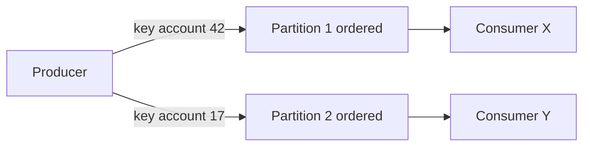
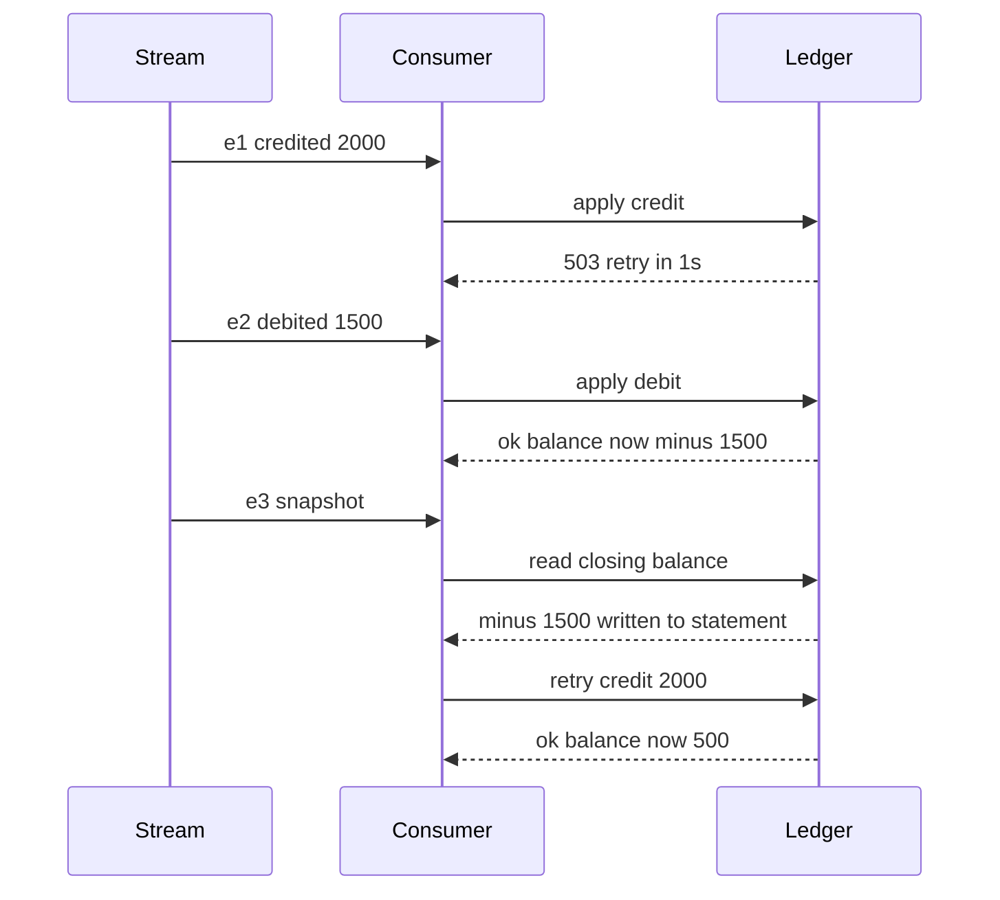

# Message Ordering

Ordering is the most over-requested and under-delivered property in messaging. Teams ask for "messages processed in order", brokers advertise ordering guarantees with fine print, and production systems quietly violate both. The honest position: **global ordering does not scale, per-key ordering is achievable with care, and a long list of everyday mechanisms — retries, DLQs, concurrent consumers, rebalances — silently break even that.** Robust systems therefore design consumers to *tolerate* reordering rather than trusting the transport to prevent it.

## Why this matters

Order bugs are among the nastiest in event-driven systems because they are invisible in tests (single consumer, no failures, order preserved) and rare in production (only under retry, scale-out, or failover — exactly when you are least watching). A `kyc.approved` event processed before the `kyc.submitted` that preceded it, or a `balance.debited` applied after a later `balance.credited`, can corrupt state in ways discovered weeks later. Knowing precisely *which* guarantees your broker gives, and which of your own mechanisms void them, is the difference between "ordering by design" and "ordering by luck".

## How it works

### Why global ordering doesn't scale

A total order over all messages requires a single serialization point — one queue, one partition, one consumer at a time. Every mechanism that adds throughput destroys it:

- **Multiple partitions**: messages in different partitions have no order relative to each other, by construction.
- **Multiple competing consumers**: even on one queue, two consumers process concurrently and *complete* in any order.
- **Multiple producers**: "order" of two events produced concurrently on different machines is not even well-defined without [[Logical Clocks and Ordering|logical clocks]] — wall clocks disagree.

So the scaling path is forced: give up *global* order, keep order only *where it matters*. Almost always, what matters is order **per entity** — per account, per user, per order. Nobody cares whether account A's deposit is processed before account B's withdrawal; everyone cares that account A's own events apply in sequence.

### Per-key ordering: the workable contract

**Kafka**: the producer hashes the message **key** to choose a partition; a partition is an append-only ordered log consumed by exactly one group member at a time. Result: all events for one key are totally ordered, end to end. This is the strongest practical ordering contract in mainstream brokers. Fine print: it holds per *partition*, so it breaks if you change the partition count (keys rehash to new partitions — old and new events for a key now live in two places), if the producer retries without idempotence (`max.in.flight > 1` can reorder batches — the idempotent producer fixes this), or if your consumer processes a partition's messages on a thread pool (see below).

**SQS FIFO**: messages carrying the same `MessageGroupId` are delivered strictly in order, one batch in flight per group at a time; different groups interleave freely and give you parallelism. The group ID is your "key". Fine print: throughput is limited per message group (serial by design); a message that keeps failing at the head of a group blocks that entire group behind it — ordering and progress are directly at odds ([[Dead Letter Queues and Poison Messages]]).

**[[Redis Streams]]**: a stream is a single append-only log whose entries carry monotonically increasing IDs of the form `milliseconds-sequence`, and `XRANGE`/`XREAD` return them in ID order. The important difference from Kafka: **there is no key concept and no key-to-consumer affinity**. `XREADGROUP` hands the next unread entry to whichever consumer in the group asks first, so a group with two consumers on one stream is a plain competing-consumer setup. To get per-key ordering you must build the partitioning yourself — hash the entity ID into one of N stream keys (`wallet-events-0` … `wallet-events-7`) and run exactly one serial consumer per stream. Two further consequences: a single stream key lives on one node in Redis Cluster, so one stream cannot outgrow one node; and `XAUTOCLAIM` reclaiming a stalled consumer's pending entries reintroduces the same reordering a redelivery does anywhere else.

**RabbitMQ**: order is preserved within a queue only for a single consumer taking messages one at a time; requeue/nack and competing consumers void it. **SQS standard** makes no ordering promise at all (best-effort).

### The three guarantees, stated precisely

Vendor marketing says "ordered". The contract is narrower, and it is the preconditions that bite:

| System | Ordered unit | The exact guarantee | Preconditions you must hold up | Voided by |
|---|---|---|---|---|
| [[Kafka Architecture\|Kafka]] | One topic **partition** | Records appended to a partition are stored in send order and delivered to consumers in log order | Same key routes to the same partition — the default partitioner is `murmur2(key) mod partitionCount`; one partition is assigned to at most one member of a consumer group; the producer must not reorder on retry; the consumer must process the partition serially | Changing partition count; non-idempotent producer with more than one in-flight request; a consumer thread pool; retry topics |
| [[SQS and SNS\|SQS FIFO]] | One **`MessageGroupId`** | Messages with the same group ID are returned in the order they were sent, and SQS returns no further message for that group while an earlier one is in flight or undeleted | FIFO queue type; every message carries a group ID; your code processes a received batch in the order returned and deletes before moving on | DLQ redrive; re-publishing a message under a different group ID; your own concurrency inside one batch |
| [[Redis Streams]] | One **stream key** | Entries are stored and read in increasing entry-ID order | You shard entities across stream keys yourself and run one consumer per stream key, serially | More than one active consumer per stream; `XAUTOCLAIM` reclaims; putting many entities in one stream and parallelising |

Read the "preconditions" column as a checklist for your own deployment. In practice most ordering incidents are not a broker breaking its promise — they are a team that silently stopped satisfying a precondition.

### Producer retries and `max.in.flight.requests.per.connection`

This is the ordering bug that lives entirely on the producer side, before the broker is even involved, and it is the one Kafka candidates most often miss.

A Kafka producer does not send one record at a time; it batches records per partition and can keep several batches **in flight** on the same connection without waiting for the previous one's acknowledgment. `max.in.flight.requests.per.connection` sets how many (default **5**). Independently, the producer retries failed sends — `retries` defaults to `Integer.MAX_VALUE`, bounded in wall-clock time by `delivery.timeout.ms` rather than by a retry count, since Kafka 2.1.

Combine those two and the failure is obvious once you see it. Suppose batch A (records 1–10 for account 42) and batch B (records 11–20 for the same account) are both in flight. Batch A fails — a transient `NOT_ENOUGH_REPLICAS`, a leader election, a network blip. Batch B succeeds and is appended to the log. The producer then retries A, which now lands *after* B. The partition's log order is B, then A: the broker faithfully preserved an order the producer handed it wrongly. **So `retries > 0` plus `max.in.flight > 1` plus no idempotence equals possible reordering within a single key, with no consumer involvement at all.**

Two fixes, one clearly better than the other:

- **`max.in.flight.requests.per.connection=1`** — only one unacknowledged request per connection, so a retry cannot overtake anything. Correct, and costly: you serialise the produce pipeline and lose a large fraction of throughput on any link with real latency.
- **`enable.idempotence=true`** — the producer is assigned a producer ID and stamps each record batch with a per-partition **sequence number**. The broker accepts a batch only if its sequence continues the last one it wrote, rejecting anything out of order, so the client must resend in sequence. This preserves order *and* deduplicates retries, and it holds for `max.in.flight` up to **5**. This is the right answer, and since Kafka 3.0 it is the default (`enable.idempotence=true`, `acks=all`).

The practical upshot: on a modern client with defaults left alone, you are protected. The danger is an inherited config that turned idempotence off — often years ago, to pair with `acks=1` for throughput, since idempotence requires `acks=all`. Once idempotence is off, the default `max.in.flight` of 5 is enough to reorder, and raising it further widens the window.

And nothing in that config has to *say* `enable.idempotence=false`. Since the 3.0 default flip, the client resolves the conflict for you: if you set `acks=1`, or `retries=0`, or `max.in.flight` above 5, and you did **not** set `enable.idempotence` explicitly, the producer quietly disables idempotence and logs a warning. Set `enable.idempotence=true` explicitly alongside the same conflicting value and you get a `ConfigException` instead — the construction fails loudly. So the properties file that is most likely to be silently unprotected is the one that never mentions idempotence at all. The config is also the only place the problem is visible: there is no metric for "my records got reordered", so this is a bug you find by reading a properties file, never by watching a dashboard.

### What silently breaks ordering

This list is the heart of the note. Each item is a mechanism you will deploy for a *good* reason, which then voids ordering as a side effect:

1. **Retries.** Message 1 fails and is retried (immediately, or after backoff); message 2 for the same entity succeeds meanwhile. Effective processing order: 2, then 1. Any per-message retry mechanism — consumer-local, broker redelivery, [[Timeouts Retries and Exponential Backoff|retry topics]] — is a reordering machine.
2. **Dead-letter queues.** DLQ + later redrive is a long-delay retry: the poisoned message re-enters *after* everything that followed it. A redriven `transfer.initiated` landing after `transfer.completed` must be handled.
3. **Concurrent consumers.** Competing consumers on a queue, or a thread pool inside one consumer, turn delivery order into mere *start* order; completion order is a race.
4. **Rebalances and failover.** During a [[Consumer Groups and Rebalancing|rebalance]], uncommitted messages are reprocessed by a new owner — interleaving replays with fresh messages. Visibility-timeout expiry in SQS does the same.
5. **Partition count changes / resharding.** Key→partition mapping changes; in-flight history for a key straddles two partitions with no mutual order.
6. **Producer-side races.** Two instances of the same service emitting events for one entity concurrently (double-click, two pods) — the broker faithfully preserves an order that was already wrong. Only an upstream serialization point (DB transaction, [[Distributed Locking|lock]], or [[The Outbox Pattern|outbox]] ordering) defines the true order.
7. **Fan-out across topics/queues.** Entity events split across two topics (e.g., `payments` and `notifications`) have no cross-topic ordering, ever.

The pattern: **ordering guarantees are per-channel, per-key, happy-path. Every failure-handling and parallelism feature trades ordering away.**

### A retry, step by step

Abstract statements about retries do not stick; walk one through. A wallet service consumes three events for account 42, whose balance starts at zero. They are correctly keyed, correctly partitioned, and delivered in perfect order by the broker:

1. `wallet.credited` — ₹2,000 in
2. `wallet.debited` — ₹1,500 out
3. `statement.snapshot` — record the closing balance for the day

The consumer takes event 1 and calls the ledger service, which returns a 503 because it is mid-deploy. The consumer's retry policy is three attempts with exponential backoff — 1s, 2s, 4s — a completely ordinary, completely sensible policy.

One precondition makes the whole example work, and it is the default almost everywhere: the retry is **non-blocking**. The failed event is parked and re-attempted later while the consumer goes on reading. That is literally what an SQS visibility timeout does — the message returns to the queue and the next receive hands you the *following* message — and it is the explicit design of a Kafka retry topic. A retry that blocked in line, holding the consumer on event 1 until it succeeded, would preserve order and stall the lane instead; that is the opposite trade, and it is the one described under per-entity serialization below. With a non-blocking retry, here is what the *effect* order becomes:

Three separate things went wrong, and only the first is obvious:

- **The balance went negative** mid-sequence. If any rule watches for negative balance — an overdraft alarm, a fraud signal, a block on further debits — it fired on a state that never legitimately existed.
- **The snapshot is wrong and is now immutable.** Event 3 read −1500 and wrote it into a customer statement. The ledger self-corrects when the retry lands; the statement does not. This is the characteristic shape of reordering damage: the transient wrong state gets *copied* somewhere that does not replay.
- **Nothing is in an error state at the end.** Final balance is ₹500, which is right. Every event is acknowledged. No alert fires. The only evidence is a statement row nobody will question for weeks.

The one-line generalisation: **the broker orders deliveries; your retry policy orders effects, and it reorders them by exactly the length of your backoff.** A retry with a 4-second backoff is a 4-second window during which every later event for that key overtakes the one being retried. Widen the backoff and you widen the window. The only way to keep the backoff *and* the order is to block the key's lane — stop consuming for account 42 until event 1 lands — which is the trade described under per-entity serialization below.

### How a DLQ silently breaks ordering

A [[Dead Letter Queues and Poison Messages|dead-letter queue]] is the same bug with the backoff set to "however long until someone looks at the dashboard". It deserves naming separately because the break is *invisible at both ends*.

- **The main stream looks healthy.** After the poison message is dead-lettered, the consumer carries on. Lag returns to zero, error rate returns to zero, the dashboard is green. There is no "hole" in the stream to see — the consumer group's offset moved past the message, and nothing downstream knows a specific key is now missing a specific event.
- **The key's history is now a lie.** Every subsequent event for account 42 was applied on top of a state that omits the dead-lettered one. If the omitted event is a debit, the account spends money it does not have for as long as the message sits in the DLQ.
- **Redrive re-injects at the tail.** Replaying the DLQ hours later delivers a message whose rightful position was hours ago. A consumer that applies it blindly regresses state. A consumer with a state-machine guard rejects it as stale — which protects the state, but means the event's effect never happens at all, silently. Neither outcome is good; only the second is *safe*, and it still needs a human to decide what the dropped event should have done.

The mitigation is to make the quarantine unit the **key**, not the message. When an event for account 42 dead-letters, stop processing account 42 entirely: write a "key is quarantined" marker, and have the consumer park every subsequent event for that key into the same holding area instead of applying it. You accept that one account is frozen — a support ticket — in exchange for never applying its events out of order. When the poison message is fixed, replay the key's parked events in their original sequence and lift the marker. This is strictly more work than a plain DLQ, and on money paths it is the difference between a frozen account and a wrong one.

The same logic applies to **retry topics** (the Kafka pattern of republishing a failed record to `topic.retry.5m`): the record leaves the ordered partition and comes back later, so a retry topic is a DLQ with a timer. Convenient, and it voids per-key ordering the moment a key has one record in the retry topic and another in the main one.

### Designing consumers that survive reordering

Since you cannot fully prevent reordering, make it harmless:

- **Commutativity.** Design operations so order doesn't matter: bare increments/decrements commute; "apply delta" commutes where "set absolute value" does not. If all ops on an entity commute, ordering is a non-issue — but check the claim honestly, because adding a guard to an increment destroys it (see *A balance that reordering corrupts* below).
- **Version / sequence checks.** Carry an entity version or sequence number in each event; the consumer rejects or parks events whose version isn't exactly `current + 1` (or simply ignores events older than current state — **last-write-wins by version, not by arrival time**). This converts reordering into either a no-op or a retryable "too early" signal.
- **State-machine guards.** Legal-transition checks (`PENDING → COMPLETED` allowed; `COMPLETED → PENDING` ignored) make stale events inert. Pairs naturally with [[Idempotency]] — the same guard often provides both.
- **Per-entity serialization where it truly matters.** Route by key (Kafka key, FIFO message group), consume each key single-threaded, and keep retries *within* the key's lane (block the lane rather than skip ahead) — accepting the throughput cost for that key. This is the correctness-over-throughput setting for money paths.
- **Buffer-and-reorder windows.** Hold out-of-order events briefly, waiting for the gap to fill. Adds latency and memory and needs a policy for permanent gaps; a last resort.

### Commutativity or serialization: the real design choice

Those five tactics collapse into one decision, and it is worth making explicitly rather than drifting into: **do you make order irrelevant, or do you enforce it?**

| | Design for commutativity | Per-entity serialization |
|---|---|---|
| Mechanism | Every operation on an entity produces the same end state regardless of application order — deltas not absolutes, set-union not list-append, idempotent state transitions | One lane per entity: key-routed partition or message group, one serial consumer, retries blocking the lane |
| Throughput | Full parallelism; any consumer can take any event | Capped per entity; a slow event stalls that entity only |
| Failure behaviour | A late event still lands correctly whenever it arrives | A stuck event freezes the entity until resolved |
| Cost | You must re-model the domain, and some operations genuinely refuse to commute | You must own the routing, the serial execution, and the stuck-lane runbook |
| Fits | Counters, tallies, last-write-wins profile fields, set membership, metrics | Ledgers, balances, state machines with legal transitions, anything an auditor reads |

The trap is believing you are in the left column when you are in the right one. "Increments commute" is true of arithmetic and false of banking, because a real debit is not `balance -= amount`; it is `if balance >= amount then balance -= amount else reject`. The guard is what breaks commutativity — see the next section. In practice most fintech systems land in the right column for the entity that holds money and the left column for everything that merely counts or displays, and the useful skill is drawing that line deliberately instead of discovering it during an incident.

### A balance that reordering corrupts

Take an account with a balance of **₹300** and two events that arrive in the same second from different upstream services: **D**, a card debit of ₹500, and **C**, a salary credit of ₹1,000. Both are perfectly ordinary. The consumer applies the standard rule — reject a debit that would overdraw the account.

- **Order D then C:** D is evaluated against ₹300, fails the guard, and is **declined**. The card network gets a decline, the customer gets a "transaction failed" push, the merchant's terminal rejects the purchase. C then applies and the balance settles at **₹1,300**.
- **Order C then D:** C applies, balance ₹1,300. D passes the guard and succeeds. Balance settles at **₹800**, purchase completed.

Two final states, **₹1,300 and ₹800**, from the same two events, decided purely by which one your consumer happened to process first. And the damage is not just the number: the first ordering **fabricates a declined transaction** that never should have existed. That decline is now a customer-visible event with its own downstream life — a failure notification, a possible upstream retry that double-charges when it succeeds, a support contact, and a row in whatever report the business reads about decline rates. No subsequent event can un-send the push notification.

Now add the usual accelerants. If D was retried after a transient ledger error, it lands after C by exactly the backoff. If D was dead-lettered and redriven an hour later, it lands after an hour of activity. If the two events came from two pods of the same service, there was never a defined order to preserve. Each path produces the same corruption, which is why the fix is never "make the transport more ordered" — it is to give the account a single serialized lane and a guard that recognises a stale event, so the only legal outcome is the one the business can defend to an auditor.

## Common misconceptions

- **"Kafka guarantees ordering."** Per partition, for one key, with an idempotent (or `max.in.flight=1`) producer, consumed sequentially. Drop any clause and the guarantee is gone.
- **"FIFO queue = my system processes in order."** FIFO governs *delivery* per message group; your retries, DLQ redrives, and downstream async calls still reorder *effects*.
- **"We need global ordering."** Interrogate it: almost every real requirement reduces to per-entity ordering plus [[Idempotency]]. Genuine global-order needs (a [[Design a Stock Exchange|matching engine]]) are solved with a single-writer sequencer, not a distributed broker.
- **"Timestamps can restore order."** Wall-clock timestamps from different producers are not comparable at millisecond scale (clock skew); use per-entity sequence numbers or [[Logical Clocks and Ordering|logical clocks]].
- **"One consumer fixes it."** One *process* with an internal thread pool is still concurrent; and one truly serial consumer caps throughput at a single lane — fine per key, fatal globally.

## In your stack

- SQS standard (your current broker) promises *no* ordering — any consumer code that implicitly depends on event order is already relying on luck. Worth an explicit audit before the [[Redis Streams]] move.
- [[Redis Streams]] preserves stream order, but gives you no key routing: the planned migration has to supply the partitioning Kafka gave you for free — hash the account ID into N stream keys, one serial consumer each — and `XAUTOCLAIM` reclaims still reorder effects exactly like SQS redeliveries do, so version-guard your state transitions regardless.
- Fintech default: per-account serialization for ledger-affecting events (key = account ID), state-machine guards on transaction status, sequence numbers on events emitted via [[The Outbox Pattern]] (the outbox table's auto-increment ID is a free per-entity sequence if you order the relay by it).
- Services at 1 replica get accidental ordering benefits (one consumer, often single-threaded) — which then silently break the day you scale to 2 replicas or add a thread pool. Don't let topology be your ordering strategy.

## Interview angle

The 60-second version: *"Global ordering needs a single serialization point, so it can't scale — every partition, consumer, or producer you add destroys it. The workable contract is per-key ordering: Kafka routes by key to a partition which is an ordered log with one consumer; SQS FIFO serializes per message-group ID. But retries, DLQ redrives, concurrent processing, and rebalances all silently reorder effects even then, so mature designs make consumers order-tolerant: commutative operations, version or state-machine guards that make stale events no-ops, and strict per-entity serial lanes only where money demands it."*

Classic follow-ups:

- "Why does a retry break ordering, exactly?" — the failed message's successor completes first; effect order ≠ delivery order.
- "FIFO queue with a poison message at the head of a group?" — the group stalls: ordering and progress conflict; you must DLQ it (accepting the order break) or block (accepting the outage).
- "How do you order events from two producer instances?" — you don't, post hoc; serialize at the source (DB transaction/outbox sequence) so there *is* a defined order to preserve.
- "Repartitioning a Kafka topic from 10 to 20 partitions — effect on ordering?" — keys rehash; per-key order is broken across the boundary; plan a drain-and-cutover or dual-read window.
- "Which producer setting can reorder records within one partition?" — `max.in.flight.requests.per.connection > 1` with retries and `enable.idempotence=false`; a retried batch lands behind a later one. Fix with idempotence (ordered up to 5 in flight), not by setting in-flight to 1.

## Check yourself

> [!question]- Q: Explain why adding a second competing consumer to a queue breaks ordering even if the broker delivers in perfect FIFO.
> Delivery order only fixes when each consumer *starts*. Two consumers process concurrently: consumer A gets message 1, consumer B gets message 2; if m1 is slow (big payload, slow downstream call, GC pause), m2's effect commits first. Order of effects is completion order, which concurrency turns into a race. FIFO delivery + parallel processing = unordered effects.

> [!question]- Q: What happens to per-key ordering when a message for account 42 is sent to the DLQ and redriven an hour later?
> Every later event for account 42 processed during that hour now precedes the redriven one. The redriven event arrives as a stale, out-of-sequence message. If the consumer applies events blindly, state regresses (e.g., status jumps backward). Survival requires a guard: version/sequence check or state-machine transition check that recognizes the event as stale and either no-ops it or routes it to manual triage.

> [!question]- Q: You must process `card.blocked` strictly after `card.issued` for the same card, at 50K events/sec across millions of cards. Design it.
> Key all card events by card ID into a partitioned log ([[Kafka Architecture]]-style). Per-key ordering gives `issued` before `blocked` per card; millions of keys spread across partitions give throughput — parallelism across cards, serialization within a card. Consume each partition single-threaded (or use a per-key executor that never runs two events for one key concurrently). Guard anyway: if `blocked` arrives for an unknown card (redrive, replay, resharding), park it for retry rather than dropping — "too early" is retryable, unlike "out of order and applied".

> [!question]- Q: A teammate sets `max.in.flight.requests.per.connection=10` "for throughput" on a keyed Kafka producer. What have they just broken, and what is the correct fix?
> Values above 5 are incompatible with the idempotent producer, and which failure you get depends on one detail — whether the properties file also mentions `enable.idempotence`. If it sets it to `true` explicitly, the producer refuses to start: `ConfigException`, loud, caught in minutes. If it says nothing about idempotence and relies on the 3.0+ default of `true`, the client resolves the conflict in favour of the value the user did set — it disables idempotence, logs a warning, and starts normally. That second branch is the dangerous one and the likelier one, because now retries can reorder: a failed batch for a key is resent and appended behind a later batch for the same key, inside one partition. It is also broken invisibly — there is no reordering metric, only a warn line nobody reads. The fix is to keep `enable.idempotence=true` with `acks=all` (the Kafka 3.0+ defaults) and in-flight at 5 or below; per-partition sequence numbers then let the broker reject out-of-sequence batches, so you keep both pipelining and order. Setting in-flight to 1 also works but costs throughput for no extra safety.

> [!question]- Q: Why are wall-clock timestamps insufficient to re-sort events from multiple services, and what works instead?
> Clock skew between machines (milliseconds even with NTP) exceeds event spacing at high rates, so timestamp order ≠ causal order; two events 2 ms apart on skewed clocks sort wrongly. Use a per-entity monotonic sequence assigned at a single serialization point (the entity's DB row version, outbox auto-increment) or [[Logical Clocks and Ordering|Lamport/vector clocks]] when there is no single point.

## Sources

- *Designing Data-Intensive Applications*, Kleppmann — Ch. 11 (ordering in partitioned logs, "the limits of total order"); Ch. 9 (total order broadcast, why it is equivalent to consensus).
- Apache Kafka documentation — message ordering per partition; idempotent producer and `max.in.flight.requests.per.connection`.
- AWS SQS Developer Guide — FIFO queues: message groups, ordering and throughput semantics.
- Confluent blog — posts on keys, partitioning, and ordering (e.g., "How to choose the number of topics/partitions").
