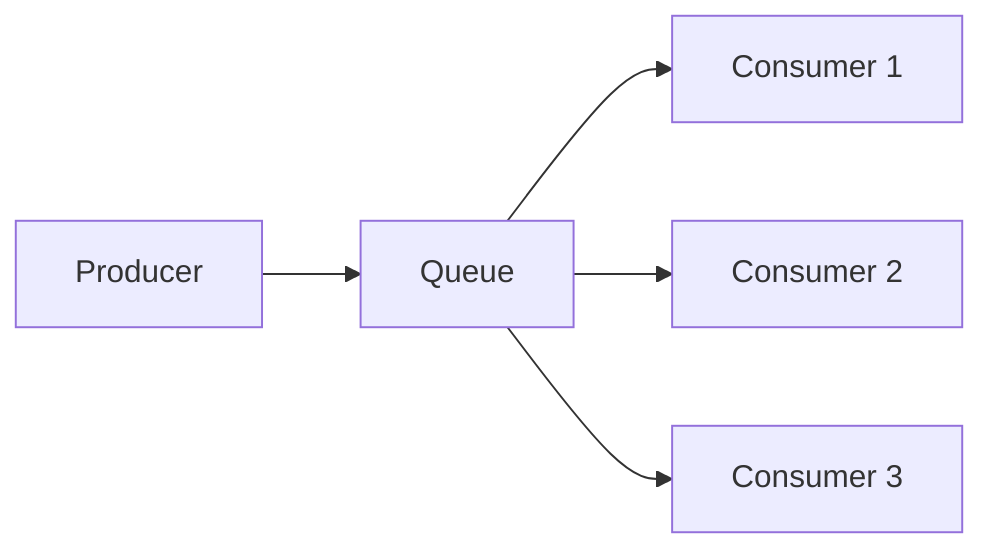
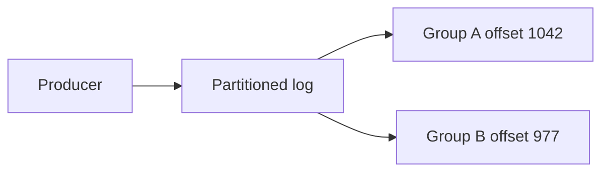

# Message Queues vs Event Logs

Almost every confusion about message brokers dissolves once you see that there are two fundamentally different models hiding under the word "queue". A **message queue** (RabbitMQ, SQS, ActiveMQ) treats a message as a *task*: it is handed to one consumer, and once acknowledged it is deleted — consumption is destructive. An **event log** (Kafka, Pulsar, and approximately Redis Streams) treats a message as a *fact*: it is appended to an ordered, durable log that is never modified by consumption; consumers merely move their own read positions. Which model a broker implements determines what it is good at more than any feature checklist does.

## Why this matters

Teams routinely pick a broker by popularity, then fight its model: they try to get replay out of RabbitMQ classic or quorum queues (they cannot; RabbitMQ Streams, added in 3.9 in 2021, are a log), or try to use Kafka consumer groups as a work queue with per-message retries and selective acknowledgment (they resist — offsets are positional, not per-message; Kafka 4.2's share groups, 2026, are Kafka's own queue-model answer). Understanding the two models tells you *in advance* which fights you will lose. It also explains most of [[Choosing a Message Broker]], why [[Consumer Groups and Rebalancing]] works so differently across brokers, and why "can I reprocess last Tuesday's events?" is trivial in one world and impossible in the other.

## How it works

### The queue model: destructive consume, competing consumers



- The broker owns delivery state **per message**: delivered, acknowledged, redelivered, dead-lettered.
- Any idle consumer may receive any message — **competing consumers**. Adding a consumer immediately adds processing capacity; no repartitioning, no coordination.
- On acknowledgment the message is **deleted**. The queue's natural state is *empty*; a growing queue is a warning sign.
- Because the broker tracks each message individually, it can do per-message things: redeliver just the failed one, route one message to a [[Dead Letter Queues and Poison Messages|DLQ]] after N attempts, let consumers reject selectively.
- Ordering is weak by design: with multiple competing consumers, messages are processed concurrently and complete out of order; redelivery puts messages behind ones that arrived later (see [[Message Ordering]]).

RabbitMQ adds smart routing on top (exchanges, bindings, per-message acks — see [[RabbitMQ]]); SQS strips the model to its serverless minimum with visibility timeouts instead of connections (see [[SQS and SNS]]). Both are the same model underneath.

### The log model: append-only, consumer-tracked offsets



- Messages are **appended** to a partition and assigned a monotonically increasing **offset**. The log is immutable; nothing a consumer does changes it.
- The broker stores almost no per-message state. Each **consumer group** tracks one number per partition: its committed offset — "I have processed everything up to here." Reading is just a seek.
- Retention is **time- or size-based** (e.g., keep 7 days), independent of consumption. A message can be read by ten groups or zero; it expires on schedule either way. Log compaction optionally keeps the latest record per key forever ([[Kafka Architecture]]).
- **Replay is free**: reset a group's offset and history flows again. New consumers can bootstrap from the full retained history. This single property enables [[Event Sourcing]], [[CQRS]] read-model rebuilds, and [[Change Data Capture]] pipelines.
- Parallelism is **by partition**: within a group, each partition is owned by exactly one consumer, so maximum parallelism = partition count, and adding consumers requires partitions to redistribute ([[Consumer Groups and Rebalancing]]).
- Ordering is **strong per partition**: all messages with the same key land in the same partition and are read in append order.

[[Redis Streams]] is log-shaped — append-only entries, consumer groups with per-group read positions, replay by ID — but a stream is a single Redis key, so it lives on one shard with no Kafka-style partitioning, and its pending-entries list (PEL) reintroduces per-message delivery state. It sits between the models, closer to the log.

### Side by side

| | Message queue (RabbitMQ, SQS) | Event log (Kafka; Redis Streams approx.) |
|---|---|---|
| Message after consume | Deleted on ack | Untouched; expires by retention |
| Delivery state | Broker tracks per message | Consumer group tracks one offset per partition |
| Replay / reprocess history | Impossible once acked | Built-in: reset offset |
| Multiple independent readers of same data | Needs fan-out topology (exchanges, SNS) duplicating messages | Native: each group has its own offsets over one log |
| Scaling consumers | Add consumers, instant | Bounded by partitions; triggers rebalance |
| Per-message retry / selective fail | Natural (redeliver just that message) | Awkward — offset is positional; skip-or-block, or build retry topics |
| Ordering | Weak (competing consumers, redelivery) | Per-partition, per-key: strong |
| Natural backlog state | Empty; growth is a problem | Full; lag is the metric, not size |
| Message role | Task to complete | Fact that happened |
| Typical fit | Job queues, RPC-ish work dispatch, per-message workflows | Event streams, audit trails, feeding many systems, stream processing |

### What each makes easy and hard

**Queues make easy:** work distribution with elastic consumers, per-message error handling and DLQs, "process each task once then forget it", priority and delay semantics, low-latency task dispatch.

**Queues make hard:** replay (gone is gone), adding a second independent reader after the fact (the first one consumed the data), audit ("what did we process last month?" — nothing retained), strong ordering under concurrency.

**Logs make easy:** replay and backfill, many independent subscribers, ordered per-key processing, keeping a durable record of everything that happened, very high throughput via sequential append and batching.

**Logs make hard:** per-message retries (one poison message at offset N blocks the partition behind it unless you skip or divert it — see [[Dead Letter Queues and Poison Messages]]), elastic scaling beyond partition count, work-queue fairness (a slow message delays its partition, not just itself).

### What happens when consumers fall behind

The two models fail in opposite directions, and this is the clearest way to feel the difference between them.

In the **queue model**, a backlog is an anomaly the broker actively resists. The broker is holding per-message delivery state for every message it has not yet seen acknowledged, so a growing queue is growing broker bookkeeping — a queue's natural state is empty, and depth is the broker's problem. RabbitMQ will eventually defend itself by blocking publishers; SQS, being someone else's storage, simply absorbs it. Falling behind in a queue threatens **the broker**.

In the **log model**, falling behind costs the broker essentially nothing: those bytes were already on disk for the retention period whether anyone read them or not, and a consumer group's position is one number. There is no pressure, no alarm, no publisher blocking — which is exactly why it is dangerous. The log keeps deleting from its tail on schedule, and a consumer whose lag exceeds the retention window finds its records simply gone, with no error raised on either side. Falling behind in a log threatens **the data**.

So: *queue backlogs are loud and bounded by the broker's resources; log backlogs are silent and bounded by your retention policy.* The per-broker specifics — what RabbitMQ, Kafka, SQS and Redis Streams each do as the backlog grows, and what to alert on for each — are in [[Backpressure and Flow Control]].

### The cost shape

The models also bill you differently, and naming the shape matters more than any price list, because the shape is what scales badly.

Take **50 million events/day at ~1 KB each = 50 GB/day**. On a log with 7-day retention and replication factor 3:

```
50 GB/day × 7 days × 3 replicas  =  1,050 GB  ≈  1.05 TB of standing broker storage
```

That cost is paid whether zero consumers or twenty read it — and adding the twentieth consumer group adds only read bandwidth, not storage. On a queue, nothing is stored after acknowledgment, so storage is near-free; the cost is **operations**: each message needs at least a send, a receive, and a delete, so 50M messages/day is ~150M billable operations/day unbatched (SQS bills per request, and a batch of up to 10 messages is one request, so batching cuts this by up to tenfold — the shape stays per-message). Crucially, a second independent reader is not free on a queue — you must physically duplicate the message into a second queue (SNS fan-out), so the message count, and therefore the bill, multiplies by the number of readers.

> **Log cost scales with bytes × retention × replication and is indifferent to the number of readers. Queue cost scales with messages × operations and multiplies with every independent reader.**

That single sentence predicts most broker cost surprises. A log is expensive to start and cheap to extend to new consumers; a queue is cheap to start and gets linearly more expensive every time another team wants the same data.

### Why the distinction drives broker choice

Ask one question first: **after a consumer has processed a message, does anyone ever need it again?**

- *No, it was a task* (send this email, resize this image, execute this transfer step) → queue model. You want per-message state, DLQs, elastic consumers.
- *Yes, it is a fact other systems may need* (order placed, balance changed, KYC approved — feeding search, analytics, caches, future services you haven't built) → log model. You want retention, replay, independent groups.

Most real estates need both, and that is fine: Kafka for the event backbone, SQS/RabbitMQ for task queues is a common and defensible split. The mistake is forcing one model to impersonate the other. Full decision framework: [[Choosing a Message Broker]].

### One business event, both models — a worked split

The test is sharper than it looks, because a single moment in the business usually generates both kinds of message. A completed transfer produces:

| What happens | Task or fact? | Model | Why |
|---|---|---|---|
| Send the push notification | **Task** | Queue | Once delivered, nobody needs it again. You want per-message retry, a DLQ for a bad device token, and consumers you can scale freely. Replaying last month's notifications would be a *bug*. |
| Post the double-entry ledger lines | **Task**, but strictly ordered per account | Queue with ordering, or a keyed log partition | Must execute exactly once per posting and in order within an account; the work itself is terminal. |
| `transfer.completed` for the rest of the company | **Fact** | Log | Fraud scoring, the ledger reconciler, settlement, analytics and whatever team exists next year all want it independently, and settlement will need to reprocess a full day. |
| Call the partner bank's status webhook | **Task** | Queue | A delivery attempt with retries and a terminal failure state. |

Note what the fintech framing adds to the task rows: a duplicated push notification is an annoyance, while a duplicated ledger posting is a real money error and a duplicated partner webhook may trigger a duplicate settlement at the other end. The queue model's per-message machinery is what gives you a place to put the [[Idempotency|idempotency key]] and a DLQ to catch the ones that cannot complete — which is precisely why "just publish everything to the log and let consumers sort it out" is a bad default for money movement. And note what the fact row adds: that one message must survive consumption, because the day the settlement team finds a calculation bug, the difference between "reset an offset" and "the data was deleted on acknowledgment" is the difference between a replay and a reconstruction project.

## Common misconceptions

- **"Kafka is a faster RabbitMQ."** Different model, not a faster one. Kafka's throughput comes from the log structure (sequential I/O, batching, zero per-message broker state), and you pay for it in partition-bound parallelism and awkward per-message operations.
- **"SQS retains messages for (up to) 14 days, so I can replay."** Retention there applies to *unconsumed* messages. Once deleted after processing, they are gone. Only a log gives processed-message replay.
- **"Redis Streams is just Kafka in Redis."** It is log-shaped but single-key (no partitioning across shards), memory-bound in practice, and trimmed with `XTRIM` rather than retained by policy. Honest comparison in [[Redis Streams]].
- **"A consumer group is the same thing in every broker."** In Kafka it is offset-tracking plus exclusive partition ownership; in Redis Streams it is a PEL plus last-delivered-ID; SQS has no consumer groups at all — every consumer competes for every message (FIFO *message* groups order messages; they do not track consumers). See [[Consumer Groups and Rebalancing]].
- **"Queues are legacy, logs are modern."** Queues are the right tool whenever messages are tasks. A DLQ-with-redrive workflow on SQS is still the cleanest per-message failure handling in the industry.
- **"A growing backlog means the same thing in both."** It does not. On a queue it is the broker's resources being consumed and an alarm it may raise itself; on a log it is free until lag crosses retention, at which point it becomes silent permanent loss. Opposite shapes, opposite alerts.
- **"We'll just add partitions later if we need more consumers."** Adding partitions to a Kafka topic changes which partition a key hashes to, so messages for one key can land in a different partition than their history — breaking per-key ordering across the boundary, and breaking any consumer that assumed a key's events all arrive in one lane. Partition count is a capacity decision with ordering consequences, not a dial ([[Message Ordering]], [[Rebalancing Partitions]]).
- **"The log is a database."** It is an ordered record of changes with a retention policy, not a store you can query by key — there is no "fetch the current state of account 42" without building a projection ([[CQRS]]) or using compaction for the narrow latest-value-per-key case. Treating a log as a queryable store is how teams end up replaying a topic to answer a lookup.

## In your stack

- Your broker journey maps onto the models: RabbitMQ (queue) → Kafka (log) → SQS (queue) → Redis Streams (log-ish). Each migration changed the *model*, which is why consumer code never ported cleanly — offset commits versus acks versus visibility timeouts are not cosmetic differences ([[Delivery Semantics]]).
- Moving SQS workloads to [[Redis Streams]] means re-gaining replay and losing elastic competing consumers beyond what `XREADGROUP` + [[Consumer Groups and Rebalancing|XAUTOCLAIM]] gives you — plus taking on trimming and memory sizing yourself.
- Fintech audit pressure favors logs for money-movement *events*: an append-only record of what happened is close to what an auditor wants anyway (see [[Event Sourcing]] for the full version, and its caveats).
- For task-shaped work (notifications, document processing, webhook delivery), the queue model remains the better fit — don't let the migration flatten that distinction.
- Services pinned at 1 replica interact with the two models very differently. On a queue, one consumer is simply slower than two and the broker holds the backlog — the only cost is drain time. On a log, one consumer owning all partitions is the same throughput ceiling *plus* a retention clock: the moment that single pod is down longer than the retention margin, data is gone rather than merely delayed. The log model quietly converts a 1-replica availability decision into a durability decision, which is a different conversation to have with whoever approved the cost saving.
- Practical reading of the Redis Streams plan: you are moving from a broker where AWS owns the storage cliff to one where your `maxmemory` setting *is* the cliff, shared with cache traffic. Every stream needs an explicit `MAXLEN`, and the trim is applied at write time without consulting consumer positions by default (Redis 8.2 added an `ACKED` trim option that removes only entries every group has acknowledged) — so on this model, trimming and consumer lag must be reasoned about together or the trim silently deletes unread entries.

## Interview angle

The 60-second version: *"There are two broker models. Queues — RabbitMQ, SQS — treat messages as tasks: any consumer can take any message, ack deletes it, the broker tracks per-message state, so per-message retries and DLQs are natural, but replay is impossible and ordering is weak. Logs — Kafka — treat messages as facts: append-only partitions, consumers track offsets, retention is time-based, so replay and multiple independent readers are free and per-key ordering is strong, but parallelism is capped by partitions and per-message error handling is awkward. Choose by asking whether anyone needs a message after it's been processed."*

Classic follow-ups:

- "How do you get fan-out in each model?" — queues: broker-side topology (exchange bindings, SNS→multiple SQS); logs: just add another consumer group.
- "Poison message in each model?" — queue: redeliver count then DLQ, rest of queue unaffected; log: it blocks its partition — skip it, or copy to a retry/DLQ topic and advance the offset ([[Dead Letter Queues and Poison Messages]]).
- "Why can't Kafka consumers outnumber partitions usefully?" — within a consumer group, a partition has exactly one owner; extra consumers idle. Capacity planning = partition planning. (Kafka 4.2's share groups lift the cap by dropping per-partition ordering — the queue model again; not yet on MSK as of Oct 2026.)
- "Which model for X?" — reason aloud from the task-vs-fact question; the interviewer is testing the framework, not the brand name.

## Check yourself

> [!question]- Q: Explain destructive vs non-destructive consumption and one architectural capability each enables.
> Queue: acking deletes the message — the broker's per-message state enables surgical redelivery and DLQ routing of individual failures. Log: consuming only advances the reader's own offset over an immutable log — retention independent of consumption enables replay, backfill, and any number of independent consumer groups over the same data.

> [!question]- Q: What happens if you add an 11th consumer to a Kafka consumer group reading a 10-partition topic? And an 11th consumer to an SQS queue?
> Kafka: the 11th consumer sits idle — each partition is owned by exactly one group member, so max useful parallelism is 10; adding it also triggers a rebalance ([[Consumer Groups and Rebalancing]]). SQS: the 11th consumer immediately shares the work — no partitions, no ownership, any consumer receives any available message.

> [!question]- Q: Six months after launch, analytics asks for "every order event since January". Under each model, what can you offer?
> Log with sufficient retention (or compacted/archived to object storage): reset a new consumer group to the earliest offset, or backfill from the archive — the data exists by design. Queue: nothing — processed messages were deleted; your only options are replaying from a source database (if the events can be reconstructed, see [[Change Data Capture]]) or starting capture now. This question is the single best test of whether you needed a log.

> [!question]- Q: A teammate proposes migrating the notification-dispatch workload from SQS to Redis Streams "so we standardize on one broker." What do you ask, and what is your recommendation?
> First ask the framework question: are notifications **tasks or facts**? Dispatching an SMS is a task — once sent, nobody ever needs that message again. So the migration buys replay that nobody will use, and costs the things the queue model gave away free: per-message retry counting, the redrive policy, the DLQ, and elastic competing consumers. On Redis Streams you would hand-build all of it — delivery-count checks inside an `XAUTOCLAIM` reclaim loop, a dead-letter stream with its own trimming policy, and redrive tooling. Second, ask about shape and scale: a stream is a single Redis key, so it lives on one shard; scaling horizontally means splitting streams yourself rather than adding consumers, and the backlog now occupies the same RAM as your caches, with an explicit `MAXLEN` whose overflow silently discards entries nobody has read. Third, take the operational argument seriously — one broker to run, patch and monitor is a real saving, and it is the only genuine benefit on the table. Recommendation: split by model rather than by brand. Keep task-shaped work (notifications, webhooks, document processing) on the queue model where per-message failure handling is native, and move fact-shaped streams — payment and KYC events that several consumers want — to the log model. "One broker" is a tidiness goal; "the model matches the message" is a correctness goal, and the second should win.

> [!question]- Q: Mini-design — payment events must feed the ledger service, a fraud model, and a settlement batch job, each independently, and settlement sometimes needs to reprocess a full day. Which model and why?
> Log model. Three independent consumer groups over one topic (no message duplication, no producer changes to add a fourth), per-key ordering by account or payment ID for the ledger, and settlement's reprocessing is an offset reset over ≥1 day retention. On the queue model you'd need fan-out into three queues (SNS→3×SQS) and still could not replay the day for settlement.

## Sources

- *Designing Data-Intensive Applications*, Kleppmann — Ch. 11 "Stream Processing", esp. "Messaging systems" vs "Partitioned logs" (this note is that section distilled).
- Jay Kreps, "The Log: What every software engineer should know about real-time data's unifying abstraction" — LinkedIn Engineering blog, 2013 (the founding essay of the log model).
- Apache Kafka documentation — Design section (motivations: why a log, consumer position as offset).
- RabbitMQ documentation — AMQP 0-9-1 model concepts (queues, acks, competing consumers).
