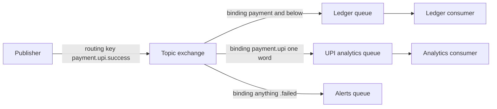

# RabbitMQ

RabbitMQ is the classic **smart broker**: the server owns routing, delivery tracking, and redelivery, so consumers can stay simple. It implements **AMQP 0-9-1**, a protocol built around one powerful idea — publishers never send to queues directly; they send to **exchanges**, and the broker routes copies into queues based on **bindings**. It is a [[Message Queues vs Event Logs|message queue]], not an event log: a consumed-and-acked message is gone, and there is no replay.

## The problem that created it

Picture a growing system in the mid-2000s. Services talk over synchronous RPC; every integration is a bespoke socket protocol or an FTP drop of CSV files. Banks (the original AMQP drivers — the spec came out of JPMorgan in 2003) needed to connect dozens of systems with different message shapes, different consumers interested in different subsets, and no tolerance for silent loss.

Three pains kept recurring:

1. **Routing logic lived in applications.** Every producer had to know every consumer. Adding a new consumer of "trade executed" events meant changing the producer.
2. **No delivery guarantees.** If a consumer was down, messages vanished or the producer blocked. Nobody tracked "did consumer X process message Y?"
3. **Vendor lock-in.** Existing enterprise brokers (IBM MQ, TIBCO) were expensive and proprietary; teams wanted an open protocol where any client could talk to any broker.

AMQP answered all three: a broker that stores messages durably, a routing layer (exchanges + bindings) that decouples who publishes from who consumes, and per-message acknowledgements so the broker knows exactly what has been processed. RabbitMQ (2007, Erlang — chosen for the same reliability reasons as WhatsApp's stack) became the dominant open implementation.

## What it solves

- **Temporal decoupling** — producer and consumer need not be alive at the same time ([[Why Async Messaging Exists]]).
- **Routing without producer knowledge** — consumers declare what they want via bindings; producers just publish with a routing key.
- **Per-message delivery tracking** — the broker redelivers anything unacked, giving at-least-once [[Delivery Semantics]] out of the box.
- **Load leveling and fair dispatch** — competing consumers on one queue, with **prefetch** preventing one consumer from hogging.
- **Fine-grained flow control** — slow consumers only slow their own queues, and the broker applies [[Backpressure and Flow Control|backpressure]] to publishers when memory runs low.

## How it works

### The AMQP model

A publisher sends a message with a **routing key** to an **exchange**. Bindings connect exchanges to queues; the exchange type decides how routing keys match bindings.

| Exchange type | Routing behavior | Typical use |
|---|---|---|
| **direct** | Exact match: routing key == binding key | Task queues, one event type → one queue |
| **topic** | Pattern match on dot-separated keys: `*` one word, `#` zero+ words (`payment.*.failed`) | Selective subscription, event taxonomies |
| **fanout** | Ignores routing key; copies to every bound queue | Broadcast, cache invalidation |
| **headers** | Matches on message header values (`x-match: all/any`) | Rare; routing on multiple attributes |

(Binding patterns as in the table: ledger binds `payment.#`, analytics binds `payment.upi.*`, alerts binds `#.failed`.) Here the ledger and analytics queues each get a copy; the alerts queue gets nothing. The producer knows none of this.

### Acknowledgements and prefetch

- A consumer receives a message and must **ack** it (`basic.ack`) after processing. Unacked messages are redelivered if the consumer dies or its channel closes — this is where duplicates come from, so consumers need [[Idempotency]].
- **nack/reject** with `requeue=false` sends the message to a configured **dead-letter exchange** ([[Dead Letter Queues and Poison Messages]]).
- **Prefetch** (`basic.qos`) caps how many unacked messages the broker pushes to one consumer. Prefetch 1 gives perfectly fair dispatch but round-trips per message; prefetch 100–300 is a common throughput/fairness compromise. Unbounded prefetch lets one consumer buffer the whole queue and starve its peers.

### Publisher confirms

Acks cover the consumer side; **publisher confirms** cover the producer side. In confirm mode the broker asynchronously confirms each published message once it is safely handled (persisted, or replicated for quorum queues). Without confirms, a publish into a dying broker is silently lost. Confirms + persistent messages + durable queues is the minimum bar for money-related traffic — and it costs meaningful throughput, because each message must hit disk and replicate before confirmation.

### Smart broker, dumb consumer — vs Kafka's inverse

RabbitMQ keeps per-message state on the broker: which message is delivered, to whom, acked or not. Consumers are trivially simple. [[Kafka Architecture|Kafka]] inverts this: the broker is a dumb append-only log that tracks almost nothing per message, and consumers are smart — they track their own offsets. The consequence: RabbitMQ's model is friendlier at moderate scale and richer per message, but the per-message bookkeeping is exactly what makes huge backlogs and very high throughput painful. The broker's work scales with messages tracked, not bytes appended.

### Clustering, quorum queues, and memory behavior

- A RabbitMQ **cluster** shares metadata (exchanges, bindings, users) across nodes, but a classic queue's contents live on one node.
- **Classic mirrored queues** were RabbitMQ's old HA story — and a notorious source of split-brain data loss during partitions. They were deprecated for years and **removed in RabbitMQ 4.0 (2024)**. Do not design anything new on them.
- **Quorum queues** (since 3.8) are the replacement: each queue is a Raft group ([[Consensus and Raft]]) across an odd number of nodes; a publish is confirmed once a quorum has it. Predictable [[Failover]], no silent loss on partition — at the cost of higher latency and more disk/memory per queue.
- **Memory flow control:** RabbitMQ wants queues near-empty. When memory crosses the high watermark, the broker **blocks publishers** until consumers drain. Historically **lazy queues** pushed messages to disk immediately to survive backlogs; since 3.12, classic queues v2 behave this way by default. A RabbitMQ with millions of messages parked in queues is a RabbitMQ operating outside its design center.

### RabbitMQ Streams — the "we have Kafka at home" caveat

One nuance before "no replay" hardens into dogma: since 3.9, RabbitMQ also ships a **stream** queue type — a genuine append-only log with offset-based reads, non-destructive consumption, and retention, accessed via AMQP or a dedicated binary protocol. It exists precisely because teams kept leaving for Kafka over replay and fan-out-to-many-readers. It is real and fast, but it does not change the comparison in this note's conclusions: streams are per-node logs with replication, not a partitioned log fabric — there is no partition-by-key scale-out model, the ecosystem (connectors, stream processors, schema tooling) is a fraction of Kafka's, and the rest of RabbitMQ (exchanges feeding classic/quorum queues) keeps its delete-on-ack semantics. Treat it as "a log endpoint inside your existing RabbitMQ" for moderate-scale replay needs, not as a Kafka alternative. Everything else in this note describes the queue types, which remain the reason you run RabbitMQ.

## Trade-offs

| You gain | You pay |
|---|---|
| Rich routing (topic/fanout/headers) with zero producer changes | Routing config becomes broker state you must manage and version |
| Per-message acks, redelivery, DLX, TTL, priorities | Broker-side bookkeeping caps throughput well below Kafka |
| Low latency at low-to-moderate volume (sub-millisecond to a few ms) | Deep backlogs degrade the whole broker, not just one consumer |
| Simple consumers; at-least-once out of the box | No replay: acked messages are gone forever |
| Quorum queues give real, Raft-backed HA | Quorum queues cost latency and resources per queue |

## Failure modes

- **Unbounded queue growth** — a dead consumer plus a healthy producer fills the queue until memory alarms fire and *all publishers on the node block*, turning one slow consumer into a platform-wide outage. Detect: queue depth + memory alarm metrics. Mitigate: max-length policies, DLX overflow, consumer autoscaling.
- **Poison message loops** — a message that always fails processing gets redelivered forever, pinning a consumer at 100% CPU. Mitigate with delivery-limit → dead-letter ([[Dead Letter Queues and Poison Messages]]).
- **Network partition with classic queues** — the historical horror story: both sides keep accepting publishes, then merge discards one side. Quorum queues fix this by refusing writes without quorum — availability sacrificed for consistency ([[CAP Theorem]]).
- **Connection/channel churn** — apps opening a connection per message exhaust file descriptors and Erlang processes. Connections and channels are meant to be long-lived.
- **Prefetch misconfiguration** — prefetch too high plus slow processing means one consumer holds thousands of unacked messages; when it crashes, they all redeliver at once (a redelivery storm).
- **Unroutable messages silently dropped** — a publish whose routing key matches no binding is discarded by default (unless published with the `mandatory` flag or the exchange has an alternate exchange). A typo in a routing key loses messages with publisher confirms still succeeding — confirms mean "broker handled it", not "a queue got it".

## When NOT to use it

- **Very high throughput** (sustained hundreds of thousands of msgs/sec): Kafka's append-only design wins by an order of magnitude on the same hardware.
- **Replay / event sourcing / multiple independent readers of history**: queues delete on ack. If a new service needs last month's events, RabbitMQ queues cannot help ([[Event Sourcing]], [[Change Data Capture]]); the stream queue type partially covers this at moderate scale, but if replay is a core requirement you are usually better served by a purpose-built log.
- **Huge backlogs as a normal state** (e.g., batch consumers that run hourly against a day of traffic): RabbitMQ degrades; Kafka or SQS absorb this shrug-free.
- **Ordered, partitioned consumption at scale**: per-queue FIFO exists, but there is no native partition-by-key fan-out comparable to Kafka partitions.
- **When a managed zero-ops queue suffices**: if routing needs are simple, [[SQS and SNS|SQS]] removes the broker you'd otherwise patch, upgrade, and page on.

## In your stack

- RabbitMQ is your legacy broker — the start of the Niyo journey (RabbitMQ → Kafka → SQS → planned [[Redis Streams]]). The pains that likely drove the first migration are the classic ones: backlog sensitivity, clustering fragility (mirrored-queue era), and ops burden.
- If any legacy service still runs RabbitMQ pre-4.0 with mirrored queues, that is a live risk: mirrored queues are removed in 4.0, so an upgrade forces a quorum-queue migration — plan it, don't discover it.
- The per-message ack model maps cleanly to fintech semantics: a ledger consumer acking only after the DB commit is at-least-once with [[Idempotency|idempotent]] handling — the same discipline you now apply with SQS visibility timeouts.
- With services pinned at 1 replica, a single consumer crash halts a queue entirely until the pod returns; queue-depth alerting is your only early warning.

## Interview angle

The 60-second version: *"RabbitMQ is a smart broker implementing AMQP: publishers send to exchanges, bindings route copies into queues, consumers ack each message and the broker redelivers anything unacked. Exchange types — direct, topic, fanout, headers — give rich routing without producers knowing consumers. It's excellent for complex routing, per-message guarantees, and moderate scale; it strains at very high throughput and deep backlogs because the broker tracks every message, and it has no replay because consumed messages are deleted. HA today means quorum queues — Raft-replicated — since classic mirrored queues were removed in 4.0."*

Classic probes:

- "RabbitMQ vs Kafka?" — lead with smart-broker/dumb-consumer vs dumb-broker/smart-consumer and queue-vs-log, not a feature list ([[Message Queues vs Event Logs]]).
- "How do you avoid losing messages?" — durable queue + persistent message + publisher confirms + consumer ack after processing + quorum queue. Any missing link loses messages.
- "What happens when consumers fall behind?" — queue growth → disk paging → memory alarm → publisher blocking; contrast with Kafka where lag is just an offset gap.

## Check yourself

> [!question]- Q: Explain the path of a message from publisher to consumer, naming every AMQP primitive it touches.
> Publisher opens a connection and channel, publishes a message with a routing key to an **exchange**. The exchange consults its **bindings** and routes copies into zero or more **queues** (per its type: direct/topic/fanout/headers). The broker pushes the message to a **consumer** on the queue, subject to its **prefetch** limit. The consumer processes and sends **basic.ack**; the broker then deletes the message. If the consumer dies first, the message is redelivered — hence at-least-once.

> [!question]- Q: What happens if a consumer crashes after processing a message but before acking it?
> The broker sees the channel close, returns the message to the queue (marked redelivered), and delivers it to another consumer. The work happens twice — this is why at-least-once delivery forces consumer [[Idempotency]]. Nothing in RabbitMQ can prevent this duplicate; it can only be absorbed downstream.

> [!question]- Q: Why were classic mirrored queues dangerous, and what replaced them?
> Mirroring was asynchronous-ish and partition handling was ad hoc: during a network partition both sides could accept writes, and healing discarded one side's messages — silent loss. **Quorum queues** replaced them: each queue is a Raft group, a publish is confirmed only when a quorum persists it, and a minority partition refuses writes instead of diverging. Mirrored queues were removed entirely in RabbitMQ 4.0.

> [!question]- Q: Mini-design — you need "payment events" consumed by a ledger service (every event), a fraud service (only card events), and an alerting service (only failures). Sketch the topology.
> One **topic exchange** `payments`. Routing keys like `payment.card.success`, `payment.upi.failed`. Bindings: ledger queue binds `payment.#`; fraud queue binds `payment.card.*`; alerts queue binds `#.failed`. Each service gets its own durable (quorum) queue so consumption is independent; each queue gets a DLX with a delivery limit for poison messages.

## Sources

- RabbitMQ official docs: AMQP 0-9-1 model explained; Quorum Queues; Classic Queues (v2 / lazy behavior); Publisher Confirms; Consumer Prefetch (rabbitmq.com/docs)
- RabbitMQ 4.0 release notes — removal of classic queue mirroring
- AMQP 0-9-1 specification (OASIS/AMQP working group)
- Kleppmann, *Designing Data-Intensive Applications*, Ch. 11 (message brokers vs log-based brokers)
- CloudAMQP blog — "RabbitMQ best practices" series (prefetch, connection reuse, queue sizing)
