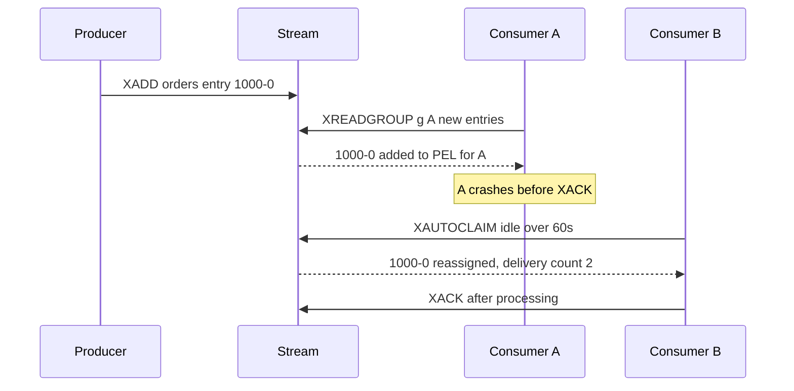

# Redis Streams

A Redis Stream (since Redis 5.0, 2018) is an **append-only log stored as a single Redis key**, with Kafka-inspired consumer-group semantics bolted on: entries get monotonic IDs, consumers in a group split entries, unacked entries sit in a **pending entries list** until acked or claimed. It is the lightest-weight way to get log-plus-groups semantics if you already run Redis — and it is **not** a Kafka replacement: retention is memory-bound, durability is Redis's durability (real caveats), and a stream lives entirely on one shard. For your planned SQS → Redis Streams move, the second half of this note is the checklist.

## The problem that created it

Redis already had two messaging shapes, both broken for real work. **Pub/Sub** is fire-and-forget: no storage, so a disconnected subscriber misses everything — fine for cache invalidation, useless for jobs. **Lists** (`LPUSH`/`BRPOP`) store messages, but a popped message is gone — a consumer that crashes mid-work loses it — and two services can't both read the same list. Teams wanted what Kafka offered (a log, replay within a window, competing consumers with redelivery) at Redis weight: no new cluster, sub-millisecond latency, one more data type in a server they already ran. Antirez designed Streams for exactly that gap: a radix-tree-backed log with IDs you can read from any point, plus consumer groups with explicit acknowledgement so crashed consumers' work is recoverable.

## What it solves

- **Persistent-ish pub/sub** — late or restarted consumers read from where they left off, unlike Redis Pub/Sub ([[Redis Beyond Caching]]).
- **Competing consumers with redelivery** — groups + PEL + claiming give the receive/ack loop SQS gives you ([[Delivery Semantics]]).
- **Bounded replay** — any consumer can re-read from any ID still in the stream; new consumers can bootstrap from retained history ([[Message Queues vs Event Logs]]).
- **Very low latency, trivial ops increment** — sub-millisecond-to-millisecond delivery (a same-DC Redis round trip, ~0.2–1 ms) from infrastructure you already operate.
- **Cheap fan-out** — multiple groups on one stream each see every entry, without SNS-style topology.

## How it works

### The data model

`XADD mystream * field value ...` appends an entry (a small field-value map) and returns its **ID**: `<unix-ms>-<seq>` (e.g. `1696150000000-3`), strictly increasing, doubling as a timestamp and a position. Internally a stream is a radix tree of compressed macro-nodes — compact, but entirely in RAM like everything in [[Redis Internals|Redis]].

Reading comes in two unrelated flavors:

- **`XREAD`** — independent readers: "give me entries after ID X", optionally blocking. Each reader tracks its own position; everyone sees everything (like a bare Kafka consumer without a group).
- **`XREADGROUP GROUP g consumer1`** — cooperative readers: entries are **split** among the group's consumers. Reading with the special ID `>` means "entries never delivered to this group"; the group tracks `last-delivered-id` server-side.

### PEL, XACK, and claiming stuck messages

When `XREADGROUP` hands entry E to consumer C, E goes into the group's **PEL (pending entries list)** charged to C, with a delivery counter and timestamp. `XACK` removes it — done. If C crashes, E stays pending forever; *nothing times out automatically* (unlike SQS's visibility timeout — recovery here is pull, not push).

Recovery is explicit:

- **`XPENDING`** — inspect: which entries, which consumer, idle how long, delivered how many times.
- **`XCLAIM`** / **`XAUTOCLAIM`** (6.2+) — transfer ownership of entries idle longer than a threshold to a live consumer, incrementing their delivery counter. `XAUTOCLAIM` iterates the PEL for you; every consumer typically runs a periodic "claim anything idle > N seconds" sweep (Redis 8.4+ `XREADGROUP ... CLAIM` folds that sweep into the read itself, and 8.8 adds `XNACK` to release an entry for immediate redelivery).
- A delivery counter that keeps climbing is your poison-message signal — there is **no built-in DLQ**; you check the counter and `XADD` the entry to a dead-letter stream yourself ([[Dead Letter Queues and Poison Messages]]).

### Trimming: MAXLEN and MINID

Nothing expires by itself; unbounded `XADD` eventually eats all memory. You cap streams with `XADD ... MAXLEN ~ 1000000` (the `~` makes trimming approximate — whole macro-nodes — and much cheaper) or `XTRIM` with `MAXLEN`/`MINID`. Critically, **trimming ignores consumer groups by default**: entries are evicted by count/ID even if the slowest group never read them — the same silent-loss race as Kafka retention vs lag ([[Kafka Operations]]), with a much smaller window because RAM is the disk. (Redis 8.2, 2025, added an `ACKED` trim option and `XACKDEL` that respect groups; Valkey gains them only in 9.2, at release candidate as of Sep 2026 — check whether your Redis/ElastiCache engine version has them.)

### Monitoring it — the commands that replace CloudWatch

Nothing here is emitted for free; you export it yourself (e.g., via a Prometheus Redis exporter):

- **`XLEN stream`** — stream length; with MAXLEN trimming this mostly confirms the cap.
- **`XINFO STREAM stream`** — first/last entry IDs, length, groups count; `last-generated-id` vs consumers' progress is your lag numerator.
- **`XINFO GROUPS stream`** — per group: `last-delivered-id` (consumption frontier), `pending` (PEL size), `lag` (entries not yet delivered, Redis 7.0+). **`lag` is your consumer-lag equivalent; PEL size is in-flight work** — alert on the growth trend of both.
- **`XPENDING stream group`** — the drill-down: per-consumer pending counts, min/max idle times, delivery counters (poison-message detection).
- Plus ordinary Redis vitals: memory used vs maxmemory, and replication lag — because here they are *broker durability* metrics, not cache metrics.

### What it is NOT — the honest limits

**Durability is Redis durability.** Redis acknowledges `XADD` once it's in memory. Persistence is [[Redis Internals|RDB or AOF]]: RDB loses everything since the last snapshot; AOF with `everysec` (the common setting) loses up to ~1 second of acked writes on crash; `appendfsync always` survives but costs most of Redis's speed. Replication to a replica is asynchronous, so [[Failover]] (Sentinel or Cluster) can lose acked-but-unreplicated entries. Compare: Kafka `acks=all`/min.insync=2 means an acked write is on at least two brokers before the producer proceeds. **If losing an acked message is unacceptable, Redis Streams alone is the wrong primitive** — in fintech terms: fine for notification jobs, not fine as the only record of a money movement.

**One stream = one key = one shard.** [[Redis Cluster and Sentinel|Redis Cluster]] shards by key, so a stream never spans nodes: its throughput and memory ceiling is one shard, and a busy stream is a textbook [[Hot Key Problem|hot key]]. There is no partition concept, no key-based fan-out, and no equivalent of Kafka's partition rebalancing (see [[Consumer Groups and Rebalancing]]). Want partitions? You build them: N streams (`orders:0`…`orders:N-1`), client-side hashing, per-stream groups — i.e., you re-implement a slice of Kafka, by hand, including resharding pain ([[Sharding]]).

**Retention is memory-bound.** Entries cost RAM until trimmed. A day's backlog at 1 KB × 500 msg/s ≈ ~43 GB — numbers that are a rounding error on Kafka disks are a cluster-resize on Redis. Deep replay windows and big consumer outages are therefore structurally expensive.

## Trade-offs

| You gain | You pay |
|---|---|
| Log + groups semantics on infrastructure you already run | Weakest durability of the brokers in this module (async replication, AOF window) |
| Sub-millisecond latency, great for ephemeral/real-time work | Memory-priced retention; short replay windows only |
| Replay within window; multiple groups; per-entry delivery counts | No DLQ, no delay queues, no visibility timeout — you build the recovery loop (XAUTOCLAIM sweeps) |
| Simple API, no new cluster, no per-request bill | One stream caps at one shard's throughput; partitioning is DIY |
| Explicit PEL = full visibility into in-flight work | PEL itself is unbounded state — leaks if acks are missed |

## Failure modes

- **Master crash between fsyncs / before replication** → acked entries vanish. Detected only by downstream reconciliation. Mitigation: AOF `everysec` minimum, replica + `WAIT` for critical writes (with real latency cost), or don't put must-not-lose data here.
- **PEL bloat** — consumers that crash without claiming sweeps, or code paths that skip `XACK`, grow the PEL forever: memory climbs, `XPENDING` scans slow. Monitor PEL size per group like you monitor consumer lag.
- **Trim-past-the-slow-group** — MAXLEN evicts unread entries; the group's position now points at history that no longer exists. Alarm on `(oldest pending or last-delivered ID) vs stream MINID`.
- **Hot stream saturation** — one busy stream pins one shard's CPU (Redis is effectively single-threaded per shard for commands); other keys on that shard suffer collateral latency. The cache and the queue fighting over the same node is the classic self-own: separate the Redis used for streams from the cache Redis.
- **Duplicate floods after claim misconfiguration** — XAUTOCLAIM idle-time shorter than real processing time re-delivers in-flight work (the SQS visibility-timeout bug, rebuilt): same fix, idle threshold ≥ worst-case processing, [[Idempotency|idempotent]] consumers always.

## When NOT to use it

- **Must-not-lose-acked-messages workloads** (ledger postings, payment instructions as sole record) — durability ceiling is disqualifying.
- **Long retention or large backlogs** — days of replay or multi-GB queues belong on disk-based logs ([[Kafka Architecture]]) or SQS's 14 days.
- **Throughput beyond one shard** — if a single stream can't carry peak load, you're signing up to hand-build partitioning; at that point Kafka/MSK is less work, not more.
- **When you need broker features** — delays, per-message TTL, DLQ, FIFO-with-dedup: SQS has them built; Streams makes you their maintainer (Redis 8.6 added producer-side dedup via `XADD IDMP`, but not the rest).
- **Teams without Redis operational depth** — "it's just Redis" is only cheap if someone already owns Redis persistence, failover, and memory management properly.

## In your stack

This is your planned move (SQS → Redis Streams), so — verify before migrating, workload by workload:

- **Durability requirement per queue.** Classify every SQS queue: "replayable/at-least-once critical" (money movement, KYC events) vs "ephemeral/regenerable" (notifications, cache warms, status fans). Only the second class should move first. For the first class, Streams needs AOF everysec + replica + WAIT at minimum — measure that latency before promising it.
- **Backlog sizes.** Pull `ApproximateNumberOfMessages` peaks and worst consumer-outage history from CloudWatch. Your 1-replica consumers make multi-hour backlogs likely (one pod restart = consumption pause); price that backlog in RAM at your message sizes.
- **Replay needs.** Anything redriven from a DLQ or replayed for reconciliation today needs an explicit retention window → MAXLEN math, plus a hand-built dead-letter stream and redrive runbook.
- **Max stream throughput.** Benchmark one stream on your instance class (XADD + XREADGROUP + XACK round-trips, your payload sizes) before assuming headroom; remember it shares a shard's single command thread.
- **Isolation.** Do not colocate streams with the main cache Redis — a backlog melting the cache is a two-for-one outage. Separate instance/cluster, its own memory alarms.
- What it *suits* in your stack: low-latency, modest-volume, ephemeral work — notification dispatch, webhook fan-out, intra-service job handoff — where losing a rare message is survivable and SQS's per-request cost/latency annoys you. What it doesn't: anything an RBI auditor will ask to see again.

## Interview angle

The 60-second version: *"Redis Streams is an append-only log as a Redis key: XADD gives time-ordered IDs, XREAD gives independent readers, XREADGROUP gives consumer groups where unacked entries sit in a pending entries list until XACK, and crashed consumers' work is recovered by XAUTOCLAIM on idle time. Retention is manual via MAXLEN trimming. It's Kafka-shaped semantics at Redis weight — the costs are Redis costs: memory-bound retention, async-replication/AOF durability windows, and a stream is one key on one shard, so no partitioning and a single-shard throughput ceiling. Great for ephemeral low-latency pipelines; wrong as a durable system of record."*

Classic probes:

- "How does a crashed consumer's message get recovered?" — PEL + XPENDING/XAUTOCLAIM; the interviewer is checking you know there's *no automatic timeout*, unlike SQS.
- "Streams vs Kafka?" — don't say "Kafka is bigger"; say: disk-backed replicated log with partitions and acks-based durability vs in-memory single-key log with group semantics; then name a workload for each.
- "Streams vs Redis Pub/Sub?" — storage and groups vs fire-and-forget; a subscriber that reconnects re-reads vs missed-forever.

## Check yourself

> [!question]- Q: Explain the journey of one entry through XADD → XREADGROUP → crash → recovery → XACK.
> XADD appends it with ID ms-seq. A consumer in group g calls XREADGROUP with `>`; the entry is delivered and recorded in g's PEL under that consumer (delivery count 1). The consumer crashes pre-XACK: the entry sits pending indefinitely. Another consumer's periodic XAUTOCLAIM (idle > threshold) takes ownership, delivery count 2, reprocesses, XACKs — removing it from the PEL. The entry itself stays in the stream until trimmed; ack ≠ delete, unlike SQS (unless you use 8.2's `XACKDEL`).

> [!question]- Q: What happens to acked-but-recent XADDs if the Redis master dies, under AOF everysec with one async replica?
> Up to ~1 second of writes may be missing from the AOF if the node restarts from its own disk; if Sentinel instead promotes the replica, everything not yet replicated (async, so an unbounded-but-usually-small window) is lost — even though producers got successful replies. This is the structural gap vs Kafka acks=all, where the ack itself waits for replication. WAIT narrows but doesn't close it (WAIT confirms replica receipt, not fsync; WAITAOF, Redis 7.2+, adds the fsync half at further latency cost).

> [!question]- Q: Why does a single very busy stream threaten unrelated Redis keys, and what's the mitigation?
> The stream is one key, pinned to one shard, and Redis processes that shard's commands on effectively one thread — heavy XADD/XREADGROUP traffic consumes the thread and starves other keys on the shard (latency spikes on your cache). Mitigations: dedicated Redis instance/cluster for streams, and if one stream's volume is itself too much, client-side partitioning across N streams — accepting you now maintain a mini-Kafka.

> [!question]- Q: Mini-design — move a notification-dispatch queue from SQS to Streams. Name the pieces you must build that SQS gave you free.
> (1) Redelivery: XAUTOCLAIM sweep with idle ≥ worst-case processing (replacing visibility timeout). (2) DLQ: check delivery count on claim; past threshold, XADD to `notifications:dlq` + XACK the original; alarm on dlq length (replacing maxReceiveCount+DLQ). (3) Retention: MAXLEN ~ sized to worst outage; alert on slow-group lag vs MINID (replacing 14-day retention). (4) Idempotent send keyed on notification ID (needed in both worlds). (5) Memory alarms + dedicated instance (replacing "AWS's problem").

## Sources

- Redis documentation — "Redis Streams" introduction; command pages: XADD, XREADGROUP, XPENDING, XCLAIM, XAUTOCLAIM, XTRIM
- Redis documentation — Persistence (RDB vs AOF guarantees), Replication (async semantics, WAIT)
- Antirez's blog — stream data type design notes ("Streams: a new general purpose data structure in Redis", 2017)
- Redis 5.0 and 6.2 release notes (streams introduction; XAUTOCLAIM)
- Kleppmann, *Designing Data-Intensive Applications*, Ch. 11 (log-based messaging, durability trade-offs)
