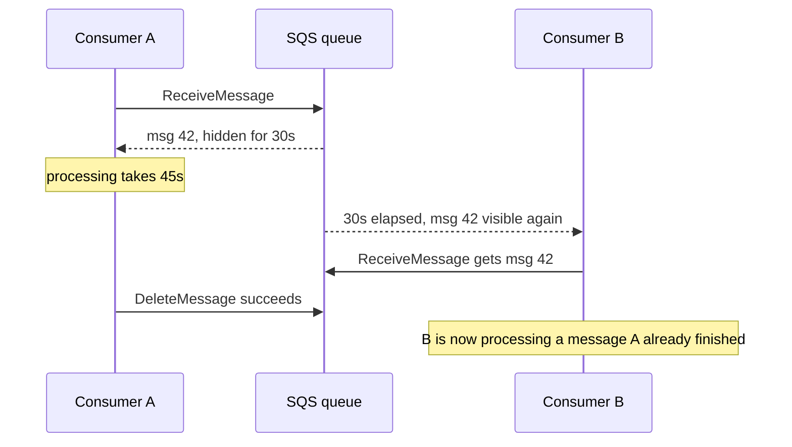

# SQS and SNS

SQS is a queue you cannot log into: no brokers, no partitions, no disks, no upgrades — an API that accepts, hides, and deletes messages, scaling invisibly. SNS is its pub-sub sibling: publish once, push to many subscribers. Together they are AWS's answer to "most teams want messaging, not a messaging *platform*". The price is a deliberately small feature set: at-least-once delivery, limited ordering, bounded retention, and — the big one versus [[Kafka Architecture|Kafka]] — **no replay, ever**.

## The problem that created it

Amazon, early 2000s: hundreds of internal teams each running (or corrupting) their own broker installs to decouple services. Queues are needed everywhere; queue *expertise* is rare. The recurring failure wasn't message semantics — it was operations: brokers running out of disk, unpatched clusters, teams paging each other over shared infrastructure. SQS (announced in beta in 2004 — commonly cited as the first AWS service — generally available 2006) applied the cloud thesis to messaging: make the queue a multi-tenant service with an HTTP API, let the provider own every machine, and charge per request. The design contract follows from multi-tenancy: messages are stored redundantly across servers, which is why standard SQS gives **at-least-once delivery with best-effort ordering** — the loose guarantees are what let it scale elastically without broker-shaped limits ([[Exactly-Once Delivery Is a Lie]] applies to anyone promising more).

## What it solves

- **Zero operations** — no capacity planning for the broker layer, no patching, no 3 a.m. disk-full. The entire [[Kafka Operations]] note doesn't apply.
- **Elastic throughput** (standard queues) — from 1 msg/day to tens of thousands/sec with no reconfiguration.
- **Durable buffering with retries built in** — visibility timeout + DLQ gives a complete at-least-once consumption loop ([[Delivery Semantics]]).
- **Decoupled fan-out** (with SNS) — one event, many independent consumers, each with its own queue, retry pace, and failure isolation.
- **Pay-per-use cost shape** — cost scales with *requests*, so idle costs ~nothing; contrast a Kafka cluster billing 24/7 regardless of traffic.

Worked cost shape (rates are order-of-magnitude — check current pricing): standard SQS runs ~$0.40 per million requests after the free tier. A queue doing a steady 100 msg/s costs roughly: sends 100/s + receives + deletes ≈ 3 request-units per message (long polling keeps empty receives near zero, batching divides this by up to 10) → ~260M messages/month × 3 ≈ 780M requests ≈ **~$300/month**, before data transfer. The same math at 5,000 msg/s is ~$15k/month — now in MSK-cluster territory — while at 1 msg/s it's ~$3. That is the whole story of SQS economics: linear in traffic × fan-out, brilliant at the low end, worth re-deriving at every order of magnitude ([[Choosing a Message Broker]]).

## How it works

### Standard vs FIFO queues

| | Standard | FIFO |
|---|---|---|
| Delivery | At-least-once (duplicates possible) | Exactly-once *processing attempt* via dedup window |
| Ordering | Best-effort only | Strict within a **message group** |
| Throughput | Effectively unlimited | Limited: ~300 ops/sec base, ~3,000 msg/sec with batching; high-throughput mode raises this much further (per-region numbers change — check current docs) |
| Use | Default | Only when ordering/dedup is worth the ceiling |

FIFO mechanics: each message carries a **MessageGroupId** — ordering is guaranteed only within a group, and groups are processed independently (the same idea as Kafka's partition key, applied per message). A **MessageDeduplicationId** (or content-based hash) suppresses duplicates of the same send for a **5-minute window** — producer-side dedup only; a consumer that processes and fails to delete still causes redelivery. So FIFO removes *producer* duplicates and gives per-group order; consumer [[Idempotency]] is still required.

### Visibility timeout — the core mechanic and its classic bugs

SQS never "assigns" a message to a consumer. A `ReceiveMessage` call returns a message and starts its **visibility timeout** (default 30 s): the message stays in the queue but is hidden. The consumer processes, then calls `DeleteMessage`. If it doesn't delete in time, the message reappears for anyone.

The classic bugs, all seen in every SQS shop eventually:

1. **Timeout < processing time → systematic duplicates.** Exactly the diagram above: every slow message is processed twice (or more). Fix: set visibility timeout ≥ p99.9 processing time (AWS suggests ~6× the average as a starting point), or heartbeat with `ChangeMessageVisibility` during long work.
2. **Crash after work, before delete** — the unavoidable at-least-once duplicate; only consumer idempotency absorbs it.
3. **Timeout way too long** — a crashed consumer's messages stay invisible for, say, 12 hours (the max); throughput stalls with an empty-looking queue.
4. **Receive-count inflation from bugs 1–3** silently marching messages toward the DLQ threshold even though nothing is "wrong" with them.

### Long polling, DLQs, delay queues

- **Long polling** (`WaitTimeSeconds` up to 20): the receive call parks until a message arrives or the wait expires. Always use it — short polling burns money (you pay per request, including empties) and samples only a subset of SQS's distributed storage, so it can return empty while messages exist.
- **DLQ + redrive**: after `maxReceiveCount` failed receives, SQS moves the message to a dead-letter queue ([[Dead Letter Queues and Poison Messages]]). **Redrive** moves inspected/fixed messages back. DLQs are plain queues — messages there still expire (14-day max retention), so an unwatched DLQ is a slow-motion data deleter. Alarm on DLQ depth > 0.
- **Delay queues / per-message delay**: postpone first delivery up to 15 minutes — handy for retry backoff and "run this soon, not now" jobs.
- Limits worth knowing: retention default 4 days, max **14 days**; payload max **256 KB** historically (AWS has been raising this — large payloads belong in S3 with a pointer anyway, the "claim check" pattern).
- **In-flight caps**: a standard queue allows ~120,000 messages in flight (received, not yet deleted); FIFO allows 20,000. Rarely hit — and when it is, the cause is usually bug #3 above (messages invisible under a huge timeout), not genuine parallelism.
- **Batching everywhere**: send, receive, and delete all support batches of 10 — the single biggest lever on both throughput and cost, since pricing is per request, not per message.

### No replay — the deep contrast with Kafka

Delete is forever. A consumed-and-deleted message cannot be re-read: no new consumer can bootstrap from history, no bug can be fixed by re-consuming last week ([[Message Queues vs Event Logs]]). Also structural: **one queue = one logical consumer group.** Two services reading the same queue *split* messages, they don't each get a copy. Fan-out therefore needs SNS in front — and that topology must be decided before the messages flow, because yesterday's messages are gone.

### SNS fan-out and filtering

SNS is a **topic**: publishers send once; SNS pushes copies to subscribers (SQS queues, Lambda, HTTP, email…). The canonical serverless pattern is **SNS → one SQS queue per consumer service**: each service gets its own buffer, retry policy, and DLQ; a slow consumer affects nobody else. **Filter policies** on subscriptions (matching message attributes, or payload fields with payload-based filtering) let each queue receive only relevant events — routing logic lives in infrastructure, not in consumers discarding 90% of traffic. This pair ≈ RabbitMQ's fanout/topic exchange ([[RabbitMQ]]), rebuilt as managed services. (SNS alone is push-based with limited retries — subscribing a queue, not a bare HTTP endpoint, is what makes delivery reliable. EventBridge is the richer-routing sibling; one line because it's beyond this note.)

## Trade-offs

| You gain | You pay |
|---|---|
| Zero broker operations, elastic scale | No replay; no history; consumers must exist before events |
| Per-request pricing, ~zero idle cost | At high sustained volume, per-request cost can exceed a cluster you'd run |
| Built-in retries, DLQ, delay, dedup (FIFO) | 14-day max retention; 256 KB-class payloads; 15-min max delay |
| Simple mental model (receive → work → delete) | Best-effort order (standard) or throughput ceiling (FIFO) |
| IAM-integrated, per-queue isolation | AWS lock-in; no cross-cloud portability of semantics |

## Failure modes

- **Visibility-timeout duplicates** (above) — detected as "same business event handled twice"; the fix is timeout tuning + idempotency, not blame on SQS.
- **Silent DLQ expiry** — poison messages dead-letter correctly, nobody watches, 14 days later they're gone. In fintech that's an unprocessed transaction evaporating: alarm on DLQ depth, and treat redrive as an operational runbook, not an improvisation.
- **Queue backlog with 1-replica consumers** — SQS absorbs any backlog happily (that's the point), but `ApproximateAgeOfOldestMessage` climbing means your consumer fleet, not the queue, is the bottleneck ([[Backpressure and Flow Control]]).
- **FIFO group stall** — one failing message blocks its whole message group (order must hold), so a poison message freezes every message behind it in that group until it DLQs out.
- **Accidental competing consumers** — a second service polling the same queue "to also get the events" steals half of them; the fix is SNS fan-out, discovered only after mysterious missing messages.

## When NOT to use it

- **Replay or audit-stream requirements** — rebuilding read models, backfilling a new consumer, re-running reconciliation: you need a log ([[Kafka Architecture]], [[Event Sourcing]]).
- **Strict ordering at high throughput** — FIFO's ceiling (without high-throughput mode, and sometimes with it) is far below one Kafka partition set.
- **Very high sustained volume with many consumers** — per-request pricing × fan-out × polling can exceed MSK/Confluent costs; do the arithmetic at your actual rates.
- **Streaming analytics / stream processing** — windowed joins and aggregations want a log and a framework, not receive-delete.
- **Multi-cloud or on-prem portability** as a requirement.

## In your stack

- SQS is your *current* broker — the hop after Kafka in the Niyo journey, and the trade was explicit: Kafka's replay and throughput for zero ops and per-request cost ([[Choosing a Message Broker]] maps the whole path).
- The visibility-timeout-vs-processing-time bug is the one to audit before the [[Redis Streams]] move: any consumer whose p99 processing time approaches its queue's visibility timeout is already double-processing today — the same workload will need the same care with XAUTOCLAIM idle times.
- With many services at 1 replica, SQS's buffering is doing real resilience work for you: a consumer pod restart loses nothing, it just resumes polling. Whatever replaces SQS must preserve that property.
- Fintech discipline: every money-touching consumer should be idempotent on a business key (not SQS MessageId — redelivered standard-queue duplicates can carry different receive metadata), and every DLQ needs an alarm and a documented redrive owner, because DLQ expiry is unrecoverable.
- SNS→SQS fan-out with filter policies is your Kong-era instinct (route at the edge) applied to events: filtering in infrastructure beats filtering in consumer code.
- Cost hygiene worth keeping until the day you leave SQS: long polling on every consumer (empty receives are billed requests) and batched send/delete — at your request volumes these two settings are the difference between trivial and noticeable monthly spend.

## Interview angle

The 60-second version: *"SQS is AWS's zero-ops queue: at-least-once delivery via a visibility timeout — receive hides the message, delete removes it, a missed delete means redelivery — with long polling, DLQs after N failed receives, and delay queues. Standard queues scale effectively without limit but order only best-effort; FIFO gives per-message-group ordering plus a 5-minute dedup window at a throughput ceiling. There's no replay — deleted is gone, and one queue is one consumer group — so fan-out is SNS publishing into one queue per service, with filter policies for routing. You pick SQS when the ops you *don't* do beat the features you don't get."*

Classic probes:

- "How do duplicates happen in SQS and what do you do?" — visibility timeout expiry mid-processing, crash before delete; answer: timeout ≥ worst-case processing, heartbeat extension, consumer idempotency keyed on business ID.
- "FIFO solves exactly-once, right?" — producer-side dedup for 5 minutes and per-group ordering; consumer-side duplicates still exist; [[Exactly-Once Delivery Is a Lie]].
- "SQS vs Kafka?" — don't list features; name the axis: ops-free bounded queue vs replayable log you operate, then map requirements (replay? fan-in volume? ordering granularity? cost shape: per-request vs per-cluster-hour).

## Check yourself

> [!question]- Q: Walk through the lifecycle of an SQS message that a consumer fails to process twice and then handles successfully.
> Send → stored redundantly. Receive 1: hidden for the visibility timeout; consumer errors, no delete; timeout lapses, message visible again, receive count 2. Receive 2: same, count 3. Receive 3: processed, `DeleteMessage` removes it. Had `maxReceiveCount` been 3 with a DLQ attached, the third *receive* would have gone to the DLQ instead — so transient-failure retry budgets and DLQ thresholds must be set together.

> [!question]- Q: What happens if a FIFO queue receives a poison message in group "account-123"?
> Ordering within a group is strict, so SQS will not deliver later "account-123" messages while the poison one is in flight/retrying. The group stalls: every retry cycle (receive → fail → visibility lapse) blocks successors until the message exhausts maxReceiveCount and dead-letters. Other groups continue untouched. Lesson: group IDs define both ordering and blast radius — and the DLQ threshold bounds the stall duration.

> [!question]- Q: Why can't two services share one SQS queue to both receive all events, and what's the correct topology?
> A queue is a single logical consumer group: each message is delivered (and deleted) once across all pollers, so two services split the stream roughly randomly. Correct: an SNS topic the producer publishes to, with one subscribed queue per service (filter policies if each wants a subset). Each service then owns its buffer, retries, and DLQ independently.

> [!question]- Q: Mini-design — order events must trigger: ledger posting (every event, ordered per account), notification send (every event, order irrelevant), fraud scoring (card events only). Sketch it with SQS/SNS.
> SNS topic `orders`. Three queue subscriptions: (1) FIFO queue for the ledger — requires the publisher path to support FIFO (SNS FIFO topic → SQS FIFO), MessageGroupId = accountId, dedup on event ID; (2) standard queue for notifications; (3) standard queue for fraud with a filter policy on `paymentMethod: card`. Each queue gets its own DLQ + alarm; ledger consumer idempotent on event ID since FIFO still redelivers on missed deletes.

## Sources

- AWS SQS Developer Guide — visibility timeout, long/short polling, DLQs and redrive, FIFO queues and high-throughput mode, quotas
- AWS SQS and SNS pricing pages (per-request rates, free tier — rates above are order-of-magnitude as of ~2025)
- AWS SNS Developer Guide — fan-out to SQS, message filtering (attribute- and payload-based), FIFO topics
- AWS Architecture Blog — "Avoiding insurmountable queue backlogs" and SNS→SQS fan-out patterns (AWS Builders' Library: "Avoiding insurmountable queue backlogs", Marc Brooker's queueing posts)
- Kleppmann, *Designing Data-Intensive Applications*, Ch. 11 (at-least-once delivery, queue semantics)
