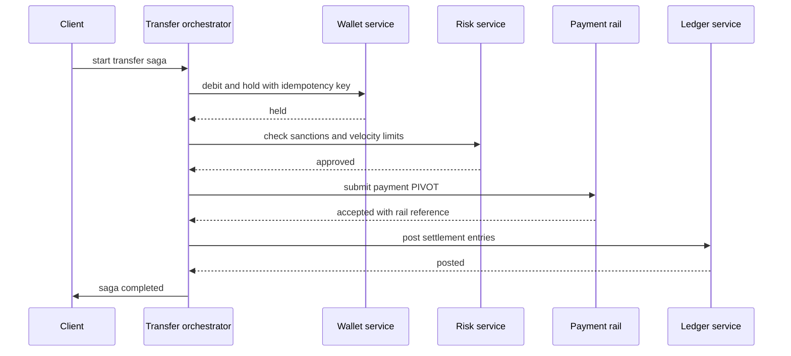
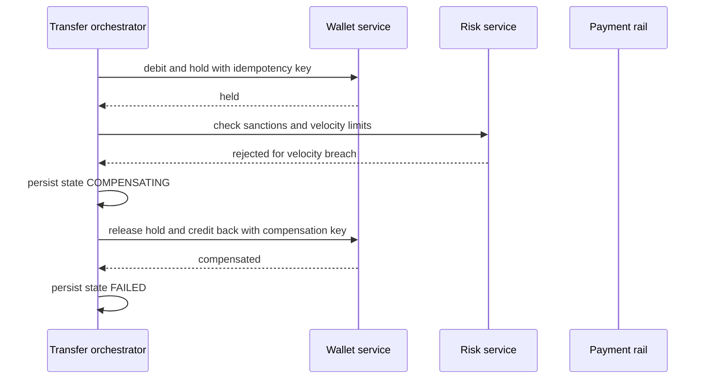

# Saga Pattern

A money transfer touches several services and must end in one of two states: fully done, or as if it never happened. In a monolith with one database you would wrap it in `BEGIN ... COMMIT` and stop thinking. Across services there is no shared transaction, and the obvious fix — [[Two-Phase Commit and Distributed Transactions|two-phase commit]] — is a blocking protocol most modern infrastructure refuses to speak. A **saga** is the pragmatic answer: break the operation into a **sequence of local transactions**, each committed independently in its own service, and give each one a **compensating transaction** that semantically undoes it if a later step fails. You trade atomicity-with-isolation for atomicity-without-isolation, and you buy that trade with a lot of explicit, visible engineering.

## The problem that created it

Start with a monolith. One Spring Boot application, one MySQL schema, one `@Transactional` method that debits a wallet, writes a transfer row, and credits a beneficiary. The database guarantees all four letters of [[ACID Transactions|ACID]]: it all commits or none of it does, and concurrent readers never see the half-done middle. This works beautifully and is the reason "just use a transaction" is correct advice far more often than architecture blogs admit.

Then the system grows. Wallet becomes its own service with its own MongoDB. Payments becomes another, because it owns partner-bank credentials. Ledger becomes a third because compliance wants it isolated ([[Monolith vs Microservices]] is the decision that got you here). Now the single `@Transactional` block is three network calls into three other services' databases, and the atomicity evaporated. Three concrete ways it hurts:

1. **Partial completion is now reachable.** The wallet debit commits; the payment call fails. The customer's money has vanished into no account. Nothing in the infrastructure notices — each local transaction was perfectly correct on its own.
2. **Retries create duplicates.** A timeout on the payment call tells you nothing about whether the payment happened. Retry blindly and you may send the money twice; give up and you may have sent it once and told the customer it failed.
3. **The crash window moves but never closes.** Wherever you put the commit, a pod restart can land between two steps. The knowledge that a transfer was mid-flight dies with the process unless something durable recorded it.

The textbook fix, 2PC, does restore atomicity — and in exchange a coordinator crash leaves every participant holding locks indefinitely, every participating resource must implement XA or an equivalent prepare-and-commit interface, and availability becomes the product of all participants' availability. Brokers, HTTP APIs, and most NoSQL stores simply do not offer it.

The escape hatch came from an older problem. Garcia-Molina and Salem's **"Sagas"** (SIGMOD, 1987) was written about *long-lived transactions* inside one database: a batch job holding locks for an hour destroys concurrency, so instead split it into short committed chunks and attach a compensating chunk to each. If the long operation fails midway, run the compensations backwards. The microservices world borrowed the structure wholesale, with the service boundary playing the role the time boundary played in 1987.

## What it solves

- **Multi-service business operations that must not end half-done** — transfers, order placement, onboarding — without a distributed transaction.
- **Availability under partial failure**: each step commits locally, so one slow service delays the saga instead of blocking locks across every participant's database.
- **No XA, no coordinator-held locks**: participants need only ordinary local transactions and an HTTP or message endpoint ([[Communication Patterns Between Services]]).
- **An explicit, inspectable model of "what is in flight"**: unlike a hidden database transaction, a saga has a persisted state you can query, alert on, and show to an operations team.
- **A home for business-level reversal rules** that a database rollback could never express — fees, cut-off times, partial refunds, ops approval.

## How it works

### The shape

A saga is `T1, T2, ... Tn` with compensations `C1, C2, ... Cn-1` — the 1987 formulation, in which only the last step needs no compensation because nothing follows it to fail. In practice the whole *tail* of a real saga needs none, for the reason the zones section below explains. Forward path: run `T1..Tn`. On failure at `Tk`: run `Ck-1, Ck-2, ... C1` in reverse. The guarantee is **"every transaction completes, or compensations run for the ones that did"** — note what is missing: no statement at all about what concurrent observers see in between. A saga gives you atomicity, consistency and durability, and deliberately gives up **isolation** ([[Transaction Isolation Levels]] describes what you are giving up).

### The money transfer, concretely

| Step | Service | Local transaction | Compensation |
|---|---|---|---|
| T1 | Wallet | Debit and place a hold on the customer's wallet | C1: release the hold, credit the amount back |
| T2 | Risk | Record a sanctions and velocity-limit decision | C2: mark the decision abandoned |
| T3 | Payments | Submit the payment to the bank rail — **the pivot** | none possible |
| T4 | Ledger | Post the double-entry settlement record | retried, not compensated |
| T5 | Notification | Send the customer the success message | retried, not compensated |

### Three zones: compensatable, pivot, retriable

The single most useful idea in saga design — Richardson's vocabulary in *Microservices Patterns* — is that steps are not interchangeable. Order them deliberately:

- **Compensatable transactions** come first. Each can be semantically undone, so a failure anywhere in this zone unwinds cleanly. T1 and T2 above.
- **The pivot transaction** is the go/no-go point. Past it, the saga is committed to finishing. In the transfer, T3 is the pivot because an accepted IMPS or UPI payment cannot be recalled by you — the money has left your system and landed in someone else's bank.
- **Retriable transactions** come after the pivot and must be designed so they *cannot* permanently fail: no business validation, no external dependency that can refuse, only writes you can keep retrying until they succeed. T4 and T5.

Design work is therefore mostly **moving steps across these boundaries**. Every validation, limit check, and compliance decision belongs *before* the pivot, because after the pivot a rejection is unactionable. If you find yourself wanting to validate something after the irreversible call, that is the design telling you the step is in the wrong zone.

### When the pivot succeeds and a later step fails

This is the case the pattern exists to make survivable, and the case people get wrong. The rail accepted the payment; the ledger post then fails because the ledger service is down.

**You do not compensate.** There is no compensation for T3. Running C2 and C1 would credit the customer's wallet back while the beneficiary has already been paid — a real, unrecoverable loss. The correct behaviour is: keep the saga alive in a `PIVOT_DONE` state and **retry T4 until it succeeds**, forever if necessary, with backoff ([[Timeouts Retries and Exponential Backoff]]). The saga's own durable state is what makes "forever" possible across pod restarts.

If a post-pivot step genuinely cannot be completed — the beneficiary record was deleted, the ledger rejects the entry as malformed — you have a **business exception, not a technical one**. It routes to an operations queue and a suspense account, and any money that needs to come back comes back as a *new forward payment* (a reversal transaction with its own reference number), never as an undo of the original. On Indian rails, a reversal is a fresh credit with its own lifecycle, timing, and failure modes; it can itself fail. The saga framework does not get you out of needing a human-reviewed exception path for money.

### Compensation is semantic undo, not rollback

A database rollback restores bytes: after it, nobody can tell the transaction happened. A compensation is a **new forward transaction whose business meaning is "reverse the earlier one"**, and the difference is not pedantry:

- **A refund is not an un-charge.** The charge and the refund are two ledger entries and two line items on the customer's statement. Payment-gateway fees on the original are often not returned. If currency conversion happened, the reversal uses a different rate, so the amounts do not match.
- **Observable side effects cannot be withdrawn.** A notification already sent cannot be unsent; the best any compensation can do is send a contradicting message, which is a worse customer experience than never having sent the first one. This is the real argument for pushing notifications to the end of the saga, where nothing that follows can fail backwards onto them.
- **Compensations can fail.** C1 might hit a wallet that is frozen for fraud review. Compensations need their own retry, their own [[Dead Letter Queues and Poison Messages|dead-letter path]], and their own alerting — a saga stuck in `COMPENSATING` is a customer with missing money.
- **Compensations must be idempotent too.** A double refund is exactly as expensive as a double charge, and far easier to trigger, because the compensation path is the one exercised during incidents when everything is being retried at once.

The payment rail's lane stays empty on purpose: the rejection landed inside the compensatable zone, so no money ever left the system and the customer simply sees a declined transfer. Had the same velocity check run *after* T3, the only honest outcome would have been a manual reversal.

### The ambiguous outcome problem

The rail call times out. You do not know whether the payment was submitted. **Compensating here is the single most expensive mistake in the pattern**: if the payment actually went through, you refund the wallet and the beneficiary keeps the money.

The rule: a timeout is not a failure, it is an **unknown**. The saga must move to an `AWAITING_CONFIRMATION` state and resolve the unknown by evidence — query the rail's transaction-status API by your own idempotency reference, or wait for the rail's webhook, or fall back to the end-of-day reconciliation file. Only a definitive "not found / not submitted" authorises compensation. This is why the pivot step's request must carry a client-generated reference that the rail echoes back: without it you cannot ask "did my transfer go through" and get a trustworthy answer. See [[Network Partitions and Timeouts]] for why the ambiguity is irreducible rather than a protocol flaw.

### Choreography vs orchestration

**Choreography**: no coordinator. Each service publishes an event when its local transaction commits, and the next service reacts. Wallet publishes `WalletDebited`; Risk consumes it, decides, publishes `RiskApproved`; Payments consumes that. Compensation is the same mechanism with failure events flowing backwards.

**Orchestration**: a coordinator (a saga orchestrator, a workflow engine) holds the state machine, sends commands to each service, and reacts to replies. The services expose `debit`/`releaseHold` style operations and know nothing about the saga.

| Dimension | Choreography | Orchestration |
|---|---|---|
| Where the flow lives | Implicit, spread across N services' subscriptions | Explicit, in one state machine you can read |
| Finding "what happens on step 3 failure" | Read several services and infer | Read one file |
| Coupling | To event schemas; no central component | To the orchestrator's command contracts |
| Cyclic dependencies | Easy to create accidentally as steps grow | Structurally avoided |
| Testing the whole flow | Hard; needs the full environment | State machine testable standalone |
| Single point of failure | None | Orchestrator — must be durable and recoverable |
| Risk it degrades into | Implicit spaghetti nobody can trace | A god-service with anemic participants |
| Good fit | 2 to 4 steps, linear, low-stakes | 5 or more steps, branching, money or compliance |

The honest rule of thumb: **choreography for short flows, orchestration for anything with money in it.** Not because choreography is wrong, but because when an auditor or an on-call engineer asks "where is transfer `TXN-88213` right now and why", orchestration has an answer in one place and choreography has an archaeology project. Both are forms of the broader sync/async and coordination choice in [[Communication Patterns Between Services]].

### Lack of isolation, and the countermeasures

Because each local transaction commits immediately, other transactions see the saga's partial state. The anomalies are the classic ones from [[Transaction Isolation Levels]], now at the service level:

- **Dirty reads**: a statement generated between T1 and C1 shows a debit that is about to be reversed. A credit-limit engine reads the lowered balance and declines an unrelated payment.
- **Lost updates**: a concurrent deposit lands between T1 and C1; C1 restores the pre-saga balance by assignment and silently erases the deposit.
- **Fuzzy / non-repeatable reads**: the saga reads the customer's daily limit usage early to approve the transfer and reads it again later to build the confirmation, and the two answers differ because another transfer interleaved.

The standard countermeasures (named in *Microservices Patterns*, Ch. 4):

| Countermeasure | What it does | In the transfer saga |
|---|---|---|
| **Semantic lock** | Mark the record with an in-progress flag; other operations see it and defer, fail fast, or queue | The wallet hold itself: funds are reserved, not spent, and a second transfer sees reduced *available* balance |
| **Commutative updates** | Express changes as deltas so apply-and-undo commute and order stops mattering | Debit and credit as `$inc` style deltas, never `balance = X` — this is what actually prevents the lost update |
| **Pessimistic view** | Reorder steps so the compensatable zone contains the *least* damaging dirty reads | Credit the beneficiary's spendable balance only after the saga completes, so the money is never withdrawable mid-saga |
| **Reread value** | Re-read and verify unchanged immediately before updating; abort if someone else moved it | Compensation re-reads the wallet version and refuses if it changed unexpectedly |
| **Version file** | Record operations as a log and apply them in a sane order even if they arrive out of order | A compensation arriving before the transaction it compensates is recorded and reconciled rather than dropped |
| **By value** | Let each request's business risk select the concurrency mechanism: a saga for low-risk requests, a distributed transaction or a stricter path for high-risk ones | High-value transfers take a serialised path with maker-checker approval |

Two of these do most of the real work: **semantic locks** stop other actors acting on in-flight state, and **commutative updates** make compensation safe under concurrency. The rest are situational.

### Saga state, recovery, and idempotency

The orchestrator's state machine must be **durable before it is useful**. The discipline:

1. **Persist the transition before dispatching the command.** Write `{sagaId, currentStep, status, stepOutputs, rail reference, updatedAt}` first, then send the command. The reverse order loses the saga on a crash.
2. **Persisting state and sending a command is itself a dual write** — use [[The Outbox Pattern]] so the command is emitted exactly when the state change commits. A saga orchestrator built without an outbox has reintroduced the problem it was supposed to solve, one level up.
3. **Recovery on startup** scans for sagas in non-terminal states and resumes from the persisted step. This necessarily re-issues commands that may already have executed — which is the whole reason point 4 below is non-negotiable.
4. **Every step and every compensation is [[Idempotency|idempotent]]**, keyed on something stable like `sagaId + stepName`. Not "usually safe to retry" — genuinely idempotent, enforced by a unique index on the key in the participant's own database. The saga machinery guarantees at-least-once delivery of each command and nothing stronger ([[Delivery Semantics]], [[Exactly-Once Delivery Is a Lie]]).
5. **Every step has a deadline.** A saga with no timer waits forever on a reply that will never come. Deadlines fire a decision: retry, compensate, or escalate to ops.

Some teams model the orchestrator's state as an event stream rather than a mutable row ([[Event Sourcing]]), which gives a free audit trail of every transition and makes "why did this saga compensate" answerable months later; the in-flight operations dashboard is then a [[CQRS|read-model projection]] over that stream.

### Observability

In-flight sagas are the thing nobody instruments until the first bad night. Minimum viable:

- **Saga ID as a first-class correlation key** carried on every command, event, and log line, alongside the request's trace identifiers ([[Distributed Tracing]]).
- **A gauge of in-flight sagas by state and age**, with an alert on anything past its expected completion time — especially `COMPENSATING` and `AWAITING_CONFIRMATION`, the two states where money is in limbo.
- **Compensation rate as a business metric.** A rising rate is a product or partner problem surfacing as a technical signal.
- **Independent reconciliation.** The saga's own view of the world is not evidence. Compare your transfer states against the rail's settlement file daily; the saga tells you what you *believe* happened.

## Trade-offs

| You gain | You pay |
|---|---|
| Multi-service consistency without 2PC or XA | No isolation: dirty reads and lost updates are now your problem to design around |
| Availability — no cross-service locks, no blocking coordinator | Compensation logic for every step before the pivot, roughly doubling the paths to write and test in that zone |
| Explicit, queryable state for in-flight business operations | A durable state store plus outbox, timers, and recovery to operate |
| Business-meaningful reversal rules a rollback could not express | Reversals are visible to customers and auditors; fees and FX rates do not cancel out |
| Steps stay in the services that own the data | Harder debugging: one logical operation spans many services and a span of time |
| Works with any transport — HTTP, SQS, Kafka | Irreversible pivots force a manual exception path you cannot engineer away |

## Failure modes

- **Compensation that quietly loses money.** `balance = savedBalance` instead of a delta erases concurrent activity. Classic, silent, and found by reconciliation weeks later. Fix: commutative updates, always.
- **Compensating on an ambiguous pivot.** Timeout read as failure, wallet refunded, payment actually sent. The most expensive bug in this pattern; see the ambiguity rule above.
- **Non-idempotent compensation under incident retries.** During an outage everything retries at once; a compensation that is not keyed issues two refunds.
- **Validation placed after the pivot.** Discovered in production as "we sent the money and then found out we should not have" — a design error, not a runtime one. Audit step ordering explicitly.
- **Stuck sagas with no timeout.** A participant never replies; the saga sits in `PENDING` forever holding a semantic lock, so the customer's funds stay reserved. Alert on saga age, not just error rate.
- **Orchestrator state lost on crash.** State kept in memory or written after dispatch; a pod restart orphans in-flight sagas. The hold stays on the wallet and nothing will ever release it.
- **Choreography growing past comprehension.** A five-service event chain where nobody can name the order of steps, and a new subscriber silently joins the flow. The [[The Distributed Monolith Anti-Pattern|distributed monolith]] in event form.
- **Compensation storms.** A downstream failure makes every saga compensate simultaneously, and the compensation traffic takes out the already-struggling service. Rate-limit compensations and put a [[Circuit Breakers|circuit breaker]] in front of them.

## When NOT to use it

- **All the data is in one database.** Then use a local ACID transaction. A saga across modules of the same schema is pure cost — the single most common over-application of the pattern ([[Monolith vs Microservices]]: if the services share a datastore, the boundary is not real anyway).
- **No compensation is possible for an early step.** If step 1 is irreversible, there is no compensatable zone and the saga degenerates into "hope". Either make step 1 reversible (reserve instead of commit) or redesign the flow.
- **The operation is read-only or naturally idempotent end-to-end.** Retry the whole thing; you do not need unwind logic.
- **Strict isolation is a hard requirement.** If no observer may ever see intermediate state — some regulatory reporting, some settlement windows — a saga cannot provide it. Keep that operation inside one transactional boundary, even if it means merging two services.
- **Two steps only, and the second is retriable.** Persist the intent and retry; a saga framework is overkill ([[The Outbox Pattern]] alone often suffices).
- **The team cannot yet operate it.** A saga with no state dashboard, no timeouts, and no reconciliation is less safe than the synchronous call it replaced, because the failure is now silent.

## In your stack

- **MongoDB as primary store** gives each participant a real local transaction — multi-document transactions on a replica set — which is exactly the unit a saga step needs. Keep each step's business write and its idempotency-key insert in that one transaction; the unique index on the key is what makes retries safe.
- **SQS as the current transport** is at-least-once with no ordering guarantee on standard queues, so saga commands and replies can arrive duplicated and out of order. Idempotency keys handle duplicates; a saga-state guard — reject a reply for a step the saga has already left — handles stale ones. FIFO queues with the saga ID as message group give you per-saga ordering if you want it ([[SQS and SNS]]). The same reasoning carries to [[Redis Streams]] after the migration.
- **Services pinned at 1 replica** means an orchestrator pod restart is a real, routine event — a window with no coordinator at all on every deploy, measurable from your own rollout timings rather than assumed. That is survivable *only* because saga state is durable and resumable; it is a strong argument for keeping the orchestrator thin and its state in Mongo rather than in memory. It also means the recovery-on-startup scan must actually exist and be tested, not assumed.
- **`x-correlation-id` and the saga ID should both ride every hop** — the correlation ID ties one request's spans together, the saga ID ties a long-running span of activity across every participant together. Log both; they answer different questions.
- **RBI's 2019 circular on harmonisation of turn-around time and customer compensation for failed transactions** prescribes timelines for auto-reversal on authorised payment systems. A compensation that is merely "eventually consistent" with no deadline is a compliance exposure, not only an engineering gap — put an SLO on compensation completion and alert on it.
- **Kong and the IAM-issued JWT** sit in front of saga initiation, not inside it: the orchestrator's internal commands run on service identity, and the initiating user's identity should be captured into the saga record at creation, because by the time step 4 runs the user's token is long expired.

## Interview angle

The 60-second version: *"A saga replaces a distributed transaction with a sequence of local transactions, each with a compensating transaction that semantically undoes it. If a step fails, you run the compensations for the already-committed steps in reverse order. You get atomicity and durability but explicitly give up isolation, so other actors can see partial state — you manage that with semantic locks and commutative updates. The key design move is ordering: everything that can be undone and everything that can reject goes before the pivot, the one irreversible step; everything after it must be retriable and cannot be allowed to fail permanently. You can run it with choreography, where services react to each other's events, or orchestration, where a coordinator drives the state machine — I'd orchestrate anything involving money, because you need one place that can answer where a transfer is. The orchestrator's state has to be durable and every step idempotent, because recovery after a crash re-sends commands that may already have run."*

Classic follow-ups:

- "Why not 2PC?" — blocking on coordinator failure, locks held across services, XA support that brokers and most NoSQL stores do not offer.
- "What is the saga's isolation level?" — there isn't one. Name the anomalies and the countermeasures rather than claiming it is safe.
- "The payment succeeds but notification fails — what do you do?" — nothing is compensated; notification is retriable, past the pivot, so retry it. The money is correctly placed.
- "The payment call times out — compensate?" — no. Resolve the unknown first by status query or reconciliation; compensating a success double-pays.
- "Choreography or orchestration?" — give the trade-off, then commit to one with a reason tied to the number of steps and the stakes.
- "How do you avoid double-refunding?" — idempotency keys on compensations, enforced by a unique constraint in the participant's database, not by orchestrator bookkeeping.

## Check yourself

> [!question]- Q: Explain to a teammate why a saga is not "a distributed transaction with extra steps", and what specifically you lose.
> A distributed transaction holds all participants in a prepared state and commits them together, so no observer ever sees partial state and a coordinator failure blocks everyone until it resolves. A saga commits each step immediately, so there is nothing to block and nothing to hold locks — but the partial state is real and visible, and "rollback" becomes a new forward transaction that reverses the business effect rather than erasing it. Concretely you lose isolation: dirty reads and lost updates between steps are now yours to design around with semantic locks and commutative updates, and some effects such as a sent notification or a paid-out rail transfer cannot be reversed at all.

> [!question]- Q: Your transfer saga is five steps. The rail call at step 3 succeeds and returns a reference, then the ledger post at step 4 fails because the ledger service is down for twenty minutes. Walk through what the system should and should not do.
> It must not compensate. Step 3 is the pivot and has no compensation; running C2 and C1 would credit the wallet back after the beneficiary has already been paid — a direct loss. The saga stays durably in a post-pivot state holding the rail reference, and step 4 is retried with backoff until the ledger recovers; because step 4 is idempotent on `sagaId + step`, repeated attempts post the entries once. Alerting should fire on saga age rather than on the individual step errors, because the saga is the thing that is stuck. If the ledger were to reject the entry permanently rather than being unavailable, that is a business exception: park it in an ops queue against a suspense account, and if money must come back it goes back as a new reversal payment with its own reference, never as an undo.

> [!question]- Q: A saga debits 1,000 from a wallet and later has to compensate. Between the debit and the compensation, a salary credit of 50,000 lands in the same wallet. The compensation restores the balance it saved at the start of the saga. What goes wrong, and what is the fix?
> The salary credit is erased — a lost update. The compensation wrote an absolute value computed before the concurrent change existed, so it overwrote it. The fix is commutative updates: the debit and its compensation must be deltas applied atomically by the wallet service, so applying `minus 1000` and later `plus 1000` leaves any interleaved `plus 50000` intact regardless of ordering. Pair it with a semantic lock — the hold — so the reserved amount is visibly unavailable while the saga runs instead of being silently missing from the balance.

> [!question]- Q: Mini-design — sketch an orchestrated transfer saga for a Spring Boot service on MongoDB with SQS as transport. Name the persisted state, the two guarantees each participant must provide, and the three alerts you would ship with it.
> State: a `sagas` collection holding `{sagaId, type, status, currentStep, createdAt, updatedAt, deadlineAt, initiatingUserId, correlationId, stepOutputs including the rail reference, lastError}`, with transitions written in a Mongo transaction together with an outbox document so the next command is emitted exactly when the transition commits. Participants must provide (1) idempotency on `sagaId + stepName`, enforced by a unique index in their own database inside the same local transaction as the business write, and (2) a compensation endpoint that is itself idempotent and expressed as a delta, for every step before the pivot. Orchestrator startup scans for non-terminal sagas and resumes; a scheduled sweeper fires deadlines. Alerts: oldest in-flight saga age past its expected completion, count of sagas in `COMPENSATING` or `AWAITING_CONFIRMATION` beyond a short window, and daily reconciliation mismatch count between saga terminal states and the rail's settlement file. Treat SQS as at-least-once and unordered: guard every reply against the saga's current step so a late duplicate for an already-completed step is dropped rather than re-driving the machine.

## Sources

- Hector Garcia-Molina and Kenneth Salem — "Sagas", ACM SIGMOD, 1987 — the original paper, about long-lived transactions in a single database.
- Chris Richardson — *Microservices Patterns* (Manning, 2018), Ch. 4 "Managing transactions with sagas" — the source of the compensatable / pivot / retriable vocabulary and the countermeasure list; microservices.io carries the condensed "Pattern: Saga" write-up.
- Lars Frank and Torben U. Zahle — "Semantic ACID properties in multidatabases using remote procedure calls and update propagations", 1998 — the paper Richardson credits for the countermeasure names.
- Caitie McCaffrey — "Applying the Saga Pattern", GOTO Chicago 2015 — a practitioner's talk on sagas in production distributed systems.
- *Designing Data-Intensive Applications*, Kleppmann — Ch. 9 (atomic commit and why 2PC is avoided); Ch. 12 (idempotence, end-to-end argument, compensating transactions).
- AWS Prescriptive Guidance — "Saga pattern" (orchestration with Step Functions); Temporal documentation — durable execution and saga compensation, for how workflow engines persist in-flight state.
- Reserve Bank of India — circular on harmonisation of turn-around time and customer compensation for failed transactions using authorised payment systems, 2019.
