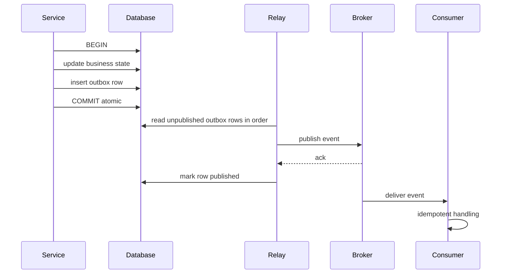

# The Outbox Pattern

Nearly every event-driven service contains this line of reasoning: "when the order is saved, publish `order.created`". That innocent "when" hides a distributed-systems trap — the database commit and the broker publish are two separate systems with no shared transaction, so one can succeed while the other fails. The **outbox pattern** fixes it with a beautifully boring move: write the event into an **outbox table in the same database transaction** as the business change, then let a separate **relay** process read the table and publish to the broker. Atomicity is borrowed from the one place you already have it — your database's ACID transaction — and the broker gets the event *eventually, but guaranteed*.

## The problem that created it

### The dual-write problem

A service must do two writes for one logical action: update its database and publish an event. Whatever order you pick, there is a crash window that breaks a different invariant:

**Ordering 1 — DB commit first, then publish:**

```
1. BEGIN; UPDATE orders ...; COMMIT;   ✅
2. 💥 crash / broker timeout / pod OOM-killed
3. publish("order.created")            ❌ never happens
```

The order exists, but the world was never told. Downstream consumers (ledger, notification, fraud) silently miss it. **State changed, event lost** — the worst failure in an event-driven system because nothing errors; the inconsistency is discovered by reconciliation or by a customer.

**Ordering 2 — publish first, then DB commit:**

```
1. publish("order.created")            ✅
2. 💥 crash / DB failure / constraint violation
3. BEGIN; UPDATE orders ...; COMMIT;   ❌ rolls back or never runs
```

The world was told about an order that does not exist. Consumers act on a phantom — a notification for a transfer that never committed, a ledger entry with no source row. **Event published, state lost.**

Retries don't fix either: retrying step 3 after a crash requires knowing the crash happened (the knowledge died with the process). Wrapping both in try/catch doesn't fix it: the crash can land *between* any two instructions. And the "obvious" fix — a distributed transaction across DB and broker ([[Two-Phase Commit and Distributed Transactions]]) — requires both sides to speak XA, couples availability, and is unsupported by most modern brokers (Kafka, SQS, Redis all refuse the role) — the industry verdict is to avoid it.

The insight that created the pattern: **you cannot make two systems commit atomically, but you can make one system record both facts atomically and propagate the second fact later.**

## What it solves

- **Atomicity of state-change + event**: the business row and the event row commit or roll back together — no lost events, no phantom events.
- **Crash safety without coordination**: no 2PC, no XA, no broker participation; the only transactional party is the database you already trust.
- **A durable publish retry point**: the relay can retry broker publishes forever; broker downtime becomes lag, not loss ([[Why Async Messaging Exists]]).
- **A free per-aggregate event sequence**: the outbox's auto-increment ID (or per-aggregate sequence column) defines a publish order that downstream can rely on ([[Message Ordering]]).

## How it works

### The write path

In one database transaction: perform the business write *and* insert a row into `outbox` — typically `(id, aggregate_type, aggregate_id, event_type, payload, created_at, published_at NULL)`. The event payload is fully rendered at write time (an intent-shaped event, not a row diff — contrast with [[Change Data Capture]]).

### The relay

A separate process moves outbox rows to the broker. Two implementations:

1. **Polling relay**: a loop selects unpublished rows in ID order (`WHERE published_at IS NULL ORDER BY id LIMIT n`), publishes each to the broker, then marks published (or deletes). Simple, works on any database; costs polling latency (typically sub-second to seconds) and DB read load; needs care to avoid concurrent pollers double-publishing (lock the batch with `FOR UPDATE SKIP LOCKED` on SQL databases, or findAndModify-style claims on MongoDB).
2. **CDC relay**: [[Change Data Capture]] (e.g., Debezium's outbox event router) tails the database's replication log, sees committed outbox inserts in commit order, and publishes them. Lower latency, no polling load, ordering from the log itself; costs CDC infrastructure. This combination — outbox + CDC — is the production-grade standard in the Kafka ecosystem.



### The fine print: at-least-once, not exactly-once

The relay has its own dual-write: publish to broker, then mark published. A crash between those two republishes the row on restart. This is irreducible — the outbox upgrades "maybe lost" to **at-least-once**, never to exactly-once ([[Exactly-Once Delivery Is a Lie]]). Consequence: **downstream consumers must be [[Idempotency|idempotent]]**, keyed on the outbox row ID (a perfect, stable dedup key — put it in the event envelope). The outbox does not remove the consumer-side discipline; it removes the *loss* and *phantom* cases.

### The fine print: ordering

- A **single** relay publishing in outbox-ID order gives clean global publish order — and is a throughput bottleneck and single point of failure (restart = lag, not loss).
- **Parallel relays** (or publishing a batch concurrently) reorder events. If order matters per aggregate, partition relay work by `aggregate_id` (and key broker messages by it) so each aggregate's events stay in one ordered lane — mirroring how [[Kafka Architecture|Kafka keys]] work.
- Broker-side retries can still reorder ([[Message Ordering]]); per-aggregate sequence numbers in the payload let consumers detect gaps and staleness.

### Housekeeping and the inbox cousin

- The outbox table grows forever unless pruned: delete or archive published rows (after a safety window) — an unpruned outbox eventually bloats the table and slows the hot path.
- Monitor the relay's lag (oldest unpublished row age) exactly like [[Backpressure and Flow Control|consumer lag]]; a dead relay is silent until someone misses events.
- The **inbox pattern** is the mirror image on the consumer side: on receipt, insert the event ID into an `inbox` table in the same transaction as the consumer's state change; a duplicate delivery hits the unique constraint and is skipped. Outbox makes publishing reliable; inbox makes consumption idempotent — together they give effectively-once *processing* across two services.

## Trade-offs

| You gain | You pay |
|---|---|
| No lost events, no phantom events | Publish latency: polling interval or CDC lag added |
| No 2PC, no broker coupling | An extra table on the hot write path (one more insert per transaction) |
| Durable retry through broker outages | A relay process to run, monitor, and fail over |
| Stable dedup key + sequence for free | At-least-once: consumers must dedup |
| Works with any broker | Outbox pruning, schema, and payload-versioning chores ([[Event Schema Evolution]]) |

## Failure modes

- **Relay down, nobody notices.** Writes succeed, outbox grows, no events flow. Detection: alert on oldest-unpublished-row age, not just relay process health.
- **Duplicate publishes from relay races.** Two relay instances (deploy overlap, split brain) claim the same rows without locking → every event published twice. Mitigate with row claims (`SKIP LOCKED` / atomic findAndModify) — and rely on consumer idempotency as the backstop, because a crash-between-publish-and-mark duplicates anyway.
- **Outbox written outside the transaction.** A refactor moves the outbox insert after the commit, or business logic uses a separate connection — the pattern silently degrades to plain dual-write. Guard with code review and an integration test that kills the process between the two writes.
- **Poison payload at the head.** A row the broker always rejects (too large, bad schema) can stall a strictly-ordered single relay — the outbox version of the [[Dead Letter Queues and Poison Messages|poison message]]; park such rows into an outbox-DLQ state after N attempts.
- **Pruning never built.** The outbox hits hundreds of millions of rows; the hot-path insert and the relay's indexed scan both degrade; the "fix" (bulk delete) locks the table during peak. Build pruning on day one.
- **MongoDB nuance**: multi-document transactions require a replica set and carry overhead; the alternative — embedding the event in the business document and relaying from there, or using change streams as the relay ([[Change Data Capture]]) — changes the shape but not the principle: one atomic write, one relay.

## When NOT to use it

- **The event is derivable and loss-tolerant** (cache warming, analytics pings): plain publish-after-commit with monitoring may be acceptable — honestly accept the small loss window instead of paying the pattern's cost everywhere.
- **The "event" is really a query**: if the only consumer is yourself five lines later, you don't need an event at all.
- **CDC on the business tables already feeds downstream** and consumers can live with row-shaped change events: you may not need a separate outbox — though you lose intent-shaped events and couple consumers to your schema ([[Change Data Capture]] discusses this trade).
- **A single datastore transaction covers all parties** (modular monolith, same DB): just write both rows; the "relay" can be an in-process after-commit hook with the outbox as retry storage — don't build the distributed version prematurely.

## In your stack

- MongoDB primary store: the outbox insert needs either a multi-document transaction (replica set — you have one) or an embedded-event design; Mongo **change streams** can serve as the CDC relay without Debezium, feeding SQS or [[Redis Streams]].
- Money movement + RBI audit expectations: the outbox table doubles as an audit artifact — an immutable, timestamped record of every event your service claimed to emit, reconcilable against the ledger. Prune to cold storage, not to /dev/null.
- Relay at 1 replica (your fleet's norm): acceptable *because* the outbox is durable — relay downtime is lag, not loss — but put an oldest-row-age alert on it; a single silent relay is the pattern's classic blind spot.
- Correlation: stamp `x-correlation-id` into the outbox row at write time so the eventual publish carries the originating request's trace ([[Distributed Tracing]]).

## Interview angle

The 60-second version: *"A service that updates its DB and publishes an event is doing a dual write: commit-then-publish loses events on a crash between the two; publish-then-commit emits phantom events for state that rolled back. You can't 2PC a database with Kafka, so instead you write the event into an outbox table in the same local transaction as the business change — atomicity comes from the DB — and a relay (a poller, or CDC like Debezium) publishes outbox rows to the broker and marks them done. The relay's own crash window makes it at-least-once, so consumers dedup on the outbox row ID; ordering needs a single relay or per-aggregate lanes. It trades a table, a relay, and some latency for the guarantee that state and events never diverge."*

Classic follow-ups:

- "Why not publish first and write the DB second?" — be ready to show *both* failure orderings; interviewers check you know each one's distinct damage.
- "Why not a transaction across DB and broker?" — [[Two-Phase Commit and Distributed Transactions|2PC]]: blocking protocol, needs XA on both sides, brokers don't play, availability coupling.
- "Exactly-once now?" — no: relay crash between publish and mark → duplicate; outbox eliminates loss and phantoms, idempotency handles the rest.
- "Poller vs CDC relay?" — poller: simple, any DB, adds latency and read load, needs locking; CDC: low latency, commit order for free, more infrastructure.
- "What's the inbox pattern?" — consumer-side mirror: event ID inserted in the same transaction as the consumer's write; unique constraint = dedup.

## Check yourself

> [!question]- Q: Explain both failure orderings of the dual-write problem and the distinct damage each causes.
> Commit-then-publish: crash after commit, before publish — state changed but no event; downstream never learns (missing ledger entry, no notification); silent divergence found only by reconciliation. Publish-then-commit: event sent, then the transaction fails or rolls back — downstream acts on state that doesn't exist (phantom): notification for a transfer that never happened, ledger entry with no source. One loses truth, the other manufactures falsehood; both are worse than a visible error.

> [!question]- Q: The relay publishes row 4017 to Kafka, then crashes before marking it published. What happens, and why is this acceptable?
> On restart the relay re-reads row 4017 as unpublished and publishes it again — a duplicate in the broker. Acceptable because the outbox's contract is at-least-once: consumers dedup on the outbox row ID (4017) carried in the event envelope, via an [[Idempotency|idempotency key]] or inbox table, making the second delivery a no-op. The alternative orderings (mark-then-publish) would convert this crash into a *lost* event — strictly worse.

> [!question]- Q: Your team runs two relay pods for availability and starts seeing every event twice even without crashes. Diagnose and fix.
> Both relays select the same unpublished rows (no claim protocol) and each publishes them. Fix: make row claiming atomic — `SELECT ... FOR UPDATE SKIP LOCKED` batches in SQL, or an atomic claim-update (set `claimed_by`, `claimed_at`) in MongoDB — so each row has one publisher; add a claim-expiry so a crashed claimant's rows are reclaimed. Keep consumer dedup regardless: claims shrink duplicates, the crash window still exists.

> [!question]- Q: Mini-design — add reliable `transfer.initiated` / `transfer.completed` events to an existing Spring Boot + MongoDB transfer service feeding SQS. Sketch the pieces and the two alerts you'd ship with it.
> (1) In the service's Mongo transaction (replica set): write/update the `transfers` document and insert an `outbox` document `{_id, aggregateId: transferId, seq, type, payload, correlationId, createdAt, publishedAt: null}`. (2) Relay: either a scheduled poller claiming batches atomically and publishing to SQS (message dedup/group ID = transferId for FIFO lanes), or a Mongo change-stream listener on the outbox collection. (3) Consumers: inbox-table dedup on outbox `_id`. (4) Pruning: TTL-index or archival job on published rows after N days (archive, not delete, for audit). Alerts: oldest-unpublished-outbox-age (relay health, loss-equivalent lag) and outbox collection size vs pruning watermark.

## Sources

- microservices.io — "Pattern: Transactional outbox" and "Pattern: Transaction log tailing" (Chris Richardson) — the canonical write-ups.
- Debezium documentation — "Outbox Event Router" (the CDC-relay implementation).
- *Designing Data-Intensive Applications*, Kleppmann — Ch. 11 (keeping systems in sync, dual writes); Ch. 9 (atomic commit and why cross-system transactions are avoided).
- Gunnar Morling, "Reliable Microservices Data Exchange With the Outbox Pattern" — Debezium blog, 2019.
