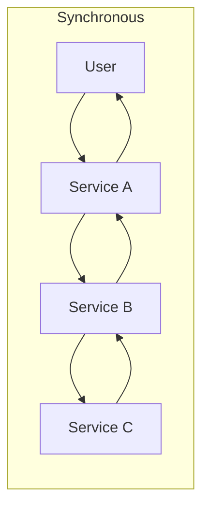
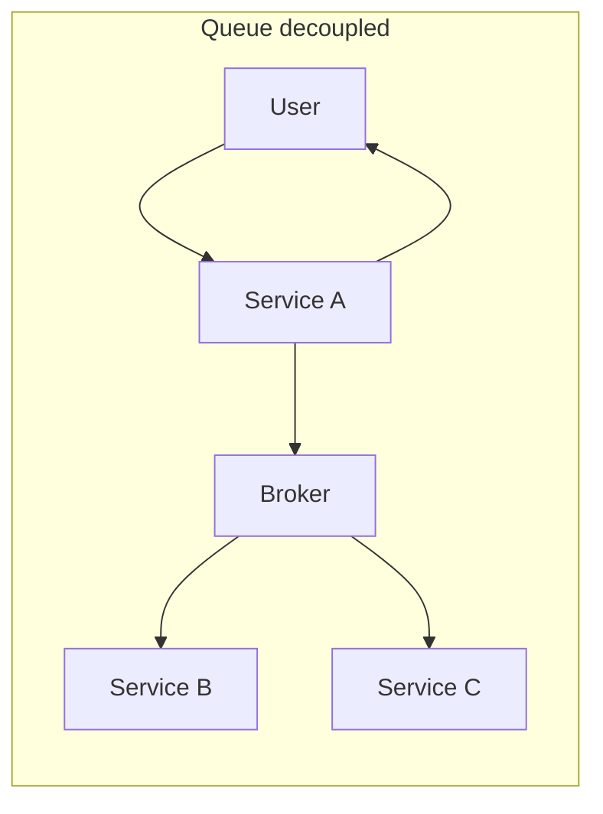

# Why Async Messaging Exists

Asynchronous messaging exists because chaining synchronous calls between services makes the whole system as slow as the *sum* of its parts and as available as the *product* of its parts — and forces every component to be up at the same moment. A message broker breaks those couplings: the producer hands work to a durable intermediary and moves on; the consumer processes it when it can. Everything else in this module — [[Delivery Semantics]], [[Message Ordering]], [[The Outbox Pattern]] — is the price you pay for that decoupling. This note is about why the price is so often worth paying.

## Why this matters

Every microservice architecture starts as a set of synchronous HTTP calls, because synchronous is the natural way to write code: call, wait, use the result. The problems only appear as the call graph deepens and traffic grows, and by then they are architectural, not local. Three distinct problems hide inside a synchronous chain, and it pays to be able to name each one separately, because they have different fixes and interviewers probe them separately.

### Problem 1: latency adds up

If service A calls B, which calls C, which calls D, the user-facing latency is at least `latency(B) + latency(C) + latency(D)` plus network hops. Worse, tail latencies compound: even if each service has a good p99, the chain's p99 is dragged down by whichever hop happens to be slow on that request — a request that touches many services has many chances to hit *someone's* bad percentile (see [[Latency vs Throughput vs Bandwidth]]).

The arithmetic is worth doing once, because it is more brutal than intuition suggests. Suppose five hops, each independently exceeding its own p99 one time in a hundred. The chance a request escapes *every* tail is:

```
0.99^5  ≈  0.951   →  about 4.9% of requests hit at least one hop's p99 tail
```

A latency budget you designed as a 1-in-100 event is a 1-in-20 event by the time it is five services deep, and nothing in any individual service's dashboard shows it — each one is comfortably meeting its own p99. Dean and Barroso's "The Tail at Scale" (*Communications of the ACM*, 2013) pushes the same arithmetic to its famous conclusion: a request that must touch 100 servers, each with a p99 of one second, takes more than a second for `1 − 0.99^100 ≈ 63%` of requests. **Tail latency is a property of the call graph, not of any service in it.** Deep synchronous chains make low, predictable latency structurally impossible.

### Problem 2: availability multiplies down

Independent components in series multiply their availabilities (see [[Availability Reliability Durability]]). Five services at 99.9% each give the chain roughly:

```
0.999^5 ≈ 0.995  →  from ~43 min/month of downtime each to ~3.6 h/month for the chain
```

Every service you add to a synchronous chain makes the whole *less* available than its weakest member. And it is worse than the arithmetic suggests: a slow dependency is often more damaging than a dead one, because callers hold threads and connections open waiting, exhausting their own pools and cascading the failure upstream (see [[Failure Modes in Distributed Systems]] and [[Timeouts Retries and Exponential Backoff]]).

### Problem 3: temporal coupling

A synchronous call requires both parties to be running, reachable, and responsive *at the same instant*. If the notification service is deploying when the payment service wants to tell it about a transaction, the payment service must choose between failing its own request, retrying inline (holding resources), or dropping the notification. **Temporal coupling** means your uptime windows must intersect — and with many services, some window is always closed.

## How it works

### What a queue changes

Put a durable broker between producer and consumer and all three problems transform:

- **Latency:** the producer's latency is now just "write to broker" — typically a few milliseconds — regardless of how slow downstream processing is. The user gets an acknowledgment that the work is *accepted*, not *done*.
- **Availability:** the producer depends only on the broker (which is built to be highly available), not on every downstream consumer. Consumers can be down for minutes and nothing is lost; messages wait.
- **Temporal coupling:** gone. Producer and consumer never need to be alive simultaneously. Deploys, crashes, and slowdowns on one side stop being incidents for the other side.





In the first picture the user waits for the whole chain and the chain fails if any box fails. In the second, the user waits only for A, and B and C consume at their own pace.

### Load leveling: the fourth win

Traffic is bursty; capacity is provisioned. A synchronous system must be provisioned for *peak* load or it falls over exactly when it matters. A queue acts as a **buffer**: bursts pile up in the broker and consumers drain them at a steady, sustainable rate. This is called **load leveling** (or peak shaving). A payments spike at month-end salary day becomes a longer queue, not a dropped request — as long as the backlog drains before it matters (that caveat is the subject of [[Backpressure and Flow Control]]).

### Producer-consumer decoupling

Beyond time and load, messaging decouples *knowledge*. A producer publishing an `order.placed` event does not know — or care — whether one consumer or five consume it. Adding a new consumer (fraud scoring, analytics, a notification) requires zero changes to the producer. Compare that with synchronous: every new downstream need means another call added to the producer's code, another dependency, another failure mode. This is the foundation of event-driven architecture and the fan-out patterns in [[SQS and SNS]] and [[Kafka Architecture]].

### What this looks like at 3am

The page says the **login** service is down. The login service is not down.

Its dashboard shows p99 response time at 30 seconds, error rate climbing, and CPU at 5%. Five percent. The service is not computing anything; it is waiting. The thread-pool gauge is the one that explains it: 200 of 200 worker threads busy, zero available — a Spring Boot service with the default Tomcat maximum of 200 worker threads.

Trace one request and the chain appears: login synchronously calls a profile-enrichment endpoint, which synchronously calls a partner KYC API that has stopped responding — not refusing connections, which would fail fast, but accepting them and never replying. Each login request parks a thread on a socket read. With a 30-second timeout, the service's effective throughput becomes:

```
200 threads ÷ 30 s per request  ≈  6.7 requests/s   against normal traffic of ~400/s
```

Every request beyond the first seven per second queues behind an exhausted pool, so a dependency *three hops away*, which the user never asked about, has taken down authentication for the whole product. This is Problem 2 in its real clothing: a slow dependency is worse than a dead one, because dead returns a connection error in milliseconds and slow consumes the caller's scarcest resource — threads — until there are none left.

Two fixes, and they are different in kind. The immediate one is defensive and synchronous: aggressive timeouts, a [[Circuit Breakers|circuit breaker]] on the enrichment call, and a [[Bulkheads and Isolation|bulkhead]] so enrichment cannot consume the whole pool ([[Timeouts Retries and Exponential Backoff]]). The structural one is this note's subject: profile enrichment was never needed to answer "is this password correct". Publishing an `user.logged_in` event and letting enrichment happen on its own time removes the hop from the critical path entirely — and a hop that is not on the critical path cannot take it down.

## Trade-offs

| You gain | You pay |
|---|---|
| Producer latency independent of consumer speed | No immediate result — caller gets "accepted", not "done" |
| Availability decoupled from downstream health | A new critical dependency: the broker itself |
| Load leveling through bursts | Backlogs and consumer lag to monitor ([[Backpressure and Flow Control]]) |
| Add consumers without touching producers | Harder to trace a request end-to-end ([[Distributed Tracing]]) |
| Natural retry point | Duplicates and reordering: [[Delivery Semantics]], [[Message Ordering]] |
| Failure isolation between services | Eventual consistency — readers may see pre-event state |

Two costs deserve emphasis because they surprise people:

- **You trade request-response errors for silent lag.** A failing synchronous call returns a 500 you can see. A failing consumer just makes the queue grow — invisibly, unless you alert on lag. Async systems need *better* observability, not less.
- **"Fire and forget" is never actually forget.** Someone must decide what happens when the consumer permanently cannot process a message ([[Dead Letter Queues and Poison Messages]]) and how to avoid losing the message between your database write and your publish ([[The Outbox Pattern]]).

## Common misconceptions

- **"Async is faster."** It is not. The same work happens, plus a broker round-trip, plus queue dwell time — so *end-to-end completion* is reliably **slower** than the synchronous version. What async changes is **who waits**: the user's response time collapses to "write to broker", and the remaining latency moves off the critical path where it is no longer the user's problem. Say "the user waits less", never "the system is faster"; interviewers notice.
- **"A queue adds capacity."** A queue adds *buffering*. If the average arrival rate exceeds the average drain rate, a queue changes nothing except where the failure becomes visible and how long it takes to notice — a backlog instead of a 503. Buffers absorb bursts; they do not create throughput ([[Backpressure and Flow Control]]).
- **"Async decouples the services."** It decouples them **in time**, not in meaning. Producer and consumer still share a message schema, and a breaking change to that schema breaks the consumer exactly as a breaking API change would ([[Event Schema Evolution]]). If your producer still cannot deploy without coordinating a consumer deploy, you have a [[The Distributed Monolith Anti-Pattern|distributed monolith]] with a broker inside it.
- **"The queue guarantees the work gets done."** It guarantees *durable custody of a request to do work*. If the consumer can never succeed — bad payload, deleted reference, permanent downstream failure — the queue faithfully stores a message that will fail forever ([[Dead Letter Queues and Poison Messages]]). Durability of the request is not completion of the work.
- **"We added a queue, so the system is more resilient."** You removed a set of coupled failure modes and added a new one: the broker is now a dependency you cannot lose, with its own capacity, retention, and operational burden. Resilience improved for *consumer* failures specifically; it did not improve in general.
- **"Async means we can ignore ordering and duplicates."** The opposite — moving to a broker is precisely what introduces at-least-once redelivery and weak ordering as everyday realities ([[Delivery Semantics]], [[Message Ordering]]). The decoupling is bought with those two obligations.

## When NOT to use it

Synchronous is still the right call surprisingly often:

- **The caller genuinely needs the answer to proceed.** An authorization check, a balance lookup, a fraud decision that gates the response — if the user cannot be answered without the result, a queue only adds latency and complexity. You would end up building request-reply over messaging, which is a worse RPC.
- **Read paths.** Queries are naturally synchronous. Messaging is a tool for *writes and side effects*, not reads.
- **Strong consistency is required across the step.** If step B must be visible the instant step A commits, async's eventual consistency is a bug, not a feature. (Sometimes the fix is rethinking the requirement; sometimes it is a transaction.)
- **Low-traffic internal tools.** Two services, ten requests a minute, same team: a synchronous call with a [[Timeouts Retries and Exponential Backoff|timeout and retry]] is simpler to build, debug, and operate. Brokers are infrastructure with real operational cost.
- **When you would need the reply anyway.** If the producer blocks waiting for a "done" message, you have rebuilt synchronous with extra steps — a classic [[The Distributed Monolith Anti-Pattern|distributed monolith]] smell.

A useful default: **synchronous for queries and for commands whose result the caller must return; asynchronous for side effects, fan-out, and anything that can tolerate seconds of delay.**

## In your stack

- Your journey — RabbitMQ → Kafka → SQS → planned [[Redis Streams]] — is four different answers to this same problem. The *why* in this note never changed; only the broker and its [[Message Queues vs Event Logs|semantics]] did.
- Fintech makes the "accepted vs done" distinction sharp: a money transfer API that enqueues work must still give the user a truthful status. That usually means persisting a transaction record (state `PENDING`) synchronously, then doing the movement async — which is exactly where [[The Outbox Pattern]] enters.
- Services pinned at 1 replica make temporal decoupling *more* valuable, not less: a single-replica consumer being down during deploys is routine, and a queue is what makes those windows harmless. Be precise about which side the replica count protects, though — it buys nothing for a **synchronous** dependency, where one replica means the callee is genuinely unavailable for the whole rollout and every caller eats timeouts. The honest reading of the fleet is that async hops survive 1 replica gracefully and synchronous hops do not, which makes "is this call on someone's critical path?" the question that decides whether 1 replica is a cost saving or a latent outage.
- Kong, CloudFront and ALB sit in front of the synchronous paths only. Anything you move behind a broker leaves the edge's view entirely — which is exactly why async systems need [[Distributed Tracing|context propagated through message attributes]] and lag alerts, or the part of the request you made invisible to the user also becomes invisible to you.
- Correctness-beats-latency (RBI-regulated money movement) cuts both ways: async gives you durable retry, but it also means you must design for duplicates ([[Idempotency]]) because at-least-once delivery is the realistic contract ([[Exactly-Once Delivery Is a Lie]]).

## Interview angle

The 60-second version: *"Synchronous chains add latencies and multiply unavailability — five 99.9% services in series are ~99.5% together — and they couple services in time: both ends must be up at once. A message broker decouples them: the producer's latency becomes 'write to broker', availability depends only on the broker, bursts are absorbed as backlog, and new consumers can be added without touching producers. The costs are eventual consistency, duplicate handling, and a new critical piece of infrastructure to operate."*

Classic follow-ups:

- "When would you keep a call synchronous?" — caller needs the result; reads; strict consistency across the step.
- "What's the first metric you'd put on an async system?" — consumer lag ([[Backpressure and Flow Control]]).
- "The user needs to know the transfer succeeded — how, if it's async?" — persist a state machine row synchronously, process async, expose status via polling/webhook/push; see [[Saga Pattern]] for the multi-step version.
- "How do you avoid losing the event if the DB commit succeeds but the publish fails?" — [[The Outbox Pattern]].

## Check yourself

> [!question]- Q: Explain to a new teammate why a chain of five synchronous services is less available than any one of them.
> Availabilities in series multiply because the chain works only if *every* link works. Five independent services at 99.9% give 0.999⁵ ≈ 99.5% — roughly 3.6 hours of expected unavailability per month versus ~43 minutes for one service. Adding links can only lower the product. And in practice it is worse: a slow (not dead) link holds caller threads open and can cascade failure upstream.

> [!question]- Q: What happens if the consumer of a queue is down for 20 minutes? Contrast with the same outage in a synchronous design.
> With a queue: messages accumulate in the broker; producers are unaffected; when the consumer returns it drains the backlog — the incident is invisible to users as long as the work tolerates 20+ minutes of delay and the backlog drains faster than it grows. Synchronous: every request during those 20 minutes fails or times out, holding resources in callers and potentially cascading. The queue converts an availability incident into a latency incident.

> [!question]- Q: A product manager asks you to make the "send KYC verification email" step async. What must you check before agreeing?
> (1) Does anything downstream need the email to have been *sent* before responding? (2) Is a delay of seconds-to-minutes acceptable for the user experience? (3) What happens on permanent failure — do we need a [[Dead Letter Queues and Poison Messages|DLQ]] and an alert? (4) Is the email send idempotent, since at-least-once delivery may send the message twice ([[Idempotency]])? (5) How is the publish made atomic with the KYC state change ([[The Outbox Pattern]])? If all five have answers, async is right — side-effect work off the critical path is the canonical use case.

> [!question]- Q: A colleague proposes making the money-transfer API async "so transfers are faster." Transfers currently take 900 ms end to end. What will actually change, and what would you say to him?
> End-to-end transfer time will get *slower*, not faster — the same ledger write, fraud check, and partner-bank call still have to happen, and now there is a broker hop and queue dwell time on top. What improves is the **API response time**, which drops to the cost of validating the request, persisting a `PENDING` transaction, and enqueueing — perhaps 40 ms — because the user stops waiting for the partner bank. That is a real and valuable win, but it is a different claim, and the difference matters for the product: the user now gets "accepted", not "done", so the app must show a pending state and a path to the final outcome. Three obligations arrive with it: the publish must be atomic with the `PENDING` write ([[The Outbox Pattern]]), the consumer must be idempotent because redelivery is the normal contract ([[Delivery Semantics]], [[Idempotency]]), and someone must alert on queue age — because the failure mode changes from a visible 500 into an invisible backlog where a transfer sits in `PENDING` for an hour and nobody is paged. Agree to it on those terms, and reject the word "faster".

> [!question]- Q: Mini-design — a salary-day spike sends 50x normal transfer-initiation traffic for 2 hours. Sketch how a queue helps and what new risk it introduces.
> Accept transfers synchronously only as far as "validated and persisted as PENDING", enqueue the movement work, and return. Consumers drain at sustained capacity; the spike becomes backlog instead of errors. New risks: backlog may take hours to drain (users see PENDING for a long time — set expectations in the product), lag must be alerted on, and the broker becomes the component you cannot lose — size and replicate it accordingly. If drain time exceeds business tolerance, you still need more consumer capacity; a queue buffers load, it does not create capacity.

## Sources

- *Designing Data-Intensive Applications*, Kleppmann — Ch. 11 (Stream Processing) frames messaging as dataflow; Ch. 8 for why partial failure makes synchronous coupling dangerous.
- Enterprise Integration Patterns (Hohpe & Woolf) — Message Channel, Point-to-Point vs Publish-Subscribe; the vocabulary most brokers borrow.
- Microsoft Azure Architecture Center — "Queue-Based Load Leveling pattern" (the canonical write-up of load leveling).
- AWS Builders' Library — "Avoiding insurmountable queue backlogs" (the honest counterpoint: queues defer work, they don't do it).
- Jeffrey Dean and Luiz André Barroso, "The Tail at Scale," *Communications of the ACM*, Vol. 56 No. 2 (2013) — why tail latency is a property of the call graph rather than of any one service.
- AWS Builders' Library — "Timeouts, retries, and backoff with jitter" and "Using load shedding to avoid overload" — the synchronous-side defences that async removes the need for.
