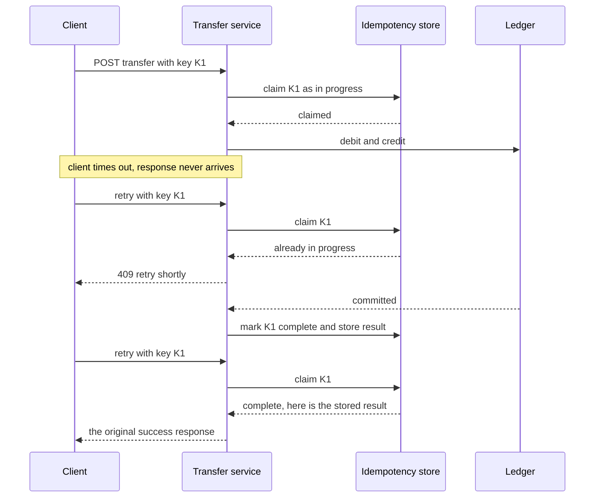

# API Design and Versioning

An API is a **promise**: once another team, app, or partner codes against it, every detail they can observe — fields, types, status codes, ordering, error shapes — becomes something you can break. API design is therefore less about elegant URLs and more about *change management*: making promises you can keep, evolving them without breaking consumers you can't redeploy, and saying no to breakage by default. This note covers the contract disciplines that matter in practice: versioning, additive change rules, pagination, idempotency keys, error contracts, and rate-limit communication.

## Why this matters

Inside a microservices fleet, APIs are the seams everything flows through ([[Communication Patterns Between Services]]); a breaking change in one service's API is a production incident in somebody else's. Externally it's worse: mobile apps take weeks to roll out through app stores (and some users never update), and partners integrate once and never touch the code again — you cannot coordinate a breaking change with consumers you cannot see. Teams that lack change discipline end up either breaking clients repeatedly or frozen, afraid to touch anything — and forced lockstep upgrades across services are a hallmark of [[The Distributed Monolith Anti-Pattern]]. Interviewers test this with "how would you evolve this API?" and "what happens to old mobile clients?".

## How it works

### Versioning: where the version lives

When you must make an incompatible change, you run old and new contracts side by side. The two main placements:

- **URI versioning** — `/v1/accounts`, `/v2/accounts`. Explicit, visible in logs and dashboards, trivially routable at the [[API Gateway]], cacheable per version ([[CDN]] and HTTP caches key on URL). Purists object that the resource hasn't changed identity, only its representation — but operability usually wins, which is why URI versioning dominates public APIs.
- **Header versioning** — `Accept: application/vnd.myapi.v2+json` or a custom `Api-Version: 2026-10-01` header (Stripe's date-based style). Keeps URLs stable; versions per-request rather than per-URL-tree. Costs: invisible in access logs unless you log the header, harder to demo with a browser, cache keys need `Vary`.

Either works; what matters is the **policy around it**: version the *contract*, not every deploy; bump the major version only for breaking changes; and treat a new major version as a last resort, because every live version multiplies test matrices, docs, and support load. Stripe's model is instructive: a pinned version per account, translation layers between versions, and years-long support windows — that's the real cost of "just add v2".

### Additive, non-breaking change discipline

The cheapest version is the one you never need. **Non-breaking (safe) changes**: adding a new optional request field, adding a response field, adding a new endpoint, adding a new enum value *only where clients were told to tolerate unknowns*, relaxing a validation. **Breaking changes**: removing or renaming a field, changing a type or format, making an optional field required, changing a status code or error shape, changing the meaning of an existing field (the sneakiest — the schema validates but the semantics lie).

Two rules make additive evolution actually work:

1. **Consumers must ignore unknown fields** (tolerant reader). Configure Jackson et al. to not fail on unknown properties; never deserialize strictly against a closed schema.
2. **Producers must never infer meaning from field absence vs null vs default** without documenting it — the ambiguity bites during rollouts when old and new writers coexist.

Add **deprecation policy** as part of the contract: mark the field/endpoint deprecated in the spec (OpenAPI `deprecated: true`), emit a `Deprecation`/`Sunset` header, measure who still calls it (per-consumer metrics — you can't retire what you can't attribute), announce a sunset date, and only remove after usage hits zero or the window closes. Deprecation without measurement is just hoping. The same evolution mindset applies to event payloads — [[Event Schema Evolution]] is this note's sibling for async contracts.

### Worked example: retiring a field without breaking anyone

"Rename `mobileNumber` to `phoneNumber`" is one line in the producer and a multi-quarter programme across live clients. The **expand-and-contract** (parallel change) sequence, and the measurement that sets its dates:

1. **Expand.** Add `phoneNumber` alongside `mobileNumber`. Both are returned, both are accepted on write, and the server treats them as one value. Nothing breaks, because nothing was removed. Mark the old field `deprecated: true` in the spec and start emitting a `Deprecation` header.
2. **Migrate what you control.** Move your own services and SDKs first — they are the consumers you can redeploy. Then announce the change and a sunset date to everyone else.
3. **Measure.** Instrument reads of the old field *per consumer*: count by client identity and app version. This step is what converts a deprecation into a plan.
4. **Contract.** Remove the field when measured usage reaches zero, or when the announced window closes and the remaining consumers have been contacted individually.

Step 4's date comes from your own decay curve, not a rule of thumb. Suppose instrumentation shows **42,000 of 600,000 daily sessions** still on app builds that read the old field — that is **7.0%**, so removing it today breaks 42,000 sessions a day. Track the weekly trend rather than guessing: if the figure halves every three weeks, 7.0% is ~3.5% at three weeks, ~1.75% at six, ~0.9% at nine and ~0.4% at twelve. At that point the decision is "a few thousand broken sessions versus carrying this field forever", which is a product trade-off with a number attached instead of an argument between engineers.

Mobile is the hard case precisely because the tail never reaches zero — some installs are never updated. The honest endpoint is usually "below an agreed threshold, with a forced-upgrade prompt for the remainder", not "zero". Notice also what makes any of this possible: the *expand* step. Had the rename shipped as a rename, there would have been no curve to measure, only an incident.

### Pagination: offset vs cursor

Unbounded list endpoints are outages waiting to happen; paginate everything that can grow.

- **Offset pagination** (`?offset=5000&limit=50`, or page numbers): simple, allows "jump to page 37". Two real problems: (1) **the database does the skipped work** — `OFFSET 5000` reads and discards 5000 rows ([[Database Indexes|indexes]] don't save you; deep pages get linearly slower, and in MongoDB `skip()` behaves the same); (2) **unstable under writes** — an insert/delete between page requests shifts every subsequent row, so readers see duplicates or miss items.
- **Cursor (keyset) pagination**: each page returns an opaque cursor encoding the last item's sort key (`created_at` + tiebreaker ID); the next request says "items after this key", which the database serves via an index seek — constant cost at any depth, and stable under concurrent inserts. Costs: no random page jumps, cursor must encode a *unique, immutable* sort key, and the sort order is fixed per cursor.

Default to **cursor** for anything user-facing, growing, or hot; offset is acceptable for small, admin-only, rarely-written datasets. Return cursors as opaque strings (base64 of the key material) so you can change the encoding without breaking clients — an exposed raw key becomes part of the contract.

**Filtering**: expose explicit, documented filter parameters (`?status=ACTIVE&created_after=...`) rather than a generic query language; validate and index what you accept, because every filter combination you allow is a query shape you must serve forever ([[N+1 Queries and ORM Pitfalls]] has the ORM-side cautionary tales).

### Idempotency keys on POST

`GET`, `PUT`, and `DELETE` are idempotent by HTTP semantics; `POST` ("create a transfer") is not — and networks fail *after* the server commits but *before* the client hears ([[Network Partitions and Timeouts]]). A client that retries a timed-out POST may create the thing twice. The fix: the client sends an **`Idempotency-Key`** header (a UUID per logical operation); the server atomically records the key with the operation's result and, on a retried key, returns the stored result instead of re-executing. Keys get a TTL (Stripe's v1 API honours a key for 24h, its v2 API for 30 days, as of 2026), and a retry with the same key but *different body* should be rejected (409/422) — same key means "the same operation", not "deduplicate whatever". This is the API-layer face of [[Idempotency]], and in fintech it is table stakes: a double-charged transfer is an incident with a regulator's name on it.

The subtlety most implementations miss is the **concurrent** retry — the second request arriving while the first is still executing, which is exactly what an aggressive client timeout produces. A store that only records results after completion has nothing to match against, so both requests execute. The mechanism needs three states, not two: the key is *claimed* before the work starts, *completed* with the stored result afterwards, and a request that finds a claimed-but-incomplete key is told to retry shortly rather than being allowed through.



Two requirements fall out of that picture. The claim must be **atomic** — a unique-index insert or a conditional write, never read-then-write ([[Distributed Locking]] is the heavier alternative you do not need here). And the *result* must be stored in the same commit as the business effect, or a crash between the two leaves an effect with no recorded key, and the next retry executes again.

### Error contract

Errors are API surface too — clients write code against them. The standard shape is **RFC 9457 Problem Details** (`Content-Type: application/problem+json`, obsoleting RFC 7807):

```json
{
  "type": "https://api.example.com/errors/insufficient-funds",
  "title": "Insufficient funds",
  "status": 422,
  "detail": "Balance 120.50 is less than transfer amount 500.00",
  "instance": "/transfers/9f1b",
  "code": "INSUFFICIENT_FUNDS"
}
```

Principles: a stable, machine-readable error `type`/`code` that never changes meaning (clients branch on it — it's as much contract as any field); human text in `detail` that may change freely; correct status-code families (4xx = the caller must change something, 5xx = the server failed, don't make clients parse prose to tell them apart); one error envelope for the whole fleet; and never leak internals (stack traces, SQL) through error bodies.

### Rate-limit headers

If you throttle ([[Rate Limiting]]), *say so in-band* so well-behaved clients can back off instead of hammering: return `429 Too Many Requests` with `Retry-After`, plus quota headers on every response — the de-facto `X-RateLimit-Limit` / `X-RateLimit-Remaining` / `X-RateLimit-Reset` trio (an IETF draft proposes standardised `RateLimit` fields without the `X-` prefix; it is still a draft, so the `X-` trio remains what clients expect). Undocumented throttling turns into clients with aggressive blind retries — a self-inflicted [[Timeouts Retries and Exponential Backoff|retry storm]].

### gRPC/protobuf compatibility in one paragraph

Protobuf encodes fields by **tag number**, not name, which defines its evolution rules: never change a field's tag, and treat type changes as breaking (a handful of numeric types are wire-compatible with each other, but the exceptions are not worth memorising); never reuse a deleted field's tag (mark it `reserved`); renaming is wire-safe (names aren't on the wire) but breaks JSON transcoding and generated code; add fields freely (unknown fields are preserved/ignored — proto3 fields are optional by nature); and removing a service method or changing its request/response message incompatibly is a breaking change exactly like REST. The schema file plus a CI compatibility check (e.g., `buf breaking`) gives [[REST vs gRPC vs GraphQL|gRPC]] a mechanical answer to "is this change safe?" that JSON APIs approximate with OpenAPI diffing.

## Trade-offs

| Decision | Option A | Option B |
|---|---|---|
| Version placement | URI: visible, routable, cacheable | Header: clean URLs, per-request, needs `Vary` |
| Version strategy | Rare major versions + additive discipline | Frequent versions: consumer clarity, producer N-version maintenance |
| Pagination | Cursor: O(1) deep pages, write-stable, no jumps | Offset: page jumps, simple, degrades and drifts |
| Error detail | Rich problem+json: debuggable | Minimal: smaller surface, less leak risk |
| Idempotency storage | Server-side keys: safe retries, storage + atomicity cost | None: simpler, double-execution on retry |

## Common misconceptions

- **"We version, so we can break things."** Every live major version is a permanent product; versioning is the *expensive escape hatch*, additive discipline is the plan.
- **"Internal APIs don't need this rigor."** Internal consumers deploy on their own schedules too; the moment you require consumers to upgrade when you deploy, you've built lockstep coupling.
- **"Adding an enum value is always safe."** Only if consumers were contractually told to handle unknown values; a `switch` with no default in a consumer turns your "additive" change into their outage.
- **"Idempotency keys are only for payments."** Any non-idempotent POST a client might retry (order creation, KYC submission, device registration) deserves one.

## Failure modes

- **The silent semantic break.** The schema is identical but a field's *meaning* changed — `status: COMPLETED` now set at authorisation rather than at settlement. Every validator passes and every consumer quietly does the wrong thing. *The signal*: a downstream business metric moves with no downstream deploy. *Confirming it*: line the metric's inflection up against the producer's deploy timeline. Schema diffing cannot catch this by construction, which is why semantic changes need a human-written changelog and are the one case where a version bump is cheaper than cleverness.
- **The intolerant reader.** One consumer deserialises strictly, so your "additive" new response field is their 500. *The signal*: errors appearing in exactly one consumer immediately after a producer deploy that added a field. *Confirming it*: the consumer's stack trace names the unrecognised property. Prevention is contractual rather than hopeful — tolerant-reader configuration plus a contract test that deliberately sends an unknown field.
- **Idempotency keys scoped to the attempt.** A key generated per HTTP call instead of per user intent is a fresh key on every retry, which disables the whole mechanism while looking implemented. *The signal*: duplicate records whose rows carry *different* keys. *Confirming it*: find where the key is created in the client — at the point the user pressed the button, or inside the HTTP wrapper. The second is the common bug.
- **TTL shorter than the retry window.** A client backs off past the key's expiry, retries, and the operation runs a second time. *The signal*: duplicates clustered just after long outages rather than scattered. *Confirming it*: compare duplicate timestamps against the TTL. The fix is a TTL longer than the longest retry window any client implements, plus a uniqueness constraint on a business key as a backstop that never expires.
- **Non-unique cursor sort key.** A cursor keyed on `created_at` alone skips or repeats rows that share a timestamp. *The signal*: users reporting items missing from long lists, or a paged total that disagrees with a count. *Confirming it*: look for ties on the sort column at page boundaries — bulk imports and batch jobs produce them in quantity. Fix: a composite key with a unique tiebreaker.
- **Throttling without headers.** Clients receive 429s carrying no `Retry-After` and retry blindly, so the limiter amplifies load rather than relieving it. *The signal*: 429 rate and inbound request rate climbing together ([[Rate Limiting]]). *Confirming it*: check whether the 429 responses carry the header at all — frequently the limiter is correct and only the response is impoverished.

## In your stack

- Kong fronts your APIs: URI versioning routes cleanly there, and rate-limit headers/429s should be emitted by Kong's rate-limiting plugins consistently across services rather than per-service reinventions ([[API Gateway]]).
- Mobile-first fintech means your oldest live client is months old: tolerant-reader Jackson config (`FAIL_ON_UNKNOWN_PROPERTIES=false`) and additive-only changes on app-facing APIs are survival, not style.
- Idempotency keys on money-moving POSTs pair with your dedupe stores: Redis (fast TTL'd key→result) or a Mongo unique index on the key — the write of "key seen" and the business effect must be atomic, which is the same discipline as [[The Outbox Pattern]].
- Error contract: one problem+json envelope fleet-wide with a stable `code` enum pays off in Kong logs, client SDKs, and support tooling; include the `x-correlation-id` in error responses so users' screenshots are traceable ([[Distributed Tracing]]).
- RBI-regulated flows add a wrinkle: deprecated fields on regulated reports may have mandated retention — deprecation windows are sometimes set by compliance, not by usage metrics.
- Additive-only discipline protects your *own rollout*, not just external consumers, even at 1 replica. A Kubernetes Deployment with `replicas: 1` and the default rolling strategy still surges: `maxSurge: 25%` rounds **up** to 1 while `maxUnavailable: 25%` rounds **down** to 0, so a new pod starts before the old one is terminated and both contract versions serve traffic for a window of seconds. Any change that is breaking is breaking *during your own deploy*, which is the cheapest possible argument for the rule.
- Idempotency keys in MongoDB: make the claim a unique-index insert on the key, and store the response document on the same record. At one replica there is no second instance to race with, but retries from Kong, the mobile client, and a scheduled job all still race with each other — single-replica is not single-writer.

## Interview angle

The 60-second answer: *"I treat an API as a promise and optimize for never needing v2: additive-only changes, tolerant readers, explicit deprecation with usage measurement and sunset headers. When a break is unavoidable: URI or header versioning — URI for operability, header for URL stability — with old versions maintained until measured usage dies. Collections: cursor pagination, because offset degrades linearly with depth and drifts under writes. Non-idempotent POSTs take an Idempotency-Key so network retries can't double-execute — critical for payments. Errors are contract too: problem+json with stable machine codes. And throttling is communicated in-band with 429 + rate-limit headers so clients back off instead of retry-storming."*

Classic follow-ups: "Offset vs cursor — why exactly is offset slow?" (the DB reads and discards skipped rows); "How does the server implement idempotency keys?" (atomic key-result store, conflict on same-key-different-body, TTL); "How do you retire a field?" (deprecate → measure → sunset date → remove); "Proto rules?" (tags immutable, `reserved` on delete, additive fields safe).

## Check yourself

> [!question]- Q: Explain to a new engineer why offset pagination gets slower on deep pages and shows duplicates under writes, and how cursors fix both.
> `OFFSET 5000 LIMIT 50` makes the database walk 5050 index entries/rows and throw away 5000 — cost grows linearly with depth. And because offsets count *positions*, a row inserted or deleted between two page fetches shifts every later position: readers see a row twice or never. A cursor encodes the last item's unique sort key ("after created_at X, id Y"); the next page is an index *seek* to that key — constant cost at any depth — and since keys don't shift when other rows are inserted, iteration stays stable. The trade: no jumping to page 37, fixed sort order per cursor.

> [!question]- Q: Scenario — a client POSTs a transfer, the connection times out, and the client retries. Walk through what happens with and without idempotency keys.
> Without: the first request may have committed before the timeout (the client can't distinguish "never arrived" from "response lost" — [[Network Partitions and Timeouts]]); the retry creates a second transfer, money moves twice. With: both requests carry the same `Idempotency-Key`; the server atomically records key→result on first execution, and the retry matches the stored key and returns the original result without re-executing. Same key with a *different* body is rejected as a conflict. Requirements: the key-check and the business effect must be atomic (unique index/transaction), and keys live under a TTL covering realistic retry windows.

> [!question]- Q: Which of these changes to a live JSON API are breaking? (a) adding an optional request field, (b) renaming `amount` to `value`, (c) adding a response field, (d) changing `amount` from number to string, (e) returning a new enum status to old clients.
> (a) Non-breaking — old clients simply don't send it (ensure the default preserves old behavior). (b) Breaking — consumers read `amount`; rename = remove + add. (c) Non-breaking *iff* consumers are tolerant readers; strict deserializers turn it breaking — which is why tolerant reading must be contractual. (d) Breaking — type changes break parsers even when the digits look the same. (e) Breaking unless the contract told clients to handle unknown enum values; an exhaustive switch in a consumer fails on the new value.

> [!question]- Q: Scenario — every money-moving POST carries an `Idempotency-Key`, the server stores key-to-result, and you still find duplicate transfers in production. Name the three likeliest causes and how you'd tell them apart from the data.
> **(1) The key is scoped to the attempt, not the operation.** Tell by looking at the duplicate rows' keys: if they *differ*, the server behaved correctly and the client is generating a new key per HTTP retry. Fix in the client — the key is minted where the user intent is created and reused for every attempt of that intent. **(2) TTL expired before the client stopped retrying.** Duplicates share a key but are separated by more than the TTL, and they cluster just after an outage where clients backed off for minutes. Fix: TTL longer than any client's retry window. **(3) The key write and the business effect are not atomic.** Duplicates share a key and are seconds apart, and the pattern correlates with process restarts or deploys — the first attempt committed the transfer and crashed before recording the key, so the retry found nothing and executed again. Fix: one transaction, or make the key insert itself the thing that authorises the effect. Regardless of which it is, add the backstop that does not depend on any of this: a uniqueness constraint on a business key — source account, beneficiary, amount, client reference — that never expires. Idempotency keys are a convenience layer over a domain invariant, and the invariant should be enforced where it lives.

> [!question]- Q: Mini-design — sketch the API contract for a transactions-list endpoint in a banking app: pagination, filtering, errors, limits.
> `GET /v1/accounts/{accountId}/transactions?limit=50&cursor=...&status=POSTED&from=2026-09-01&to=2026-09-30`. Cursor = opaque base64 of (created_at, transaction_id) descending; response `{ "items": [...], "next_cursor": "..." }` with `next_cursor: null` at the end. Enforce `limit <= 100`. Explicit, indexed filters only (status, date range, type). Authn via [[How JWT Works|JWT]] plus an *ownership check* that `accountId` belongs to the caller. Errors as problem+json with stable codes (`ACCOUNT_NOT_FOUND`, `INVALID_CURSOR` — 4xx family), `x-correlation-id` echoed. Rate limiting at Kong: 429 + `Retry-After` + `X-RateLimit-*` headers. All changes additive; new fields documented as ignorable.

## Sources

- RFC 9457, "Problem Details for HTTP APIs" (IETF, 2023; obsoletes RFC 7807).
- Stripe API documentation and the Stripe engineering blog on API versioning (date-pinned versions, idempotent requests) — the industry reference implementation.
- Sam Newman, *Building Microservices*, 2nd ed. (O'Reilly, 2021) — ch. 5 on contracts and avoiding breaking changes (expand-and-contract).
- Google, *API Improvement Proposals* (aip.dev) — AIP-158 pagination, AIP-180 backwards compatibility; and the protobuf language guide's "Updating a Message Type" rules.
- Roy Fielding's REST dissertation (2000) — for what "uniform interface" actually claimed, as background.
- IETF draft "RateLimit header fields for HTTP" (draft-ietf-httpapi-ratelimit-headers) — standardization of rate-limit headers.
