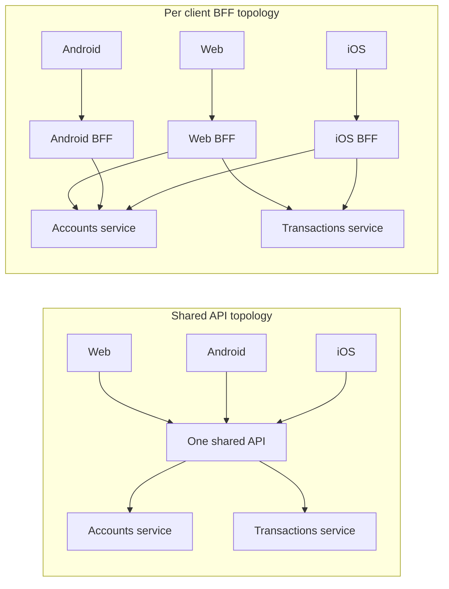
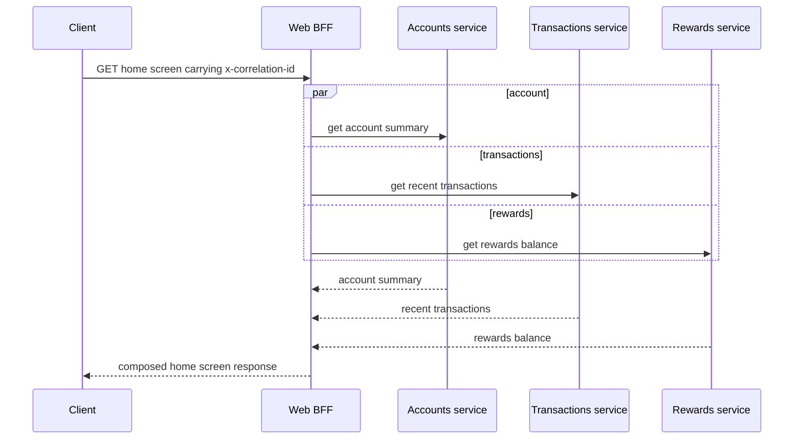

# Backend for Frontend

A **Backend for Frontend (BFF)** is a backend service built for exactly one client experience — a web app, an Android app, an iOS app, a partner integration — and owned by the team that owns that client, not by a shared platform team. Its only job is aggregation, payload shaping, and protocol translation for that one consumer, which frees it to change at that client's release cadence instead of negotiating a shared contract with everyone else. It is not a replacement for an [[API Gateway]], which still sits in front handling cross-cutting edge concerns for every client uniformly; and it is not free — a BFF per client is more services to build, deploy, and keep consistent, trading a shared bottleneck for duplicated logic.

## The problem that created it

Split a monolith into microservices ([[Monolith vs Microservices]]) and the natural next move is one general-purpose API in front of them, serving everyone: the web app, the Android app, the iOS app, and whatever partner integrations have signed up. That single API drifts toward the lowest common denominator almost immediately, and the drift shows up as four distinct, compounding pains:

1. **Mobile over-fetches and pays for it.** A general `GET /accounts/{id}` built to satisfy the web dashboard returns 40-odd fields — balances, limits, KYC flags, linked instruments, reward tiers. The Android screen renders six of them. Every one of those unused fields is still serialized, sent, and parsed, and on a metered or patchy cellular connection in a tier-2 city, bytes the client will never use are not free — they are latency and data cost paid by someone who gets nothing for it.
2. **The web app pays in round trips instead.** The home screen needs an account summary, recent transactions, and a rewards balance — three separate resources, so three separate calls, sequenced or parallelized by the client, each with its own latency and failure mode. Composing one screen out of several independently-versioned endpoints is work the client now owns, repeated for every screen that needs more than one resource.
3. **Every client change becomes a negotiation.** The iOS team wants one new field surfaced; the change has to go through whoever owns the shared endpoint, who must weigh it against the web team's roadmap, Android's, and the partner team's stability guarantees — one endpoint, four sets of priorities, one release train.
4. **Versioning becomes a standoff.** Mobile apps sit on old binaries for months after a release because app-store review and user update rates are slow; the web app redeploys continuously; a partner's integration is contractually frozen to a specific version. A single endpoint now has four consumers who cannot agree on when a breaking change is safe, and [[API Design and Versioning|versioning policy]] stops being a technical decision and becomes a scheduling fight.

The pattern was written up by Phil Calçado in "The Back-end for Front-end Pattern (BFF)" (September 2015), describing SoundCloud hitting precisely this shape of problem: one shared public API that had become a coordination bottleneck, clients needing several calls to render a single screen, and mobile users on unreliable networks paying for it. The fix was to stop sharing one API layer across all of them. Calçado credits the name itself to SoundCloud's web tech lead, Nick Fisher. Sam Newman's "Backends For Frontends — A Microservice Pattern" (November 2015) is what carried the name into general use.

## What it solves

- **Payload shaping per client** — the BFF returns exactly the fields its one client renders, nothing more; the over-fetching tax disappears because there is no second consumer to keep generic for.
- **Aggregation/composition** — one BFF call fans out to several downstream services and returns one composed response, collapsing what would be several client-side round trips into one.
- **Protocol translation** — the BFF can speak whatever the backend services actually use internally (REST, gRPC, a mix) and present whatever shape its one client wants, without forcing every consumer onto the same wire format.
- **Decoupled release cadence** — because exactly one client depends on it, the BFF's owning team can change it on that client's schedule without a cross-team negotiation.
- **Ownership clarity** — the team that owns the client experience also owns the service that serves it; a change to the iOS home screen is an iOS-team change end to end, not a ticket filed against a shared API team.

## How it works

The organizing idea: **one backend per client experience**, sitting between the client and the domain services, doing composition and shaping and nothing else. This is a client-aligned boundary, not a domain-aligned one — contrast it with [[Service Boundaries and Domain-Driven Design]], which carves services around bounded business contexts; a BFF is carved around a *consumer*, and the two axes can and do coexist in the same architecture.

On the left, every client shares one layer, and that layer must satisfy all of them at once — the problem above. On the right, each client's BFF calls only the downstream services its one screen set needs, shaped and composed exactly for that client; the domain services on the far right are the same services in both pictures, just no longer forced to serve every consumer identically.

### The fan-out itself

Composing one screen means the BFF calls several downstream services and assembles their answers into one response — and it should do that fan-out in parallel, not sequentially, or it loses the entire latency advantage it exists to provide:

Three calls in parallel bound total latency by the slowest of the three, not their sum — the whole point of composing server-side instead of leaving the client to make three sequential round trips of its own. The same `x-correlation-id` the client sent in must be forwarded to every one of the three fanned-out calls, or the trace that stitches an incident back together breaks exactly at the hop that matters.

### BFF versus API gateway

They sound similar — both sit between clients and services — and answer different questions, so they stack instead of competing:

| | [[API Gateway]] | BFF |
|---|---|---|
| Serves | Every client, uniformly | One client experience |
| Core concern | Cross-cutting: authn, rate limiting, routing, TLS | Client-specific: aggregation, payload shaping, protocol translation |
| Owned by | Platform/API team | The team that owns that client |
| Changes with | Security and infra policy | That client's screens and release cadence |
| Position | One tier, at the edge | Usually behind the gateway, one per client |
| Business logic | Must hold none (smart endpoints, dumb pipes) | Holds composition logic; must hold no business rules either |

A gateway cannot do client-specific aggregation without becoming client-aware for every route, which defeats the point of a single uniform edge; a BFF doing its own authentication for every client would duplicate work the gateway already centralizes once. The usual chain is edge → gateway (uniform policy) → the matching BFF (client-specific composition) → domain services. The vault's [[API Gateway]] note already draws this line in its own mini-design — "if mobile needs composed responses, a mobile BFF service behind the gateway owns that" — and it is the note that owns plugin scoping, consumer policy, and the edge's failure modes; this one stays on the composition layer behind it.

### BFF versus GraphQL

GraphQL solves the same over-/under-fetching problem with one shared endpoint and a typed schema: the client composes its own query, naming exactly the fields it wants, and the server returns exactly that shape — see [[REST vs gRPC vs GraphQL]] for the full treatment. Where BFF and GraphQL diverge is honest and worth stating both ways:

- **GraphQL amortizes the shaping logic once**, across every client, in one schema and one deployable; a BFF-per-client duplicates aggregation logic wherever two clients need something similar, and that duplication is the main thing teams pay for the pattern.
- **GraphQL costs you HTTP caching by default.** In the usual setup every operation — reads included — goes over POST to a single endpoint, so the CDN/proxy caching a REST BFF gets for free on `GET` doesn't apply. The GraphQL-over-HTTP spec does allow queries over `GET`, and persisted queries put cacheable URLs back on the table, but that is machinery you adopt deliberately, alongside normalized client caches.
- **GraphQL's resolvers are per-field, so naive composition triggers N+1 calls downstream** (100 accounts, then 100 separate calls for each account's owner) — the same shape of problem a BFF's own hand-written fan-out code sidesteps by construction, but GraphQL needs DataLoader-style batching as standard, mandatory practice to avoid it.
- **GraphQL needs query-cost control**, because the client — not your team — decides how deep and how expensive a query is; a BFF has no equivalent exposure, because the BFF's own code, not the caller, decides exactly which downstream calls happen.

[[REST vs gRPC vs GraphQL]] puts the deciding factor on the same axis, and owns the full contract comparison this note deliberately does not restate: how many distinct screen and client shapes need composing. One screen, or a handful of clients with genuinely different aggregation needs — BFFs, kept simple, each with one obvious owner. Dozens of evolving screens across platforms — the per-client BFF sprawls into an endpoint farm, and a shared GraphQL schema amortizes the shaping once, at the cost of the caching and query-cost machinery above.

### Keeping it thin

Two implementation habits keep a BFF from drifting into the failure mode below where it becomes a second, unowned service layer:

- **Stack choice is tooling, not identity.** The pattern says nothing about language. Netflix's 2012 redesign ran its per-device adaptation layer as adapter scripts written in Groovy, uploaded by the device teams themselves; the only real requirement is a runtime that issues several concurrent downstream calls without friction, which every mainstream server stack can do. A Spring Boot shop has no reason to introduce a second language purely to host a BFF.
- **The boundary is the client platform, not the screen.** One Android BFF serves every Android screen; splitting further into a BFF per screen multiplies the deploy-and-monitor cost the pattern already pays, without buying any additional ownership clarity — the team boundary, not the UI boundary, is what should decide where one BFF ends and the next begins.

## Trade-offs

| You gain | You pay |
|---|---|
| Payload shaped exactly to one client — less over-fetching, fewer round trips | Duplicated aggregation/shaping logic across BFFs wherever clients' needs overlap |
| Client team owns its own release cadence, no negotiation with a shared API team | One more service per client to build, deploy, and monitor — and page on |
| Protocol translation isolated to the BFF; domain services stay on a clean internal contract | An added network hop in the request chain, so latency and the chain's end-to-end availability both inherit this hop's cost — the series-multiplication math in [[Availability Reliability Durability]] applies to a BFF exactly as it does to any other hop in the chain |
| Domain services shed client-specific branching, stay focused on their own domain | Someone must still own cross-BFF consistency — same auth rules, same error contracts — or it drifts per client |

Put a number on the added-hop line before arguing it in the abstract: Kong at 99.95%, a web BFF at 99.9%, and two domain services behind it each at 99.9% chain to 0.9995 × 0.999 × 0.999 × 0.999 ≈ 99.65% — about 30.6 hours of expected unavailability a year on that one path, before the BFF has composed anything. Taking the BFF back out (gateway calling the two domain services directly) recovers about 8.7 hours of that a year — the same 0.1% × 8,760 h rule of thumb for one serial dependency that [[Availability Reliability Durability]] derives elsewhere; keeping the BFF buys per-client ownership and shaping at exactly that cost, which is the number to put in front of whoever approves the design rather than asserting the hop is "basically free."

## Failure modes

- **The BFF accretes business logic until it's a second service layer nobody owns.** Aggregation ("combine these three calls for the home screen") creeps toward decisioning ("hide this account if risk flag X is set") until the BFF holds rules that belong in a domain service — the same smart-pipes violation the gateway is warned about in [[API Gateway]], one layer closer to the client and therefore easier to miss in review. Left unchecked long enough, the fleet ends up with several client-specific services, none independently deployable from the domain logic they've absorbed — exactly the shape named in [[The Distributed Monolith Anti-Pattern]]: all the service count, none of the independence.
- **Fan-out latency: the slowest downstream call sets the floor.** A BFF composing a screen from several domain calls can parallelize them, which flattens total latency toward the slowest single call rather than their sum — but it never removes the dependency. One degraded domain service drags down every BFF response that composes it, and the fan-out needs the same timeout and circuit-breaking discipline as any other caller making several calls per request ([[Communication Patterns Between Services]]).
- **The BFF becomes a shared dependency again once a second client starts using it.** "Just reuse the mobile BFF" is the natural next ask when a partner integration needs something similar; the single-consumer assumption that justified the BFF's existence quietly breaks, its owning team now gates releases for a client they don't own, and the fleet has recreated — one layer removed — the exact negotiation the pattern was built to avoid.
- **Duplicated authorization logic drifts between BFFs.** Each BFF independently revalidates the caller's token and re-derives what that user may see; written separately per BFF, the checks diverge over a few quarters — one BFF enforces an ownership check another forgot. Gateway-level authentication plus one shared authorization library (not copy-pasted logic per BFF) is the usual fix.
- **The duplication gets "fixed" by extracting a shared library, which quietly recouples release cadence.** A team notices the account-summary aggregation looks identical in two BFFs and pulls it into a shared internal library; a security fix to that library now means coordinating redeploys of every BFF that imports it — the same library-coupling problem [[Service Mesh]] describes for cross-cutting networking concerns, resurfacing here for business composition logic instead. Extract only the pieces that are identical by requirement, not merely identical today.

## When NOT to use it

- **A single client.** With only a web app, there is no second client's divergent needs to justify a separate service, no release-cadence conflict to decouple, and no aggregation variance to isolate — a BFF here is just your API with extra deployment steps.
- **A team too small to own one backend per experience.** If one team already maintains web, Android, and iOS, splitting into three BFFs multiplies their deploys and on-call load without adding any autonomy, because the same team is negotiating with itself across three services instead of one.
- **Clients whose needs barely diverge.** If web and mobile render the same data in the same shape, a single shared endpoint (or a thin projection parameter on it) is simpler than three near-identical BFFs that will inevitably drift anyway.
- **Divergence is in fields, not in aggregation shape, and GraphQL's operational cost is already paid for.** If the organization already runs GraphQL with DataLoader batching and query-cost limits in place, adding client-specific field selection there is usually cheaper than standing up another owned service — see the comparison above.

## In your stack

- Niyo's actual client set — web app, Android app, iOS app, and partner integrations — is the textbook BFF setup, and each genuinely has a different release cadence: app-store review and staged rollouts for the mobile apps, continuous deploys for web, contractually frozen versions for partners. That divergence is the real trigger; confirm it exists for a given screen before building the service, rather than assuming it because the client list matches the pattern.
- Kong fronts everything as the uniform gateway — IAM-issued JWT validation, rate limiting, routing — so a BFF would sit behind it, not beside it: CloudFront → ALB → Kong → the matching client BFF → domain services → MongoDB.
- The fleet's 1-replica norm makes a BFF's cost concrete rather than abstract: it is one more single-replica hop added in series, and if it fans out to several single-replica domain services, the chain's end-to-end availability is the product of all of them — the same computation [[Availability Reliability Durability]] runs for the CloudFront-to-Mongo chain, extended by however many services the new BFF calls.
- Propagate `x-correlation-id` through the BFF into every fan-out call it makes; a BFF that mints a fresh ID per downstream call turns an incident spanning its fan-out into several untraceable fragments instead of one followable trace.
- Fintech framing: a BFF may compose and shape a statement screen or a home dashboard, but approval, limits, and risk decisions stay in the owning domain service with its own audit trail — the gateway's "decide whether and what shape, never what it means" rule applies one layer down, to the BFF, without exception.
- The boundary should match actual team topology, not the platform list. If one team owns both the Android and iOS clients today, the honest boundary is one mobile BFF, not two — splitting by platform when ownership doesn't split that way buys none of the autonomy the pattern exists to provide, only the extra service to deploy and monitor.

## Interview angle

The 60-second version: *"A BFF is one backend per client experience — a web BFF, an Android BFF, an iOS BFF — owned by the team that owns that client, whose only job is aggregation, payload shaping, and protocol translation for exactly one consumer. It exists because one general-purpose API drifts to the lowest common denominator: mobile over-fetches fields it won't render, on a cellular link it's paying for; the web app needs several round trips to compose one screen; and every client change becomes a negotiation across incompatible release cadences. It's different from an API gateway, which handles cross-cutting concerns — auth, rate limiting, routing — for every client uniformly; they stack, gateway in front. It's different from GraphQL, which solves the same over/under-fetching problem with one shared schema the client queries itself, at the cost of default HTTP caching, N+1 resolvers, and query-cost control. The honest trade: duplicated logic across BFFs, more services to deploy and monitor, and an added network hop — so with one client, a BFF is just your API with extra deployment steps."*

Classic follow-ups: "BFF vs API gateway?" (cross-cutting vs client-specific, stacked not competing — gateway in front). "BFF vs GraphQL?" (separate owned services per client vs one shared schema clients query themselves; the deciding factor is how divergent client needs really are, and whether GraphQL's operational cost — caching, DataLoader, query-cost limits — is already paid for). "What stops a BFF becoming a second monolith?" (keep it to aggregation and shaping; business rules stay in the domain service, same discipline as the gateway). "When would you not build one?" (single client, or a team too small to own one backend per experience — say so plainly rather than building it anyway).

## Check yourself

> [!question]- Q: Explain the difference between an API gateway and a BFF to a colleague, and why they stack rather than compete.
> A gateway applies cross-cutting policy — authentication, rate limiting, routing, TLS — uniformly, once, for every client that passes through it; it cannot do client-specific aggregation without becoming aware of every client's screen shapes, which defeats having one uniform edge. A BFF does the opposite: it holds no cross-cutting policy of its own (it trusts the gateway's verdict) and instead composes, shapes, and translates for exactly one client. Putting the BFF behind the gateway means authentication and quota are enforced once, centrally, and only the request that passes gets routed to the client-specific service that knows how to assemble its screens — neither layer replaces the other's job.

> [!question]- Q: The Android team says the account screen payload is 40 fields, they render six, and users on patchy 3G are feeling it. Propose a fix and name the deciding factor between a BFF and a cheaper alternative.
> Case for a BFF: the Android team owns the shaping, trims the response to the six fields it renders, and can also collapse a second call (recent transactions) into the same response — real savings on a slow link, and Android iterates on its own schedule. Cheaper alternative if this is one screen in isolation: add a projection parameter (`?fields=...`) or a purpose-built endpoint on the existing service, no new deployable needed. The deciding factor is how many screens and how many clients have genuinely divergent aggregation needs, not field needs alone — one screen's over-fetching is a projection parameter; a pattern repeating across many evolving screens, owned by a team that wants its own release cadence, is the BFF.

> [!question]- Q: Six months after shipping an Android BFF, the web team asks to reuse it because it already assembles the same risk-score payload they need. What's the right call?
> Reusing it reintroduces the exact problem the BFF was built to avoid: the Android team's release cadence — app-store review, staged rollouts — now gates web's deploys, and the first field web needs that Android doesn't is a renewed cross-team negotiation inside what was supposed to be a single-owner service. The better move is either a web-owned BFF that calls the same domain services (duplicating the composition logic, which is the accepted cost of the pattern), or extracting the shared piece — the risk-score aggregation itself — into its own small domain service that both BFFs call. Duplicating logic across BFFs is the acceptable price; duplicating ownership of one BFF across two client teams is the mistake.

> [!question]- Q: Mini design — sketch the request chain for a transfers home screen served to web, Android, iOS, and a partner integration, and say where logic lives at each layer.
> CloudFront/ALB handle TLS and static assets; Kong validates the JWT against IAM's JWKS, enforces rate limits, and routes — all uniform, all once. Behind it, each client hits its own BFF (web-bff, android-bff, ios-bff, partner-bff), which fans out to the accounts, transactions, and rewards services, composes exactly that client's screen shape, and propagates `x-correlation-id` into every downstream call. The domain services hold the actual business rules — transfer limits, risk checks — and are the only place writes land in MongoDB. The partner BFF is usually the thinnest of the four: partners are typically sold a stable, versioned REST contract rather than a UI-screen-shaped aggregation, so it can be closer to a thin adapter than a true composing BFF.

> [!question]- Q: Why does it matter that the BFF sits behind the gateway rather than in front of it?
> If BFFs sat in front of the gateway, each one would have to reimplement the authentication and rate limiting the gateway exists to centralize — defeating the reason a single edge exists — and the public attack surface would be as many services as there are clients, instead of one hardened entry point. Sitting behind the gateway, the token is validated and the quota enforced exactly once, and only a request that survives that gets routed to the matching BFF, which trusts the gateway's verdict rather than re-deriving it. It's the same vertical layering any other service behind Kong already relies on.

## Sources

- Phil Calçado, "The Back-end for Front-end Pattern (BFF)" (philcalcado.com, September 2015) — the write-up of SoundCloud's experience; credits the name itself to Nick Fisher.
- Sam Newman, "Backends For Frontends — A Microservice Pattern" (samnewman.io, November 2015) — the post that carried the name into general use.
- Sam Newman, *Building Microservices*, 2nd ed. (O'Reilly, 2021) — the Backends for Frontends material: client-specific aggregation versus a shared API layer.
- Chris Richardson, microservices.io — BFF is documented there as a variation on the API Gateway pattern, one gateway per kind of client, rather than on a standalone pattern page.
- Daniel Jacobson, Netflix Tech Blog, "Embracing the Differences: Inside the Netflix API Redesign" (July 2012) — an earlier account of the same problem, one API serving wildly different devices, solved with a per-device adaptation layer of Groovy adapter scripts, before the BFF name existed.
