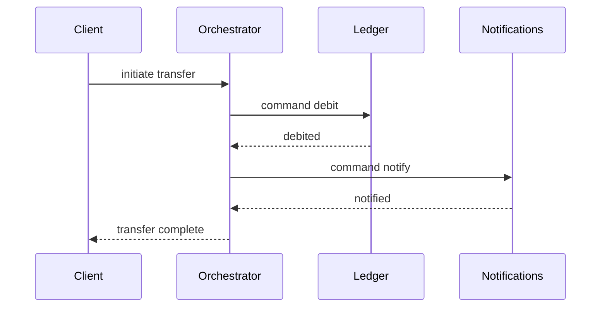

# Communication Patterns Between Services

Once a system is split into services, the single biggest design decision left is *how they talk*: synchronously (caller waits for an answer) or asynchronously (caller emits a message and moves on). This choice decides your latency, your availability math, your consistency model, and how tightly teams are coupled. The working rule this note builds toward: **synchronous for queries a user is actively waiting on; asynchronous for propagating state changes** — and the math below shows why sync chains are the thing to fear.

## Why this matters

Every inter-service call is a bet on another service's availability and latency. Teams that default to "just call the other service's REST API" end up with deep synchronous chains where one slow dependency stalls the whole request path and one down service takes the user-facing feature with it — the runtime signature of [[The Distributed Monolith Anti-Pattern]]. Teams that default to "everything is an event" end up unable to answer "did it work?" for operations users are waiting on, and debugging flows nobody can trace. Knowing *which* pattern fits *which* interaction is the skill; interviews probe it with "how do these two services stay consistent?" and "what happens when service B is down?".

## How it works

### The two axes

Communication differs on two independent axes:

- **Sync vs async**: does the caller block for the response? Sync = REST/gRPC request-response ([[REST vs gRPC vs GraphQL]]). Async = messages via a broker ([[Message Queues vs Event Logs]]).
- **Command vs event**: a **command** tells a specific service to do something (`DebitAccount`) and implies the sender knows who acts; an **event** announces a fact (`AccountDebited`) and lets any interested consumer react. Commands couple sender to receiver; events invert the dependency — the producer doesn't know or care who listens.

Request-reply can also run **over queues**: the requester sends a command message carrying a correlation ID and a reply-to queue, and consumes the reply asynchronously. You pay broker latency but gain load leveling and retry-ability — useful for slow back-office operations (document verification, statement generation) where the caller wants an answer but not within one HTTP timeout.

### The latency and availability math of call chains

This is the core quantitative argument. Suppose each service answers with availability *a* and some latency distribution.

**Availability in series multiplies.** A request that synchronously traverses *n* services succeeds only if all succeed:

- 5 services at 99.9% each: 0.999⁵ ≈ **99.5%** — the chain carries roughly five times the downtime of any single link ([[Availability Reliability Durability]]).
- 5 services at 99% each: 0.99⁵ ≈ **95.1%** — one failed request in twenty.

**Tail latency compounds too.** The chain's latency is the *sum* of hops, and the slowest hop dominates the tail: if each hop is usually 5 ms but p99 is 100 ms, a 5-hop chain hits a ~100 ms+ hop in roughly 1 − 0.99⁵ ≈ 4.9% of requests — tail events that were rare per-service become common per-request ([[Latency vs Throughput vs Bandwidth]]). Fan-out makes it worse: call 10 services in parallel and wait for all, and the response is as slow as the slowest of 10 draws — you experience somebody's p99 on ~1 in 10 requests.

Asynchronous messaging changes the equation: the producer's availability depends only on itself and the broker (2 components, not *n*), and consumer slowness or downtime delays *processing*, not the user's acknowledgment. The cost is that the caller no longer knows the outcome at response time — the work is *accepted*, not *done* — which is exactly why async fits state propagation and not user-facing queries. [[Why Async Messaging Exists]] covers this trade in depth.

### Orchestration vs choreography

> Full treatment — designing the orchestrator as a durable state machine, the hybrid forms, and when to use an engine — is in [[Orchestration vs Choreography]].

For multi-step flows (a transfer: debit, credit, notify, record), two coordination styles:

- **Orchestration**: one coordinator (an orchestrator service or workflow engine) explicitly commands each step and handles each outcome. The flow is readable in one place, state is queryable ("where is transfer 123 stuck?"), and compensation on failure is centrally managed. Cost: the orchestrator couples to every participant and can become a god service.
- **Choreography**: no coordinator — each service reacts to the previous service's events (`TransferRequested` → ledger debits and emits `Debited` → notifications reacts…). Maximal decoupling, no central bottleneck. Cost: the flow exists only as an emergent property; answering "what is the sequence?" requires reading several codebases, and detecting a stalled flow requires correlating events ([[Distributed Tracing]]).

Rule of thumb: **choreograph simple, local reactions (2–3 steps, side effects); orchestrate long or business-critical flows** — anything with compensation logic, SLAs, or an operations team asking "where is it stuck?". Both styles implement the [[Saga Pattern]] when the steps are local transactions needing compensation; that note covers failure handling in detail.

| | Orchestration | Choreography |
|---|---|---|
| Where the flow is written down | One coordinator's code or workflow definition | Nowhere — it emerges from each service's subscriptions |
| Answering "where is transfer 123?" | Query the orchestrator's state row | Correlate events across several services and logs |
| Adding a step | Edit the orchestrator; participants unaware | Parallel reaction: new consumer subscribes, no existing service changes. Mid-sequence step: several services re-wire their subscriptions |
| Removing a participant | Edit the orchestrator | Stop consuming; the producer never knew |
| Compensation on failure | Centralised, expressible as a sequence | Each consumer handles its own; cross-step rollback is hard to express |
| Coupling direction | Coordinator knows every participant | Producer knows nobody |
| Coordinator failure | A real single point of failure — needs durable state and HA | No coordinator to fail |
| Detecting a stalled flow | Timeout on a persisted state-machine row | Infer from the *absence* of an expected event — much harder |
| Natural fit | Money movement, regulated flows, SLAs, ops queries | Fan-out reactions: notify, index, analytics, cache invalidation |

The asymmetry worth internalising: orchestration makes the flow **legible and queryable** at the cost of a coupled coordinator; choreography makes the flow **extensible** at the cost of nobody being able to state what it is. Legibility is non-negotiable where an auditor or an operations team will ask; extensibility is what you want where consumers come and go.

### Cross-service reads: API composition vs materialized views

Splitting data by service makes "join" a design problem ([[Service Boundaries and Domain-Driven Design]]). Two answers:

- **API composition**: a composing layer (a BFF, the [[API Gateway]], or the frontend) calls each owning service and merges results in memory. Simple and always fresh — but it inherits the chain math above (availability in series, slowest-call latency), can't sort/filter/paginate across services without pulling full datasets, and melts under fan-out on hot paths.
- **Materialized view**: the reading service maintains its *own local, query-optimized copy* of the other services' data, kept current by consuming their events ([[The Outbox Pattern]], [[Change Data Capture]]) — the [[CQRS]] read-model idea. Reads are local (fast, available, joinable); the costs are eventual staleness (typically milliseconds to seconds of lag), storage duplication, and owning a projection pipeline with its own [[Message Ordering|ordering]] and replay concerns.

Rule: compose for low-traffic, freshness-critical reads across few services; materialize for hot paths, cross-service search/sort/aggregation, or whenever the composition would exceed 2–3 fan-out calls.

### Choosing: the decision guide

| Interaction | Pattern | Why |
|---|---|---|
| User-facing query ("show my balance") | Sync REST/gRPC to the owner (or local view) | User is waiting; needs an answer now |
| State change others must learn about | Async event via broker | Decouples producer; consumers absorb at their pace |
| Telling a specific service to act | Command — sync if caller needs outcome now, else queued | Explicit intent, retryable if queued |
| Multi-step business flow with compensation | [[Saga Pattern]] — orchestrated if complex/critical | Central visibility and failure handling |
| Slow back-office processing with an eventual answer | Request-reply over queue, correlation ID | Load leveling + eventual response |
| Cross-service read on a hot path | Materialized local view fed by events | Removes runtime fan-out from the request path |

## Trade-offs

| | Synchronous | Asynchronous |
|---|---|---|
| Caller knows outcome | Immediately | Later or never (must track separately) |
| Availability coupling | Series — multiplies failure | Decoupled through broker |
| Latency | Sum of chain; tails compound | Producer fast; end-to-end depends on queue depth |
| Consistency | Read-your-write possible | Eventual; [[Delivery Semantics|at-least-once]] requires consumer [[Idempotency|idempotency]] |
| Debuggability | One trace, clear causality | Requires correlation IDs, event tooling |
| Backpressure | Caller blocks (natural but harmful) | Queue absorbs; needs [[Backpressure and Flow Control|monitoring]] |
| Infrastructure | None beyond network | Broker to run, schemas to manage ([[Event Schema Evolution]]) |

## Common misconceptions

- **"Async is more available."** It relocates the failure rather than removing it. The *producer* becomes independent of consumers, which is real and valuable — but the business outcome still needs the consumer to run. A ten-minute consumer outage is a ten-minute delay, and to a user waiting for a payment confirmation, a long enough delay is indistinguishable from a failure. What async buys is producer availability and load tolerance; what it does not buy is end-to-end outcome availability.
- **"Events are fire-and-forget."** Fire-and-forget describes the producer's *obligation*, not the system's. Any event that drives a side effect needs durability (written atomically with the state change — [[The Outbox Pattern]]), a retry path, a dead-letter destination, and someone watching consumer lag. "We published it" is not "it happened".
- **"A queue means we don't need backpressure."** A queue converts overload from errors into depth and latency, which is an improvement, not an escape. An unbounded backlog is an outage with a delay fuse, and a consumer that cannot keep up at peak never catches up on its own. Depth and lag are first-class alerts ([[Backpressure and Flow Control]]).
- **"Request-reply means synchronous."** They are independent choices. Request-reply over a broker — a command carrying a correlation ID and a reply-to destination — gives the caller an answer without holding an HTTP connection open, which is exactly right for work measured in seconds to minutes.
- **"Sync is simpler."** Simpler to *write*; not simpler to *run*. Every synchronous hop adds a [[Timeouts Retries and Exponential Backoff|timeout and retry]] policy, a [[Circuit Breakers|breaker]], a connection pool to size, and one more thing that pages someone at 3am. The complexity doesn't vanish — it moves out of the broker and into every caller, where it is implemented inconsistently.

## Failure modes

- **The deep sync chain.** A → B → C → D: D's p99 becomes everyone's p99; D's outage breaks A. Detected by tracing span depth; fixed by flattening (A gathers what it needs itself), async-ing the non-essential hops, or materializing views. *The signal that reveals it*: the user-facing endpoint's p99 tracks a downstream's p99 almost exactly while the endpoint's own CPU and handler time stay flat. *Confirming it*: pull trace waterfalls for the slow percentile — if nearly all of the parent span's time sits inside one child span, the bottleneck is the dependency, not the service you were paged for.
- **Retry storms.** Sync chains where each layer retries multiply load: 3 retries at each of 3 layers means 4 attempts per layer, so up to `4 × 4 × 4 = 64` requests reach the bottom service for one user request — against a service already struggling. Needs [[Timeouts Retries and Exponential Backoff|budgeted timeouts and backoff]], retries at one layer only, and [[Circuit Breakers]]. *Signal*: the struggling service's inbound request rate **rises** while upstream user traffic is flat or falling — machine-generated load is the only thing that behaves that way. *Confirming it*: compare request counts at adjacent hops over the same window; a ratio well above 1 is the amplification factor, and it tells you which layer is retrying.
- **Lost-outcome async.** Fire-and-forget commands with no tracking: money debited, confirmation never recorded. Every async command needs a persisted state machine row or saga log; "we'll see it in the logs" is not tracking. *Signal*: rows that entered an intermediate state and never left it. *Confirming it*: a scheduled query for "state is pending and last updated older than the SLA" should normally return zero. If no such query exists anywhere, you cannot detect this class of failure at all — which is itself the finding, and the fix is building the query before hunting for the bug.
- **Poison message blocking a partition.** One message that always throws, in a stream where ordering forces in-order processing, stops everything behind it. *Signal*: lag climbing on exactly one partition or stream key while the rest are healthy — a flat aggregate lag chart hides this, so chart lag *per partition*. *Confirming it*: inspect the oldest unacknowledged message and the consumer's error log for a repeating stack trace on one message ID. Fix is a bounded retry then dead-letter, never an infinite in-place retry.
- **Choreography sprawl.** After a year, nobody can say what consumes `TransferCompleted` or in what order effects land; a renamed field breaks an unknown consumer ([[Event Schema Evolution]] and a schema registry mitigate). *Signal*: the consumer list for an event cannot be produced without grepping every repository. *Confirming it*: compare the broker's own consumer-group listing against the documented consumer list — the divergence is the measurement, and it is usually larger than anyone expects.
- **Dual-write inconsistency.** Writing the DB then publishing the event as two separate operations loses one of them on a crash — the problem [[The Outbox Pattern]] exists to solve. *Signal*: a reconciliation count between the two stores that is non-zero and steps upward rather than drifting. *Confirming it*: run the reconciliation over a window containing a known crash, restart or deploy — drift that correlates with process restarts is dual-write loss, not a query bug.

## When NOT to use it

Anti-recommendations per pattern: don't use **sync chains** for anything deeper than ~2 hops on a user path without a stated latency budget per hop; don't use **async** for operations where the user must know the result before proceeding (payment authorization at checkout) unless you add result-push (WebSocket/[[WebSockets Server-Sent Events and Long Polling|SSE]]) or polling and design the pending state honestly; don't use **choreography** for flows with compensation or regulatory reporting duties; don't use **orchestration** for trivial two-step reactions where a direct event would do; don't **materialize views** for data read once a day by an admin screen — composition is fine.

## In your stack

- Niyo's trajectory (RabbitMQ → Kafka → SQS → planned Redis Streams, see [[Choosing a Message Broker]]) is all on the async side of this note; the sync side is Spring REST clients behind Kong. The decision guide above is effectively "when do I call vs when do I publish to SQS/Streams".
- Money movement fits orchestrated sagas: compliance wants to know exactly where transfer 123 is, which choreography makes expensive to answer. Notifications, analytics, and CRM updates fit choreography — pure reactions to facts.
- With many services at 1 replica, the series-availability math is brutal: each 1-replica hop in a sync chain is a single point of failure, so every hop you convert to async measurably protects the user path. This is one of the strongest practical arguments for event-driven design in your fleet.
- The `x-correlation-id` convention is what keeps async flows debuggable — it must propagate *into message headers*, not just HTTP headers, or traces die at the broker ([[Distributed Tracing]]).
- At-least-once delivery on SQS/Redis Streams means every consumer you write needs [[Idempotency]] — dedupe on a business key or idempotency key before side effects, non-negotiable where money moves.
- Moving a hop to async transfers an obligation to the product, not just the platform: the user now needs an honest **pending state**. In a banking app, "transfer submitted, confirming" with a push or poll on completion is a design deliverable, and skipping it is how a technically correct async migration becomes a support-ticket generator. Decide the pending UX in the same ticket as the pattern change.
- Redis Streams consumer groups (the planned destination) make the poison-message failure mode above concrete: a never-acknowledged entry stays in the pending-entries list indefinitely. Plan the claim-and-dead-letter policy — a maximum delivery count after which the entry is moved aside and alerted on — *before* the migration, not after the first stuck stream.

## Interview angle

The 60-second answer: *"Two axes: sync vs async, command vs event. Sync request-response for queries the user is waiting on — but chains multiply unavailability (five 99.9% hops ≈ 99.5%) and sum latency, so keep user paths shallow. Async events for state propagation — producer availability decouples from consumers, queues level load, but you buy eventual consistency and need idempotent consumers. Multi-step flows: orchestrate when you need central visibility and compensation — typically money — choreograph simple reactions. Cross-service reads: API composition when cold and freshness-critical, event-fed materialized views when hot. The failure I design against hardest is the deep synchronous chain — that's a distributed monolith's runtime signature."*

Classic follow-ups: "Service B is down — what happens to A?" (answer per pattern: circuit breaker + fallback for sync; queue buildup + lag alerting for async); "How do you keep the view consistent?" (outbox/CDC, ordering per key, replay); "Exactly-once?" ([[Exactly-Once Delivery Is a Lie]] — at-least-once plus idempotency).

## Check yourself

> [!question]- Q: Explain why five services at 99.9% availability give a synchronous chain roughly 99.5%, and what that means operationally.
> Series composition: the request succeeds only if every hop does, so availabilities multiply: 0.999⁵ ≈ 0.995. The chain is unavailable ~0.5% of the time — about 3.6 hours/month versus ~43 minutes for a single service. Operationally: the user-facing SLO is set by the *weakest product of dependencies*, so adding "one quick sync call" to a path is never free, and the fixes are removing hops, adding fallbacks behind [[Circuit Breakers|circuit breakers]], or moving the hop off the request path with async propagation.

> [!question]- Q: Scenario — checkout calls the payments service synchronously; payments is degraded with p99 at 8 seconds. Walk through what happens and how you'd redesign.
> Checkout threads block up to their timeout waiting on payments; thread pools and connection pools saturate; checkout starts failing *all* requests including ones not needing payments — classic cascade ([[Failure Modes in Distributed Systems]]). Retries amplify load on the degraded service. Redesign: strict timeout aligned to a stated budget, [[Circuit Breakers|circuit breaker]] so checkout fails fast, [[Bulkheads and Isolation|bulkheaded]] thread pool for the payments client. Structurally: accept the order, enqueue payment authorization as a command with an idempotency key, mark the order "payment pending", and push the outcome to the user via SSE/polling — the user path no longer shares payments' fate, at the cost of an explicit pending state.

> [!question]- Q: When would you choose API composition over a materialized view for a cross-service read, and when the reverse?
> Composition: few services (2–3), low traffic, freshness matters (support-console lookups), and no cross-service sorting/filtering — simple, no pipeline to own. Materialized view: hot user-facing path, needs joins/sort/aggregation across services, or the composed chain's availability/latency math breaks the SLO — reads become local and survive the source services' outages, at the price of eventual staleness, duplicate storage, and owning an event-fed projection with replay and [[Message Ordering|ordering]] handling.

> [!question]- Q: Scenario — you move the notification hop off the synchronous checkout path onto a queue. Two weeks later, support reports that some users never received a confirmation. Nothing alerted. What did the move actually change, and what did you forget to build?
> What changed is the *visibility class* of the failure, not its existence. Synchronously, a failing notification produced an error on a request someone was watching — loud, immediate, attributable. Asynchronously, the same failure becomes a message that was consumed and dropped, or one sitting in a backlog, or one that threw and was retried into oblivion: silent by construction. What's missing is the monitoring that async *requires* rather than merely benefits from — consumer lag and queue depth alerts, a dead-letter destination with a non-zero alarm on it (an empty DLQ nobody alarms on is decoration), idempotent consumers so retries are safe, and a business-level reconciliation ("transfers completed more than N minutes ago with no notification recorded") that catches the cases the infrastructure metrics cannot see. The general rule: moving work off the request path removes the *caller's* error-reporting for free, so you must replace it deliberately before the move, not after the first complaint.

> [!question]- Q: Mini-design — a transfer must debit a wallet, credit a beneficiary record, send a push notification, and update an analytics store. Assign a pattern to each step.
> Debit + credit are the money invariant: one service (ledger) and ideally one local transaction; if they're genuinely separate services, an orchestrated [[Saga Pattern|saga]] with compensation and a persisted state machine. The ledger emits `TransferCompleted` via the [[The Outbox Pattern|outbox]] (atomic with the commit). Notification service and analytics consume the event independently — choreography, at-least-once, idempotent consumers. The user-facing status read is sync against the orchestrator/ledger state. Nothing downstream of the money step is allowed to delay or fail the transfer itself.

## Sources

- Sam Newman, *Building Microservices*, 2nd ed. (O'Reilly, 2021) — ch. 4 "Microservice Communication Styles".
- Chris Richardson, microservices.io — patterns: "Messaging", "Remote Procedure Invocation", "API Composition", "CQRS", "Saga".
- Gregor Hohpe & Bobby Woolf, *Enterprise Integration Patterns* (Addison-Wesley, 2003) — request-reply over messaging, correlation identifier, command vs event message.
- Martin Kleppmann, *Designing Data-Intensive Applications* (O'Reilly, 2017; a 2nd edition with Chris Riccomini followed in March 2026) — 1st ed. ch. 11 on derived data and event streams feeding materialized views.
- Jeff Dean & Luiz Barroso, "The Tail at Scale" (CACM, 2013) — why fan-out makes tail latency everyone's problem.
