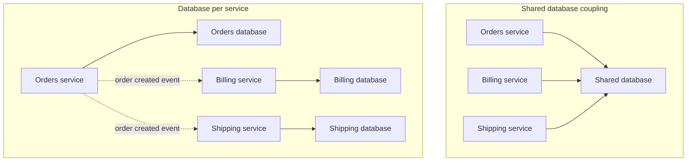

# Database per Service

**Database per service** means exactly what it says: each microservice owns a database (or schema, or table set) that no other service touches directly. Anyone who wants that data either calls the owning service's API or subscribes to events it publishes — never a query against its tables.

This is the pattern most teams quietly skip when they "do microservices", and it is the one that actually matters. Split the code into separate deployables and leave the database shared, and you have not built microservices — you have built [[The Distributed Monolith Anti-Pattern|a distributed monolith]] with extra network hops.

## The problem that created it

A team splits a monolith into `orders`, `billing`, and `shipping` services. To ship fast, all three keep talking to the one database the monolith always had — same instance, same schema, same tables. For a few sprints this feels free: no new infrastructure, no new APIs to design, every query you already know how to write still works.

Then the coupling that was supposed to be cut shows up anyway, just moved:

- **Nobody can change a schema safely.** `billing` wants to rename a column on `orders` because its new feature needs clearer naming. But `orders` and `shipping` both read that column directly. The rename is now a three-team negotiation, not a one-service deploy — the shared database is coupling mechanism #3 in [[The Distributed Monolith Anti-Pattern]]: the real (and unversioned) API.
- **A slow query in one service degrades another.** `shipping` runs a nightly batch job that full-scans a large table. That scan and `orders`'s request-path lookups draw on one budget of disk I/O, CPU and connections, so `orders`'s p99 degrades because of a query it never issued and has no visibility into. The connection ceiling is the sharpest edge: three services' pools now compete for one instance's limit, and a spike in any of them starves the others ([[Connection Pooling]]). Cache pollution is the softer version of the same story — a large scan *can* evict hot pages, but real engines defend against exactly that (InnoDB's midpoint-insertion LRU, Postgres's small ring buffer for sequential scans), so lead with contention for I/O and connections rather than with eviction.
- **Ownership of a table becomes unclear.** When `users` is written by three services' code, "who decides what a valid row looks like" has no answer. Constraints that should be enforced in one place (a business invariant like "a wallet balance never goes negative") get re-implemented — or forgotten — in whichever service happens to write last.
- **Deploys must be coordinated.** A migration that adds a `NOT NULL` column with no default breaks every other service's existing writes the moment it runs, unless all of them deploy compatible code in the same window.

The common thread: services that share a database are **not independently deployable**, which was the entire point of splitting them apart.

A system with separate deployables and separate on-call rotations, sharing one schema underneath, has the operational cost of microservices and the coupling of a monolith — the fastest route to [[The Distributed Monolith Anti-Pattern]], and the shared database is usually the first domino.

## What it solves

The pattern's rule is a single sentence: **one service writes a given piece of data, and it is the only service with a connection string to where that data lives.** Everyone else reaches it in one of exactly two ways:

- **Synchronously**, by calling the owning service's API.
- **Asynchronously**, by subscribing to events the owning service publishes.

Never by opening a connection to its tables.

This is what makes the schema a *private implementation detail* again — `orders` can rename a column, re-shape its documents, or switch storage engines entirely, and as long as its API contract and published event shapes hold, no other team's code breaks and no other team's deploy is implicated. Independent deployability, the thing the whole split was supposed to buy, comes back.

A second benefit falls out of the same privacy for free: **polyglot persistence.** Once a service's storage is nobody else's business, nothing stops it from picking the engine that actually fits its data — a graph store for a recommendation service, a document store for `orders`, a wide-column store for time-series telemetry — instead of every service being forced onto whatever the monolith's one database happened to be ([[Choosing a Database]] is the decision framework for that choice, made per service rather than once for the whole system).

## How it works

### The enforcement spectrum

"Each service owns its data" is a sentence a team can agree to in a design review and quietly stop honoring six months later under incident pressure — conventions decay because nothing stops the violation except memory of the agreement. The pattern is only as strong as how it's enforced, and enforcement comes in three tiers of increasing cost and increasing guarantee:

| Tier | What it looks like | Isolation mechanism | Strength |
|---|---|---|---|
| Private tables in a shared schema | All services' tables live in one schema/database; `orders_*` tables are "orders's, by convention" | Naming convention and team agreement only | Weakest — any credential with access to the schema can read or write any table, nothing technical stops it |
| Separate schema or database, shared instance | Each service gets its own schema (Postgres) or database (MySQL, MongoDB), on one physical instance | Grants scoped to that schema or database — `GRANT`/`REVOKE` in SQL, or a Mongo user whose roles name only its own database | Enforceable — a service's credentials cannot read or write another service's tables, whatever its code tries |
| Separate instance entirely | Each service's database runs on its own instance, often with its own network path | Network isolation plus credentials | Strongest — no shared buffer pool, no shared connection ceiling, no blast radius between services at the storage layer |

The middle tier is the pragmatic default for most teams: it gets you real, mechanically-enforced ownership without paying for a dedicated instance per service.

The top tier is reserved for services where the noisy-neighbor risk or the blast radius of a credential leak is unacceptable — typically the ones touching money or regulated identity data.

Whichever tier you pick, **enforce it with database permissions, not with a wiki page.** A convention says "please don't query `orders`'s tables"; a grant makes the query return a permission-denied error. The difference matters precisely at 3am during an incident, when an engineer under pressure reaches for the fastest fix — a convention lets that fix through silently, a grant stops it at the database.

In the top half, any service can read or write any table — the schema is the undocumented, unversioned real contract between all three. In the bottom half, each service's storage is private, and the only path between them is an API call or an event `orders` chose to publish; `billing` and `shipping` cannot see `orders`'s schema at all, only the shape of the event.

## Trade-offs

Isolating storage is not free — it removes capabilities relational thinking takes for granted, and each removal has a real consequence, not just a missing feature.

**Cross-service joins stop existing.** A `SELECT` spanning two services' tables was merely discouraged while they shared an instance; once the stores are separated it is impossible, because no single connection can see both schemas. You're left with two honest options: call the owning service and join the results in application code — which means accepting an extra network round trip and a new availability dependency, since if the owning service is down, your join is down — or maintain your own denormalized read model of the fields you need, kept current by subscribing to the owning service's events. The first option is simpler and more consistent; the second is faster and more resilient to the owner's downtime, at the cost of staleness.

**Foreign keys cannot span services.** A database can no longer enforce "this `orderId` on a shipment row must reference a real row in `orders`" — that constraint lived in the database engine for free, and now it's gone. Referential integrity becomes an *application* concern: the `shipping` service must handle the case where the order it references was later cancelled or never existed, because the database will not stop it from storing a dangling reference.

**ACID transactions cannot span services.** A transfer that used to be "debit this table, credit that table, commit" inside one database is now two separate commits in two separate databases, with no shared transaction log to make them atomic. This is the cross-system atomicity gap [[Two-Phase Commit and Distributed Transactions|two-phase commit]] was built to close, and 2PC genuinely does close it — but it pays by blocking participants holding locks whenever the coordinator dies after they have voted, and MongoDB, Kafka, SQS and Redis never implemented XA at all, so it cannot even span the stores services actually run on. The industry's answer is the [[Saga Pattern]] instead: a sequence of local transactions, each with its own compensating action if a later step fails, coordinated without ever locking two databases at once. Where a service also needs to react reliably to another service's committed state — updating its own read model, say — that reaction has to survive the writer's crash between "I changed my data" and "I told everyone", which is exactly the dual-write problem [[The Outbox Pattern]] exists to close; and where the read side of that reaction grows complex enough to need its own independently-scaled store and query shape, that's [[CQRS]].

**Reporting and analytics lose their one-join answer.** A query that used to be `JOIN orders, billing, shipping` for a finance dashboard now has no database that can see all three. The data has to be consolidated somewhere else — typically by streaming each service's changes via [[Change Data Capture]] into a warehouse built for exactly this kind of cross-boundary query, so analytics stops competing with production traffic for the same operational database too.

**Data duplication is the point here, not a smell.** Normalization theory says don't store the same fact in two places. Database-per-service breaks that rule on purpose: `billing` caching the customer's name and a running order total, kept current by consuming `orders`'s events, is *correct* design in this world, not denormalization gone wrong — there is no other way for `billing` to have that data without either querying `orders`'s tables directly, which is forbidden, or calling `orders` synchronously on every read, an availability and latency tax you usually don't want. The rule that keeps this sane is ownership, not avoidance of duplication: exactly one service is the writer and source of truth for a fact, and every other copy is an **eventually consistent** read-only shadow of it — see [[Consistency Models]] for what "eventually" is actually promising, and [[Normalization vs Denormalization]] for the classical trade this pattern deliberately violates. The moment two services both believe they can write the same fact, the pattern has silently failed.

Each service's store also now scales on its own terms: the replicas-then-caching-then-partitioning ladder in [[Database Scaling Patterns]] gets applied per service, against that service's own read/write shape, instead of one shared instance absorbing every service's load at once — a real benefit, but it also means N scaling problems to reason about instead of one.

| You gain | You pay |
|---|---|
| Independent schema changes, no cross-team migration coordination | No cross-service joins — an app-level call or a maintained read model, every time |
| No noisy-neighbor batch job competing for another service's I/O, CPU and connection ceiling | No foreign keys across services — referential integrity becomes application code |
| Each service can scale, back up, and tune its store independently | No ACID across services — sagas and compensations instead of a rollback |
| Freedom to pick the right engine per service (polyglot persistence) | N databases to back up, patch, monitor, and capacity-plan instead of one |
| | Eventual consistency becomes occasionally visible to a user, not just an internal detail |
| | Debugging a request now means reasoning across several stores, not one join |

## Failure modes

- **An event is lost, and copies silently drift.** `billing`'s read model of order totals is only as current as the last event it received; if `orders` publishes using a plain publish-after-commit instead of [[The Outbox Pattern]], a crash between commit and publish leaves `billing` holding a stale total forever, with no error anywhere. *Signal*: a reconciliation job comparing `billing`'s cached totals against `orders`'s source of truth finds drift with no corresponding incident. *Mitigation*: the outbox pattern for every event-publishing writer, plus a scheduled reconciliation job as the backstop — never just "trust the pipe."
- **The owning service is down, and the synchronous-join path fails with it.** A team that chose "call the owner and join in application code" instead of a read model has reintroduced an availability dependency between services that database-per-service was supposed to remove the *coupling* from, not the *dependency* on. *Mitigation*: [[Timeouts Retries and Exponential Backoff|timeouts and a defined fallback]], or switch that specific read path to an event-fed local copy if the caller can tolerate staleness instead of unavailability.
- **Splitting a live shared schema is its own outage risk.** Migrating an existing monolith's one database into per-service stores means, for a transition window, two code paths must both work — the old direct-table access and the new API/event path — while production traffic keeps flowing. Attempting a big-bang cutover (freeze writes, copy data, flip over) on a live money-moving schema is the highest-risk version of this migration; the safer path is the same one used for decomposing the service boundaries themselves: incrementally, dual-writing or using CDC to keep the new store in sync before anything reads from it, the database-migration analogue of [[Strangler Fig Migration]].
- **A request now spans several stores, and nothing ties the trace together.** A customer complaint ("my order says shipped but billing shows unpaid") used to be one SQL join away from an answer; now it requires pulling state from two services' two databases and reasoning about which event each one had processed by what time. *Mitigation*: propagate `x-correlation-id` through every synchronous call and stamp it onto every published event, and lean on [[Distributed Tracing]] — without it, "debug a request across stores" becomes "guess."
- **Credentials get provisioned too broadly, and the anti-pattern comes back silently.** A new service's database user is copy-pasted from an existing one during onboarding and inherits access to schemas it has no business touching. Nothing breaks that day — the violation only becomes visible months later, when a convenient direct query someone wrote against it turns into incidental coupling, discovered the hard way when the "owning" service tries to change that schema. *Mitigation*: a periodic audit comparing each service's actual database grants against a declared ownership map, not a one-time review at provisioning time.

## When NOT to use it

Database-per-service is what makes a microservice split expensive — not as a side effect, but structurally: everything in the trade-offs section above is the price of the isolation, paid in full, forever.

A team that is not willing to pay it should not run separate databases, and should seriously ask whether it should be running separate *services* at all.

- **A small team.** The three enforcement tiers above all cost engineering time and infrastructure; a five-person team maintaining six services' worth of databases is paying an operational tax with no corresponding org-scaling benefit, because the thing database-per-service buys — teams not blocking each other — doesn't exist yet when it's one team blocking itself.
- **An early product with unstable boundaries.** If you don't yet know where `orders` ends and `billing` begins — the question [[Service Boundaries and Domain-Driven Design]] is about answering properly — splitting the database locks in a guess. Moving a field between two services' databases later is a real migration; moving it between two modules in one codebase is a refactor.
- **A modular monolith, deliberately.** [[Modular Monolith]] gets you the valuable part of this pattern — a module boundary with its own slice of schema, enforced by build structure and architecture tests (ArchUnit, Spring Modulith) rather than by a network call — while keeping one ACID database underneath, so cross-module invariants still get a real transaction instead of a saga. If your honest answer to "why split the database" is "so we're doing microservices properly," that's not a reason; [[Monolith vs Microservices]] is the note for weighing whether you need the split at all before you pay for this part of it.

## In your stack

MongoDB is your primary datastore ([[MongoDB Architecture]]), and the conventions that point every repo at one shared Mongo rather than standing up another are about physical infrastructure, not data ownership — the two are easy to conflate.

Pointing two services' Spring Data Mongo clients at the same cluster is fine, and is exactly the shared-instance middle tier of the enforcement spectrum: cheaper to run than a dedicated cluster per service. But each service must get its **own logical database** within that cluster, its **own Mongo user** with roles scoped to only that database, and zero code anywhere that reads another service's collections directly. "We share a Mongo client" is an infrastructure statement; "we share a database" is the anti-pattern, regardless of how many separately-deployed services are drawn on the architecture diagram.

The RBI-regulated angle adds a real wrinkle. An auditor's question — "show me every wallet debit and its matching ledger credit" — used to be one join on a monolith's single database. With wallet and ledger owned by separate services, you cannot and should not hand an auditor join access to two production stores.

The honest answer is the same [[Change Data Capture]] path used for analytics: both services emit their state changes as events (via [[The Outbox Pattern]]), and a reconciliation store or warehouse, fed from those events, is where the consolidated report — and any gap between a debit and its credit — becomes visible. Build that reconciliation path deliberately, as its own piece of infrastructure with its own owner, rather than assuming it falls out of "the services publish events anyway."

The same split rules out the thing that feels most natural under pressure: a money-touching invariant that spans two services — debit a wallet in one service, credit a loan account in another — cannot be a database transaction, because there is no database that holds both rows. It has to be a [[Saga Pattern|saga]]: debit happens, an event fires, credit happens, and if the credit step fails, a compensating transaction reverses the debit — recorded as its own audited entry, never a silent rollback. [[Idempotency]] on every step is what keeps a retried saga step from double-crediting or double-debiting when a network call times out but actually succeeded.

## Interview angle

The 60-second version: *"Database per service means each microservice is the only service with a connection to its own data — everyone else goes through its API or subscribes to its events, never its tables. It's what actually delivers independent deployability, because a shared schema recouples services that were split apart: nobody can change a table without coordinating every reader, and a slow query in one service can starve another's share of the instance's connections and I/O. The cost is real: no cross-service joins, no foreign keys across services, no ACID transactions across services — which is why this pattern drags in sagas, the outbox pattern, and CDC as soon as you adopt it. Enforce it with database grants, not team agreement, because conventions decay. And it's not free, so a small team or a product with unstable boundaries is often better off with a modular monolith that gets the same boundary discipline without paying for distributed data."*

Classic follow-ups:

- *"How do you do a cross-service join?"* — app-level join at call time (consistent, costs latency and an availability dependency) versus an event-fed denormalized read model (fast and resilient to the owner's downtime, costs staleness) — name both and the trade.
- *"Isn't caching another service's data just denormalization?"* — yes, deliberately: one writer stays the source of truth, every other copy is documented as eventually consistent, which is the whole point, not a smell.
- *"How do you enforce this isn't violated?"* — database-level grants per schema/database, not a convention; treat a direct cross-service query found in code review as a correctness bug, not a style nit.
- *"What's the hardest part of adopting this on an existing system?"* — splitting a live, shared schema without an outage window, which is its own incremental migration, not a weekend cutover.

## Check yourself

> [!question]- Q: Explain why two microservices sharing one database are not actually decoupled, even though they run as separate deployed processes.
> Decoupling at the process level (separate deployables, separate restarts, separate on-call) doesn't touch the coupling that matters for change: if both services read and write the same tables, neither can change its schema without the other's agreement, and a migration on one is a coordinated deploy for both. The database becomes the real, unversioned contract between them — exactly coupling mechanism #3 in [[The Distributed Monolith Anti-Pattern]]. Independent deployability, the actual goal of splitting services, requires the data to be split too.

> [!question]- Q: Scenario — Orders and Billing were split into separate services but still read and write the same `orders` table directly, for speed. A sprint later Billing needs to add a `NOT NULL` column with no default that Orders's code doesn't set. What breaks, and what's the real fix?
> The moment the migration runs, every write Orders performs without setting that column starts failing — the two services are forced into a lockstep deploy even though they're "separate" services. The real fix isn't a careful migration order; it's that this situation shouldn't be possible at all. Only Orders should have write access to that table, enforced by a database grant, not a convention. Billing's need for that data should go through Orders's API or an event Orders publishes — at which point Orders can add the column, populate a sensible default, and deploy alone.

> [!question]- Q: Mini-design — Billing needs the customer's name and the order total on an invoice, but Orders owns order totals and Customers owns names, in separate databases. Sketch two ways to get this data, and the trade-off between them.
> Option A: at invoice-render time, Billing calls the Orders API and the Customers API and joins the two responses in application code. Simple and always current, but invoice rendering now has two extra network hops and two new availability dependencies — if either service is down, the invoice can't render. Option B: Billing subscribes to events published by Orders and Customers (order-total-changed, customer-renamed) and maintains its own small denormalized read model of just the fields it needs. Rendering becomes a single local query with no cross-service blast radius, but the data is eventually consistent — a rename can take a moment to land — and Billing now owns extra storage and a consumer process to keep running. Pick A when staleness is unacceptable and the caller can tolerate the owner's downtime; pick B when render-time speed and resilience to the owner being down matter more than up-to-the-second accuracy.

> [!question]- Q: Scenario — an RBI auditor wants a single reconciled report of every wallet debit and its matching ledger credit, but Wallet and Ledger are owned by separate services with separate databases. How do you produce it without giving the auditor join access to two production databases?
> Don't answer the audit question with a live cross-join — it requires access you shouldn't grant and couples an audit request to production database load. Instead, both services publish their state changes as events via [[The Outbox Pattern]], and a reconciliation store or warehouse, fed by [[Change Data Capture]] or the same event stream, consolidates both sides. The auditor's report is built from that consolidated copy. As a side benefit, that's also where a broken saga becomes visible: if a wallet debit's matching ledger credit never arrives (or a failed saga's compensating reversal never posts), the reconciliation store shows the gap directly, rather than it hiding inside two services that each think their own side is fine.

> [!question]- Q: Why is it wrong to call Billing's local copy of the customer's name "denormalization gone wrong" in a database-per-service architecture?
> The classical objection to denormalization is that it stores the same fact in two places where one database could have enforced consistency with a join — here that database doesn't exist, by design. Billing has no legal way to read Customers's name field except by caching a copy fed by Customers's events, because querying Customers's tables directly violates ownership and calling Customers synchronously on every read pays a latency and availability tax most reads don't need. The thing that makes this correct rather than sloppy is the ownership rule: Customers remains the one writer and source of truth, Billing's copy is documented as an eventually consistent shadow of it, and nothing else in the system is allowed to write a customer's name. Duplication without that rule is just two sources of truth quietly disagreeing; duplication with it is the accepted cost of the isolation database-per-service was built to buy.

## Sources

- Chris Richardson, microservices.io — "Pattern: Database per service" and "Pattern: Shared database"; the former lists the private-tables-per-service, schema-per-service and database-server-per-service options this note's enforcement spectrum is built on.
- Chris Richardson, *Microservices Patterns* (Manning, 2018) — ch. 2–4: service decomposition, inter-service communication, and why private data stores are foundational to the rest of the pattern language (sagas, CQRS, CDC).
- Sam Newman, *Monolith to Microservices* (O'Reilly, 2019) — ch. 4, "Decomposing the Database": splitting a live shared schema without breaking production, the same migration risk this note's failure modes section covers.
- *Designing Data-Intensive Applications*, Kleppmann — ch. 11 ("Stream Processing"), "Keeping Systems in Sync", on why dual writes between two systems go wrong; the atomic-commit and 2PC material is ch. 9. Together they are the structural reason this pattern reaches for sagas, the outbox and CDC rather than distributed transactions.
