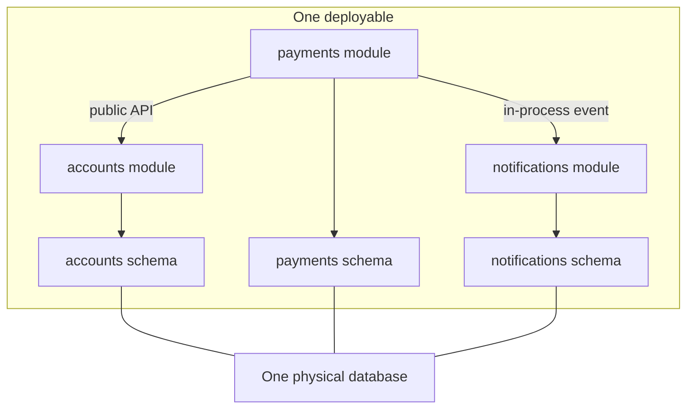

# Modular Monolith

A **modular monolith** is a single deployable application whose internals are divided into modules with *enforced* boundaries: each module has a public API, private internals, and (ideally) its own slice of the database, and no module reaches into another's guts. It keeps the monolith's superpowers — in-memory calls, one ACID database, one pipeline — while buying the most valuable property microservices offer: real boundaries you could later cut along. For most teams most of the time, this is the correct default, which is why it's the underrated middle of the [[Monolith vs Microservices]] debate.

## The problem that created it

Picture a Spring Boot codebase at a growing company. Year one: three packages, one team, everyone knows everything. Year three: forty engineers, two hundred packages, and the compiler lets any class call any other class — so they do. The `loans` code queries the `users` table directly; `notifications` imports a helper from deep inside `payments`; a "quick fix" wires `kyc` into `rewards`. Nothing stops this because *in a plain monolith, discipline is the only boundary, and discipline loses to deadlines*. The result is the **big ball of mud**: every change ripples unpredictably, nobody can state what depends on what, and when the team finally decides to extract a service, they discover there is no seam to cut — everything touches everything.

The naive reaction is "monoliths rot, therefore microservices." But the rot wasn't caused by the single deployable; it was caused by *unenforced boundaries*. Teams that jump to microservices without learning to draw boundaries just reproduce the mud over a network — [[The Distributed Monolith Anti-Pattern]]. The modular monolith attacks the actual disease: it makes boundaries explicit and mechanically enforced while keeping deployment trivial.

## What it solves

- **Boundary erosion** — module contracts are enforced by tooling, not code-review vigilance.
- **Change ripple** — a module's internals can be refactored freely; only its public API is a contract.
- **Team stepping-on-toes** — modules give teams ownership areas without giving them a Kubernetes bill.
- **The premature-microservices trap** — you get decoupling benefits now, and keep the *option* to extract services later along boundaries that have been proven by use ([[Strangler Fig Migration]]).
- **Distributed-systems tax avoidance** — no network partitions, no [[Saga Pattern|sagas]], no [[Distributed Tracing|tracing infrastructure]] required just to follow one request.

## How it works

### Structure

Modules are organized around business capabilities (the same [[Service Boundaries and Domain-Driven Design|bounded contexts]] you'd use for services): `payments`, `accounts`, `kyc`, `notifications`. Each module exposes a narrow public API — a Java interface or facade, or in-process events — and hides everything else. Cross-module communication goes through those APIs only; cross-module *data* access goes through the owning module, never directly to its tables.

### Enforcing the boundaries

Enforcement is the entire point — an unenforced module is a folder. Mechanisms, roughly in order of adoption effort:

1. **Package/visibility rules.** In Java, keep module internals package-private and expose only the facade; in a Maven/Gradle multi-module build, make each module a separate compilation unit so "module A can see module B's internals" is a *compile error* unless B exports it. Java 9+ JPMS modules or Gradle `api` vs `implementation` dependencies make exports explicit.
2. **Architecture tests.** **ArchUnit** (Java) lets you write unit tests like "no class outside `payments` may depend on `payments.internal.*`" or "modules must form an acyclic dependency graph"; these run in CI and fail the build on violation. Spring Modulith formalizes this for Spring: it derives module boundaries from package structure and ships verification tests plus module-scoped integration tests.
3. **Separate schemas.** Give each module its own database schema (or MongoDB database/collection prefix) and its own credentials; module A's code *cannot* join against module B's tables even if a developer tries. This is the single highest-value rule, because shared tables are the coupling that makes later extraction nearly impossible — the database is where monoliths really tangle.
4. **In-process events for cross-module side effects.** Instead of `payments` calling `notifications` directly, it publishes a `PaymentCompleted` event on an in-process bus (e.g., Spring application events). This keeps modules decoupled and — crucially — rehearses the exact shape of the eventual message-based integration ([[Why Async Messaging Exists]]) without a broker.

The four are not interchangeable, and the ordering above is by effort, not by strength:

| Mechanism | What it actually catches | Effort | What it still misses |
|---|---|---|---|
| Package-private visibility | Casual reaching into internals from outside the package | Near zero | Same-package access; reflection; dependency injection that wires by type can still hand out an internal bean |
| Separate build modules | Any compile-time dependency not explicitly exported | Hours of build setup, once | Runtime coupling through shared beans or shared data |
| ArchUnit / Spring Modulith tests | Named rules as build failures — dependency direction, cycles, internal access | A day to set up, minutes per rule | Only what somebody wrote a rule for; the data dimension entirely |
| Per-module schema and credentials | *All* cross-module data access, including raw SQL and anything reflective | Migration work if retrofitted; trivial on day one | Nothing in the data dimension — this is the strongest single rule |
| In-process events | Direct call coupling for reaction-shaped side effects | Low | Query-shaped dependencies, which still need a facade |

The top of the table is cheap and weak, the bottom is where the guarantees live. A team that adopts only the first two has naming conventions; a team that adopts schema separation has a boundary that survives a deadline, because a developer in a hurry physically cannot query the other module's data.

### Transactions and queries

Within one module: ordinary [[ACID Transactions]]. Across modules you have a choice the microservices world doesn't give you: you *can* span one database transaction across two modules' schemas when correctness demands it (money movement), accepting the coupling consciously — or you can practice eventual consistency with in-process events where coupling matters more than atomicity. That choice-per-case is a luxury; across network boundaries the atomic option disappears entirely.

### Measuring whether the boundaries are actually holding

Enforcement mechanisms tell you the rules are *declared*; three cheap numbers tell you whether they are *working*.

1. **Suppression count, not violation count.** Violations should be zero, because the build fails on them. The number that moves is the count of rules weakened or packages excluded to get a build green. A growing exclusion list is boundary decay wearing a compliance costume — track it like a debt register, with a name against each entry.
2. **Cross-module transaction count.** How many code paths open one transaction spanning two modules' schemas. This should be a short, explicitly reviewed list; what kills the extraction option is this list growing without anyone noticing it grew.
3. **Change coupling from git history** — the measure that catches the decay the other two miss. For each pair of modules, count commits touching *both*, divided by commits touching *either*. Two modules that co-change constantly are one module stored in two folders, whatever the import graph says, because the property a boundary was supposed to buy is the ability to change one without the other.

   This is computable from `git log --name-only` in an afternoon; Adam Tornhill popularised the technique — he calls it **temporal coupling** — in *Your Code as a Crime Scene* (2015). Worked example over the last 300 commits: `payments` is touched in 90 commits, `rewards` in 60, and 36 commits touch both. The union is 90 + 60 − 36 = 114, so coupling is 36 ÷ 114 ≈ **32%** — about one change in three to either module crosses the boundary. That seam is in the wrong place. Extracting `rewards` as a service would convert that 32% into *cross-team, cross-repository coordination on every third change*, which is how a split produces lockstep deploys ([[The Distributed Monolith Anti-Pattern]]).

   Contrast a healthy pair from the same history: `notifications` touched in 40 commits, `accounts` in 70, both in 3. Union 107, coupling 3 ÷ 107 ≈ **2.8%**. That is a seam you could cut tomorrow — and note it is the pair the extraction-ordering advice would have picked anyway, now with a number behind the intuition.

Run these quarterly. The first two are hygiene; the third is the one to bring to a design review when someone proposes a split, because it answers "will these two actually be independent?" with evidence instead of optimism.

### The extraction path

Because modules already have API-only communication and separate schemas, extracting one to a real service is mechanical rather than archaeological: replace the in-process facade with an HTTP/gRPC client, replace in-process events with real messages on a broker, move the schema to its own database instance, deploy. The [[Strangler Fig Migration]] note covers doing this incrementally and safely. A modular monolith is best understood as *keeping the option to do microservices cheap*, which is worth a lot when, per [[Monolith vs Microservices|monolith-first]], you don't yet know where the right boundaries are.

## Trade-offs

| You keep (vs microservices) | You give up (vs microservices) |
|---|---|
| In-memory calls — no network tax, no partial failure | Independent *scaling* — the whole artifact scales together |
| One ACID database when you need it | Independent *deployment* — one release train, one version in prod |
| One pipeline, no orchestration platform required | Polyglot — one language/runtime for everyone |
| Trivial debugging: one process, one stack trace | Hard fault isolation — one OOM still kills every module |
| Cheap refactoring across module APIs (compiler-checked) | Team autonomy limits: shared build, shared dependency upgrades |

And versus a plain monolith, the cost is **discipline infrastructure**: multi-module build setup, ArchUnit/Modulith tests, schema separation, and the ongoing willingness to route around the "it would be faster to just query their table" temptation. That cost is small but nonzero, and it must be paid continuously.

## Common misconceptions

- **"Modules are folders."** A folder is a naming convention; a module is a constraint that fails something. If a developer can import across the boundary and the build still goes green, there is no module. The one-question test: *name the mechanism that fails the build*. No answer means you have a plain monolith with tidy packages, and tidy packages decay silently.
- **"It's a stepping stone to microservices."** It is a destination in its own right, and most systems should stop there. Treating it as a waypoint makes teams tolerate real problems ("we'll fix that when we split") instead of fixing them now, and the split that justifies the tolerance frequently never comes. Keeping the extraction option cheap is the benefit; exercising it is a separate decision with its own criteria ([[Monolith vs Microservices]]).
- **"One database means the modules are coupled."** One database *instance* is a deployment fact; one *schema written by two modules* is the coupling. Separate schemas with separate credentials inside one instance give you ownership without the operational cost of many databases — that trade is the whole point of the pattern, and conflating the two is how teams talk themselves into premature infrastructure.
- **"We'll add the boundaries later."** Boundaries are nearly free while the code already respects them and brutally expensive afterwards: retrofitting schema separation onto tables that are already joined is the same surgery as a service extraction, minus the benefit. Enforcement goes in on day one precisely because there is then nothing to migrate.
- **"Module APIs should be designed like public APIs."** They are internal and compiler-checked, so they can be narrow, specific, and changed in a single commit across all callers. Treating them as versioned contracts imports the full cost of [[API Design and Versioning]] — deprecation windows, tolerant readers, parallel versions — with none of the reason for it, since there is no consumer you cannot redeploy.

## Failure modes

- **Boundary decay.** Someone adds a cross-module import "temporarily"; without ArchUnit-style CI enforcement it metastasizes. Detection: dependency-graph checks in CI, periodic architecture reviews. Mitigation: make violations build failures, not review comments. *The signal that reveals it once rules exist*: the suppression/exclusion list growing, not the violation count — violations are zero by construction. *Confirming it*: the change-coupling percentages above; a pair climbing quarter over quarter is decay even when every rule still passes.
- **The shared-kernel swamp.** A `common`/`utils` module grows until every module depends on it for domain logic, quietly re-coupling everything. Keep shared code to genuinely generic infrastructure; duplicated domain code in two modules is often healthier than a shared domain module. *The signal*: `common`'s inbound dependency count equals the module count *and* its change rate is rising — a genuinely generic module is depended on by everything and changes rarely. *Confirming it*: read what is actually in it. Domain types and business rules mean it is a domain module in disguise; `Money` and ID formats are fine.
- **God module.** One module (usually the original core) keeps absorbing features because creating a new module takes effort. Signal: one module's change rate dwarfs the rest. *Confirming it*: commit share per module over a quarter — one module taking most of the commits in a system with six modules is either genuinely the core or the place new work goes because the path of least resistance leads there. Ask which, out loud, and check whether the last three features that landed there belonged to it.
- **Transactional creep.** Cross-module DB transactions, allowed "for correctness," become routine, welding schemas together and silently destroying the extraction option. Track and review every cross-module transaction as a logged exception. *The signal*: the count in the exception register going up between reviews. *Confirming it*: grep for transactional boundaries that enclose calls into another module's facade — if that returns entries nobody can justify from the business invariant, the exception has become the convention.
- **Build-time ceiling.** The monolith costs from [[Monolith vs Microservices]] — build time, test time, release contention — still arrive with enough growth. Modularity delays and softens them (module-scoped test runs help) but does not remove them; at some team size extraction becomes genuinely necessary.

## When NOT to use it

- **You already need hard runtime isolation** — a component with a different security/audit boundary (regulated money path), wildly different resource profile, or availability tier. A module cannot give you a separate blast radius or a separate pod budget.
- **Genuine polyglot requirements** — the ML team writes Python; no Java module will fix that.
- **Multiple large teams already exist** with separate charters and release cadences: forcing them through one pipeline recreates the contention microservices solve. Past roughly several teams / ~30+ engineers on one artifact, the single release train hurts more than the network tax.
- **Serverless or edge deployment models** where the unit of deployment is a function, not an application.

## In your stack

- Niyo is already on the microservices side of this line, so the modular monolith matters to you in two ways: (1) as the thing to recommend when designing greenfield systems or advising smaller teams, and (2) *inside each existing service* — a Spring Boot service with clean internal module boundaries and per-capability Mongo collections is far easier to split later than one with tangled packages. Spring Modulith and ArchUnit apply directly to your stack.
- The "separate schemas" rule maps to MongoDB as separate databases or clearly owned collection namespaces per module, with no cross-module collection access — the same ownership rule you already apply between services.
- In-process Spring application events are a cheap rehearsal for the SQS/Redis Streams messaging you'd use post-extraction; designing module events with the same schema discipline as real messages ([[Event Schema Evolution]]) makes extraction a transport swap.
- With many services pinned at 1 replica, it's worth asking in design reviews whether two tiny coupled services would have been better as two modules of one service: same availability (one replica either way), half the network hops, one fewer deployment to operate. Put the number on it: two 1-replica services at 99.9% each, called in series on a user path, give `0.999² = 0.998001` ≈ 99.80% — about **86 minutes of monthly downtime against 43 for a single service** — very nearly double, in exchange for nothing if the two deploy together anyway. The change-coupling measurement above is how you tell whether "they deploy together anyway" is true before the argument starts.
- The honest counter-case in your fleet: two capabilities with genuinely different availability tiers — say the money path versus a reporting job — are better apart even at 1 replica each, because a module cannot stop a reporting OOM from killing the money path. The question is never "modules or services" in the abstract; it is "does this specific pair need a separate blast radius?".

## Interview angle

The 60-second explanation: *"A modular monolith is one deployable with microservice-grade internal boundaries: modules aligned to business capabilities, public APIs only, private internals, ideally a schema per module, enforced by build structure and architecture tests like ArchUnit rather than by discipline. You keep in-memory calls, one ACID database, and one pipeline, and you keep the option to extract services later along boundaries proven by use. It's the rational default below the team size where independent deployment becomes the bottleneck."*

Classic follow-ups: "How do you *enforce* the boundaries?" (multi-module builds, ArchUnit/Spring Modulith, separate schemas — interviewers want mechanisms, not intentions); "When does it stop being enough?" (independent scaling/isolation/polyglot needs, or release-train contention at multi-team size); "How does it help a later migration?" (API-only seams + owned schemas = cheap [[Strangler Fig Migration]]).

## Check yourself

> [!question]- Q: Explain why "separate schemas per module" is the highest-value modularity rule.
> Code coupling is visible and refactorable with IDE support; *data* coupling is invisible until extraction time. If two modules read each other's tables, every schema change is a cross-module negotiation, and extracting either module means untangling shared tables, queries, and transactions — usually the hardest part of any monolith split. Separate schemas force all cross-module data access through the owning module's API, which is exactly the contract a future service boundary needs. The code swap (facade to HTTP client) is mechanical; the data divorce is not, so do it up front while it's cheap.

> [!question]- Q: Scenario — six months in, a teammate adds a direct SQL join from the `rewards` module to the `payments` schema to ship a dashboard faster. What happens if this pattern spreads, and what should have stopped it?
> Each such join silently re-couples schemas: `payments` can no longer change its tables without auditing `rewards`, cross-module transactions start spanning both schemas, and the extraction option dies — you're back to a big ball of mud with extra folders. Prevention should be mechanical, not cultural: per-module DB credentials that physically cannot read another schema, plus an ArchUnit/CI rule failing the build on cross-module repository imports. The dashboard need is legitimate — serve it via a `payments` public query API or a published read model, not a join.

> [!question]- Q: What does a modular monolith fundamentally NOT give you, no matter how clean the modules are?
> Anything requiring a separate runtime: independent scaling (all modules scale as one artifact), independent deployment (one release train, one prod version), fault isolation (one process — an OOM or CPU spin in any module affects all), per-module technology choices, and separate security/compliance boundaries at the infrastructure level. If a requirement on this list is real today, that module should be a service.

> [!question]- Q: Scenario — leadership wants to extract the `rewards` module into its own service next quarter. Every ArchUnit rule passes and the schemas are separate. What would you measure before agreeing, and what result would make you say no?
> Passing rules prove nobody is reaching across the boundary *in code*; they say nothing about whether the two sides change together, which is what independent deployment actually requires. Measure change coupling from git history: over the last few hundred commits, count commits touching `rewards`, commits touching its nearest neighbour (say `payments`), and commits touching both, then compute both ÷ union. A result like 36 of 114 ≈ 32% means roughly one change in three spans the pair — extract it and that 32% becomes a two-repository, two-deployment, two-team coordination on every third change, which is lockstep deployment and therefore [[The Distributed Monolith Anti-Pattern]]. Say no, and investigate *why* they co-change: usually the boundary is misplaced and some behaviour belongs on the other side ([[Service Boundaries and Domain-Driven Design]]). A single-digit percentage is the result that makes extraction safe. Also check the two supporting numbers: cross-module transactions involving `rewards` (each is a saga you will have to write) and whether any rule exclusions were added to keep the build green.

> [!question]- Q: Mini-design — sketch the module layout and enforcement plan for a greenfield neo-banking backend built by 12 engineers.
> Modules by capability: `identity` (authn, [[How JWT Works|JWT]] issuance), `kyc`, `accounts` (balances, ledger), `payments` (transfers), `cards`, `notifications`. Gradle multi-module build, one Spring Boot deployable; each module exposes a facade interface + in-process events, internals package-private. One Postgres/Mongo instance, one schema per module, per-module credentials. ArchUnit tests: acyclic module graph, no `*.internal` imports, repositories only touch their own schema. Cross-module money operations (`payments` → `accounts`) may share a transaction — logged and reviewed as exceptions. Notifications consume events only, making it the first extraction candidate when scale demands.

## Sources

- Simon Brown, "Modular Monoliths" talk (2015 onward) — popularized the term; also his C4 model writing on component boundaries.
- Martin Fowler, "MonolithFirst" (martinfowler.com, 2015) — the strategic argument this pattern implements.
- Spring Modulith reference documentation (spring.io) — module conventions, verification, event publication.
- ArchUnit user guide (archunit.org) — architecture rules as unit tests.
- Sam Newman, *Monolith to Microservices* (O'Reilly, 2019) — ch. 1 presents the modular monolith as a legitimate destination, not just a waypoint.
- Kamil Grzybek, "Modular Monolith: A Primer" (kamilgrzybek.com, 2019) — detailed .NET-flavored but language-agnostic treatment.
- Adam Tornhill, *Your Code as a Crime Scene* (Pragmatic Bookshelf, 2015) — temporal coupling and other behavioural-code-analysis measures derived from version-control history.
