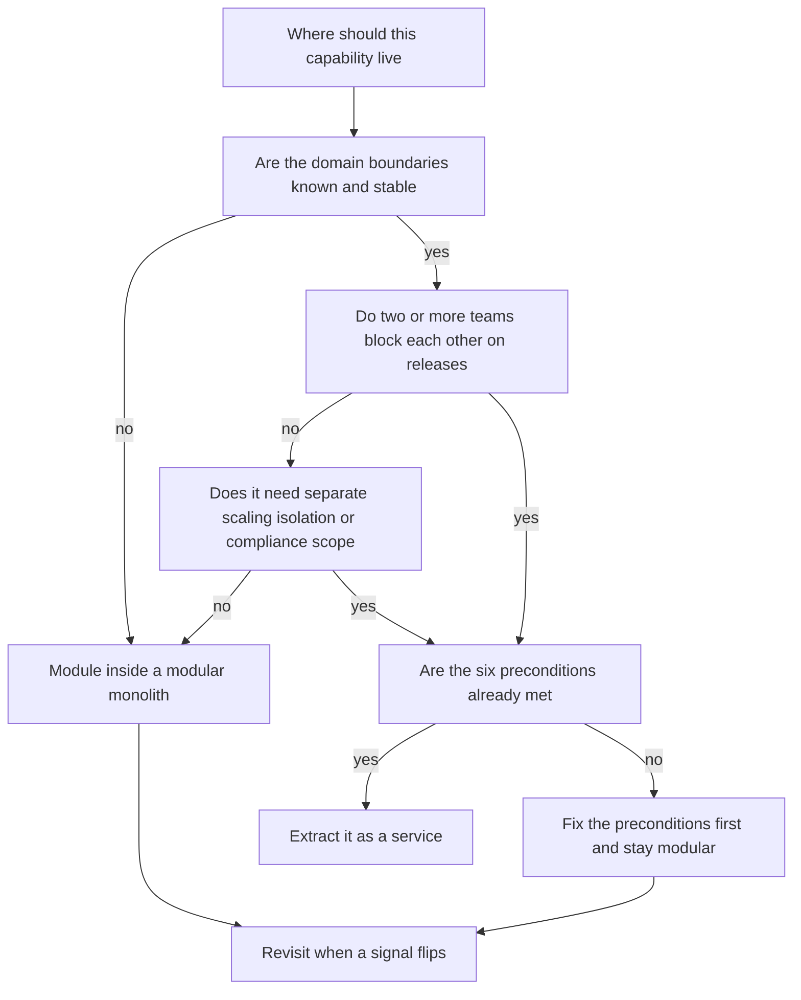

# Monolith vs Microservices

"Monolith vs microservices" is the most religiously argued question in system design, and the honest answer is that neither is ideal — each is a set of trade-offs that fits some combination of team size, domain stability, and scale. A **monolith** is one deployable unit containing all the application's capabilities; **microservices** are many independently deployable units, each owning a capability and its data, communicating over a network. The decision hinges less on technology than on your organization: how many teams need to ship independently, and how well you understand your domain boundaries. This note gives you the real cost ledger of each and a verdict framework instead of a winner.

## Why this matters

Every architecture conversation you will ever have at work or in an interview eventually lands here. Picking wrong in either direction is expensive: premature microservices buy you distributed-systems problems ([[Network Partitions and Timeouts]], [[Two-Phase Commit and Distributed Transactions|distributed transactions]], a deployment platform to run) before you have the traffic or team size to justify them, while an unstructured monolith at a growing company becomes a codebase where fifty engineers queue behind one deploy pipeline and every incident takes everything down. Interviewers use the question to test whether you reason from constraints or recite fashion — "we should use microservices because Netflix does" is an instant signal of shallow thinking, because Netflix has thousands of engineers and you probably don't.

## How it works

### What a monolith actually is

A **monolith** is a single build artifact — one Spring Boot fat JAR, one Rails app, one binary — deployed as one unit. All features share a process, a release cycle, and almost always one database. Function calls between modules are in-memory: nanoseconds, type-checked by the compiler, and transactional — one [[ACID Transactions|ACID transaction]] can span any two features' tables. "Monolith" says nothing about internal quality: it can be a well-modularized codebase ([[Modular Monolith]]) or a tangle. It also says nothing about replica count — monoliths scale horizontally fine ([[Vertical vs Horizontal Scaling]]); you just scale *all* of it together.

### What microservices actually are

**Microservices** decompose the system into services that are (a) independently deployable, (b) owners of their own data store, and (c) aligned to a business capability — payments, KYC, notifications. The canonical definition is Lewis and Fowler's 2014 article: componentization via services, organized around business capabilities, decentralized data management, infrastructure automation. The defining property is **independent deployability** — if two "services" must always release together, you have [[The Distributed Monolith Anti-Pattern|a distributed monolith]], not microservices. Every in-process function call that crosses a service boundary becomes a network call, with everything that implies.

### The real costs of microservices

These are not hypothetical; every one of them is a line item you will staff and operate.

1. **Network boundaries replace function calls.** A local call takes nanoseconds and cannot partially fail; a network call takes milliseconds ([[Latency Numbers Every Engineer Should Know]]), can time out, can succeed on the far side while appearing to fail on yours, and needs [[Timeouts Retries and Exponential Backoff|timeouts, retries]] and [[Idempotency]] to be safe. Chain five services synchronously and both latency and failure probability compound — see [[Communication Patterns Between Services]] for the math.
2. **Transactions stop being free.** One database gave you atomic multi-table commits. With data split across services, keeping two stores consistent requires the [[Saga Pattern]], [[The Outbox Pattern]], and compensation logic — pages of careful code replacing one `@Transactional` annotation. Cross-service queries need API composition or materialized views instead of a SQL join.
3. **Observability becomes mandatory infrastructure.** Debugging a monolith is reading one log and one stack trace. Debugging twenty services requires [[Distributed Tracing]], correlation IDs, centralized [[Logs Metrics and Traces|logs and metrics]] — before this exists, every cross-service incident is archaeology.
4. **You must run a deployment platform.** Independent deployability presumes CI/CD per service, container orchestration (Kubernetes), service discovery ([[Health Checks and Service Discovery]]), config management, and an [[API Gateway]]. That platform is itself a system someone operates.
5. **Organizational overhead.** Each service needs an owner, an on-call rotation, API contracts with consumers ([[API Design and Versioning]]), and versioning discipline. Twenty services owned by six engineers means everyone owns everything, which means nobody does.

### The arithmetic: what a synchronous split costs before anyone writes bad code

Cost 1 above deserves numbers, because it is the one people assume is small. Take a checkout path and split it five ways without degrading a single line of logic.

**Availability.** Model each deployable as "app tier AND its datastore must both be up". Use 99.9% for an application tier and 99.95% for a managed datastore — plausible planning figures, and the point survives any numbers you prefer.

- **Monolith**: one app, one database. `0.999 × 0.9995 = 0.99850`. Over a 30-day month (43,200 minutes), unavailability of 0.1500% is **≈ 64.8 minutes**.
- **Split into five services, each with its own store, called in series**: each service is still 0.99850, but the request succeeds only if *all five* succeed, so availabilities multiply: `0.99850⁵ ≈ 0.99252` — **99.25%**, or **≈ 323 minutes/month**.

That is **five times the monolith's downtime**, produced entirely by topology. No engineer got worse; the request simply now depends on five things instead of one. This is the same series-multiplication result as [[Communication Patterns Between Services]], applied to the split decision itself.

The lever is **how many hops are on the blocking path**, not how good each service is. Take two of the five hops off the critical path — make them asynchronous ([[The Outbox Pattern|outbox]] + broker), or give them a [[Circuit Breakers|circuit breaker]] with a usable fallback so their failure degrades rather than fails the request:

- **Three blocking hops**: `0.99850³ ≈ 0.99551` → **≈ 194 minutes/month**.

Removing two of five serial hops cuts the *excess* downtime over the monolith (258 minutes) almost exactly in half (to 129).

Compare the two available levers honestly, because the arithmetic is less one-sided than the slogan. Halving the *app tier's* failure rate on every hop — 99.9% to 99.95%, so each service becomes `0.9995 × 0.9995 ≈ 0.99900` and each hop's **total** failure rate falls by about a third, from 0.001499 to 0.001000 — brings the five-hop chain to `0.99900⁵ ≈ 0.99501`, about **215 minutes**. Removing *one* hop instead leaves `0.99850⁴ ≈ 0.99401`, about **259 minutes**. So hardening every link saves more here, and the general shape is worth remembering: deleting one of *n* hops removes roughly 1/n of the unavailability, while cutting every hop's failure rate by a given fraction removes that same fraction of the total.

"Flatten the chain" is still the first move, but for reasons that are economic rather than arithmetic: removing a hop is one design change, made once, that stays made — whereas holding every service at 99.95% is a permanent fleet-wide programme that regresses the moment attention moves. And as the stack notes below, a service pinned at a single replica cannot be *relied* on to hold 99.95%, because single-pod events it has no peer to absorb dominate its availability. Reach for the lever you can actually pull.

**Latency.** An in-process call between modules costs on the order of nanoseconds and cannot partially fail. An in-cluster HTTP hop costs the network round trip plus serialization, framework filters, and connection acquisition — take a **measured** p50 of a few milliseconds per hop as a planning figure and then measure your own; the planning figure is not the interesting part.

- Five sequential hops at 3 ms p50 add **~15 ms p50** — irrelevant against a 300 ms user budget. Per-request latency is rarely why a split hurts.
- The **tail** is why. If each hop's p99 is 60 ms, then assuming independence the chance a request hits *at least one* hop at or above its p99 is `1 − 0.99⁵ ≈ 4.9%`. Roughly one checkout in twenty now has a tail excursion that did not exist in the monolith. Real hops are *correlated* (shared nodes, shared datastore, simultaneous GC), so the true figure is usually worse, not better — this is the "Tail at Scale" effect ([[Latency vs Throughput vs Bandwidth]]).
- **Budget division** is the design constraint: a 300 ms p99 budget across five serial hops leaves ~60 ms per hop *including* that service's own database work. One service that legitimately needs 150 ms has already consumed the budget, and the only remedies are parallelising the fan-out, caching, or deleting the hop.

Read the whole example as the price list for the *first* column of cost, paid every day forever. The honest other side: the monolith's 64.8 minutes take down *every* feature, while the split chain's 323 minutes may take down only checkout and leave statements, cards and notifications serving. Blast radius is the thing you bought; latency and availability on the composed path are what you paid.

### The real costs of monoliths at scale

The monolith's costs arrive later and grow with team size and traffic:

1. **Build and test times.** A million-line codebase can take tens of minutes to compile and hours to run tests against, so feedback loops rot and engineers batch risky changes.
2. **Blast radius.** One bad deploy, one memory leak, one hot code path takes down *every* feature. There are no [[Bulkheads and Isolation|bulkheads]]: the payments feature shares a heap with the PDF-export feature.
3. **Team contention.** Fifty engineers in one repo means merge conflicts, a shared release train (your change waits on everyone else's), and no team can choose its own stack or upgrade a dependency without organization-wide coordination.
4. **Scaling is all-or-nothing.** If one endpoint needs 10x capacity you replicate the whole artifact, memory footprint and all. Usually tolerable — machines are cheap — but painful when one component wants a GPU or 10x the memory of everything else.
5. **The database becomes the coupling point.** Any module can reach any table, so hidden dependencies accumulate until no one can change a schema safely.

Note the asymmetry: microservices costs are paid **up front and continuously**; monolith costs are paid **later, if you grow**. Many systems never grow enough to pay them.

### Conway's law — the real decision variable

**Conway's law** (Melvin Conway, 1968): organizations design systems that mirror their communication structures. The practical corollary is that architecture and org chart must agree, or the org chart wins. Microservices are, first and foremost, an *organizational scaling tool*: they let team A deploy without talking to team B. That benefit is real only when there are enough teams for coordination to be the bottleneck — a common rule of thumb is that below roughly 20–30 engineers the coordination you're eliminating barely exists, so you pay the distributed-systems tax for nothing. Conversely, Amazon's "two-pizza teams" and Netflix's thousands of engineers genuinely need the decoupling. Ask "how many teams need to ship independently?" before any technical question.

### "Monolith first" — and when it's wrong

Martin Fowler's **MonolithFirst** argument (martinfowler.com, 2015): nearly every successful microservices system he saw started as a monolith that was split later, while systems built as microservices from scratch often ended in trouble. The reason is that good [[Service Boundaries and Domain-Driven Design|service boundaries]] require understanding the domain, and you understand a domain by building in it; carving boundaries on day one means carving them wrong, and a wrong *network* boundary is far costlier to move than a wrong package boundary. The [[Modular Monolith]] is the disciplined version of this strategy, and [[Strangler Fig Migration]] is the exit path.

When monolith-first is wrong:

- **You already know the boundaries** because you're rebuilding a well-understood domain, or the organization already has strong independent teams with separate charters.
- **A component has genuinely divergent requirements from day one** — e.g., a KYC document-processing pipeline with heavy memory needs, or a component requiring a separate compliance/audit boundary (common in fintech, where the RBI-regulated money path may need isolation from everything else).
- **Hard polyglot needs** — an ML inference service in Python inside a Java shop is better as a separate service immediately.

## Trade-offs

| Dimension | Monolith | Microservices |
|---|---|---|
| Latency between components | In-memory, ~ns | Network, ~ms, can fail partially |
| Data consistency | One DB, ACID across features | [[Saga Pattern|Sagas]], eventual consistency, outbox |
| Deploy independence | None — one release train | Full — per-service, if boundaries are right |
| Blast radius of a bad deploy | Whole system | One service (if sync chains don't propagate it) |
| Scaling granularity | Whole artifact | Per service |
| Tech stack freedom | One stack | Per-service (polyglot) |
| Observability needed | One log, one trace | Tracing, correlation IDs, centralized everything |
| Platform cost | One pipeline, simple hosting | Kubernetes, service discovery, gateway, per-service CI |
| Refactoring across boundaries | IDE rename, compiler-checked | Cross-team API migration project |
| Fits org size | One to a few teams | Many teams needing autonomy |

## Common misconceptions

- **"Microservices are faster."** Per-request they are almost always *slower* — network hops replace function calls. The thing they speed up is *organizational throughput*, and only past a team-size threshold.
- **"Monoliths don't scale."** Shopify, Stack Overflow, and GitHub ran (or run) enormous traffic on majestic monoliths; horizontal replication of a stateless monolith scales far beyond most companies' needs ([[Stateless vs Stateful Services]]).
- **"Microservices means small."** Size is not the point; *independent deployability and ownership* are. A 100k-line "service" owned cleanly by one team is fine.
- **"We'll get microservices benefits by splitting the code."** If services share a database or must deploy together, you got the costs with none of the benefits — [[The Distributed Monolith Anti-Pattern]].

## The verdict framework

Don't pick a winner; score your situation. Microservices earn their cost when **most** of these are true — the more that are false, the stronger the case for a monolith (preferably [[Modular Monolith|modular]]):

1. **Org:** multiple teams (roughly 3+, ~20–30+ engineers) blocked on each other's releases.
2. **Domain:** boundaries are understood and stable — you can name the bounded contexts and they haven't moved in months ([[Service Boundaries and Domain-Driven Design]]).
3. **Scale asymmetry:** components have genuinely different scaling, hardware, or availability needs.
4. **Platform:** you have (or will fund) Kubernetes-grade deployment, [[Distributed Tracing|tracing]], and on-call maturity.
5. **Regulatory/isolation:** some capability needs a hard audit or failure boundary.
6. **Polyglot necessity:** real need for different stacks, not preference.

A startup of 8 engineers scores ~0/6: monolith. A 200-engineer fintech with a regulated payments core, a stable domain, and an existing EKS platform scores 5–6/6: microservices are rational. Most mid-sized teams land in the middle, which is exactly where the modular monolith lives.

### The organisational signals, concretely

Signal 1 does most of the work in that score, so make it measurable instead of a feeling. Coordination — not technology — is the bottleneck when you can point at these:

- **Release-train queuing.** The median time from "merged" to "in production" is days, and most of it is *waiting for a slot*, not testing.
- **Rollback contention.** One team's bad change reverts another team's finished work, because they shipped in the same artifact.
- **Sign-off from non-owners.** A one-line change needs review from a team that doesn't own the behaviour, purely because the code lives in their area of the repo.
- **Lead time flat while headcount rises.** The classic Brooks observation: more engineers, no more throughput, because coordination cost grows faster than capacity.
- **Ownership ambiguity in incidents.** The first ten minutes of every page go to deciding whose problem this is.

A network boundary alone fixes none of these; giving a team a deployable it owns end to end fixes all of them, and that is the benefit microservices actually sell. Conversely, if you cannot name which team is blocking which, you are buying a cure for a disease you don't have.

### Preconditions — what must already be true before a split pays off

The six signals say whether you *want* independence. These say whether you can *hold* it. Each one missing turns the first post-split incident into archaeology, and several missing turns the split into [[The Distributed Monolith Anti-Pattern|a distributed monolith]] regardless of intent:

1. **A platform where service number eleven is cheap.** A CI/CD template, container build, [[Health Checks and Service Discovery|discovery]], config and secrets, all reusable. If standing up a new service is a two-week project, teams will bolt new capabilities onto whatever service already exists — the exact boundary rot a split was meant to prevent.
2. **Request-scoped observability, installed *before* the split.** Correlation IDs propagated on every hop, centralised logs, ideally [[Distributed Tracing|tracing]]. After the split, "which service dropped this request?" has no cheap answer, and you will spend months rebuilding the debugging one stack trace used to give you free.
3. **Contract discipline.** Additive-only API changes, tolerant readers, consumer-driven contract tests ([[API Design and Versioning]]). Without it, the split yields services that must deploy together — costs paid, independence not delivered.
4. **Data ownership you can enforce.** One writer per table or collection, plus a decided answer for the operations that used to be one transaction ([[Saga Pattern]], [[The Outbox Pattern]]). Splitting code while leaving the database shared is the most common way a migration delivers every cost and no benefit.
5. **A name on every service.** An owning team and an on-call rotation. A service nobody owns is everybody's problem, which is nobody's.
6. **A rollback story per service.** Independent deploy only pays if independent *rollback* works — which requires versioned contracts and no implicit assumptions about which version of a peer is running ([[Deployment Strategies]]).

## In your stack

- Niyo runs Java/Spring Boot microservices on EKS with Kong as the gateway — the platform cost (item 4 above) is already paid, which legitimately lowers the marginal cost of a new service. The question for each new capability is still "new service or new module in an existing one?", and the verdict framework applies per decision.
- Many Niyo services are pinned at 1 replica for cost. That's worth noticing: one of microservices' headline benefits is independent *scaling*, and a fleet of 1-replica services captures none of it while paying full network, observability, and ops cost. The benefits being captured are organizational (ownership, deploy independence) and isolation — be honest about which ones you're buying.
- The `x-correlation-id` header convention and centralized logging exist precisely because of cost 3 (observability): without them, cross-service debugging at Niyo would be guesswork. See [[Distributed Tracing]].
- Fintech adds a real splitting force the generic debate ignores: regulatory isolation. Keeping the RBI-regulated money-movement path in services separate from, say, marketing notifications shrinks audit scope and blast radius — a 5/6 score on the framework even at modest team size.
- The 99.9% per-app-tier figure in the arithmetic above is **optimistic for a 1-replica service**. A rolling deploy is the exception and not the problem: at `replicas: 1` the default strategy surges a second pod before retiring the old one (see the arithmetic in [[API Design and Versioning]]). The events with no peer to absorb them are the unplanned ones — a node drain, a spot reclaim, an eviction, an OOM restart, a readiness blip — and each is *downtime* for that service rather than a reduced-capacity moment. A four-hop synchronous user path across four 1-replica services multiplies four such optimistic numbers together. Given the replica count is a settled cost decision, the lever available to you is the one the arithmetic says is strongest anyway: take hops off the blocking path ([[Communication Patterns Between Services]]), rather than trying to make each hop more reliable.
- Niyo's preconditions scorecard is unusually good on items 1, 2 and 5 (EKS platform, `x-correlation-id` discipline, per-service ownership) and is worth auditing honestly on 3 and 4 — contract tests between services, and whether any Mongo collection has more than one writing service. Those two are where a fleet quietly slides into the anti-pattern.

## Interview angle

The 60-second answer: *"They're trade-offs, not a ladder. A monolith gives you in-memory calls, one ACID database, and one pipeline — cheap to build and operate, but at scale you hit build times, shared blast radius, release contention, and all-or-nothing scaling. Microservices buy independent deployment, ownership, and scaling per capability — but you pay with network boundaries, distributed transactions, mandatory observability, and a platform to run it all. The deciding variable is usually the organization, per Conway's law: under a few teams, the coordination overhead microservices eliminate doesn't exist yet, so monolith-first — ideally a modular monolith — and split along proven boundaries when team contention actually hurts."*

Classic follow-ups:

- "When would you start with microservices?" — known domain, pre-existing platform, hard isolation/polyglot requirements from day one.
- "How do you split a monolith?" — [[Strangler Fig Migration]], boundaries from [[Service Boundaries and Domain-Driven Design|DDD bounded contexts]], data last.
- "What goes wrong most often?" — [[The Distributed Monolith Anti-Pattern]]: shared DBs, lockstep deploys, sync call chains.

## Check yourself

> [!question]- Q: Explain to a junior engineer why microservices usually make individual requests slower, and what they actually speed up.
> Each service boundary turns an in-memory function call (~nanoseconds, cannot partially fail) into a network call (~milliseconds, can time out or partially fail), and synchronous chains compound both latency and failure probability. What microservices speed up is organizational throughput: teams deploy, scale, and choose technology independently instead of queueing behind a shared release train. The trade is per-request performance and operational simplicity for team autonomy.

> [!question]- Q: Scenario — a 10-engineer startup with an unclear, fast-moving domain asks you to design their system "the right way, with microservices like Netflix". What do you tell them?
> Netflix's architecture solves Netflix's problem: thousands of engineers needing independent deployment. At 10 engineers there is no coordination bottleneck to remove, the domain boundaries aren't known yet (so service boundaries would be wrong and expensive to move), and they'd spend scarce engineering time on Kubernetes, tracing, and sagas instead of product. Recommend a modular monolith with enforced module boundaries and one database, designed so a later split along proven seams is possible — [[Modular Monolith]], then [[Strangler Fig Migration]] if and when growth demands it.

> [!question]- Q: What specifically breaks about transactions when you move from a monolith to microservices, and what replaces them?
> In a monolith, one ACID transaction can atomically update any set of tables, and the database guarantees all-or-nothing. Across microservices each service owns its own store, so no single transaction spans them; a business operation touching two services can half-complete. Replacements: the [[Saga Pattern]] (sequence of local transactions with compensating actions), the [[The Outbox Pattern|outbox pattern]] (atomically commit state change + event in one local transaction, publish asynchronously), and designing operations to be [[Idempotency|idempotent]] so retries are safe. All of these deliver eventual, not immediate, consistency.

> [!question]- Q: Scenario — a team proposes splitting monolithic checkout into five services, each with its own store, promising "no change in code quality". Estimate the availability impact and say what you would do about it.
> Model each deployable as app tier AND datastore: `0.999 × 0.9995 = 0.99850`. The monolith is one such unit — 0.1500% unavailable, about **65 minutes per 30-day month**. Five of those called in series multiply: `0.99850⁵ ≈ 0.99252`, about **323 minutes per month** — roughly 5x the downtime, with nobody writing worse code. Then be precise about the fix, because two levers exist. Halving each *app tier's* failure rate — which cuts each hop's total failure rate by about a third — gets the chain to about 215 minutes; deleting one hop gets it to about 259 — so hardening is not useless, it is simply a permanent fleet-wide programme, and not a level a service pinned at one replica can be relied on to hold. The lever you pull once and keep is **shortening the blocking path**: move the hops the user does not need an answer from off the request path via events ([[The Outbox Pattern|outbox]] + broker), and give the remaining optional ones a [[Circuit Breakers|breaker]] with a real fallback. Down to three blocking hops, `0.99850³ ≈ 0.99551` ≈ 194 minutes — half the excess removed. Then say the honest other half out loud: the split also shrinks blast radius, so those 323 minutes may affect only checkout where the monolith's 65 affected everything. The decision is which of those two properties the business actually needs.

> [!question]- Q: Mini-design — Niyo adds a new "rewards" capability. Walk the verdict framework to decide service vs module.
> Ask: (1) Will a distinct team own rewards and need to deploy independently of the service it would otherwise live in? (2) Are its boundaries stable and well understood, or still being discovered with product? (3) Does it have different scale/hardware needs than its host? (4) Platform exists at Niyo — yes, cost already paid. (5) Does it touch regulated money movement needing audit isolation? (6) Polyglot need? If only the platform box is ticked, build it as a module inside the closest bounded context with its own schema, and extract later via [[Strangler Fig Migration]] once boundaries prove out. If a dedicated team plus regulatory separation apply, a new service is justified despite 1-replica economics.

## Sources

- James Lewis & Martin Fowler, "Microservices" (martinfowler.com, 2014) — the canonical definition.
- Martin Fowler, "MonolithFirst" and "MicroservicePremium" (martinfowler.com, 2015).
- Sam Newman, *Building Microservices*, 2nd ed. (O'Reilly, 2021) — ch. 1 on what microservices are and when to use them ("Should I Use Microservices?").
- Sam Newman, *Monolith to Microservices* (O'Reilly, 2019).
- Melvin Conway, "How Do Committees Invent?" (Datamation, 1968) — origin of Conway's law.
- Frederick P. Brooks Jr., *The Mythical Man-Month* (Addison-Wesley, 1975) — coordination cost growing faster than headcount.
- Jeff Dean & Luiz Barroso, "The Tail at Scale" (CACM, 2013) — why per-hop tail latency becomes per-request tail latency once a path fans out.
- Chris Richardson, microservices.io — "Pattern: Monolithic architecture" and "Pattern: Microservice architecture".
