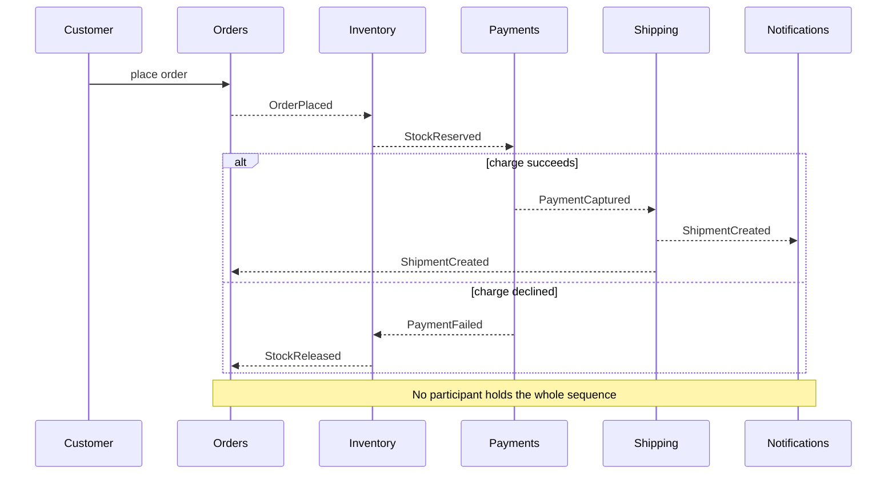
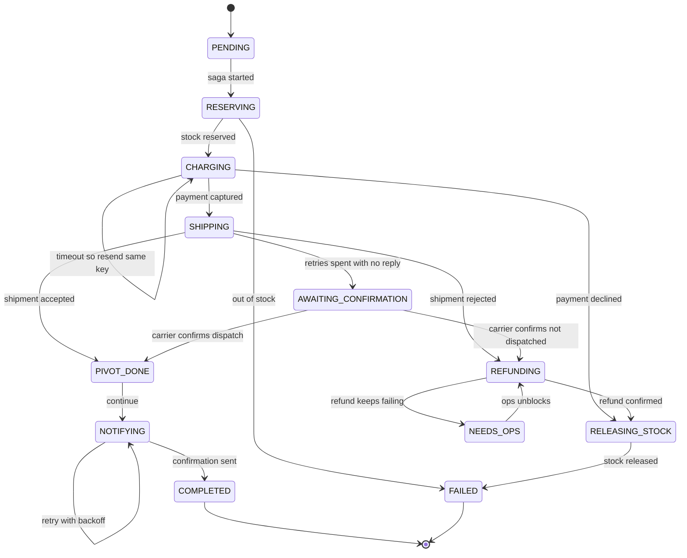

# Orchestration vs Choreography

Every multi-service business process needs an answer to "who is in charge". **Choreography** says nobody: each service reacts to events and emits its own, and the process is whatever falls out of the subscriptions. **Orchestration** says one component: an *orchestrator* owns the process definition, tells each service what to do, and tracks where the process is. [[Saga Pattern]] and [[Communication Patterns Between Services]] each carry a comparison of the two. This note goes further in three directions: why the question exists at all, how to build an orchestrator that survives crashes and redeploys, and when a workflow engine beats hand-rolling one.

## The problem that created it

Take *place order*: reserve inventory, charge the customer, create the shipment, send the confirmation. In a monolith this is one method, and the call stack quietly does three jobs for free. It fixes the **order** of the steps (the lines of code), it supplies the **failure policy** (a `catch` block, or a rolled-back `@Transactional`), and it records **where the process currently is** (the instruction pointer, visible in a thread dump). Split the four steps across four services and the stack is gone. Those three jobs still need a home, and there are only two places to put them: in **one component** that holds all three (orchestration), or **spread across the participants**, each knowing a slice (choreography).

The vocabulary is older than microservices. In the SOA era of the early 2000s, "orchestration" meant one party's executable process (BPEL engines, ESBs) and "choreography" meant a global description of how peers exchange messages with no central owner (Peltz, 2003). *Enterprise Integration Patterns* (2003) called the orchestrator a **Process Manager**: a component that keeps the state of a sequence and decides the next step. The failure of that era was the ESB that accreted business rules until nothing could change without it; the reaction, summed up in the 2014 "Microservices" article by Fowler and Lewis as *smart endpoints and dumb pipes*, pushed the industry toward choreography. The pendulum swung back in the mid-to-late 2010s, when durable workflow engines (Step Functions, Conductor, Cadence and its Temporal fork, Zeebe) made an explicit process definition cheap without writing the recovery machinery yourself. Neither answer won. They fail in opposite directions, and the skill is knowing which failure you can afford.

## What it solves

- **Orchestration solves legibility and control.** The process is a definition you read in one place, an instance you can query ("where is order 8841?"), and a single owner of timeouts, retries and compensation. It is the pattern for flows where support will ask for an answer and an auditor for evidence.
- **Choreography solves autonomy and extensibility.** No service is told what to do, so no central component must know every participant; a new consumer joins by subscribing and the publisher never changes. It is the pattern for reactions where the producer genuinely does not care who listens ([[Why Async Messaging Exists]]).
- **Neither removes the underlying cost.** The steps still are not atomic, so both are ways of running a [[Saga Pattern|saga]]. The choice only decides *where the sequencing and compensation logic lives*.

## How it works

### Choreography: the process as emergent behaviour

Each service subscribes to the events it cares about, commits its local transaction, and emits the next event. Nobody sends commands; everybody announces facts. The order flow, with a payment failure branch:

The arrows are events on a broker; the emitter does not know who consumes them. The strengths are real: no extra component, no single point of control, and services can be added or removed without the others noticing — as long as the change is a *parallel reaction*. The weaknesses, stated concretely:

- **The process exists nowhere as code.** "Reserve, then charge, then ship" is a property of who subscribes to what. To read it end to end you open four repositories and reconstruct the chain from event names.
- **Adding a step is cheap or expensive depending on its shape.** As [[Communication Patterns Between Services]] notes, for a *parallel* reaction (analytics also wants `OrderPlaced`) a new consumer subscribes and no existing service changes. Inserting a *sequential* step does not. To put a fraud check between inventory and payment, Fraud must subscribe to `StockReserved`, Payments must stop listening to `StockReserved` and listen to `FraudCleared` instead, and the failure path needs the same re-wiring. Three services change, deployed in an order that must not strand orders already in flight.
- **Cyclic event chains.** A emits X, B reacts and emits Y, A reacts to Y and emits X again. With no process definition to show the loop, it appears in production as an event storm, usually through a "recalculate on change" handler with no hop limit.
- **Debugging is correlation work.** A stalled order raises no error; what failed is an *absent* event. You need a correlation id carried in message headers and [[Distributed Tracing]] to find the last event that did happen, and "which subscriber should have reacted and did not" is a question about configuration, not logs. Teams that run choreography seriously end up building a watcher that tracks in-flight orders and alerts on silence — a half-orchestrator with none of the control.
- **Compensation scatters.** On payment failure Inventory must release stock, so Inventory subscribes to `PaymentFailed`. Once Shipping can fail after payment, Payments must subscribe to `ShipmentFailed` to refund and Inventory to release — or each compensation emits its own event to trigger the previous one. Either way the rollback is a second, hidden choreography running backwards, and every service must know the failure events of services later in the chain.

### Orchestration: the process as a definition

An orchestrator owns the definition. It sends each step a command, records the outcome, picks the next step, and on failure walks the completed steps in reverse running their compensations. The sequence diagram for this shape is already drawn in [[Saga Pattern]] and [[Communication Patterns Between Services]] — one lane in the middle talking to every participant — so it is not redrawn here; the state machine below is the deeper view. The same order flow, as the orchestrator sees it:

| Step | Orchestrator sends | Waits for | Compensation if a later step fails |
|---|---|---|---|
| 1 | `ReserveStock` | `StockReserved` or `OutOfStock` | `ReleaseStock` |
| 2 | `ChargeCustomer` | `PaymentCaptured` or `PaymentDeclined` | `RefundCustomer` — a new forward transaction, not an undo |
| 3 | `CreateShipment` | `ShipmentAccepted` or `ShipmentRejected` | none: the pivot, the goods have left |
| 4 | `SendConfirmation` | `Sent` | none: retried until it succeeds |

"Waits for" never means a blocked thread. The orchestrator persists "order 8841 is in CHARGING", returns, and treats the reply as a later event that triggers the next transition. That is why an orchestrator can be fully asynchronous and hold many slow instances at once and still be an orchestrator.

**Strengths:** the workflow is explicit and readable in one place; its state is tracked, so "where is it" is a query; timeouts and retries live in one place instead of being re-implemented per service; and compensation is a reverse walk over a list you can see. **Weaknesses:** it is a new service to run and keep highly available; it couples to every participant's command contract; if it calls participants **synchronously** it inherits the availability-in-series math from [[Communication Patterns Between Services]] and ties up threads on slow steps; and it attracts business logic from every domain until it becomes a god service.

### Designing an orchestrator properly

A good orchestrator is not a long method with `try/catch`. It is a **persistent state machine, one instance per business process**, and its compensating states belong in the machine itself:

Read it in three zones, using the vocabulary of [[Saga Pattern]]: forward states up to the pivot, compensating states (`REFUNDING`, `RELEASING_STOCK`) that walk back in reverse order, and the pivot itself (`SHIPPING` to `PIVOT_DONE`), after which the machine never goes backwards. Two states exist for honesty rather than the happy path: `AWAITING_CONFIRMATION` holds an unknown outcome until evidence arrives, and `NEEDS_OPS` is where a compensation that will not succeed waits for a human instead of retrying silently forever. Seven rules separate this from a long method:

1. **Durable, and resumed rather than restarted.** The instance record (`sagaId`, `definitionVersion`, `state`, `stepOutputs`, `deadlineAt`, `version`) is committed before any command goes out, and on startup the orchestrator scans for non-terminal instances and resumes each from its recorded state — the persist-before-dispatch discipline in [[Saga Pattern]]. One way to hold that state is as an append-only stream of transitions instead of a mutable row ([[Event Sourcing]]), which answers "why did this order compensate" months later and is, in effect, what Temporal's history is. A mutable row plus an append-only `saga_events` audit collection gets most of that benefit with less machinery.
2. **Every transition is a compare-and-set.** Advance only if the instance is still in the state the reply belongs to: `updateOne({_id: sagaId, state: "CHARGING"}, {$set: {state: "SHIPPING"}, $inc: {version: 1}})`, and if it matches nothing, drop the message. Replies on an at-least-once transport arrive duplicated, late and out of order ([[Delivery Semantics]]); without the guard a duplicate `PaymentCaptured` re-drives shipping. It matters at one replica too: with a default rolling update the old and new pod overlap for a while, and the reply consumer and the deadline sweeper can each try to advance the same instance.
3. **Every command carries a stable idempotency key.** `sagaId:stepName` for the forward command and `sagaId:stepName:compensate` for its compensation, stable across retries and never regenerated per attempt, enforced by a unique index in the participant's own database rather than by orchestrator bookkeeping ([[Idempotency]], [[Exactly-Once Delivery Is a Lie]]). That is what lets a lost reply be handled by simply resending: the participant returns the stored result instead of charging twice.
4. **Three clocks, and the ambiguous outcome.** A per-attempt timeout, a per-step deadline that covers the retries, and a per-instance deadline. Deadlines are data (`deadlineAt`, read by a sweeper, or engine timers), never an in-memory `setTimeout` that dies with the pod. A timed-out step is first resent with the same key. When the retry budget is spent with no reply, the outcome is **unknown, not failed**: move to `AWAITING_CONFIRMATION`, resolve it with a status query on your own reference, and compensate only on a definitive "not done" ([[Network Partitions and Timeouts]]).
5. **Publish through the outbox.** Committing the transition and sending the next command is a dual write; write both in one local transaction and let a relay publish ([[The Outbox Pattern]]). Without it the orchestrator can persist `CHARGING`, crash before sending, and leave an instance with no command in flight until a deadline notices.
6. **Version the definition and stamp every instance with it.** The workflow will change while instances are in flight. Store `definitionVersion` on each instance and choose per change: **pin** (in-flight instances finish on the version they started, new ones start on the new version, both handlers coexist until the old one drains — the safe default), **migrate** (map old states onto new for running instances; only for urgent fixes, rehearsed on copies), or **drain** (stop starting instances on the old version and wait). Renaming or removing a state that live instances occupy strands them in a state the new code does not recognise. Engines hit the same wall: Temporal rebuilds state by replaying recorded history against your code, so changing workflow code in a way that diverges from that history breaks in-flight workflows, which is what its versioning mechanism exists for.
7. **Keep it thin: sequencing and state, nothing else.** The orchestrator decides *what comes next*; participants decide *whether the step is allowed*. It reads a reply as OK, REJECTED or RETRYABLE and moves on; it never computes a fee or checks a limit. The smell is an `if` on a business value inside the orchestrator. The structural guard is ownership: one orchestrator per process, owned by the team that owns the process, not one company-wide orchestrator that every domain feeds.

### Engines instead of hand-rolling

Teams rarely hand-roll all seven rules for long. The four engines you will be asked about differ in where the definition lives and how state survives a crash:

- **Temporal** — *durable execution*. The workflow is ordinary code in a general-purpose language (SDKs exist for several, including Java and Go). The engine records every step's outcome in a persisted event history; when a worker dies, another replays the code against that history to rebuild the exact in-memory state and carries on. The price: workflow code must be deterministic (side effects go in activities) and live changes need its versioning mechanism (patching, or worker versioning that pins old executions to old code). Its founders created Cadence at Uber and forked it as Temporal in 2019. You operate a cluster backed by a database, or buy it managed (Temporal Cloud).
- **AWS Step Functions** — the definition is a **state machine written as JSON** (Amazon States Language) and AWS runs it serverlessly. States invoke Lambda functions or other AWS services and carry declarative `Retry` and `Catch` rules, waits and parallel branches. **Standard** workflows run up to a year, persist state between transitions, support the task-token callback pattern for waiting on an external system, and are billed per state transition; **Express** workflows run at most five minutes, are at-least-once (asynchronous) or at-most-once (synchronous), do not support callbacks, and are billed by executions, duration and memory (AWS docs, 2026; check the price list before sizing). Versions and aliases arrived in 2023. Nothing to operate, and the definition is not portable.
- **Camunda with Zeebe** — the definition is a **BPMN diagram**, a standard notation that analysts and engineers can both read. The engine creates a process instance and exposes *jobs* that workers poll for (or, in recent versions, have streamed to them), advancing as workers complete or fail them. Best when the process is long-lived, includes human tasks, or the business wants to own the diagram. Licence is a real decision: since Camunda 8.6 (October 2024) the Self-Managed components, Zeebe included, are source-available under the Camunda License 1.0 — free for development and testing, a paid licence for production.
- **Netflix Conductor** — definitions are JSON workflows and workers poll the server for tasks, so participants can be in any language and the engine never calls them. Netflix open-sourced it in December 2016 and archived its repository in December 2023; the open-source line now lives on as Conductor OSS, maintained by Orkes (founded by Conductor's original engineers) and the community, with Orkes selling a managed version. Check that stewardship before betting a regulated flow on it.

**Hand-rolled or engine?** Hand-roll when you have one or two sagas, few steps, the pieces already in operation (a Mongo collection, an outbox, a queue, a sweeper), and a team willing to test the crash paths. Move to an engine when the *third distinct* process arrives, when you need long timers, human steps or process history for non-engineers, or when the recovery machinery you are rebuilding (timers, retries, versioning, replay) outweighs the business logic. An engine does not remove the hard parts: an engine that retries a step after a timeout cannot know whether the first attempt ran, so participants still need idempotency keys; the thin-orchestrator discipline still applies; and you have added a platform to run, secure, and keep inside your audit and data-residency boundaries.

### Hybrids

Most real systems use both, split on a boundary:

- **Orchestration inside a bounded context, choreography between contexts.** The Orders context runs its place-order saga with an orchestrator, because its steps are tightly related, compensating, and owned by one team. When the saga completes, Orders publishes `OrderCompleted` and Loyalty, Analytics and Notifications react independently. Internals are explicit, seams are loose, which fits [[Service Boundaries and Domain-Driven Design]]: the context boundary is where you stop coordinating and start announcing.
- **An orchestrator that consumes events.** Replies arrive as messages on a reply queue or topic, so the orchestrator is itself event-driven, and can be *started* by an event (`TransferRequested`). The difference from choreography is not the transport; it is that one component holds the definition and the state. Participants that emit plain facts and a single process manager reacting to them is a legitimate middle: participants stay unaware of the saga, but the flow still lives in one place.
- **Do not nest deeply.** An orchestrator commanding other orchestrators recreates the central ESB at larger scale. Keep the hierarchy to one level, two when a child process is a genuinely reusable unit.

### Choosing: the decision table

| Factor | Leans choreography | Leans orchestration |
|---|---|---|
| Number of steps | 2 to 4, mostly linear | 5 or more, or any branching |
| Need for visibility | Nobody asks "where is it" | Support or an auditor must answer it per instance |
| Failure handling | Failures are local and ignorable, such as a missed analytics event | Compensation, a pivot, deadlines, ambiguous outcomes |
| Team ownership | Many teams, nobody owns the whole outcome | One team owns the end-to-end outcome and can own the orchestrator |
| Coupling tolerance | Producers must not know their consumers | A coordinator coupled to participants is acceptable |
| How the flow changes | Extended with parallel reactions | Steps inserted or reordered often — one place to edit |

The honest rule of thumb: choreography scales to about **three or four steps** before the process becomes unreadable. The sibling notes put the line at 2 to 3 and 2 to 4 steps; that is one band, and four is a ceiling, not a target. Past it — or the moment money, compensation or an SLA enters — orchestrate. The step count is a proxy for the real limit: nobody can hold the whole flow in their head.

## Trade-offs

| Choice | You gain | You pay |
|---|---|---|
| Orchestration | One readable definition, queryable state, central timeouts and retries, a compensation that is a reverse walk | A component to run and keep available; a coordinator coupled to every participant; a standing pull toward hoarding business logic |
| Choreography | Autonomy, no central component, free parallel extension | A process that exists nowhere; multi-service edits to insert or reorder; debugging by absent event; scattered compensation |
| Workflow engine | Timers, retries, history and versioning you did not write | A platform to operate or buy, a definition model to learn, execution history that must fit your audit and residency rules, lock-in to the model |
| Hybrid | Explicit core, loose seams | Two mental models, and discipline about where the boundary sits |

## Failure modes

- **The orchestrator is down, so every in-flight process stalls.** Instances do not fail; they freeze in their last durable state, holding whatever early steps took (stock reservations, wallet holds). At one replica this is a real outage: every deploy, node drain and OOM kill is a window with no coordinator, and the deadline sweeper, usually in the same process, is down with it. Durable state turns a loss into a stall, and that is the whole defence.
- **The recovery stampede.** After a long outage the sweeper finds thousands of instances past `deadlineAt` and compensates them all at once, though the delay was the orchestrator's, not the participants'. Extend deadlines by the outage on recovery, or rate-limit expiries and re-check participant state first. (Design reasoning, not a named pattern.)
- **Duplicate step execution when a reply is lost.** The participant did the work, the reply vanished, the deadline fired, the command was resent. With no stable key enforced in the participant's database the customer is charged twice.
- **A stale reply re-drives the machine.** No compare-and-set, so a late `PaymentCaptured` arriving after the saga moved to `REFUNDING` pushes it on to shipping.
- **The god orchestrator.** Business rules migrate in because it is the convenient place, participants shrink to anemic CRUD services, every domain change needs an orchestrator deploy, and the ESB has been rebuilt ([[The Distributed Monolith Anti-Pattern]] in hub-and-spoke form).
- **Event cycles in choreography.** Two handlers re-trigger each other with no hop limit or de-duplication, and the loop is visible only as a rising message rate.
- **Compensation of a compensation.** The refund fails. There is no "undo the refund" — recursing builds an unbounded chain of undos. Treat compensations as steps that retry until they succeed, with backoff, a dead-letter path ([[Dead Letter Queues and Poison Messages]]) and a `NEEDS_OPS` state; anything the customer can see goes back as a new forward transaction.
- **A definition change strands running instances.** A deploy renames a state and every instance in the old one fails the same way on every sweep.

## When NOT to use it

- **Do not orchestrate a fan-out reaction.** Notify, index, update analytics, invalidate a cache: the producer does not need the result, and an orchestrator that waits on them puts the least reliable subscriber on the critical path.
- **Do not choreograph money.** Anything with a pivot, a compensation or a deadline, or where support must answer "where is it" for one customer, wants a single owner of the state.
- **Do not choreograph past about four steps**, or any flow with branching that someone has to draw on a whiteboard to explain.
- **Do not orchestrate a single local transaction.** If the steps share one database use a transaction; if there are two steps and the second is retriable, persist the intent and retry through an outbox ([[Saga Pattern]] makes the same point).
- **Do not run one organisation-wide orchestrator.** One per process, owned by the process's team.
- **Do not adopt an engine to avoid thinking about idempotency**, and do not hand-roll one if nobody will test the crash paths.

## In your stack

- **Money transfer: orchestrated.** Wallet debit and hold, risk, rail submission (the pivot), ledger post, notification — the saga laid out in [[Saga Pattern]], and the problem space of [[Design a Payment System]]. State in a Mongo collection carrying `definitionVersion` and `version`, transitions as compare-and-set, the next command written to an outbox in the same Mongo transaction, `sagaId` and `x-correlation-id` on every hop. When support asks "where is TXN-88213" the answer is one document; when an auditor asks, it is the transition log.
- **Notification fan-out: choreographed.** When a transfer completes, publish one `TransferCompleted` event and let push, SMS, email and analytics each consume it from their own queue (SNS fanning out to SQS, see [[SQS and SNS]] and [[Design a Notification Service]]). A new channel is a new queue and the publisher never changes; one channel's outage does not touch the others. No compensation, nobody waiting. The two styles meet at that event, which is the bounded-context hybrid above.
- **At one replica, a stalled orchestrator is a deploy-time event.** Durable state makes it a stall instead of a loss, but only if you have tested it: kill the pod mid-saga in UAT and confirm the instance resumes from its recorded state with no command lost or doubled. Check that the recovery scan exists, that the sweeper extends deadlines after downtime, and that an alert fires on the age of the oldest in-flight instance, because a stalled orchestrator produces silence, not errors. Holds placed by early steps survive every stall, so their expiry must outlast your worst plausible outage or they lapse under a saga that later resumes. A second replica closes the gap only if compare-and-set and idempotency are already in place, because two pods will race on the same instances.
- **The broker journey does not change the saga.** Because every transition is compare-and-set and every command idempotent, correctness rests on at-least-once delivery, not on one broker's behaviour; moving from SQS to [[Redis Streams]] is a transport change, not a saga rewrite ([[Choosing a Message Broker]]).
- **Engine decision.** On AWS, Step Functions is the native candidate and Temporal the code-first one. With one or two sagas, the Mongo, outbox and SQS you already run is defensible; the third distinct saga type is the signal to reconsider. **An engine is new regulatory scope.** Execution history stores step inputs and outputs; if they carry payment data, where it lives matters (RBI's 2018 directive on storage of payment system data requires such data to be stored in India; whether it binds you depends on your role in the payment chain, so confirm with compliance), and history retention is finite (Step Functions Standard keeps execution history for 90 days after completion, per AWS docs in 2026; Express keeps none unless you log to CloudWatch), so audit evidence must be exported to your own store.

## Interview angle

The 60-second version: *"Both answer who is in charge of a multi-service process. In choreography nobody is: each service reacts to events and emits its own, which gives loose coupling, but the process exists nowhere as code, inserting a step touches several services, and debugging means hunting for an event that never happened. In orchestration a coordinator owns the definition, sends commands, tracks state and runs compensations, so the flow is readable and queryable in one place; the cost is a component to keep available and a pull toward becoming a god service. I choreograph short fan-out reactions, three or four steps at most, and orchestrate anything with compensation, deadlines or money, because someone will ask where a given transaction is. Built properly, the orchestrator is a durable state machine per instance: state committed before commands go out, transitions as compare-and-set, an idempotency key on every command, deadlines stored as data, commands published through an outbox, and the definition versioned. Beyond one or two flows I would consider an engine like Temporal or Step Functions rather than rebuild timers and replay. In practice I combine them: orchestrate inside a bounded context, publish events between contexts."*

Classic follow-ups:

- "Isn't an orchestrator a distributed monolith?" — only when it holds business rules. Keep it to sequencing and state; participants own the decisions.
- "What if the orchestrator dies mid-saga?" — state is durable, startup resumes non-terminal instances, resent commands are idempotent. A stall, not a loss.
- "Should the orchestrator call synchronously or send messages?" — messages for slow or durability-sensitive steps; synchronous only for fast steps, and still persist the intent before calling.
- "How do you change a workflow with live instances?" — stamp `definitionVersion`; pin, migrate or drain.
- "Temporal or Step Functions?" — code replayed from history versus a JSON state machine run serverlessly; the choice is about who writes and operates the definition.

## Check yourself

> [!question]- Q: Your team wants a fraud check between inventory and payment in a choreographed order flow. What changes, and what does the pain tell you?
> Fraud must subscribe to `StockReserved`; Payments must switch from `StockReserved` to `FraudCleared`; a `FraudRejected` event is needed and Inventory must subscribe to it to release stock; and the rollout must be ordered so orders already in flight are not stranded. That is three services and a migration window to insert one step, where an orchestrated flow is one definition edit plus the new participant. If it keeps happening, the flow has passed the three-or-four-step ceiling and wants an orchestrator inside the Orders context.

> [!question]- Q: Scenario — the orchestrator pod is OOM-killed just after committing `CHARGING` together with its outbox row, before the command was published. What happens on restart, and which mechanisms make it correct?
> The outbox row committed atomically with the state, so the relay publishes the command after restart and nothing is lost; the recovery scan also sees a non-terminal instance in `CHARGING` and resumes it. If the command had already been published before the crash, the relay may publish it again, and the idempotency key enforced in Payments' database returns the stored result instead of charging twice. When replies arrive, the compare-and-set on `state = CHARGING` drops any duplicate. Outbox prevents the lost command, the key prevents the double effect, compare-and-set prevents the double advance.

> [!question]- Q: Scenario — `CreateShipment` times out three times in a row with no reply. Should the orchestrator refund the customer?
> No. A timeout is an unknown, not a failure, and shipping is the pivot: refunding while the goods have in fact left is a direct loss. Move to `AWAITING_CONFIRMATION`, ask the carrier whether the order was dispatched using your own reference, and go to `PIVOT_DONE` or `REFUNDING` only on a definitive answer. If the status source is unavailable past the instance deadline, escalate to `NEEDS_OPS` with the customer's funds still held; failing closed beats guessing.

> [!question]- Q: Design — 3,000 orders are in flight and you must add a fraud check to the definition. What are your options?
> Every instance carries `definitionVersion`. **Pin**: new orders start on v2, in-flight ones finish on v1, and both handlers ship until v1 drains, then v1 is deleted — the safe default. **Migrate**: map v1 states onto v2 for running instances, only for an urgent bug and rehearsed on copies; instances already past the insertion point are unaffected, the rest would gain the step. **Drain**: stop starting v1 and wait. Renaming a state under live instances strands them. An engine shifts the mechanics, not the problem: Temporal workflows must keep replaying recorded history, so code changes are gated behind its versioning mechanism.

> [!question]- Q: A colleague says "an orchestrator at one replica is a single point of failure, so choreography is safer for transfers." Respond.
> The premise is partly right and the conclusion is wrong. Choreography removes the coordinator, not the stall: if the ledger consumer is down its queue just fills, the transfer stops mid-way, and nobody notices because no component owns the state to alert on. An orchestrator at one replica stalls during deploys too, but with durable state, a tested recovery scan and an alert on oldest-instance age, the stall is visible and recoverable. The real fix is a second replica once compare-and-set and idempotency make a race safe; giving up explicit state for money flows trades a visible problem for an invisible one.

## Sources

- Chris Richardson — *Microservices Patterns* (Manning, 2018), the saga chapter — orchestration versus choreography, the compensatable / pivot / retriable vocabulary; microservices.io carries a condensed write-up.
- Sam Newman — *Building Microservices*, 2nd edition (O'Reilly, 2021) — the treatment of orchestrated and choreographed sagas.
- Gregor Hohpe and Bobby Woolf — *Enterprise Integration Patterns* (Addison-Wesley, 2003) — the Process Manager pattern.
- Chris Peltz — "Web Services Orchestration and Choreography", IEEE Computer, 2003 — the original SOA-era definitions of the two terms.
- James Lewis and Martin Fowler — "Microservices", martinfowler.com, 2014 — smart endpoints and dumb pipes.
- Hector Garcia-Molina and Kenneth Salem — "Sagas", ACM SIGMOD, 1987.
- AWS Step Functions Developer Guide — Amazon States Language, Standard versus Express workflows, versions, execution history retention; AWS Prescriptive Guidance, "Saga pattern".
- Temporal documentation — durable execution, deterministic workflow constraints, workflow versioning; Camunda documentation — BPMN, Zeebe job workers, and the 8.6 licensing announcement (2024); Netflix TechBlog, "Netflix Conductor: A microservices orchestrator" (2016); Orkes, Conductor OSS community repository announcement (2023).
- Reserve Bank of India — directive on storage of payment system data, 2018.
