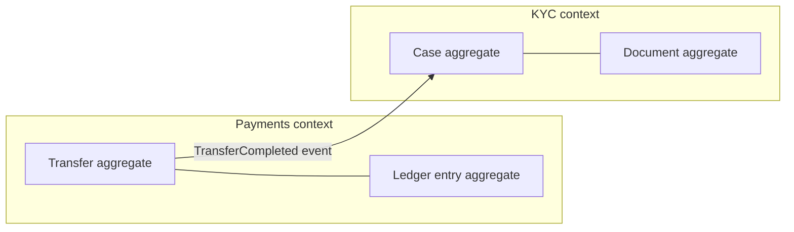

# Service Boundaries and Domain-Driven Design

Where you draw service boundaries matters more than whether you have services at all: good boundaries make changes local and teams autonomous; bad ones turn every feature into a multi-service, multi-team project. **Domain-Driven Design (DDD)** — Eric Evans's 2003 book and the body of practice around it — is the main toolkit for finding boundaries, because it starts from the business domain rather than from technology. The core move is to split along **bounded contexts** (areas where a consistent business language holds) and to treat **aggregates** as the smallest units you must never cut in half. This note gives you the vocabulary, the heuristics, and the two famous ways teams get it wrong.

## Why this matters

Every cost in [[Monolith vs Microservices]] — network latency, distributed transactions, cross-team coordination — is paid *at the boundaries*. A boundary placed where the domain rarely crosses it is nearly free; a boundary placed through the middle of a cohesive business operation is paid on every single request, forever, as chatty calls and [[Saga Pattern|sagas]]. Most microservices failures trace back not to technology choices but to boundaries drawn by technical layer, by database entity, or by org-chart accident — producing [[The Distributed Monolith Anti-Pattern|distributed monoliths]]. Interviewers probe this constantly because it separates people who have decomposed real systems from people who have read about it.

## How it works

### Bounded contexts

A **bounded context** is a boundary within which a domain model and its language are internally consistent. The founding insight of DDD is that large domains do not have one model: the word "account" means a login identity to the auth team, a ledger entity to payments, and a KYC case to compliance. Forcing one `Account` class to serve all three produces a bloated object that every team must coordinate to change. Instead, DDD says: let each context have its *own* model of Account, make the boundary explicit, and translate at the edges (DDD calls the translation layer an **anti-corruption layer** when protecting your model from an external or legacy one).

**Ubiquitous language** (brief, because the idea is simple): within a bounded context, the team and the code use the business's own terms — if the compliance team says "case", the class is `Case`, not `KycRecordDto`. The practical payoff for boundary-finding: *where the language changes, a context boundary probably lives*. If two groups use the same word to mean different things, or different words for the same thing, you've found a seam.

Bounded contexts are the natural candidate for service boundaries (or [[Modular Monolith|module]] boundaries): one context = one service (or a small cluster of services owned by one team). The mapping isn't forced to be 1:1, but a service that spans two contexts serves two masters, and a context split across many services multiplies coordination.

### Context mapping — naming the relationships between contexts

Contexts don't float free; they integrate, and DDD gives the integration styles names (**context mapping**) because the *relationship* determines who absorbs change. The ones that matter for service design:

- **Customer–supplier**: the downstream context's needs feed into the upstream's planning — upstream commits to a contract and a deprecation process ([[API Design and Versioning]]). This is the healthy default between internal teams.
- **Conformist**: downstream simply adopts the upstream's model as-is because it has no leverage (typical against a big vendor API). Cheap to build, but the upstream's modeling choices — and churn — flow straight into your code.
- **Anti-corruption layer (ACL)**: downstream defends its own model by translating at the edge — an adapter that converts the upstream's representation into local domain terms. More code, but the upstream's model (or a legacy monolith's mess) stops leaking in; essential when integrating with systems you don't trust to stay stable, and the standard shield during a [[Strangler Fig Migration]].
- **Shared kernel**: two contexts deliberately share a small model subset (a common `Money` type, shared ID formats) and accept that changing it requires joint agreement. Keep it tiny — a growing shared kernel is re-coupling in disguise.
- **Open host service / published language**: an upstream exposes one well-documented, versioned protocol for *all* consumers (rather than bespoke integrations per consumer) — what a good public API or a schema-registry-governed event stream ([[Event Schema Evolution]]) is.

The map is a power diagram: for each boundary, ask "who conforms to whom, and where does translation live?" A boundary with no named relationship defaults to accidental conformism — the downstream team quietly absorbing every upstream change, which is how coordination overhead sneaks back in after a split.

### Aggregates — the consistency boundary

An **aggregate** is a cluster of domain objects (one **aggregate root** plus its subordinates) that must change together to keep business invariants true — e.g., an `Order` and its `OrderLines` where "total equals sum of lines" must always hold. DDD's rule: a transaction updates **one aggregate**; anything spanning aggregates is eventually consistent via events. This rule, designed for object modeling, turns out to be the key to service decomposition:

- An aggregate is the **smallest unit you must never split across services**, because its invariants need [[ACID Transactions|atomic updates]] — split it and you need a distributed transaction for every change ([[Two-Phase Commit and Distributed Transactions]], which you want to avoid).
- Conversely, anything that is *already* allowed to be eventually consistent with the aggregate (per the one-aggregate-per-transaction rule) can tolerate a network boundary — which makes **the aggregate the floor of decomposition** and the cross-aggregate relationships the legitimate places to cut.

### Worked example: letting an invariant decide a boundary

The aggregate rule sounds abstract until you price it. Take double-entry bookkeeping, the invariant at the centre of any ledger: **a transfer posts a debit and a matching credit, and the two must sum to zero**. Nothing may ever observe one without the other.

Suppose someone proposes splitting "outgoing postings" and "incoming postings" into two services — a plausible-sounding cut along a verb. The invariant now straddles the boundary, so every transfer needs either a distributed transaction ([[Two-Phase Commit and Distributed Transactions]], which you are avoiding for good reasons) or a [[Saga Pattern|saga]] with compensation. And compensation for a *posted ledger entry* is not a rollback — ledgers are append-only, so the compensation is a **reversing entry**, which is visible on the customer's statement and in the regulator's report.

Put a number on the operational consequence. Assume — and this is an assumption to replace with your own measurement — a saga step fails or times out mid-way once in every 10,000 attempts. At 200,000 transfers a day, `200,000 ÷ 10,000 = 20` transfers a day land half-posted, each needing a reversing entry, a reconciliation check, and potentially a customer-facing explanation. That is roughly 7,300 a year, and it is a daily operations workload generated *entirely by where someone drew a line*. The same operation inside one aggregate, in one service, in one local transaction, produces zero of them, because the database makes the all-or-nothing guarantee for free.

This is the aggregate rule's real content: **a boundary that crosses an invariant converts a database guarantee into an operational process**. When you are choosing between candidate cuts, list the invariants each cut would straddle before you list anything else — latency and chattiness are costs you can optimise later, while a straddled invariant is a correctness problem you will be staffing forever.

### Signals that a boundary is wrong

Boundaries are hypotheses, so they need falsification tests. Each of these is observable, and two or more together means the line is in the wrong place rather than merely under-optimised:

- **Chatty reads.** Count calls across the boundary per user-facing request. If one screen needs several round trips to the same neighbour, that data belongs closer — either as a local read model or on the other side of the line.
- **Saga count.** The number of business operations needing compensation. Each one is a boundary crossing an invariant; a growing list is a boundary being crossed by the domain, not by the architecture.
- **Co-deployment.** Two services that must release together are one service that has not noticed ([[The Distributed Monolith Anti-Pattern]]).
- **Identical models on both sides.** If both services hold the same concept with the same fields and the same meaning, there was no *context* boundary there — only a network one. A real context boundary shows up as two genuinely different models of the same word.
- **Ticket spread.** Routine features touching both repositories. If the business asks for one thing and two teams must plan it, the business's unit of work is larger than your unit of ownership.
- **Who gets paged.** One service whose incidents are consistently rooted in a neighbour's changes. That is the boundary telling you it does not isolate anything.

### Boundaries and the org chart

Conway's law says the architecture will come to mirror the communication structure. The practical consequence for boundary work is uncomfortable: **if you draw boundaries the organisation does not match, the organisation wins** — teams spanning two services will erode the line between them, and two teams sharing one service will partition it informally and then argue about it.

The deliberate use of this is the **inverse Conway manoeuvre** — change the team structure to the shape you want the architecture to take, then let the architecture follow. Named on the Thoughtworks Technology Radar and developed at length in *Team Topologies* (Skelton & Pais, 2019), it is the reason "which team will own this?" is a design question and not an afterthought. In practice: before proposing a decomposition, write down the team that will own each piece. If a piece has no owner, or one team owns three pieces that then deploy together, redraw — you have found the boundary the organisation will actually enforce.

### Why entity-per-service fails

The tempting naive decomposition: one service per noun — `UserService`, `OrderService`, `ProductService`, `PaymentService`. It fails because **business operations are verbs that span nouns**. "Place an order" needs user, product, inventory, and payment; with entity services, that one operation becomes a synchronous fan-out across four services — a **chatty distributed join**. Costs: latency and failure probability compound per hop ([[Communication Patterns Between Services]]); no service can answer a business question alone; every new feature touches several services (coordination is back); and consistency across the nouns needs sagas for what one aggregate could have guaranteed locally. Entity services are maximally *coupled to everything* because entities are what everything shares — you've decomposed along exactly the wrong axis.

### Why layer-per-service fails

The second classic mistake: services by technical layer — a "UI service", "business-logic service", "data-access service", or horizontally split teams like "the API team" and "the DB team". Now *every* feature, by construction, crosses *every* service: a new field travels through all the layers and all the teams. You get maximal coordination, lockstep deploys, and zero independent value per service — the purest form of [[The Distributed Monolith Anti-Pattern]]. Conway's law explains why this happens: teams organized by technology produce architecture organized by technology. The fix is organizing both teams and services by **business capability**, so a feature lands inside one boundary.

### Splitting heuristics

When the domain analysis leaves you choices, these heuristics rank the candidate cuts:

1. **Split by business capability.** "Payments", "KYC", "card issuance", "notifications" — things the business would recognize as functions it performs. Capabilities are stable (companies rarely stop doing payments) even while implementations churn, so boundaries drawn on them age well.
2. **Split by rate of change.** Code that changes together should live together (common closure principle). If the loan-offer rules change weekly but ledger logic changes yearly, separating them means the risky deploys stop touching the stable core. Conversely, two pieces that always change in the same ticket belong in one service — a boundary between them would be crossed by every change.
3. **Split by data coupling.** Draw the entity-relationship graph and cut where the edges are thinnest. A boundary crossed by ID references and occasional events is cheap; one crossed by joins, shared transactions, or large synchronous reads is paid on every request. If two candidate services would need to share a table or transact together, the boundary is wrong — merge them or move the line.
4. Secondary signals: different **scaling or availability needs** (statement generation vs real-time auth), different **security/compliance scope** (RBI-audited money path vs marketing), different **team ownership**.

### The cost of a wrong boundary

A wrong *module* boundary costs a refactor: move classes, fix imports, done in a sprint. A wrong *service* boundary costs: a cross-team API renegotiation ([[API Design and Versioning]]), a data migration between stores (weeks — see [[Strangler Fig Migration]] data strategies), rewriting local calls as sagas or vice versa, and re-routing every consumer — all while both services keep serving traffic. This asymmetry is the entire argument for [[Monolith vs Microservices|monolith-first]]: boundaries are hypotheses, and you want hypotheses to be cheap to revise until they're proven. Expect to get some boundaries wrong; design so that being wrong is survivable (events over shared tables, narrow APIs, owned data).

## Trade-offs

| Approach to boundaries | Gains | Costs |
|---|---|---|
| Bounded context per service | Local changes, team autonomy, stable seams | Requires real domain analysis up front; contexts can be misjudged |
| Entity-per-service | Easy to name, feels "clean" | Chatty distributed joins; every feature spans services |
| Layer-per-service | Matches a tech-org chart | Every change crosses every service; lockstep deploys |
| Coarse services (context clusters) | Fewer boundaries to pay for | Larger blast radius per service; may hide two teams in one repo |

DDD itself has a cost: modeling workshops (event storming), maintaining per-context models and translation layers, and accepting *deliberate duplication* — three contexts each holding their own partial copy of customer data feels wasteful to a normalization instinct ([[Normalization vs Denormalization]]) but is what keeps them decoupled.

## Common misconceptions

- **"DDD means microservices."** DDD predates microservices by a decade; bounded contexts work equally well as modules in a [[Modular Monolith]]. DDD finds the seams; whether you cut network boundaries along them is a separate decision.
- **"Smaller services are better services."** Size is not the metric; *alignment with a capability and ownership by one team* is. Over-fine decomposition multiplies boundaries, and boundaries are the expensive part.
- **"We can skip the domain analysis and refactor later."** Network boundaries resist refactoring — see the cost asymmetry above. The analysis (even a two-day event-storming workshop) is orders of magnitude cheaper than moving a boundary in production.
- **"Shared data means a shared service called 'common'."** A `common-data-service` that everyone calls is an entity service in disguise and becomes the system's choke point. Share by *events and copies*, not by a central landlord.

## In your stack

- Niyo's domain decomposes naturally by capability: identity/IAM, KYC, accounts/ledger, transfers, cards, forex, notifications. The test for any existing service: can you state its bounded context in one sentence of business language? Services that need a paragraph are probably spanning contexts.
- "Account" at Niyo is a textbook polysemous term — login account (IAM), bank account (ledger), customer profile (CRM) — exactly the signal DDD uses to place boundaries. Translation at the edges (e.g., IAM's `sub`/oneAppUserId mapping to a customer ID elsewhere) is an anti-corruption layer whether or not it's called that.
- Aggregate thinking is directly actionable in MongoDB: an aggregate maps cleanly to one document (or a small document cluster updated via a single-document atomic op) — [[MongoDB Architecture]] rewards aggregate-shaped documents because single-document updates are atomic without multi-document transactions.
- Money movement invariants ("debit and credit post together") define aggregates that must never straddle services: ledger entries belong in one service, one store, one transaction. Downstream effects (notifications, analytics) are the eventually consistent, event-fed part — the [[The Outbox Pattern|outbox]] carries them out safely.
- The 1-replica posture changes the *cost* of a boundary without changing where it belongs. A boundary you cross synchronously on a user path adds a single point of failure to that path, so the practical advice sharpens: when a cut is genuinely required by an invariant or an audit scope, make the crossing **asynchronous wherever the user is not waiting on it** ([[Communication Patterns Between Services]]). Boundary placement is a domain question; boundary *crossing style* is where your replica economics get a vote.
- The IAM service is a worked context map in your own fleet: it is an **open host service** publishing one protocol (JWT with `sub`/oneAppUserId) that every other context consumes, rather than bespoke integrations per service. That is the relationship you want for a capability everything depends on — and it is worth checking that downstream services reference the identity by ID only, rather than replicating IAM's model of a user, which would quietly make them conformists.
- Before proposing any new boundary at Niyo, write the owning team next to each side. With a fleet this size the inverse-Conway check is the fastest filter available: a proposed service with no named owner will become somebody's second service, deploy on their cadence, and stop being independent within two quarters.

## Interview angle

The 60-second explanation: *"I decompose by bounded context — areas where one business language and model hold — not by entity or layer. Within a context, aggregates mark the consistency boundaries: things that must update atomically stay in one service; things that can be eventually consistent can cross boundaries as events. Heuristics for choosing cuts: business capability first, then rate of change, then data coupling — cut where the data edges are thinnest. Entity-per-service fails because business operations span entities, giving you chatty distributed joins; layer-per-service fails because every feature then crosses every service. And since a wrong network boundary costs a migration while a wrong module boundary costs a refactor, I keep boundaries coarse until the domain proves where the seams are."*

Classic follow-ups: "How do you find bounded contexts in practice?" (event storming with domain experts; language shifts; existing team ownership); "What if two services keep needing each other's data?" (the boundary is wrong — merge them, or replicate a read model via events rather than adding sync calls); "How does this interact with the database?" (one store per service, aggregates never split across stores — shared tables are the anti-pattern).

## Check yourself

> [!question]- Q: Explain to a colleague why "one service per database entity" produces chatty systems, using an e-commerce order as the example.
> "Place order" is one business operation but touches user, product, inventory, and payment entities. With entity services, the order flow becomes a synchronous fan-out: call UserService, ProductService, InventoryService, PaymentService — four network hops whose latency and failure probabilities compound, plus a saga to keep them consistent where a capability-aligned OrderService owning its own order+line data could have done one local transaction and emitted one event. Entities are what all operations share, so cutting along entities places a boundary through the middle of every operation.

> [!question]- Q: What is an aggregate, and precisely how does it constrain service decomposition?
> An aggregate is a cluster of objects with an aggregate root whose business invariants require atomic updates — one transaction per aggregate, cross-aggregate changes via eventual consistency. It constrains decomposition as a floor: a service boundary must never pass through an aggregate, because the invariant would then need a distributed transaction on every update. Conversely, cross-aggregate relationships are already designed for eventual consistency, so they are the legitimate places a network boundary can go.

> [!question]- Q: Scenario — after splitting, the `loans` service calls the `customers` service synchronously on every request for customer data, and both teams keep coordinating releases. Diagnose and fix.
> Diagnosis: the boundary cuts a high-traffic data dependency — either the context was misjudged (loan processing may need its *own* model of the customer) or the integration style is wrong. Fixes in order of preference: (1) give `loans` its own read model of the customer fields it needs, kept current by `customers` events ([[Change Data Capture]] or the [[The Outbox Pattern|outbox]]) — removes the runtime dependency entirely; (2) if the data is write-coupled too (changes always span both), the boundary is wrong — merge or redraw. Adding caching or retries without addressing the coupling treats symptoms; coordinated releases signal [[The Distributed Monolith Anti-Pattern]].

> [!question]- Q: Your service consumes a third-party KYC vendor's API, and vendor payload fields have leaked into your domain model and database. Which context-mapping relationship are you in, which should you be in, and what changes?
> You're in an accidental **conformist** relationship: the vendor's model shapes your internals, so every vendor change (field renames, new verification flows, or switching vendors entirely) ripples through your domain and storage. You should be behind an **anti-corruption layer**: one adapter at the boundary translates vendor payloads into your own KYC domain terms (your `Case`, your status enum), and only your model is persisted. The change: define the internal model first, write the translator, migrate stored vendor-shaped documents, and confine all vendor types to the adapter module. Cost is the translation layer; payoff is that swapping vendors becomes an adapter rewrite instead of a domain migration.

> [!question]- Q: Scenario — a design proposes splitting the ledger into an "outgoing postings" service and an "incoming postings" service, arguing the two teams would then own one each. Price the proposal.
> The proposal cuts straight through the double-entry invariant: a transfer's debit and its matching credit must sum to zero and must never be observable separately. Split them and every transfer needs a distributed transaction or a [[Saga Pattern|saga]] with compensation — and compensation on an append-only ledger is a *reversing entry*, visible to the customer and to the auditor, not an invisible rollback. Quantify it rather than arguing aesthetics: at an assumed one-in-10,000 mid-saga failure rate and 200,000 transfers a day, that is 20 half-posted transfers daily, each needing reversal and reconciliation — about 7,300 a year of operational work created by a line on a diagram, where one local transaction would have produced none. The organisational motive is real, though, so answer it on its own terms: two teams can own one service (clear module boundaries, separate review ownership), or the split can follow a *different* seam that no invariant crosses — transfers versus cards, or posting versus statement generation. Never let an ownership problem choose a boundary that an invariant forbids; the invariant is the floor ([[ACID Transactions]]), ownership is negotiable above it.

> [!question]- Q: Mini-design — decompose a neo-bank into bounded contexts and name one aggregate per context.
> Contexts: Identity (aggregate: Credential/LoginIdentity), KYC (Case with its Documents), Accounts/Ledger (Account with LedgerEntries — the double-entry invariant lives here), Transfers/Payments (Transfer with its state machine), Cards (Card with controls/limits), Notifications (NotificationRequest). Integration: Transfers commands Ledger postings within the money context cluster (strong consistency); everything else consumes events — TransferCompleted → Notifications, KYC CaseApproved → Accounts activation. Identity translates its "account" (login) to a customerId that other contexts reference by ID only.

## Sources

- Eric Evans, *Domain-Driven Design: Tackling Complexity in the Heart of Software* (Addison-Wesley, 2003) — bounded contexts, ubiquitous language, aggregates.
- Vaughn Vernon, *Implementing Domain-Driven Design* (Addison-Wesley, 2013) — the practical aggregate rules (small aggregates, reference by ID, eventual consistency between them).
- Sam Newman, *Building Microservices*, 2nd ed. (O'Reilly, 2021) — ch. 2 "How to Model Microservices": capabilities over entities/layers.
- Chris Richardson, microservices.io — "Decompose by business capability" and "Decompose by subdomain" patterns.
- Alberto Brandolini, *Introducing EventStorming* (Leanpub) — the workshop technique for finding contexts.
- Martin Fowler, "BoundedContext" (martinfowler.com, 2014).
- Matthew Skelton & Manuel Pais, *Team Topologies* (IT Revolution Press, 2019) — team structures as a design input, and the inverse Conway manoeuvre.
