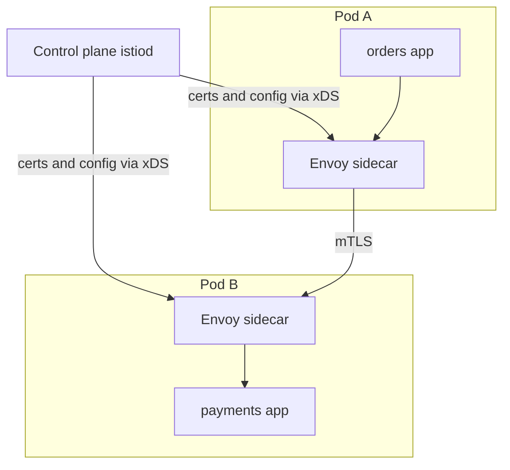

# Service Mesh

A **service mesh** is infrastructure that takes the networking concerns every service re-implements — TLS between services, retries, timeouts, traffic routing, request metrics — and moves them out of application code into a layer of proxies that sit next to each service instance. You get uniform [[TLS and HTTPS|mTLS]], [[Timeouts Retries and Exponential Backoff|retries/timeouts]], canary traffic shifting, and per-hop telemetry *without changing a line of app code*. The honest half of the story: it is another distributed system to operate, it taxes every pod with a proxy, and for small fleets — which is most companies — a shared library or an [[API Gateway]] delivers most of the value at a fraction of the complexity.

## The problem that created it

A company grows to dozens of microservices in several languages. Security says "encrypt all service-to-service traffic and authenticate callers"; reliability says "every call needs timeouts, retries with backoff, and [[Circuit Breakers|circuit breaking]]"; observability says "we need uniform latency/error metrics per hop" ([[Logs Metrics and Traces]]). The first answer is a shared library (Netflix's Hystrix/Ribbon era): put retries, discovery, and metrics in a JAR every service imports. It works — until it doesn't scale organizationally: the library exists per language (the Go team rewrites it, badly), upgrading it means redeploying *every* service (a months-long campaign when a TLS bug lands), and teams drift across versions so "uniform" policy quietly stops being uniform.

The mesh's move: since every service's traffic already flows through the kernel, intercept it in a **proxy next to each instance** instead of a library inside each binary. Now the networking behavior is deployed, configured, and upgraded independently of application code, uniformly, in any language. This became practical only once Kubernetes made "inject a container into every pod" a routine operation — the mesh is very much a child of the container-orchestration era.

## What it solves

- **Uniform mutual TLS** — encryption plus cryptographic service identity (who is calling whom) fleet-wide, with automatic certificate issuance and rotation; a large piece of zero-trust networking ([[API Security Essentials]]).
- **Consistent resilience defaults** — timeouts, retries with budgets, outlier ejection (a proxy-level [[Circuit Breakers|circuit breaker]]) applied by config, not by hoping every team wired Resilience4j correctly.
- **Traffic management** — percentage-based shifting (95/5 canary), header-based routing, mirroring real traffic to a new version, fault injection for [[Chaos Engineering]] ([[Deployment Strategies]] implemented in the network).
- **Telemetry for free** — every hop emits latency, error-rate, and volume metrics and trace spans from the proxy, uniformly, including from services whose teams never instrumented anything ([[Distributed Tracing]]).
- **Polyglot uniformity** — all of the above identical for Java, Go, Python, Node, because none of it lives in the app.

## How it works

Two parts: a **data plane** of proxies that carry traffic, and a **control plane** that programs them.

- **Data plane**: an **Envoy** proxy (or Linkerd's purpose-built Rust micro-proxy) runs as a **sidecar** container in each pod. iptables rules (set up by an init container or CNI plugin) transparently redirect all inbound and outbound pod traffic through the proxy, so the application still thinks it's dialing `payments:8080` directly. The proxy terminates/originates mTLS, applies retry/timeout policy, picks endpoints (load balancing with outlier ejection), and emits metrics and spans.
- **Control plane**: **Istio**'s `istiod` or **Linkerd**'s control plane watches Kubernetes (services, endpoints, and mesh CRDs like `VirtualService`/`DestinationRule`), acts as the certificate authority issuing short-lived per-service certs (identity from the pod's service account), and pushes configuration to every proxy via Envoy's xDS APIs. Policy is declared once, centrally; proxies enforce it everywhere.

A request thus crosses **two proxies per hop** (caller's sidecar out, callee's sidecar in). Each adds latency — plan on low single-digit milliseconds per hop until you have measured your own; Linkerd's published benchmarks claim sub-millisecond median overhead per proxy, which is a vendor number obtained under favourable conditions, not a planning figure. Add CPU/memory per sidecar on top (commonly quoted at ~50–100 MB and a slice of CPU each, multiplied by every pod in the fleet).

### Traffic policy done right: budgets and timeout hierarchies

Two mesh-config disciplines separate teams that benefit from teams that amplify outages:

- **Retry budgets over naive retry counts.** "3 retries per request" looks harmless per-call but is multiplicative fleet-wide: during a brownout, every caller retrying 3x can quadruple load on the sick service. A **retry budget** (Envoy supports this) caps retries as a *percentage of active requests* (e.g., retries may add at most 20% extra traffic), so retry pressure degrades gracefully instead of exploding exactly when capacity is lowest. Budgets are the mesh-native answer to [[Failure Modes in Distributed Systems|retry amplification]].
- **Timeout hierarchies.** Timeouts exist at several layers — app HTTP client, caller's sidecar, callee's sidecar, and any per-retry timeout — and they must nest: the outermost (app) timeout must exceed the mesh's total (per-try timeout × tries + backoff), or the app gives up and reports failure while the mesh is still retrying — **phantom failures** where the operation eventually succeeds after the caller stopped listening, a classic source of duplicate side effects and confused traces. Rule: set the budget end-to-end first ([[Timeouts Retries and Exponential Backoff]]), then derive each layer inward, and document which layer owns retries (exactly one should).

### Mesh vs API gateway

They sound similar ("proxies applying policy") and answer different questions:

| | [[API Gateway]] (Kong) | Service mesh |
|---|---|---|
| Traffic direction | North-south: clients → fleet | East-west: service → service |
| Placement | One tier at the edge | A proxy at *every* service instance |
| Core concerns | Client authn ([[How JWT Works|JWT]]), [[Rate Limiting|rate limiting]], routing, API products | mTLS + workload identity, inter-service resilience, hop telemetry |
| Sees | Only traffic entering the fleet | Every internal hop |
| Typical owner | API/platform team at the edge | Infrastructure/platform team |

A gateway cannot secure or observe traffic *between* services (it never sees it); a mesh does nothing for client-facing concerns like API keys or per-consumer quotas. Large fleets run both; small fleets usually need only the gateway.

**Ambient/sidecarless trend (one line):** Istio's ambient mode (generally available since Istio 1.24, November 2024) and eBPF-based approaches (Cilium) move mesh functions out of per-pod sidecars into per-node infrastructure, cutting the resource tax and the lifecycle coupling a sidecar imposes on every pod.

## Trade-offs

| You get | You pay |
|---|---|
| mTLS + identity everywhere, zero app changes | A second distributed system (control plane) to run, upgrade, and page on |
| Uniform retries, timeouts, outlier ejection | Per-pod proxy tax: memory, CPU, and added per-hop latency |
| Canary/mirror/header routing by config | Debugging gains a layer: "is it the app, the sidecar, or the mesh config?" |
| Per-hop golden metrics and spans for free | Envoy/Istio expertise is scarce; misconfig blast radius is fleet-wide |
| Polyglot consistency | Version upgrades of the mesh itself are delicate, fleet-touching events |

One scope note the table above doesn't cover: the mesh does **not** absolve applications of [[Idempotency]] (proxy retries make duplicate requests *more* likely, not less), business-level fallbacks, or [[Backpressure and Flow Control|backpressure]] decisions — it moves transport concerns, not business semantics.

## Common misconceptions

- **"mTLS means the caller is authorised."** mTLS establishes *workload identity* — this connection comes from the `orders` service account — which is authentication at the infrastructure layer and genuinely valuable. It says nothing about whether the *end user* behind that request may perform the operation. An authenticated `orders` proxy calling `payments` proves the workload, not that the human owns the account being debited. Authentication, authorisation **and an ownership check** stay in the application on every access path; the mesh removes none of them.
- **"The mesh makes the system reliable."** It makes failure *handling* uniform, which is a different thing. Retries, timeouts and outlier ejection redistribute and mask failures — they create none of the redundancy that actually produces availability. Outlier ejection with one endpoint behind the service has nowhere to eject to: the policy executes exactly as configured and the request still fails.
- **"Adopting a mesh is a platform change, not an application change."** The mesh is transparent to application *code*, not to application *behaviour*. Timeout hierarchies, retry ownership, container startup and shutdown ordering, and connection reuse all change on the day the sidecar lands. Teams that scope adoption as pure infrastructure find the behavioural changes in production instead of in a design review.
- **"Mesh telemetry replaces application instrumentation."** The proxy sees transport: status code, duration, bytes, per hop. It cannot see that the request was a high-value transfer, which partner bank it routed to, or which business rule rejected it. Mesh metrics are excellent at *where*; application metrics remain the only source of *what*, and business dashboards are built from the latter.
- **"The per-pod overhead is a rounding error."** Per pod it is small; multiplied by every pod in the fleet it is a budget line, and on small pods the *proportional* increase is large — see the arithmetic under "In your stack" before quoting anyone a number.

## Failure modes

- **Control plane outage.** Proxies keep running with last-known config (fail-static), but new pods can't get certs/config and policy changes freeze. Detected by mesh health dashboards; mitigated by HA control planes and treating mesh upgrades like database upgrades.
- **Sidecar lifecycle races.** App container starts before its sidecar is ready → startup connection failures; or at shutdown the sidecar exits first and the app's final in-flight calls black-hole. The mirror failure is a sidecar that never exits, which hangs a Kubernetes Job outright ([[Sidecar Pattern]]). Mitigations: sidecar startup ordering, drain-aware [[Graceful Shutdown and Deployment Safety|shutdown hooks]]; Kubernetes native sidecar containers — init containers with `restartPolicy: Always`, alpha in 1.28 and stable since 1.33 — address exactly this ordering problem.
- **Retry amplification by config.** A platform-level default of "3 retries" applied on top of app-level retries multiplies traffic during incidents ([[Failure Modes in Distributed Systems|retry storms]]). Retry policy must live in *one* layer; mesh retry budgets help.
- **Silent policy misroutes.** A fat-fingered `VirtualService` can send 100% of payments traffic to the canary, fleet-wide, instantly. Mesh config deserves the same review/CI rigor as code — it *is* code. *The signal*: a traffic-split metric by destination subset that does not match the intended percentages — which only exists if you chart traffic by subset, so build that chart as part of adopting traffic shifting, not after the first misroute. *Confirming it*: diff the live routing config against what the repository says it should be; a mesh without config in version control cannot answer this question at all.
- **Certificate expiry/rotation bugs.** When the CA or rotation breaks, every mTLS hop starts failing closed at once — a fleet-wide outage with a security-shaped root cause. Monitored via cert-expiry metrics. *The signal*: failures begin at a time correlated with certificate lifetime rather than with any deploy or traffic change — the most unnerving property of this class, because nothing changed. *Confirming it*: read the certificate validity window the proxies are actually holding and compare it to wall clock; if the control plane's CA is the problem, workloads will fail in the order their certs expire, producing a slow, spreading outage rather than a sharp one.

### What this looks like at 3am

03:12. Four services page at once, from four different teams, all returning 503s. The first thing to read is not any service's dashboard — it's the *shape* of the failure, because the shape distinguishes a mesh incident from an application incident in about ninety seconds.

An application failure propagates along the call graph: one service degrades, then its callers, then theirs. A mesh failure appears everywhere a proxy exists, simultaneously, including between services that have no dependency on each other at all. Four unrelated teams paging in the same minute is already the diagnosis.

The confirming evidence sits in the mesh's own telemetry rather than the applications':

- **Client-side error rate up, server-side request rate down, across the fleet.** A service whose own handler is broken shows the opposite — inbound traffic intact, server errors rising. Requests failing *before they reach any application* is the mesh's signature.
- **Envoy access-log response flags.** A fleet-wide wave of `UF` (upstream connection failure) or `UC` (upstream connection termination) with no matching increase in application error logs says the proxy never got the request to the app. Charting response-flag counts is the single most useful mesh dashboard to build before you need it.
- **Proxy config sync state.** `istioctl proxy-status` reporting `STALE` instead of `SYNCED` for one or more xDS resource types means the data plane is serving traffic on configuration the control plane can no longer refresh — running on last-known-good, which is the designed behaviour and also the warning.

Root cause in this class of incident is nearly always one of three: certificate issuance or rotation broke and mTLS began failing closed as existing certs aged out; a config object was accepted and distributed fleet-wide in seconds; or the control plane is unhealthy, so restarted and newly scheduled pods cannot obtain configuration at all. Note what all three have in common — none of them is in anyone's application code, and none of them appears in an application's logs. That is the operational cost line that adoption proposals leave out: you have taken on a tier-0 distributed system whose failures look like everyone's failures at once.

## When NOT to use it

Most of the time — this is the section that matters:

- **Small fleets.** Below roughly 15–20 services (and a platform team of less than a handful), the mesh's fixed operational cost exceeds everything it saves. A well-configured HTTP client wrapper (Resilience4j defaults in a shared Spring Boot starter) plus [[API Gateway|gateway]]-level policy covers most needs — the library problem the mesh solves is a *many-languages, many-teams* problem you don't have yet.
- **Single-language fleets with a platform team.** The strongest mesh argument is polyglot uniformity; an all-Java shop with a maintained internal starter already has a uniform layer it controls.
- **You only want one feature.** Need just mTLS? Consider CNI-level encryption (e.g., WireGuard via Cilium) or app-level TLS. Just canaries? A gateway or ingress controller shifts traffic. Just metrics? Instrument the shared client.
- **Latency-critical hot paths** where two proxy traversals per hop measurably blow the budget.
- **Serverless/managed platforms** where you don't control pod networking anyway.

Because "you only want one feature" is the most common honest situation, here is the pillar-by-pillar alternatives table. Adopt the mesh when you need *several* rows at once across many services; otherwise buy the row you need:

| What you actually need | Cheapest thing that delivers it | When the mesh wins instead |
|---|---|---|
| Encryption between services | CNI-level encryption, or TLS in the app with cert automation | You also need per-workload *identity* for policy, not just confidentiality |
| Uniform timeouts, retries, breakers | A shared client starter — Resilience4j defaults in an internal Spring Boot starter | Several languages, or you cannot get every team to adopt the starter version |
| Canary and traffic shifting | Ingress controller or [[API Gateway|gateway]] weights at the edge | You must shift *internal* east-west traffic, or route by header for named users |
| Per-hop latency and error metrics | Application instrumentation — Micrometer plus [[Distributed Tracing|tracing]] | You need coverage of services whose teams will never instrument anything |
| The real call graph | Tracing | You want it without touching any application |
| Fault injection for [[Chaos Engineering]] | A test harness, or a proxy in a staging environment | You need it in production, by configuration, per route |

The pattern in the right-hand column is worth naming: every row flips to the mesh for the same two reasons — **polyglot breadth** and **not needing the owning team's cooperation**. If neither of those is your constraint, the left column is the answer, and no amount of feature count changes that.

## In your stack

- Niyo's east-west traffic runs service-to-service on EKS behind Kong (north-south). Before any mesh conversation, the honest checklist: is cross-service traffic required to be mTLS by security/compliance? Are retry/timeout defaults inconsistent across services today? Is per-hop telemetry missing beyond what `x-correlation-id` logging gives you? If the pain is only "some services lack retry config", a shared Spring Boot starter is two orders of magnitude cheaper than Istio.
- The 1-replica fleet cuts against a mesh twice: sidecars would add a proxy's memory/CPU to every one of those single pods (a real percentage increase on small pods), and mesh features like outlier ejection and traffic shifting assume *multiple endpoints to choose between* — at one replica there is nothing to eject or shift to.
- Put arithmetic on that first point before anyone argues it either way. Take the fleet's pod count, a sidecar at the commonly cited 50–100 MB, and a small application pod requesting 512 MB: **a 100 MB sidecar is a ~20% memory increase on that pod** (100 ÷ 512 ≈ 19.5%), and across 40 single-replica services that is ~4 GB of additional cluster memory plus a per-pod CPU slice, carried continuously. Latency arithmetic matters less but should be stated too: two proxy traversals per hop means a 4-hop chain crosses 8 proxies, so even at a tuned ~1 ms each you add ~8 ms — invisible against a 300 ms user budget, and 40% of a 20 ms internal budget. Measure your own proxies rather than trusting either figure; the point is to have a number in the proposal.
- The mesh's telemetry pillar overlaps with what you'd get from consistent Micrometer metrics + the existing correlation-ID tracing convention; adopt uniform app-level instrumentation first — it's needed for business metrics anyway.
- If RBI/audit requirements ever mandate encrypted service-to-service traffic inside the cluster, that single requirement is the most plausible mesh (or CNI-encryption) trigger for your fleet — scope it as "mTLS everywhere", compare Istio ambient vs Cilium WireGuard vs app-TLS, and name the ops headcount in the decision.

## Interview angle

The 60-second explanation: *"A service mesh moves cross-cutting network concerns out of app code into sidecar proxies — usually Envoy — programmed by a control plane like Istio or Linkerd. You get mTLS with workload identity, uniform timeouts/retries/outlier ejection, traffic shifting for canaries, and per-hop golden metrics, all by configuration, in any language. The costs: an extra proxy on every pod (latency, memory, CPU), a control plane that is itself a critical distributed system, and a new debugging layer. It earns its keep in large polyglot fleets with a platform team; below a couple dozen services, a shared client library plus gateway policy delivers most of the value — and sidecarless 'ambient' modes are the current attempt to shrink the tax."*

Classic follow-ups: "Mesh vs API gateway?" (east-west vs north-south; identity/policy between services vs edge authn/rate limiting — complements, not substitutes); "What breaks when the control plane dies?" (data plane fails static; new pods and config changes stall); "Why not just a library?" (polyglot + independent upgrade cadence — then concede the library is right for small single-language fleets); "Sidecar overhead?" (two proxy traversals per hop, per-pod memory; hence ambient/eBPF).

## Check yourself

> [!question]- Q: Explain to a colleague what problem the sidecar solves that a shared resilience library doesn't.
> The library couples networking behavior to every application binary: it must exist per language, every upgrade (say a TLS fix) requires rebuilding and redeploying the entire fleet, and version drift across teams erodes the uniformity you wanted. The sidecar intercepts traffic at the pod level, so the same policy and the same upgrade apply to every service regardless of language, deployed independently of app releases by the platform team. The trade is runtime cost (proxy per pod, latency per hop) and a control plane to operate — which is why the library remains the right answer for small, single-language fleets.

> [!question]- Q: Scenario — mid-incident, a payments call chain shows doubled traffic to a degraded downstream, and both the app's Resilience4j config and the mesh's VirtualService define 3 retries. What happened and what's the fix?
> Retries stacked multiplicatively: each app-level retry is itself retried by the sidecar, so one logical request becomes up to 4 x 4 = 16 attempts (original + 3 at each layer) against a service already in trouble — retry amplification worsening the outage. Fix: retries live in exactly one layer (pick the mesh for transport-level, keep app retries for business-level only, never both for the same failure class), add mesh retry budgets that cap retry share of traffic, and ensure retried operations carry [[Idempotency|idempotency keys]], since duplicate deliveries just became far more likely.

> [!question]- Q: Your company has 12 Java/Spring services, one platform engineer, and security has asked for encrypted internal traffic. Mesh?
> No — the mesh's differentiators (polyglot uniformity, config-driven traffic shifting at scale) are worth little at 12 single-language services, and one platform engineer cannot safely operate a control plane as a critical system. Meet the actual requirement directly: mTLS via a CNI that encrypts node-to-node traffic (e.g., WireGuard-based), or Spring-level TLS with cert automation; resilience defaults via a shared starter; canaries via the ingress/gateway. Revisit the mesh if the fleet grows several-fold, goes polyglot, or needs per-service workload identity for zero-trust audits.

> [!question]- Q: Why does a service mesh NOT remove the need for idempotent consumers and application-level fallbacks?
> The mesh operates on transport semantics: it can retry a request (creating duplicates — making idempotency *more* necessary), eject a bad endpoint, or time out a call, but it cannot know what a failed payment means to the business, what a safe fallback response is, or whether an operation may be executed twice. Business semantics — compensation ([[Saga Pattern]]), fallback content, dedupe on business keys — stay in the application. The mesh moves the plumbing, not the meaning.

> [!question]- Q: Scenario — security mandated encrypted internal traffic plus a record of which workload called which, so you deployed the mesh with strict mTLS. Six weeks later an auditor asks you to prove that user A could not read user B's statements. What does the mesh contribute, and what does it not?
> The mesh contributes the *transport* half: every hop was encrypted, and each request carries a cryptographic workload identity, so you can show that only the `statements` service's own service account ever connected to the statements store's fronting service, and produce per-hop logs of which workload called which. What the mesh contributes to the auditor's actual question is **nothing**. The question is about *user*-level authorisation — whether the request carrying user A's [[How JWT Works|JWT]] was permitted to fetch an account belonging to user B — and that is decided inside the application, by validating the token and then performing an explicit ownership check that the requested `accountId` belongs to the authenticated subject. A mesh with perfect mTLS will faithfully encrypt and attribute a request that reads the wrong user's data. The evidence the auditor needs is the application's authorisation decision log, keyed by the token's subject, immutable and replayable. Mesh identity answers "which workload"; only the application answers "which user, and may they".

> [!question]- Q: The app's HTTP client times out at 2s; the mesh is configured with a 1.5s per-try timeout and 2 retries. What goes wrong?
> The mesh's worst-case envelope is ~4.5s (three tries at 1.5s, plus backoff), but the app abandons the call at 2s — so for slow requests the app reports failure and moves on (possibly running its own retry or fallback) while the sidecar is still retrying the original, which may then *succeed* unobserved. Results: duplicate side effects (the app's retry plus the mesh's late success), misleading error metrics, and traces whose outcome contradicts the caller's view. Fix the hierarchy: outer app timeout > mesh total (per-try × tries + backoff), and let exactly one layer own retries.

## Sources

- William Morgan (Linkerd creator), "What's a service mesh? And why do I need one?" (buoyant.io) — the canonical introduction.
- Istio documentation (istio.io) — architecture (istiod, Envoy xDS), security model (mTLS, SPIFFE-style identity), ambient mode.
- Envoy Proxy documentation (envoyproxy.io) — the data plane's actual capabilities: outlier detection, retry budgets.
- Linkerd documentation (linkerd.io) — the lightweight counterpoint, Rust micro-proxy benchmarks.
- Sam Newman, *Building Microservices*, 2nd ed. (O'Reilly, 2021) — ch. 5 section on service meshes: adopt for breadth of needs, skepticism for small fleets.
- Cilium documentation (cilium.io) — eBPF/sidecarless mesh and WireGuard encryption as the alternative path.
