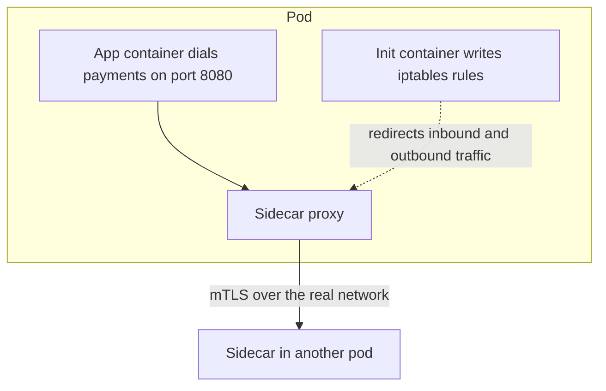
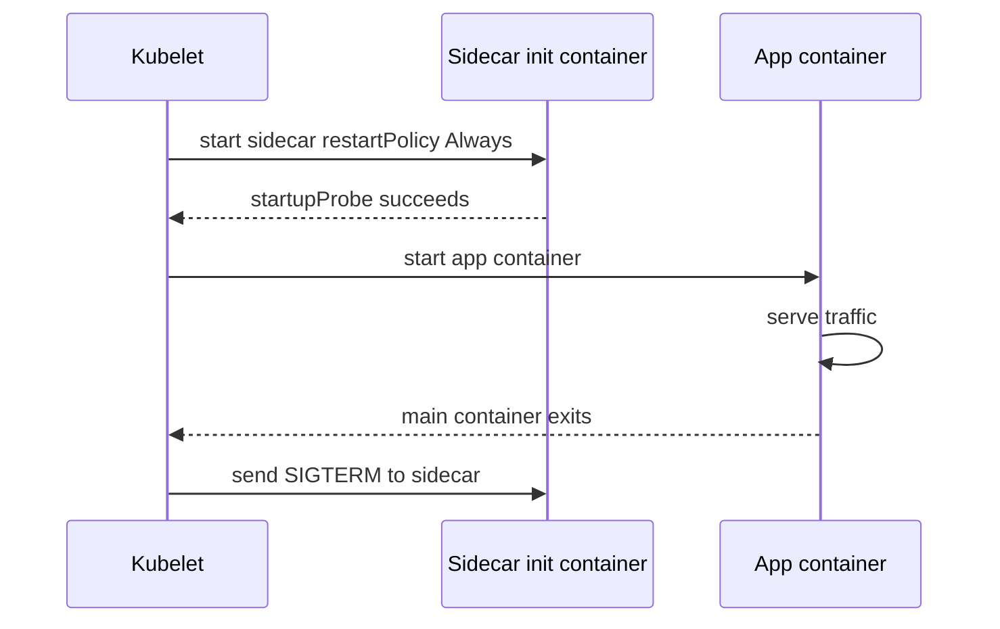

# Sidecar Pattern

A **sidecar** is a second container deployed alongside your application container, sharing its lifecycle and its network namespace — same pod, same `localhost`, same IP address. Your suspicion is correct: this is exactly the mechanism under Envoy, under Istio, and under anything Kubernetes itself calls a sidecar. The name was already in use by 2014 (Netflix's Prana was billed as a sidecar), and Brendan Burns and David Oppenheimer catalogued it, alongside the **ambassador** and **adapter** variants, in a 2016 Google paper on container-based design patterns — but Kubernetes' pod abstraction is what turned "run a helper process next to your app" from a bespoke trick into a routine, first-class deployment unit.

## The problem that created it

A fleet of microservices needs the same handful of things from every single instance, regardless of what the service does: encrypt traffic to its peers, retry a failed call with backoff, trip a [[Circuit Breakers|circuit breaker]] when a downstream is sick, enforce a [[Timeouts Retries and Exponential Backoff|timeout]], find the current address of a dependency, emit latency and error metrics per call, and pick up config or secret changes without a restart. None of that is domain logic — it's infrastructure plumbing that every service needs identically.

The first instinct is a shared library: one JAR (or module) that every service imports to get retries, discovery, and metrics for free. This is the Netflix OSS era — Hystrix for circuit breaking, Ribbon for client-side load balancing, Eureka for discovery — and for years it was the industry-standard answer. It has a scaling problem that only shows up once the organization grows past it: with **N** languages and **M** concerns, you maintain **N × M** implementations (the Go team hand-rolls its own Ribbon-equivalent; the Python team never gets one). Upgrading a single concern — say a TLS bug in the retry client — means recompiling and redeploying *every service that imports the library*, a fleet-wide campaign for a one-line fix. And teams drift: six months after a mandated upgrade, half the fleet is still on the old version, so "uniform policy" quietly stops being uniform. Netflix itself put Hystrix into maintenance mode in November 2018, with Ribbon and much of that stack following, pointing teams toward lighter-weight, more composable alternatives (Resilience4j, and the broader proxy-based approach this note covers) — a tacit admission that the all-in-library model had run into its own limits at Netflix's own scale.

That library-versus-proxy argument is the shared premise of this note and [[Service Mesh]]. The division of labour: this note owns the *mechanism* — pod, namespace, container lifecycle, the non-mesh uses; [[Service Mesh]] owns the *fleet-wide system* built on top of it — mTLS everywhere, retry budgets, traffic shifting, control-plane failure modes, and the adopt/don't-adopt decision.

The sidecar's move: since the concern is really about *traffic in and out of the process*, and Kubernetes already gives every pod its own network namespace, put the concern in a **second process inside that namespace** instead of a library inside the app's binary. The application keeps calling `localhost`; it has no idea the sidecar is there, what language it's written in, or when it was last upgraded.

## What it solves

- **Language-agnostic infrastructure.** The sidecar is a separate binary — Java, Go, Rust, doesn't matter to the app — so the same policy and the same bug fix apply identically whether the app next to it is Spring Boot, Node, or Python.
- **Independent upgrade cadence.** Patching a sidecar's image and rolling pods is a platform-team operation; it touches zero application code and needs no application redeploy or recompile.
- **A uniform place for mTLS, retries, timeouts, and discovery** ([[Health Checks and Service Discovery]]) — the concerns a mesh proxy owns — without every team re-implementing them.
- **A uniform place for telemetry** — [[Distributed Tracing|spans]] and per-call metrics emitted by the proxy itself, even for services whose teams never instrumented anything.
- **A uniform place for config and secret rotation** — a sidecar can watch a mount or a vault and refresh it, so "pick up a rotated credential without restarting" is solved once, generically, instead of inside every app's bootstrap code.
- **The same trick for non-networking concerns** — log shipping, metrics scraping — anything that is "do this generically, next to every instance" rather than "this is specific to what the app does."

## How it works

### Kubernetes mechanics

A **pod** is Kubernetes' unit of co-scheduling: every container inside it shares the same network namespace (one IP, one port space — containers reach each other over `localhost`) and can share volumes. That's the entire mechanical basis of the pattern — nothing more exotic than two containers started together and told to share a network stack. The shared-volume half matters just as much as the shared-network half for the non-mesh cases below: a log shipper tails files the app writes to a common `emptyDir` without the app knowing a shipper exists; a config or secret reloader writes a refreshed file to a volume the app already reads from, no network call involved at all.

For a **mesh sidecar** specifically, co-location alone isn't enough — the app must be made to talk to the proxy *without knowing it exists*. That's done by traffic interception: an init container (classic Istio) or a CNI plugin installs `iptables` NAT rules in the pod's network namespace that transparently redirect inbound and outbound traffic through the proxy's listening port. The app still dials `payments:8080` directly; the kernel, not the app, reroutes the packet through the sidecar first.

### The lifecycle problem, and the Kubernetes fix for it

A plain sidecar is just an ordinary container in the pod's `containers` list, and ordinary containers in a pod have **no ordering guarantee** relative to each other. Two concrete failures fell out of that for years:

1. **Startup race.** The app container could start — and start taking traffic or opening outbound connections — before its sidecar was up and configured, producing connection-refused errors right after every rolling deploy.
2. **Jobs that never finish.** A Kubernetes Job is only marked `Complete` once every container in its pod has exited. A sidecar that runs forever (a proxy has no natural "done" state) keeps the pod alive indefinitely even after the batch work finished in seconds — the pod just sits there. Teams patched around both problems by hand: `preStop` hooks sequencing shutdown, a shared `emptyDir` used as a completion flag, or small wrapper ("sidecar terminator") processes that killed the proxy once the main container exited.

Kubernetes closed this gap with **native sidecar containers** (KEP-753): declare the sidecar as an entry in `initContainers`, but set `restartPolicy: Always` on it. That one field tells the kubelet to treat it specially — start it first, in `initContainers` order; treat it as "started" once its process is running, or once its `startupProbe` succeeds if one is defined, before starting the next init container or any app container; keep it running and restart it independently if it crashes; and at pod shutdown, send it `SIGTERM` only *after* every regular container has exited — which is exactly what makes Job completion work again. The feature reached alpha in Kubernetes **1.28** (August 2023) behind a feature gate, beta and enabled by default in **1.29** (December 2023), and stable/GA in **1.33** (April 2025). One piece of fine print worth holding onto: without a `startupProbe` on the sidecar, "started" means *process launched*, not *ready to take traffic* — a proxy can be running and still not synced with its control plane, so the ordering guarantee alone doesn't remove the startup race unless the probe reflects real readiness.

This is also the mechanism behind clean [[Graceful Shutdown and Deployment Safety|graceful shutdown]] for meshed pods: the proxy staying alive until after the app's own shutdown hooks finish means the app's last outbound calls and in-flight responses still have a working sidecar to go through.

One terminology wrinkle worth flagging for an interview: before 1.28, "sidecar" was purely the informal name for "any second container in this pod." Since 1.28 it's *also* the formal Kubernetes name for a specific feature — an `initContainers` entry with `restartPolicy: Always`. A pod can have an informal sidecar (any extra container, no ordering guarantees) without opting into the formal feature at all; the two are easy to conflate, and only the formal one gets the startup-ordering and SIGTERM-after-main-containers behavior described above.

### Envoy and Istio: data plane vs control plane

Keep these two facts separate, because they answer different interview questions. **Envoy** is the *data plane* — the actual proxy process that runs as the sidecar, intercepts traffic, terminates/originates TLS, applies retry and timeout policy, and emits metrics and spans. It originated at Lyft and was open-sourced in 2016. **Istio** is the *control plane* — it touches zero application traffic itself; it watches Kubernetes objects and its own CRDs, acts as a certificate authority for workload identity, and pushes configuration to every Envoy sidecar over Envoy's xDS APIs. Istio launched in 2017 as a joint effort between Google, IBM, and Lyft, built on Envoy as its data plane from the start. You can run Envoy sidecars with no Istio at all (hand-written config, or a different control plane); in Istio's original sidecar mode, Envoy has always been the data plane it configures — ambient mode's node-level `ztunnel` is a separate, non-Envoy proxy for the sidecarless case (see [[Service Mesh]]). The full mesh treatment — mTLS fleet-wide, retry budgets, traffic shifting, the control-plane failure modes — lives in [[Service Mesh]]; this note stops at the sidecar mechanism underneath it.

### Sidecars that aren't mesh proxies

The pattern is broader than service meshes. Anything that is "a generic helper, deployed next to every instance of an app, sharing its pod" qualifies:

- **Log shippers** — Fluent Bit or Filebeat tailing the app's log files or stdout and forwarding them to a sink, instead of every app shipping its own logs.
- **Metrics exporters** — scraping an app-specific metrics endpoint and re-exposing it in the format the platform's monitoring stack scrapes.
- **Config reloaders** — watching a mounted `ConfigMap` or file for changes and signaling the app to pick them up without a restart.
- **Secret agents** — HashiCorp Vault's Agent Injector pattern is the canonical example: a sidecar authenticates to Vault on the pod's behalf, writes rendered secrets to a shared volume, and re-renders them on rotation, so the app reads a local file and never holds a Vault token itself.
- **Database connection proxies** — Google's `cloud-sql-proxy`, which the app dials on `localhost` as if the database were local, while the sidecar handles the real connection, IAM auth, and TLS to the managed database.

The last of these is specifically the **ambassador** variant from Burns and Oppenheimer's taxonomy: a sidecar that proxies *outbound* calls to an external or remote service, representing it locally so the app never has to know the real address, auth scheme, or topology on the other side. Note that the Vault Agent case above is *not* an ambassador in that strict sense — it talks to Vault on the app's behalf but delivers through a shared volume, never sitting on the app's own network path. The **adapter** variant is the mirror case: a sidecar that normalizes the *app's own* output into a standard shape for something else to consume — the metrics-exporter case above is the clearest adapter. All three (sidecar, ambassador, adapter) are the same mechanical trick — second container, shared network namespace and volumes — aimed at progressively narrower jobs:

| Variant | Direction of the traffic it touches | This note's example |
|---|---|---|
| Sidecar (general term) | Doesn't have to touch traffic at all — may just watch a volume | Log shipper, config reloader, Vault Agent |
| Ambassador | Outbound: app → sidecar → the real remote endpoint | `cloud-sql-proxy` |
| Adapter | The app's own output → sidecar → standardized shape | Metrics-format exporter |

A mesh proxy is unusual among these in touching traffic in *both* directions at once (inbound and outbound) — which is why it needs the `iptables` interception the others don't.

## Trade-offs

| You get | You pay |
|---|---|
| Language-agnostic, independently upgradeable concern | A sidecar's own memory/CPU request on *every* pod that carries it — small per pod, a real cluster-capacity line item multiplied by fleet size |
| App code stays oblivious — no library, no import | A process boundary on the request path even over loopback; for proxying/mTLS sidecars, real processing time on top of that, not just transport |
| Uniform policy, config-driven | Another component to debug: "is it the app, the sidecar, or the sidecar's own config?" |
| Clean startup/shutdown ordering (native sidecars: default-on 1.29, GA 1.33) | Still a second container to build, scan, patch, and version — someone owns that image |
| Works per-concern, incrementally adoptable | At small fleet size, the fixed operational cost of running and upgrading sidecars can exceed what any one concern was costing you as a library |

Not every sidecar sits at the same point on that cost line: a full mTLS-terminating proxy like Envoy is the heavy end — [[Service Mesh]] works that specific arithmetic out — while a log shipper or a config-watcher that only touches a shared volume is lighter, with no proxying work and no traffic on its own request path. Lighter still multiplies the same way across the fleet; it just starts from a smaller number per pod.

**Sidecarless trend, in one line:** the same per-pod tax that makes any sidecar expensive at fleet scale is what's driving "ambient" and eBPF-based approaches (Cilium; Istio's ambient mode, GA since Istio 1.24, November 2024) to move mesh functions out of per-pod sidecars into per-node infrastructure — see [[Service Mesh]] for that trade in depth; this note's arithmetic on sidecar cost applies to any sidecar, mesh or not.

## Failure modes

- **App ready before sidecar ready.** Covered above — fixed by native sidecar startup ordering *plus* a `startupProbe` that reflects real readiness, not just process launch; without a probe, "started" still just means "running."
- **Sidecar OOM looks like a healthy pod.** An OOM kill in one container doesn't by default kill the pod — Kubernetes restarts just that container. If the app routes everything through the sidecar (an ambassador, a mesh proxy, a DB connection proxy), the app can report itself healthy on its own liveness probe while every call it makes fails, because the thing actually carrying its traffic is mid-restart. A liveness probe that only checks the app process won't catch this; it needs to reflect the dependency the sidecar provides.
- **Jobs that never complete.** The pre-1.28/1.33 problem above, still live on any cluster running an older minor version with a sidecar defined as a plain container.
- **Traffic bypassing the proxy.** A misconfigured or missing `iptables` redirect (bad init-container ordering, a CNI bug, a process that binds before the rules are installed) sends traffic around the sidecar entirely — silently dropping mTLS, retries, or whatever policy the sidecar was supposed to enforce, with no error to notice.
- **Version skew between control plane and data plane.** A control plane pushing configuration or API shapes a trailing-version proxy doesn't understand (or vice versa) surfaces as proxies silently serving stale or partially-applied config rather than a clean error.
- **Resource limits set for the app but not the sidecar.** A manifest that carefully sizes the app container's `requests`/`limits` and leaves the sidecar on cluster defaults understates the pod's real footprint — the pod's total request is the *sum* across containers, which matters for scheduling and for anyone eyeballing "how big is this pod" from the app container alone.

## When NOT to use it

- **Few cross-cutting concerns, one or two languages.** A single-language fleet with a maintained internal library already has the uniformity a sidecar buys; the library's actual weakness — N languages × M concerns — isn't your problem yet.
- **The helper doesn't need per-pod isolation.** Log shipping is the clearest case: if you don't need app-specific in-process parsing, a **DaemonSet** running one log-forwarder per *node* captures the same container stdout at a fraction of the aggregate memory cost of one sidecar per pod — the sidecar only wins when the transformation genuinely needs to run inside the pod.
- **Latency-critical hot paths** where even a loopback hop and whatever processing the sidecar does measurably blow the budget.
- **You only need the edge, not every hop.** North-south traffic (clients into the fleet) is an [[API Gateway|API gateway]]'s job, not a reason to put a sidecar on every pod; sidecars earn their keep on east-west, per-instance concerns.
- **A modular monolith.** If the system is one deployable ([[Monolith vs Microservices]] territory, or [[Modular Monolith|its modular-monolith middle ground]]), there's no per-instance network boundary for a sidecar to sit on — the concerns it solves don't exist yet in that shape.

## In your stack

- At one replica per pod — the shape of much of your EKS fleet — a sidecar's resource tax is paid in full with nothing to average it against: there's no second pod sharing the cost, and (per [[Service Mesh]]) a mesh's per-endpoint tricks like outlier ejection have nowhere to apply either. Before adding *any* sidecar to a service at this shape, size it the same way you'd size the mesh question: this sidecar's memory/CPU request, times every pod that gets it, as a standing line in cluster capacity — not a rounding error, a number.
- Kong already owns your edge concerns (authn, rate limiting, routing) at the gateway tier, and the central IAM service issuing JWTs means most inter-service auth is a header/token check, not a per-hop mTLS problem — which is exactly the gap a gateway-plus-library combination covers without a sidecar on every pod. A mesh (Envoy sidecars fleet-wide) is the heavier version of this same pattern and, per [[Service Mesh]]'s own "when not to use it," isn't justified at your current fleet size.
- Non-mesh sidecars are the more plausible near-term use: if any batch Job or CronJob runs a helper container (a secrets-fetcher, a log-flusher) alongside the main workload, check your EKS cluster's minor version — native sidecar semantics need 1.29+ (beta, default-on) and are stable from 1.33 — before assuming `restartPolicy: Always` is available; below 1.29 the Job-never-completes failure mode above is live, not historical.
- If RBI/audit scope ever requires per-hop evidence of *which workload* called which (not just which user), that requirement — and not a general resilience wish-list — is what would turn "add a sidecar here" into "consider a mesh"; scope it as that specific requirement, the same way [[Service Mesh]] frames it.
- Before anyone proposes a per-pod log or metrics sidecar, check what already runs cluster-wide on EKS: a DaemonSet-based log forwarder or node-level metrics agent solves the same problem for every pod on a node at once, and a per-pod sidecar is only the right call on top of that if a specific service needs in-process parsing the cluster-wide agent can't do.

## Interview angle

The 60-second version: *"A sidecar is a second container in the same pod, sharing its network namespace, that takes over a cross-cutting concern — mTLS, retries, discovery, log shipping, a DB connection proxy — so the app doesn't need a language-specific library for it. Kubernetes makes this routine because pods already share a network namespace; mesh sidecars add traffic interception via iptables so the app stays oblivious. Envoy is the proxy that runs as the sidecar; Istio is the control plane that configures the fleet of them — data plane versus control plane. The historical pain was lifecycle: ordinary containers have no start/stop ordering, so apps raced their own proxy on startup and Jobs hung because the sidecar never exited. Kubernetes fixed that with native sidecar containers — init containers with restartPolicy Always — alpha in 1.28, GA in 1.33. The honest cost is a resource floor and a network hop on every single pod, multiplied by fleet size, which is why small fleets are usually better served by a shared library plus a gateway."*

Classic follow-ups: "Sidecar vs library?" (language-agnostic and independently upgradeable, vs recompile-the-fleet to patch — but a real resource and ops cost per pod); "Why did Jobs hang?" (no container-exit ordering pre-native-sidecar; fixed by SIGTERM-after-main-containers semantics); "Envoy vs Istio?" (proxy vs the thing that configures the proxy — see [[Service Mesh]] for the full data-plane/control-plane treatment); "Give me a non-mesh sidecar" (log shipper, config reloader, `cloud-sql-proxy`-style DB ambassador); "When would you *not* reach for one?" (small fleet, one language, or a concern — like log shipping — a DaemonSet solves per-node instead of per-pod).

## Check yourself

> [!question]- Q: Explain to a colleague why Kubernetes needed a *new* kind of init container for sidecars instead of just using a plain container with a different restart setting.
> Ordinary containers in a pod have no defined ordering relative to each other, so a plain sidecar container could start after the app (causing startup failures) and, because it runs forever, would keep a Job's pod alive indefinitely even after the main work finished — Jobs only complete once every container has exited. Native sidecars fix both with one field: `restartPolicy: Always` on an `initContainers` entry tells the kubelet to start it first (gated on its `startupProbe` if defined), keep it running independently, and — critically — send it `SIGTERM` only after all regular containers exit, which is what lets the Job complete.

> [!question]- Q: Scenario — your Spring Boot pod declares its Envoy sidecar as a native sidecar, an `initContainers` entry with `restartPolicy: Always`, but defines no `startupProbe` on it. Right after every rolling deploy the app's first outbound calls fail. Diagnose it.
> Without a `startupProbe`, the kubelet treats the sidecar as "started" the moment its process launches, and releases the app container immediately — so the ordering guarantee buys you almost nothing. Two distinct symptoms follow, and they tell you how far Envoy had got: connection-refused means Envoy had not yet bound the port the `iptables` rules redirect to, so nothing was listening at all; 503s with no healthy upstream mean Envoy was listening but had not yet received its config over xDS. Fix: add a `startupProbe` to the sidecar that checks a real readiness signal, so the kubelet's ordering gate reflects "ready to proxy," not "process exists."

> [!question]- Q: Scenario — a nightly reconciliation Job has been "running" for 18 hours on a cluster on Kubernetes 1.26, though its own logs show the reconciliation finished in 4 minutes. What's happening, and what are the two ways to fix it?
> 1.26 predates native sidecar containers (alpha only arrived in 1.28), so if the Job's pod has a sidecar — say a secrets-agent or log-shipper — defined as an ordinary container, it keeps running forever after the main container exits, and the Job is never marked `Complete` because not every container has exited. Fixes: upgrade the cluster to 1.29+ (beta) or 1.33 (GA) and redeclare the sidecar as an `initContainers` entry with `restartPolicy: Always`, so the kubelet terminates it once the main container exits; or, short of that, add an explicit mechanism — a `preStop` hook, a shared-volume completion flag, or a small wrapper process — that kills the sidecar once the main container signals it's done.

> [!question]- Q: Mini-design — you're asked whether to add a dedicated log-shipping sidecar to every pod across a 60-service fleet, each pinned at one replica. What do you check before saying yes, and what's the cheaper default?
> First check whether the log volume genuinely needs per-pod isolation or app-specific in-process parsing before shipping — that's the sidecar's actual justification. If raw stdout to a central sink is enough, a **DaemonSet** running one log-forwarder per *node* (not per pod) captures the same output via the container runtime at a fraction of the aggregate memory cost, since it's one process per node instead of one per pod across 60 single-replica services. Compute the sidecar's cost explicitly before choosing it: its memory/CPU request times every pod it's added to, continuously, with no second replica to spread it across. The sidecar wins only when the transformation must run inside the pod; otherwise the DaemonSet is the cheaper default.

> [!question]- Q: A colleague says "Envoy is the sidecar, so Envoy and Istio are the same thing." Correct them.
> Envoy is the *data plane* — the actual proxy process that runs as the sidecar, intercepts traffic, terminates mTLS, applies retries and timeouts, and emits telemetry. It originated at Lyft and predates Istio. Istio is the *control plane* — it never touches a byte of application traffic; it watches Kubernetes and mesh CRDs, issues certificates, and pushes configuration to every Envoy sidecar over xDS. You can run Envoy sidecars with hand-written config and no Istio at all; and in Istio's sidecar mode, Envoy has always been the data plane it configures — note that Istio's newer ambient mode swaps in a different, non-Envoy node proxy (`ztunnel`) for L4, keeping Envoy only in optional waypoint proxies for L7, so the pairing isn't absolute. See [[Service Mesh]] for how the two combine into a fleet-wide system.

## Sources

- Brendan Burns, David Oppenheimer, "Design Patterns for Container-Based Distributed Systems" (USENIX HotCloud, 2016) — origin of the sidecar/ambassador/adapter taxonomy.
- Kubernetes Enhancement Proposal KEP-753 ("Sidecar Containers") and Kubernetes documentation on native sidecar containers — `restartPolicy: Always` semantics, startup/shutdown ordering, version history (alpha 1.28, beta 1.29, stable 1.33).
- Envoy Proxy documentation (envoyproxy.io) — the data plane's own capabilities and history.
- Istio documentation (istio.io) — architecture (`istiod`, xDS), origin as a Google/IBM/Lyft project.
- Netflix/Hystrix GitHub repository and README — maintenance-mode announcement, November 2018.
- Google Cloud documentation — Cloud SQL Auth Proxy, the canonical ambassador-pattern sidecar example.
