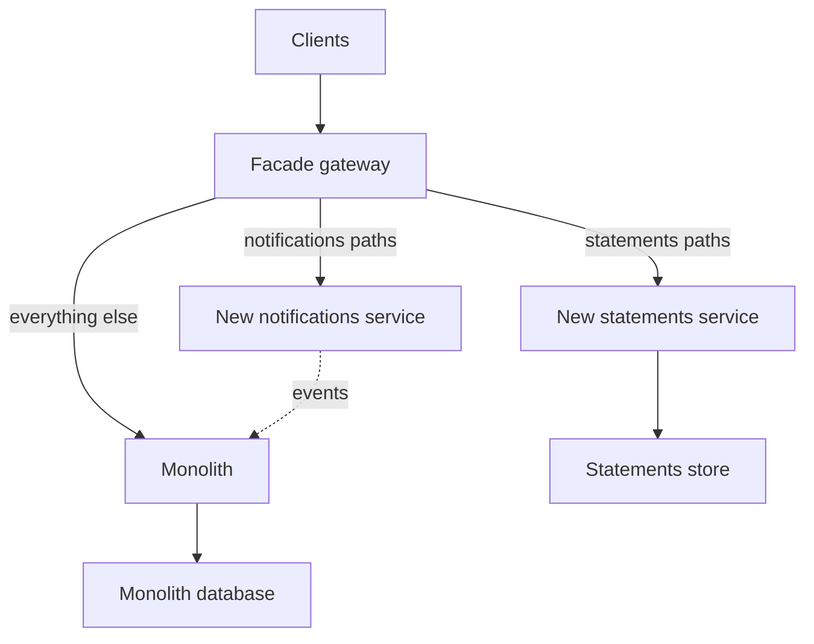

# Strangler Fig Migration

The **strangler fig** pattern (Martin Fowler, 2004 — named after fig trees that grow around a host tree until they can stand alone) is the standard safe way to decompose a monolith: put a routing facade in front of it, extract one capability at a time into a new service, shift that capability's traffic through the facade, and repeat — while the monolith keeps serving everything not yet extracted. At every moment the system works, releases ship, and the migration can pause or stop. It exists because the alternative — the big-bang rewrite — fails so reliably that "we'll rewrite it from scratch" is close to a professional red flag.

## The problem that created it

A company decides its aging monolith must become services ([[Monolith vs Microservices]] scores say it's time: multiple teams, release contention, scaling asymmetries). The instinctive plan: freeze the old system, build the new one properly, cut over when done. This fails in well-documented ways. The monolith *can't* freeze — the business keeps demanding features, so the rewrite chases a moving target. Years of accumulated edge cases (that weird settlement path, the compliance workaround from 2019) are invisible until the cutover breaks them, because the old code *is* the spec and nobody can read all of it. The new system gets zero production feedback until the single most dangerous moment — a one-night cutover of everything at once. And for the whole duration (always longer than estimated), the company pays two teams to deliver zero visible value. Big rewrites die of this; the industry's scar tissue around them is why incremental approaches won.

The strangler fig inverts every one of those properties, one at a time.

## What it solves

- **Risk concentration** — replaces one giant cutover with dozens of small, individually reversible traffic shifts.
- **The moving-target problem** — the monolith keeps shipping features; extraction proceeds alongside, capability by capability.
- **Zero-feedback development** — each extracted service takes real traffic immediately, surfacing its wrong assumptions while they're cheap.
- **Sunk-cost traps** — the migration has value at every intermediate state, so it can pause for a quarter (or stop permanently) without waste.
- **Unknown-unknown edge cases** — comparison techniques (shadowing old vs new) flush out behavioral differences per capability instead of all at once on cutover night.

## How it works

### 1. The facade (routing layer)

Put an interception point in front of the monolith that all consumers pass through — an [[API Gateway]] (Kong), a [[Reverse Proxy vs Forward Proxy|reverse proxy]], or [[Load Balancers|LB]] routing rules. Initially it routes 100% to the monolith. As capabilities are extracted, routing rules send *those* paths to new services — consumers never know. The facade is also where you get per-capability traffic percentages (1% canary → 100%, see [[Deployment Strategies]]) and instant rollback (flip the rule back).

### 2. Extract capability by capability

Choose slices using [[Service Boundaries and Domain-Driven Design|bounded-context analysis]] — extract *capabilities* (notifications, statements, KYC), never layers (extracting "the data access tier" manufactures [[The Distributed Monolith Anti-Pattern|a distributed monolith]]). Ordering heuristics: start with something **low-risk but real** (edge of the domain, few inbound dependencies — often notifications or document generation) to build the team's migration muscle and platform; then prioritize by **value**: capabilities changing fastest (release-contention relief), needing independent scale, or blocked by the monolith's stack. Save the deepest, most entangled core (usually the ledger/orders heart) for last — by then the fig has grown around it and the team has done this a dozen times.

Inside the monolith, **branch by abstraction** handles callers that invoke the capability in-process: introduce an interface over the old implementation, make all internal callers use the interface, add a second implementation that calls the new service, and flip between them with a feature flag — no long-lived migration branch, everything on trunk, reversible at runtime. (Verification trick: run both implementations and compare results on live traffic — GitHub's `scientist` library pattern — before trusting the new path.)

### 3. Data separation — the hard part

Code extraction is weeks; data extraction is the part that hurts. The staged path:

1. **Shared DB (temporary).** The new service reads/writes the monolith's database directly. Honest only as a *named, time-boxed* stage — it's [[The Distributed Monolith Anti-Pattern|shared-database coupling]] and must not fossilize.
2. **Synced copy.** The new service gets its own store, kept in sync with the monolith's data: the monolith publishes events via [[The Outbox Pattern|outbox]], or [[Change Data Capture]] (Debezium) tails its commit log. The service reads its own store; writes still go to the monolith (or dual-write carefully — see failure modes). This stage proves the new data model against real data volumes and lets reads cut over independently of writes.
3. **Owned store.** Write authority moves to the new service: it becomes the system of record, the monolith's copy is dropped or (transitionally) fed *backwards* by the service's events for not-yet-migrated monolith readers. The capability now owns its data fully; the extraction is done.

| Stage | Reads served from | Writes go to | What the stage proves | How you undo it | Main risk |
|---|---|---|---|---|---|
| 1. Shared DB | Monolith's database | Monolith's database | The new code path, the routing, and the deployment all work | Flip the facade rule back | Fossilises into permanent shared-database coupling |
| 2. Synced copy | New service's own store | Monolith | The new data model holds at real volume, and the sync keeps up | Flip reads back — the copy is disposable | Silent staleness; dual-write drift if the sync isn't outbox/CDC driven |
| 3. Owned store | New service | New service | Nothing left to prove — the extraction is complete | Data migration, not a config change | Behavioural mismatch on the write path |

The reversibility cliff is the row to notice: stages 1 and 2 are undone by configuration, stage 3 only by a data migration. That is why shadow-and-compare belongs immediately before the **write** cutover rather than before the read cutover — it is the last cheap moment in the whole sequence.

Each step is separately deployable and reversible; the backfill + sync machinery (snapshot, then stream changes — exactly a [[Replication]] bootstrap) is reusable across capabilities. The monolith's data model will fight you: tables entangled by joins and foreign keys across capability lines need seams cut in the schema first ([[Database Scaling Patterns|the same surgery as sharding prep]]).

### 4. Measure progress

Strangler migrations die silently when nobody can say whether they're progressing. Track: **% of requests served by new services** (from facade metrics), **% of capabilities extracted** vs the target list, **monolith LOC/deploy frequency trend**, and per-capability cutover state (reads shifted / writes shifted / data owned). Publish the dashboard; a migration without a visible progress metric becomes a permanent twilight state — half-extracted, paying both architectures' costs ([[Monolith vs Microservices]] costs *summed*).

### Worked example: reading a shadow comparison

Shadowing is cheap to run and easy to misread, so it is worth walking the arithmetic once. Suppose the statements capability generates **2,000,000 documents a month**, and you run the new service alongside the old on mirrored traffic for two weeks — roughly **1,000,000 documents** — comparing outputs field by field.

The headline result comes back as **0.3% mismatch**. Should you cut over?

0.3% of 1,000,000 is **3,000 mismatches** — too many to eyeball, and apparently too many to ship. But the rate is not the finding; the *distribution* is. Bucket them by which field differs:

- **2,850** differ only in a generation-timestamp field. Expected — the two runs happened at different instants. This is a defect in the comparator, not in the service.
- **140** differ in the rounding of an interest figure at the second decimal. A genuine behavioural difference, and in a regulated context the most important kind there is. 140 in a million is **0.014%** — small, and still a correctness defect, because the old behaviour is the one the customer and the regulator have already seen.
- **10** differ structurally: a section missing for accounts closed mid-cycle. A real edge case, and exactly the species that a big-bang rewrite would have met for the first time on cutover night.

Two lessons sit in those numbers. First, a mismatch *rate* on its own is close to meaningless — the same 0.3% would have supported "ship it" or "abandon it" depending on who was arguing, and only categorisation decides. Write the comparator to ignore legitimately non-deterministic fields *before* the run, or noise drowns the two findings you did the exercise for.

Second, run the window long enough for rare paths to occur. An edge case appearing in 1 of every 100,000 documents shows up about **10 times in a million-document sample and essentially never in a 10,000-document one**. If the capability has rare but consequential paths — closed accounts, dormant accounts, cross-currency, leap-day interest — a short shadow window does not prove they work; it proves they did not happen. Size the window against the rarest path you care about, not against the team's patience.

### 5. Know when to stop

The goal was never "zero monolith"; it was relieving specific pains. Stop extracting when the remainder is **stable, rarely changed, adequately scaled, and owned by one team** — a well-behaved service that happens to be old. Many successful migrations end with a smaller monolith serving the stable core forever; extracting low-churn code has real cost and near-zero benefit. Revisit only when a remainder capability starts changing fast or needs independent scale.

## Trade-offs

| Gains | Costs |
|---|---|
| Risk spread over many small reversible steps | Long period running *both* architectures (two ops surfaces) |
| Continuous delivery throughout | Facade + sync infrastructure to build and operate |
| Real production feedback per capability | Temporary duplication: data copies, dual code paths, flags |
| Can pause/stop with value banked | Requires sustained org patience — years, not quarters |
| Edge cases surfaced incrementally | Twilight-state risk if progress isn't measured and funded |

## Common misconceptions

- **"The facade is temporary scaffolding."** The routing layer almost never comes out — it becomes the permanent gateway tier. Budget it as a tier-0 component with the availability engineering that implies, rather than as migration tooling somebody will delete later. Teams that treat it as disposable under-invest in exactly the component every request now passes through.
- **"Shadow traffic is risk-free."** Mirrored requests are *real work*: they hit real datastores, consume real third-party quota, and if the new path has side effects — sending an SMS, calling a partner bank, writing a ledger row — shadowing does not test the system, it damages it. Mirror read-shaped work only, or make the new path's side effects explicitly inert and prove that inertness before the first mirrored request, not after.
- **"Extraction order is a technical decision."** It is mostly a learning and political one. The first extraction's real job is to build the pipeline, the sync machinery, and the team's confidence, which is why the right first slice is the low-risk one rather than the most valuable one. Choosing the most painful capability first is the standard way migrations die in month four with nothing to show.
- **"Traffic shifted means the capability is extracted."** Reads shifted, writes shifted, and data owned are three separate milestones. A capability parked between them carries *both* architectures' costs, and tracking it as a single boolean is how teams believe they are further along than they are. Track the three states per capability explicitly.
- **"The goal is zero monolith."** Extracting low-churn, adequately-scaled code costs about the same as extracting high-churn code and returns nothing, so the stopping point is economic rather than architectural — and calling a surviving stable core a failure is how teams spend a year on extractions nobody needed.

## Failure modes

- **The eternal middle.** Three capabilities extracted, funding dries up, the org now runs a monolith *plus* services *plus* sync plumbing indefinitely. Mitigation: visible progress metrics, explicit "stop" criteria agreed up front, extraction order chosen so each slice pays for itself. *The signal*: the percentage of requests served by new services flat across two consecutive quarters. *Confirming it*: check whether any capability advanced a cutover state in that period — "work happened" and "the migration progressed" are different claims, and only the second one counts. A deliberate stop is a fine outcome; an undeclared one is the failure.
- **Dual-write drift.** During stage 2, writing to both stores without an atomic mechanism (no outbox/CDC, just two writes in code) loses one write on a crash and the copies diverge silently. Detection: continuous reconciliation jobs comparing stores; mitigation: single write path + [[The Outbox Pattern|outbox]]/[[Change Data Capture|CDC]]-driven sync, never raw dual writes ([[Exactly-Once Delivery Is a Lie]] thinking applies).
- **Facade as single point of failure.** All traffic now flows through the routing layer; it needs the availability engineering of any tier-0 component ([[Load Balancers]], health checks, capacity headroom).
- **Shared-DB stage fossilizes.** "Temporary" direct DB access never gets removed; five services later you've *built* a distributed monolith via migration. Mitigation: time-box the stage per capability and track it as tech debt with an owner.
- **Behavioral mismatch on cutover.** The new service handles the happy path but misses a legacy quirk (rounding rule, locale format). Mitigation: shadow traffic and compare outputs before shifting writes; canary percentages with business-metric monitoring, not just error rates. *The signal to watch is a business metric, not an error rate* — a rounding bug returns HTTP 200 every time, so error dashboards stay green while the numbers go wrong. *Confirming it*: compare the business metric on the canary cohort against the control cohort over the same window, which requires tagging the cohort at the facade; a canary you cannot segment is a canary you cannot read.

## When NOT to use it

- **The monolith doesn't need decomposing.** No release contention, team fits, scale is fine → the pains that justify the (multi-year) cost are absent; a [[Modular Monolith|modularization]] inside the deployable may be all the boundary work needed.
- **The system is small enough to rewrite honestly.** A 20k-line internal tool with stable requirements can be rewritten faster than strangled — the pattern's machinery outweighs the host.
- **You can't intercept the traffic.** No facade point (thick clients hardcoding internals, DB-integrated consumers) means no incremental routing; you must first build the interception point or choose module-level refactoring instead.
- **The monolith is being retired, not replaced** (product sunset) — don't invest in migration scaffolding for code with an end date.
- **As a stealth rewrite.** If each "strangled" capability is also being redesigned with new requirements simultaneously, you've smuggled the big-bang rewrite's moving-target problem back in; strangle behavior-for-behavior, then evolve.

## In your stack

- Niyo already owns the hardest prerequisite: Kong is the facade. Path-based routing per capability, canary percentages, and instant rollback are configuration, not construction.
- Stage-2 sync maps directly to your tooling: outbox collections in MongoDB tailed into SQS/Redis Streams, or CDC via Mongo change streams — the same machinery as [[Change Data Capture]] for analytics, reused for migration.
- Fintech sequencing: strangle outward-in — notifications, statements, document/KYC processing first; the ledger and money-movement core last, with shadow-and-compare runs before any write cutover, because a behavioral mismatch there is a reconciliation incident with regulatory reporting duties ("correctness beats latency" applies doubly to migrations).
- The 1-replica cost posture actually helps mid-migration: extracted services start tiny. But note each extraction adds a deployment to operate — the stop-extracting criteria above are partly an ops-budget decision in your fleet.
- A useful asymmetry against the mesh option: **traffic shifting at Kong does not need multiple replicas of anything**. Percentage routing happens at the facade, between the old path and the new service, so a 1%-to-100% canary works with one replica on each side — whereas a [[Service Mesh|mesh]]'s canary and outlier-ejection features need several endpoints to choose between. For your fleet, the facade is both the cheaper and the more capable canary mechanism.
- Shadowing rule for fintech, stated as a hard line rather than a caution: **never mirror a request whose new path can reach a partner bank, a payment rail, an SMS gateway, or the ledger**. Shadow the read-shaped capabilities (statements, document generation, reporting) and validate the write-shaped ones with replayed historical inputs against an isolated store instead. The 0.3%-mismatch analysis above is worth running; causing 1,000,000 duplicate partner calls to obtain it is not.
- Legacy RabbitMQ consumers being moved to Redis Streams can themselves be strangled: run old and new consumers side by side on mirrored traffic, compare effects via idempotency keys, shift, retire ([[Choosing a Message Broker]]).

## Interview angle

The 60-second explanation: *"Strangler fig: put a routing facade — usually the API gateway — in front of the monolith, extract one business capability at a time into a service, shift that capability's traffic incrementally with instant rollback, and let the monolith keep serving the rest. Data moves in stages: shared DB briefly, then a synced copy via outbox or CDC, then full ownership with write cutover. Branch by abstraction handles in-process callers; shadow traffic validates behavior before cutover. Big-bang rewrites fail because the old system can't freeze, the edge cases live only in the old code, and all risk lands on one cutover night — strangling converts that into small reversible steps with continuous delivery. And you stop extracting when the remainder is stable and owned — the goal is relieved pain, not zero monolith."*

Classic follow-ups: "What's the hardest part?" (data separation — walk the three stages and dual-write risks); "First capability to extract?" (low-risk edge capability to build muscle, then highest-churn); "How do you know it's working?" (facade traffic %, deploy-frequency trends, per-capability cutover states); "When is a rewrite actually right?" (small, stable-spec, interceptable systems — concede it exists).

## Check yourself

> [!question]- Q: Explain why big-bang rewrites fail so consistently, in terms a product manager would accept.
> Four compounding reasons: (1) the old system can't stop changing — the business won't pause for two years, so the rewrite chases a moving target; (2) the old code is the only complete spec — years of edge cases (that one settlement quirk) are discovered only when the new system breaks them, all at once, at cutover; (3) the new system gets no production feedback until the highest-risk moment, the single cutover; (4) until that day, enormous spend has delivered zero user-visible value, making the project politically fragile. The strangler fig converts all four: continuous feature delivery, edge cases surfaced per capability, production feedback from week one, and value banked at every step.

> [!question]- Q: Scenario — during stage 2, the new statements service reads its own Mongo store synced from the monolith by nightly batch jobs, and support reports users seeing yesterday's transactions. What went wrong and what's the proper mechanism?
> The sync chose batch (24h staleness) for data with intra-day freshness expectations — a requirements mismatch, not a bug. Proper mechanism: continuous replication — the monolith emits change events transactionally via the [[The Outbox Pattern|outbox]], or [[Change Data Capture]] tails the database's change log (Mongo change streams / Debezium), giving the copy seconds of lag; bootstrap with a snapshot then stream, like a [[Replication|replica]] catching up. Also add staleness monitoring (lag metric + alert) and a reconciliation job, because a silently stale copy during migration erodes exactly the trust the canary needs.

> [!question]- Q: Why must you extract capabilities rather than layers, and what happens if you ignore this?
> A layer (data access, business logic) is involved in *every* feature, so an extracted layer is synchronously called by everything and must change whenever anything changes — you get lockstep deploys and deep call chains: [[The Distributed Monolith Anti-Pattern]] built deliberately. A capability (statements, notifications) has narrow interfaces to the rest of the domain, so its extraction removes work from the monolith and adds only thin, stable contracts. Boundaries follow the business, not the tech stack — the same rule as [[Service Boundaries and Domain-Driven Design]].

> [!question]- Q: Scenario — your two-week shadow run on 1,000,000 statements reports a 0.3% mismatch between old and new. The migration lead wants to abort; the delivery lead wants to ship. What do you do with the number?
> Neither — the rate alone cannot settle it, and treating it as a verdict is the actual mistake. 0.3% of 1,000,000 is 3,000 mismatches; categorise them by the differing field before anyone argues. In a typical breakdown, the large majority differ only in non-deterministic fields such as a generation timestamp, which is a comparator defect rather than a service defect; a much smaller group — say 140, or 0.014% — differ in a rounded monetary figure, which is a real correctness bug and blocking in a regulated context regardless of how small the percentage looks; and a handful differ structurally on an edge case like accounts closed mid-cycle, which is precisely the unknown-unknown the exercise exists to find. So: fix the comparator, fix the rounding, fix the edge case, re-run. Then check the other direction before trusting a clean result — a path occurring once in 100,000 documents appears about 10 times in a million-document sample and essentially never in a short one, so if the capability has rare consequential paths, confirm the window was long enough for them to have occurred at all. A clean shadow over too small a sample is not evidence of correctness; it is evidence of a small sample.

> [!question]- Q: Mini-design — plan the first two quarters of strangling a fintech monolith containing auth, KYC, ledger, transfers, statements, and notifications.
> Prerequisites (weeks 1–4): confirm Kong fronts all consumer traffic; stand up migration telemetry (per-path routing metrics); pick conventions for outbox/CDC sync. Q1: extract **notifications** — lowest risk, event-consuming edge capability; monolith publishes `TransferCompleted` etc. via outbox; new service consumes, sends, owns its store from day one (no legacy data to migrate). Validates the platform, pipeline, and team muscle. Q2: extract **statements** — read-heavy, tolerant of seconds-stale data: build its read store via CDC from ledger tables (stage 2), shadow-compare generated statements against the monolith's for two weeks, shift reads 1% → 100% through Kong. Ledger and transfers are explicitly deferred until several extractions have hardened the machinery; auth likely routes to the existing central IAM rather than being re-extracted. Publish the progress dashboard from day one.

## Sources

- Martin Fowler, "StranglerFigApplication" (martinfowler.com, 2004; renamed from "StranglerApplication") — the origin.
- Sam Newman, *Monolith to Microservices* (O'Reilly, 2019) — the book-length treatment: extraction patterns, branch by abstraction, data decomposition stages.
- Paul Hammant, "Branch by Abstraction" (paulhammant.com; also described on martinfowler.com) — trunk-based migration mechanics.
- GitHub engineering, the `scientist` library — side-by-side comparison of old/new code paths on live traffic.
- Chris Richardson, microservices.io — "Strangler application" pattern page and refactoring-to-microservices material.
- Shopify engineering blog, "Deconstructing the Monolith" (2019) — a real modularization/extraction account at scale.
