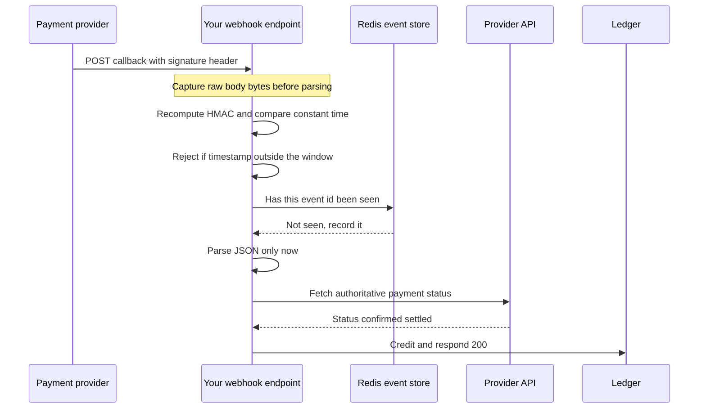

# API Security Essentials

Authentication tokens answer "who is calling?" — but a production API, especially one moving money, needs more layers: proof the *channel* is private, proof the *message* wasn't altered or replayed, proof the *machine* on the other end is the machine you meant, and controls that hold even when a credential leaks. Security engineering is layering these so that no single failure — a leaked key, a compromised pod, an XSS — is sufficient for an attacker to act. This note is the catalog of those layers and the judgment calls between them.

## Why this matters

- Bearer tokens ([[How JWT Works]]) protect *who*; they say nothing about channel privacy, message integrity after the TLS boundary, or replay. Teams that equate "we use JWTs" with "the API is secure" are missing most of the stack.
- Each layer kills a specific attack class. Knowing which layer kills which attack is what lets you answer "is mTLS overkill here?" or "why does AWS sign requests instead of using bearer tokens?" with reasons instead of fashion.
- Fintech reality: partner integrations, webhooks from payment providers, and service-to-service money flows each have a canonical attack and a canonical control — auditors will ask for them by name.

## How it works

### Layer 1 — TLS everywhere

Non-negotiable baseline: every hop encrypted, including *inside* the cluster. "TLS to the edge, plaintext inside" assumes the internal network is trustworthy — the perimeter model that a single compromised pod disproves. TLS gives confidentiality and integrity *in transit* and authenticates the *server* to the client ([[TLS and HTTPS]] has the handshake mechanics). In your fleet TLS terminates at CloudFront/ALB per the edge convention; the design question is what protects traffic behind that point.

### Layer 2 — mTLS: the client proves itself too

Ordinary TLS authenticates only the server. **Mutual TLS** has the client present a certificate as well, so both ends prove identity before a byte of application data flows. It is the standard answer for **service-to-service** identity: every workload gets a short-lived certificate from an internal CA (SPIFFE/SPIRE formalize this; [[Service Mesh]] sidecars like Istio's do it transparently), and connections between unauthenticated workloads simply fail. Strengths: transport-level, uniform, no app code. Costs: a CA and cert-rotation machinery to run (an expired internal cert is a classic 3 a.m. outage), and it authenticates *workloads*, not *end users* — so fleets typically run mTLS for "which service is this" plus JWTs for "which user is this request on behalf of" ([[Communication Patterns Between Services]]).

### Layer 3 — HMAC request signing: authenticate the message, not just the channel

A bearer token is detachable: whoever holds it can attach it to *any request* — that's what "bearer" means. **Request signing** binds the credential to the *exact request*: client and server share a secret; the client computes `HMAC-SHA256(secret, canonical-request)` over method, path, sorted query/headers, body hash, and timestamp, and sends the signature. The server recomputes and compares. Now:

- A captured request can't be *modified* (any change breaks the signature) — integrity beyond the TLS boundary, surviving proxies/logs/queues.
- The secret itself **never travels on the wire**, so it can't be skimmed in transit the way a bearer token can (from logs, proxies, browser tooling).
- With the timestamp signed, old requests expire — see replay protection below.

**AWS SigV4** is the canonical design — every AWS API call is signed this way; its canonicalization rules (lowercased sorted headers, hex-encoded SHA-256 body hash, credential scope of date/region/service) are worth reading once as the reference implementation. **When signing beats bearer tokens**: long-lived machine credentials (no token endpoint needed), requests transiting untrusted middleboxes, high-value operations where you want per-request integrity, and webhooks (below). When bearer wins: user-delegated access, short-lived scoped authority, anything needing the OAuth ceremony ([[OAuth 2 and OpenID Connect]]). The classic pain of HMAC is **canonicalization bugs** — client and server disagreeing on header ordering or encoding produces maddening signature mismatches.

### Layer 4 — Replay protection

TLS stops an active man-in-the-middle, but a *legitimate request captured elsewhere* (logs, a compromised partner system) can be re-sent verbatim — a valid signature and all. Replaying "transfer ₹10,000" is a real money attack. Two standard mechanisms, usually combined:

- **Timestamp window**: the signed request includes its creation time; the server rejects anything outside a window of N minutes. S3, for example, rejects a signed request whose timestamp is more than 15 minutes from its own clock (as of 2026), with `RequestTimeTooSkewed` — the tolerance is per-service, not one AWS-wide constant. Bounds replay to the window; requires sane clocks (same leeway logic as [[How JWT Works]]).
- **Nonce**: a unique random value per request, signed, and remembered by the server (Redis set with TTL = the timestamp window) — a seen nonce is a replay, rejected. The nonce store only needs to span the window, so it stays small.

Note the sibling concept: [[Idempotency]] keys make *retries safe* (same operation, once); replay protection makes *re-sends rejected* (attacker's copy, never). Payment APIs typically need both — idempotency for the client's own retries, replay rejection for everyone else.

### Layer 5 — Audience-scoped, short-lived tokens

Even within token-world, blast-radius engineering: mint tokens whose `aud` is one service and whose scopes are the minimum verbs needed, living minutes ([[JWT Pitfalls]] on why). A leaked token for `notifications:send` aimed at the notifications service cannot touch payments. This is least privilege applied to credentials — cheap to do at issuance, and it converts "a token leaked" from an incident into a shrug.

### Layer 6 — Secret management

Every layer above involves secrets — HMAC keys, client secrets, DB passwords, signing keys. The discipline:

- **Central vault** (HashiCorp Vault, AWS Secrets Manager, SSM Parameter Store): secrets fetched at runtime by workload identity (IRSA in your EKS world), never in code, images, or env-var dumps.
- **Rotation as routine**: every secret has an owner and a rotation schedule; dual-secret overlap (accept old+new during rotation) makes it zero-downtime, exactly like JWKS key overlap ([[Designing an IAM Service]]).
- **Detection**: secret scanning in CI (a leaked key in git history is leaked forever — rotate, don't delete), and vault access auditing.
  The signing keys behind your JWTs are the apex secret — HSM custody per [[Designing an IAM Service]].

### Layer 7 — Rate limiting as a security control

[[Rate Limiting]] is usually discussed as capacity protection, but several attacks are *only* stopped by it: credential stuffing (millions of password guesses), OTP brute force (6 digits = 10^6 guesses — rate limiting is the *entire* security of SMS OTP), enumeration (user IDs, card BINs), and token-endpoint abuse. Security rate limits differ from capacity limits: keyed per-account *and* per-IP (attackers rotate IPs), much lower thresholds, progressive lockout/backoff, and alerting (a tripped limit is a signal, not just a 429). Your org's rule — generic limits at the edge (Kong/CloudFront), security-boundary limits in the app — is the right split: the app knows "5 OTP attempts per account" semantics; the edge doesn't.

**The OTP arithmetic, worked.** This is the clearest case in the whole note of a limit doing cryptography's job, so it is worth computing rather than asserting.

A 6-digit OTP has 10^6 = 1,000,000 possible values — about 19.9 bits of entropy, which is roughly what three random characters of printable ASCII would give you. Three scenarios:

- **No limit at all.** An attacker managing 1,000 guesses per second walks the entire space in 1,000 seconds — under 17 minutes — and expects to hit the right code after half of it, about 8 minutes. The OTP is not a secret in any meaningful sense; it is a number you can simply count to.
- **5 attempts per account per 15 minutes.** Exhausting one account now needs 1,000,000 ÷ 5 = 200,000 windows, and 200,000 × 15 minutes = 3,000,000 minutes ≈ **5.7 years**. The limit did not strengthen the OTP by a single bit; it converted an 8-minute attack into a multi-year one purely by rationing attempts. That is the whole security argument for SMS OTP, which is why the limiter's availability is the OTP's availability.
- **The attack the per-account limit does not stop.** A competent attacker does not grind one account; they spray. Five guesses against one account succeed with probability 5 ÷ 1,000,000 = 1 in 200,000. Run that across 200,000 accounts — easily obtained from a breach dump — and the expected number of successful takeovers per sweep is 200,000 × 0.000005 = **about 1**, while every individual account stays politely within its limit and nothing trips. The per-account counter is blind to this by construction, because it only ever sees one account at a time.

The design conclusion follows directly: per-account limits are necessary and insufficient. You also need a **global** view — total OTP failures per minute across the platform, with an alert on deviation from baseline — plus per-IP and per-device keys to raise the attacker's cost, and OTP hygiene that shrinks the attack surface itself: one OTP valid for one purpose, invalidated on first use and on the final failed attempt, with a short validity window so the 5 attempts must be spent quickly. Lengthening the code also helps more than it looks: moving 6 digits to 8 multiplies the space by 100, turning the spray estimate above from ~1 success per 200,000 accounts into ~1 per 20,000,000.

### Layer 8 — Webhook signature verification

Webhooks invert the trust direction: a provider (payment gateway, KYC vendor) calls *you*, and "a POST arrived at your public endpoint" carries zero authenticity — anyone can send JSON shaped like a payment confirmation. Shipping money on an unverified webhook is a top-tier fintech vulnerability. The standard control is layer-3 applied in reverse: the provider signs each delivery with a shared secret (e.g. Stripe's `Stripe-Signature`: HMAC over `timestamp.payload`), you recompute over the **raw body bytes** (before any JSON parsing — re-serialization breaks signatures) with constant-time comparison, enforce the timestamp window, and dedupe event IDs (providers deliver at-least-once — [[Delivery Semantics]]). Treat the webhook as a *hint* where stakes are high: verify, then confirm state via the provider's API before releasing value.

The ordering is not stylistic — each step is only sound if the ones before it have already run:

Three details that look like pedantry and are not. Parsing comes *after* verification because parsing is the first place the attacker's bytes get to influence your process — and because re-serialising to verify is the bug described below. Dedupe comes before the business call because providers retry, so the same genuine event will arrive more than once ([[Delivery Semantics]]). And the confirmation call to the provider's API exists because a signature proves *who sent it*, never *that the money is real*: signing keys leak, test and production environments get crossed, and an event can legitimately be superseded by a later reversal. For anything that releases value, the webhook tells you *to go look*, and the provider's API tells you *what is true*.

## Trade-offs

| Layer | Kills | Costs |
|---|---|---|
| TLS everywhere | wire sniffing, MITM | cert management; mostly solved |
| mTLS | workload impersonation, lateral movement | internal CA + rotation ops; not user identity |
| HMAC signing | token theft-in-transit, request tampering, (with ts) replay | canonicalization complexity, shared-secret custody |
| Nonce + timestamp | replay | a nonce store on the hot path, clock discipline |
| Scoped short tokens | blast radius of any leak | more token minting, finer IAM config |
| Vault + rotation | leaked static secrets living forever | vault availability matters; rotation drills |
| Security rate limits | stuffing, OTP brute force, enumeration | false positives on shared IPs/NATs; tuning |
| Webhook verification | forged provider callbacks | raw-body handling, per-provider secret ops |

The meta-trade: each layer adds operational surface. Layering is not maximalism — it's choosing, per interface, the layers whose attack actually applies.

## Common misconceptions

- **"We have TLS, so requests can't be tampered with."** True only *on the wire between two TLS endpoints*. The moment a request is logged, queued, persisted for retry, or forwarded by a terminating proxy, TLS's protection has ended — HMAC signing is what protects the message itself across those boundaries.
- **"HMAC signing is obsolete; bearer tokens are the modern way."** AWS — the largest API operator on earth — signs every request with SigV4 to this day. The two solve different problems: bearer tokens carry *delegated, scoped, expiring authority*; signatures bind *long-lived credentials to exact requests*. Modern designs use both, by surface.
- **"Replay protection is unnecessary — we have idempotency keys."** An idempotency key makes a replayed *create* return the same result instead of a duplicate — which quietly means the attacker's replay *succeeds* and reads the response. Idempotency protects correctness against retries; replay protection rejects the attacker's copy outright. Money APIs want both ([[Idempotency]]).
- **"Rate limiting is an availability concern, not security."** For OTP and password endpoints, the rate limit *is* the cryptography: a 6-digit OTP has 20 bits of entropy, defensible only because guessing is capped.
- **"Webhooks from well-known providers can be trusted — the payload looks right."** Payload shape is public documentation; anyone can forge it. Only the signature (verified over raw bytes) distinguishes the provider from an attacker with curl.

## Failure modes

- **Internal CA or cert expiry** — fleet-wide connection refusals that look like a network outage. *Signal*: handshake failures clustered at a wall-clock instant rather than ramping with load, and failing in both directions between services that were fine a second earlier. *Confirm*: read the certificate's `notAfter` from the pod itself rather than from the config that was supposed to deploy it. Monitor cert expiry like disk space, with the alert set in weeks, not hours.
- **Clock drift** breaks signature timestamp windows and token `exp` simultaneously. *Signal*: a fixed fraction of requests failing with "expired" or "skewed" while retries land fine, because the failures are the ones that happened to hit one node. *Confirm*: compare node clocks against each other and against a signed request's own timestamp — this is one of the few bugs where the evidence is in the request body. NTP monitoring is a security control, not an infrastructure nicety: drift silently widens replay windows in one direction and rejects valid traffic in the other.
- **Nonce store outage** — fail open, which opens the replay window, versus fail closed, which halts signed traffic. *Signal*: if you fail open, the only trace is the *absence* of replay rejections, so alert on the rejection counter hitting zero rather than on errors. *Confirm*: the store's own health plus a synthetic replay you send on a schedule and expect to be rejected — a canary that proves the control is alive, since a control that never triggers and a control that is broken look identical. Where money moves, fail closed and engineer the store's HA ([[Redis Cluster and Sentinel]]).
- **Canonicalization drift** after a proxy or library upgrade mutates headers — signatures break for one client class only. *Signal*: 401s concentrated in a single partner or a single SDK version while every other caller is unaffected, starting at a deployment boundary on *your* side. *Confirm*: log the server-side canonical string for a failing request and diff it against what the client says it signed; the difference is almost always header case, header ordering, URL encoding of a query parameter, or a trailing slash. The fix is a strict written canonical spec plus published test vectors and contract tests.
- **Vault outage** — pods that fetch secrets at boot cannot start; runtime-fetch designs degrade harder. *Signal*: pods crash-looping in a startup phase with a healthy image and a healthy cluster, spreading only as replacements are scheduled. *Confirm*: whether a pod that is *already running* still serves traffic — if yes, it is a secret-fetch problem, not an application problem. Cache secrets in memory with a TTL; never fall back to baked-in defaults, because a fallback credential that works is a permanent credential nobody rotates.

### What this looks like at 3am

Not a page. A reconciliation alert — the nightly job that matches ledger credits against the payment gateway's settlement file reports fourteen credits with no matching settlement record.

Every operational dashboard is clean, and that is the point. The webhook endpoint's request rate is normal, its latency is normal, and its error rate is zero, because all fourteen forged requests were handled perfectly and returned 200. Nothing in the serving path had an opinion about them. The first real clue is in the access logs: those requests came from an autonomous system that is not the provider's, which is a thing nobody looks at until they have a reason to.

The root cause is four characters of control flow. The handler verified the signature *only when the header was present* — an `if` wrapped around the verification, added eighteen months earlier with an honest comment about a legacy provider that did not sign its callbacks, and never removed when that provider was retired. So the attacker did not break the HMAC, defeat a timing comparison, or steal a secret. They read the provider's public integration documentation, which describes the payload format because integrators need it, posted well-formed JSON, and simply omitted the signature header. The check they skipped was the check that would have stopped them, and it skipped itself.

Confirming it takes one query and one API call: count requests to the webhook path that arrived with no signature header, which should be exactly zero and was not; then take each suspicious credit's payment reference and ask the provider's API about it, where the answer is that no such payment exists. That second step is also the independent control that would have caught this before any money moved — the confirm-via-API step from layer 8 does not care why verification was skipped.

The generalisable rule is worth more than the fix: **a security check placed inside a conditional that attacker-controlled input can falsify is not a security check.** A missing signature must be rejected exactly as hard as a wrong one, absence must never be a fast path, and anything that releases value needs a second control that does not share the first one's code path. Layering is not belt-and-braces instinct; it is the acknowledgement that any single control can have an `if` around it that nobody has read in eighteen months.

## When NOT to use it

- **mTLS for first-party mobile/browser clients** — client-cert UX is miserable; that's what tokens are for. mTLS is a machine-to-machine tool (certificate pinning in mobile apps is the related-but-different control).
- **HMAC signing for user-facing APIs** — forcing canonicalization on every integrator kills DX; use OAuth bearer + TLS, reserve signing for machine/partner/webhook surfaces.
- **Nonce stores for idempotent read traffic** — replaying a GET gains an attacker nothing; spend the Redis capacity where replays have side effects.
- **A vault for a weekend project** — env vars and a rotation note are proportionate; the discipline scales with value at risk.

## In your stack

- Your current answer to "which service is calling?" is worth auditing: inside EKS, is pod-to-pod traffic mTLS'd (mesh), network-policied, or flat? Flat + gateway-only JWT validation is the perimeter model [[Designing an IAM Service]] argues against.
- Payment-provider webhooks (PG callbacks, UPI status, KYC vendor results) are your highest-stakes layer-8 surface: raw-body HMAC verification, timestamp window, event-ID dedupe in Redis, and confirm-via-API before crediting — each step maps to a real Indian-fintech incident pattern.
- IRSA (IAM roles for service accounts) is your layer-6 foundation: workloads get AWS credentials by identity, no static keys — the same SigV4 signing discussed above is what those credentials perform on every AWS call.
- OTP-based login flows make layer 7 the load-bearing wall: per-account counters in Redis with lockout and alerting, implemented in the app because the semantics are the app's — matching your org's edge-vs-app rate-limit split. Add the platform-wide failure-rate alert from the arithmetic above; per-account counters alone are blind to spraying.
- **1-replica implication for webhook receivers.** A single pod means every rolling deploy is a window where the provider's callbacks get connection errors. That is survivable only because providers retry — which makes at-least-once delivery and your event-ID dedupe load-bearing rather than defensive, and makes the dedupe store's own availability part of the money path. Confirm the obvious thing before you need it: that a callback arriving twice produces one credit, and that the second arrival is rejected by the dedupe check rather than by luck in the database. The same pinning means your nonce and dedupe keys must not live in a Redis configured to evict them ([[Sessions vs Tokens]] has the eviction failure in full).

## Interview angle

- The senior-level probe is layer *selection*: "service A calls service B — what secures it?" wants mTLS for workload identity + scoped token for user context + TLS as floor, and a reason for each. "Design webhook ingestion for a payment provider" wants signature-over-raw-body, timestamp, dedupe, and verify-then-confirm.
- **60-second version**: "Layers, each killing one attack class: TLS everywhere for the wire, mTLS so services prove identity to each other, bearer tokens scoped by audience and minutes-short so leaks have small blast radius. For machine and partner surfaces, HMAC request signing à la SigV4 binds the credential to the exact bytes — the secret never travels, tampering breaks the signature, and a signed timestamp plus nonce store kills replay. Secrets live in a vault, fetched by workload identity, rotated with overlap. Rate limiting doubles as a security control — it's the whole defense of an OTP. And webhooks get verified like hostile input: HMAC over the raw body, timestamp window, dedupe, confirm by API before money moves."
- Follow-ups: "Why does AWS use SigV4 instead of bearer tokens?" (long-lived credentials that never transit + per-request integrity + replay windows); "Replay vs idempotency — difference?"; "Your webhook secret leaks — walk the response" (rotate with overlap, audit deliveries since leak, re-verify suspicious events via provider API).

## Check yourself

> [!question]- Q: Explain, mechanically, why an HMAC-signed request is safe to pass through a logging proxy that a bearer-token request is not.
> The bearer request carries the credential itself in the Authorization header — anyone who reads the log replays the token until expiry against any endpoint it's valid for. The signed request carries only a *signature*: HMAC(secret, canonical request including timestamp). The secret never appears on the wire; the signature is useless for any other request (different bytes → different MAC) and expires with the timestamp window. The log reader can replay the one captured request within the window at most — and a nonce check kills even that.

> [!question]- Q: What happens if your webhook endpoint parses JSON first and verifies the HMAC against the re-serialized body?
> Verification breaks or, worse, becomes forgeable. Re-serialization changes bytes — key order, whitespace, unicode escapes, number formatting — so legitimate signatures fail intermittently (library-version-dependent), and teams then "fix" it by loosening comparison or skipping verification under pressure. The rule: capture raw body bytes before any parsing, HMAC those exact bytes, compare constant-time, and only then parse. In Spring, that means reading the request body as bytes (e.g. a caching request wrapper) rather than binding straight to a DTO.

> [!question]- Q: Your OTP login allows 5 attempts per account per 15 minutes, enforced in Redis. Redis goes down. Fail open or closed, and what does each cost?
> Fail open: logins proceed unthrottled — a 6-digit OTP now faces unlimited guessing, ~10^6 tries to takeover; attackers watch for exactly such windows. Fail closed: no one can attempt OTP login until Redis returns — an availability incident, but a bounded, visible one. For a fintech, fail closed on the security boundary (the org rule: fail closed where value or identity is at stake), then engineer Redis HA and a tight timeout so the closed window is short. The deeper lesson: a rate limiter that is part of the security model inherits availability-criticality.

> [!question]- Q: A partner reports that your signed-request API rejects them with a signature mismatch, but only for requests whose JSON body contains non-ASCII characters — customer names in Devanagari, mostly. Everything else works. Where is the bug?
> In the body hash, and specifically in the fact that one side is hashing a *string* while the other is hashing *bytes*. A signature is computed over octets; the moment either party hashes a decoded string and lets its platform choose an encoding on the way back out, the two sides can disagree about what was signed even though both believe they are looking at the same document. Classic variants: one side encodes UTF-8 and the other falls back to the platform default charset; a client library escapes non-ASCII as `\uXXXX` on serialisation while the server hashes the raw multi-byte form; or a Unicode normalisation difference makes two visually identical names differ in bytes. ASCII payloads hide every one of these, which is why the bug reaches production — the test fixtures were all in English. The diagnosis is mechanical rather than clever: log a hex digest of the exact byte array the server hashed, have the partner log theirs, and compare the byte lengths first — a length difference points at escaping or encoding, an equal length with different bytes points at normalisation. The fix is a specification that says "hash the exact octets of the request body as transmitted," plus published test vectors including a non-ASCII case, which is the control that would have turned this into a failing integration test instead of a support ticket. The same discipline applies in reverse on your webhook receivers: hash the raw bytes, never the re-serialised object.

> [!question]- Q: Mini design prompt — expose a payouts API to third-party partners. Pick your layers and justify each.
> TLS with modern ciphers (floor). Partner authentication: OAuth client credentials with per-partner `aud`/scopes for standard access, *plus* HMAC request signing on mutating endpoints (payout creation) — per-request integrity for money movement (not non-repudiation: either holder of a shared secret can compute the MAC; that needs an asymmetric signature), with signed timestamp (5-min window) and nonce dedupe in Redis for replay. [[Idempotency]] keys on payout creation for safe partner retries. Per-partner rate limits (security + fairness) and per-partner secrets in the vault with scheduled rotation and overlap. Immutable audit of every request with signature metadata ([[Designing an IAM Service]]). Status callbacks to partners are signed webhooks — same HMAC discipline in reverse, with published verification docs.

## Sources

- AWS documentation: *Signature Version 4 signing process* — the reference HMAC request-signing design.
- RFC 2104 (HMAC); RFC 8705 (OAuth 2.0 mTLS client authentication and certificate-bound tokens).
- OWASP API Security Top 10 (2023 — still the current edition as of October 2026) and OWASP Secrets Management Cheat Sheet.
- Stripe documentation: *Checking webhook signatures* — the canonical webhook-verification pattern.
- SPIFFE/SPIRE documentation — workload identity and mTLS at fleet scale.
