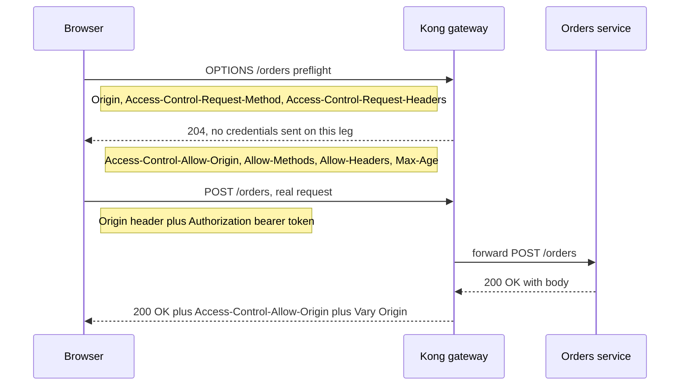

# CORS

**CORS is enforced entirely by the browser.** curl, Postman, a Spring `WebClient`, and an attacker's own script all ignore it completely — they get the response body regardless of any header. CORS protects a *user* from a *malicious website their browser also happens to be running*; it does nothing to protect your API from a malicious or simply non-browser *client*. That single sentence resolves most of the confusion engineers carry about CORS, so hold onto it while reading the mechanics below — authentication, authorization, and the rest of your API's own security controls ([[API Security Essentials]]) are a separate, still-mandatory concern that CORS does nothing to replace.

## The problem that created it

Browsers automatically attach cookies to every request that matches a cookie's domain, regardless of which page triggered the request. This is what makes "stay logged in" work — you don't re-authenticate on every page load. But without a restriction, it is also catastrophic: if you're logged into your bank in one tab, a page open in another tab can issue `fetch("https://bank.example/transfer", {credentials: "include"})`, the browser attaches your real session cookie automatically, and the malicious page's JavaScript can read the response — balance, confirmation, everything.

The **same-origin policy (SOP)** is the browser rule that closes this gap. It does not stop the request from being *sent* — for the kinds of requests an HTML form could already make, that was always possible and still is. It stops a script running on origin A from *reading the response* of a request to origin B. Sent-but-unreadable is the SOP's entire shape, and it's the detail that makes the later CSRF distinction make sense.

**Origin** is defined precisely as **scheme + host + port**, all three:

- `https://app.example.com` and `http://app.example.com` — different origins (scheme).
- `app.example.com` and `api.example.com` — different origins (host), even though both sit under the same registrable domain.
- `example.com:3000` and `example.com:8080` — different origins (port) — the reason a local React dev server on `:3000` calling a Spring Boot API on `:8080` is already a cross-origin call, SOP included ([[TLS and HTTPS]] covers the scheme half of this triple).

## What it solves

SOP alone would make legitimate cross-origin use cases impossible: a SPA served from `app.example.com` calling `api.example.com`, a partner embedding your widget on their own site, a mobile web client hitting a separate API host. **CORS is the opt-out, not a restriction** — it is the mechanism by which a *server* tells the *browser* "I am willing to let this other origin read my response." Most engineers reach for CORS thinking it tightens something; it only ever relaxes SOP, and only for origins the server names.

- Lets a server grant specific origins read access to its responses, deliberately and per-origin.
- Lets the server distinguish credentialed access (cookies/Authorization allowed) from anonymous access, per origin.
- Keeps the actual enforcement inside the browser — which is exactly why it cannot function as a server-side access control (see below).
- Replaced earlier, worse workarounds (JSONP's `<script>`-tag abuse, server-side proxying) once the W3C/WHATWG standardized it.

## How it works

Every request governed by CORS carries an `Origin` header the script cannot forge or suppress — `Origin: https://app.example.com`; `Origin` is a forbidden header name, so no amount of JavaScript can set it to something else. The server's response headers tell the browser what to do with that fact. Requests fall into two buckets.

### Simple requests — no preflight

A request skips the preflight only if **all** of these hold:

- Method is `GET`, `HEAD`, or `POST`.
- Only CORS-safelisted headers are set (`Accept`, `Accept-Language`, `Content-Language`, `Content-Type` among a short list).
- If `Content-Type` is present, it is one of `application/x-www-form-urlencoded`, `multipart/form-data`, or `text/plain`.

The *why* matters more than the list: this is exactly what a plain HTML `<form action="https://other-origin">` could always submit cross-origin, with zero JavaScript, long before CORS was standardized (W3C Recommendation 2014; the behaviour now lives in the WHATWG Fetch Standard). Restricting `fetch`/`XMLHttpRequest` from doing the same thing a form could already do would protect nothing — the request was already reachable. "Simple" means "no more dangerous than a form post."

### Preflighted requests

Anything outside that set — a custom header (`Authorization` carrying a [[How JWT Works|JWT]], `x-correlation-id`), a method like `PUT`/`DELETE`/`PATCH`, or `Content-Type: application/json` — triggers a **preflight**: the browser sends an `OPTIONS` request *before* the real one, asking permission.

Preflight request carries:
- `Origin` — the calling origin.
- `Access-Control-Request-Method` — the method the real request will use.
- `Access-Control-Request-Headers` — the custom headers the real request will carry.

A detail worth stating because it causes real outages: **the preflight is sent without credentials**, by spec, regardless of what the actual request will carry. A gateway or filter that requires `Authorization` on *every* incoming request, including `OPTIONS`, will 401 every preflight — and since any API that requires `Authorization: Bearer` on every call makes every browser-based cross-origin call to it non-simple, this isn't a corner case for a JWT-secured API; it's the default path.

Preflight response carries:
- `Access-Control-Allow-Origin` — the origin permitted to read the response (one value, or `*`).
- `Access-Control-Allow-Methods` — methods the server accepts from that origin.
- `Access-Control-Allow-Headers` — headers the server accepts; must list every non-safelisted header the real request will send. A wildcard `*` here is a convenience, not a universal one: per the Fetch standard it does **not** cover `Authorization`, which must be named explicitly — a sharp edge for any Bearer-token API.
- `Access-Control-Allow-Credentials` — `true` if a *credentialed* cross-origin exchange is permitted at all. It is not what makes the browser attach credentials: the calling script does that, with `credentials: "include"`. This header is the server's consent — without it a credentialed preflight fails and a credentialed response is never exposed to the script. "Credentials" is a precise term in the Fetch standard: **cookies, TLS client certificates, and HTTP authentication entries** — the things the browser attaches on its own. An `Authorization: Bearer` header that JavaScript sets explicitly is **not** a credential in this sense; it is an ordinary non-safelisted header, governed by `Access-Control-Allow-Headers`, and it works perfectly well against `Access-Control-Allow-Origin: *`. Conflating the two is the single most common misreading of this header.
- `Access-Control-Max-Age` — seconds the browser may cache this answer before preflighting again. The Fetch standard's default when the header is absent is 5 seconds; browsers additionally cap whatever the server asks for — Chromium at 7200s / 2 hours since v76 (2019), Firefox at 86400s / 24 hours (both unchanged as of 2026) — so a server asking for more gets silently truncated, not denied.

If the preflight is answered favourably, the browser sends the real request, and the *actual response* must itself carry `Access-Control-Allow-Origin` (and `-Credentials` if relevant) — the preflight's approval doesn't retroactively apply to a response that forgot its own headers. One more default worth knowing: JavaScript can only read seven safelisted response headers — `Cache-Control`, `Content-Language`, `Content-Length`, `Content-Type`, `Expires`, `Last-Modified`, `Pragma` — unless the server lists additional ones in `Access-Control-Expose-Headers` — a custom header like `x-correlation-id` is invisible to `fetch(...).headers.get(...)` without it. A header added later as part of an otherwise routine API change — a deprecation notice, a new pagination cursor — needs `Access-Control-Expose-Headers` updated in lockstep, the same additive-change discipline any other contract evolution requires ([[API Design and Versioning]]).

### The credentials rule

When `Access-Control-Allow-Credentials: true`, the browser refuses `Access-Control-Allow-Origin: *` outright and demands the server echo back one specific origin. The reason isn't arbitrary: `*` plus credentials would mean "any website on the internet may make a cookie-bearing request to me and have the response handed to its script" — precisely the bank-in-another-tab scenario the same-origin policy exists to prevent. So the combination is rejected at the protocol level, forcing the server to commit to exactly one caller per response.

The sharp edge here is a server that satisfies the letter of the rule while recreating its danger: **blindly reflecting whatever `Origin` header the request happened to carry, for every caller, is wildcard-with-credentials wearing a disguise.** It passes the "not literally `*`" check while granting every origin in existence the same access `*` would have. The fix is an explicit allowlist checked against the incoming `Origin`, echoing back only a match — never an unconditional reflection.

### The Vary header

If `Access-Control-Allow-Origin` is computed dynamically from the request's `Origin` — which it must be, once more than one origin is trusted — the response is no longer a single fixed document; it varies by a request header. Any shared cache sitting in the path (a [[CDN]] like CloudFront, a reverse-proxy cache) that keys purely on URL can store the response computed for origin A and then serve *that exact response, headers included* to a request arriving from origin B. If credentials were also involved, B's page just received a response authorized for A — a real cache-poisoning class of bug, not a theoretical one. The fix is one header: `Vary: Origin`, telling every cache downstream to key its entries by the `Origin` header too, not just the path. One caveat worth knowing before you rely on it: a CDN does not have to honour `Vary` for cache-keying, and CloudFront does not — its cache key is whatever its cache policy says, so `Origin` has to be named in that policy's header list (which also makes CloudFront forward `Origin` to the origin, which the allowlist echo needs anyway). `Vary: Origin` is still correct and still required for every well-behaved shared cache in the path; it is just not sufficient on its own at a CloudFront edge.

### CORS is not CSRF protection

CORS governs whether a script may **read** a cross-origin response. CSRF is about an **unwanted state-changing request being sent and acted on** — the SOP never blocked sending, only reading, so a CSRF attack that transfers money doesn't need to read anything back; the money moved, and that's the entire damage. A permissive CORS policy can make CSRF *worse* — if a malicious origin can also read the response, it can chain reads (fetch a CSRF token, then use it) that a blind POST couldn't — but tightening CORS does not substitute for CSRF defenses. Those are `SameSite` cookies (Chrome defaulted unset cookies to `SameSite=Lax` in 2020), CSRF tokens, or requiring a custom header that forces a preflight. See [[Sessions vs Tokens]] for the cookie/CSRF mechanics in full.

## Trade-offs

| Config choice | You get | You pay |
|---|---|---|
| Wildcard origin, no credentials | Simplest setup; any site may call your public API — and a JS-set `Authorization` header still works, since it isn't a credential | No cookies or TLS client certs possible; cannot distinguish callers by origin at all |
| Explicit allowlist + credentials | Browser JS on trusted origins only, including cookie-borne sessions | An allowlist to maintain; a new client origin is a config change, not automatic |
| No CORS headers configured | Cross-origin JS reads blocked everywhere, by default | Any legitimate cross-origin SPA/widget integration fails with a console error, not a clear server-side one |

None of these rows is "more secure" in isolation — the right one is whichever matches what the API already is. The common mistake is picking row one because "nothing sensitive is cross-origin yet" and only later adding authenticated routes to the same origin configuration without revisiting the credentials question — that's how a wildcard meant for public data quietly ends up fronting a cookie-bearing endpoint.

## Failure modes

- **A crashed service masquerading as a CORS bug.** When the server throws before it reaches the code that sets CORS headers — an uncaught exception, a 500 on the error path — the error response carries no `Access-Control-Allow-Origin`, and Chrome's console reports "No Access-Control-Allow-Origin header present," which reads like a CORS misconfiguration. The actual bug is upstream; the browser is just the messenger. This is the single most common CORS "bug report" that isn't about CORS at all.
- **Preflight not routed.** A gateway or ingress rule that only matches `GET`/`POST`/`PUT` and has no rule for `OPTIONS` returns a 404/403 on the preflight itself, so the browser never attempts the real request — the actual endpoint is never even reached.
- **Auth required on `OPTIONS`.** Since preflights are sent without credentials by spec, an auth filter guarding every method including `OPTIONS` rejects every preflight, which silently breaks every cross-origin call that needed one — a near-duplicate of the point above, caused by security config rather than routing.
- **Missing `Vary: Origin`.** Covered above — a cache serves one origin's approved response to another.
- **Wildcard plus credentials, rejected by the browser.** Not a server-visible failure — the request may even complete at the network level — but the browser refuses to expose the response to the calling script, so the app sees an opaque failure with no server-side error to grep for.
- **A redirect losing the headers.** Every response in a CORS chain — including an intermediate 301/302 — must itself carry the CORS headers for the browser to keep following it. Worse: a redirect returned in answer to the *preflight* `OPTIONS` itself is treated as an outright failure by the fetch spec, not followed at all — a trailing-slash or login redirect sitting in front of an API silently breaks every preflighted cross-origin call against it.
- **`Access-Control-Allow-Headers` drift.** The list must name every non-safelisted header the real request sends. A client adds a new header later — a feature-flag header, a client-version header — without the server's allowlist being updated, and the preflight silently denies it. Nothing reaches the application; there is no server log entry to grep for, because the browser never attempted the real request.

## When NOT to use it

- **Server-to-server calls.** No browser is involved, so there is no SOP to relax and no CORS header does anything — one Spring service calling another, or calling a partner's API, needs service-to-service auth (mTLS, a JWT), not CORS config. East-west identity and encryption are a different layer entirely ([[API Security Essentials]], or [[Service Mesh]] if the fleet is large enough to warrant one).
- **Native mobile clients.** A mobile app's HTTP client isn't a browser and has no concept of "origin" to restrict; CORS headers are inert for mobile-only traffic.
- **Genuinely same-origin deployments.** If the frontend and the API are served from the same scheme, host, and port, there is no cross-origin call happening at all, and adding CORS headers anyway is unnecessary surface, not a safety margin.
- **As a stand-in for authentication, authorization, or CSRF defense.** Restated in imperative form because it's the mistake worth repeating: CORS answers "may a browser script read this," never "who may call this" or "should this state change be allowed to happen." Lock down origins all you like; auth, ownership checks, and CSRF tokens are still separately mandatory.
- **Internal tooling already behind a network boundary.** If the only legitimate caller is an admin UI reachable solely over VPN or a zero-trust gateway, a public CORS allowlist is solving a problem the network boundary already solved — don't widen the origin list just because the client happens to be a browser.

## In your stack

- Org convention puts CORS, TLS, and generic rate limiting at the edge — Kong ([[API Gateway]]), CloudFront, ALB — rather than reimplemented per service, and CORS is the cleanest illustration of why. Kong ships a bundled `cors` plugin, enabled globally or scoped to a Service or a Route, so the allowed-origin list is one reviewable piece of config instead of N near-duplicate copies drifting across services. It also means a new partner origin is a Kong config change reviewed once, not a pull request against every service that happens to be reachable cross-origin. ([[API Gateway]] owns the gateway's general plugin/scoping model and the edge order CloudFront → ALB → Kong → EKS; this note only covers what the CORS-specific config must say.)
- **The double-CORS bug** is the concrete failure duplication produces: if Kong's `cors` plugin answers with `Access-Control-Allow-Origin` *and* a Spring service behind it also adds its own (via `@CrossOrigin` or a `WebMvcConfigurer`/`CorsRegistry` bean), the response carries two `Access-Control-Allow-Origin` headers. Browsers treat a response with multiple values for that header as invalid and refuse it outright — even if both values are identical. `curl` shows nothing wrong, because `curl` doesn't enforce CORS at all; only the browser does, which makes this exactly the kind of bug that looks fine in every tool except the one your users actually use. The fix is structural: CORS lives in exactly one layer — the gateway — and services are told to leave it unset.
- Where Spring-level CORS is in play anyway (an internal tool without a gateway in front, say): `@CrossOrigin` or a `WebMvcConfigurer#addCorsMappings` bean is the per-controller/per-app mechanism. With Spring Security on the classpath, its filter chain runs ahead of MVC, so CORS additionally needs enabling on the security filter chain itself — `http.cors(...)` on `HttpSecurity`, backed by a `CorsConfigurationSource` bean — otherwise the security filter can reject or mishandle the preflight before any `@CrossOrigin` annotation gets a chance to run, the single-service version of the "auth required on OPTIONS" failure mode above.
- Since your IAM-issued JWTs travel as `Authorization: Bearer`, every browser-based cross-origin call against a Niyo API is non-simple and preflights — tune `Access-Control-Max-Age` so the browser isn't re-preflighting on every call, within whatever hard cap the browser itself enforces. Note that a Bearer token is *not* a CORS credential: it needs `authorization` named explicitly in `Access-Control-Allow-Headers` (a `*` there does not cover it), but it does **not** require `Access-Control-Allow-Credentials: true`. Turn credentials on only if a session actually rides in a cookie.
- `x-correlation-id` is a custom header: any browser client that sets it needs it listed in `Access-Control-Allow-Headers`, and if a client needs to read it back from the response for debugging, it needs `Access-Control-Expose-Headers` too — it isn't in the browser's default-readable set ([[Distributed Tracing]]).

## Interview angle

The 60-second version: *"The same-origin policy is a browser rule: a script on one origin can't read the response of a request to a different origin — scheme, host, and port must all match. It doesn't block sending the request, only reading what comes back. CORS is the server's opt-out of that restriction — response headers like Access-Control-Allow-Origin tell the browser which other origins may read its responses. Simple GET/POST requests with only safelisted headers skip straight through; anything else — a custom header, JSON, PUT/DELETE — triggers a preflight OPTIONS first. If credentials are allowed, the server can't use a wildcard origin — it must echo one specific, validated origin — and if that echo is dynamic, the response needs Vary: Origin or a shared cache will serve one origin's headers to another. The one thing to never forget: this is all enforced by the browser. curl and server-side clients ignore it completely, so CORS is not an access control — auth and authorization still do that job."*

Classic follow-ups:
- *"Is CORS a security feature?"* — yes, for the browser's user, never for the server; name the curl example immediately.
- *"Why does my JSON POST preflight but my form POST doesn't?"* — `application/json` isn't in the three safelisted content types; it's new surface a pre-CORS form could never have sent, so it must ask first.
- *"CORS vs CSRF?"* — reading vs sending; a permissive CORS policy can compound CSRF risk but isn't CSRF protection.
- *"Where do you configure it in a microservices fleet?"* — once, at the edge, never per service — then walk into the double-CORS-header bug as the evidence.
- *"What does `Vary: Origin` actually fix?"* — a CDN or reverse-proxy cache serving one origin's approved headers to a different origin's request; name it as a cache-poisoning class of bug, not a cosmetic header.

## Check yourself

> [!question]- Q: A colleague says "CORS protects our API from unauthorized callers." What's wrong with that sentence, and what actually protects the API?
> CORS is enforced by the browser's own fetch/XHR implementation — it governs whether a page's JavaScript is allowed to *read* a cross-origin response. Any client that isn't a sandboxed browser script — curl, Postman, a server-side HTTP client, an attacker's own script run outside a browser — never evaluates CORS headers at all and simply receives the full response. What actually protects the API is authentication (validating the caller's identity, e.g. the JWT) and authorization with an ownership check on every access path — mandatory regardless of any CORS configuration.

> [!question]- Q: A frontend calls `fetch("https://api.example.com/orders", {method: "POST", headers: {Authorization: "Bearer ...", "Content-Type": "application/json"}, body: ...})` from `https://app.example.com`. Does this preflight, and why?
> Yes. Two independent reasons each force it: the `Content-Type` is `application/json`, not one of the three safelisted values (`application/x-www-form-urlencoded`, `multipart/form-data`, `text/plain`); and `Authorization` is not a CORS-safelisted header at all. Either alone would be enough to take this out of the "simple request" bucket. The browser sends an `OPTIONS` request first, with `Origin`, `Access-Control-Request-Method: POST`, and `Access-Control-Request-Headers` listing `authorization` and `content-type`; only if the server's preflight response approves that origin, method, and header set does the browser send the real POST.

> [!question]- Q: Your API sets `Access-Control-Allow-Origin: *` and `Access-Control-Allow-Credentials: true`. A teammate says it's working in their manual test. What's actually happening, and what's the fix?
> It isn't working as intended — browsers refuse this exact combination; a request configured to send credentials against a wildcard-credentialed response is blocked by the browser before the script ever sees it, regardless of what the server sent. Their "working" test is almost certainly a credential-less request (no `credentials: "include"`, so no cookie — a JS-set `Authorization` header would still pass, since it is not a CORS credential) succeeding against the wildcard, which tells you nothing about the credentialed path. The fix: replace the wildcard with an explicit allowlist of trusted origins, validate the incoming `Origin` header against it, and echo back only a match — never a blind reflection, which recreates the same hole under a different name.

> [!question]- Q: A service reports CORS errors in the browser console for a specific endpoint, but the service's own logs show nothing unusual for that time window. Where do you look first?
> Before touching CORS config, check whether the request ever completed successfully at the server — a request that throws before reaching the code that attaches `Access-Control-Allow-Origin` (an uncaught exception, a 500 on an error path that skips the CORS filter) produces exactly this console message, because the browser is reporting the *absence* of a header on whatever response it got, not necessarily a misconfigured one. Check the actual HTTP status first — if it's a 500 and the headers were only ever added on success, the fix is error-path header coverage (or moving CORS to a layer that always runs, like the gateway), not the allowlist itself. Only treat it as a true CORS misconfiguration once you've confirmed the response status was healthy and the headers were simply wrong or absent.

> [!question]- Q: Mini-design — a fintech API serves a first-party web banking frontend on `app.niyo.example`, a third-party partner's embedded widget calling from `partner.example`, and a native mobile app. Where does CORS apply, and what does each origin get?
> CORS applies only to the two browser-based callers; the mobile app's HTTP client isn't subject to SOP, so no CORS config affects it at all — its security is entirely auth/authz (JWT validation, ownership checks), same as everywhere else. At the gateway, configure an explicit allowlist with exactly two entries. `app.niyo.example` gets `Access-Control-Allow-Headers` naming `authorization` and `x-correlation-id` — and `Access-Control-Allow-Credentials: true` **only if** the session rides in a cookie; if the frontend sends a Bearer token that JavaScript sets, the header list alone is sufficient and credentials stay off, which is the stricter and simpler position. `partner.example` is scoped to only the routes the widget actually needs, almost certainly without credentials unless the partner integration has its own token flow — never reuse the first-party cookie-bearing policy for a third-party origin. Both entries are validated against the incoming `Origin`, never wildcarded, and the response carries `Vary: Origin` since the allowed value now depends on which of the two callers made the request.

## Sources

- MDN Web Docs — "Cross-Origin Resource Sharing (CORS)" and "Same-origin policy": the mechanics, header definitions, safelisted request headers/content-types, and documented browser caps on `Access-Control-Max-Age`.
- WHATWG Fetch Standard — the formal specification of CORS protocol behaviour, including the preflight-redirect-as-failure rule and the credentials/wildcard restriction.
- OWASP Cheat Sheet Series — "Cross-Origin Resource Sharing" and "Cross-Site Request Forgery Prevention": the CORS-is-not-CSRF-protection distinction from a security-review angle.
- Spring Framework reference documentation — CORS support (`@CrossOrigin`, `WebMvcConfigurer`, and CORS integration with Spring Security's filter chain).
- Kong documentation — the bundled `cors` plugin and its global/service/route scoping (consumer scoping is not supported for this plugin: it runs before the authentication plugins, so no consumer identity exists yet).
