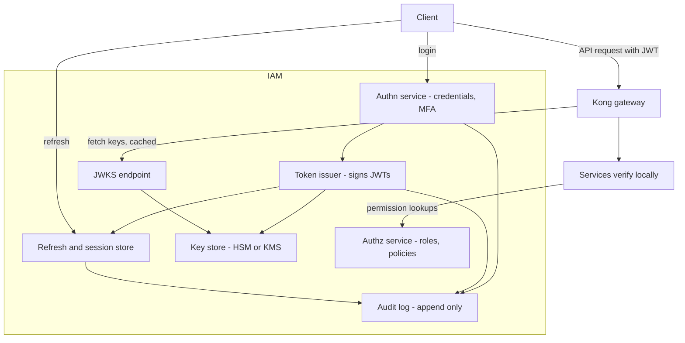

# Designing an IAM Service

Your company has one; this note designs it from scratch so you understand every piece of the one you have. An **IAM (Identity and Access Management) service** is the component that answers two questions for the whole fleet — *who is this?* (authentication) and *what may they do?* (authorization) — and mints the signed tokens that carry those answers everywhere else. It is the most availability-critical and most attacked service you will ever run: it sits upstream of every request, and compromising it is compromising everything behind it.

## The problem that created it

A fleet of microservices each doing its own login is a disaster in slow motion: N password databases, N MFA implementations, N places to get bcrypt wrong, N things to audit, and no way to log a user out everywhere. The first consolidation move is obvious — one service owns credentials and login. The second is subtler: once one service authenticates everyone, every other service needs a *portable proof* of that authentication, which is exactly the JWT-issuance story from [[How JWT Works]]. The third arrives with the regulator: for a fintech, "who accessed what, when, authenticated how" must have one authoritative, auditable answer. The IAM service is where all three consolidations land — identity becomes a product with one owner, and the rest of the fleet becomes stateless verifiers of its signatures.

## What it solves

- One hardened implementation of credential storage, login, MFA, and lockout — instead of N.
- One token issuer with one key-custody story; services verify locally and scale freely.
- One revocation point (refresh tokens, sessions, devices) and one audit trail.
- One place to integrate SSO/IdPs ([[Single Sign-On]]) and one owner for compliance questions.

## How it works

### The shape of the system

### Authn vs authz — keep them separate

**Authentication** (who are you) and **authorization** (what may you do) have different data, different change rates, and different consumers — designing them as separable components inside (or beside) the IAM pays off immediately:

- **Authn**: credential verification (argon2/bcrypt password hashes — never reversible encryption), MFA hooks (TOTP, SMS/push OTP, WebAuthn) pluggable as a step in the login pipeline, lockout and credential-stuffing throttles ([[Rate Limiting]] applied as a security control), device fingerprinting. Output: "user 42 authenticated at T with factors [password, totp]" — which the token issuer turns into `sub`, `auth_time`, `amr` claims.
- **Authz**: the mapping from identity to permission — roles, groups, policies ([[RBAC vs ABAC]]). It changes far more often than identity (every role edit), is queried by *services* rather than by login flows, and is the piece you'll most want to evolve independently (e.g. toward a policy engine). Keep authorization data OUT of long-lived tokens ([[JWT Pitfalls]]); tokens carry identity and coarse scopes, authz answers fine-grained questions at request time.

### Token issuance and signing-key management

The issuer holds the crown jewels: the private signing keys. Design decisions, in order of importance:

1. **Asymmetric signing** (RS256 or ES256) so only the issuer can mint — argued in [[How JWT Works]].
2. **Keys never touch application memory if you can afford it.** The gold standard is an **HSM** (hardware security module) or cloud KMS (AWS KMS, CloudHSM): the key is generated inside the hardware, never exportable; the issuer sends a digest and receives a signature. A stolen issuer pod then can't exfiltrate the key — it can only sign while compromised, which is detectable and stoppable. For a fintech this is close to table stakes; PCI-DSS and RBI expectations around key custody point the same direction. The ceremony matters too: key generation witnessed/logged, access dual-controlled, no single human able to extract or replace a signing key.
3. **Rotation via JWKS + `kid`.** Publish current public keys at `/.well-known/jwks.json`, each with a key ID. Rotation is additive and overlap-based:
   - Generate new key `k8`; publish it alongside `k7` in JWKS.
   - Wait for verifier caches to pick it up, then start *signing* with `k8` (tokens carry `kid: k8`).
   - Keep `k7` published until every token signed with it has expired (max access-token TTL + cache TTL), then remove.
   Rotate on a schedule (e.g. quarterly) so the muscle exists, and instantly on suspicion of compromise — emergency rotation with a short overlap logs everyone out, which is the correct trade in a compromise.

### Validation at the gateway vs per-service

Where does JWT verification happen — Kong ([[API Gateway]]) or each service?

| | Gateway-only | Per-service only | Both (defense in depth) |
|---|---|---|---|
| Garbage rejected at the edge | yes | no — junk reaches services | yes |
| Services safe from internal callers bypassing the gate | no — anything inside the perimeter is trusted | yes | yes |
| Config drift risk | one place | N places (one service forgets `aud`…) | N+1 places, but gateway catches gross errors |
| Cost | one verification | one per hop | one per hop plus edge |

Gateway-only recreates the perimeter-trust model: anything that gets inside (SSRF, a compromised pod, a misrouted internal call) is implicitly authenticated. Per-service-only wastes the edge's ability to shed unauthenticated junk before it consumes capacity. The standard answer for a fintech is **both**: Kong rejects malformed/expired tokens early (cheap — signature checks are microseconds), and every service re-verifies plus enforces its own `aud` and scopes. A shared internal library (your own starter wrapping Spring Security's resource server) keeps the N service configs from drifting.

### Sessions, devices, and revocation

The stateful side of the house ([[Refresh Tokens and Token Rotation]] has the mechanics): the refresh-token/session store keyed by family, with device metadata (platform, fingerprint, last-seen IP/geo). This is what powers user-visible "your devices" screens, "log out everywhere," fraud-ops kill switches, and reuse-detection tripwires. Store token *hashes*, never plaintext. For instant access-kill beyond the refresh boundary, add the user-version claim or `jti` denylist pattern from [[JWT Pitfalls]] — implemented here, enforced by verifiers.

### Audit logging — regulator-grade

Every security-relevant event — login success/failure, MFA challenge/result, token issued, refresh, revocation, role change, key rotation, admin action — goes to an **append-only** audit stream: write-once storage (object lock / WORM), or at minimum a stream the IAM itself cannot rewrite, with integrity protection (hash chaining or signed batches) so tampering is evident. Include `sub`, `jti`, client, IP, device, correlation ID; never include credentials or token values. The test an auditor applies: *can you reconstruct everything principal X did in window W, and prove the record wasn't altered?* Retention per regulation (RBI expectations run to years). Design it as an event stream from day one — it will also feed fraud detection.

### Availability — IAM is in every request path

Soberly: if verification is local (JWT + cached JWKS), the IAM is *not* in the per-request path — that's the design's whole point. It is in the **login path**, the **refresh path**, and the **JWKS-fetch path**. So:

- **Cache JWKS aggressively** in every verifier: hours-long TTL, refresh in the background, and crucially **serve stale on fetch failure** — public keys don't become dangerous when stale, only when *missing*. A verifier that hard-fails on JWKS fetch converts an IAM blip into a fleet-wide 401 storm.
- **When IAM is down**: existing access tokens keep working everywhere (local verification). No new logins; refreshes fail, so users log out progressively over one access-token TTL ([[Refresh Tokens and Token Rotation]] traces this). Your access TTL therefore bounds the *worst* case rather than buying a grace period: tokens are minted at staggered times, so a 10-minute outage under a 15-minute TTL logs out roughly two-thirds of active users as their tokens expire one by one — only the ones minted just before it started ride it out untouched.
- The IAM itself needs boring excellence: multiple replicas (this is the one service where the 1-replica cost decision is indefensible), HA datastore, [[Circuit Breakers]] and [[Timeouts Retries and Exponential Backoff|sane timeouts]] on its dependencies (SMS/email OTP providers are the classic slow dependency that takes login down), and [[Load Shedding and Graceful Degradation|load shedding]] on login endpoints under credential-stuffing storms.

### Multi-tenant claims design

Serving multiple tenants (brands, partner banks, B2B customers) from one IAM:

- A **`tenant` claim** (or `org_id`) in every token, set at issuance from the user's home tenant — never from request input.
- **Every service enforces it**: tenant becomes a mandatory filter on every query touching tenant-scoped data. The classic breach is a valid token from tenant A reading tenant B's rows because one endpoint forgot the filter — authorization *and ownership* checks on every path, not just authentication.
- Decide early whether `sub` is globally unique or per-tenant (global is simpler; `iss`-per-tenant or compound `tenant:sub` both appear in the wild), and whether tenants can have their own IdPs federated in ([[Single Sign-On]]) — that choice shapes `iss`/`aud` conventions fleet-wide.

## Trade-offs

| You gain | You pay |
|---|---|
| One hardened identity implementation | A single point of catastrophic compromise — it gets the most hardening budget |
| Stateless, horizontally scalable verification fleet-wide | Key management becomes a real operational discipline (HSM, ceremonies, rotation drills) |
| One revocation point, one audit trail | Login/refresh availability is now one team's pager |
| Clean authn/authz separation enables independent evolution | Cross-team coupling: every auth change routes through IAM's roadmap |

## Failure modes

- **JWKS outage with short verifier caches** — fleet-wide 401s. Mitigation above; also serve JWKS from a CDN ([[CDN]]) since it's small, public, and cacheable.
- **Signing-key compromise** — the worst day: attacker mints arbitrary identities. Detection is hard (forged tokens verify!) — watch for `jti`s you never issued, impossible claim combinations, issuance-log mismatches. Response: emergency rotation, revoke-all, incident disclosure. HSM custody exists to make this day nearly impossible.
- **Credential-stuffing storms** on login — IAM CPU (password hashing is deliberately expensive) saturates; legitimate logins starve. Rate limit per-IP/per-account at Kong *and* in-app, add progressive delays and bot checks.
- **Refresh-store corruption/loss** — everyone logs out; sessions and device trust vanish. The store needs the same durability care as money data.
- **Audit pipeline silently dropping events** — discovered only at audit time. Monitor the stream's own liveness; an unauditable IAM is a compliance incident with no technical symptom.

## When NOT to use it

- **Don't build one** when you're small or identity isn't a differentiator: managed providers (Auth0, Cognito, Keycloak self-hosted) give you MFA, rotation, and audit out of the box. Build when scale economics, data-residency/regulatory custody, or deep product coupling (your fintech KYC flows) demand it — which is why your company did.
- **Don't centralize fine-grained authorization decisions** into the IAM synchronously per-request — that recreates the session-store bottleneck. Centralize *policy*, distribute *enforcement* ([[RBAC vs ABAC]]).
- **Don't put the IAM behind the same gateway auth it provides** without a bootstrap path — login must work when nothing has a token yet, and JWKS must be reachable by a verifier that can't yet verify.

## In your stack

- This note is your company's architecture: central IAM issuing JWTs, Kong validating at the edge, Spring Boot resource servers re-verifying via JWKS. The checklist questions to carry into work: access TTL? rotation cadence and `kid` overlap? HSM/KMS custody? JWKS cache policy — and does a fetch failure serve stale or fail closed?
- `sub` = oneAppUserId and `jti` are deliberately loggable system identifiers in your fleet — the audit design above is why that convention exists: traces stay followable without redacting the trail into uselessness.
- Login/refresh at 1 replica would make every IAM deploy a visible auth blip fleet-wide — this is the service that justifies the exception to the cost-pinning decision, and the PDB/replica honesty rules from your platform notes apply doubly here.
- The audit stream is a natural Kafka/SQS consumer feeding fraud systems — the [[The Outbox Pattern|outbox pattern]] applies to emitting it atomically with issuance writes.

## Interview angle

- "Design an auth service" is a standard senior interview. The grading signals: asymmetric keys + JWKS rotation with `kid` overlap (most candidates hand-wave rotation), authn/authz separation, the gateway-vs-service validation argument, and the availability story ("what breaks when your IAM is down, and for how long?").
- **60-second version**: "One service owns credentials, MFA, and token issuance; everything else verifies signatures locally. Private keys live in an HSM/KMS; public keys publish via JWKS with kid-based overlapping rotation. Authn and authz are separate components — identity changes rarely, permissions change constantly, so tokens carry identity and coarse scopes while fine-grained authz is a request-time lookup. Kong validates at the edge for cheap rejection, services re-verify for zero-trust. Statefulness is confined to refresh tokens, sessions, devices — the revocation handles. Every event hits an append-only audit stream. Availability: IAM off the per-request path by design; JWKS cached with serve-stale; an outage costs new logins and refreshes, bounded by access TTL."
- Follow-ups: "Walk me through key rotation with zero downtime." "IAM down 10 minutes — user impact timeline?" "Where do you check permissions and why not in the token?" "How do you prove to an auditor nobody tampered with the login log?"

## Check yourself

> [!question]- Q: Explain why putting signing keys in an HSM changes the blast radius of an issuer compromise.
> With keys in application memory or config, compromising one issuer pod exfiltrates the key — the attacker mints valid tokens *forever after, from anywhere*, undetectably, until you rotate. With HSM/KMS custody the key is generated inside hardware and marked non-exportable; the issuer only sends digests and receives signatures. A compromised pod can abuse the *signing capability* while it stays compromised — bad, but bounded in time, visible in KMS usage logs, and ended by killing the pod and rotating. You've converted an unbounded, silent compromise into a bounded, auditable one.

> [!question]- Q: What happens, hop by hop, when the IAM service is completely down for 20 minutes (access TTL 15 min, JWKS cached 6 h with serve-stale)?
> Per-request verification continues everywhere — JWKS is cached, signatures check locally; users with valid access tokens notice nothing initially. Logins fail immediately. Refreshes fail, so each user's session dies when their current access token expires: a progressive logout completing by minute 15, meaning minutes 15–20 have essentially all active users locked out. Recovery is a refresh/login stampede at minute 20 — the token endpoint needs headroom or [[Load Shedding and Graceful Degradation|shedding]] for exactly that surge. If JWKS had a 5-minute hard-fail cache instead, the outage would have *also* 401'd valid tokens fleet-wide from minute 5 — which is why serve-stale on public keys is non-negotiable.

> [!question]- Q: Your fleet validates JWTs only at Kong. A pentester demonstrates an SSRF in one service that lets them call another service directly, inside the cluster. What just happened to your auth model, and what's the fix?
> The internal call bypassed the only verification point — inside the perimeter, requests carry no checked identity, so the SSRF converts into full authenticated access to any internal API: perimeter trust, the model zero-trust exists to kill. Fix: every service verifies tokens itself (shared resource-server library enforcing signature, `iss`, `aud`, scopes), so an internal caller without a valid token for *that* audience gets 401 regardless of network position; keep Kong's edge check as the cheap first filter, and add mTLS between services ([[API Security Essentials]]) so transport identity backs token identity.

> [!question]- Q: Mini design prompt — add "partner bank" tenants to your IAM, each with their own user base, some wanting their own corporate IdP for staff. Name the three claim-design decisions and one query-layer control.
> (1) Tenant claim: every token carries `tenant` set from the user's home tenant at issuance — never derivable from request parameters. (2) Subject scoping: decide global-unique `sub` vs per-tenant; if partner IdPs federate in ([[Single Sign-On]]), map external subjects to your internal `sub` at the federation boundary so downstream services see one identity scheme. (3) Audience/issuer convention: single `iss` with tenant claim is simpler than issuer-per-tenant; document it fleet-wide. Query-layer control: tenant becomes a mandatory filter enforced in the data-access layer (not left to each endpoint), because the canonical multi-tenant breach is a valid tenant-A token reading tenant-B rows through one forgotten WHERE clause.

## Sources

- RFC 7517 (JWK), RFC 8414 (authorization server metadata), OpenID Connect Discovery — the JWKS/metadata machinery.
- RFC 9700 — *Best Current Practice for OAuth 2.0 Security* — issuer-side requirements.
- NIST SP 800-63B — *Digital Identity Guidelines: Authentication and Lifecycle Management* — credential storage, MFA, session guidance.
- OWASP Authentication Cheat Sheet and Secrets Management Cheat Sheet.
- AWS KMS / CloudHSM documentation — non-exportable key custody mechanics in the reader's cloud.
