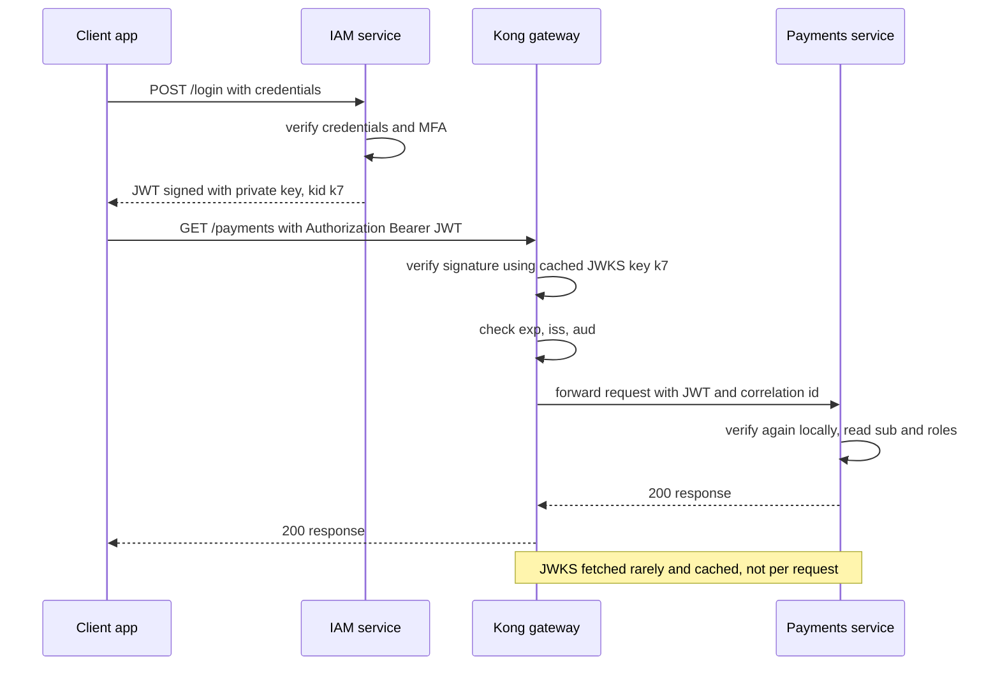

# How JWT Works

A **JSON Web Token (JWT**, RFC 7519**)** is a compact, URL-safe way to transmit signed claims between parties. It exists to answer one question without a database lookup: *"is this statement about the user genuine and unmodified?"* A JWT is three base64url-encoded segments joined by dots — a header, a payload of claims, and a cryptographic signature over the first two. Anyone can *read* a JWT; only the holder of the signing key can *mint* one that verifies. That asymmetry between reading and forging is the entire design.

## The problem that created it

Picture the system from [[Sessions vs Tokens]] growing up. One monolith with a session table becomes thirty microservices behind a gateway. Now every service needs to know who the caller is on every request. The session answer — call a central store — means thirty services hammering one Redis, an extra network hop per request per service, and an auth outage becoming a total outage. Service-to-service calls make it worse: when service A calls B which calls C, must each hop re-consult the store?

What the fleet actually needs is a credential that any service can verify *locally*, that carries the identity *inside itself*, and that can't be tampered with in transit. Signed claims are the cryptographic answer: the issuer signs "this is user 42, valid until 12:05," and every service holding the verification key checks the signature with pure CPU. JWT standardized the envelope for exactly this (RFC 7519, 2015), which is why it became the lingua franca of microservice and OAuth deployments — your IAM service issues one, and Kong plus every Spring Boot pod can verify it independently.

## What it solves

- **Stateless verification** — identity checked locally from the token itself; no shared session store, no per-request call to the issuer.
- **Tamper evidence** — modify one character of the payload and the signature check fails.
- **Cross-service identity propagation** — A→B→C calls forward the same token; each hop verifies independently.
- **Interoperability** — a standard format with libraries everywhere; OIDC's `id_token` ([[OAuth 2 and OpenID Connect]]) is a JWT by specification.

## How it works

### Structure: header.payload.signature

A real (HS256, secret `your-256-bit-secret`) token:

```
eyJhbGciOiJIUzI1NiIsInR5cCI6IkpXVCJ9.
eyJpc3MiOiJodHRwczovL2lhbS5leGFtcGxlLmNvbSIsInN1YiI6InVzZXItNDIiLCJhdWQiOiJwYXltZW50cy1hcGkiLCJleHAiOjE3NTk5MDY4MDAsImlhdCI6MTc1OTkwNTkwMCwianRpIjoiYTFiMmMzIn0.
vTogCu8XZllAjCz9l1DfdR2WFTi4PtJu9AeEcTwvXaE
```

Decoding the first two segments (plain base64url, no key needed):

```json
// header — how it was signed
{ "alg": "HS256", "typ": "JWT" }

// payload — the claims
{
  "iss": "https://iam.example.com",
  "sub": "user-42",
  "aud": "payments-api",
  "exp": 1759906800,
  "iat": 1759905900,
  "jti": "a1b2c3"
}
```

The third segment is `HMAC-SHA256(base64url(header) + "." + base64url(payload), secret)` — a signature over the exact bytes of the first two segments.

**base64url is encoding, not encryption.** Anyone who sees the token — browser dev tools, proxy logs, jwt.io — reads the full payload with zero keys. The signature guarantees *integrity* (it wasn't modified) and *authenticity* (the key-holder minted it), never *confidentiality*. Secrets never go in a JWT payload ([[JWT Pitfalls]]). (Encrypted tokens exist — JWE — but the signed-only JWS form described here is what almost everyone, including your IAM, means by "JWT.")

### Signing: HS256 vs RS256/ES256

| | HS256 (HMAC) | RS256 / ES256 (RSA / ECDSA) |
|---|---|---|
| Keys | One shared secret signs *and* verifies | Private key signs; public key verifies |
| Who can mint tokens | Every party that can verify | Only the issuer |
| Key distribution | Secret to every verifying service | Public key published freely (JWKS) |
| Blast radius of a verifier compromise | Attacker can forge tokens | Attacker can only verify |
| Speed / size | Fastest by far (~1 µs), 32-byte tag | RSA-2048: slow to sign, fast to verify, 256-byte signature; ES256: fast to sign, slower to verify than RSA, 64-byte signature — both tens of µs per verify, still negligible per request |

**Why asymmetric wins for microservices**: with HS256, *verifying* and *forging* are the same capability — so thirty services verifying tokens means thirty copies of a secret that can mint arbitrary identities, and your security equals your sloppiest service. With RS256/ES256, the private key lives only inside the IAM service (ideally an HSM — [[Designing an IAM Service]]); services fetch the **public** key from a **JWKS** (JSON Web Key Set, RFC 7517) endpoint like `https://iam.example.com/.well-known/jwks.json`. The token's header carries a `kid` (key ID) naming which published key signed it, which is also what makes zero-downtime key rotation possible. A leaked verifier compromises nothing but the ability to check signatures. HS256 remains fine when issuer and verifier are the *same* deployment or two tightly coupled services — provided the secret is long and random (a human-memorable string is brute-forceable offline; see [[JWT Pitfalls]]).

### Standard claims (RFC 7519 §4)

| Claim | Name | Meaning |
|---|---|---|
| `iss` | issuer | Who minted it — verify it's *your* IAM, not any token-shaped object |
| `sub` | subject | Who it's about — the stable user/principal ID (your oneAppUserId) |
| `aud` | audience | Who it's *for* — stops a token for service A being replayed at service B |
| `exp` | expiration | Unix seconds after which it must be rejected |
| `iat` | issued at | When minted — enables max-age policies |
| `nbf` | not before | Reject before this time (rarely used) |
| `jti` | JWT ID | Unique per token — the hook for denylists and replay detection |

Everything else is a custom claim (roles, tenant ID, scopes). Custom claims are where most design mistakes live — [[JWT Pitfalls]].

### Validation checklist — in order

Order matters: cheap structural checks first, and the algorithm decision must never come from attacker-controlled input.

1. **Parse structure** — exactly three segments, valid base64url, header is JSON.
2. **Check `alg` against your allowlist** — *you* decide the expected algorithm per issuer; never execute whatever the header requests (`alg: none` and HS/RS confusion attacks live here — [[JWT Pitfalls]]).
3. **Resolve the key** — by `kid` from your cached JWKS (asymmetric) or configured secret (HS256).
4. **Verify the signature** over `header.payload` bytes. Fail → reject; nothing in the payload can be trusted before this line.
5. **Verify `exp`** (and `nbf` if present) with bounded leeway.
6. **Verify `iss`** equals the expected issuer exactly.
7. **Verify `aud`** contains this service's identifier.
8. Then application checks — scopes, roles, `jti` denylist if you run one.

A mature library (jjwt or Spring Security's resource-server support in your world) does 1–7 — but only against the expectations you configure. Leave `aud` unconfigured and step 7 silently never happens.

### Clock skew leeway

`exp` compares the token's timestamp with the *verifier's* clock, and fleet clocks drift. A token minted to expire at 12:00:00 may be rejected at 11:59:58 by a fast verifier or accepted at 12:00:02 by a slow one. Standard practice is a small fixed **leeway** (30–60 seconds; Spring Security defaults to 60) applied when checking `exp`/`nbf`. Keep it small relative to token lifetime — a 5-minute leeway on a 15-minute token quietly extends every token by a third — and run NTP so the leeway covers drift, not broken clocks.

### Issue → use → verify



The IAM service is on the request path only at *login* and at key fetch — that absence from the per-request path is the scalability argument, and also the revocation problem ([[JWT Pitfalls]]).

## Trade-offs

| You gain | You pay |
|---|---|
| Local, store-free verification at every hop | No revocation before `exp` without extra machinery |
| Horizontal scale with no shared auth state | Claims are frozen at issuance — role changes lag until re-issue |
| Standard format, mature libraries | Big misuse surface: the pitfalls list is long |
| Public-key trust model via JWKS | Key management becomes real operational work ([[Designing an IAM Service]]) |
| Claims readable for debugging | Claims readable by everyone — payload is not private |

Token size is a genuine cost: a JWT with many claims rides in a header on *every* request, and headers have limits — see [[JWT Pitfalls]] on bloat.

## Failure modes

- **JWKS endpoint unreachable with cold caches** — verifiers that can't resolve `kid` reject everything; an IAM outage becomes fleet-wide 401s. Mitigation: cache keys with long TTLs, serve stale on fetch failure ([[Designing an IAM Service]]).
- **Key rotated, old key dropped too early** — in-flight tokens signed with the old `kid` fail across the fleet. Correct rotation publishes old + new keys overlapping for at least one access-token lifetime.
- **Clock drift beyond leeway** — one bad node's clock makes it reject (or over-accept) tokens others handle fine; symptoms look random because they're per-node. Monitor NTP sync.
- **Validation disparity** — one service forgets `aud`, another configures a different leeway; the same token is valid *here* and invalid *there*. Centralize validation config (shared library or gateway policy).

## When NOT to use it

- **As a browser session mechanism for a plain server-rendered app** — a cookie session is simpler and natively revocable ([[Sessions vs Tokens]]).
- **When claims must be fresh-per-request** (balance checks, instantly-revocable permissions) — a signed snapshot is the wrong tool; look up at request time ([[RBAC vs ABAC]]).
- **As a data container** — if the payload keeps growing, you're shipping a user profile in a header; carry `sub` and fetch the rest.
- **For secrets** — the payload is public to anyone holding the token.

## In your stack

- Your IAM issues JWTs that Kong and each Spring Boot service verify independently — the exact issue→use→verify picture above. Find your fleet's `alg` and whether verification keys come from a JWKS URL or a baked-in secret; that answer determines your key-compromise blast radius.
- `sub` in your tokens is the oneAppUserId — a system identifier your logging convention explicitly keeps in operational logs (it isn't PII), which is what lets you trace a user's request chain next to `x-correlation-id` ([[Distributed Tracing]]).
- Spring Security's `spring-boot-starter-oauth2-resource-server` with `jwk-set-uri` is the idiomatic Java verifier: it fetches and caches JWKS, honors `kid`, and runs checklist steps 1–7 against configured `iss`/`aud`.
- Kong validating at the edge ([[API Gateway]]) plus services re-verifying internally is defense in depth — the gateway rejects garbage early; services don't blindly trust anything that made it past the gate. The trade-off discussion lives in [[Designing an IAM Service]].

## Interview angle

- Interviewers probe three things: can you decode the structure from memory, do you know *why* RS256 beats HS256 across many services, and do you know validation order (especially that `alg` comes from your config, not the token).
- **60-second version**: "A JWT is base64url header, payload, signature. The payload is readable by anyone — encoding, not encryption; the signature makes it unforgeable. HS256 uses one shared secret, so every verifier can also mint — fine for one service, dangerous for thirty. RS256/ES256 keep the private key in the issuer and let services verify via a public JWKS endpoint, with `kid` enabling rotation. Verification: structure, algorithm allowlist, resolve key, signature, then exp/iss/aud with small clock leeway. The catch: you can't revoke a signed token, so keep lifetimes short and pair with refresh tokens."
- Classic follow-ups: "How do you log a user out?" (→ [[JWT Pitfalls]]); "How do you rotate signing keys with zero downtime?" (overlapping JWKS keys + `kid`); "Where does the private key live?" (→ [[Designing an IAM Service]]); "Why does `aud` exist?" (cross-service replay).

## Check yourself

> [!question]- Q: Explain to a junior engineer why anyone can read a JWT but nobody can forge one.
> The three segments are base64url — a reversible text encoding anyone can decode, so the payload is public. The third segment is a signature computed over the exact bytes of the first two using a key only the issuer controls. Changing any payload byte changes what the signature should be, and without the key you can't compute the new value — so tampering is detectable and minting is impossible. Integrity and authenticity, deliberately without confidentiality.

> [!question]- Q: Your company uses HS256 with the secret in every one of 30 services. What exactly is the risk, and what's the migration?
> Any of the 30 services (or one leaked config/repo/log) can *mint* tokens for any user with any claims — verification capability equals forging capability under HMAC. Compromise of your least-hardened service is compromise of identity fleet-wide. Migration: IAM generates an RSA or EC keypair (private key in HSM/KMS), publishes the public key at a JWKS endpoint, signs new tokens RS256/ES256 with a `kid`; services switch to JWKS-based verification and accept both algorithms for one token lifetime, then HS256 is removed from every allowlist.

> [!question]- Q: What happens if the IAM rotates its signing key and immediately deletes the old key from the JWKS?
> Every access token signed with the old key — all of them, fleet-wide, up to one full token lifetime's worth — fails verification: the `kid` in their headers no longer resolves. Users are mass-logged-out and services return 401 storms until re-login. Correct rotation is additive: publish the new key alongside the old, start signing with the new `kid`, and remove the old key only after the longest in-flight token lifetime (plus verifier cache TTL) has elapsed.

> [!question]- Q: Mini design prompt — a token is rejected with "expired" on exactly one pod out of six, intermittently. Diagnose.
> Same token, different verdicts per pod means per-node state, and for `exp` that's the clock. One pod's clock has drifted ahead beyond the configured leeway (or that pod has leeway configured differently). Check NTP sync status on the node, compare times across pods, and confirm validation config (leeway, library version) is identical. Fix the clock and alert on drift; don't widen the leeway to paper over it, since that extends effective token lifetime for everyone.

## Sources

- RFC 7519 — *JSON Web Token (JWT)*: structure and registered claims.
- RFC 7515 (JWS) and RFC 7517 (JWK/JWKS) — signature mechanics and key-set publication.
- RFC 8725 — *JWT Best Current Practices*: the official validation and algorithm guidance.
- jwt.io (Auth0) — interactive decoder for building structure intuition.
- OWASP JSON Web Token Cheat Sheet for Java — validation guidance in the reader's language.
