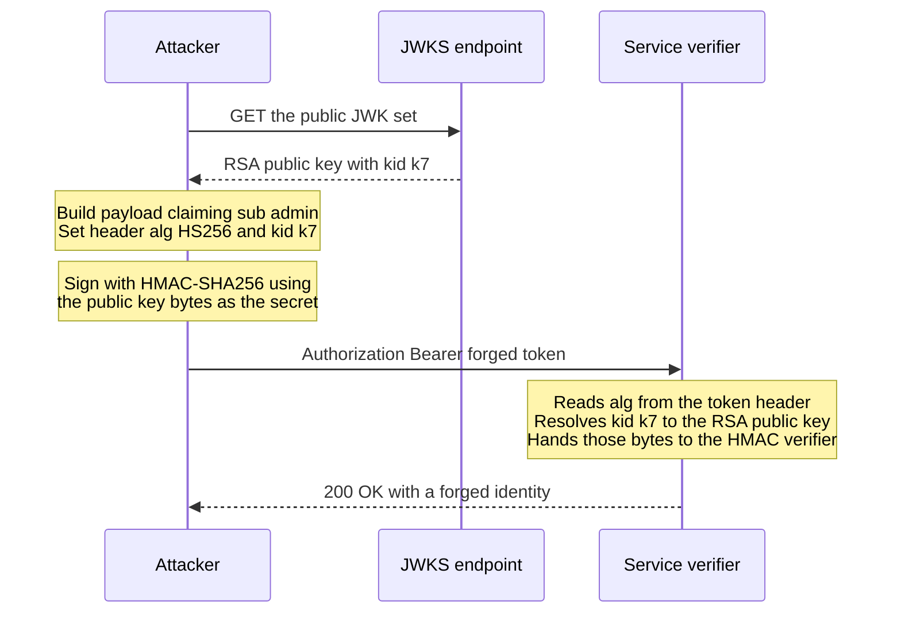

# JWT Pitfalls

JWT is a sound specification with a terrible accident history. Almost every famous JWT breach came not from broken cryptography but from a verifier trusting something it shouldn't (the token's own `alg` header), a secret too weak to resist offline guessing, or a validation step silently skipped. This note catalogs the failure modes you must design against — each one is cheap to prevent at design time and expensive to discover in an incident. Read [[How JWT Works]] first; this note assumes the structure and validation checklist from there.

## Why this matters

- These are not exotic attacks: `alg=none` bypasses and algorithm-confusion forgeries have hit real libraries and real companies, and weak-secret cracking is a stock tool (hashcat mode 16500) any attacker runs first.
- Half the list isn't attacks at all but *architecture debt* — the logout problem, stale roles, header bloat — which hurts precisely the systems that adopted JWTs most enthusiastically.
- For a fintech, a forged token is a forged identity in front of money movement. An auditor's first questions — "how do you revoke?", "what's your token lifetime?" — are answered well or badly by decisions in this note.

## The pitfalls

### 1. `alg=none` — the signature that isn't

RFC 7518 defines `none` as a valid algorithm meaning *unsecured* JWT — header, payload, and an **empty signature**. Early libraries honored whatever `alg` the header declared, so an attacker could take any token, change the payload, set `"alg": "none"`, strip the signature — and verifiers accepted it as valid. This is CVE-level history in multiple libraries (the 2015 Auth0/Tim McLean disclosures made it famous).

**Rule: the verifier decides the algorithm, never the token.** Configure an explicit allowlist (e.g. "RS256 only") and reject anything else before signature checking. Modern libraries — Nimbus, the one under Spring Security's resource server, and jjwt — require you to specify the expected algorithm or key type; the bug resurfaces in hand-rolled verifiers and misused low-level APIs.

### 2. Algorithm confusion — HS256 vs RS256

A subtler relative. A verifier knows the issuer's RSA **public** key — public by design. The attacker crafts a token with `"alg": "HS256"` and signs it with HMAC *using the public key's bytes as the HMAC secret*. A confused verifier that calls a generic `verify(token, key)` sees HS256, treats the supplied RSA public key as an HMAC secret, and the forged signature matches. The attacker has minted valid tokens from public information.

Why it is exploitable at all comes down to one design seam: HMAC takes an arbitrary byte string as its key, so *any* bytes are a syntactically valid HMAC secret — including a PEM-encoded public key. An RSA verifier would reject the same bytes as the wrong kind of object; an HMAC verifier cannot tell that it was handed the wrong kind of object, because to HMAC there is no wrong kind.

Note what the attacker never needed: a private key, a leaked secret, or any access to your systems. Everything in that diagram above the forged request is published on purpose. Same rule as pitfall 1 — pin the algorithm — plus use typed APIs that bind a key to its algorithm family so an RSA key cannot be silently reinterpreted as an HMAC secret.

### 3. Weak HS256 secrets

HMAC verification is fast, which means *offline brute force is fast*: an attacker with any one valid token can try secrets at GPU speed (hundreds of millions of HMAC-SHA256 guesses per second) with zero requests to your servers, and a hit mints unlimited tokens for any user. Human-chosen secrets — `secret`, the company name, anything in a wordlist — fall in seconds.

An HS256 secret must be ≥256 bits of CSPRNG output, stored in a secrets manager, rotated like a signing key. Better: this pitfall is one more reason asymmetric signing wins for anything multi-service ([[How JWT Works]]).

### 4. Missing `aud` / `iss` checks

Signature validity proves *the issuer minted it* — not that it was minted *for you*. Two replay shapes:

- **Cross-service**: a token legitimately issued for the low-stakes notifications API is presented to the payments API. Both verify against the same IAM keys; without an `aud` check, payments accepts it.
- **Cross-issuer**: a service trusting multiple issuers (common after mergers or with third-party IdPs) accepts a token from staging IAM in production because nobody compared `iss`.

Every verifier must check `iss` equals its expected issuer and `aud` contains its own identifier. Libraries only enforce these if configured — an unset expected-audience usually means the check silently doesn't run. In Spring Security the default validates `exp` and (if set) `iss`, not `aud`; audience needs explicit configuration — the `spring.security.oauth2.resourceserver.jwt.audiences` property in current Spring Boot, or an audience validator added via `JwtValidators`.

### 5. Long-lived access tokens

Every revocation and staleness problem scales linearly with lifetime. A 24-hour access token means: a stolen token works for up to 24 hours, a fired employee keeps access for up to 24 hours, a role downgrade takes effect tomorrow. Teams choose long lifetimes to avoid re-login friction — the correct mechanism for that is a **refresh token**, which restores short access-token lifetimes (minutes) while sessions stay long ([[Refresh Tokens and Token Rotation]]). An access-token TTL over ~1 hour is a design smell; 5–15 minutes is the common production range.

### 6. PII and mutable authorization data in the payload

Two distinct mistakes with one root cause — forgetting the payload is **readable by everyone and frozen until expiry**:

- **PII**: email, phone, name, account numbers in claims are visible to any party that handles the token and land in every log that captures headers. For an RBI/GDPR-regulated system, that's uncontrolled PII replication. Carry `sub` (an opaque system identifier); let services fetch profile data when needed.
- **Mutable authorization data**: roles/permissions in the token are a *snapshot at issuance*. Revoke someone's admin role and every already-issued token still says admin until `exp`. With long-lived tokens this is a real privilege-escalation window. Either keep tokens short enough that staleness is acceptable, or check permissions at request time and treat token roles as a hint — the full trade-off is in [[RBAC vs ABAC]].

### 7. The logout/revocation problem

The structural one. Stateless verification means no per-request issuer contact — so the issuer has no lever to pull when a user logs out, a device is reported stolen, or fraud ops flags an account. "Logout" that only deletes the client's copy leaves every stolen copy valid until `exp`.

| Option | Mechanism | Cost |
|---|---|---|
| Short expiry + refresh | Access token lives minutes; real revocation happens by killing the refresh token at next rotation | Damage window = access TTL; needs the full [[Refresh Tokens and Token Rotation|refresh machinery]] |
| `jti` denylist | Revoked token IDs in Redis (TTL = token's remaining life); every verification consults it | A shared-store lookup per request — partially un-does statelessness; denylist store joins the critical path |
| Version/epoch claim | Token carries `ver`; store holds current version per user; bump to invalidate all their tokens | Per-request lookup again, but one tiny counter per *user*, cacheable; coarse (all sessions, not one) |

Production systems converge on **short expiry + refresh as the baseline**, adding a denylist or version check only for genuinely instant-kill requirements (and often only on sensitive routes). Choosing *none* of these is choosing "we cannot terminate access faster than our TTL" — fine only if you can defend that sentence to a regulator.

### 8. Token size bloat

A JWT rides in the `Authorization` header of **every request**. Teams add claims (roles, permissions arrays, feature flags, profile fields) until tokens hit several KB. Costs: bandwidth multiplied by your busiest endpoints; header-size limits in proxies and servers (nginx's default `large_client_header_buffers 4 8k` means 8 KB per *header line*, not 8 KB of headers in total; Node's `--max-http-header-size` defaults to 16 KB for the whole header block; CDNs and ALBs impose their own ceilings) producing errors that never name the token — nginx answers `400`, servers implementing RFC 6585 answer `431`; and every extra claim is more frozen state (pitfall 6). A healthy access token is a few hundred bytes — identity, audience, expiry, scopes. If someone proposes embedding a permissions matrix, the answer is a lookup, not a bigger token.

### 9. Trusting the token's own key locators — `kid`, `jku`, `x5u`

Pitfalls 1 and 2 are about letting the token choose the *algorithm*. This one is about letting it choose the *key*, and it is the more dangerous of the two because it still feels like real cryptography is happening.

JWS (RFC 7515) defines header parameters whose job is to tell a verifier where to find the key: `kid` names one, `jku` gives a URL to a JWK Set, `x5u` a URL to an X.509 certificate. The trap is circular and easy to miss — the verifier must resolve the key *before* it can check the signature, so these fields are acted on while they are still unverified attacker input.

- **`jku` / `x5u`**: a verifier that fetches key material from the URL inside the token can be pointed at the attacker's own server. The attacker generates a keypair, publishes the public half at `https://evil.example/jwks.json`, signs a token of their own design with the private half, and sets `jku` to that URL. The signature check *passes*, honestly and correctly — against the attacker's key. Rule: key material comes only from verifier configuration. Your JWKS URL is a config property, never a token claim. If an integration genuinely requires `jku`, allowlist exact origins and treat anything else as a rejection.
- **`kid`**: an attacker-controlled string that many implementations use as a lookup index. If it is interpolated into a filesystem path, you inherit path traversal — the classic is pointing `kid` at a file whose contents are predictable or empty, then HMAC-signing the token with that same known value, so the verifier derives the attacker's secret from your own disk. If it is interpolated into SQL, you inherit injection that returns a key of the attacker's choosing. Rule: treat `kid` as an opaque index into an in-memory map built from your configured JWKS — a miss is a rejection, never a fetch-whatever-it-says.

The unified rule, and the one sentence worth memorising from this whole note: **nothing in the header selects the algorithm or the key; your configuration does, and the header is only ever a hint you are free to ignore.**

### What this looks like at 3am

03:40, and it is not subtle: 401 rates step up simultaneously across every service behind Kong. The reflex is "the IAM is down" — but the IAM's own dashboards are green. Logins succeed. Tokens are being issued normally. Users who log in *right now* work fine; users who were already logged in get 401s. That split is the diagnostic gift: the problem is not with minting, it is with verifying a specific population of already-minted tokens.

Two commands settle it. Take the token from a failing request, base64url-decode the **header** only — no key needed, it is just encoding — and read the `kid`. Then `curl` the JWKS endpoint and list the `kid`s it actually publishes. The failing tokens say `k7`; the JWKS contains only `k8`.

The root cause is a rotation runbook that did two things in one change: started signing with the new key *and* removed the old one. Correct rotation is additive and overlapped — publish the new key, wait for verifiers to pick it up, start signing with it, and remove the old key only after every token signed with it has expired ([[Designing an IAM Service]] has the full sequence). Note that a verifier which re-fetches the JWK set when it meets an unknown `kid` does not rescue you here: the key is genuinely gone, not merely uncached, so a refetch returns the same incomplete set. That matters diagnostically, because "key removed too early" and "verifier cache is stale" produce an identical symptom from the application's side and are told apart only by what the JWKS currently contains. The incident also has a built-in clock: it decays on its own as the affected tokens expire and clients re-authenticate, which is precisely long enough for someone to "fix" it by restarting services and conclude that restarting services fixed it.

Immediate mitigation is to republish the old key. The durable fix is that key removal becomes a separate, scheduled change from key introduction — never the same deployment.

## Common misconceptions

- **"The JWT is signed, so its contents are safe."** Signed means tamper-evident, not private. The payload is base64url — fully readable by anyone holding the token, including every proxy and log that captures headers ([[How JWT Works]]).
- **"We validate the signature, so we validate the token."** Signature validity is step 4 of 8. Without `exp`, `iss`, and `aud` checks, a genuine-but-wrong token sails through — pitfall 4 is entirely post-signature.
- **"Logout works — we delete the token on the client."** Deleting the client's copy does nothing to other copies. A token is not a session; it cannot be destroyed, only outlived.
- **"Short tokens are annoying, so we'll just extend expiry."** Expiry is the only built-in security boundary a JWT has. The refresh-token pattern exists precisely so that extending *sessions* never requires extending *tokens* ([[Refresh Tokens and Token Rotation]]).
- **"HS256 is fine because the secret is in our private repo."** A private repo is a distribution channel, not a vault — and every service that verifies holds the minting capability. Offline cracking means even a never-leaked-but-weak secret is unsafe.

## The hardening checklist

A compact review list for any JWT deployment — each line traces to a pitfall above:

1. Algorithm pinned per issuer in verifier config; `none` and unexpected families rejected before signature work.
2. Asymmetric signing for multi-service fleets; HS256 secrets (if any remain) are ≥256-bit CSPRNG values in a secrets manager.
3. `iss` and `aud` explicitly configured and enforced in **every** verifier — grep the fleet, don't assume.
4. Access-token TTL 5–15 minutes; anything longer has a written justification.
5. Payload carries `sub`, `aud`, `exp`, `iat`, `jti`, coarse scopes — no PII, no fine-grained permissions, total size a few hundred bytes.
6. A revocation lever exists and is drilled: refresh-token kill at minimum, `jti` denylist or user-version claim where instant kill is required.
7. Clock leeway ≤60 s, NTP monitored.
8. Key rotation rehearsed with overlapping `kid`s, and key *removal* scheduled as a separate change from key *introduction* ([[Designing an IAM Service]]).
9. Key material resolved only from verifier configuration: `jku`/`x5u` ignored or origin-allowlisted, `kid` used as an opaque map lookup that can only hit or miss.

## In your stack

- Ask of your IAM's tokens, in order: what algorithm (and is it pinned per service)? what's the access TTL? is `aud` configured in every Spring Security resource-server config, or only `iss`? Those three answers locate you against pitfalls 1–5.
- Your `sub` = oneAppUserId convention is pitfall 6 done right — an opaque system identifier, deliberately kept in operational logs rather than redacted, with real PII fetched from services that own it.
- Redis is where a `jti` denylist or user-version store would live ([[Redis Beyond Caching]]) — note it re-adds a shared dependency to the per-request path, the thing JWTs were adopted to remove. Scope it to sensitive routes if latency matters.
- Fintech reality: fraud/account-takeover response *will* eventually demand instant kill. Design the revocation lever before the incident, because retrofitting a denylist during one is miserable.
- **1-replica implication for JWKS.** Verifiers cache the key set in process, so a pod restart starts cold. At one replica there is no warm peer to serve traffic while the new pod fetches keys — the first requests after every deploy depend on the IAM's JWKS endpoint being reachable at that exact moment, and a failed fetch during startup turns a routine rollout into a 401 window. Two cheap mitigations: cache with a long TTL and serve-stale on fetch failure, and give the readiness probe something that proves key resolution actually works rather than only that the port is open ([[Health Checks and Service Discovery]]).
- Kong validating at the edge and Spring Boot services re-verifying means the same token is checked twice against two independent configurations — which is defence in depth only if both configurations agree. Pitfall 4 lives in that gap: grep every resource-server config in the fleet for an explicitly set audience before assuming it is enforced anywhere.

## Interview angle

- The stock question is "how do you log out a JWT?" — strong answers name the contradiction (stateless vs revocation) and the three options with costs, rather than pretending one is free.
- Security-minded interviewers probe `alg=none` and confusion attacks to see if you know *the verifier pins the algorithm*; that one sentence is the pass signal.
- **60-second version**: "JWT failures cluster in three groups. Verifier bugs: honoring the token's own alg header — fix by pinning algorithms and checking iss and aud explicitly. Key weaknesses: HS256 secrets crackable offline — fix with 256-bit random secrets or, better, asymmetric signing. Architecture debt: tokens are readable, frozen, and irrevocable until expiry — so no PII, no mutable roles in long-lived tokens, lifetimes in minutes, refresh tokens for continuity, and a jti denylist or version claim if you need instant kill. And keep tokens small; they ride every request."
- Follow-ups: "Walk me through the HS256/RS256 confusion attack." "Your PM wants 30-day tokens so users stay logged in — respond." (refresh tokens) "What's in your token and why?"

## Check yourself

> [!question]- Q: Explain the algorithm-confusion attack and the one-line design rule that kills it (and alg=none).
> A verifier holding an RSA public key receives a token claiming HS256. Generic verify APIs then treat the supplied key material as an HMAC secret — and the attacker, who also knows the public key, HMAC-signed the forged token with exactly those bytes, so it verifies. `alg=none` is the blunter cousin: declare no algorithm, send no signature, hope the library accepts. Both die to the same rule: **the verifier's configuration decides the algorithm; the token's header is attacker input and never gets a vote.**

> [!question]- Q: What happens if your fraud team demands "kill this user's access NOW" and your system is pure stateless JWT with 15-minute tokens and 30-day refresh tokens?
> You can revoke the refresh token immediately (that's server-side state), so the user can't obtain new access tokens. But every outstanding access token remains valid up to 15 more minutes on every service, and nothing short of rotating the fleet-wide signing key (logging out everyone) ends it sooner. If 15 minutes of fraud is unacceptable, you needed a per-request check — `jti` denylist or user-version claim in Redis — built *before* the incident. This is why access TTL is a risk parameter, not a convenience knob.

> [!question]- Q: A token passes signature verification. Name three ways it can still be the wrong token to accept.
> (1) Expired — `exp` in the past (or not yet valid via `nbf`). (2) Wrong audience — legitimately issued for another service and replayed here; caught only by the `aud` check. (3) Wrong issuer — minted by a different trusted-key holder, e.g. staging IAM or another tenant's IdP; caught by `iss`. (Bonus: revoked `jti`, or a stale role snapshot the business already withdrew.) Signature validity means "genuinely minted," never "appropriate here and now."

> [!question]- Q: A service must accept tokens from two issuers — your own IAM and a partner bank's IdP — so it is configured with both JWKS URLs. What new failure mode did you just create, and how do you close it?
> If the verifier resolves `kid` against the *union* of both key sets, the two trust domains have quietly merged. A token minted by the partner IdP for one of its own staff accounts carries a `kid` the service can resolve, so the signature verifies — and unless `iss` and `aud` are checked, the partner's user is now authenticated as a user of your system, with whatever `sub` their IdP chose to put in. Nobody attacked anything; the configuration simply says "any key from either pile is fine." Closing it has two parts. First, bind key sets to issuers rather than pooling them: read `iss`, select *that* issuer's key set, and only then resolve `kid` and verify — so a partner-signed token is never checked against your keys or vice versa. Second, enforce `aud` as well, so even a correctly-issued token for another audience is rejected. The general shape is pitfall 9 again at the configuration level: the token should never widen the set of keys you are willing to trust, and "we added a second `jwk-set-uri`" is exactly that widening if issuer binding is missing.

> [!question]- Q: Mini design prompt — your mobile team complains the 6KB JWT is causing 431 errors through a proxy. The token contains the user's 40-entry permission list, email, and KYC tier. Fix it.
> Strip the token to `sub`, `iss`, `aud`, `exp`, `iat`, `jti`, and coarse scopes — a few hundred bytes. Permissions move to a request-time lookup (cached in Redis, keyed by `sub`, invalidated on role change — [[RBAC vs ABAC]]); email and KYC tier are fetched from their owning services when actually needed (and were PII-in-headers anyway, pitfall 6). Result: smaller and *fresher* authorization data, no proxy limits, less frozen state. The permissions matrix in the token was also stale from the second it was minted.

## Sources

- RFC 8725 — *JSON Web Token Best Current Practices*: the official catalog of these attacks and mitigations.
- Tim McLean, "Critical vulnerabilities in JSON Web Token libraries" (Auth0 blog, 2015) — the original alg=none / key-confusion disclosure.
- OWASP JSON Web Token Cheat Sheet — practical validation and storage guidance.
- RFC 7009 — *OAuth 2.0 Token Revocation*: the standardized revocation endpoint shape.
- PortSwigger Web Security Academy, "JWT attacks" — hands-on labs for alg=none, algorithm confusion, weak-secret cracking, and the `jku`/`kid` header injection techniques in pitfall 9.
- RFC 7515 — *JSON Web Signature*: defines the `kid`, `jku`, and `x5u` header parameters whose misuse pitfall 9 describes.
