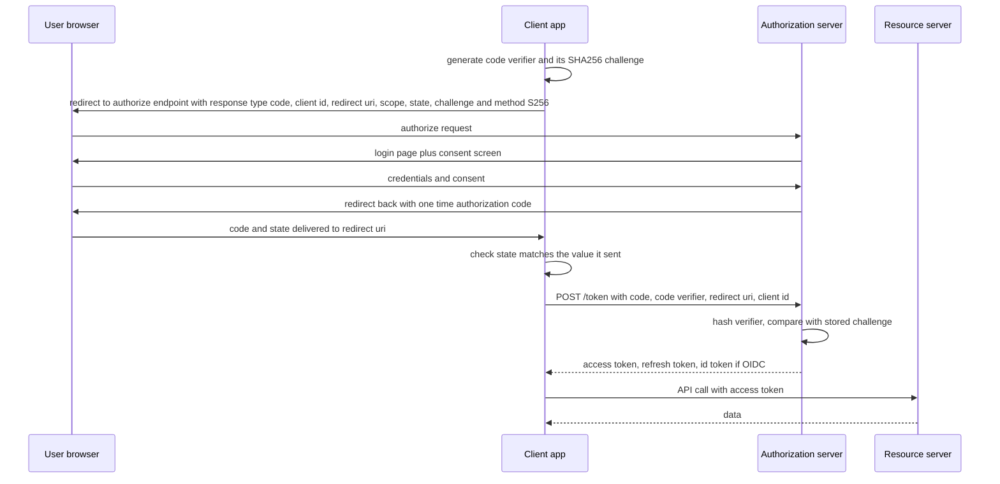

# OAuth 2 and OpenID Connect

**OAuth 2.0** (RFC 6749) answers a question that passwords cannot: *how does a user let application A access their data in service B without giving A their B password?* It is a framework for **delegated authorization** — issuing scoped, revocable credentials to third parties. **OpenID Connect (OIDC)** is a thin layer on top that answers the different question OAuth kept being abused for: *who is this user?* Nearly every "Log in with Google," every modern [[Single Sign-On]] deployment, and most corporate IAM services speak these two protocols, so the vocabulary here — roles, flows, scopes, claims — is the shared language of the whole auth industry.

## The problem that created it

Mid-2000s web: you want a photo-printing site to print your photos stored on another service. The only mechanism was handing the printing site **your actual password** — the "password anti-pattern." That gave it *total* access (read, delete, change password), forever, unrevocable except by changing the password everywhere, and trained users to type credentials into random sites. Google (AuthSub), Yahoo (BBAuth) and Flickr each invented proprietary delegation protocols; OAuth (1.0 as a community spec in 2007, published as RFC 5849 in 2010; then 2.0 as RFC 6749 in 2012) standardized the idea: the user authenticates **only to the service that owns the data**, approves a *scoped* grant, and the third party receives a limited-power, revocable token — never the password.

Then everyone immediately bent it into a login mechanism ("if Google gives this app a token, the app knows the user has a Google account — so, login!"). But OAuth proves *authorization to access resources*, not *identity* — an access token says what you can do, not verifiably who you are, and homegrown "login with OAuth" patterns had real holes (token substitution: an app accepting any valid-looking access token as proof of identity). OIDC (2014) standardized the identity layer properly: a signed **id_token** that *asserts who authenticated, when, and how*.

## What it solves

- **Delegation without credential sharing** — scoped, expiring, revocable third-party access.
- **One credential ceremony** — users authenticate only at the authorization server; apps never handle passwords.
- **Standardized machine identity** — services authenticate to each other with the same token machinery (client credentials).
- **Federated login** (with OIDC) — "sign in with X," enterprise SSO, one IdP serving many apps ([[Single Sign-On]]).

## How it works

### The four roles

| Role | Meaning | Example |
|---|---|---|
| **Resource owner** | The user whose data/consent it is | You |
| **Client** | The application wanting access | Mobile app, SPA, backend service |
| **Authorization server** | Authenticates the owner, issues tokens | Your IAM, Google, Okta |
| **Resource server** | Holds the data; accepts access tokens | Your payments API |

In your company's setup the IAM service is the authorization server and every Spring Boot service is a resource server — even though client and resource server are all first-party, the roles and flows are the same.

### Authorization code flow + PKCE — THE flow

One flow matters for anything involving a human: **authorization code with PKCE**. Everything else for users is historical or niche. The design constraint it solves: tokens must reach the client *without* transiting the browser's URL bar, history, or referrer headers, and the redirect back to the app must be bindable to the party that started the flow.

**PKCE** (Proof Key for Code Exchange, RFC 7636, "pixy") exists because the authorization *code* travels through the browser redirect and can be intercepted (malicious apps registering the same redirect URI on mobile, leaky logs). The client invents a one-time secret per flow — a random `code_verifier` — and sends only its SHA-256 hash (`code_challenge`) when starting. To redeem the code it must present the original verifier; an attacker who stole the code can't, because the hash doesn't reverse. Originally designed for mobile apps that can't hold a static secret, PKCE is now recommended for *all* clients (RFC 9700) and **required** in the OAuth 2.1 draft.

The code is single-use and short-lived (minutes); tokens travel only in the response to the direct token-endpoint POST, never through a redirect URL — for a SPA that POST is a `fetch` from the page, so tokens do reach browser memory, just not the URL bar, history, or referrers. From here, token lifecycle is [[Refresh Tokens and Token Rotation]].

### Why implicit died

The **implicit flow** skipped the code exchange: tokens came back *in the URL fragment* of the redirect, because cross-origin requests from JavaScript (CORS) were not yet reliably supported across 2012-era browsers. That put bearer tokens in browser history, referrer leakage paths, and JS-visible URLs, with no PKCE-style binding and no refresh tokens. CORS removed the only reason it existed; RFC 9700 says don't use it, and the OAuth 2.1 draft deletes it outright (along with the password grant, which had apps collecting passwords again — the exact anti-pattern OAuth was built to end). SPAs use authorization code + PKCE like everything else.

### Client credentials — machines

When no user exists — service A calling service B, a nightly job — the client *is* the resource owner. It authenticates to the token endpoint directly with its own credentials (secret or, better, mTLS/private-key JWT) and receives a scoped access token. No redirects, no consent, no refresh token (just ask again). This is the standard shape for service-to-service auth in microservice fleets ([[Communication Patterns Between Services]]), often with the gateway or mesh handling it invisibly.

### Device flow — one line

For input-constrained devices (TVs, CLIs): the device shows a short code, the user approves it on their phone at a URL, the device polls the token endpoint (RFC 8628).

### OAuth = authorization; OIDC adds identity

OIDC is OAuth 2.0 plus:

- **`id_token`** — a signed JWT ([[How JWT Works]]) asserting *authentication facts*: `iss`, `sub` (stable user ID at this issuer), `aud` (the client), `iat`/`exp`, `auth_time`, `nonce` (binds token to the client's session, blocking replay/substitution), `amr` (how they authenticated — password, MFA). It is consumed by the **client** and proves *who logged in* — it is **not** an API credential; sending an id_token to a resource server is a category error.
- **`/userinfo` endpoint** — returns profile claims for the access token's user.
- **Discovery** — `/.well-known/openid-configuration` publishes all endpoints and the JWKS URI, so integrating with any OIDC provider is configuration, not code.
- Standard scopes: `openid` (triggers OIDC), `profile`, `email`.

Rule of thumb: **access token = what you may do** (resource servers read it); **id_token = who you are** (the client reads it).

### Scopes vs claims

- **Scopes** are *requested permissions* on the access token — coarse strings like `payments:read` negotiated at authorization time. The resource server enforces them: scope present → operation allowed to be attempted.
- **Claims** are *facts* inside a token — `sub`, `email`, `roles`, `tenant`. Scopes gate what an app may ask; claims state what is true. Fine-grained per-resource decisions ("can this user modify *this* account?") belong to the authorization layer ([[RBAC vs ABAC]]), not to scopes — scope explosion (`account:123:write`) is an anti-pattern.

## Trade-offs

| You gain | You pay |
|---|---|
| No password sharing; scoped revocable access | Serious protocol complexity — redirects, state, nonce, PKCE all must be right |
| One standard for user, SPA, mobile, machine auth | Many deprecated flows still documented — easy to implement 2012 advice |
| OIDC: federated login as configuration | The authorization server becomes critical infrastructure ([[Designing an IAM Service]]) |
| Consent and audit points built into the ceremony | Redirect-based UX; webviews and embedded browsers cause pain |

## Failure modes

- **Open redirect / loose redirect-URI matching** — tokens or codes delivered to attacker URLs. Redirect URIs must be exact-match registered.
- **Missing `state`/`nonce` checks** — CSRF on the callback (attacker's code bound into victim's session) and id_token replay. Libraries handle this; hand-rolled callbacks forget it.
- **Authorization server outage** — no new logins or refreshes fleet-wide; existing access tokens ride it out ([[Designing an IAM Service]] covers the availability math).
- **Clock skew and JWKS staleness** — id_token validation inherits every JWT failure mode ([[How JWT Works]]).

## When NOT to use it

- **First-party, single-app, server-rendered product with no third parties and no SSO ambitions** — a session cookie is less machinery ([[Sessions vs Tokens]]). Adopt OAuth when the *delegation or federation* problem actually appears.
- **Internal service-to-service where a mesh already provides mTLS identity** ([[Service Mesh]]) — adding client-credentials tokens on top may duplicate what SPIFFE-style certs give you; pick one primary machine-identity mechanism.
- **Don't use implicit or password grants ever** — not "not recommended"; removed in OAuth 2.1.

## In your stack

- Your central IAM is an authorization server issuing JWT access tokens; Kong and the services are resource servers. Whether your mobile app does textbook auth-code+PKCE or a first-party credentials API is worth checking — many Indian fintechs run custom login UX against the same token machinery underneath.
- Spring Security speaks all of this natively: `oauth2-resource-server` for validating access tokens (JWKS discovery included), `oauth2-client` for calling other services via client credentials.
- Service-to-service calls through Kong can use client-credentials tokens with per-service `aud`/scopes — which is what gives your fleet a story for "which *service* is calling," distinct from mTLS at the transport layer ([[API Security Essentials]]).
- A future "partner API" (account aggregators, embedded-finance B2B) is textbook OAuth: scoped third-party access, consent screens, revocation per partner. In India this converges with RBI's Account Aggregator framework, which is itself consent-token based.

## Interview angle

- Interviewers test for exactly three things: the four roles, auth-code+PKCE as the one user flow (and *why* the code exchange plus PKCE exist), and the OAuth-vs-OIDC boundary. "OAuth is authorization, OIDC adds the signed identity assertion" is the sentence to land.
- **60-second version**: "OAuth lets a user grant an app scoped access to their stuff without sharing passwords — four roles: resource owner, client, authorization server, resource server. The one flow for humans is authorization code with PKCE: browser redirect to the auth server for login and consent, short-lived code comes back, client swaps code plus PKCE verifier for tokens on a back channel — so tokens never ride URLs. Implicit died because it put tokens in URLs; passwords grant died because it recreated password sharing. Machines use client credentials. OIDC layers identity on top: a signed id_token telling the client who authenticated, a userinfo endpoint, and discovery metadata. Scopes bound what the app may ask; claims state facts about the subject."
- Follow-ups: "Why can't the SPA just skip the code and get tokens directly?" "What does PKCE stop that `state` doesn't?" (code interception vs CSRF — different attacks) "Why is sending an id_token to an API wrong?"

## Check yourself

> [!question]- Q: Explain why the authorization code comes back through the browser but tokens don't — what attack class does this structure remove?
> Everything through browser redirects lands in URL bars, browser history, proxy logs, and referrer headers — unacceptable places for a bearer credential. The flow therefore sends only a single-use, minutes-lived *code* through the front channel, and the client exchanges it on a direct TLS back-channel POST, authenticated with its secret or PKCE verifier. Even a leaked code is useless without the verifier (PKCE binds code to flow-initiator). The implicit flow's fatal flaw was ignoring exactly this: tokens in the fragment inherit every URL leak path with no second factor to redeem.

> [!question]- Q: A teammate says "we use OAuth for login." What's technically imprecise, and when does that imprecision bite?
> OAuth issues access tokens proving *authorization to call APIs*, not identity assertions. "Login with OAuth" means inferring identity from token possession — which breaks under token substitution: an app that accepts any valid access token as login proof can be fed a token the attacker legitimately obtained for their *own* malicious app, asserting the victim's resources. OIDC's id_token fixes it: signed, audience-bound to *this client*, nonce-bound to *this session* — an actual authentication statement. The imprecision bites exactly when someone builds login from raw OAuth and skips those bindings.

> [!question]- Q: What happens if a mobile OS lets a malicious app register the same custom-URL redirect scheme as your banking app — with and without PKCE?
> Without PKCE: the malicious app can receive the redirect carrying the authorization code and (for a public client with no secret) redeem it at the token endpoint — full account access. With PKCE: it receives the code but not the `code_verifier`, which exists only in the legitimate app's memory; the token endpoint hashes the presented verifier against the stored challenge and refuses. This interception scenario is precisely why PKCE was created for mobile and is now mandatory for public clients in OAuth 2.1.

> [!question]- Q: Mini design prompt — your fleet needs service A to call service B with provable identity and least privilege. Sketch it with OAuth machinery.
> Client credentials: A holds its own credential (prefer private-key JWT or mTLS over a static secret) and requests a token from the IAM with `aud` = B and a minimal scope like `b:ledger:read`. B validates signature, `iss`, `aud`, scope — locally, via JWKS ([[How JWT Works]]). Tokens live minutes and are cached by A until near expiry; no refresh tokens. Rotation of A's credential goes through the secrets manager ([[API Security Essentials]]). Now B's logs show *which service* called with *which authority* — and revoking A is one IAM-side change, not a redeploy of B.

## Sources

- RFC 6749 — *The OAuth 2.0 Authorization Framework*; RFC 6750 — bearer token usage.
- RFC 7636 — *PKCE*; RFC 8628 — device authorization grant.
- RFC 9700 — *Best Current Practice for OAuth 2.0 Security*; OAuth 2.1 draft (draft-ietf-oauth-v2-1) — the consolidated modern ruleset.
- OpenID Connect Core 1.0 (openid.net) — id_token, userinfo; OpenID Connect Discovery 1.0 — `/.well-known/openid-configuration`.
- oauth.net and Aaron Parecki's *OAuth 2.0 Simplified* — the most readable flow-by-flow walkthroughs.
