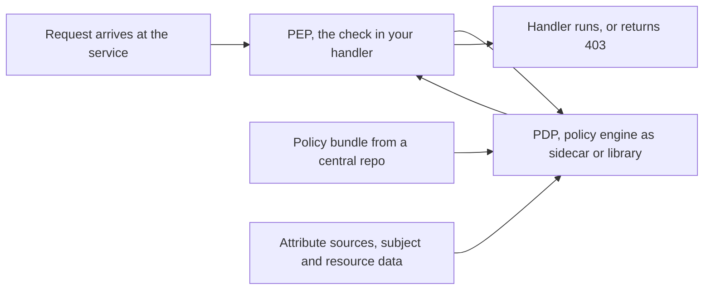

# RBAC vs ABAC

Authentication tells you *who* is calling; authorization decides *what they may do* — and it is where most real-world access-control pain lives, because permissions change constantly while identity barely changes at all. **RBAC** (role-based access control) groups permissions into named roles and assigns roles to users; **ABAC** (attribute-based access control) evaluates policies over attributes of the user, the resource, and the context. RBAC is what almost everyone starts with and audits easily; ABAC is what systems grow toward when "role" stops being able to express the rules. Most mature systems run a hybrid.

## Why this matters

- Every endpoint you write makes an authorization decision, explicitly or (dangerously) implicitly. Knowing the models tells you where that decision should live and what it should read.
- The models fail differently: RBAC fails by **role explosion** (thousands of near-duplicate roles nobody understands); ABAC fails by **unauditability** ("who can access X?" becomes a computation over all possible attribute combinations, not a table lookup).
- For a fintech, authorization *is* the control framework regulators examine — segregation of duties, maker-checker, least privilege. These are authorization-model questions wearing compliance clothes.

## How it works

### RBAC — permissions grouped into roles

Three tables, conceptually: **users → roles → permissions**. `kunal` has role `ops-analyst`; `ops-analyst` carries `txn:read`, `ticket:write`. Code checks permissions (or roles — checking *permissions* is the better discipline, since roles can then be recomposed without code changes).

Strengths: matches how organizations think ("she's in ops"); onboarding/offboarding is role assignment; and the killer feature, **auditability** — "who can approve refunds?" is a table query, and an access review is reading role definitions. Weakness: roles are static *sets*, so every needed variation mints a new role — `ops-analyst`, `ops-analyst-senior`, `ops-analyst-south-region`, `ops-analyst-readonly-contractor`… Enterprises genuinely reach thousands of roles (role explosion), at which point nobody can review them and the audit advantage quietly dies. RBAC also cannot natively express *relationships to the specific resource*: "agents may view transactions **of their assigned customers**" isn't a role; bolting it on as per-customer roles is the explosion in its purest form.

The arithmetic of role explosion is worth doing once, because it is multiplicative and people reliably estimate it as additive. Suppose back-office access varies along four dimensions: 4 regions, 3 seniority levels, 2 access levels (read-only and read-write), and 5 product lines. Every combination that a real person occupies needs its own role, so the ceiling is 4 × 3 × 2 × 5 = **120 roles** — already past the point where an access review is a careful reading and into the territory where it is a scroll and a signature. Now the compliance team asks for a channel distinction with 6 values, which sounds like a small request because it is one dimension. It multiplies: 120 × 6 = **720 roles**. Nothing was designed badly; the model is simply a Cartesian product, and products grow the way products grow. That is the moment the role names themselves start telling you the truth — when a role is called `ops-analyst-south-readonly-cards`, three of those four words are *attributes* that have been encoded into an identifier because the model had nowhere else to put them.

### ABAC — policies over attributes

Decisions evaluate rules over four attribute families: **subject** (department, clearance, KYC-verified), **resource** (owner, amount, classification, region), **action**, and **environment** (time, IP, device trust, MFA freshness). A policy reads like:

> Permit `transaction:approve` IF subject.role == "ops-analyst" AND resource.amount < 100000 AND resource.region == subject.region AND environment.mfa_age < 15min.

That one rule replaces dozens of region/limit role variants, and it can express ownership ("resource.owner == subject.id") and context (business hours, trusted device) that RBAC simply can't. The costs: policies are code — they need testing, review, versioning; the decision depends on *fetching current attributes* (latency, availability of attribute sources); and audit inverts — "who can approve this transaction?" requires evaluating the policy against every user's attributes rather than reading a table. **ReBAC** (relationship-based, Google Zanzibar-style: permissions as graph relations like `viewer of doc:123`) is the third model worth naming in interviews — Zanzibar backs sharing permissions across Google Drive, Photos, YouTube and other Google services, and the open reimplementations are SpiceDB and OpenFGA.

### Which shape is your rule? RBAC, ABAC, ReBAC

The three models are not a maturity ladder you climb; they are three different sentence structures, and the right question is which one your actual rule is written in. Say the rule out loud and listen to where the information lives:

| | RBAC | ABAC | ReBAC |
|---|---|---|---|
| The rule sounds like | "Ops analysts may approve refunds" | "Approvers may approve refunds under ₹1 lakh in their own region with fresh MFA" | "An agent may view a customer they are assigned to" |
| Decision input | a set membership | a predicate over subject, resource, action, environment attributes | the existence of a path in a relationship graph |
| What you store | user→role→permission tables | attributes on subjects and resources, plus policy source | relationship tuples such as agent is assigned-to customer |
| "Who can do X?" | table read | evaluate the policy across the attribute space | reverse graph traversal, which the system is built to answer |
| "What can user U do?" | table read | evaluate across all resources | forward graph traversal |
| Scales badly when | dimensions multiply, producing role explosion | policies interact in untested combinations | the graph is deep and must be consistent across regions |
| Canonical implementation | your database, or an IdP's group model | OPA/Rego, XACML, hand-written service checks | Zanzibar, SpiceDB, OpenFGA |

The practical reading: a rule whose variables are *values* — amounts, regions, times, device trust — is ABAC-shaped. A rule whose variable is a *link between two entities* — assigned to, owns, is a member of, shared with — is ReBAC-shaped, and trying to express it as attributes means carrying a list of IDs around as an attribute, which is the "assignment list in the token" mistake. A rule with no variables at all is RBAC-shaped, and should stay there.

### Policy engines — decision/enforcement separation

The architectural pattern underneath modern authz: separate the **PDP** (policy decision point — evaluates "permit/deny") from the **PEP** (policy enforcement point — the code path that asks and obeys). **OPA** (Open Policy Agent) is the best-known general-purpose PDP: policies written in Rego, deployed as a library or a sidecar so the decision never leaves the host — evaluation itself is microseconds, with a localhost round trip on top in the sidecar shape — and policy bundles distributed centrally. The win is uniformity — one policy language, one audit point for *policy*, decisions near the code ([[Service Mesh]] deployments often pair OPA at the sidecar). The discipline required: attribute data must be available at decision time, and policy changes become deployments with all the rigor that implies.

Read the arrows as the dependency list, because that is what an availability review will ask for. The decision is local, so it does not add a network hop — but it is only as fresh as the bundle that was last distributed and the attributes that were last fetched. Those two inbound arrows are where staleness and outages enter a design that otherwise looks dependency-free, and they are the reason "the PDP is a sidecar, so there is no network call" is a half-truth worth saying out loud in full.

### Where does the check happen — roles in the token vs lookup at request time

The engineering decision you'll actually make, and it's a staleness-vs-latency trade:

| | Roles/permissions embedded in JWT | Lookup at request time |
|---|---|---|
| Latency | zero — claims already parsed | +1 lookup (cacheable to ~0.2–1 ms with Redis) |
| Freshness | stale until token expiry — revoked admin keeps admin ([[JWT Pitfalls]]) | current to within cache TTL |
| Token size | grows with permissions — header bloat | token stays minimal (`sub`, scopes) |
| Availability | none beyond token verification | authz store/cache joins the request path |
| Good for | coarse, slow-changing facts: `tenant`, 2–3 broad roles, scopes | fine-grained permissions, resource-level checks, anything security-sensitive |

The converged pattern: **coarse-grained in the token, fine-grained at request time**. The token carries `sub`, `tenant`, and scopes — enough for the gateway and for cheap filtering. Services resolve actual permissions via a cached lookup (Redis, invalidated on role change) or a local PDP. With 5–15 minute access tokens, even in-token roles are only minutes stale — which is why short TTLs ([[Refresh Tokens and Token Rotation]]) soften this whole debate.

### Fintech angle: maker-checker as authorization workflow

**Maker-checker** (four-eyes): the person who initiates a sensitive operation (maker) cannot be the one who approves it (checker) — standard in banking and expected by RBI-regulated processes for things like payout configuration, limit changes, manual adjustments. Two design observations:

- It is *stateful, relational* authorization: "may approve" depends on the *resource's history* (`approver != initiator`, sometimes `approver.limit >= txn.amount`). Pure RBAC can say who *can be* a checker; it cannot express "not the same human as the maker" — that's an ABAC/ReBAC-shaped rule evaluated against the pending change record.
- Model it as a **workflow with authorization at each transition**, not a single check: `draft → pending_approval → applied`, each transition permission-gated, every transition audit-logged with both identities. The pending-change record is the natural place the `maker_id` lives for the checker-time comparison. This is also a place where per the org's own rules, the decision must be deterministic — an LLM or heuristic may *recommend*, but the permit/deny on money movement is code.

## Trade-offs

| | RBAC | ABAC/policy |
|---|---|---|
| Mental model | org-chart natural | rule-engine, needs discipline |
| "Who can do X?" audit | table read | computation over attribute space |
| Expressiveness | sets only — no ownership, no context | ownership, amounts, time, device, relationships |
| Change management | role edits, instant | policy deploys plus attribute pipelines |
| Failure growth mode | role explosion | policy sprawl and untested rule interactions |
| Decision dependencies | role table (small, cacheable) | every attribute source consulted by policies |

## Common misconceptions

- **"Scopes are our authorization model."** OAuth scopes bound what a *client application* may request on a user's behalf; they are not per-user, per-resource permissions. `payments:read` says the app may attempt payment reads — whether *this user* may read *this payment* is RBAC/ABAC's job ([[OAuth 2 and OpenID Connect]] draws the line).
- **"ABAC replaces RBAC."** In practice ABAC policies almost always *reference roles as one attribute among several* — `subject.role == "ops-analyst" AND resource.region == subject.region`. Mature systems are hybrids: roles for the stable, human-auditable backbone; attributes for the variable dimensions.
- **"Authorization is checked at the gateway, so services don't need to."** The gateway can enforce coarse scopes and tenancy; it cannot know that transaction 992 belongs to customer 47. Resource-level authorization is only checkable where the resource is loaded — inside the service ([[Designing an IAM Service]] makes the same argument for authn).
- **"If the user can't see the button, they can't do the action."** UI hiding is not authorization. Every API endpoint enforces its own checks, because attackers call APIs, not buttons.

## Failure modes

Authorization failures share one nasty property: the successful attack and the correct behaviour produce the same HTTP status, so none of these announce themselves on a latency or error dashboard. Each one below needs a deliberately chosen signal.

- **Role explosion** — thousands of roles, access reviews rubber-stamped, orphaned roles quietly accumulating privilege. *Signal*: three counts, trended monthly — total roles, roles held by nobody, and roles held by exactly one person. The last two are the ones that matter: a role with one holder is usually an attribute wearing a role's clothes, and a role with zero holders is unreviewed privilege waiting for someone to be assigned it. *Confirm*: diff role definitions against the previous review and look for name suffixes encoding regions, limits, or tenure. Mitigated by checking permissions rather than role names in code, plus periodic recertification.
- **Stale in-token roles** — privilege revoked, the token still says yes for up to its TTL; incident reviews phrase this as "access persisted after revocation." *Signal*: in the audit log, join each successful privileged action against the role-change history for that `sub` and alert on any action whose timestamp follows a revocation. This is a query you have to write in advance; nothing emits it for you. *Confirm*: decode the token used, compare its `iat` with the revocation time. Mitigation: short TTLs plus request-time checks on sensitive routes.
- **Attribute-source outage under ABAC** — the PDP cannot fetch subject or resource attributes. *Signal*: depends entirely on which way you fail. Fail-closed is loud and self-announcing — a 403 spike on one route class. Fail-open is silent and produces *fewer* errors than normal, which is why it is the dangerous choice: the only detectable trace is a drop in denial rate, so you must monitor **denials as a metric** and alert when they fall to zero. *Confirm*: the attribute source's own health, plus a canary identity that should always be denied and whose continued denial proves the path is live. Where money moves, fail closed per the org's rule, then engineer the attribute store's availability to match.
- **Policy bug deployed fleet-wide** — one bad Rego change is an instant, uniform authorization incident, in either direction. *Signal*: a step change in the permit/deny ratio at a bundle version boundary; tag every decision with the policy version so the correlation is one group-by rather than an archaeology project. *Confirm*: replay a sample of recent real decisions against both bundle versions and diff the outcomes. Treat policy like code — OPA ships a unit-test framework, so there is no excuse for untested rules — with staged rollout and fast rollback.
- **Missing ownership checks** — the quiet catastrophe: authentication passes, role checks pass, and nobody verified that the resource belongs to the caller. *Signal*: in access logs, requests where the authenticated `sub` does not match the owner of the resource ID in the path. Sequential or guessable IDs make this trivially discoverable by an attacker and trivially detectable by you — one of the few cases where the attacker's probe is loud, because enumeration produces a burst of 200s across resource IDs from one `sub`. *Confirm*: pick an endpoint, call it with another user's resource ID from a test account, and see what comes back; this takes two minutes and is worth doing on every new resource-scoped endpoint. Every access path needs authentication, authorization, *and* ownership — role models do not give you the third for free.

### What this looks like at 3am

Not a page — a finding. 02:50, during a routine quarterly access review, someone notices that an offboarded contractor's `sub` appears in the back-office audit trail at 01:12, four hours after their role was removed at 21:12. No alert fired. Every request they made returned 200, because from the system's point of view every request was legitimate.

The permissions design was the sensible-looking one: permissions cached in Redis keyed by `sub`, invalidated by event — a role change publishes a message, a consumer evicts the key — with a 24-hour TTL as a backstop. Invalidate-on-event is the right instinct; the 24-hour TTL is where the trap was set, because it quietly declares that the event pipeline is never allowed to be late by more than a day.

The pipeline broke at 20:00. A producer release added a field to the role-change event, and the consumer — deployed separately, as consumers are — could not parse the new shape. Every role-change event published after 20:00 therefore failed, retried to its `maxReceiveCount`, and landed in the dead-letter queue ([[Dead Letter Queues and Poison Messages]], [[Event Schema Evolution]]). The contractor's revocation event was one of them. The eviction never ran because the message carrying it is sitting in the DLQ, so the cached snapshot — "has back-office access" — stayed authoritative and kept being served, confidently, for the rest of the day.

How you confirm it: dead-letter depth on the role-change queue, climbing steadily since 20:00 with nobody watching, and the DLQ messages themselves, one of which names this contractor; then `TTL` on their cache key in Redis, where a value near the full 24 hours means the key was repopulated after the role change while an original value means the eviction never happened; then the role table's own `updated_at` against the cached document. Three checks, five minutes — and the DLQ depth answers the question your compliance team asks next, which the audit trail alone cannot: *how many other people are in this state right now?* Every message in there is one authorization change the system believes it applied and did not.

Two fixes, and you want both. Alert on dead-letter depth and consumer lag for the authorization-invalidation queue as a **security** alert routed to a human, not as a capacity metric on a dashboard nobody opens — this pipeline's liveness is part of the access-control system. And set the TTL to the longest access delay you are willing to defend to a regulator, because the TTL is your fail-safe and the event is merely your fast path. A 24-hour backstop said "a day of stale privilege is acceptable" in config, long before anyone said it in a meeting ([[Cache Invalidation]]).

## When NOT to use it

- **Don't adopt ABAC/OPA** while plain roles still express your rules — a policy engine for 4 roles and 30 permissions is machinery without a problem. Adopt when you catch yourself minting roles that encode attributes (`-south-region`, `-under-50k`).
- **Don't embed fine-grained permissions in tokens** for anything security-sensitive or fast-changing — that's [[JWT Pitfalls]] pitfall 6 restated.
- **Don't centralize per-request authz decisions over the network** (every service calling one authz API synchronously) without caching/sidecars — you've rebuilt the session-store bottleneck [[Sessions vs Tokens]] escaped.

## In your stack

- Find where your services check permissions today: `@PreAuthorize` role checks against JWT claims (in-token model), or a lookup to a permissions service (request-time model)? That tells you your staleness window for revocation, and whether it matches what fraud-ops assumes.
- Redis is the natural permissions cache keyed by `sub`, invalidated on role change — the staleness-vs-latency dial becomes a TTL you choose consciously ([[Redis Beyond Caching]]).
- Maker-checker almost certainly already exists in your back-office flows; recognizing it as a workflow-authorization pattern makes you the person who designs the next one correctly (pending-change record, transition gates, immutable audit per [[Designing an IAM Service]]).
- **1-replica honesty, and why it argues for the sidecar.** If fine-grained authorization becomes a synchronous call to a central permissions service, that service is now in the path of every protected request — and at one replica it is one pod between your fleet and every authorization decision, with no peer to absorb a restart. Combined with the fail-closed rule for money paths, a single pod's rolling deploy becomes a fleet-wide 403 window. This is the strongest architectural argument for the local-PDP or cached-lookup shape over a central authorization API: it keeps the decision in the caller's process, where a restart affects only the caller. If a central authz service is unavoidable, it joins the IAM in the small set of services where the replica-count exception is justified ([[Designing an IAM Service]]).
- If your invalidation path runs over SQS today and moves to Redis Streams later, the transport changes but the obligation does not — the role-change consumer is part of the security boundary either way. Give it the delivery guarantees and the lag alerting you would give a money path, not the ones you would give a notification ([[Delivery Semantics]]).
- Multi-tenant reality: `tenant` in the token plus a mandatory data-layer filter is your coarse ABAC rule already in production — the "every access path needs an ownership check" rule from your org's working agreements is literally this note.

## Interview angle

- The probe is rarely "define RBAC" — it's "roles in the token or looked up per request?" (answer with the staleness/latency/size table and the coarse-in-token, fine-at-request hybrid) and "how do you avoid role explosion?" (permissions not roles in code; attributes for the variable parts).
- **60-second version**: "RBAC maps users to roles to permissions — simple, matches the org chart, and auditable by table read, but roles are static sets, so variation breeds role explosion and you can't express ownership or context. ABAC evaluates policies over subject, resource, and environment attributes — one rule replaces fifty role variants and handles 'only their own customers, under 1 lakh, with fresh MFA' — but auditing becomes computation and attribute sources join the request path. Engines like OPA separate decision from enforcement with local sidecars. In practice: coarse roles and tenant in a short-lived token, fine-grained checks at request time behind a cache, and in fintech, maker-checker as a workflow where the approve transition checks the approver isn't the maker."
- Follow-ups: "Design authorization for Google-Docs-style sharing" (ReBAC/Zanzibar); "Your access review found 3,000 roles — now what?"; "Fail open or fail closed when the policy store is down?" (closed, where value is at stake — then engineer the store's availability).

## Check yourself

> [!question]- Q: Explain role explosion and the design discipline that delays it.
> Roles are fixed permission sets, so every business variation — region, seniority, amount limits, read-only variants — requires a new role; combinations multiply (regions × levels × scopes), reaching thousands of roles that nobody can review, defeating the auditability RBAC existed for. Disciplines that delay it: code checks *permissions* not role names (roles stay recomposable); keep roles few and coarse; and when you notice roles encoding attribute values in their names, move those dimensions into attributes/policies — the role name is telling you it wants to be an ABAC rule.

> [!question]- Q: A user's admin role is revoked at 10:00. Your JWTs embed roles and live 15 minutes; sensitive admin endpoints also do a request-time permission lookup cached in Redis with a 60s TTL. When does their admin access actually end, path by path?
> Endpoints trusting token claims alone: up to 10:15 — any token minted just before revocation says admin until expiry, and nothing re-checks. Endpoints doing the request-time lookup: within 60 seconds (cache TTL) of 10:00, or instantly if revocation actively evicts the Redis key — which is the better design: publish a role-change event, evict on consume. The scenario is why sensitive routes get request-time checks and why access TTL is a security parameter, not a convenience ([[JWT Pitfalls]]).

> [!question]- Q: Why can't pure RBAC express maker-checker, and what's the minimal correct implementation?
> Maker-checker's rule is relational to the specific pending change: approver must hold the checker permission AND not be the human who initiated *this* change (and often satisfy an amount limit). RBAC answers "does the user hold checker?" but has no vocabulary for comparing the subject against the resource's history. Minimal implementation: a pending-change record storing `maker_id`, state machine `draft → pending → applied`, and the approve transition enforcing `caller != maker_id` plus the permission check, both deterministically in code, with both identities written to the immutable audit log ([[Designing an IAM Service]]). The comparison is a one-line ABAC policy; the workflow record is what makes it checkable at all.

> [!question]- Q: Finance asks for "anyone in ops can approve refunds up to ₹50,000; above that it needs a manager." Your system is pure RBAC. What is the minimum correct change, and when does this become the moment to adopt a policy engine?
> Notice first where the new information lives: the ₹50,000 threshold is a property of the *refund*, not of the person, and RBAC has no vocabulary for properties of the resource. The tempting fix is two roles — `refund-approver-small` and `refund-approver-large` — which works exactly once. It is the first factor of a Cartesian product, and the second request ("…and only for their own region") doubles it while the third multiplies again; you are now minting roles whose names encode amounts. The minimum correct change keeps one `refund-approver` permission and puts the amount comparison in the service as an explicit, deterministic check against the refund record, with the threshold in configuration rather than compiled in, and both the threshold and the decision written to the audit log so the number in force at the time is reconstructable. That satisfies the org's rule that permit/deny on money movement is code, not inference. The policy-engine moment arrives on one of two triggers, not on a feeling: when three or more such dimensions start interacting and the conditionals in your handlers stop being readable, or when non-engineers need to change thresholds without a deployment — because at that point you are already running a policy engine, just one written in `if` statements and spread across services with no tests and no version history.

> [!question]- Q: Mini design prompt — support agents may view transactions only for customers assigned to them (assignments change hourly, ~2,000 agents, ~2M customers). Token, lookup, or policy — design the check.
> In-token is out immediately: assignment lists are large (bloat) and hourly-changing (stale). The rule is relationship-shaped: `exists assignment(agent, customer)`. Design: an assignments table owned by the workforce service, exposed as a fast membership check — Redis set per agent (`agent:123:customers`) rebuilt/evicted on assignment events, service checks membership before serving (and the query layer *also* filters by assigned customers, so a missed check can't leak). The JWT contributes only `sub` and the `support-agent` role as a gate. This is ReBAC in miniature — at Google-Docs scale you'd reach for a Zanzibar-style system, but one indexed relation plus cache is the right size here.

## Sources

- NIST RBAC model (Sandhu, Ferraiolo and Kuhn, 2000; standardised as INCITS 359-2004) — the formal role model.
- NIST SP 800-162 — *Guide to Attribute Based Access Control (ABAC) Definition and Considerations*.
- Google, "Zanzibar: Google's Consistent, Global Authorization System" (USENIX ATC 2019) — the ReBAC reference.
- Open Policy Agent documentation (openpolicyagent.org) — Rego, PDP/PEP architecture, testing.
- OWASP Authorization Cheat Sheet — ownership checks, fail-closed guidance, IDOR.
