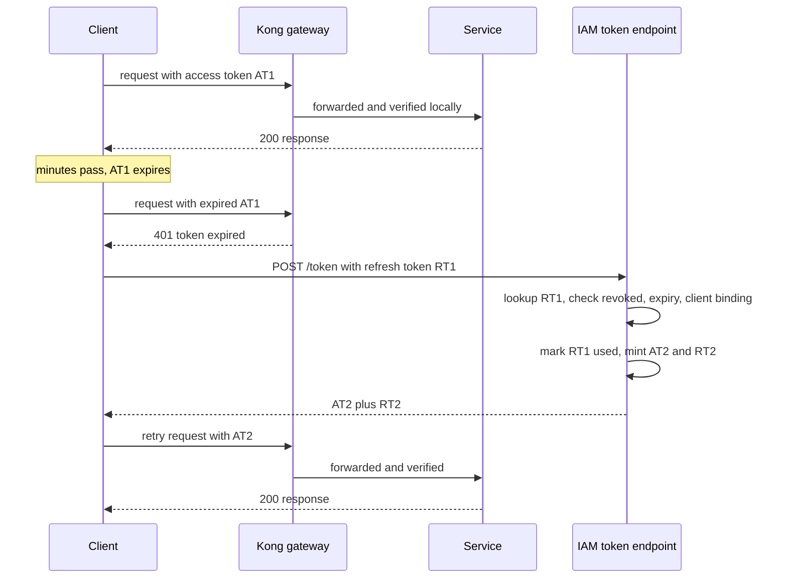

# Refresh Tokens and Token Rotation

Short-lived access tokens are the fix for JWT's revocation problem — but nobody will re-enter a password every fifteen minutes. The **refresh token** resolves the contradiction: a second, long-lived credential whose *only* power is to obtain new access tokens from the issuer. Access tokens stay stateless and short; the refresh token is stateful, revocable, and exercised rarely. **Rotation** — issuing a new refresh token at every use and invalidating the old one — then converts refresh-token theft from a silent long-term compromise into a detectable event.

## The problem that created it

Start from the two failure modes at the ends of the token-lifetime dial. Long-lived access tokens (say 30 days): great UX, but a stolen token works for 30 days, a fired employee keeps access for 30 days, and [[JWT Pitfalls]] catalogs the rest. Short-lived access tokens (15 minutes): tight damage windows — but with only one token type, "expired" means "log in again," and no consumer product survives four logins an hour.

The session world never had this problem: the server-side session was both long-lived *and* instantly revocable ([[Sessions vs Tokens]]). The token world needs to reconstruct that property without putting a state lookup back into every request. The insight: the expensive, stateful check doesn't need to happen *per request* — only *per access-token lifetime*. So split the credential in two:

- **Access token** — JWT, 5–15 minutes, verified statelessly by every service on every request ([[How JWT Works]]).
- **Refresh token** — opaque random string (no need for JWT structure; only the issuer ever reads it), days to months, stored server-side by the IAM, usable only at the token endpoint.

Revocation now has a handle again: the IAM checks its database on every *refresh* — is this token known, unexpired, unrevoked, and bound to this client? Killing a session = deleting one row. The user feels nothing: the client silently exchanges the refresh token for new access tokens for months. Security gets a damage window of minutes; UX gets a session of months. The state lookup happens once per 15 minutes per user instead of once per request — cheaper than sessions by a factor of requests per user per access-token lifetime (about nine in the worked example below), almost as revocable.

## What it solves

- **Short access tokens without login friction** — the access TTL becomes a pure security parameter, no longer a UX parameter.
- **Real revocation** — logout, device kill, fraud response: delete the refresh token server-side; access dies within one access-token lifetime.
- **Fresh claims** — every refresh can re-read roles/tenant state, bounding the staleness problem from [[JWT Pitfalls]] to minutes.
- **Visibility** — refresh events are rare and loggable: a natural audit point and anomaly-detection hook (new geography, impossible travel).

## How it works

### The refresh flow

Well-built clients refresh *proactively* (a minute before `exp`) rather than waiting for a 401, avoiding the failed-request-and-retry round trip. Either way the services and gateway never see refresh tokens — only the IAM's token endpoint does.

### Rotation and reuse detection — the tripwire

A static refresh token that lives for 90 days is a 90-day skeleton key: stolen once, used silently forever, indistinguishable from the real client. **Rotation** fixes the "silently" part:

1. Every refresh returns a **new** refresh token (RT2) and marks the presented one (RT1) as used.
2. All of a session's tokens form a **family** (lineage) tracked server-side.
3. If a token that was *already used* is ever presented again — RT1 arrives after RT2 was issued — someone has a copy. Legitimate clients never replay an old token, so this is near-proof of theft. The IAM **revokes the entire family**, killing both attacker and victim sessions, and forces re-authentication.

This is the **stolen-refresh-token tripwire**: the attacker can still race one refresh ahead of the victim, but the moment the *other* party (victim or attacker) presents the now-stale token, the family burns. Theft converts from indefinite silent access into a bounded window ending at the next legitimate refresh — plus an alertable security event. OAuth 2.0 Security Best Current Practice (RFC 9700) recommends exactly this (rotation with revocation on reuse) for public clients, and the OAuth 2.1 draft requires refresh tokens for public clients to be either sender-constrained or one-time-use.

One operational wrinkle: flaky networks cause *innocent* reuse — the client sends RT1, the response with RT2 is lost, the client retries RT1. Production IAMs allow a short grace period (reusing the immediately-previous token within ~a minute returns the same RT2) to avoid logging users out on packet loss, at a small cost in tripwire sharpness.

### Where refresh tokens live, per client type

| Client | Access token | Refresh token |
|---|---|---|
| Browser SPA | Memory only | `HttpOnly` `Secure` `SameSite` cookie scoped to the token endpoint path (XSS can't read it); rotation mandatory |
| Mobile app | Memory | iOS Keychain / Android Keystore — hardware-backed |
| Server-side web app | Server session | Server-side storage; it never reaches the browser |
| Service-to-service | Memory, re-fetched | Typically **no refresh token** — client-credentials flow just requests a new token ([[OAuth 2 and OpenID Connect]]) |

### Absolute vs sliding sessions

Rotation forces a policy choice about *total* session length:

- **Sliding expiration**: each refresh extends the session; an active user stays logged in indefinitely. Comfortable, but "indefinitely" is a hard word in a security review.
- **Absolute expiration**: the family carries a hard ceiling from first login (e.g. 30 days, or 24 hours for a banking app) regardless of activity; then full re-authentication.
- Standard practice is **both**: slide on activity, capped by an absolute maximum (e.g. refresh extends 14 days per use, absolute cap 90 days). Fintech apps compress aggressively — absolute caps measured in hours rather than weeks, and MFA re-triggered for sensitive operations regardless of how fresh the session is.

### The cost shape of refresh traffic

The two-token split is sold as a security design, but it is also a capacity decision, and it is worth knowing which numbers move. Take an illustrative shape: **2 million daily active users, a 15-minute access TTL, and roughly two hours of active app usage per user per day.**

Two hours at a 15-minute TTL is 8 refreshes per user per day, so 2,000,000 × 8 = 16,000,000 refreshes per day, which is 16,000,000 ÷ 86,400 s ≈ **185 refreshes per second** on average. Compare that with what a session model would do for the same population making 75 authenticated requests each per day: 150,000,000 ÷ 86,400 ≈ **1,736 lookups per second**, about **nine times more** ([[Sessions vs Tokens]] runs the same numbers from the other side). That ratio is the whole argument in one number — the stateful check did not disappear, it just stopped happening per request and started happening per access-token lifetime.

The number that surprises people is the *write* rate. Without rotation a refresh is a read; with rotation every refresh marks one token used and inserts its successor, so those 185 per second are **185 writes per second, sustained, forever**, against a store that also has to be durable and consistent enough that two concurrent refreshes cannot both succeed. That shapes the storage choice more than the read rate does, and it is the honest answer to "can we just put the refresh tokens in the same database as everything else?" — you can, if you have budgeted a permanent write stream of that size plus retention for the family history you keep for audit.

Both numbers scale linearly with DAU and inversely with access TTL: halving the TTL to 7.5 minutes doubles refresh traffic to ~370/s without improving anything a regulator asked for. The access TTL is a dial with a security reading on one side and a cost reading on the other, and both should be said out loud when someone proposes turning it.

## Trade-offs

| You gain | You pay |
|---|---|
| Minutes-long damage window with months-long sessions | A second credential class with its own storage, rotation, and theft model |
| Deletable server-side revocation handle | IAM becomes stateful: a refresh-token store with writes on every refresh |
| Reuse detection as a theft alarm | False trips from races/retries — hence grace periods and their tuning |
| Fresh claims every few minutes | Client complexity: 401 handling, proactive refresh, concurrent-request coordination |
| Audit point per session per ~15 min | Token endpoint is now login-critical infrastructure ([[Designing an IAM Service]]) |

## Common misconceptions

- **"A refresh token is inherently more secure than a long-lived access token."** It is not — it is a bearer credential too, and a longer-lived one. Four properties do the work, and all four are design choices you can accidentally skip: it is checked against server-side state on *every* use, so it is revocable; it is exercised rarely, so it spends almost all its life at rest rather than in flight; it lives in the most protected storage the client offers; and it is accepted at exactly one endpoint. Drop any of those — put it in `localStorage`, accept it at a service, never check revocation — and you are holding a long-lived access token with extra ceremony.
- **"Rotation prevents refresh-token theft."** Rotation prevents nothing. It makes theft *detectable*, and only when the legitimate client comes back to refresh — the silent case in the scenarios below is real and is why rotation is paired with absolute session caps and anomaly detection rather than trusted alone.
- **"The refresh token should be a JWT so services can verify it."** No service should ever see it. Making it a JWT adds a forgery surface, adds size, and buys nothing, because its validity is not a property of its contents — it is the presence of a row. An opaque random string has nothing to verify offline and therefore nothing to attack offline ([[How JWT Works]] on what signatures are actually for).
- **"Rotation logs the user out every 15 minutes."** Rotation replaces both tokens and continues the session; the only thing that changes is which bytes the client holds. Users notice rotation exclusively when it goes wrong — which is why the race conditions below matter more than the happy path.
- **"We don't need a separate refresh token — our token endpoint renews an access token when you present the old one."** That *is* a refresh token, built as a self-verifying JWT with no server-side state, which means it has the full cost of the pattern and none of the revocation benefit. Worse, it makes theft permanent in a new way: an attacker holding a stolen access token can renew it indefinitely, so the short TTL you were relying on to bound the damage no longer bounds anything.
- **"Short access tokens mean we don't need to think about revocation."** They bound it, which is not the same as solving it. The TTL is the worst-case delay before a revocation takes effect, and somebody will eventually ask whether that number is acceptable for a compromised account moving money ([[JWT Pitfalls]] on the instant-kill levers).

## Failure modes

- **Token endpoint outage**: nobody can refresh, so the entire user base logs out progressively over one access-token lifetime — a slow-motion fleet-wide logout. *Signal*: a 401 rate that *ramps* over roughly one access TTL rather than stepping up instantly, which is the fingerprint that distinguishes this from a verification problem. *Confirm*: the token endpoint's own availability, and whether logins are failing too. The endpoint needs the same availability treatment as login ([[Designing an IAM Service]], [[Circuit Breakers]]).
- **Concurrent refresh races**: a client with parallel requests sends two refreshes with the same token; the second looks like reuse and burns the family, randomly logging users out. *Signal*: reuse-detection events whose two presentations share a device fingerprint and an IP and sit milliseconds to seconds apart — theft looks nothing like that. *Confirm*: log the time delta, device, and IP on every reuse revocation, so the false positives are separable from the real ones without a code change. Fix client-side with a single-flight mutex around refresh, server-side with a grace period.
- **Refresh storms**: a mass access-token expiry — a forced app upgrade, a deploy, a key rotation — synchronizes refreshes into a thundering herd at the token endpoint. *Signal*: evenly spaced RPS spikes on the token endpoint exactly one access TTL apart, which no organic traffic pattern produces. *Confirm*: histogram the `exp` values of incoming refresh requests; a healthy population is spread flat, a synchronized one is a spike. Jitter token lifetimes a few percent ([[Cache Stampede and Thundering Herd]] is the same shape).
- **Family-table growth**: every login creates a family; every refresh writes. *Signal*: storage and write latency on the refresh store trending up with no change in active users, which means rows are arriving faster than retention removes them. *Confirm*: compare row count against live sessions — a large gap is retained history, and you should be able to say deliberately how much of it you keep for audit. Needs TTL-based cleanup and capacity planning like any hot table.

### What this looks like at 3am

A forced app upgrade goes out at 21:00 and everybody re-authenticates within a few minutes of each other. Nothing happens. At 21:15 the token endpoint's p99 jumps, its error rate spikes for about half a minute, and then everything is fine again. At 21:30 it happens again. At 21:45, again. By the time anyone is paged the pattern is unmistakable and completely baffling if you are looking at the token endpoint in isolation, because the spikes are not correlated with anything the endpoint does.

The arithmetic explains it. Say 500,000 users were pushed through re-login inside the same minute. Their access tokens now all expire inside the same minute too, and clients that refresh proactively bunch even tighter — assume the cohort lands within a 30-second bucket. That is 500,000 ÷ 30 ≈ **16,667 refreshes per second** against a baseline of roughly 185 — about a **90-fold** spike. The IAM's database connection pool saturates for the duration, a slice of refreshes time out, those clients retry, and the pattern repeats one access TTL later because the survivors are still synchronized. Nothing is broken; the system is simply being asked to do a day's work in half a minute, four times an hour.

You confirm it the same way you would confirm any herd: histogram the `exp` claims of incoming refresh requests and look at the shape. Spread is healthy, a spike is the diagnosis, and the spacing between spikes will be exactly your access TTL — a number you can read off the graph and check against your configuration.

The fix is jitter, and it is cheap. Randomise each access token's lifetime by ±10% at issuance: on a 15-minute TTL that is ±90 seconds, spreading the same cohort over a 180-second window. 500,000 ÷ 180 ≈ **2,778 per second**, a 6× reduction in peak, achieved by changing one line at the issuer and nothing at all on the clients. The deeper point is that *synchronization* is the bug, not load — and synchronization is created by events that touch every user at once, which in your world means forced upgrades, key rotations, and IAM restarts. Any of those is a good moment to ask what will happen exactly one access TTL later ([[Cache Stampede and Thundering Herd]] is the same failure in a different costume, and the same jitter fixes it).

## When NOT to use it

- **Service-to-service auth** — machines don't mind re-authenticating; client credentials with short tokens is simpler than refresh-token custody ([[OAuth 2 and OpenID Connect]]).
- **Plain server-rendered browser apps** — a cookie session already gives you everything refresh tokens reconstruct, with less machinery ([[Sessions vs Tokens]]).
- **Ultra-sensitive single operations** (payment authorization, admin step-up) — don't extend sessions into them; demand fresh MFA regardless of token state.

## In your stack

- Map your own flow: what TTL does your IAM put on access tokens, does it rotate refresh tokens, and does it detect reuse? Those three answers define your account-takeover story.
- The refresh-token store is a natural Redis-or-Mongo table keyed by token hash with family/lineage metadata — and it must be *hashed at rest* (a dumped plaintext table is a mass session-hijack). Size it for the **write** rate, not the read rate: with rotation every refresh is a write, which is the cost shape that decides whether this lives beside your other Mongo collections or gets its own capacity. Reuse the existing Mongo and Redis clients rather than adding a dependency for it.
- Jitter your access-token TTL at issuance. Your forced-upgrade releases and IAM restarts are exactly the events that synchronize an entire user base onto the same expiry minute, and the resulting herd arrives one TTL later at a token endpoint that is often the least over-provisioned thing in the path.
- Your 1-replica reality: if the IAM or its token endpoint runs single-replica, every deploy/restart is a window where refreshes fail; users with freshly expired access tokens see errors until it returns. Proactive client refresh plus a modest access TTL hides small blips; a real outage still becomes a progressive logout.
- Refresh events are audit-grade for RBI purposes: log `sub`, `jti`, family ID, device, IP at every refresh — rare enough to keep forever, rich enough to reconstruct a session's whole life.

## Interview angle

- The core probe: "why two tokens?" — the answer is the decoupling: access TTL becomes a security dial, refresh TTL a UX dial, and revocation moves to the rare stateful path.
- Rotation + reuse detection is a favorite senior-level follow-up; the phrase "revoke the whole family on reuse" signals you've seen the real pattern.
- **60-second version**: "Access tokens are stateless and verified everywhere, so they must be short — minutes — to bound theft and staleness. The refresh token is the opposite: long-lived, opaque, stored server-side by the issuer, presented only to the token endpoint, so it's instantly revocable. Rotation issues a new refresh token every use; presenting a used one proves a copy exists, and the issuer burns the whole token family — theft becomes an alarm instead of silent access. Store it in an HttpOnly cookie or mobile keystore, never localStorage; cap sessions with an absolute expiry on top of sliding."
- Follow-ups: "Stolen refresh token — walk through what happens with and without rotation." "Why is the refresh token opaque rather than a JWT?" (only the issuer reads it; opacity means its validity *is* the DB row — nothing to verify offline, nothing to forge offline). "How do you handle two tabs refreshing at once?"

## Check yourself

> [!question]- Q: Explain why splitting into access + refresh tokens is strictly better than one medium-lived token (say, 12 hours).
> A single 12-hour token is both the per-request credential and the session credential, so it inherits the worst of both: stolen means 12 hours of unrevocable access on every service, claims are 12 hours stale, yet users still re-login twice a day. Splitting decouples the dials: the per-request credential drops to minutes (theft window, staleness all improve ~50x), while the session credential grows to months *and* becomes revocable, because it's stateful and only touches one endpoint. UX improves and security improves simultaneously — the rare case where there's no trade.

> [!question]- Q: An attacker steals a refresh token via malware, and rotation with reuse detection is enabled. Trace the timeline. What happens if the victim's device then goes offline for a month?
> Attacker refreshes first: gets AT+RT2, has live access. At the victim's next refresh, the victim presents the now-used RT1 — reuse detected, family revoked, both parties logged out, alert fires; attacker's access ends at their current access token's expiry. The ugly case: if the victim never refreshes again (device offline), no reuse ever occurs — the attacker rotates along happily and is indistinguishable from the real client. Reuse detection bounds theft *only when the legitimate client stays active*; you still need absolute session expiry, anomaly detection on refresh (geo/device), and user-visible session management to cover the silent case.

> [!question]- Q: What happens if your IAM's token endpoint goes down for 30 minutes and access tokens live 15 minutes?
> No in-flight request fails immediately — services verify access tokens locally. But every user whose access token expires during the outage cannot refresh: within 15 minutes, effectively 100% of active users hold expired tokens and get 401s. The outage presents as a progressive fleet-wide logout completing within one access TTL. Mitigations: HA on the token endpoint, proactive refresh (spreads the cliff), and a conscious decision about whether gateways should ever accept slightly-stale tokens during a declared IAM outage (usually no, for a fintech — fail closed).

> [!question]- Q: An attacker obtains a read-only copy of your refresh-token table from an old backup bucket. Walk through the impact under two designs: tokens stored in plaintext, and tokens stored as SHA-256 hashes.
> Plaintext is a mass session hijack, and the worst kind — every row is a live, working credential, and because the attacker never has to touch your login flow there is no failed-authentication signal anywhere to alert on. They can refresh each one at leisure, and with rotation enabled they will even look like well-behaved clients while doing it. Containment is a fleet-wide forced re-authentication, which is both a visible incident and a disclosure conversation. With hashes, the dump is close to worthless: a refresh token is 128 or more bits of CSPRNG output, so there is no structure to guess and no dictionary to try, and the attacker cannot invert the hash to produce the string your token endpoint actually compares against. Worth being precise about *why a fast hash is correct here* while it would be wrong for passwords — password hashing needs deliberate slowness because humans choose from a tiny, predictable space, whereas a random 128-bit token has no small space to search, so SHA-256 is sufficient and the per-refresh latency cost stays negligible at 185 lookups per second. Two details that complete the design: hash on the way in and store only the hash, never alongside the original, and remember that the index you look the token up by must be the hash too, or you have reintroduced the plaintext you were trying to avoid. This is also why refresh tokens are opaque random strings rather than JWTs — there is nothing in them worth protecting except the bytes themselves.

> [!question]- Q: Mini design prompt — users of your banking app report random logouts. Logs show refresh-reuse revocations for affected users with two refresh calls ~200 ms apart from the same device. Diagnose and fix.
> The app fires concurrent API calls on wake; two of them see an expired access token and both trigger refresh with the same RT — the second arrives after the first consumed it, trips reuse detection, and burns the family. It's a false positive from a client race, not theft (same device, 200 ms apart). Fix client-side: a single-flight lock so exactly one refresh runs and other requests await its result. Fix server-side: a short grace window (~60 s) where replaying the immediately-previous token returns the same successor instead of revoking. Keep the alert, but tune it to fire on reuse outside the grace window or across devices/IPs.

## Sources

- RFC 6749 §1.5, §6 — *OAuth 2.0*: refresh token definition and the refresh grant.
- RFC 9700 — *Best Current Practice for OAuth 2.0 Security*: rotation, reuse detection, sender-constraining.
- OAuth 2.1 draft (draft-ietf-oauth-v2-1) — refresh-token requirements for public clients.
- Auth0 engineering blog, "Refresh token rotation" — the family/tripwire model with grace-period practicalities.
- OWASP Session Management Cheat Sheet — absolute vs idle timeouts.
