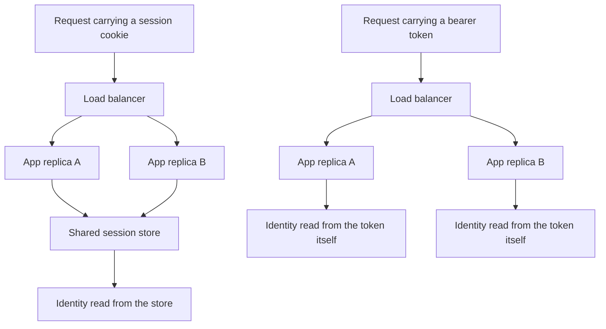

# Sessions vs Tokens

HTTP is stateless: every request arrives with no memory of the last one. Everything in authentication engineering descends from one question — *after login, how does the server know request N+1 comes from the same person as request 1?* There are exactly two families of answer: the server keeps a record and hands the client a reference to it (**sessions**), or the server hands the client a self-contained, signed statement and keeps nothing (**tokens**). Every property that matters — revocation, horizontal scaling, which attacks apply — falls out of that single choice.

## Why this matters

- Your company's JWT-plus-central-IAM setup is the token answer. Understanding what it traded away (instant revocation, server-side control) requires understanding the session model it replaced.
- The choice is really a restatement of [[Stateless vs Stateful Services]]: sessions make your auth tier stateful; tokens keep it stateless. The scaling and failure consequences are the same ones as for any stateful vs stateless service.
- The two models have *different attack surfaces*. Defending a cookie session against XSS token theft, or a localStorage token against CSRF, is defending against the wrong attack — teams get breached by mixing up which threats apply to which model.

## How it works

### Cookie sessions — the server remembers

1. User submits credentials. Server verifies them, generates a random, meaningless **session ID** (e.g. 128 bits from a CSPRNG), and stores a record server-side: `session_id → {user_id, roles, expiry, …}`.
2. Server returns the ID in a `Set-Cookie` header. The browser attaches it automatically to every subsequent request to that domain.
3. On each request, the server looks the ID up. Found and unexpired → the stored record *is* the user's identity. Not found → not logged in.

The session ID is a **reference**, not a claim — it carries no information itself, so there is nothing to forge; an attacker must guess a random value out of 2^128. The authority lives entirely server-side, which yields the session model's superpower: **instant revocation**. Delete the row, and the user is logged out everywhere, immediately. Password change, account compromise, "log out all devices" — all are one server-side write.

The cost appears the moment you run more than one app server. The session store must be reachable from every server, which forces one of:

- **Sticky sessions** — the [[Load Balancers|load balancer]] pins each user to one server (cookie-based affinity). Simple, but a server crash logs out everyone pinned to it, and load distributes unevenly. This is the pattern that made stateful app tiers painful — see [[Stateless vs Stateful Services]].
- **Shared session store** — sessions live in Redis or a database that all servers query. This is the standard production answer (Spring Session does exactly this), but it adds a network hop *to every authenticated request* and makes the session store a critical shared dependency: if Redis is down, nobody is logged in.

### Bearer tokens — the client carries the proof

1. User submits credentials. The auth service verifies them and issues a **signed token** — typically a JWT ([[How JWT Works]]) — containing the user's identity and an expiry, signed with a key only the issuer holds.
2. The client stores the token and sends it on each request, conventionally in `Authorization: Bearer <token>`.
3. Any server verifies the **signature** locally (with the shared secret or the issuer's public key) and trusts the claims inside. No lookup, no shared store, no coordination.

"**Bearer**" is a precise and alarming word: whoever *bears* the token is treated as the user, like cash rather than a cheque. Verification is pure CPU — any of a thousand stateless replicas can do it — which is why tokens are the default for horizontally scaled microservices and why your Kong gateway ([[API Gateway]]) can validate a JWT without calling the IAM service on every request.

The cost is the mirror image of the session model's strength: **revocation pain**. The server kept nothing, so there is nothing to delete. A signed token is valid until it expires, even if the user logged out, changed their password, or was fired five minutes ago. Every mitigation (short expiry plus [[Refresh Tokens and Token Rotation|refresh tokens]], denylists) is a partial reintroduction of server-side state — covered in [[JWT Pitfalls]].

### Where the state lives — the whole argument in one picture

Every property in this note falls out of those two shapes. The session graph has a point all replicas converge on, and that single point is simultaneously the revocation lever, the scaling bottleneck, and the shared failure domain — you cannot keep one without the others. The token graph has no convergence point at all, which is exactly what buys the scaling and exactly what costs the lever.

### What the two models cost, with numbers

Take a plausible consumer-fintech shape — the figures are illustrative assumptions, but the ratios between them are what matter: **2 million live sessions, a 400-byte session record, and 150 million authenticated requests per day.**

- **Session model.** State: 2,000,000 × 400 B = **800 MB** of session records before per-key overhead. That is small — the problem was never the bytes; it is that those bytes must be highly available, because losing them logs out two million people at once. Traffic: 150,000,000 ÷ 86,400 s ≈ **1,736 lookups per second** on average, with daily peaks several times higher. Redis absorbs that rate without noticing. The point is not the rate; it is that 1,736 times a second your ability to authenticate depends on a network call that can be slow, throttled, or gone.
- **Token model.** State: zero. Traffic to any auth tier: zero. Those same 1,736 requests per second each perform one local signature verification on whichever replica received them, and the IAM service is touched only at login and refresh.
- **Revocation, the same arithmetic in reverse.** Fraud ops disables an account at 10:00:00. Session model: the next request after the delete fails — sub-second, and it applies to every device at once. Token model with a 15-minute access TTL: if that user's current token was minted at 09:58:30, it keeps verifying everywhere until 10:13:30. Worst case is the full 15 minutes; averaged across users whose tokens were minted at uniformly spread times, roughly **7.5 minutes**. That average is the honest number to quote when someone asks how fast you can cut off access, and the 15 minutes is the number to quote to a regulator, who will ask for the worst case.

Stated as one sentence: the token model removes ~1,736 store lookups per second from the request path and adds up to 15 minutes of revocation latency. Whether that is a good trade is a *business* judgement about what those 15 minutes can cost you, which is why this decision does not belong to the auth team alone.

### The two attack surfaces — and where to store what

The storage question is really a question about which attack you'd rather defend:

- **CSRF (cross-site request forgery) applies to cookies.** Browsers attach cookies *automatically*, even to requests triggered by a malicious page the user happens to visit — so `evil.com` can make the user's browser POST to `yourbank.com/transfer` with valid credentials attached. Defenses: `SameSite=Lax` or `Strict` cookie attributes (the modern first line), anti-CSRF tokens, origin checks. Tokens in a header are immune — JavaScript must explicitly attach them, and `evil.com`'s scripts cannot read or send another origin's stored values.
- **XSS theft applies to script-readable storage.** A token in `localStorage` or `sessionStorage` is readable by *any* JavaScript running on the page — so a single XSS flaw (or a compromised third-party script) exfiltrates it, and the attacker holds a bearer credential usable from anywhere until expiry. A cookie marked **`HttpOnly`** is invisible to JavaScript, so XSS cannot steal it (though XSS can still *use* the session from the victim's own browser).

| Client type | Recommended storage | Reasoning |
|---|---|---|
| Browser SPA | Access token in memory only; refresh token in an `HttpOnly`, `Secure`, `SameSite` cookie | Memory vanishes on tab close and isn't persistently stealable; the long-lived credential stays XSS-invisible |
| Browser, server-rendered app | Classic session cookie (`HttpOnly`, `Secure`, `SameSite`) | The original model still fits best |
| Mobile app | OS keystore — iOS Keychain, Android Keystore | Hardware-backed storage; no XSS, no cookies |
| Backend service | Memory or a secrets manager; never source control | See [[API Security Essentials]] |

The one placement with no defense story is **long-lived tokens in localStorage** — persistent, script-readable, and bearer. OWASP recommends against it; it remains common because it is the easiest thing to code.

### Hybrid patterns

Production systems rarely sit at either pure extreme:

- **Short-lived stateless access token + stateful refresh token** — the dominant modern pattern and almost certainly your company's. Per-request verification stays stateless and fast; revocation happens at the refresh boundary, bounding the damage window to the access token's lifetime (minutes). Detailed in [[Refresh Tokens and Token Rotation]].
- **JWT-formatted session ("phantom token")** — the gateway holds an opaque reference token from the client, exchanges it for a JWT via introspection, and passes the JWT to internal services. Clients get revocable opaque tokens; services get self-contained claims.
- **Stateless token + denylist for emergencies** — normal verification is local, but a small Redis set of revoked token IDs (`jti`) is consulted too. You pay a cache lookup per request to regain targeted revocation — state has crept back in, just less of it.

## Trade-offs

| Dimension | Cookie sessions | Bearer tokens |
|---|---|---|
| Revocation | Instant — delete the record | Hard — valid until expiry; needs denylist or short TTL |
| Horizontal scaling | Needs sticky LB or shared store | Free — any replica verifies locally |
| Per-request cost | Store lookup (network hop) | Signature check (local CPU) |
| Cross-domain / mobile / service-to-service | Awkward — cookies are a browser mechanism | Natural — just a header |
| Primary browser attack | CSRF (auto-attached cookies) | XSS theft (script-readable storage) |
| Claims freshness | Always current — read from store | Frozen at issuance until expiry |
| Server-side memory | One record per live session | None (until you add denylists) |

## Common misconceptions

- **"JWTs replaced sessions because they're more secure."** They replaced sessions because they *scale without shared state*. Security-wise the trade is sideways at best: you gain nothing against theft and you lose instant revocation. Choosing tokens is an architecture decision wearing a security costume.
- **"Cookies are insecure, headers are secure."** Backwards in one important way: an `HttpOnly` cookie is the *only* browser storage JavaScript cannot read, making it the most XSS-resistant place a credential can live. Cookies' weakness is CSRF — a different attack with mature defenses (`SameSite`).
- **"A JWT in a cookie gives you the best of both."** It gives you a *stateless credential delivered via cookie* — you inherit CSRF exposure (auto-attachment) *and* keep the revocation problem. Sometimes still the right call for SSR apps, but it's a combination of trade-offs, not an escape from them.
- **"Stateless means no server-side storage anywhere."** The issuer almost always keeps state — refresh tokens, key material, audit logs ([[Refresh Tokens and Token Rotation]], [[Designing an IAM Service]]). "Stateless" precisely means *per-request verification needs no lookup*; the login and refresh paths remain stateful.

## Failure modes

- **Shared session store outage** = total login outage, because every request needs the lookup. *Signal*: the 401-or-redirect-to-login rate goes vertical across every service simultaneously while application error rates stay flat — authentication fails before business logic ever runs, so your service dashboards look innocent. *Confirm*: look at the store's own latency and connection metrics, not the app's; a saturated connection pool to Redis and a healthy JVM is the signature. Mitigations: Redis HA ([[Redis Cluster and Sentinel]]), aggressive timeouts so a slow store degrades rather than hanging request threads, sometimes a short-TTL local cache of recently seen sessions.
- **Sticky-session server loss** logs out its pinned users and dumps them onto survivors — a re-login stampede plus skewed load. *Signal*: a login-rate spike sized to roughly one instance's share of traffic, with a simultaneous step increase in RPS on the remaining instances. *Confirm*: line the spike up against an instance restart, an OOM kill, or a target-group deregistration — the timestamps match to the second.
- **Stolen bearer token** is valid from *anywhere* until expiry — no equivalent of "delete the session." *Signal*: there often isn't one. A stolen token produces perfectly well-formed, perfectly authenticated 200s; the auth layer is working exactly as designed. Detection has to come from behaviour rather than from auth — the same `sub` appearing from two geographies minutes apart, a device fingerprint that changes mid-session, call sequences no UI could produce. *Confirm*: join access logs on `sub` and look at the IP and device spread for a single `jti`. Containment is only as good as the TTL plus whatever refresh-token revocation you built *before* the incident.
- **Clock skew** can make one server treat a token as expired while another accepts it. *Signal*: a stable fraction of requests — one pod's share of the load balancer's distribution — returns 401 "expired" while an immediate client retry succeeds, which makes it look like flakiness rather than a clock bug. *Confirm*: compare node clocks, then decode a rejected token's `exp` against the rejecting node's own time; see the leeway discussion in [[How JWT Works]].

### What this looks like at 3am

03:10. The support queue fills with "I keep getting logged out" from a server-rendered admin app backed by cookie sessions. The login rate is four times normal and climbing; the 5xx rate is flat; there was no deploy. Every instinct says "auth service problem," but there is no auth service — sessions live in Redis.

The Redis dashboard has the answer: `used_memory` pinned flat against `maxmemory`, and `evicted_keys` — a counter that had been zero for months — climbing steadily since about 02:40. The session store shares a Redis instance with the product cache under `maxmemory-policy allkeys-lru`. A nightly batch job had warmed a large dataset into that cache, memory hit the ceiling, and Redis began evicting the least-recently-used keys it could find — sampled rather than exactly ranked, because Redis only approximates LRU ([[Cache Eviction Policies]]), but a sample of idle keys skews old the same way. At 3am that means the session keys of every user who had been away from the keyboard for a few minutes. Redis did precisely what it was configured to do.

How you confirm it in two minutes: `INFO stats` for `evicted_keys` (rising), `INFO memory` for `used_memory` against `maxmemory` (equal), and `TTL` on a session key that still exists — if the surviving sessions have healthy TTLs, this is eviction, not expiry, and those are different bugs with different fixes. Immediate mitigation: raise `maxmemory` or flush the cache keyspace. The real fix is a design rule worth writing down — **sessions must never share a Redis instance with a cache**. `maxmemory-policy` is set per instance, not per keyspace or per logical database, so there is no way to shelter the session keys inside a Redis that is allowed to evict; the only honest separation is a dedicated instance running `maxmemory-policy noeviction`, where memory pressure surfaces as a loud write error instead of a quiet disappearance. An evicted cache entry is a cache miss; an evicted session is a logged-out human. The same rule applies to anything else where losing the key changes behaviour rather than just speed: `jti` denylists, nonce stores for replay protection ([[API Security Essentials]]), idempotency records ([[Idempotency]]).

## When NOT to use it

- **Don't use pure stateless tokens** when instant revocation is a hard requirement — banking sessions, admin consoles, anything a regulator asks "how fast can you terminate access?" about. Use sessions, or tokens with expiry so short the question disappears.
- **Don't use cookie sessions** for service-to-service calls, mobile APIs, or third-party API consumers — cookies are a browser mechanism; everything else wants a header.
- **Don't build the hybrid machinery** (refresh rotation, denylists) for an internal tool with one server and fifty users. A session table is less code and fewer bugs.

## In your stack

- Your services are stateless JWT verifiers — the token choice is *why* your Spring Boot pods on EKS scale horizontally without a session store, and why Kong can authenticate at the edge ([[API Gateway]]) without a per-request IAM call.
- The revocation pain lands on your central IAM service: when it must kill access (fraud, compromised account — a real fintech requirement), it can only act at the refresh boundary unless a denylist exists. Ask what your access-token TTL is; that number *is* your revocation latency.
- Redis is the natural home for any denylist or session-adjacent state you add ([[Redis Beyond Caching]]) — but note that doing so reintroduces a shared dependency into the auth path.
- RBI-regulated flows ask "how quickly can a compromised credential be disabled?" — the honest answer for pure bearer tokens is "access-token TTL," so that TTL is a compliance number, not just a performance one.
- **The 1-replica honesty.** Many of your services run a single pod, which quietly flatters any state you keep in process. An in-memory denylist, a local "recently revoked" set, or a per-instance session map all *appear* to work today because there is only one instance for them to be consistent with. The day a service scales to two, each pod sees half the writes and the control silently becomes 50% effective — with no error, no alert, and no test that fails. If you hold auth-relevant state in process, write down that it is correct only at one replica, because that is a design constraint masquerading as a cost decision.
- If you ever add a shared session store or a denylist, remember it inherits the same pinning: a Redis or IAM at one replica puts a single pod between your users and being logged in, and the mitigation is replicas, not timeouts ([[Redis Cluster and Sentinel]], [[Designing an IAM Service]]).

## Interview angle

- The probe is almost always the trade-off: "JWTs scale but can't be revoked; sessions revoke but need shared state — now pick for *this* scenario." Strong answers name the hybrid immediately.
- **60-second version**: "Sessions store identity server-side and give the client a random reference — instant revocation, but every server needs the store, so you get sticky LBs or a Redis hop per request. Tokens sign the identity into the credential itself — any replica verifies locally, perfect for microservices, but you can't un-sign a token, so revocation degrades to short expiry plus refresh tokens. Cookies auto-attach, so they're CSRF-prone; script-readable storage is XSS-stealable, so access tokens go in memory and refresh tokens in HttpOnly cookies."
- Classic follow-ups: "User is fired — walk me through killing their access in both models." "Why not put the JWT in localStorage?" "Your session Redis dies — blast radius?" "When would you still choose sessions in 2026?" (admin panels, server-rendered apps, hard-revocation requirements).

## Check yourself

> [!question]- Q: Explain why bearer tokens scale horizontally "for free" while sessions don't.
> Token verification needs only the signing secret or public key, which every replica holds — identity checking is local CPU with no coordination, so adding replicas adds capacity linearly. Session validation needs the session record, which lives in exactly one logical place; every replica must reach that store, so you either pin users to servers (sticky) or add a shared-store network hop to every request. The session store also becomes a single point of failure the token model simply doesn't have. It is the [[Stateless vs Stateful Services]] argument applied to auth.

> [!question]- Q: What happens if an attacker steals (a) a session cookie, (b) a bearer access token? Compare containment.
> Both let the attacker impersonate the user. The session cookie's damage ends the instant the server deletes the session — one write, immediate, total. The bearer token cannot be invalidated: it verifies successfully on every replica until `exp`, from any IP. Containment is only as good as the TTL plus whatever refresh-token revocation and `jti` denylisting you built in advance ([[JWT Pitfalls]]). This asymmetry is the whole revocation argument in one scenario.

> [!question]- Q: A teammate proposes storing the JWT in localStorage "so it survives page refresh." What do you push back with, and what do you propose?
> localStorage is readable by any script on the page, so one XSS flaw or compromised third-party script exfiltrates a persistent bearer credential usable from the attacker's machine until expiry. Propose: access token in memory only (lost on refresh — fine, because the refresh token silently gets a new one), refresh token in an `HttpOnly`/`Secure`/`SameSite` cookie that scripts can't read, with CSRF handled by `SameSite` plus the fact that the refresh endpoint is the only cookie-authenticated route.

> [!question]- Q: Your SPA keeps the access token in memory and the refresh token in an `HttpOnly` cookie. A security reviewer asks: "assume XSS is achievable on your domain — what can the attacker actually do?" Answer honestly.
> More than the `HttpOnly` flag suggests. The attacker cannot *read* the refresh cookie, so they cannot exfiltrate a credential to their own machine and use it later from anywhere — that is the real and worthwhile win. But the cookie is still attached automatically by the browser, so injected script can call your refresh endpoint from the victim's own page and read the **access token out of the response body**, then issue any authenticated request it likes, in a loop, for as long as the tab stays open. With rotation enabled it even keeps the session alive by rotating on the victim's behalf. So `HttpOnly` converts "permanent credential theft" into "session riding while the page is open and the victim is online" — a genuine downgrade in severity, not immunity. The remaining defences are the ones that stop or shorten the XSS itself: a strict Content-Security-Policy, ruthless control of third-party scripts, re-authentication or MFA step-up on money movement regardless of session state, and anomaly detection on refresh events ([[Refresh Tokens and Token Rotation]]). The lesson generalises: storage flags limit *where* a credential can travel, never *what* can be done from inside the victim's browser.

> [!question]- Q: Mini design prompt — design auth for an internal admin console (50 users, compliance requires terminating access within seconds of an HR flag). Sessions or tokens?
> Sessions, without hesitation. The hard requirement is instant revocation — the session model's native strength. Scale is trivial (50 users), so the shared-store cost is negligible: one Redis or DB-backed session table, `HttpOnly`/`Secure`/`SameSite=Strict` cookies, CSRF tokens on mutating routes, and an HR-triggered hook that deletes the user's sessions. A JWT design here would force you to build denylist machinery to simulate what sessions do natively.

## Sources

- OWASP Session Management Cheat Sheet — session ID entropy, cookie attributes, lifecycle rules.
- OWASP Cross-Site Request Forgery Prevention Cheat Sheet — why cookies are CSRF-prone and the SameSite/token defenses.
- RFC 6750 — *OAuth 2.0 Bearer Token Usage*: the formal definition of bearer semantics.
- MDN Web Docs: *Set-Cookie* (HttpOnly, Secure, SameSite) and *Window.localStorage* security notes.
- Spring Session reference documentation — the shared-Redis session pattern in the reader's own framework.
