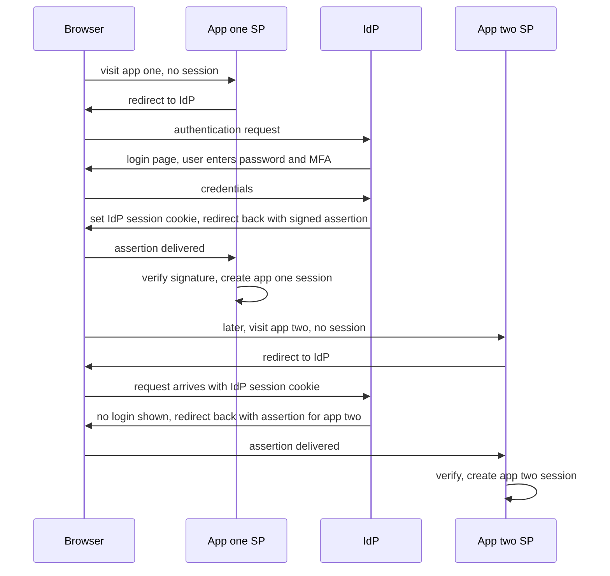

# Single Sign-On

**Single Sign-On (SSO)** lets a user authenticate once — to one identity authority — and then access many independent applications without logging in again. The mechanism underneath every variant is the same: applications stop checking passwords themselves and instead accept a **signed assertion** from a trusted **identity provider**, discovering "the IdP vouches for this user" via a browser redirect. Understand the two-session structure (IdP session + per-app sessions) and both the magic and the mess — especially logout — explain themselves.

## The problem that created it

An enterprise with 50 SaaS apps and 5,000 employees, pre-SSO: 50 password databases, 50 password policies, users reusing one password across all 50 (so one phishing hit compromises everything), and — the operationally fatal one — **offboarding**: an employee leaves and IT must deactivate 50 accounts, reliably, immediately. Miss one and an ex-employee retains access to the CRM; for a fintech, that's an audit finding with teeth. Password managers patch the user pain, not the control pain: the company still doesn't own authentication.

The fix inverts the trust: apps *outsource* authentication to one **Identity Provider (IdP)** the company controls. Each app (now a **Service Provider, SP**) holds no passwords — it redirects unauthenticated browsers to the IdP and accepts the IdP's signed assertion on return. Login becomes one place to enforce MFA and password policy; offboarding becomes one switch; and because the IdP keeps its own session, the *second* app's "login" happens invisibly. Consumer-world "Sign in with Google" is the same structure with Google as IdP.

## What it solves

- **One credential ceremony** — MFA, password policy, phishing-resistance investment happen once, strongly.
- **Instant, complete offboarding** — disable at the IdP, every SP loses the user at next assertion.
- **Centralized access control and audit** — who can reach which app is IdP policy; every login is one log stream ([[Designing an IAM Service]]).
- **Apps shed credential liability** — an SP breach leaks no passwords, because the SP never had any.

## How it works

### The redirect dance and the two sessions

1. Browser hits `app.example.com` with no session. The SP redirects to the IdP, carrying an authentication request.
2. The IdP checks for its **own session cookie**. None → login page (password + MFA). Present → skip straight to step 3; *this skip is the entire "single" in SSO*.
3. The IdP posts/redirects the browser back to the SP with a **signed assertion** — "I authenticated user X at time T by methods M."
4. The SP validates the signature against the IdP's published keys, then establishes **its own session** (cookie or token — [[Sessions vs Tokens]]) and serves the user. Subsequent requests to this app never involve the IdP.

So SSO is *federated login*, not shared sessions: after the dance, each app runs an **independent app session** alongside the **IdP session**. App session lifetimes are the app's choice — which is why you stay logged into one tool for weeks while another re-dances daily — and why logout is about to get messy.

### SAML vs OIDC

Two protocol generations implement the same dance:

| | **SAML 2.0** (2005) | **OIDC** (2014) |
|---|---|---|
| Assertion format | Signed XML document | Signed JWT — the `id_token` ([[How JWT Works]]) |
| Transport | Browser POST/redirect bindings | OAuth 2.0 auth-code + PKCE flow ([[OAuth 2 and OpenID Connect]]) |
| Vocabulary | IdP / SP / assertion | OP (provider) / RP (relying party) / id_token |
| Metadata and keys | SAML metadata XML exchange | `/.well-known/openid-configuration` + JWKS |
| Client types | Web apps (browser-centric) | Web, mobile, SPA, APIs — first-class |
| Security history | XML signature-wrapping attack class | JWT pitfalls ([[JWT Pitfalls]]), but simpler parsing |
| Where you'll meet it | Enterprise SaaS, legacy corp IT — still everywhere | Everything built this decade |

Strategy is uniform across the industry: **new integrations speak OIDC; SAML support exists because enterprise customers demand it**. "Enterprise SSO support" on a pricing page usually means "we added SAML."

### Logout fan-out — why single logout is messy

Login fans *in* to one IdP; logout must fan *out* to N independent sessions — and that inversion breaks cleanly:

- Logging out of **one app** kills that app's session only; the IdP session survives, so revisiting the app silently re-authenticates — "I logged out but I'm still in," correct behavior, confused users.
- Logging out **everywhere** (Single Logout, SLO) requires the IdP to notify every SP with a live session. The mechanisms — SAML SLO, OIDC front-channel logout (hidden iframes to each SP, blocked increasingly by third-party-cookie restrictions), OIDC back-channel logout (server-to-server logout tokens, needs every SP to implement an endpoint and map IdP sessions to its own) — are all best-effort: any SP that's down, unreachable, or unimplemented keeps its session. No mechanism can reach a *bearer token already issued* ([[JWT Pitfalls]]'s revocation problem again).
- Honest engineering treats SLO as **defense in depth, not a guarantee**: short app-session/token lifetimes bound the orphan window; sensitive apps re-check the IdP session or demand step-up auth on critical actions; offboarding relies on *IdP disable + short sessions*, not on logout propagation.

### Workforce vs customer identity

The market splits on who the users are, and the products barely overlap:

- **Workforce IAM** (employees → internal/SaaS apps): **Okta**, **Microsoft Entra ID** (ex-Azure AD), Ping, JumpCloud. Center of gravity: directory sync (HR system as source of truth), SCIM provisioning/deprovisioning, per-app assignment policies, device posture, SAML-heavy app catalogs. Buyer: IT/security.
- **Customer identity, CIAM** (your users → your product): **Auth0**, **AWS Cognito**, Firebase Auth, or a built-it-yourself IAM ([[Designing an IAM Service]]). Center of gravity: signup funnels, social login, progressive profiling, consumer MFA (OTP, biometrics), API/token issuance at consumer scale and consumer pricing. Buyer: product engineering.
  Same protocols, opposite requirements — workforce optimizes for *control* (few users, many apps, strict policy), CIAM for *conversion and scale* (millions of users, one product). "We have Okta, why build IAM?" confuses the two: Okta signs your employees into Jira; it is not built to authenticate 10 million banking customers into your app.

## Trade-offs

| You gain | You pay |
|---|---|
| One strong login; MFA investment amortized over all apps | IdP = single point of failure for *new* logins across every app |
| One-switch offboarding and central audit | IdP compromise = every app compromised (the 2022-era Okta incidents made this concrete) |
| Apps hold no passwords | Apps must implement federation correctly — assertion validation bugs are auth bypasses |
| Invisible second-app login | Logout and session-lifetime semantics get genuinely confusing |
| Per-app access policy in one console | Protocol/metadata/cert-rotation ops per SP integration |

## Failure modes

- **IdP outage**: active app sessions continue (apps have their own sessions — the same grace structure as [[Designing an IAM Service]]'s JWKS argument); anyone needing a *new* login to *any* app is locked out of everything. Mitigations: IdP HA, status-page honesty, app sessions long enough to ride blips.
- **Signing-certificate expiry/rotation misses**: assertions stop validating at some or all SPs — a staggered, confusing outage (SAML cert rotation is manual metadata exchange at many SPs; OIDC's JWKS automates this — one more reason OIDC won).
- **Clock skew**: SAML assertions and id_tokens both carry tight validity windows; a drifted SP rejects valid assertions intermittently.
- **Deprovisioning gaps**: IdP disabled, but an app with month-long sessions keeps serving the ex-employee — the exact audit finding SSO was bought to prevent. Control: short sessions on sensitive apps + SCIM deprovisioning that *deletes the app session*, not just the account mapping.
- **Assertion-validation bugs at an SP** (signature-wrapping, audience confusion): accepting assertions minted for another SP — the SAML cousin of missing-`aud` ([[JWT Pitfalls]]).

## When NOT to use it

- **Single product, consumer-facing, no third-party apps**: you don't need *federation*, you need good first-party auth ([[Designing an IAM Service]]); adding an internal IdP hop adds moving parts for no control gain. (Offering "Sign in with Google" to users is a feature decision, not an architecture need.)
- **Machine-to-machine auth**: SSO is a browser-redirect, human ceremony; services use client credentials and mTLS ([[API Security Essentials]]).
- **As a logout guarantee**: never design a control that depends on SLO reliably reaching every SP — it won't.

## In your stack

- Your customers authenticate against your own IAM (CIAM side — the [[Designing an IAM Service]] design); your *workforce* presumably signs into AWS, Jira, and internal consoles via Google Workspace or Okta-class SSO. Two identity systems, two threat models — keeping them separate is correct, and the back-office consoles that touch customer money should sit behind the workforce IdP with step-up MFA.
- If Niyo ever sells B2B (partner-bank portals, corporate dashboards), "support SAML/OIDC SSO" becomes a sales checkbox — the architecture above is what you'd implement as SP, with your IAM federating *in* from each partner's IdP ([[Designing an IAM Service]]'s multi-tenant claims design).
- AWS access via IAM Identity Center is SAML/OIDC federation in your daily life already: short-lived AWS credentials minted from a workforce-IdP assertion — SSO plus [[API Security Essentials]]'s scoped-short-credential principle in one product.
- Offboarding honesty check for the fintech auditor: list every internal tool a departing employee can reach, and for each, whether access dies at the IdP switch or waits for an app session to expire — that second list is your real deprovisioning SLA.

## Interview angle

- The crisp mental model interviewers reward: **"SSO = apps outsourcing authentication to an IdP via signed assertions, with two session layers."** Most candidates can't explain why logging out of one app doesn't log out of others — the two-session model answers it in one sentence.
- **60-second version**: "Apps stop checking passwords and redirect to an identity provider; the IdP authenticates once, sets its own session, and returns a signed assertion the app validates and converts into its own local session. Second app, same redirect — but the IdP session cookie is already there, so it's invisible. SAML is the XML-era protocol enterprises still require; OIDC does the same job as a JWT id_token over OAuth flows and is the modern default. Logout is the weak spot: killing N independent app sessions is best-effort fan-out, so real deprovisioning = disable at the IdP plus short app sessions. Workforce identity — Okta, Entra — optimizes control over employees and SaaS; customer identity — Auth0, Cognito, or your own IAM — optimizes signup, scale, and token issuance."
- Follow-ups: "SAML vs OIDC — when forced to support both?" "Walk through what happens when an employee is terminated — where are the gaps?" "Your IdP is down: who exactly is impacted?" "Design 'login with your corporate account' for a B2B SaaS" (SP-initiated OIDC/SAML, per-tenant IdP config, JIT provisioning vs SCIM).

## Check yourself

> [!question]- Q: Explain why the second app's login is invisible, using the two-session model.
> The first login created an IdP session cookie in the browser (scoped to the IdP's domain). The second app, finding no local session, redirects to the IdP like always — but the browser presents the IdP cookie, so the IdP skips the login page entirely and immediately returns a signed assertion for app two, which builds its own session. The user "logged into" app two through two redirects and zero keystrokes. Every SSO property — and the logout confusion — follows from these two independent session layers.

> [!question]- Q: An employee is terminated at 09:00 and disabled in Okta at 09:05. At 11:00 they're still using an internal dashboard. Explain, and name the two controls that close the gap.
> The dashboard validated an assertion at 08:30 and minted its *own* session (say, 12 hours); IdP disablement stops *future* assertions but never touches existing app sessions — and single-logout fan-out, even if triggered, is best-effort. Controls: (1) short app-session/token lifetimes on sensitive apps (minutes to an hour), forcing frequent re-assertion that the disabled IdP account will fail; (2) SCIM-driven deprovisioning that actively terminates the app's sessions/accounts server-side, not just the IdP mapping. The same structure as JWT revocation ([[JWT Pitfalls]]): disable the issuer, and outstanding credentials still ride out their TTL unless state is kept and consulted.

> [!question]- Q: What happens to each class of user when the IdP goes down for 30 minutes?
> Users with live app sessions: unaffected within those apps — sessions are local; they only notice if an app's session expires mid-outage and the re-dance fails. Users opening a new app (or expired session): locked out of *that* app — and since every app shares the IdP, effectively locked out of everything they weren't already inside. Machine traffic: unaffected (shouldn't be on SSO at all). It's the [[Designing an IAM Service]] availability shape — federation keeps the IdP off the per-request path, so outages hit session *establishment*, with blast radius set by app-session lifetimes.

> [!question]- Q: Mini design prompt — your B2B product must let each corporate customer bring their own IdP (Okta, Entra, Google). Sketch the SP-side design decisions.
> Per-tenant IdP configuration: protocol (OIDC preferred, SAML supported), metadata/JWKS or cert per tenant, stored and rotated per tenant. Home-realm discovery: map login email domain → tenant → IdP before redirecting. Assertion handling: validate against *that tenant's* keys, enforce audience, then map the external subject to an internal `sub` at the federation boundary so downstream services see one identity scheme ([[Designing an IAM Service]] multi-tenant design). Provisioning: JIT-create users from first assertion, SCIM for updates/deprovisioning. Security rails: never accept tenant-A-signed assertions for tenant-B users (key-to-tenant binding), short app sessions, audit every federation event. This feature list is roughly why companies buy Auth0/WorkOS rather than build it per customer.

## Sources

- SAML 2.0 specifications (OASIS) — assertions, bindings, and the Web Browser SSO profile.
- OpenID Connect Core 1.0, plus the Front-Channel and Back-Channel Logout specs (openid.net) — the OIDC SSO and SLO mechanics.
- RFC 7522 — SAML 2.0 profile for OAuth 2.0 client authentication (where the two worlds meet).
- Okta and Auth0 developer documentation — the clearest practitioner explanations of IdP/SP flows and logout limitations.
- NIST SP 800-63C — *Digital Identity Guidelines: Federation and Assertions*.
