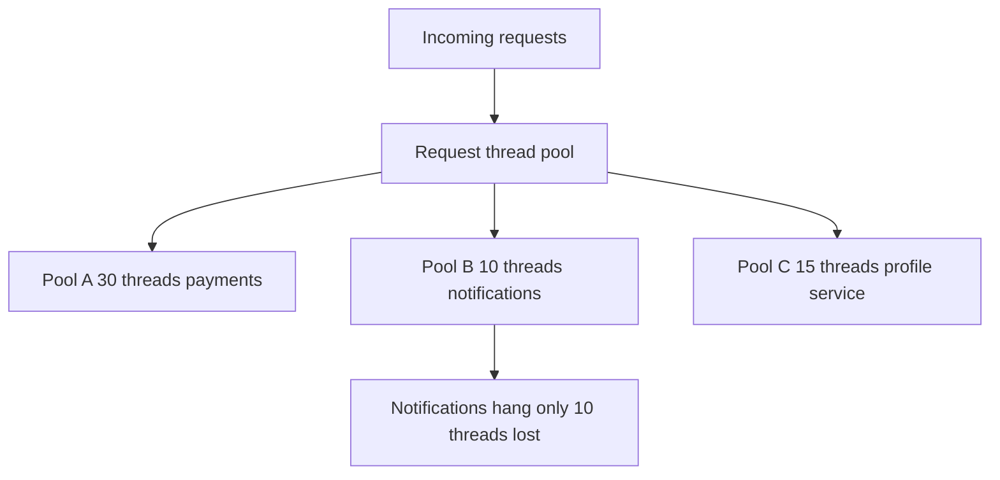

# Bulkheads and Isolation

A ship's hull is divided by **bulkheads** — watertight walls — so that a breach floods one compartment and the ship lists but floats. The engineering transfer is direct: partition your resources (threads, connections, pods, even whole regional deployments) so that one failing dependency, one hot endpoint, or one abusive tenant exhausts *its* compartment and nothing else. Where [[Circuit Breakers|circuit breakers]] react to failure after detecting it, bulkheads are structural: the blast radius is capped before anything goes wrong, by construction.

## The problem that created it

A service starts life calling two dependencies through one shared HTTP client with one connection pool and serving all requests from one thread pool. Fine — until dependency B has a slow day. Requests touching B hold their threads for the full timeout; requests touching only the healthy dependency A arrive, find every thread parked on B, and queue behind them. From the outside, *the whole service* is down, even though 70% of its traffic never needed B at all. The failure didn't cascade through any bug — it cascaded through a **shared resource**. The same shape recurs at every scale: one tenant's bulk export saturating the API for everyone (**noisy neighbor**), one hot endpoint starving the others, one bad availability zone taking out a fleet scheduled without zone awareness. Shared fate is the default; isolation has to be built.

## What it solves

- **Blast-radius capping**: a failure consumes at most its compartment's resources.
- **Noisy-neighbor containment**: one tenant/endpoint/workload cannot starve the rest.
- **Partial availability**: features backed by healthy dependencies keep working while one dependency burns ([[Load Shedding and Graceful Degradation]] decides *what* to keep; bulkheads make keeping it possible).
- **Predictable degradation**: you know in advance what fraction of capacity any single failure can take, because you drew the lines.

## How it works

Isolation applies at several layers; real systems stack them:

| Layer | Compartment | Contains | Typical tool |
|---|---|---|---|
| In-process | Thread pool / semaphore per dependency | A hanging dependency | Resilience4j Bulkhead |
| Connection | Pool per dependency and per purpose | Slow queries starving fast ones | Separate HikariCP/driver pools |
| Workload | Deployment per workload class | CPU-hungry consumers vs API pods | Separate K8s Deployments |
| Infrastructure | Node pools, AZ spread | Node and zone failure | Topology spread, anti-affinity |
| Fleet | Cells, shuffle shards | Poison tenants, bad deploys | Cell router, shuffle sharding |

### Thread-pool and semaphore isolation (in-process)

Give each downstream dependency its own bounded thread pool (or a semaphore capping concurrent calls). Calls to the payments partner get, say, 30 threads; the notification service gets 10. When notifications hang, exactly 10 threads are lost — the other pools, and the request-serving pool, keep working. This was Hystrix's signature move; in Resilience4j it's the `Bulkhead` (semaphore, caps concurrent calls in the caller's thread) and `ThreadPoolBulkhead` (dedicated pool, adds hand-off overhead but can time out waiting work).

Choosing between the two is a real decision, not a style preference:

| | Semaphore `Bulkhead` | `ThreadPoolBulkhead` |
|---|---|---|
| Where the call runs | The caller's own thread | A dedicated pool thread, after a hand-off |
| Cost per call | A counter increment — negligible | Task submission, context switch, and a second thread parked |
| Caps | Concurrent calls into the dependency | Concurrent calls *and* the caller threads they occupy |
| Can abandon a hung call | No — the caller thread is still blocked in the call | Yes — the caller holds a future it can give up on |
| Interacts with Servlet threads | The Tomcat thread blocks for the call's duration | The Tomcat thread can return while the pool thread waits |
| Use when | You have real timeouts on the underlying client — the common case | The underlying client's timeout is untrustworthy or absent, or you need async composition |

The honest default is the semaphore: it is cheaper, simpler, and sufficient *provided the client underneath has a working read timeout*. The thread-pool flavor exists mainly to bound calls whose own timeout you cannot trust — which is a reason to fix the client, and only then to decide whether you still need the pool.

### Connection-pool isolation

Same idea one layer down: separate connection pools per dependency — and per *purpose*. A reporting query that holds Mongo connections for 30 s should not draw from the same pool as 5 ms point reads for the request path ([[Connection Pooling]]). Many teams run two pools to the same database — `fast` and `slow` — precisely so analytics can never exhaust the OLTP path's connections.

### Pod and node isolation (Kubernetes)

- Separate **Deployments** for different workload classes: an API deployment and a worker/consumer deployment of the same codebase, so a poison message pegging consumer CPU ([[Dead Letter Queues and Poison Messages]]) never slows API pods.
- **Resource requests/limits** are micro-bulkheads: a pod's memory limit bounds how much of the node one container can take.
- **Topology spread / anti-affinity** across nodes and AZs caps how many replicas one node failure or AZ outage removes — isolation against *correlated* infrastructure failure ([[Failure Modes in Distributed Systems]]).
- Dedicated **node pools** for disruptive workloads (batch, ML) keep them off latency-sensitive nodes.

### Cell-based architecture (fleet level)

The largest bulkhead: run many complete, independent copies of the whole stack — **cells** — and partition customers across them, with a thin routing layer on top. A bad deploy, poison workload, or data corruption hits one cell; customers in other cells never notice. AWS builds many internal services this way (described in the AWS Builders' Library; each cell is capped at a tested maximum size, and new capacity means new cells, not bigger ones) — the blast radius of *any* single failure becomes `1/N` of customers, by construction.

**Shuffle sharding**, one paragraph: instead of pinning each customer to one cell of workers, assign each customer a random *subset* (say 2 of 8 workers). Two customers rarely share their whole subset — with 8 workers taken 2 at a time there are 28 distinct pairs — so a poison customer who kills every worker they touch takes out their own pair, while almost every other customer still has at least one healthy worker from their own combination. Fault isolation approaching one-customer granularity at the cost of near-zero extra hardware; Route 53 famously shields its DNS fleet this way.

### Sizing compartments: Little's Law, not vibes

A per-dependency pool's size falls out of arithmetic, not instinct. By **Little's Law**, concurrent requests = arrival rate × duration, where duration is strictly the *mean*: a dependency called 50 times/second at 100 ms occupies 50 × 0.1 = 5 concurrent calls in steady state. Feeding it the p99 instead, as people usually do, overstates concurrency — which is harmless here, because every error is in the safe direction. Size the bulkhead a comfortable multiple above that (say 2–3× for bursts: 10–15 permits), and the *remaining* budget tells you what a total hang of that dependency can cost you — 15 threads out of a 200-thread server is a contained incident; 150 is not. Three practical rules:

- **Size from the timeout, not the p99**: when the dependency hangs, each call holds its permit for the full timeout — a 10 s timeout at 50 calls/s wants 500 permits to avoid rejecting healthy load during the hang, which is exactly why timeouts must be tight before bulkheads can be small ([[Timeouts Retries and Exponential Backoff]]).
- **Revisit on traffic shifts**: a pool sized in January is wrong by June; alert on sustained saturation of any compartment, not just rejections.
- **Leave a shared reserve**: some teams keep 10–20% of threads unpartitioned as overflow for whichever compartment bursts — a deliberate, bounded hole in the bulkhead that trades a little isolation for a lot less rejection.

## Trade-offs

| You gain | You pay |
|---|---|
| Capped blast radius per failure | **Capacity fragmentation** — the headline cost (below) |
| Noisy neighbors contained | More pools/deployments/cells to size, monitor, and tune |
| Partial availability during incidents | Sizing is guesswork that drifts as traffic mix changes |
| Clear failure attribution (which pool filled up) | Thread-pool flavor adds hand-off latency; cells add routing complexity |

**Capacity fragmentation deserves emphasis**: one shared pool of 50 threads serves any traffic mix; five pools of 10 reject work in a pool that's full even while 40 threads idle elsewhere. Isolation *deliberately* forbids resource sharing — that's the whole point — so you pay for peak per-compartment rather than peak overall. The cost shape: total provisioned capacity scales with the **sum of per-compartment peaks**, not the peak of the sum, and the gap widens as compartments' loads are less correlated. Cells repeat this at fleet scale, plus each cell's fixed overhead (its own LB, datastores, monitoring) multiplied by N cells.

## Failure modes

- **Mis-sized compartments**: a pool sized for last year's traffic rejects legitimate load during this year's peak — the bulkhead itself becomes the outage. *Signal*: rejections from exactly one compartment while host CPU, heap, and the request thread pool all sit idle. *Confirm*: graph permits-in-use against the configured maximum per named compartment — Resilience4j exports `resilience4j.bulkhead.available.concurrent.calls` and `resilience4j.bulkhead.max.allowed.concurrent.calls` through Micrometer, and a flat line at zero available on one name while the others are slack is the entire diagnosis ([[Logs Metrics and Traces]]).
- **Hidden shared resources**: isolated thread pools all calling through one shared connection pool, DNS resolver, or synchronized logger — the compartments have a hole below the waterline. *Signal*: a dependency you never touched degrades in lockstep with the one that broke. *Confirm*: take a thread dump during the incident; if threads from compartment A are parked in the same connection-acquisition or name-resolution frame as compartment B's, the sharing is proven rather than suspected. Isolation claims must be verified by failure injection ([[Chaos Engineering]]), not asserted from diagrams.
- **Compartment too big to matter**: two "isolated" services sharing one database have shared fate where it counts ([[The Distributed Monolith Anti-Pattern]]). *Signal*: the two services' error rates begin within the same second — independent failures do not synchronize that tightly. *Confirm*: list every resource both reach; one shared entry explains it.
- **Cell routing layer as the new single point of failure**: the thin router in front of cells must be simpler and more reliable than anything behind it, or you've concentrated risk instead of spreading it. *Signal*: an outage spanning every cell at once, which by construction should be impossible.
- **Saturation ≠ failure**: a full bulkhead should reject *fast* (and trip alarms), not queue silently — unbounded queues in front of a bounded pool recreate the original problem with extra latency. *Signal*: compartment rejections stay at zero while its wait-time histogram climbs; the bulkhead is converting the failure into latency and passing it to your callers instead of absorbing it.

### What a leaky bulkhead looks like at 3am

The page fires: `checkout-service` p99 is 14 seconds. You open the dashboard expecting one red panel and find two. The partner-bank panel is red, which is unsurprising — the bank's TLS handshakes are timing out. The *profile-service* panel is red too, which is not: profile-service's own dashboard shows p99 at 11 ms and a zero error rate. Both calls go through separate Resilience4j bulkheads, 30 permits and 15, and both report zero available permits.

A thread dump settles it in one frame. The two bulkheads partition *permits*, but both hand their work to the same `WebClient`, which draws from one shared connection pool. The bank's hanging handshakes are holding every connection in that pool; profile-service calls are blocked acquiring a connection and never reach the network at all, so they consume their own compartment's permits while waiting for a resource the other compartment has exhausted. The compartments were drawn above the waterline.

The 3am fix is a tourniquet — shorten the bank's connect timeout so handshakes release connections, or trip its breaker by hand ([[Circuit Breakers]]). The fix that week is a separate connection pool per dependency, plus a chaos test that blackholes the bank's address and asserts that profile-service latency does not move ([[Chaos Engineering]]). The general lesson is the one the dump taught: an isolation boundary is only as deep as the *lowest* resource the compartments share.

## When NOT to use it

- **One or two dependencies, low traffic**: pool-per-dependency machinery costs more in tuning than it saves; good timeouts + a breaker cover you.
- **When you can't afford the fragmentation**: if the service barely has capacity for peak as one pool, splitting it guarantees rejections somewhere. Fix capacity first.
- **Cell-based architecture below serious scale**: cells multiply operational surface (N of everything). Below many teams/millions of users, AZ-spread replicas and per-dependency pools capture most of the benefit at a fraction of the cost.
- **Don't isolate what should share fate**: two calls that are always made together for the same request gain nothing from separate pools — compartments should follow failure domains, not org charts.

## Common misconceptions

- **"Microservices are bulkheads."** Splitting a monolith partitions code ownership, not resources. Two services sharing one Mongo cluster, one Redis, one node pool, and one deploy pipeline share fate on every dimension that actually causes outages ([[The Distributed Monolith Anti-Pattern]]). Service boundaries are a *claim* of isolation; shared infrastructure is the refutation.
- **"A bulkhead protects the dependency."** It protects *you from* the dependency. The sick downstream keeps receiving exactly the same traffic until something else reduces it — a timeout, a breaker, a rate limit. A bulkhead caps how much of your own capacity the dependency may consume, and nothing else.
- **"Bigger compartments are safer."** Backwards. The permit count *is* the damage cap, so a pool generous enough never to reject is a pool generous enough to let one hang take the process. Sizing a bulkhead to avoid rejections spends the isolation you were buying.
- **"Isolation is free when compartments are rarely full."** You provision for each compartment's peak continuously, while the benefit arrives only during incidents. That is a trade worth making — but calling it free is how bulkheads get sized by optimism and then fail the first real peak.
- **"Resilience4j's `Bulkhead` queues callers."** Its default `maxWaitDuration` is 0: a caller that cannot get a permit is rejected immediately with `BulkheadFullException` rather than waiting. That is normally what you want. If you configure a wait duration you have reintroduced a queue, and it needs sizing like one.

## In your stack

- The honest single-replica caveat first: many bulkhead layers presuppose multiple units to isolate — pod/node/AZ isolation protects nothing when there is exactly one pod ([[Graceful Shutdown and Deployment Safety]]). What *does* still work at 1 replica is everything in-process: per-dependency thread pools, semaphore bulkheads, and split connection pools inside your one Spring Boot instance — arguably they matter *more*, because that lone pod's thread pool is the entire service.
- Concrete fit: separate Resilience4j `Bulkhead`s per partner-bank API in payment services, so one slow partner can't absorb every Tomcat thread. Resilience4j's semaphore bulkhead defaults to `maxConcurrentCalls: 25` and `maxWaitDuration: 0` — a sane starting shape, but 25 is a default, not a measurement; re-derive it from Little's Law against the endpoint's real rate and timeout.
- The arithmetic for one pod: Spring Boot's embedded Tomcat defaults to 200 request threads (`server.tomcat.threads.max`), so at 1 replica those 200 threads *are* the entire service. A 20-permit bulkhead around a partner bank caps a total hang at 10% of the service; no bulkhead at all caps it at 100%, and 100% of one replica is an outage, not a degradation. The in-process pattern earns its keep here precisely *because* there is no fleet behind it.
- Mind the compartments you never chose: HikariCP defaults to a maximum pool of 10 connections with a 30-second acquisition timeout, and the MongoDB Java driver defaults to `maxPoolSize` 100 per client. Those are bulkheads whether or not you think of them that way — 200 Tomcat threads contending for 10 JDBC connections is an isolation ratio somebody picked, and it wasn't you.
- Redis is a shared compartment by construction, and no client-side bulkhead changes that: the server executes commands serially ([[Redis Internals]]), so one expensive command — an unbounded range read, a slow Lua script — delays every other client's command. Spring Boot's default Lettuce client compounds it within a process by multiplexing commands over a shared connection. The fix is forbidding slow commands and splitting hot workloads onto separate Redis instances, not partitioning threads in front of a serial server.
- Mongo connection pools: your services share Atlas/self-managed clusters across endpoints — consider a small dedicated pool for any long-running aggregation so reporting can never starve transactional reads.
- Separate API and SQS-consumer deployments of the same service is bulkheading you likely already do; the isolation claim only holds if their *replicas and resources* are actually distinct, not just their entrypoints.
- A Kafka consumer group, and an SQS queue with its own consumer deployment, are natural bulkheads per topic and per queue — one poisoned queue backs up its own consumers only, provided handlers don't share a thread pool ([[Consumer Groups and Rebalancing]], [[Backpressure and Flow Control]]).

## Interview angle

- **60-second version**: "Bulkheads partition resources so failures can't spread through sharing: per-dependency thread and connection pools in-process, resource limits and AZ spread at the infra layer, and at the top end cell-based architecture — N independent stacks with customers partitioned across them, so any failure hits 1/N of users. Shuffle sharding refines that by giving each customer a random subset of workers, so overlap between customers is rare. The price is capacity fragmentation: you provision for the sum of per-compartment peaks, and a full compartment rejects work while others idle."
- Classic follow-ups: "Semaphore vs thread-pool bulkhead?" (cheap caller-thread cap vs isolated pool with hand-off cost); "How do bulkheads interact with circuit breakers?" (bulkhead caps damage while it's happening; breaker stops the calls — structural vs reactive); "What's shuffle sharding?" (the one-paragraph answer above wins the round); "What's the cost?" — if you don't say capacity fragmentation unprompted, the interviewer will.

## Check yourself

> [!question]- Q: Explain the bulkhead pattern and its relationship to circuit breakers in one minute.
> Bulkheads partition resources — threads, connections, pods, cells — so a failure exhausts only its own compartment: a hanging dependency burns its 10-thread pool, not the whole service. Breakers are reactive (detect failure, stop calling); bulkheads are structural (cap the damage even before detection, and even for failure modes a breaker can't see, like a slow-but-under-threshold dependency). Production systems use both: the bulkhead limits harm during the window the breaker needs to gather evidence.

> [!question]- Q: What happens if two "isolated" thread pools in your service both call through one shared HTTP connection pool of 20 connections?
> The isolation is cosmetic. When the slow dependency's requests occupy all 20 connections, the other pool's threads block waiting for connections — the compartments share a resource below the waterline, and the failure spreads exactly as if there were no bulkheads. Lesson: isolation must hold along the *entire* call path, and the only way to know is to inject the failure and watch ([[Chaos Engineering]]).

> [!question]- Q: Why does shuffle sharding isolate better than plain sharding with the same hardware?
> Plain sharding: 8 workers in 4 fixed pairs — a poison customer kills their pair and *every* customer pinned to that pair, 25% of users. Shuffle sharding: each customer gets a random 2-of-8 subset; there are 28 possible pairs, so the poison customer's exact pair is shared by almost nobody — they take out themselves, while other customers overlapping in just one worker still have a healthy one. Same 8 workers, blast radius drops from a fixed 1/4 of customers toward a single customer.

> [!question]- Q: Mini design: a multi-tenant API where one tenant's batch jobs keep degrading everyone's latency. Apply isolation at three layers.
> (1) In-process: per-tenant-class semaphore bulkheads — interactive traffic gets a guaranteed pool, batch gets a small bounded one that rejects fast when full (pair with per-tenant [[Rate Limiting]]). (2) Workload: split batch onto its own Deployment and queue so batch CPU/memory can never sit in the interactive pods ([[Why Async Messaging Exists]]). (3) Fleet: if tenants are big enough, cell-per-tenant-group with the batch-heavy tenant pinned to its own cell. Name the cost at each step: reserved capacity idles when batch is quiet — that's the fragmentation you're buying isolation with.

> [!question]- Q: Using Little's Law, size a bulkhead for a partner API called 20 times/second with a 150 ms p99 and a 2 s timeout, and state what you're trading at each candidate size.
> Steady state: 20 × 0.15 = 3 concurrent calls; with 2–3× burst headroom, ~6–10 permits serve healthy traffic. But during a full hang, calls hold permits for the 2 s timeout: 20 × 2 = 40 concurrent to avoid rejecting *any* request mid-hang. The spread between 10 and 40 is the design decision: 10 permits caps a hang's damage at 10 threads but rejects most traffic to that dependency during the hang (fine if there's a fallback — [[Circuit Breakers]]); 40 permits keeps everything flowing into a dead dependency and quadruples the damage cap. With a breaker in front (trips within seconds of a hang), the small pool is right: the bulkhead only has to hold the line during the breaker's detection window.

## Sources

- Michael Nygard, *Release It!* (2nd ed., 2018) — bulkheads as a stability pattern, with the shipping metaphor.
- AWS Builders' Library: "Workload isolation using shuffle-sharding" (Colm MacCárthaigh) — cells, shuffle sharding, and the Route 53 story.
- AWS whitepaper/re:Invent material on cell-based architecture — cell sizing, routing layers, blast radius math.
- Resilience4j documentation — `Bulkhead` and `ThreadPoolBulkhead` semantics and configuration.
- Netflix TechBlog on Hystrix — the original large-scale thread-pool-isolation production story.
