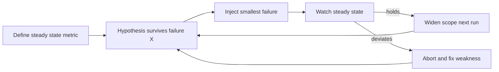

# Chaos Engineering

Chaos engineering is deliberately injecting failures into a system to find out — before your users do — whether the resilience you believe you have actually exists. The famous origin is Netflix's **Chaos Monkey**, which killed production instances at random during business hours. That sounds reckless until you grasp the logic: instances *will* die regardless; the only choice is whether they die as a controlled experiment with engineers at their desks, or as a 3 a.m. surprise. Chaos engineering converts the first kind of luck into knowledge, and modern practice wraps it in experimental discipline: a hypothesis, a minimal blast radius, and an abort switch.

## The problem that created it

Around 2010–2011, Netflix migrated from its own datacenter to AWS — trading hardware they controlled for commodity cloud instances that could be terminated, rebooted, or degraded at any time. Their architecture was *designed* for this: stateless services behind load balancers, redundancy across instances and zones ([[Netflix Architecture]]). But a design goal is a claim, not a fact. Engineers wrote failover logic, tested it once against a contrived scenario, and moved on; six months and forty deploys later, nobody could say whether it still worked. Resilience mechanisms share an awkward property: **they're only exercised during failures**, so they rot invisibly — the fallback that NPEs, the failover that depends on the thing that failed, the timeout nobody set ([[Failure Modes in Distributed Systems]]).

Netflix's answer was to make failure routine. **Chaos Monkey** (2011, later open-sourced) randomly terminated production instances. **Why production?** Because staging never matches prod's real traffic, data shapes, config, and emergent inter-service behavior — a pass in staging proves little about the system that matters. **Why business hours?** Because the point is cheap learning: engineers are at their desks, deploys are fresh in mind, and a weakness surfaces as a quick fix instead of a page at 3 a.m. Any team whose service couldn't survive a single instance death learned it with the full team awake — and fixed it, because the monkey would be back tomorrow. The cultural effect exceeded the technical one: within months, surviving random instance death was simply a property every Netflix service had, because it was tested continuously.

## What it solves

- **Verifies resilience claims**: redundancy, failover, fallbacks, timeouts — tested against reality, continuously, not asserted from diagrams.
- **Prevents resilience rot**: mechanisms exercised weekly can't silently decay the way mechanisms exercised never do.
- **Surfaces unknown couplings**: the hidden shared dependency, the retry storm, the config that only one instance had ([[Failure Modes in Distributed Systems|correlated failures]]).
- **Trains humans**: game days rehearse diagnosis, escalation, and rollback while nothing real is burning — the on-call muscle you want pre-built ([[Alerting and On-Call Design]]).

## How it works

### The Simian Army

Chaos Monkey got siblings, each targeting a failure class:

| Tool | Injects | Resilience claim tested |
|---|---|---|
| Chaos Monkey | Random instance termination | Any single instance is disposable |
| Latency Monkey | Artificial delays/degradation in service calls | Callers survive a *slow* dependency — harder than a dead one ([[Timeouts Retries and Exponential Backoff]]) |
| Conformity Monkey | Nothing — flags instances violating resilience best practices (not in an ASG, no health check, …) | The fleet stays structurally resilient |
| Chaos Gorilla | An entire availability zone's outage | Zone redundancy actually fails over |
| Chaos Kong | An entire AWS **region** evacuation | Traffic shifts cross-region; Netflix ran these regularly at full production scale |

(Latency Monkey proved the most dangerous of the family — degrading a service *partially* can trip failure modes that clean termination never finds, which is exactly why it's valuable and why it needs the discipline below.)

### From monkeys to a discipline

The Netflix chaos team formalized the practice ("Principles of Chaos Engineering", ~2015), and the center of gravity moved from "break things randomly" to **controlled experiments**:

1. **Define steady state** — a measurable signal of health: successful payments per minute, p99 latency, stream starts per second. Not "CPU looks fine" — a *user-visible* output.
2. **Hypothesize**: "steady state will hold if we kill one instance of service X" — written down, falsifiable.
3. **Inject the failure** — smallest realistic event first: one instance, one dependency, added latency on one route.
4. **Control the blast radius**: run on a traffic slice (1%, one cell, canary cohort), with an **abort switch** and automatic rollback the moment steady state deviates. Modern platforms (Netflix's ChAP, AWS Fault Injection Service, Gremlin, LitmusChaos for Kubernetes) build the guardrails in.
5. **Compare, learn, fix, widen**: hypothesis held → expand scope next run; failed → you found a real weakness at minimal cost. Either way, re-run continuously — resilience regresses like any other property.

**Game days** are the human-scale version: schedule two hours, announce a scenario ("Mongo primary fails over at 14:00"), execute it for real (or tabletop it), and watch the *whole* sociotechnical system respond — alerts, dashboards, runbooks, escalation, rollback. Half the findings are usually about humans and tooling: the alert that never fired, the runbook that's stale, the one engineer who knows the fix.

### Prerequisites — earn the right to break things

Chaos without the following isn't engineering, it's vandalism:

- **Observability**: if you can't *see* steady state deviate, you learn nothing and may not notice the damage ([[Logs Metrics and Traces]], [[Distributed Tracing]]).
- **On-call and alerting that work**: someone must be watching, and the experiment must page the way a real incident would ([[Alerting and On-Call Design]]).
- **Rollback/abort capability**: a tested way to stop the experiment and restore service in minutes ([[Deployment Strategies]]).
- **Basic resilience hygiene already in place**: timeouts, health checks, redundancy where claimed. Chaos *verifies* resilience; it can't create it. If you already know the system dies when one pod dies, you don't need an experiment — you need the fix.

### Right-sized chaos for a small team

You don't need a Simian Army; you need the habit. Cheap, high-yield experiments:

- **Kill one pod in staging** (`kubectl delete pod`) during synthetic load: does the service drain gracefully, do probes and the LB behave, how long is the gap ([[Graceful Shutdown and Deployment Safety]])?
- **Pull a dependency**: block Redis or a partner-API route (a NetworkPolicy or a toxiproxy in between) — do timeouts fire, do breakers trip, is the fallback real ([[Circuit Breakers]])?
- **Add latency** rather than failure: 500 ms on every Mongo call — the gray-failure rehearsal most stacks fail first.
- **Expire a cert** in a test environment — or at minimum inventory and alert on every `NotAfter` date; cert expiry is the classic correlated failure.
- **Tabletop game day**: one hour, zero injection — "the region is down, walk me through the next 30 minutes" exposes stale runbooks for free.
- Kafka/SQS: kill a consumer mid-batch and verify redelivery + idempotency hold ([[Delivery Semantics]], [[Idempotency]]).

### An adoption path that doesn't scare anyone

Teams rarely fail at chaos for technical reasons; they fail by starting too big. A sequencing that works:

1. **Tabletop first** (zero risk): talk through a failure scenario; fix the runbook gaps it exposes.
2. **Staging, infrastructure level**: kill pods, drain nodes, restart databases under synthetic load; fix what breaks.
3. **Staging, dependency level**: latency and error injection on specific calls; verify timeouts, breakers, fallbacks actually engage.
4. **Production, read-only and reversible**: smallest scope, off-peak at first, with the abort switch demonstrated *before* the experiment, not during.
5. **Production, continuous and automated**: experiments as scheduled regression tests for resilience; business-hours by then, because by then it's boring.

Each stage earns trust for the next; skipping stages spends trust you haven't earned. The counterintuitive goal is for chaos experiments to become *uninteresting* — an experiment that reliably finds nothing is a resilience property, verified.

## Trade-offs

| You gain | You pay |
|---|---|
| Verified (not assumed) resilience | Real risk of real impact — bounded, never zero, when run in prod |
| Weaknesses found at chosen, cheap moments | Engineering time: experiments, guardrails, fixes they generate |
| On-call rehearsal and runbook validation | Cultural capital — leadership must accept controlled risk |
| Continuous regression-testing of failure paths | Prerequisite investment (observability, rollback) before any payoff |

## When NOT to use it

- **Known-fragile systems**: if the hypothesis is "this will fail", skip the experiment and fix the known weakness. Chaos is for testing things you *believe* are resilient.
- **No observability / no rollback**: you'd be injecting failure you can't measure or stop. Build those first.
- **Production chaos against single-replica services**: the "experiment" is an outage with a hypothesis attached — see below.
- **Compliance-critical windows and money-moving paths without sign-off**: in a regulated fintech, chaos in prod payment flows needs explicit risk acceptance; prefer staging with production-shaped synthetic load, and keep prod experiments to read paths and infrastructure layers.

## In your stack

- The single-replica honesty clause: Chaos Monkey's premise is *redundancy* — killing one of N instances should be invisible. At 1 replica, killing the pod is a guaranteed outage; you'd be measuring your MTTR, not your resilience. So for your fleet, prod-style random instance killing is the wrong tool — and that's a finding in itself: **it tells you where resilience currently can't exist**, and makes the case (service by service) for a second replica where the outage math justifies it.
- What chaos *is* right for you: staging experiments under synthetic load — kill the one pod and measure the real gap end-to-end (drain, probe removal, restart, JVM warm-up); verify your learned probe behavior (Facets' hardcoded `failureThreshold: 10` means detection budgets are `period × 10` — an experiment confirms the real number); pull Redis and confirm readiness doesn't collapse (your fleet's deliberate decoupling of readiness from shared datastores at 1 replica — verify it held).
- Dependency chaos transfers fully: partner-bank sandbox APIs made slow (not dead) is the single most production-relevant experiment a Niyo service can run.
- Game-day scenarios tailor well to RBI-world: "UPI partner down for 2 hours", "Mongo failover mid-settlement", "cert on the KYC callback endpoint expired" — each tests queues, reconciliation, and alerting more than pods.
- Verify consumer rebalance chaos on SQS/Kafka paths: kill a consumer mid-message; confirm no loss, no unintended duplicate side effects ([[Idempotency]]).

## Interview angle

- **60-second version**: "Chaos engineering is experimentally verifying resilience: define a measurable steady state, hypothesize it survives a specific failure, inject that failure with a controlled blast radius and an abort switch, and compare. Netflix's Chaos Monkey killed random prod instances in business hours — prod because staging can't represent prod, business hours because engineers are awake to learn cheaply; the Simian Army scaled the idea to latency injection, AZ kills (Chaos Gorilla) and region kills (Chaos Kong). Prerequisites first: observability, alerting, rollback — chaos verifies resilience, it doesn't create it."
- Classic follow-ups: "Why production?" (fidelity); "Why is latency injection more dangerous than termination?" (partial degradation trips gray-failure paths clean kills never touch); "What's the first experiment you'd run here?" (smallest falsifiable one: kill one instance of a stateless service); "What do you need before starting?" (the prerequisites list).
- Honest senior answer for small fleets: "at one replica, chaos-killing prod pods just measures MTTR — I'd run chaos in staging and spend the argument on a second replica for the services that deserve it."

## Check yourself

> [!question]- Q: Explain why Netflix ran Chaos Monkey in production during business hours rather than in staging at night.
> Production, because staging differs from prod in traffic, data, configuration, and emergent inter-service behavior — a staging pass doesn't verify the system users depend on. Business hours, because the goal is cheap learning: engineers are at desks, context is fresh, and a surfaced weakness becomes a same-day fix instead of a 3 a.m. page. The instances were going to die sometime regardless; Chaos Monkey converted that from a surprise at the worst time into an experiment at the best time.

> [!question]- Q: What happens if a team runs chaos experiments without observability or rollback in place?
> Without observability they can't define steady state, so a deviation goes unmeasured — the experiment yields no learning and the damage may be discovered by users. Without rollback/abort, a failed hypothesis becomes an uncontrolled incident, destroying the blast-radius bound and the organizational trust chaos depends on. That's why prerequisites order strictly: observability, alerting/on-call, rollback — then chaos. Breaking things you can't watch or stop is vandalism with a methodology slide.

> [!question]- Q: Your fleet runs many services at 1 replica. A director proposes "let's run Chaos Monkey in prod like Netflix." Respond honestly.
> Chaos Monkey tests redundancy, and at 1 replica there is none: killing the pod is a guaranteed user-visible outage — the experiment's result is known in advance, so it's not an experiment. Counter-proposal: (1) staging chaos under synthetic load to measure the real restart gap and verify probes/drain behavior; (2) dependency chaos (slow partner APIs, Redis loss) which tests timeout/breaker/fallback logic independent of replica count; (3) use the known outage math to argue for a second replica on the services where the cost is justified — then prod chaos becomes meaningful there.

> [!question]- Q: Mini design: a one-hour game day for "MongoDB primary fails over during settlement processing." What do you script and measure?
> Script: announce window; snapshot steady state (settlement throughput, consumer lag, error rates); trigger a controlled replica-set stepdown in the staging cluster mid-run of synthetic settlement load; observers watch dashboards, on-call gets paged through the real alerting path. Measure: driver reconnect time, in-flight write outcomes (retryable writes honored? duplicates? — [[Idempotency]]), queue backlog growth and drain time, which alerts fired and when, time for on-call to produce a correct diagnosis from runbooks. Outputs: gaps become tickets (missing alert, stale runbook, unset timeout), and the exercise repeats next quarter.

## Sources

- Netflix TechBlog: "The Netflix Simian Army" (2011) and "Chaos Monkey Released Into The Wild" (2012); ChAP and Chaos Kong posts for the later evolution.
- "Principles of Chaos Engineering" — principlesofchaos.org (the community statement from the Netflix chaos team era).
- Basiri et al., "Chaos Engineering", IEEE Software 2016; Rosenthal & Jones, *Chaos Engineering* (O'Reilly, 2020).
- Google SRE Book, ch. 28 (DiRT-style disaster testing is Google's game-day lineage).
- AWS Fault Injection Service and LitmusChaos documentation — the current tooling for cloud/K8s experiments.
