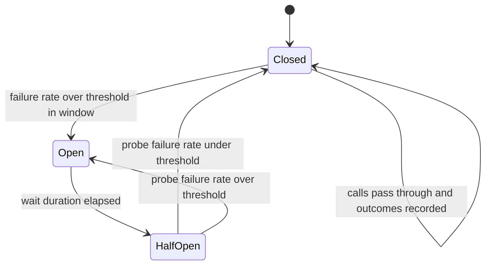

# Circuit Breakers

A retry assumes the failure is transient; a circuit breaker handles the case where it isn't. When a dependency is genuinely down, continuing to call it wastes your threads, adds your retries to its misery, and makes your users wait out full timeouts for answers that will never come. A circuit breaker watches the failure rate and, past a threshold, **fails fast**: calls are rejected immediately without touching the dependency, until careful probing shows it has recovered. The name is the household electrical metaphor — when the current is dangerous, the circuit opens and stops the flow.

## The problem that created it

A growing system adds its tenth downstream dependency. One of them — say a recommendations service — has a bad deploy and starts timing out. Every caller dutifully waits out its 2-second timeout, then retries ([[Timeouts Retries and Exponential Backoff]]), tripling the load on the dying service. Meanwhile the *callers'* threads spend 2 seconds each learning what the last thousand calls already proved: it's down. Thread pools drain, latency propagates upward, and a failure in a nice-to-have feature has taken the checkout path with it — a textbook cascading failure ([[Failure Modes in Distributed Systems]]).

Two observations fall out. First, after enough consecutive failures, *the outcome of the next call is already known* — paying a full timeout to learn it again is pure waste. Second, a recovering dependency, cold and fragile, needs its traffic restored gradually, not in one synchronized stampede. The circuit breaker encodes both: remember recent outcomes, stop calling when the evidence says "down", and probe gently before trusting again. Netflix's Hystrix popularized the pattern (in maintenance mode since November 2018; its documented successor for the JVM is **Resilience4j**), and Michael Nygard's *Release It!* (2007) named it.

## What it solves

- **Wasted work**: no threads or connections burned on a dependency known to be down.
- **Pile-on load**: the failing service stops receiving your traffic and gets room to recover.
- **Latency honesty**: callers get an immediate error (or fallback) instead of a timeout-length wait.
- **Stampede on recovery**: half-open probing restores traffic gradually rather than all at once.
- **Blast-radius containment**: one bad dependency degrades one feature, not the whole process — in concert with [[Bulkheads and Isolation]].

## How it works

The breaker is a state machine wrapped around every call to one dependency:

- **Closed** (normal): calls pass through; the breaker records outcomes in a sliding window (count-based, e.g. last 100 calls, or time-based, e.g. last 60 s). When the **failure rate** — or, importantly, the *slow-call* rate, since a dependency answering in 9.9 s under a 10 s timeout is failing in every way that matters — crosses a threshold (say 50% over a minimum of 20 calls), the breaker trips to Open.
- **Open**: calls are rejected instantly with a breaker-specific error. No network I/O happens at all. After a configured **wait duration** (e.g. 30 s), the breaker moves to Half-Open.
- **Half-Open**: a small, fixed number of **probe requests** (e.g. 5) are allowed through; all others are still rejected. Once that many outcomes are recorded, the *same* failure-rate and slow-call-rate thresholds are applied to just those probes: under threshold the breaker closes and normal traffic resumes, at or over it the breaker re-opens and the wait restarts (ideally with backoff on repeated trips). Hystrix used a stricter single-probe rule — one failure re-opened it — so don't carry that intuition into a library that evaluates a rate.

The minimum-calls requirement matters: thresholds are only evaluated once the window holds enough volume to mean something, because 1 failure out of 2 calls is 50% and proves nothing.

### What to return when the breaker is open

Tripping the breaker is the easy half; deciding what the caller sees is the design work:

| Strategy | When it fits | Example |
|---|---|---|
| **Fail fast** (error immediately) | The data is essential and wrong answers are worse than none | Payment authorization: return a clear "try again later" |
| **Fallback value** | A sensible default exists | Recommendations down → show bestsellers |
| **Cached/stale value** | Staleness is tolerable | Last-known FX rate with a timestamp, profile data from Redis |
| **Degraded feature** | The feature can be hidden | Drop the "people also bought" panel entirely ([[Load Shedding and Graceful Degradation]]) |

For fintech reads, stale-with-disclosure often beats erroring; for money movement, failing fast and closed is almost always right — never fall back to a guess about a balance.

### Per-dependency breakers

One breaker per *dependency* (often per dependency **endpoint**), never one global breaker. Each breaker needs its own window, thresholds, and fallback, because "Mongo is slow" and "the notification service is down" are different events deserving different responses. In Resilience4j terms, a named `CircuitBreaker` instance per remote, from a `CircuitBreakerRegistry`.

### Resilience4j in practice (your Java world)

Resilience4j is a lightweight, functional library — you decorate a `Supplier`/`Callable` or annotate a Spring method, and compose resilience mechanisms:

- `CircuitBreaker` — this pattern: `failureRateThreshold`, `slowCallRateThreshold` + `slowCallDurationThreshold`, `slidingWindowType` (COUNT_BASED/TIME_BASED), `slidingWindowSize`, `minimumNumberOfCalls`, `waitDurationInOpenState`, `permittedNumberOfCallsInHalfOpenState`.
- `Retry`, `TimeLimiter`, `Bulkhead`, `RateLimiter` — composable around the same call.
- **Decoration order matters.** The conventional composition is: Retry *outside* CircuitBreaker *outside* TimeLimiter/Bulkhead around the actual call — so each attempt's timeout counts as one breaker outcome, and the retry sees (and counts against) the breaker's state. Invert it and your retries can hammer through state transitions or the breaker can count one logical operation several times in surprising ways. Whatever order you pick, verify it with a forced-failure test rather than assuming.
- Every state transition emits an event and a metric — export them; a breaker you can't see is a breaker you can't trust ([[Logs Metrics and Traces]]).

A worked starting configuration for a typical internal HTTP dependency (tune against measured traffic, never ship blind):

| Parameter | Starting value | Reasoning |
|---|---|---|
| `slidingWindowType` / `Size` | TIME_BASED, 60 s | Survives traffic-volume swings better than a fixed count |
| `minimumNumberOfCalls` | 20 | Below this, failure rate is noise — but verify the endpoint actually sees 20 calls/minute |
| `failureRateThreshold` | 50% | Half the calls failing is a dependency problem, not bad luck |
| `slowCallDurationThreshold` / `RateThreshold` | ~2× dependency p99 / 80% | Catches the slow-but-alive mode that failure counting misses |
| `waitDurationInOpenState` | 30 s | Longer than a typical pod restart or failover blip |
| `permittedNumberOfCallsInHalfOpenState` | 5 | Enough evidence to decide, small enough to be harmless |

**Why those differ from the shipped defaults — and why the defaults are a trap on quiet endpoints.** Resilience4j's documented defaults (unchanged through 2.4.0, the current release as of 2026) are `slidingWindowType: COUNT_BASED`, `slidingWindowSize: 100`, `minimumNumberOfCalls: 100`, `failureRateThreshold: 50`, `waitDurationInOpenState: 60s`, `permittedNumberOfCallsInHalfOpenState: 10`, and `slowCallDurationThreshold: 60s` with `slowCallRateThreshold: 100`. Work out what that means on an endpoint receiving 2 calls per second. The breaker will not evaluate anything until it has recorded 100 calls. On a *cold* window — a freshly started pod, or a breaker that has just re-closed, since the window resets on that transition — that means 100 ÷ 2 = **50 seconds** of recorded failures before it can trip, and during those 50 seconds, under a 5-second timeout, roughly a hundred users each wait the full five seconds to be told something the breaker already had enough evidence to know. A *warm* window is only half as bad: it already holds 100 pre-outage successes, each failure evicts one, and the 50% threshold is reached after 50 failures — 50 ÷ 2 = **25 seconds** and about fifty users. (Both are counted from the first recorded outcome, which itself lands one timeout after the dependency goes dark.) At one replica every restart puts you in the cold case. On an endpoint receiving 5 calls per *minute*, that same count-based window of 100 spans twenty minutes of wall clock, so the breaker is weighing evidence from before the incident started. Separately, a `slowCallDurationThreshold` of 60 s will never fire beneath any sane timeout, which quietly disables the slow-call detection that is often the only reason you wanted a breaker.

**Half-open is not reached on a timer.** `automaticTransitionFromOpenToHalfOpenEnabled` defaults to **false**: an open breaker moves to half-open when *a call arrives* after the wait duration has elapsed, not at the instant the wait expires. On a busy endpoint that distinction is invisible. On a quiet one it is the difference between a 30-second outage and an hour-long one — a breaker that opened at 03:00 on a path with no traffic until 04:00 is still open at 04:00, and the first call of the hour is the one that discovers recovery. Enabling the automatic transition costs a background thread and buys a state machine that advances on schedule. Either behaviour is defensible; reasoning about recovery timing without knowing which one you have is not.

### Breaker vs retry: the interplay

They answer different questions. **Retry** handles "this *call* failed, the dependency is probably fine" — micro-scale, per-request. **Breaker** handles "this *dependency* is failing, stop asking" — macro-scale, across requests. Used together: the retry absorbs blips; the breaker is the escape valve that stops retries from amplifying a real outage ([[Timeouts Retries and Exponential Backoff]]). A retry policy should treat `CallNotPermittedException` (breaker open) as non-retryable — retrying against an open breaker is burning CPU to re-ask a question the breaker exists to answer.

### The binary-breaker limitation

A breaker is a switch: fully on, or fully off. That is a blunt control for a dependency which is 30% broken rather than 100% broken. Closed, you keep pushing everything into a tier that can serve only part of it; open, you send nothing to a tier that could have served some. Production systems therefore often pair the breaker with a *proportional* control — **client-side adaptive throttling** (Google SRE Book, ch. 21), where each caller tracks its own requests-versus-accepts over a rolling window and rejects a growing *fraction* of its own outbound calls as its accept rate falls. The two compose cleanly: adaptive throttling handles partial degradation smoothly, the breaker handles total failure decisively. Knowing that a breaker is a step-function approximation of a continuous control is the difference between configuring breakers and understanding them.

## Trade-offs

| You gain | You pay |
|---|---|
| Fast failure instead of timeout waits | False trips: a threshold too tight rejects calls to a healthy-enough dependency |
| Recovery breathing room downstream | State to tune per dependency (thresholds, windows, wait durations) |
| Explicit, testable degraded modes | Fallback paths that must be designed, tested, and kept honest |
| A natural metrics point per dependency | In-process state: every pod's breaker learns independently (see failure modes) |

## Failure modes

- **Shared breaker across unrelated endpoints**: one breaker wrapping all calls to a service means its broken `/reports` endpoint trips the breaker for its healthy `/auth` endpoint — a self-inflicted outage of a working feature. *Signal*: a feature fails that has no dependency on anything known to be broken. *Confirm*: check whether the open breaker's name covers more than one endpoint; the name is the scope. Scope breakers to failure domains, usually endpoint-level.
- **Thresholds that never trip**: `minimumNumberOfCalls` above the endpoint's traffic within the window; the breaker is decorative. *Signal*: a dependency outage in which you observe long timeouts throughout and no `CallNotPermittedException` at all. *Confirm*: graph `resilience4j.circuitbreaker.buffered.calls` — if it never reaches `minimumNumberOfCalls`, the failure rate is never evaluated and the state can never change. Verify trip behaviour with forced-failure tests ([[Chaos Engineering]]), not by reading config.
- **Fallback worse than failure**: a fallback that itself calls another remote service, or returns stale data where staleness is dangerous (account balances before a transfer). *Signal*: latency during an incident that is *longer* than the primary path's timeout — a sure sign the fallback is doing remote work. Fallbacks must be *cheaper and safer* than the primary, or absent.
- **Flapping**: wait duration shorter than the dependency's actual recovery time → open, half-open, fail, open, forever. *Signal*: `resilience4j.circuitbreaker.state` oscillating on a period equal to your `waitDurationInOpenState` — a square wave is diagnostic, since real recovery is not periodic. Each pod flaps on its own schedule, so the downstream sees a ragged drizzle of probes. Lengthen the wait or add backoff on repeated trips.
- **Per-pod cold state**: breakers live in process memory. A freshly deployed pod knows nothing and must re-learn that a dependency is down by failing the minimum-calls count again — right after a rolling deploy, your fleet briefly un-breaks a broken dependency. *Signal*: a burst of downstream traffic and timeouts aligned exactly to deploy timestamps. At many replicas this smears out; at one replica every restart is a complete amnesia event.

## When NOT to use it

- **Local, in-process work** — a breaker around a pure computation or local cache read is noise. Breakers are for network calls that can hang or fail independently.
- **Very-low-traffic paths** — below the minimum call volume, the breaker never has evidence; a plain timeout + sane retry policy is the honest tool.
- **As a substitute for fixing timeouts.** A breaker with no timeouts underneath still lets every pre-trip call hang for the full default; the breaker *counts* failures, timeouts *bound* them. You need both.
- **Batch/offline jobs** that can simply fail and rerun — the operational machinery isn't worth it where no user is waiting.

## Common misconceptions

- **"An open breaker is an outage."** Open is a *decision*, not a symptom. The dependency was already failing; the breaker only changed how you lose — immediately and cheaply, with a fallback, instead of slowly and expensively through timeouts. Alert on open *transitions* because they tell you something broke, but treat the breaker as the messenger. The incident started before it opened.
- **"The breaker protects the downstream service."** Mostly it protects *you*. Removing your traffic helps the downstream only in proportion to how much of its load you were — one caller tripping its breaker among fifty callers changes almost nothing for the dependency. The relief downstream comes from *every* caller breaking, or from the dependency's own [[Load Shedding and Graceful Degradation|shedding]]. Claiming your breaker gives a partner bank room to recover overstates your importance.
- **"Breaker state is a fleet-wide fact."** There is no distributed breaker by default. N pods hold N independent opinions, formed from N separate samples, and the dependency experiences their union. A dashboard showing "the breaker is open" is really showing one pod's view, or an aggregate that may hide pods still calling.
- **"Tight thresholds catch problems earlier."** They also trip on noise. The threshold is a trade between detection latency and false positives, and the cost of a false positive is highest exactly where you are most tempted to be strict: low-traffic, high-value endpoints where a handful of unlucky failures look like 50%.
- **"Half-open probes are health checks."** They are real user requests, chosen arbitrarily. Whoever is unlucky enough to be probe number one during a still-broken dependency pays with a real failure on a real request. That is the right trade, but it means the probe count is a user-impact budget, not a diagnostic setting.

## In your stack

- Resilience4j is the natural fit for your Spring Boot services — the `resilience4j-spring-boot3` starter (or `resilience4j-spring-boot4` for Spring Boot 4, added in Resilience4j 2.4.0, March 2026) supplies the `@CircuitBreaker` annotation and config-file binding, Spring Cloud Circuit Breaker wraps it in a vendor-neutral `CircuitBreakerFactory` if you want the abstraction, and Micrometer exports breaker state out of the box.
- At one replica, the "per-pod cold state" caveat cuts both ways: there's exactly one breaker instance per dependency, so its view *is* the service's view — but every restart wipes it, and your restarts are total outages anyway ([[Graceful Shutdown and Deployment Safety]]).
- Scope: a breaker per downstream Niyo service (and per partner-bank API endpoint) — partner APIs are exactly the slow-but-not-down dependencies the slow-call threshold exists for.
- Be deliberate about breakers around MongoDB/Redis at one replica: with readiness probes already decoupled from shared datastores in your fleet, a breaker that fails fast on Mongo blips turns hangs into clean 5xx — good — but make sure the open-state response is an honest error, never a fabricated default for anything financial.
- Breakers belong in your SQS consumers, not only in HTTP handlers — and they do something different there. When a downstream is dark, a consumer that keeps polling and failing burns through `maxReceiveCount` and dead-letters perfectly good messages for a reason that has nothing to do with the messages ([[Dead Letter Queues and Poison Messages]]). The correct response to an open breaker in a consumer is to *stop polling*, not to fail the handler: the backlog then waits in the queue, which is precisely the shock absorber a queue exists to be ([[Backpressure and Flow Control]]).
- Breaker-open events are an alerting goldmine: `state=OPEN` on the payments → partner-bank breaker is a symptom-based page worth waking someone for ([[Alerting and On-Call Design]]). Micrometer exports `resilience4j.circuitbreaker.state`, `resilience4j.circuitbreaker.calls`, `resilience4j.circuitbreaker.failure.rate` and `resilience4j.circuitbreaker.buffered.calls` per breaker name — the last of these is the one that tells you whether a quiet breaker is healthy or simply has never gathered enough evidence to have an opinion.

## Interview angle

- **60-second version**: "A circuit breaker is a per-dependency state machine: closed while healthy, recording outcomes in a sliding window; it opens when the failure or slow-call rate crosses a threshold over a minimum volume, rejecting calls instantly; after a wait it goes half-open and lets a few probes through, then applies the same threshold to just those probes — under it the breaker closes, over it the breaker re-opens. Open-state behavior is a design decision: fail fast, fallback, or stale cache. Retries handle transient blips; the breaker stops retries from amplifying a real outage."
- Classic follow-ups: "Why half-open instead of just closing after the wait?" (a recovering service must be probed, not stampeded); "Where does breaker state live?" (per process — pods learn independently); "Breaker vs retry?" (per-call vs per-dependency evidence); "What do you return when open?" (depends on the data's safety profile).
- Distinguish yourself by naming the *slow-call* threshold — most candidates only know failure counting, but slow-and-alive is the more common production villain.

## Check yourself

> [!question]- Q: Explain the three breaker states and why half-open exists at all.
> Closed: calls flow, outcomes recorded in a sliding window; trips open when failure/slow-call rate crosses the threshold over a minimum volume. Open: calls rejected instantly, no I/O, for a wait duration. Half-open: a handful of probe calls go through, and the same threshold is then applied to that small sample — under it the breaker closes, at or over it the breaker re-opens (Hystrix's older single-probe rule, where one failure re-opens, is the stricter variant). Half-open exists because a recovering dependency is cold and fragile — going straight to closed would release the full backlog of traffic at the worst moment, re-killing it. Probing restores trust with bounded risk.

> [!question]- Q: What happens if one breaker wraps every endpoint of a downstream service and its reporting endpoint breaks?
> The reporting endpoint's failures fill the shared sliding window and trip the breaker — which now also rejects calls to the service's perfectly healthy auth and profile endpoints. You've converted a partial downstream failure into a total one, yourself. Scope breakers to actual failure domains, typically per endpoint or per endpoint group with shared fate.

> [!question]- Q: Your breaker on a partner-bank API never trips, even during a visible outage. List the likely causes.
> (1) `minimumNumberOfCalls` higher than the endpoint's traffic within the window, so the threshold is never evaluated; (2) failures surfacing as *slow successes* under a generous timeout while only a failure-rate threshold is configured — no slow-call threshold; (3) the breaker decorating the wrong layer, e.g. outside a retry wrapper that swallows errors and returns fallbacks, so the breaker records successes; (4) exceptions not registered as countable failures. Verify with a forced-failure test, not config review.

> [!question]- Q: A payment service at 1 replica has a breaker to a partner bank left on `COUNT_BASED` / `slidingWindowSize: 100` / `minimumNumberOfCalls: 100`. The endpoint sees ~2 calls per second with a 5-second timeout. The bank goes completely dark. Narrate the first minute, then fix the config.
> Assume the breaker is warm: its window already holds 100 pre-outage successes, so `minimumNumberOfCalls` is satisfied and each failure evicts one success. The 50% threshold is reached after 50 failures, 50 ÷ 2 = 25 seconds of recorded failures (and recorded outcomes only start one 5-second timeout after the bank goes dark). Had the pod just restarted, the window would be empty and it would take the full 100 ÷ 2 = 50 seconds, because the failure rate is not evaluated below `minimumNumberOfCalls`. In that window roughly fifty users (warm) to a hundred (cold) each wait the full 5 seconds to receive an error the breaker had ample evidence to predict, and the service holds about 2 × 5 = 10 threads blocked at any instant — survivable here, but it would not be if the call rate were twenty times higher. Only then does the breaker open and start failing in microseconds. Fix: switch to `TIME_BASED` with `minimumNumberOfCalls` around 20, and treat the window length as the detection lever — a warm window at a 50% threshold trips after about half its length of total failure, so 60 seconds gives roughly 30 s (no faster than the warm default) and 20 seconds gives roughly 10 s, while a cold window trips after 20 calls, 10 s; TIME_BASED's own win is that it stops weighing stale evidence on quiet endpoints; add a `slowCallDurationThreshold` meaningfully below the 5-second timeout so the slow-but-alive mode is caught too; and keep `waitDurationInOpenState` longer than a bank-side failover blip. The 1-replica wrinkle cuts both ways: this breaker is the service's only opinion, so there is no fleet to average out a false trip — and equally, no other pod quietly still hammering the bank.

> [!question]- Q: Mini design: checkout calls an FX-rate service. Design the breaker and its open-state behavior.
> Per-endpoint breaker: time-based window 60 s, minimum ~20 calls, 50% failure threshold plus slow-call threshold (slower than ~800 ms counts as slow), wait 30 s, 3–5 half-open probes. Open-state: serve the last-known rate from Redis **with a timestamp and a staleness cap** (say 15 minutes) and a slightly widened spread to cover movement risk if business accepts it; past the cap, fail fast and disable FX checkout — an old rate presented as current is a financial loss, not a degraded mode. Alert on every open transition.

## Sources

- Michael Nygard, *Release It!* (1st ed. 2007; 2nd ed. 2018) — the original articulation of the pattern alongside bulkheads and timeouts.
- Martin Fowler, "CircuitBreaker" (martinfowler.com, 2014) — the canonical short write-up.
- Resilience4j official documentation — CircuitBreaker configuration, state machine, and decoration order.
- Netflix TechBlog on Hystrix — the production story that popularized breakers (Hystrix has been in maintenance mode since November 2018, pointing to Resilience4j).
- Google SRE Book, ch. 22 "Addressing Cascading Failures" — the overload and cascade mechanics breakers defend against (the chapter itself does not use the term "circuit breaker"); ch. 21 for client-side adaptive throttling.
