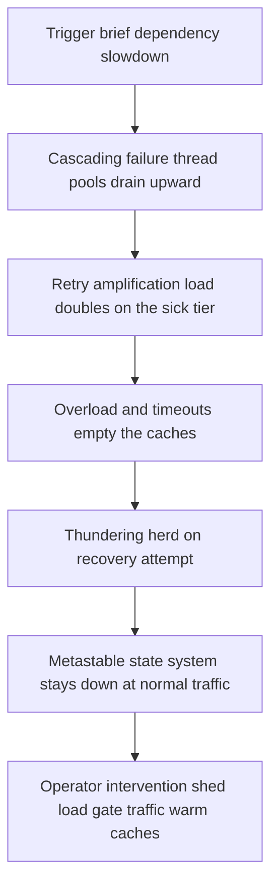

# Failure Modes in Distributed Systems

Individual machines fail simply: a disk dies, a process crashes. Distributed systems fail *socially* — the interesting outages are emergent, produced by the interactions between healthy-looking components: retries that multiply load, caches whose misses stampede the database, fleets that inherit the same expired certificate. This note is a taxonomy of the recurring patterns. Learn their **signatures**, because during an incident you don't diagnose from first principles — you pattern-match against shapes you've seen before.

## Why this matters

- **These patterns are the content of resilience engineering.** Every tool in this module — [[Timeouts Retries and Exponential Backoff|timeouts]], [[Circuit Breakers|breakers]], [[Bulkheads and Isolation|bulkheads]], [[Load Shedding and Graceful Degradation|shedding]] — exists as a defense against one or more entries below.
- **The failure is usually the interaction, not the component.** Post-mortems across the industry repeat the same finding: every individual part behaved as designed, and the system still died. You cannot find these failure modes by unit-testing components.
- **Interviewers probe exactly this**: "what happens when X slows down?" is a request to narrate one of these patterns.

The taxonomy at a glance:

| Failure mode | One-line signature | First-line defense |
|---|---|---|
| Cascading failure | One slow dependency → thread exhaustion spreading upward | Timeouts + bulkheads + breakers |
| Retry amplification | Load *grows* as success rate falls | Retry budgets, single retry layer |
| Thundering herd | Recovery or expiry → synchronized stampede | Jitter, request coalescing, gradual ramp |
| Metastable failure | Trigger clears, system stays down | Shed load to break the loop; capacity headroom |
| Gray failure | "Healthy" by its own checks, failing for callers | Differential observability, outside-in checks |
| Correlated failure | "Independent" redundancy fails together | Diversity: AZs, staggered deploys/certs, deploy hygiene |

## How it works

### Cascading failure

**Mechanism.** A dependency slows; callers' threads park waiting on it; the callers' own callers now see slowness and park *their* threads; each layer's pool drains in turn. Load may also *concentrate*: when one replica dies, survivors inherit its traffic, which pushes them past saturation, which kills them — failures feeding failures until the whole tier is down.
**Signature.** Latency and error graphs light up in a *wave* moving up the call graph; thread-pool and connection-pool saturation everywhere; the originating dependency often looks *least* alarming because its callers stopped reaching it.
**Real example.** AWS's October 19–20, 2025 us-east-1 event had this shape in public telling: a race condition in DynamoDB's automated DNS management left the regional endpoint's DNS record empty, and the fault propagated into dependent services (EC2 launches, NLB, Lambda) and their dependents, far beyond the original fault. Nygard's *Release It!* opens with an airline grounded by one unhandled exception in a connection pool.
**Defense.** Aggressive timeouts so threads can't park indefinitely; [[Bulkheads and Isolation|bulkheads]] so one dependency can only drain its own pool; [[Circuit Breakers|breakers]] to stop calling the sick tier; [[Load Shedding and Graceful Degradation|shedding]] on survivors so inherited load doesn't kill them too.

### Retry amplification

**Mechanism.** Retries multiply offered load exactly when capacity is lowest. Layered retries compound geometrically — 3 attempts per layer across 3 layers is 27 bottom-level attempts per user action (the arithmetic is in [[Timeouts Retries and Exponential Backoff]]).
**Signature.** Downstream request rate *rises* as its success rate falls — the damning graph is request count inversely tracking availability. Traffic during the outage exceeds pre-outage traffic.
**Real example.** A recurring ingredient in large-provider postmortems and the standard first chapter of most "why did recovery take hours" stories. Client-side retries against an impaired endpoint are the usual aggravating factor, though postmortems rarely quantify how much of the offered load they contributed — treat any specific multiplier you hear quoted about someone else's incident as folklore.
**Defense.** Retry at one layer only; retry budgets (caps like ~10% extra traffic); exponential backoff with full jitter; breakers as the stop signal; honest 429/503 + `Retry-After` so clients back off in sync.

### Thundering herd on recovery

**Mechanism.** A resource everyone wants becomes available at one instant — a service returns, a popular cache key expires, a leader is re-elected — and every waiter acts simultaneously. The recovering resource, cold (empty caches, fresh JIT, unwarmed pools), faces its worst-ever second of traffic at its weakest-ever moment and dies again.
**Signature.** Sawtooth: recover, spike, collapse, repeat. Also appears as periodic spikes aligned to synchronized TTLs or cron schedules.
**Real example.** The cache-expiry variant is so common it has its own note — [[Cache Stampede and Thundering Herd]]. Facebook's September 2010 outage is a canonical public telling: a configuration value was pushed that every client independently judged invalid, and every client simultaneously queried the database holding the correct value to repair itself.
**Defense.** Jittered backoff and jittered TTLs; request coalescing (one flight refreshes, others wait); slow-start/warm-up ramps at the LB ([[Load Balancers]]); for leader churn, randomized election timeouts ([[Consensus and Raft]]).

### Metastable failure

**Mechanism.** The nastiest entry: a trigger (traffic spike, brief outage) pushes the system into a degraded state that is **self-sustaining** — the trigger clears, and the system *stays down* because a feedback loop now generates enough internal load to keep itself saturated. The canonical loop is the **cache-miss storm**: cache empties during a blip → all reads hit the DB → DB saturates → requests time out *before refilling the cache* → cache stays empty → repeat, indefinitely, at normal offered traffic. Retry loops and queue backlogs (serving requests whose callers have given up) sustain the same way. The HotOS '21 paper ("Metastable Failures in Distributed Systems", Bronson, Aghayev, Charapko, Zhu) named the pattern: a *vulnerable* state tips into a *metastable* one, and the sustaining effect is the system's own work amplification.
**Signature.** The trigger is gone, dashboards show normal inbound traffic, yet the system remains saturated; every component is "busy but useless". Recovery requires an *intervention*, not patience.
**Real example.** The paper catalogs production cases from Meta and elsewhere; every experienced operator recognizes "we had to turn traffic off to let caches refill".
**Defense.** Break the loop by force: shed hard (serve a fraction of traffic until caches warm), disable retries temporarily, restart with traffic gated. Prevent by keeping the feedback gains low — capacity headroom, retry budgets, request coalescing, serve-stale — and by load-testing the *recovery* path, not just steady state ([[Chaos Engineering]]).

### Gray failure / partial degradation

**Mechanism.** A component fails *differentially*: healthy by its own checks, broken for (some of) its real clients. A NIC dropping 5% of packets, one AZ's path to one dependency degraded, a disk slow but not dead, a process that answers health probes from localhost while its request threads are wedged. The defining paper (Huang et al., "Gray Failure: The Achilles' Heel of Cloud-Scale Systems", HotOS 2017) frames it as an observer problem: the *system's* observer says healthy, the *app's* observer says sick.
**Signature.** "It's slow for some users/some routes but every dashboard is green." Health checks pass while p99 burns; errors correlate with a specific path, zone, or node rather than a component.
**Real example.** The Microsoft/Azure-authored paper draws on cloud production incidents; in Kubernetes terms, the classic is a pod whose liveness probe (a trivial in-process ping) passes while its Tomcat pool is deadlocked.
**Defense.** Measure from the caller's viewpoint: synthetic outside-in probes, per-dependency client-side success metrics ([[Logs Metrics and Traces]]), readiness checks that exercise a real code path; compare pairwise views (A can reach B, C cannot) to localize; evict suspect nodes rather than debating them.

### Correlated failure

**Mechanism.** Redundancy math assumes independence: two replicas at 99% each give 99.99% *only if their failures are uncorrelated*. Shared fate breaks the assumption: same AZ or rack, same cert bundle expiring at the same second, same bad config pushed fleet-wide, same deploy rolled everywhere at once, same underlying library CVE, same DNS resolver. The redundancy was an accounting fiction.
**Signature.** Multiple "independent" units fail within seconds of each other; the shared cause is a dimension nobody graphed (expiry date, config version, kernel version).
**Real example.** Cert expiries have felled major services repeatedly (ask any on-call engineer about a `NotAfter` date); fleet-wide config pushes are the cause in several famous outages — Cloudflare's 2019 global outage was one regex in a WAF rule deployed everywhere simultaneously.
**Defense.** Diversity along the correlated dimension: spread replicas across AZs (topology spread), stagger cert issuance and *alert on expiry*, canary every config/deploy before fleet rollout ([[Deployment Strategies]]), treat config pushes with the same ceremony as code. Chaos drills that kill a whole AZ expose the correlations you forgot ([[Chaos Engineering]]).

### How the modes chain together

Real incidents are rarely one mode; they're a sequence. A representative chain, worth tracing slowly because it's the anatomy of most multi-hour outages:

Each arrow is a place a defense could have cut the chain: a timeout and bulkhead at the first, a retry budget at the second, shedding at the third, jitter and coalescing at the fourth. This is why resilience mechanisms are deployed in *layers* — any single one failing to hold still leaves the next arrow defended. Post-incident reviews should name which mode each phase of the timeline was in; "the database was slow" is a trigger description, not an outage explanation.

### Detection: what to have on a dashboard before you need it

- **Per-dependency, client-side**: success rate, p99, and *request count* for every downstream — the amplification signature (traffic up, success down) only shows if you graph both.
- **Saturation gauges**: thread-pool active/queued, connection-pool waiters, queue depths — cascades are visible here minutes before they reach error rates.
- **Goodput, not just throughput**: requests completed within deadline; the metastable state hides behind healthy-looking raw throughput.
- **Correlation dimensions as labels**: AZ, node, deploy version, cert expiry on every metric — correlated failure is only diagnosable if the shared dimension was recorded ([[Logs Metrics and Traces]]).

### Triage: naming the mode in sixty seconds

During an incident you are not deducing, you are matching. This is the lookup table worth having memorised:

| What the dashboards show | Most likely mode | How you confirm it, fast |
|---|---|---|
| Errors appearing tier by tier moving *up* the call graph; thread and connection pools saturated at each | Cascading failure | Find which tier's own latency rose *first* in time — the source is early in the timeline and deep in the topology, and it usually looks calm by the time you page |
| Downstream request rate rising while its success rate falls | Retry amplification | Divide the downstream's current request rate by the current rate of distinct inbound user requests; the quotient is your live amplification multiplier, read straight off two graphs |
| Spikes at regular intervals — doubling gaps, or aligned to a clock boundary | Thundering herd | Check whether the spacing matches a configured backoff series, a TTL, or a cron schedule; nothing else produces that spacing |
| Inbound traffic normal, trigger long cleared, system still saturated | Metastable failure | Cut one suspected loop for sixty seconds — disable retries, or gate traffic hard. If utilisation falls, that was the loop; if not, move to the next candidate |
| Every probe green, but specific users, routes, or nodes failing | Gray failure | Compare *caller-side* success rates per upstream instance; a node passing its own probe while callers fail against it is the whole diagnosis |
| Several "independent" units failing within the same few seconds | Correlated failure | Sort the failed units by every shared attribute you record — AZ, node, image tag, deploy timestamp, cert expiry. One column will be constant, and that column is the cause |

### What this looks like at 3am

**03:07** — the page is `checkout-service availability below 99%`. The Kong dashboard shows inbound traffic flat and ordinary. This is not a traffic event, which rules out the easy explanation first.

**03:09** — checkout's p99 is 9 seconds against a 2-second target and its Tomcat active-thread gauge is pinned at maximum. You go one hop down. The ledger service's latency panel looks *fine* — p99 of 40 ms — which is the first genuinely confusing data point of the night.

**03:12** — the resolution to that confusion: ledger looks fine because ledger is barely receiving anything. Its request rate fell at 03:04, three minutes *before* checkout began failing. The time is going somewhere between them. Checkout's client-side panel for its Mongo calls shows p99 climbing from 15 ms to 1.4 s starting at 03:03.

**03:15** — Mongo's request rate is four times normal while its success rate sits at 60%. That ratio is the finding: offered load rising as success falls is retry amplification, and the multiplier is legible directly off the graph. Checkout retries, the shared data-access helper retries, and the driver retries — three layers that nobody had ever multiplied together.

**03:20** — the trigger turns out to be mundane and long over: a Mongo primary election at 03:03 lasting about fifteen seconds. The system has now been degraded for seventeen minutes on account of those fifteen seconds. Nothing is recovering on its own, because nothing is going to: this is the metastable state, sustained by the retries rather than by the fault.

**03:22** — the intervention is neither "wait" nor "restart Mongo". It is to cut the loop: flip the retry kill-switch, watch offered load collapse back to real traffic, confirm Mongo's latency drops, then re-admit. Recovery takes under two minutes once the loop is broken.

The post-incident finding is not "Mongo had an election" — elections are routine, expected, and designed for. The finding is that fifteen seconds of leader churn became a twenty-minute outage through a retry policy that existed at three layers, and the remediation lives in the retry budget, not in the database.

## Common misconceptions

- **"We have retries, so we're resilient."** Unbudgeted retries are an amplifier — they're how blips become outages. Resilience is retries *plus* budgets, breakers, and shedding.
- **"The system will recover when the trigger clears."** Metastable failures specifically won't; plan interventions (traffic gating, cache warm-up) in advance.
- **"Health checks tell us if it's healthy."** They tell you the health-check path works. Gray failures live in the gap between the probe and real traffic.
- **"Two replicas = double the reliability."** Only under independence. Same AZ, same deploy, same cert → correlated, and the second replica buys far less than the math claims.
- **"The root cause is the thing that broke first."** The trigger and the cause are different objects. A fifteen-second leader election is a trigger; a retry policy that converts fifteen seconds into twenty minutes is the cause. Post-mortems that stop at the trigger produce remediations aimed at the wrong system entirely — hardening the database that was never really the problem.
- **"We'd see it in the error rate."** Several of these modes are visible in *saturation* and *ratios* long before they reach errors: pool utilisation, queue depth, and the request-rate-to-success-rate relationship all move minutes earlier. A dashboard built only from error rates and averages is a dashboard that pages you once the outage is already underway.

## In your stack

- At one replica per service, "cascading" needs rereading: there's no fleet to drain slowly — a single wedged thread pool is an instant total outage of that service, and the cascade propagates via its *callers*. Your defense budget concentrates in timeouts, per-dependency bulkheads, and honest fast failure inside each lone pod.
- The arithmetic 1 replica removes: in a 3-replica service each running at 60% utilisation, losing one replica redistributes its share and pushes the survivors to 1.8 / 2 = 90% — uncomfortable, survivable, and the classic setup for a cascade you can watch develop. At 1 replica there is no such curve to watch. The pod is either there or absent, and every caller's experience jumps straight from normal to connection-refused. You have traded a gradual failure you might have interrupted for a binary one you cannot, which is the honest argument for spending the resilience budget caller-side.
- Gray failure is harder for you than for a larger fleet, for the same reason: the standard technique is comparing instances — this node is failing for callers, its peers are not. With one pod there is no peer to compare against, so detection has to come from outside-in synthetic probes and from each *caller's* client-side success rate per upstream, not from the pod's own view of itself.
- Your known correlated dimensions: many services on shared Mongo/Redis (a datastore blip is fleet-correlated by design — which is exactly why your readiness probes were decoupled from shared datastores), same base images and cert chains, and single-AZ exposure wherever one replica rides one node.
- The metastable cache-miss storm is your most plausible big outage: Redis cache-aside in front of Mongo, fleet-wide. Jittered TTLs, request coalescing, and serve-stale are cheap insurance ([[Cache Stampede and Thundering Herd]]).
- SQS consumers add a queue-backlog variant: a backlog of messages whose business relevance has expired can keep a consumer saturated long after the trigger — age-based message dropping is the shed valve ([[Backpressure and Flow Control]], [[Dead Letter Queues and Poison Messages]]).
- Your `x-correlation-id` convention is the diagnostic tool for all of these — the failure-mode signature appears when you trace one user action across hops ([[Distributed Tracing]]).

## Interview angle

- **60-second version**: "The big six: cascading failure — one slow dependency drains thread pools up the call graph; retry amplification — layered retries multiply load as success falls; thundering herd — synchronized demand at recovery or expiry; metastable failure — a feedback loop like a cache-miss storm keeps the system down after the trigger clears; gray failure — healthy by its own probes, failing for callers; correlated failure — redundancy sharing fate via AZ, cert, config, or deploy. Each has a distinct signature, and each maps to a specific defense: timeouts and bulkheads, retry budgets, jitter and coalescing, load shedding, outside-in observability, and diversity."
- Classic follow-ups: "Why doesn't the system recover when traffic normalizes?" (metastability — name the sustaining loop); "How do you detect what health checks can't?" (client-side metrics, synthetics); "Why did both replicas fail together?" (enumerate correlation dimensions).
- The strongest move in a design interview: after drawing an architecture, *unprompted*, walk one of these failure modes through it.

## Check yourself

> [!question]- Q: Explain a metastable failure and why it's categorically worse than a cascading failure.
> A cascade propagates while a cause persists and subsides when it's removed. A metastable failure is self-sustaining: a trigger (spike, blip) flips the system into a state where its own feedback — cache-miss storms re-saturating the DB before the cache can refill, retries exceeding capacity, backlogged work for callers who've left — generates enough load to keep it down at *normal* inbound traffic. The trigger clearing doesn't help; an operator must break the loop (shed hard, gate traffic, warm caches). It's worse because waiting — the default incident response — provably fails.

> [!question]- Q: What happens if a pod's liveness probe pings an in-process endpoint while its request threads are all deadlocked? Which failure mode, and what's the fix?
> Gray failure: the probe's observer (trivial local handler on a live event loop/acceptor) sees health; real callers see a wedged service. Kubernetes keeps the pod "Ready", the LB keeps routing to it. Fixes: readiness that exercises a real request path (without gating on shared datastores), client-side success-rate metrics per upstream, and synthetic outside-in checks — plus alerting on p99/error-rate symptoms rather than probe status alone ([[Alerting and On-Call Design]]).

> [!question]- Q: Your dependency's traffic *doubled* during its outage. Explain the mechanism and the three-layer fix.
> Retry amplification: every failed/timed-out call retried at multiple layers multiplies attempts (3 attempts × 3 layers = 27× worst case), so offered load grows exactly as capacity falls — often keeping the dependency down after its original fault is fixed. Fix: (1) retry at a single designated layer with backoff + full jitter; (2) retry budgets capping retry traffic to a small fraction; (3) circuit breakers so sustained failure stops the calls entirely, plus 429/`Retry-After` from the dependency so clients coordinate their backoff.

> [!question]- Q: Mini design: you must present an "independent failure domains" review of a payments stack — what correlation dimensions do you check?
> Infrastructure: same AZ/node/rack, same LB, same NAT gateway. Platform: same K8s cluster and control plane, same base image, same JVM version. Security: cert chains and their expiry dates, shared secrets rotation. Change: deploys rolled fleet-wide same hour, shared config service, same feature-flag push. Data: shared Mongo/Redis/Kafka, same backup window. People/process: one on-call, one runbook. For each shared dimension, either diversify (stagger, spread, canary) or accept it explicitly with eyes open — an unexamined shared dependency is the definition of correlated risk.

> [!question]- Q: What happens if you fix the root cause of an outage but recovery still doesn't happen — and traffic is back to normal levels?
> You're in a metastable state: some feedback loop is regenerating the overload internally. Hunt for the loop, in rough order of likelihood: empty caches sending full read traffic to the database (which times out before the caches can refill), client/layered retries multiplying the still-degraded success rate into extra load, a queue backlog of expired-but-still-processed work, and connection churn (reconnect storms). The intervention menu: shed a large fraction of traffic until caches warm, temporarily disable retries, drop aged queue messages, then re-admit traffic gradually. "Wait for it to settle" is the one response guaranteed not to work.

## Sources

- Bronson, Aghayev, Charapko, Zhu — "Metastable Failures in Distributed Systems", HotOS 2021 (follow-up OSDI 2022 study of production incidents).
- Huang et al. — "Gray Failure: The Achilles' Heel of Cloud-Scale Systems", HotOS 2017.
- Google SRE Book, ch. 22 "Addressing Cascading Failures" — the cascade/amplification playbook.
- AWS Builders' Library — "Timeouts, retries, and backoff with jitter"; "Using load shedding to avoid overload".
- Michael Nygard, *Release It!* (2nd ed., 2018) — stability antipatterns with production war stories.
- Cloudflare postmortem, "Cloudflare outage on July 2, 2019" — one WAF regex deployed fleet-wide, the reference case for config-push correlation.
