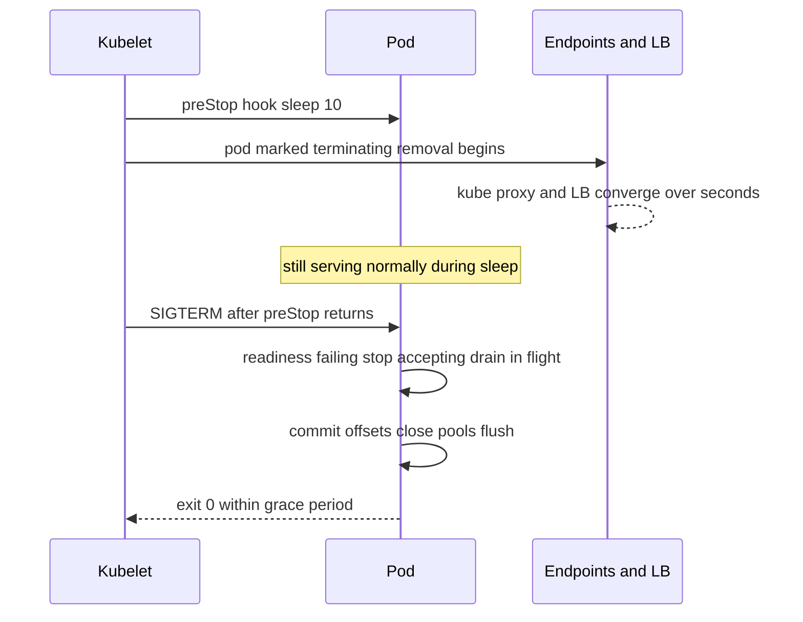

# Graceful Shutdown and Deployment Safety

Your services are killed far more often by *you* than by failures: every deploy, scale-down, node drain, and spot reclaim terminates pods on purpose. If shutdown is sloppy, every one of those routine events drops in-flight requests, kills transactions halfway, and leaves queue messages in limbo — a reliability tax paid dozens of times a week and usually misattributed to "deploy flakiness". Graceful shutdown is the choreography that makes planned death invisible: stop accepting new work, finish what you hold, release what you share, exit. The hard parts are a genuine race condition inside Kubernetes and the brutal arithmetic of running one replica.

## The problem that created it

A growing team notices a small spike of 502s and client timeouts on *every* deploy. Nothing is failing — this is the system working as configured: Kubernetes sends the old pod SIGTERM, the JVM dies within milliseconds (or worse, after SIGKILL because nobody handled SIGTERM), and every request in flight on that pod dies with it. In a fintech, "requests in flight" includes a debit that was committed at the partner but whose confirmation never got recorded — now a reconciliation case ([[Idempotency]]). The deeper bug: engineers assume Kubernetes "moves traffic away, then stops the pod". It doesn't — **it does both at the same time**, and bridging that race is the application's job.

## What it solves

- **Zero-error deploys**: in-flight requests complete; new ones land on other pods (when they exist).
- **Clean resource release**: DB connections returned, Kafka/SQS consumers deregistered with offsets committed, locks released — instead of peers waiting out stale-session timeouts.
- **Node-drain and autoscaler compatibility**: pods that die well make evictions, spot reclaims, and cluster consolidation non-events ([[Autoscaling]]).
- **Honest deployment risk accounting**: once shutdown is clean, what remains — the capacity gap during the roll — is visible and schedulable ([[Deployment Strategies]]).

## How it works

### The shutdown sequence every service owes its callers

On SIGTERM, within `terminationGracePeriodSeconds`:

1. **Flip readiness to failing** (and stop accepting new connections at the listener) — signal "no new work" while staying alive.
2. **Drain in-flight work**: let active HTTP requests finish; stop polling the queue and finish the current batch.
3. **Close shared resources deliberately**: commit consumer offsets and leave the group; close connection pools; flush buffers, metrics, and logs.
4. **Exit 0.** If the grace period expires first, SIGKILL ends the process mid-whatever — the budget must exceed your honest worst-case drain (longest request timeout + batch processing time + pool close), or long-tail work dies at the deadline.

Spring Boot ≥2.3 implements the web-server half with `server.shutdown=graceful` plus `spring.lifecycle.timeout-per-shutdown-phase` — the listener stops taking new requests and active ones get the phase timeout to finish. Queue consumers and schedulers are on you (`SmartLifecycle`/`@PreDestroy` ordering).

### The Kubernetes race, and the preStop sleep

Here is the trap. When a pod enters Terminating, two things start **in parallel**:

- Path A: kubelet sends SIGTERM to the container.
- Path B: the endpoint controller removes the pod's IP from the Service's endpoints, and *then* every consumer of that list — kube-proxy on every node, Kong/ALB/ingress target lists — converges on its own schedule, typically hundreds of milliseconds to several seconds.

Nothing orders A after B. So a pod that exits quickly on SIGTERM dies *while traffic is still being routed to it* — connection refused, 502s at the LB. **Readiness-gate removal must effectively happen before the kill, and Kubernetes does not guarantee it; you buy the ordering with a delay.** The standard fix is a **preStop sleep**:

```yaml
lifecycle:
  preStop:
    exec:
      command: ["sleep", "10"]
```

preStop runs *before* SIGTERM is sent (and counts against the grace period), so the pod keeps serving normally for ~10 s while endpoint removal propagates everywhere; only then does the drain sequence begin. Inelegant, universal, correct. Sizing: the sleep must cover endpoint-propagation time (plus LB deregistration delay if an external LB targets pods directly), and `terminationGracePeriodSeconds` must cover **sleep + drain + close** — a 10 s sleep inside a 30 s default grace period leaves only 20 s of real drain budget.



### Connection draining at the load balancer

The LB layer has its own version: **deregistration delay** (ALB) / drain mode — a deregistering target stops receiving *new* requests but existing ones get up to N seconds to complete. Align the chain: LB deregistration delay ≤ preStop+drain window, and keep-alive connections must be actively ended (send `Connection: close`, stop accepting) because an idle-but-open keep-alive from Kong or the ALB can carry a *new* request into a pod that thinks it's draining. Long-lived connections (WebSockets, gRPC streams, SSE) need application-level closure — ask clients to reconnect — or they occupy the full grace period and die hard ([[WebSockets Server-Sent Events and Long Polling]]).

### Queue consumers: rebalance on shutdown

For Kafka/SQS/Redis Streams consumers, shutdown choreography is about the *group*, not the caller:

- **Kafka**: stop polling, finish the in-hand batch, **commit offsets synchronously**, then `close()` the consumer — which sends a LeaveGroup so the group rebalances *immediately* instead of waiting out `session.timeout.ms` with the dead consumer's partitions stalled ([[Consumer Groups and Rebalancing]]). Killed mid-batch without commit, the next owner re-reads from the last commit: duplicate processing — which must be safe anyway ([[Delivery Semantics]], [[Idempotency]]).
- **SQS**: stop receiving, finish and delete in-hand messages; anything not deleted reappears after the visibility timeout — redelivery, not loss, provided handlers are idempotent.
- **Schedulers/locks**: release distributed locks and leadership explicitly, or peers wait out the TTL ([[Distributed Locking]]).

### Single-replica honesty

Everything above assumes *someone else serves while you die*. At `replicas: 1` that assumption fails, and the honest accounting is:

- A rolling update with `maxUnavailable: 1, maxSurge: 0` is a **planned outage**: old pod dies, gap, new pod schedules, pulls, starts, JVM warms, passes readiness — easily 30–120 s of zero endpoints per deploy. The fix that exists: **`maxSurge: 1, maxUnavailable: 0`** — start the new pod first, kill the old only after the new is Ready. This closes the *deploy* gap (cost: brief 2× resources and tolerating two instances running concurrently — watch singleton assumptions like schedulers and non-grouped consumers).
- **PDBs protect nothing at 1 replica.** A PodDisruptionBudget bounds *voluntary* disruptions (node drains, consolidation) — but with one replica, `minAvailable: 1` computes `disruptionsAllowed = 0` and blocks node drains outright (the cluster can't be maintained), while `maxUnavailable: 1` permits the drain and the outage it implies. There is no PDB setting that makes one replica drain-safe; the PDB is paperwork either way. Only a second replica closes the node-drain gap.
- Graceful shutdown still earns its keep at 1 replica: the outage window is *bounded and clean* (no dropped mid-flight transactions, offsets committed) instead of ragged. But it cannot make the window zero.

## Trade-offs

| You gain | You pay |
|---|---|
| Error-free planned terminations | Slower rollouts (sleep + drain per pod, serialized) |
| Clean consumer rebalances, no stalled partitions | Grace-period budgets to size and keep honest |
| Drain-compatible nodes (autoscaler, patching) | preStop sleep is cargo-culted config that must be explained to every newcomer |
| maxSurge closes the 1-replica deploy gap | Transient 2× resource use; two-instances-concurrently correctness to verify |

## Failure modes

- **SIGTERM unhandled** → instant death mid-request; the baseline failure. Verify with a kill test, not code review ([[Chaos Engineering]]).
- **Grace period shorter than real drain** → clean shutdown begins, SIGKILL finishes it; symptoms only on slow-request tails, so it hides for months.
- **No preStop sleep** → 502 blip on every single deploy; often normalized as "deploys are just like that".
- **Readiness and liveness confused**: failing *liveness* during drain gets you restarted mid-drain. Readiness gates traffic; liveness detects wedged processes; only readiness should flip at shutdown ([[Health Checks and Service Discovery]]).
- **Keep-alives not closed** → upstream LB/Kong keeps streaming new requests down an open connection into a "draining" pod.
- **Consumer killed without LeaveGroup** → partitions frozen until session timeout; at 1 consumer, the whole topic's processing stalls for that window.

## When NOT to use it

- There's no case against graceful shutdown itself — but there are over-engineering boundaries: don't chase *zero*-second drains for batch workers where redelivery + idempotency already give correctness; don't stretch grace periods to cover multi-minute jobs (checkpoint and resume instead — a "request" that can't finish in seconds shouldn't be an HTTP request, see [[Why Async Messaging Exists]]); don't bother with preStop sleeps on pods receiving no Service traffic (pure consumers) — their choreography is offsets, not endpoints.
- And don't let graceful shutdown *mask* the single-replica gap: a clean outage is still an outage; the honest fix is maxSurge for deploys and a second replica for drains.

## In your stack

- Your fleet already learned several of these the hard way; this note is the theory under those scars. On Facets `flavor: "deployment"` services, the grace period key is snake_case — `termination_grace_period_seconds` — and camelCase spellings are **silently dropped**, leaving the 30 s chart default; verify in the rendered pod spec, never in the Facets JSON.
- Probe budgets: Facets hardcodes `failureThreshold: 10` for all probes, so readiness detection time is `period × 10` — a `readiness_period: 5` means ~50 s to *detect* unreadiness, longer than a 30 s drain pause sized against the Kubernetes-default threshold of 3. Self-managed `.kube/*.yml` services use the default 3. Size preStop/drain against the threshold your service actually has.
- PDBs: Bharat's replica counts pinned at 1 make `max_unavailable: "1"` the only viable PDB (CP-approved) — `min_available: 1` blocks node drains outright. Verify `kubectl get pdb` shows ALLOWED DISRUPTIONS ≥ 1, and remember what this buys at 1 replica: nothing but drain *permission*; the outage happens either way.
- Spring Boot: `server.shutdown=graceful` + `spring.lifecycle.timeout-per-shutdown-phase` for the web half; confirm SQS listeners (`@SqsListener` containers) stop polling and finish in-hand messages inside the same budget.
- Deploy-gap math for your single-replica services: prefer `maxSurge: 1, maxUnavailable: 0` wherever two concurrent instances are safe; where they aren't (unpartitioned consumers, in-memory schedulers), the deploy gap is real — schedule deploys accordingly and say so in the runbook.
- JVM warm-up extends the gap: the new pod passing readiness isn't the new pod at full speed; first-minute p99 after deploy is its own metric worth graphing ([[Logs Metrics and Traces]]).

## Interview angle

- **60-second version**: "On SIGTERM: fail readiness and stop accepting, drain in-flight, commit consumer offsets and leave the group, close pools, exit — all inside the termination grace period. The subtlety is the Kubernetes race: SIGTERM delivery and endpoint removal start in parallel, so a fast-exiting pod dies while LBs still route to it — the standard fix is a preStop sleep that holds the pod serving until endpoint removal propagates, with the grace period sized to cover sleep plus drain. Align LB deregistration delay with that window. And at one replica, none of this prevents the gap — only maxSurge (for deploys) or a second replica (for drains) does; PDBs protect nothing at 1."
- Classic follow-ups: "Why does a sleep fix a race?" (it doesn't order events; it buys propagation time — and that honesty is the point); "Readiness vs liveness at shutdown?" (flip readiness only); "What happens to a Kafka consumer killed hard?" (partitions stall till session timeout, then rebalance; duplicates from last commit); "Rolling vs blue-green for one replica?" (maxSurge rolling ≈ mini blue-green).
- Senior tell: volunteering that graceful shutdown is tested by actually killing pods under load, not by reading the YAML.

## Check yourself

> [!question]- Q: Explain the Kubernetes termination race and why a preStop sleep — which orders nothing — fixes the symptom.
> On termination, SIGTERM delivery (kubelet → container) and endpoint removal (endpoint controller → kube-proxy on every node → external LBs) begin in parallel with no ordering guarantee; removal convergence takes hundreds of ms to seconds. A pod that reacts quickly to SIGTERM stops accepting while traffic is still routed to it → connection refused/502. preStop runs before SIGTERM and delays it; during the sleep the pod serves normally while removal propagates everywhere. It's not synchronization — it's a timing bet sized above observed propagation, which is why it must count inside the grace-period budget.

> [!question]- Q: What happens if a Kafka consumer pod is SIGKILLed mid-batch without committing? Walk the timeline.
> The broker doesn't learn of the death until heartbeats stop; the consumer's partitions sit unprocessed until `session.timeout.ms` expires. Then the group rebalances and another consumer (or the restarted pod) takes the partitions, resuming from the **last committed offset** — the dead consumer's in-flight batch is reprocessed: duplicates, which handlers must absorb idempotently ([[Idempotency]], [[Delivery Semantics]]). With one consumer total, the topic simply stalls for the session timeout plus restart. Graceful close() avoids most of this by committing and sending LeaveGroup, triggering an immediate rebalance.

> [!question]- Q: A service runs 1 replica with maxUnavailable 1, maxSurge 0, and a PDB of minAvailable 1. Describe deploy behavior and node-drain behavior.
> Deploy: the rollout kills the only pod first, then creates the new one — schedule + pull + start + warm-up + readiness ≈ 30–120 s of zero endpoints; every deploy is a planned outage. Node drain: the PDB computes disruptionsAllowed = 0, so the drain *blocks* — the outage is prevented by making the node unmaintainable, which just moves the pain to the platform team (and gets overridden eventually). Fixes: `maxSurge: 1, maxUnavailable: 0` closes the deploy gap (if two concurrent instances are safe); the PDB should be `maxUnavailable: 1` (permitting drains, outage and all); only a second replica makes drains actually safe.

> [!question]- Q: Mini design: specify the full shutdown config for a Spring Boot payment service — 10 s p99 request timeout, SQS consumer, behind Kong/ALB, 1 replica.
> preStop sleep 10 s (endpoint + ALB deregistration propagation); `server.shutdown=graceful` with timeout-per-shutdown-phase 15 s (> the 10 s longest request); SQS listener stop + finish/delete in-hand messages ≈ 10 s; pool/offset/flush close ≈ 5 s → `terminationGracePeriodSeconds` ≥ 45 (sleep 10 + drain 15 + consumer 10 + close 5 + margin), spelled `termination_grace_period_seconds` if Facets-managed, verified in the rendered pod spec. ALB deregistration delay ~15 s ≤ drain window. Deploy with maxSurge 1/maxUnavailable 0 after confirming two concurrent consumers are safe (SQS: yes, with idempotent handlers). Readiness flips at SIGTERM; liveness untouched. Validate by killing the pod under synthetic load and counting errors — target zero.

## Sources

- Kubernetes documentation: Pod lifecycle & termination, container lifecycle hooks (preStop), and PodDisruptionBudgets.
- AWS Builders' Library: "Ensuring rollback safety during deployments" and ALB target-group deregistration-delay documentation.
- Spring Boot reference: graceful shutdown (`server.shutdown`) and lifecycle phases.
- Kafka documentation / Confluent docs on consumer group membership, `session.timeout.ms`, and clean consumer shutdown.
- Google SRE Workbook, ch. on canarying releases — deployment safety beyond the single pod ([[Deployment Strategies]]).
