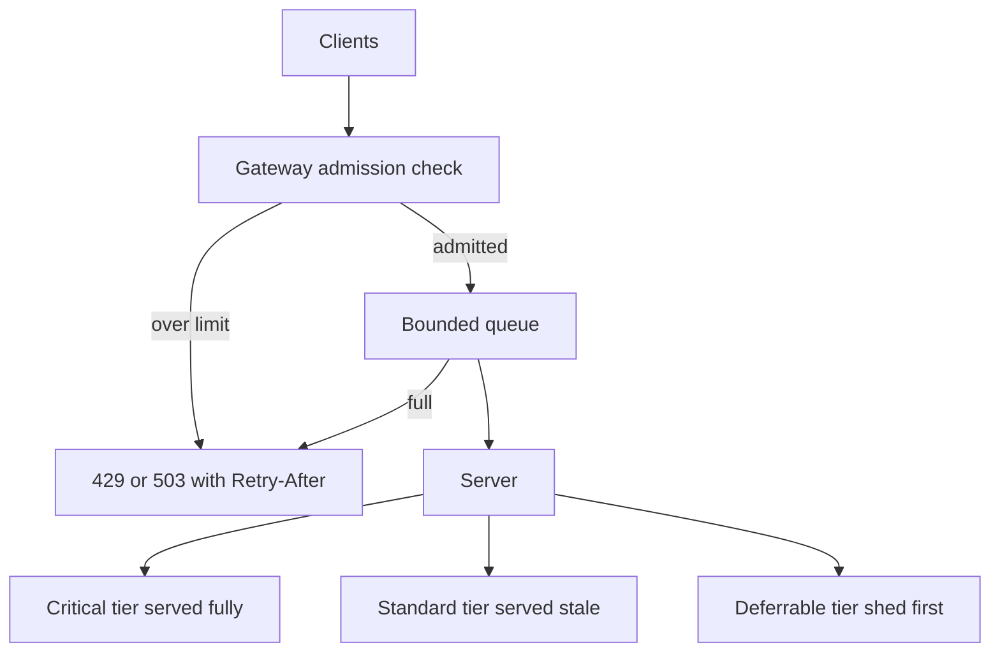

# Load Shedding and Graceful Degradation

Capacity is finite; demand occasionally isn't. The question is never *whether* your system can be offered more load than it can serve — a marketing push, a retry storm, a dependency slowdown halving your effective throughput — but what it does in that moment. Unprepared systems degrade for *everyone at once*: queues grow, latency explodes, timeouts fire, retries pile on, and goodput collapses to zero. Prepared systems **shed**: they serve what they can at full quality, reject the excess fast and honestly, and keep their most important work alive. Surviving overload is a feature you design, not a property you hope for.

## The problem that created it

A growing service handles 800 requests/second comfortably. One day it's offered 1,200. Intuition says it serves 800 and fails 400 — but that's not what unmanaged overload does. The extra requests queue; queuing adds latency; latency pushes requests past their callers' timeouts, so callers *retry*, adding more load ([[Timeouts Retries and Exponential Backoff]]). Soon the server spends its CPU on context switching, full garbage-collection cycles, and processing requests **whose callers have already given up** — work that counts as throughput but delivers nothing. **Goodput** (requests completed within their deadline, useful to someone) falls far below 800 even as the server runs hotter than ever. This is the congestion-collapse curve: past saturation, offered load up, useful work *down* — and it's one trigger of [[Failure Modes in Distributed Systems|metastable failure]], where the collapsed state outlives the traffic spike that caused it.

The fix requires accepting an uncomfortable truth: **rejecting a request you can't serve in time is a service to the caller**, who gets a fast, actionable answer instead of a slow failure that poisons their own latency budget.

## What it solves

- **Goodput preservation**: capacity goes to requests that will complete in time, not to doomed ones.
- **Congestion-collapse prevention**: bounded queues and early rejection keep the server on the productive side of the curve.
- **Priority under pressure**: payments survive while analytics sheds — *you* choose what fails, instead of the scheduler choosing randomly.
- **Honest signaling**: 429/503 + `Retry-After` tells callers precisely what to do; a timeout tells them nothing.

## How it works

### The collapse arithmetic

The congestion-collapse story is usually told qualitatively. It is worth doing once with numbers, because the *timescale* is what surprises people. Take the server from above: capacity 800 requests/second, offered 1,200, callers timing out at 2 seconds, an unbounded queue in front.

Excess arrives at 1,200 − 800 = 400 requests/second, so after *t* seconds of overload the backlog is 400*t* requests. A request joining the back of that queue waits backlog ÷ drain rate = 400*t* ÷ 800 = 0.5*t* seconds before service even begins. Set that against the 2-second client timeout: the wait exceeds the deadline once 0.5*t* > 2, that is, once *t* > 4.

**Four seconds.** Four seconds into a 50% overload, every request the server pulls off the queue has already been abandoned by its caller. The server is still completing 800 requests per second — raw throughput looks *perfect* on the dashboard — and its goodput is zero. It gets worse from there, because each abandoned caller is now free to retry, pushing offered load above 1,200 and making the backlog grow faster than this arithmetic assumed ([[Timeouts Retries and Exponential Backoff]]).

Two consequences follow directly. First, the window in which shedding must engage is *seconds*, which is why reactive [[Autoscaling|autoscaling]] is not a load-shedding mechanism — it is a recovery mechanism that arrives after the decision has already been made for you. Second, the queue here is not a buffer, it is the mechanism of the failure. Bounding it to 400 requests caps the wait at 400 ÷ 800 = 0.5 s, so everything admitted comfortably beats the deadline and everything else is refused immediately and honestly.

### Admission control: decide at the door

Shed at the *cheapest possible point* — before the expensive work. A request rejected at the gateway costs microseconds; the same request timing out in the database costs everything on the way. Admission signals that work in practice: concurrent requests in flight (the most robust single signal — a semaphore with a limit calibrated to measured capacity), queue depth/wait time, event-loop or thread-pool saturation, and measured downstream latency. CPU alone is often too lagging. [[Rate Limiting]] is admission control's per-client cousin: rate limits enforce *fairness policy* per caller even when the system is healthy; load shedding protects *total capacity* whoever the caller is. You want both.

### Priority tiers: shed analytics before payments

All traffic is not equal, and overload is when that stops being a platitude:

| Tier | Examples | Overload behavior |
|---|---|---|
| **Critical** | Money movement, auth, KYC callbacks | Serve until the walls crack; shed everything else first |
| **Standard** | Balance views, transaction history | Serve degraded (stale cache) under pressure |
| **Deferrable** | Analytics events, recommendations, prefetch | Shed first, silently; queue for later where possible |

Tag requests with a criticality header at the edge and honor it at every hop — Google's systems propagate exactly such a criticality value end-to-end. A system that sheds 20% of traffic *by tier* can be invisible to users; one that sheds 20% randomly fails one in five payments.

### Queue limits and fast rejection

Every queue must be **bounded** — an unbounded queue converts overload into unbounded latency, which is worse than refusal because every queued request is aging toward its caller's timeout. Keep queues short (a few times per-request service time), and on overflow reject *immediately* with **429 Too Many Requests** (per-client limit exceeded) or **503 Service Unavailable** (server-wide overload), plus **`Retry-After`** so well-behaved clients back off in a coordinated way instead of guessing. Two refinements worth knowing: **LIFO under overload** (serve the newest request — it has the most remaining deadline; the oldest queued request is the most likely already abandoned) and **deadline-aware drop** (if a request arrives with 50 ms of its caller's budget left and p50 service time is 80 ms, reject it now — it cannot succeed).

### Brownouts: degrade features, not availability

A **brownout** (the term echoes electrical grids dimming voltage rather than blacking out) disables *expensive optional features* under load so the core stays fast: skip personalized recommendations and show a static list; disable the expensive fraud-scoring enrichment and fall back to rules; shrink page sizes; drop image quality. The levers are feature flags consulted per request against a load signal — which means they must be built and tested *before* the incident ([[Deployment Strategies]]). The academic treatment (Klein et al., "Brownout", ICSE 2014) frames it as a control loop: measure latency, dim optional content until latency recovers.

### Degraded modes: serve something true enough

When a dependency is down rather than you being overloaded, degradation means serving from what you still have: **stale cache reads when the DB is down**, last-known-good configuration, cached search results, read-only mode during a write-path outage. Serve-stale needs care with Redis specifically: once a key's TTL expires the key is *gone*, so you cannot read it afterwards. The pattern is two TTLs — a short soft TTL written inside the value marking the entry as due for refresh, and a much longer hard TTL on the Redis key itself — so a soft-expired entry is still present to serve with a staleness marker rather than erroring. The design questions are *what staleness is acceptable per data type* (an account balance: seconds; a merchant logo: days) and *how the user is told*. This is the open-state fallback menu from [[Circuit Breakers]], applied system-wide.

### Cooperative clients: shedding's other half

Server-side rejection only works if clients respond to it sanely, so mature systems push part of the mechanism client-side:

- **Adaptive client throttling** (Google SRE ch. 21): each client tracks its own requests vs. accepts over a rolling window and preemptively self-rejects with probability rising as its reject rate rises — so the server stops paying even the (cheap) cost of refusing. The client sheds *itself*.
- **Honor `Retry-After` with jittered backoff** in every SDK you ship; a shedding server in front of non-backing-off clients is bailing a boat whose crew keeps pouring water in ([[Timeouts Retries and Exponential Backoff]]).
- **Degrade request ambition**: under pressure signals, clients can ask for less — smaller page sizes, no includes/expansions, cached-OK reads — turning one expensive request into a cheap one rather than zero.

### The 1M RPS connection

At 100 RPS, overload is a capacity bug you fix by scaling up. At 1M RPS, offered load routinely exceeds planned capacity somewhere — a cell, a shard, a hot key ([[Hot Partition Problem]]) — and autoscaling takes minutes you don't have ([[Autoscaling]]). Big systems therefore treat shedding as a permanent, always-armed subsystem, not an incident response: admission control at every tier, criticality propagated on every request, brownout flags pre-wired. Surviving 1M RPS with 800K of capacity *is the feature* — see [[Anatomy of 1M RPS]].

## Trade-offs

| You gain | You pay |
|---|---|
| Goodput stays near capacity under any offered load | Some real requests are rejected — by design, visibly |
| Chosen failures (tiers) instead of random ones | Classifying and propagating criticality through every hop |
| Fast, actionable errors for callers | Degraded/stale paths that must be built, flagged, and tested |
| Protection against retry storms and collapse | Admission thresholds need calibration against *measured* capacity, and drift |

## Failure modes

- **Shedding too late (or by the wrong signal)**: thresholds set above the real collapse point, or keyed to CPU when the bottleneck is connections — the system still collapses, now with extra config. *Signal*: latency and queue depth climbing while the shed counter stays at zero. *Confirm*: overlay the shed-decision metric on the latency graph; if the threshold crosses after latency has already passed the deadline, it is calibrated above the collapse point ([[Capacity Planning]]).
- **Unbounded queue upstream of the shedder**: Kong or the kernel accept-queue buffering thousands of doomed requests before your admission check runs — the queue *is* the overload. Concretely, in a default Spring Boot service your admission filter executes on a Tomcat worker thread, and Tomcat's defaults permit up to 8,192 open connections (`server.tomcat.max-connections`) plus an accept backlog of 100 (`server.tomcat.accept-count`) to be waiting *before any of your code runs*, against 200 worker threads. *Signal*: a gap between the gateway's observed latency and the application's own — the difference is queue time your shedder never saw. Bound every stage, including the ones you did not write.
- **Clients ignoring `Retry-After`**: mobile apps hammering retries turn your polite 429s into a second storm. *Signal*: your 429 rate and your total request rate rising together — polite refusal is supposed to *reduce* offered load, and if it does not, the clients are not listening. Pair shedding with SDK backoff and edge rate limits.
- **Degraded mode serving dangerous staleness**: a cached balance shown before a transfer, an FX rate hours old presented as live. *Signal*: none, which is exactly the danger — stale-but-plausible values generate support tickets and reconciliation breaks, not alerts. *Confirm*: emit the age of every served-stale value as a metric so staleness is observable at all, and enforce caps per data class in code.
- **Untested brownout flags**: the first time the flag flips is during the incident, and the "cheap" fallback path throws. *Signal*: an incident that gets *worse* the moment someone enables degraded mode. Exercise degraded modes on a schedule, in production, at low traffic ([[Chaos Engineering]]).
- **Shedding readiness confusion**: a pod that fails its readiness probe under load removes itself from the LB entirely — at small replica counts this amplifies overload on survivors into a cascade, and at one replica it drops the Service to zero endpoints. *Signal*: endpoint count dropping during a load spike instead of error rate rising. Shed *requests*, not *instances*.

### What overload looks like at 3am

**02:58** — a partner's unannounced batch job starts. Inbound rate on `balance-service` goes from 300 requests/second to 900 and stays there.

**03:01** — the page is latency, not errors: p99 at 6 s and climbing steadily. Everything is *succeeding*, slowly. The error-rate panel is clean, which is exactly why the page arrived three minutes late.

**03:03** — pod CPU reads 40%, the data point that sends most people in the wrong direction. The pod is not CPU-bound, it is waiting. The Tomcat active-threads gauge is flat at 200 and has been since 02:59.

**03:05** — the giveaway: the gateway's p99 has passed 6 s while the application's own request timer still reads 400 ms, unchanged from yesterday. The 5.6-second gap at that instant — and widening every second the overload continues — is time spent queued *before* the application ever saw the request. Do the arithmetic the dashboard is implying — 200 threads ÷ 0.4 s per request is 500 requests/second of real capacity against 900 offered. Capacity was never exceeded by the *work*; it was exceeded by the *admissions*.

**03:07** — and the mobile app times out at 3 seconds, so most of what the pod is dutifully completing is discarded on arrival. Throughput looks healthy. Goodput is near zero.

**03:09** — the intervention is a per-consumer rate limit at Kong against the partner's key, which drops offered load below capacity within seconds. The permanent fix is the thing that was missing: an admission limit inside the pod, keyed to in-flight concurrency, so the next unannounced batch job meets a fast 429 instead of a deep queue.

What to carry away is the *shape* of the evidence rather than the specific numbers: latency high, errors low, CPU moderate, threads pinned, and gateway-versus-application latency wildly divergent. That combination is overload, and not one of those panels on its own looks like an outage.

## When NOT to use it

- **When you're not actually capacity-bound**: if latency comes from a bug or a missing index, shedding hides it. Shedding manages genuine overload, it doesn't fix slowness.
- **Where every request is legally or financially mandatory** (inbound bank webhooks, regulatory callbacks): you can't 429 the regulator — buffer durably in a queue instead and process async ([[Why Async Messaging Exists]]); the queue is the shock absorber.
- **Brownouts without measurement**: disabling features that aren't actually expensive buys nothing and costs product quality — profile first.
- **Tiny internal tools**: a bounded thread pool and sane timeouts are enough; full admission-control machinery is overkill.

## Common misconceptions

- **"Load shedding is what you do once you run out of capacity."** It is a permanently armed subsystem, not an incident response. The arithmetic above gives you four seconds between the start of a moderate overload and zero goodput; nothing a human reaches for in that window arrives in time. If the shedder is not already running and already calibrated, it is not going to help.
- **"Queueing is kinder to callers than rejecting them."** A queue converts a refusal into latency, and past the caller's deadline it becomes a refusal *anyway* — now with the server's work wasted, the caller's budget burned, and a retry on the way. Queueing is kind only when the spike is bounded, short, and the caller is genuinely willing to wait. Otherwise a queue is a slower, more expensive way of saying no.
- **"Autoscaling means we never need to shed."** Reactive scaling takes minutes once you include scheduling, image pull, JVM start and warm-up; collapse takes seconds. The two are not alternatives and do not compete: shedding is how you survive until the capacity arrives, and autoscaling is how the incident ends.
- **"CPU tells us when we're overloaded."** CPU is both lagging and frequently wrong. A service blocked on a slow dependency has *low* CPU during its worst overload, because its threads are waiting, not computing. In-flight concurrency, thread-pool saturation, and queue wait all move the instant the dependency slows; CPU may never move at all.
- **"We'll decide what to degrade when it happens."** Degraded paths are code, and an un-exercised degraded path is untested code whose first production execution happens under maximum stress, during an incident, chosen by someone who is tired. The product conversation about what may be dropped is cheap in advance and impossible at 3am.

## In your stack

- At one replica, the capacity story is stark: one pod's capacity *is* the service's capacity, there's no fleet to absorb a spike, and [[Autoscaling|HPA]] adding a second pod takes minutes plus JVM warm-up. Admission control inside the pod (bounded Tomcat threads + a concurrency-limit filter) is your only millisecond-scale defense.
- Kong is your natural shedding point: per-consumer rate limits plus a global concurrency cap per upstream, returning 429 with `Retry-After` before traffic ever reaches a Spring pod. Edge-level limits belong at Kong/CloudFront per your conventions; app-level limits that *are* the security/capacity boundary stay in the app.
- Tiering maps cleanly to your domain: UPI/money-movement and KYC-callback endpoints are critical; balance and history views standard (serve-stale from Redis is acceptable with a marker); notification fan-out and analytics deferrable — they're already async via SQS, which is the correct shock absorber.
- Serve-stale is cheap for you: your cache-aside Redis entries can carry a soft TTL (refresh) and hard TTL (refuse), letting read endpoints ride out short Mongo incidents.
- Size the in-pod admission limit by measurement, not by inheriting Tomcat's 200 threads as if it were a capacity number. It is a *thread* limit; capacity is threads ÷ service time, and the two diverge the moment a dependency slows. Load-test to the concurrency at which p99 starts bending upward, set the semaphore just below it, and let threads remain what they actually are — a memory bound, not an admission policy.
- SQS gives your async paths a shedding axis the HTTP paths don't have: **message age**. A consumer that reads `ApproximateAgeOfOldestMessage` and drops or dead-letters work whose business relevance has expired is applying the same insight as LIFO on an HTTP queue — under backlog, the oldest item is the one most likely to be worthless. Decide per queue which ones are age-droppable (notification fan-out) and which are never droppable (settlement, KYC callbacks).
- Remember the fleet-wide lesson already learned: readiness probes must not gate on shared datastores at one replica — an overloaded Mongo must surface as degraded responses or 5xx from a *live* pod, never as the Service dropping to zero endpoints.

## Interview angle

- **60-second version**: "Past saturation, queues grow, latency blows past caller timeouts, retries amplify, and goodput collapses — so the design goal is to reject excess load fast and early. Admission control keyed to in-flight concurrency, bounded queues, 429/503 with Retry-After, and priority tiers so analytics sheds before payments. Under partial failure, degrade instead: brownout expensive features, serve stale cache with a staleness cap. The capacity isn't the feature — the behavior at capacity is."
- Classic follow-ups: "Throughput vs goodput?" (completed-in-deadline is what counts); "Why LIFO under overload?" (newest request has the longest remaining deadline); "Rate limiting vs load shedding?" (per-client fairness policy vs total capacity protection); "How do you pick what to shed?" (criticality tiers, propagated end-to-end).
- The senior signal is naming congestion collapse: that past the knee, doing *less* work total is how you do *more* useful work.

## Check yourself

> [!question]- Q: Explain why accepting 1,200 RPS into a server that can do 800 yields far fewer than 800 completed useful requests.
> The excess queues; queuing delay grows without bound; requests exceed their callers' timeouts while still in the queue, so the server increasingly processes requests whose callers already gave up — zero-value work. Meanwhile retries from those timeouts add offered load, deepening the queue, and GC/context-switch overhead rises. Goodput — responses delivered within deadline — collapses well below 800. Early rejection keeps the server at ~800 of *useful* work and gives the other callers a fast, honest signal.

> [!question]- Q: What happens if your load shedder returns 503 without Retry-After to 10,000 mobile clients at once?
> Each client invents its own retry policy; most retry immediately or on a fixed short timer, so the shed traffic returns as a synchronized wave — a thundering herd you created ([[Cache Stampede and Thundering Herd]]). `Retry-After` (plus SDK-enforced jittered backoff) spreads re-arrival. Shedding without backoff coordination moves the overload a second into the future rather than resolving it.

> [!question]- Q: Which should your fintech shed first and last: txn-history reads, UPI debits, analytics events, KYC webhooks? Justify the hard case.
> First analytics (deferrable, async-buffered, nobody waits). Then history reads — degrade to stale Redis before shedding outright. Last, between UPI debits and KYC webhooks, neither should shed: debits are the revenue-critical interactive path; KYC webhooks are compliance-mandatory but *not latency-sensitive* — so the correct move is to never 429 them but durably enqueue and process async. The lesson: "critical" splits into latency-critical (serve now) and delivery-critical (never lose) — different mechanisms, both protected.

> [!question]- Q: A pod starts shedding nothing while timing out everything. Its downstream dependency slowed from 50 ms to 800 ms; pod CPU reads 12%. Your admission control is keyed to CPU. Explain, and name the signal it should use.
> Nothing sheds, because CPU is measuring the wrong resource: the threads are blocked on I/O, not computing, so utilisation *falls* during the worst overload. Meanwhile capacity has collapsed by the ratio of service times — with 200 Tomcat threads, capacity was 200 ÷ 0.05 = 4,000 requests/second and is now 200 ÷ 0.8 = 250, a 16× reduction with no change in traffic whatsoever. Offered load that was comfortable is suddenly 16× over, the queue grows, deadlines pass, and the CPU-keyed shedder watches it all happen at 12%. The right primary signal is **in-flight concurrency against a calibrated limit** — a semaphore counting admitted requests — with queue wait time as the secondary. Both move the moment the dependency slows. At one replica the stakes are unforgiving: this pod is the service, so "overloaded and not shedding" is a total outage rather than a hot instance.

> [!question]- Q: Mini design: flash-sale traffic will be 5× your capacity for 10 minutes. Design the overload plan without buying 5× hardware.
> Edge: queue-and-token system (virtual waiting room) at CloudFront/Kong admitting users at sustainable rate; per-client rate limits; static-cache everything cacheable. App: concurrency-limit admission per pod, bounded queues, LIFO + deadline-drop; criticality tiers — checkout critical, browse served from stale cache (brownout: disable recommendations, reviews, live stock counts). Async: orders written to a durable queue, confirmation async ([[Message Queues vs Event Logs]]). Pre-scale ahead of the event since reactive autoscaling is too slow; load-test the shed path itself. Accept: some users wait at the door — by design, visibly, fairly.

## Sources

- AWS Builders' Library: "Using load shedding to avoid overload" (David Yanacek) — goodput, the collapse curve, rejection cost.
- AWS Builders' Library: "Fairness in multi-tenant systems" — shedding and fairness interplay.
- Google SRE Book, ch. 21 "Handling Overload" — criticality propagation, client-side throttling, utilization signals; ch. 22 for cascades.
- Klein et al., "Brownout: Building More Robust Cloud Applications", ICSE 2014 — the control-loop formulation of feature degradation.
- Netflix TechBlog: "Performance Under Load" (2018) — concurrency-limit-based adaptive admission control (their open-sourced concurrency-limits library).
