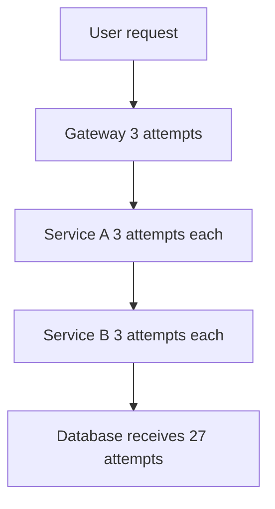

# Timeouts Retries and Exponential Backoff

Every remote call can hang, fail, or succeed without you ever learning it succeeded. The trio of timeout, retry, and backoff is the minimum equipment for making a network call responsibly — and each one, configured carelessly, makes outages *worse*: a missing timeout turns one slow dependency into a fleet-wide thread famine, and naive retries turn a brief blip into a self-inflicted DDoS. This note covers how to set each one deliberately instead of inheriting a library default you never read.

## The problem that created it

Picture a young service making its first HTTP call to another service. It works in testing, ships, and runs fine for months. Then one afternoon the downstream service's database gets slow. Responses that took 50 ms now take 60 seconds — not failing, just *slow*. Here is the trap: the calling service's HTTP client has no timeout configured, and many clients default to **infinite or absurdly long timeouts** (classic `java.net.URLConnection` defaults to infinite; older Apache HttpClient and some JDBC drivers default to 0, meaning "wait forever"). Each incoming request grabs a thread, calls downstream, and parks. Threads are finite. Within a minute the caller's entire thread pool is parked waiting on a dependency that is merely degraded — and now the *caller* is down too, and so is everything that calls it. One slow service has cascaded upward through every layer ([[Failure Modes in Distributed Systems]]).

The second act: engineers add retries to "improve reliability". The downstream recovers from its incident and comes back cold — at which moment every caller fires its queued retries simultaneously, and the recovering service is knocked flat again by its own clients ([[Cache Stampede and Thundering Herd|thundering herd]]). The network being unreliable was fallacy number one ([[The Fallacies of Distributed Computing]]); pretending otherwise is how these two stories keep happening.

## What it solves

- **Timeouts** bound the worst case: no call can hold a thread, a connection, or a user longer than you decided it may.
- **Retries** absorb *transient* failures — a dropped packet, a pod mid-restart, a brief leader [[Failover|failover]] — so users never see them.
- **Exponential backoff** spaces retries out so a struggling dependency gets breathing room instead of a beating.
- **Jitter** desynchronizes clients so thousands of retries don't land in the same instant.
- **Retry budgets and circuit breakers** cap the total extra load retries may generate, so the cure can't exceed the disease.

## How it works

### Timeouts: every call, every hop, deliberately

A remote call has several distinct timeouts, and they are not interchangeable:

| Timeout | Bounds | Typical symptom when missing |
|---|---|---|
| **Connect timeout** | TCP/TLS establishment | Threads stuck in handshake to a dead host (can be minutes at OS defaults) |
| **Request/read timeout** | Time waiting for response bytes | Threads parked on a slow-but-alive dependency — the cascading-failure fuel |
| **Pool-acquisition timeout** | Waiting for a free connection from the pool | Requests queue invisibly before the call even starts ([[Connection Pooling]]) |
| **Total/deadline timeout** | The whole operation including retries | Retries silently tripling your worst-case latency |

How to choose a value: not by gut. Measure the dependency's **p99.9 latency** and set the timeout a little above it — tight enough to fail fast, loose enough that you aren't failing healthy-but-slow requests. A timeout set at p50 fails half your traffic; a timeout at 30 s is indistinguishable from none.

**The arithmetic of a hang.** The timeout value converts directly into how long you survive a dependency outage, and the conversion is Little's Law: concurrent calls = arrival rate × duration. Suppose one Spring Boot pod with Tomcat's default 200 request threads, serving an endpoint that calls a partner API 50 times per second. Healthy, at a 120 ms p99, those calls occupy 50 × 0.12 = 6 threads — invisible. Now the partner stops answering and every call runs to its timeout instead:

| Read timeout | Threads held during a full hang | Outcome for the pod |
|---|---|---|
| 10 s | 50 × 10 = 500 wanted, only 200 exist | Exhausted after 200 / 50 = **4 seconds** |
| 2 s | 50 × 2 = 100 | Survives — half the pool lost, other endpoints keep serving |
| 500 ms | 50 × 0.5 = 25 | Survives — 12.5% of the pool, barely visible |

Read the first row slowly. A 10-second timeout means the pod is completely wedged four seconds after the partner goes quiet, and every *other* endpoint that pod serves — including ones that never touch the partner — dies with it, because they share the thread pool. The second row is the identical partner outage contained to half the pool. Nothing changed but one configuration value. The same table is the argument for bulkheads: a 20-permit [[Bulkheads and Isolation|bulkhead]] buys the third row's blast radius even if the timeout stays at the first row's value.

**Timeout budgets across hops.** In a chain A → B → C, A's timeout must exceed B's timeout *plus* B's retries *plus* B's own processing — otherwise A gives up while B is still faithfully working, wasting B's effort and possibly retrying a request that will succeed after A stopped listening. The rule: **the outer timeout must exceed the sum of the inner chain's worst case**. Better still, propagate a single **deadline** downstream (gRPC does this natively; over HTTP you can pass a remaining-budget header) so every hop knows how much time is actually left and can give up early instead of doing doomed work.

### Retries: only when it's safe, only when it helps

A retry is a bet that the failure was transient. Two preconditions:

1. **The operation must be safe to repeat.** A timeout is ambiguous — the request may have been fully processed before the response was lost. Retrying a `GET` is fine; retrying "transfer ₹5,000" without protection double-charges. Retries are only safe on **idempotent** operations, or operations *made* idempotent with an idempotency key — this is the single most practical idea in distributed systems for a fintech engineer, covered in [[Idempotency]] and the reason [[Exactly-Once Delivery Is a Lie]] matters.
2. **The failure must plausibly be transient.** Retry on connection errors, 503s, and timeouts (if idempotent). Never retry a 400 or 422 — the request is wrong and will be wrong every time. A 429 says *explicitly* to slow down; retrying it fast is antisocial.

### Exponential backoff with full jitter

Fixed-interval retries from many clients synchronize into waves. Exponential backoff spreads attempts over time; jitter spreads them across clients. The AWS Architecture Blog post "Exponential Backoff and Jitter" (Marc Brooker, 2015) simulated several strategies and found **full jitter** the strongest simple choice: it minimised the total number of calls the server had to absorb (a decorrelated-jitter variant was competitive on time-to-completion):

```
sleep = random_between(0, min(cap, base * 2^attempt))
```

where `base` might be 100 ms, `cap` perhaps 10 s, and `attempt` counts 0, 1, 2… So attempt 0 waits somewhere in [0, 100 ms], attempt 1 in [0, 200 ms], attempt 2 in [0, 400 ms] — the *ceiling* doubles, and the uniform-random draw below it is what breaks synchronization. Without jitter, 1,000 clients that failed together retry together, producing load spikes at exactly the same offsets — with a 1 s base, at t+1 s, t+3 s, t+7 s, the gaps doubling each wave; with full jitter the same retries smear into a gentle slope.

### Retry amplification: the multiplication nobody does

Retries at multiple layers multiply. Suppose each layer makes up to 3 *attempts* (1 original + 2 retries) and the chain is gateway → service A → service B → database. If the database is down, every bottom-level attempt fails, so:

```
3 attempts at gateway × 3 at A × 3 at B = 27 database-level attempts
```

for **one** user click. With "3 retries" meaning 4 attempts per layer, it's 4³ = 64. A modest per-layer policy becomes a 27–64× load amplifier against a dependency that is *already failing* — this is **retry storm**, and it is how systems stay down after the original fault is fixed ([[Failure Modes in Distributed Systems|metastable failure]]).

Put load numbers on it, because the multiplier only becomes frightening in absolute terms. Suppose user-facing traffic is 500 requests/second, each normally making one query against a database provisioned for 2,000 queries/second — a comfortable 25% utilisation. The database has a 30-second blip. Under the three-layer policy above, each user request now generates up to 27 bottom-level attempts: 500 × 27 = **13,500 queries/second** offered to a database that can serve 2,000. It is 6.75× over capacity, and the entire overload is manufactured by its own clients *in response to it being overloaded*. When the original 30-second fault clears, nothing improves: the database is still receiving 13,500 qps, still failing, still being retried. The blip has become a self-sustaining outage, and waiting is the one response guaranteed not to end it — someone has to turn the retries off.



Defenses, in order of preference:

- **Retry at one layer only** — usually the layer that owns the user experience; let inner layers fail fast upward.
- **Retry budgets**: cap retries as a fraction of total traffic (e.g., retries may add at most 10% extra requests, the approach gRPC and Google SRE use). When the budget is spent, failures propagate immediately instead of being retried.
- **Circuit breaking as the escape valve**: when failure rate shows the dependency is *down* rather than *blipping*, stop calling it entirely — retrying into a dead service is pure amplification. See [[Circuit Breakers]].

### Resilience4j specifics, since this is a JVM shop

The library's defaults are reasonable, but they are *defaults*, and two of them are routinely misread:

- **`maxAttempts` defaults to 3, counting the first call.** It is one call plus two retries, not three retries. The quantity that multiplies across layers is *attempts*, never retries, and conflating the two understates the damage: a team describing the default as "two retries" at two layers naturally multiplies 2 × 2 and reports 4× amplification, when the bottom dependency actually sees 3 × 3 = 9 calls. Always restate a retry policy in attempts before multiplying it across layers.
- **`waitDuration` defaults to a fixed 500 ms — no backoff, no jitter.** Exponential backoff is opt-in via an `IntervalFunction`, and jitter specifically via `IntervalFunction.ofExponentialRandomBackoff(...)`, which randomises each wait around the exponentially growing interval. Leaving the default in place across a large client population is the synchronised-wave failure mode arriving by configuration rather than by accident.
- **`retryExceptions` / `ignoreExceptions` are where "transient vs permanent" gets encoded.** Configure them deliberately: a `Retry` that has not been told which exceptions are retryable will happily re-send a request that failed validation, with the identical payload, to get the identical rejection.
- **`TimeLimiter` does not bound a blocking call.** It operates on `CompletionStage`/`Future` and cannot interrupt a thread parked inside a synchronous socket read. It bounds how long *you wait for a result*; it does not release the thread doing the waiting. The HTTP, Mongo, and Redis clients' own read timeouts are what actually free resources, and no Resilience4j decorator substitutes for them — this is the single most common way a service with a full resilience stack still dies of thread exhaustion.
- **Make `CallNotPermittedException` non-retryable.** That exception means the [[Circuit Breakers|circuit breaker]] is open — retrying it burns CPU re-asking a question the breaker exists to answer. Keep the decoration order deliberate too: the conventional composition is Retry outside CircuitBreaker outside TimeLimiter, so each attempt's timeout registers as exactly one breaker outcome.

## Trade-offs

| You gain | You pay |
|---|---|
| Transient faults invisible to users | Added tail latency (each retry stacks its timeout) |
| Bounded worst-case latency from timeouts | Tuning burden — budgets must be revisited as dependencies change |
| No synchronized retry waves (jitter) | Occasional duplicate side effects — must engineer [[Idempotency]] |
| Capped amplification (budgets) | Some genuinely recoverable requests fail once the budget is spent |

## Failure modes

- **Timeout shorter than the dependency's honest p99** → you manufacture failures and then retry them, adding load for nothing. *Signal*: the downstream team's success-rate dashboard is materially higher than your client-side one for the same endpoint. *Confirm*: plot your client-side latency histogram with the timeout drawn on it — if the timeout line cuts through a populated part of the distribution rather than sitting in its empty tail, you are killing healthy requests.
- **Retry on non-idempotent write** → duplicate payments, duplicate notifications. *Signal*: reconciliation breaks, or a user reports being charged twice — which is to say, hours or days late, by a human, never by a monitor. *Confirm*: look for two records with different IDs, the same amount and payee, seconds apart, where the first request's latency is suspiciously close to the client timeout. Prevention is idempotency keys, not hope.
- **Synchronized retries without jitter** → sawtooth load spikes on recovery; the dependency flaps as each wave re-kills it. *Signal*: request-rate spikes at regular, backoff-shaped intervals after an incident — roughly 1 s, 2 s, 4 s apart — rather than a smooth ramp. *Confirm*: the spike spacing matching your configured backoff schedule is the proof; nothing else produces that spacing.
- **Retrying 4xx errors** → amplification with zero chance of success. *Signal*: a 4xx rate that is an exact small multiple of the distinct-request rate. *Confirm*: group failures by status code and check whether retried statuses include any 4xx other than 429; always classify before retrying.
- **Nested timeout inversion** (inner timeout longer than outer) → outer caller gives up, inner work completes anyway; users see errors for operations that succeeded. *Signal*: a population of operations that are present and successful in the downstream's records but recorded as failures in yours. *Confirm*: compare each hop's configured timeout along one call path and check the outer exceeds the inner chain's worst case — this is a config audit, not a metrics question. Particularly nasty for money movement, where the discrepancy *is* the financial exposure.
- **The client that was never configured** → one HTTP, JDBC, or driver client built without timeouts survives every review because it works perfectly until the day its dependency hangs. *Signal*: during an incident, thread dumps show threads parked in a call nobody suspected. *Confirm*: audit by enumerating client beans and reading their actual effective configuration, not by grepping for the word "timeout" — the dangerous clients are dangerous precisely because the word does not appear.

## When NOT to use it

- **Don't retry** inside low-level libraries that other layers will also wrap with retries — be the layer that doesn't, and document it.
- **Don't retry** when a human is waiting and a fast, honest failure lets them act (a payment screen is often better failing in 2 s than succeeding in 40 s).
- **Don't add backoff** to a dead-letter path — a poison message fails deterministically; back off forever and you've built a slow infinite loop. Park it in a DLQ instead ([[Dead Letter Queues and Poison Messages]]).
- **Timeouts are never optional.** There is no legitimate case for an unbounded remote call.

## Common misconceptions

- **"Retries make a system more reliable."** Retries trade extra load for a lower chance of user-visible failure. While the dependency is healthy that is an excellent trade. While it is overloaded, the extra load *is* what is killing it, and retries make reliability strictly worse. An unbudgeted retry policy is not a reliability feature; it is a bet that pays off only as long as spare capacity exists, placed automatically at the exact moment spare capacity has run out.
- **"A timeout means the request failed."** A timeout means you stopped listening. The request may have been processed in full — debited, recorded, acknowledged at the partner — a tenth of a second after you gave up. Every timeout on a write is an *ambiguous outcome*, not a failure, which is why [[Idempotency]] and reconciliation exist and why retrying a write without an idempotency key is a correctness bug rather than a tuning choice.
- **"Exponential backoff is the fix; jitter is a refinement."** They solve different problems. Backoff spreads *one client's* attempts over time. Jitter spreads *the population*. Ten thousand clients that failed in the same second and back off identically still retry in the same instant — the waves move further apart and get no smaller. Jitter is the part that does the de-synchronising, which is why the AWS analysis measured its largest win in calls-to-the-server rather than in per-client latency.
- **"The client library has sensible timeout defaults."** Several do. The dangerous ones default to waiting forever, and they are dangerous precisely because nothing about them looks wrong until the day their dependency hangs. The only safe assumption is that an unconfigured client has no timeout until you have read its effective configuration and confirmed otherwise.
- **"Idempotency makes a retry free."** It makes a retry *safe*. The retry still costs a request against the dependency you may be overloading, and the deduplication store is itself a dependency with finite capacity and its own failure modes. Safety and cost are separate budgets.

## In your stack

- Audit every `RestTemplate`/`WebClient`/`OkHttp`/Mongo/Redis/SQS client in your services for explicit connect and read timeouts — Spring's `RestTemplate` built without a configured factory historically had effectively no timeouts, and a single forgotten client is enough to exhaust a Tomcat pool.
- At one replica per service, thread-pool exhaustion from a missing timeout doesn't degrade capacity — it removes **all** of it. The pod's readiness probe then fails and the Service drops to zero endpoints; a timeout bug presents as a full outage, not a slowdown.
- SQS redelivery is itself a retry loop, and its default is not neutral: the queue's visibility timeout defaults to **30 seconds**, so a handler that takes longer than that without extending it gets the message delivered again *while it is still processing the first copy* — concurrent duplicate processing, not sequential. Your consumer-side retries then multiply with SQS's. Make handlers idempotent ([[Delivery Semantics]]), set the visibility timeout above the handler's real worst case (or heartbeat-extend it with `ChangeMessageVisibility`), and let `maxReceiveCount` plus a DLQ be the retry budget ([[Dead Letter Queues and Poison Messages]]). Not p99.9: a read timeout is sized at p99.9 to *cut* the tail, but a visibility timeout is a lease that must *cover* it, and one sized at p99.9 duplicates one message in a thousand by construction.
- Kong retries upstream requests **by default** — a Kong Service's `retries` field defaults to 5, so up to six attempts, though only for proxy-level failures (connection refused, connect/read timeout) rather than for an application 5xx. A hanging dependency produces exactly those proxy-level failures. If that default is untouched and your Spring services also retry, you are running a multi-layer policy nobody decided on, with the gateway contributing the larger multiplier. Restate both layers in *attempts*, multiply them, and then choose which single layer keeps retrying; set the other to no retries and write down why.
- For money movement, prefer a *short* timeout plus an idempotency-keyed retry over a long timeout — bounded ambiguity you can reconcile beats an unbounded wait ([[Idempotency]], [[Stripe and Payment System Design]]).

## Interview angle

- **60-second version**: "Every remote call gets a connect and a read timeout sized off the dependency's tail latency, with outer timeouts exceeding the inner chain's worst case. Retries only on idempotent operations and only for plausibly transient failures, with exponential backoff and full jitter — `random(0, min(cap, base·2^attempt))` — so clients don't synchronize. Because retries multiply across layers (3 attempts at 3 layers is 27× at the bottom), I retry at one layer, cap total retries with a budget, and use a circuit breaker to stop calling a dependency that's actually down."
- Classic follow-ups: "Why jitter and not just exponential backoff?" (synchronized clients re-spike together); "When is retrying a timeout dangerous?" (non-idempotent writes — the request may have succeeded); "How do you set the timeout value?" (from measured p99.9, not folklore); "What's a retry budget?"
- Strong candidates volunteer the amplification arithmetic unprompted — it's the difference between knowing the pattern and knowing why it exists.

## Check yourself

> [!question]- Q: Explain why "3 retries with exponential backoff" at every layer of a 3-layer stack is dangerous, with the arithmetic.
> Retries multiply across layers. If each layer makes 3 attempts (1 original + 2 retries), a failure at the bottom means the bottom dependency sees 3 × 3 × 3 = 27 attempts for one user request (with 3 *retries*, i.e., 4 attempts, it's 4³ = 64). All that extra load lands on a dependency that is already failing, which can keep it down after the original fault is fixed. Fix: retry at a single layer, enforce a retry budget, and circuit-break when the failure rate shows the dependency is down.

> [!question]- Q: A payment call times out. Walk through what might have happened and what the client may safely do next.
> Three possibilities: the request never arrived; it arrived and failed; it arrived and *succeeded* but the response was lost. The client cannot distinguish them — a timeout is ambiguity, not failure. A blind retry risks a double charge. Safe path: retry with the same idempotency key so the processor deduplicates ([[Idempotency]]), or query the operation's status first. Without idempotency support, don't retry automatically — surface the ambiguity for reconciliation.

> [!question]- Q: What happens on recovery if 10,000 clients use exponential backoff without jitter?
> They failed at roughly the same moment, so their backoff schedules are in phase: waves of synchronized retries separated by the backoff schedule — with a 1 s base, gaps of ~1 s, 2 s, 4 s, so waves at ~1 s, 3 s, 7 s after the failure. The recovering service — cold caches, fresh connections — is hit by the full population at once and can be knocked over again, repeating each wave ([[Cache Stampede and Thundering Herd]]). Full jitter draws each sleep uniformly from [0, ceiling], smearing the waves into a flat, survivable trickle.

> [!question]- Q: One pod with 200 Tomcat threads calls a partner API 50 times a second. The partner stops responding entirely. Narrate what happens under a 10-second read timeout, and name the single change that contains it.
> Each in-flight call holds its thread for the full 10 seconds, and nothing is released inside that window, so the pod accumulates 50 blocked threads per second and exhausts all 200 after 200 / 50 = 4 seconds. From that moment *every* endpoint on the pod is unservable — including ones that never touch the partner — because they share the thread pool. At one replica that is a total outage of the service, not a degradation, and the readiness probe failing afterwards only removes the last endpoint from the Service. The single highest-leverage change is the timeout: at 2 seconds, steady-state concurrency during the same hang is 50 × 2 = 100 threads, half the pool, and unrelated endpoints keep serving. A 20-permit [[Bulkheads and Isolation|bulkhead]] reaches the same containment without touching the timeout, and a [[Circuit Breakers|breaker]] removes the waiting altogether once it has enough evidence — but if you may change exactly one number tonight, change the timeout.

> [!question]- Q: Mini design: set the timeout/retry policy for checkout → order service → inventory service → MongoDB, where checkout must answer in 2 s.
> Work backwards from the 2 s budget. Mongo query timeout ~300 ms (above its measured p99). Inventory: read timeout ~500 ms, no retries (fail fast upward). Order service: timeout ~800 ms, at most one retry with full jitter, only on idempotent calls — total worst case ~1.6 s. Checkout: 2 s total deadline, no further retries; on failure return a fast, clear error. One retrying layer, outer budgets exceed inner worst cases, deadline propagated downstream so doomed work stops early.

## Sources

- Marc Brooker, "Exponential Backoff and Jitter", AWS Architecture Blog (2015) — the full-jitter analysis and simulations.
- AWS Builders' Library: "Timeouts, retries, and backoff with jitter" (Marc Brooker) — the operational playbook this note follows.
- Google SRE Book, ch. 21 "Handling Overload" and ch. 22 "Addressing Cascading Failures" — retry budgets and amplification.
- *Designing Data-Intensive Applications* (Kleppmann), ch. 8 — timeouts and the unreliability of networks.
- gRPC documentation on deadlines and deadline propagation.
