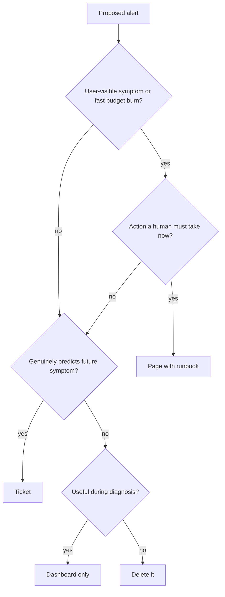

# Alerting and On-Call Design

Alerting is the contract between your system and a sleeping human: *wake me only when a user-visible problem needs a decision a machine can't make.* Most alerting setups violate this contract within a year — they page on causes instead of symptoms, on thresholds nobody can defend, and at volumes that train responders to ignore them. Good alerting design is mostly the discipline of deleting.

## The problem that created it

A young system starts with one well-meaning alert: "CPU > 80%." It fires at 2 a.m.; CPU was high because a batch job ran; nothing was wrong. Over months, every incident spawns a new alert for its specific cause — disk, heap, thread pool, a queue depth, a log pattern. The system grows to dozens of services, each with dozens of alerts.

Now the pager fires twenty times a week. Eighteen are noise: a blip that self-healed, a threshold tuned for last year's traffic, a cause-alert for a condition users never felt. The on-call engineer learns — rationally — to glance and dismiss. Then a real outage pages, looks like the other noise, and sits unacknowledged for forty minutes. The postmortem's root cause is not the bug; it is **alert fatigue**: the alerting system destroyed the signal it existed to carry. The Google SRE book's framing became industry standard because everyone, at every scale, independently reproduces this failure.

## What it solves

A deliberately designed alerting and on-call system provides:

- **Early, trustworthy detection** of user-facing degradation — before support tickets do.
- **Proportional response**: wake a human for emergencies, file a ticket for everything slower-moving.
- **Sustainable on-call**: pages rare and meaningful enough that carrying the pager doesn't burn people out.
- **Organizational learning**: every page either leads to a fix or to deleting/tuning the alert, so quality ratchets upward.

## How it works

### Symptom-based vs cause-based alerts

A **symptom** is what the user experiences: error rate up, latency over target, transactions not completing. A **cause** is any internal condition that *might* produce a symptom: CPU high, disk filling, replica lagging, one pod restarting.

**Page on symptoms; use causes for diagnosis and tickets.** The reasoning: the mapping from causes to user pain is many-to-many and unreliable. CPU at 95% may be harmless (batch window) while user-facing failure can occur with every internal graph green (a bad deploy returning well-formed wrong answers). Symptom alerts are also *stable*: "checkout error rate > 1%" stays valid through re-architectures, while cause alerts rot with every infrastructure change. Cause-based signals still matter in two places: as **diagnostic dashboards** the responder opens after a symptom page, and as **ticket-severity alerts** for genuinely predictive conditions ("disk 90% full, exhausted in ~3 days") where acting during business hours prevents the future symptom.

### Burn-rate alerting on SLOs

The modern form of symptom alerting is built on [[SLA SLO SLI and Error Budgets]]. Given an SLO — say 99.9% of requests succeed over 30 days — the **error budget** is the allowed 0.1% of failures. **Burn rate** is how fast you're consuming that budget relative to the sustainable pace: burn rate 1 means exactly on budget; burn rate 14.4 means the whole month's budget gone in ~2 days.

Static thresholds ("error rate > 1% for 5 min") force one number to be both sensitive and quiet; burn-rate alerting uses *multiple windows* instead. The SRE Workbook's recommended starting configuration, stated there for a 99.9% / 30-day SLO:

| Budget consumed | Long window | Short window | Burn rate | Response |
|---|---|---|---|---|
| 2% of monthly budget | 1 hour | 5 min | 14.4× | **Page** |
| 5% of monthly budget | 6 hours | 30 min | 6× | **Page** |
| 10% of monthly budget | 3 days | 6 hours | 1× | **Ticket** |

Every long window is paired with a short window of one-twelfth its length, which must *also* be burning, so the alert resets quickly once the problem stops instead of paging on stale history. One detail the table hides: **detection time depends on how far past the threshold you are**, because the long window is a trailing average. At *exactly* 14.4× the hour's average only crosses the threshold as the hour completes; at a 100% error rate it crosses in under a minute. The table sets the sensitivity, not the speed. The effect: a fast, severe outage pages within minutes; a slow bleed that would quietly eat the month's budget becomes a ticket; a brief blip that costs 0.01% of budget pages no one. The alert threshold now derives from a *business commitment* rather than a guess.

### Page vs ticket: the severity split

Every alert must be classified by the response it deserves:

| | **Page** (wake a human now) | **Ticket** (handle in working hours) |
|---|---|---|
| Criterion | User-facing symptom, or budget burning so fast that waiting loses it | Needs action eventually; nothing is lost by waiting until morning |
| Examples | SLO fast-burn, checkout failures, money-movement pipeline stalled | Slow budget bleed, disk 80%, cert expiring in 2 weeks, replica lag growing |
| Response time | Minutes | Days |

The test for a page is brutal and binary: **is it actionable right now?** If the responder's realistic action is "watch it" or "mention it tomorrow," it is a ticket. If an alert pages repeatedly and the action is always the same mechanical step, automate the step and delete the page.

Beyond page-vs-ticket, mature teams grade *incidents* (not alerts) by severity once a human is engaged — a typical ladder:

- **SEV1**: user-facing outage or money/data at risk; all-hands response, incident commander, status updates on a clock.
- **SEV2**: significant degradation or imminent SEV1; primary on-call drives, escalates freely.
- **SEV3**: minor or contained; handled in working hours, tracked to closure.

The severity ladder matters because it pre-authorizes behavior: a SEV1 declaration is permission to roll back first and ask questions later, wake the database owner, or shed load — decisions that cost minutes if they need debate at 3 a.m. **Escalation policy** is the companion contract: who is paged if the primary doesn't acknowledge within N minutes (secondary → team lead → engineering manager), configured in the paging tool, not in tribal memory.

### Alert fatigue: the real killer

Every alerting rule should survive this audit quarterly:

1. **Did it fire in the last quarter?** Never fired in a year → does the condition still exist?
2. **When it fired, was it true?** There is no published constant here, but the working rule of thumb is that once roughly half the firings are false, responders start dismissing on sight.
3. **When true, did a human act?** No action ever → ticket, dashboard, or deletion.
4. **Was the action automatable?** Then automate it and delete the alert.

The cultural rule that makes this work: *every page is either actionable or it is deleted.* Teams that track "pages per on-call shift" as a health metric (the SRE book's guideline is a maximum of **two incidents per 12-hour shift**, on the reasoning that fewer gives too little practice and more gives no time to handle each properly) catch fatigue before it becomes an outage. Noise is not a cosmetic problem — it is the mechanism by which real outages go unanswered.

### Runbooks attached to alerts

A page at 3 a.m. lands on someone with partial context and a foggy brain. Every alert should link a **runbook**: what this alert means, which dashboard confirms it, the three most likely causes with diagnostic queries, the mitigation steps (restart X, fail over Y, roll back Z — see [[Deployment Strategies]]), and the escalation path when steps are exhausted. A runbook that just restates the alert name is decoration; the standard is "a competent engineer who has never touched this service can mitigate." Writing the runbook also functions as an alert review: if you cannot write actionable steps, you have discovered the alert is not actionable — delete it.

### On-call rotation hygiene and blameless postmortems

- **Rotation size**: sustainable rotations need roughly 6–8 people; below that, frequency burns people out. Pair a primary with a secondary escalation.
- **Handoffs**: a brief written handoff (open incidents, ongoing weirdness, recent deploys) at every rotation boundary.
- **Follow-up time is part of on-call**: the shift includes time to fix what paged, tune what mis-paged, and update runbooks — otherwise debt compounds.
- **Blameless postmortems**: after any significant incident, write what happened, the timeline, contributing causes, and action items — *without* naming human error as a root cause. The reasoning is mechanical, not sentimental: systems in which people fear blame hide information, and hidden information means the same incident recurs. The postmortem's output feeds back into alerts (did we detect it fast?), runbooks (did they help?), and engineering priorities (error budget spent → reliability work earns priority over features, per [[SLA SLO SLI and Error Budgets]]).
- **Test the loop**: [[Chaos Engineering]]-style game days verify that alerts fire, runbooks work, and escalation paths are current *before* a real incident does.

## Trade-offs

| You gain | You pay |
|---|---|
| Pages that mean something — fast response to real outages | Up-front work: SLOs defined, burn-rate rules, runbooks written |
| Slow burns caught as tickets before users notice | Multi-window burn-rate alerting is harder to reason about than a static threshold |
| Sustainable on-call, retained engineers | Deleting alerts feels risky; requires organizational spine |
| Postmortems that compound into reliability | Honest postmortems take hours to write well |

## Failure modes

- **Fatigue relapse**: alert count creeps back up after every incident ("add an alert" is the reflexive action item). Mitigate with the quarterly audit and a budget on total page-capable alerts.
- **Symptom blindness between SLOs**: a flow nobody defined an SLI for fails silently. Mitigate by walking critical user journeys (login, KYC, money transfer) and confirming each has a symptom alert.
- **Dead escalation paths**: the secondary left the team; the page goes nowhere. Game days catch this.
- **Runbook rot**: steps reference decommissioned dashboards. Every postmortem should include "did the runbook work?"
- **Watermelon dashboards**: green outside, red inside — averages hide a failing 1% that is one entire customer segment. Alert on percentiles and per-segment SLIs ([[Latency vs Throughput vs Bandwidth]]).

## When NOT to use it

- **Full burn-rate machinery on day one**: a two-service system with no SLOs yet is better served by three honest symptom alerts (availability, latency, saturation) than a cargo-culted SLO program.
- **Paging on anything during known maintenance**: silence windows exist; use them rather than training people to ignore pages.
- **SLO alerting for batch/async pipelines without adaptation**: a nightly settlement job needs freshness/completeness alerts ("file not processed by 06:00"), not request-rate burn alerts.

## In your stack

- Your fleet's symptom SLIs live at the edges: Kong/ALB-level error rate and latency per route are the closest proxy to user experience — alert there, diagnose with per-service dashboards below ([[API Gateway]], [[Load Balancers]]).
- Services pinned at 1 replica change the math: a pod restart *is* a user-visible blip, not a tolerated event. Either the SLO absorbs brief unavailability honestly, or the alert will page on every deploy and node drain — fatigue by design. Be explicit about which.
- Money movement and KYC flows deserve their own SLIs ("debit success rate", "KYC verification completion") — an RBI-reportable incident should never be discovered via support tickets. For these, bias toward paging earlier: correctness beats latency, and a stalled settlement queue at 2 a.m. is a legitimate page.
- Queue-based flows (SQS today, Redis Streams next) need symptom alerts on *consumer lag / oldest-message age* — the user symptom of an async system is staleness, not errors ([[Backpressure and Flow Control]]).
- `x-correlation-id` belongs in every runbook's diagnostic queries: "take a failing request's correlation ID, search logs across services" is the universal first step ([[Distributed Tracing]]).

## Interview angle

The 60-second answer: "Alert on symptoms — what users experience — not causes, because cause-to-pain mapping is unreliable in both directions. The gold standard is burn-rate alerting on SLOs: page when the error budget is burning fast (multi-window, multi-burn-rate so brief blips don't page and slow bleeds become tickets), ticket when it's burning slowly. Split everything by response: pages must be actionable *now*, everything else is a ticket. The biggest real-world killer is alert fatigue — every page is actionable or it gets deleted — and every alert links a runbook. Around it: 6–8 person rotations, handoffs, and blameless postmortems so incidents compound into reliability instead of recurring."

Classic follow-ups: "Why not page on CPU?" (cause, not symptom; fires without pain and misses pain). "What's burn rate 14.4?" (budget-month consumed in ~2 days; the 2%-in-1-hour page). "How do you fix a noisy pager culturally?" (audit, delete, track pages/shift, automate mechanical responses). "Why blameless?" (blame hides information; hidden information repeats incidents).

## Check yourself

> [!question]- Q: Explain symptom-based vs cause-based alerting and why the industry settled on paging for symptoms only.
> A symptom is user-visible degradation (errors, latency, staleness); a cause is an internal condition that might produce it (CPU, disk, lag). Causes map unreliably to user pain: they fire when nothing is wrong and stay silent when something is (bad deploys keep infrastructure green). Symptom alerts track the thing you actually promised users, and they survive re-architecture. Causes remain valuable as diagnostics after a symptom page and as tickets when genuinely predictive.

> [!question]- Q: Your 30-day SLO is 99.9%. Error rate jumps to 1.44% at 01:00 and stays there. What happens under the Workbook's burn-rate rules, and when?
> Burn rate = 1.44% / 0.1% = 14.4×. The 5-minute short window is satisfied almost at once, but the 1-hour long window is a trailing average that only reaches 14.4× as that hour completes — so at *exactly* this rate the page lands near 02:00, and a worse rate would page proportionally sooner. At 14.4× the entire month's budget would be gone in about 2 days (30 ÷ 14.4 ≈ 2.1), which is exactly why this tier pages rather than tickets. If instead the error rate were 0.2% (burn 2×), no page fires; the 3-day 1× window accumulates and a ticket is filed — the budget is eroding but a human in working hours is the right response.

> [!question]- Q: A teammate proposes an alert: "WARN logs > 100/min on payment-service — page." Critique it.
> It pages on a cause-shaped proxy with no demonstrated link to user pain: WARN volume rises with traffic, with one chatty retry loop, with a dependency blip that self-heals. Its precision will be terrible, it will fire at peak hours by construction, and the responder has no defined action — the start of alert fatigue. Counter-proposal: page on payment *success-rate* SLO burn; keep WARN patterns on a diagnostic dashboard; if a specific WARN genuinely predicts failure, make it a ticket with a runbook, and revisit its precision quarterly.

> [!question]- Q: Mini-design — define the paging set for a UPI payment flow (order → payment → bank adapter → async settlement via SQS).
> Pages: (1) payment success-rate SLO fast-burn at the edge (Kong route level); (2) p99 payment latency SLO fast-burn; (3) settlement queue oldest-message age > threshold (staleness is the async symptom); (4) bank-adapter hard-down (all requests failing — a symptom, since users can't pay). Tickets: slow-burn on both SLOs, DLQ depth > 0, disk/cert/capacity predictions. Each page links a runbook with correlation-ID log queries, the bank-status dashboard, and rollback steps. Everything else — CPU, heap, restarts — is dashboard-only.

## Sources

- Google SRE Book (2016), ch. 6 "Monitoring Distributed Systems" (symptoms vs causes), ch. 11 "Being On-Call", ch. 15 "Postmortem Culture".
- *The Site Reliability Workbook* (2018), ch. 5 "Alerting on SLOs" — the multi-window, multi-burn-rate configuration and its exact thresholds.
- Rob Ewaschuk, "My Philosophy on Alerting" — the widely circulated precursor to the SRE book's monitoring chapter.
- Atlassian and PagerDuty incident-management guides — practical rotation sizing and handoff mechanics.
