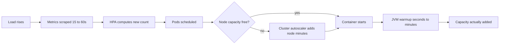

# Autoscaling

Autoscaling is the feedback loop that adjusts how many copies of a service run, so capacity follows load instead of being guessed once and fixed. It converts the static question "how many pods do we need?" into the dynamic one "what signal tells us we need more, and how fast can we add them?" The catch that this note keeps returning to: **autoscaling reacts, bursts don't wait** — so autoscaling reduces your headroom requirement; it never eliminates it.

## The problem that created it

A growing system sized by hand faces a bad choice. Provision for peak — festival-day traffic, 9 a.m. login storms — and most of that capacity idles at 3 a.m., burning money. Provision for average and every peak becomes an outage. Before autoscaling, teams picked a replica count in a config file, revisited it after incidents, and carried the scars: either a CFO asking why utilization is 8%, or a pager going off at the exact moment the business was doing best.

[[Vertical vs Horizontal Scaling|Horizontal scaling]] plus [[Stateless vs Stateful Services|stateless services]] made the fix mechanically possible — if any pod can serve any request, adding pods adds capacity. Autoscaling closes the loop automatically: measure a signal, compare to a target, adjust the replica count.

## What it solves

- **Cost tracking load**: capacity scales down at night and up at peak instead of being pinned at peak 24/7.
- **Survival of moderate, gradual surges** without a human bumping replica counts mid-incident.
- **Recovery capacity**: after a pod loss or node drain, the autoscaler restores the fleet toward target.
- **Honest capacity signals**: a well-chosen scaling metric doubles as a saturation dashboard ([[Capacity Planning]]).

## How it works

### The reactive loop: HPA

Kubernetes' **Horizontal Pod Autoscaler (HPA)** is the canonical reactive autoscaler. Periodically (default every 15 s) it computes:

```
desiredReplicas = ceil( currentReplicas × currentMetric / targetMetric )
```

Example: 4 pods at 80% average CPU with a 50% target → `ceil(4 × 80/50)` = 7 pods.

Three defaults that the formula alone hides, and that decide how the loop actually feels:

- **A 10% dead band.** If `currentMetric / targetMetric` falls between 0.9 and 1.1, the HPA does nothing at all — that is the `--horizontal-pod-autoscaler-tolerance` default of `0.1` (overridable per HPA via a `tolerance` field in `behavior`, stable since v1.37 in 2026), and it exists so a fleet hovering near target doesn't twitch every 15 seconds.
- **Up and down are asymmetric on purpose.** The default `behavior` allows scale-*up* with a 0-second stabilization window and a policy of +100% or +4 pods per 15 s, whichever is larger; scale-*down* gets a **300-second stabilization window** during which the controller takes the *highest* desired count it computed, so brief lulls can't tear capacity out.
- **CPU/memory targets are a fraction of each pod's `resources.requests`**, not of the node or the limit — so a wrong request silently rescales every percentage you reason about.

### Why CPU is often the wrong signal

CPU-based scaling assumes saturation shows up as CPU. For **IO-bound services — most Java/Spring microservices, which spend their time waiting on MongoDB, Redis, HTTP calls to other services, and bank gateways — it doesn't.** A thread blocked on a 2-second downstream call consumes ~zero CPU. Under a surge, such a service exhausts its *thread pool and connection pools* first: latency climbs, requests queue, timeouts fire — while CPU sits at 30% and the HPA sees no reason to act. The service falls over "cold."

The inverse error also bites: JVM startup (JIT compilation, class loading) burns CPU, so a CPU-triggered HPA can see new pods start hot, conclude load rose further, and spiral upward.

CPU is the *right* signal for genuinely CPU-bound work (encoding, crypto, serialization-heavy gateways). For everything else, scale on a signal that tracks the actual bottleneck:

| Signal | Fits | Mechanism |
|---|---|---|
| CPU utilization | CPU-bound services | HPA resource metric |
| **RPS per pod** | Request-serving, IO-bound services with known per-pod capacity (measured via load test — [[Capacity Planning]]) | HPA custom metric (Prometheus adapter) |
| **Queue lag / depth** | Async consumers: scale on backlog, the direct measure of falling behind ([[Backpressure and Flow Control]]) | KEDA or external metrics (SQS queue depth, Kafka consumer lag, Redis Streams pending count) |
| p99 latency | Tempting, but noisy and *late* — degradation has already happened; better as an alert ([[Alerting and On-Call Design]]) | Possible, rarely primary |
| Concurrency / in-flight requests per pod | Capacity expressed as parallelism, a good thread-pool proxy | Envoy/service-mesh metrics, KEDA |

**KEDA** (Kubernetes Event-Driven Autoscaling) is the standard way to drive HPA from event sources — it reads queue depth or lag directly from SQS/Kafka/Redis and can scale consumers 0→N.

### The other two autoscalers

- **VPA (Vertical Pod Autoscaler)**, one line: it adjusts a pod's CPU/memory *requests* instead of the replica count — useful for right-sizing, and still awkward alongside HPA-on-CPU since both react to the same signal. Its other historic cost, a pod restart to apply new requests, is era-specific: in-place pod resize graduated to beta in Kubernetes v1.33 (2025) and to stable in v1.35 (December 2025), and VPA's `InPlaceOrRecreate` mode uses it (alpha in VPA 1.4, GA in 1.6).
- **Cluster Autoscaler**: pods are scheduled onto nodes, and when new pods don't fit, they sit `Pending` until the cluster autoscaler provisions a node — adding **minutes** to scale-up latency on top of pod startup. **Pod priority and preemption** decide who waits when capacity is tight: give user-facing services higher `priorityClass` so a scale-up evicts batch/cron pods instead of queueing behind them. A common trick is a low-priority "balloon" deployment of placeholder pods that reserve warm node capacity and get evicted the instant real workloads need it.

### Scaling lag vs bursts: why headroom survives

Autoscaling is a pipeline of delays: metric scrape (~15–60 s) → HPA decision (15 s loop) → pod scheduling → possibly node provisioning (minutes) → container start → **application ready**. For a JVM service, that last step dominates: Spring context startup plus JIT warmup means a new pod can take tens of seconds to start and *minutes* to reach full, low-latency throughput — a freshly started JVM runs interpreted/cold and serves its first requests slowly, exactly when you need it fast (mitigations exist — CDS, tuned startup, GraalVM native images or CRaC checkpoint restore — each trading build complexity for startup time).

Total realistic lag: 1–5+ minutes. Any burst faster than that is served entirely by **pre-existing headroom**. A traffic step that doubles load in 30 seconds hits the current fleet at 2× — if the fleet was running at 85% utilization, it is now past saturation, latency explodes, and (worse) overloaded pods can fail readiness probes, shrink the serving set, and trigger the retry-amplification spiral described in [[Failure Modes in Distributed Systems]]. Autoscaling handles *trends*; headroom handles *steps*. Target utilizations of 50–70% are not waste — they are the burst budget, and known events (festival days) are handled by **pre-scaling on schedule**, not by trusting the reactive loop ([[Capacity Planning]] does this math).



### Beyond reactive: scheduled and predictive scaling

The reactive loop is the baseline, not the whole toolkit:

- **Scheduled scaling** sets the floor by calendar: raise `minReplicas` before the 9 a.m. login storm or a festival sale window, lower it after. For known events this beats any reactive signal, because the capacity exists *before* the first request of the surge.
- **Predictive scaling** (AWS predictive auto scaling, custom forecast-driven controllers) fits a model to historical cycles and pre-scales automatically. Useful for strong daily/weekly periodicity; useless for one-off events, which stay on the calendar.
- **Scale-down is the dangerous direction.** Scaling up late costs latency; scaling down early costs an outage when the next wavelet arrives against a shrunken fleet that must warm up again. Default postures: long scale-down stabilization windows, small down-steps, and never scaling down during a declared incident or event window.

### Scale-to-zero and serverless

Scale-to-zero (Knative, Lambda, Cloud Run) removes the last idle instance, making idle cost truly zero — compelling for spiky, low-duty-cycle workloads (webhooks, cron-like processing, internal tools). The price is the **cold start**: the first request after idle pays full startup — for a JVM, that can be seconds to tens of seconds, which is user-visible and SLO-breaking on an interactive path. Mitigations (provisioned concurrency, min-instances = 1) work by… not scaling to zero, which is the honest tell: for steady-traffic user-facing services, scale-to-zero solves a problem you don't have and adds one you can't accept. It shines where traffic is rare, latency tolerance is high, or runtimes start fast.

## Trade-offs

| You gain | You pay |
|---|---|
| Cost tracks load | Reactive lag means headroom is still mandatory — autoscaling shrinks it, never removes it |
| No 3 a.m. manual scaling | A feedback loop you must tune (targets, windows) and can destabilize (flapping, spirals) |
| Queue consumers that drain their own backlogs | Custom-metric plumbing (Prometheus adapter / KEDA) to operate |
| Right signal = self-documenting capacity | Wrong signal = confident automation doing the wrong thing at the worst time |

## Failure modes

- **IO-bound service, CPU signal**: latency collapse at 30% CPU; HPA never fires. Detected by latency alerts with no scaling events; fixed by RPS-per-pod or concurrency metrics.
- **Scale-up spiral**: warmup CPU or retry storms read as load; more pods start, burn startup CPU, trigger more scaling. Damped by startup-aware probes, scale-up policies, and sane max replicas.
- **Flapping**: aggressive scale-down tears capacity out after each lull; the next wavelet pays full warmup again. The stabilization window and conservative down-policies exist for this.
- **Max replicas as silent ceiling**: HPA hits `maxReplicas` during a real surge and stops; nobody alerted on it. Alert on "at max replicas" as a saturation symptom.
- **Downstream un-scalability**: the service scales 4→40 pods; MongoDB and the bank gateway do not. Each new pod brings its own connection pool, and the database drowns in connections — autoscaling one tier *amplifies* pressure on fixed tiers ([[Connection Pooling]], [[Backpressure and Flow Control]]). Scaling limits must be set with the whole chain in mind.
- **Cluster capacity cliff**: HPA asks, nodes aren't there, pods pend for minutes mid-surge. Balloon pods / overprovisioning and priority classes mitigate.

## When NOT to use it

- **Stateful systems** (databases, brokers): adding a replica means data movement and rebalancing, not just a new process — scaling is an operation, not a loop ([[Rebalancing Partitions]]).
- **Services pinned at 1 replica by design**: there is nothing to scale horizontally; honesty says so (see *In your stack* below).
- **Predictable load with tight SLOs**: if peak is known (market open, festival sale), schedule capacity; don't gamble a reactive loop against a step function.
- **When the bottleneck is elsewhere**: autoscaling app pods in front of a saturated database converts a slow system into a fast producer of database pain.

## In your stack

- Much of your fleet is **pinned at 1 replica as a cost decision** — meaning no HPA, and the honest consequences: a deploy or pod loss is a brief outage, and a surge is absorbed entirely by that one pod's headroom. Where autoscaling matters most for you is the *consumers*: SQS queue depth (and later Redis Streams pending-entries lag) via KEDA is the natural, low-risk place to start — backlogs are tolerant of scaling lag in a way user-facing requests aren't.
- Your Java/Spring services are the textbook IO-bound case: time goes to MongoDB, Redis, and bank/partner HTTP calls. If you enable HPA with a CPU target, expect it to sleep through your real saturation (thread/connection pools). Measure per-pod RPS capacity with a load test first ([[Capacity Planning]]), then scale on RPS per pod.
- JVM warmup makes aggressive reactive scale-up less effective for you specifically: a Spring Boot pod that takes tens of seconds to start and minutes to JIT-warm contributes nothing during a 2-minute burst — measure your own number rather than trusting mine. Pre-scale for known events (festival days, salary-day loads); keep startup probes honest so cold pods don't receive full traffic ([[Health Checks and Service Discovery]], [[Graceful Shutdown and Deployment Safety]]).
- Mind the fixed tiers: MongoDB and partner-bank rate limits don't autoscale. Cap `maxReplicas` against downstream connection budgets, and pair scaling with [[Rate Limiting]] and [[Load Shedding and Graceful Degradation]] at the edge for the load you *choose* not to serve.
- Cost shape for the auditor-minded: HPA on EKS scales pods (free beyond the nodes), but pods force nodes via the cluster autoscaler — your real cost scales with *node-hours*, and the lever is utilization target × warmup-driven headroom.

## Interview angle

The 60-second answer: "Autoscaling is a feedback loop: measure a signal per pod, compare to target, resize the fleet — HPA's `ceil(current × metric/target)`. The design decision is the signal: CPU works for CPU-bound services, but IO-bound services saturate thread and connection pools at low CPU, so you scale those on RPS per pod or concurrency, and async consumers on queue lag via KEDA. Below pods sits the cluster autoscaler adding nodes in minutes, with pod priority deciding who waits. The key limitation: the loop reacts in minutes — scrape, decide, schedule, maybe provision a node, then application warmup, which for JVMs is the dominant term — so bursts are absorbed by headroom, not by autoscaling. Target 50–70% utilization and pre-scale known peaks. Scale-to-zero trades idle cost for cold starts — great for spiky background work, wrong for latency-sensitive paths."

Classic follow-ups: "Why is CPU wrong for a typical microservice?" (IO-bound: blocked threads ≈ no CPU; pools saturate first). "Autoscaling vs headroom?" (lag math — anything faster than the loop is headroom's job). "How do you autoscale a queue consumer?" (lag/depth, KEDA, 0→N is fine because backlog tolerates lag). "What breaks downstream?" (connection amplification into fixed-size databases).

## Check yourself

> [!question]- Q: Explain to a teammate why your Spring Boot payment service fell over at 35% CPU and the HPA never scaled.
> The service is IO-bound: request threads spend most of their life blocked on MongoDB and the bank gateway. Blocked threads consume no CPU, so saturation showed up as thread-pool and connection-pool exhaustion — queuing, rising latency, then timeouts — while CPU stayed low. The HPA was watching CPU against a target it never approached, so it correctly (by its own lights) did nothing. The fix is scaling on a signal that tracks the real bottleneck: RPS per pod against load-tested capacity, or in-flight concurrency.

> [!question]- Q: What happens when traffic steps from 1,000 to 2,500 RPS in 40 seconds, fleet at 70% utilization, full autoscaling enabled, JVM services?
> The step outruns the loop. For the first minutes the existing fleet takes 2.5× load at 70% baseline — it is immediately past saturation: latency spikes, pools exhaust, some pods may fail readiness and shrink the serving set, inviting retry amplification. HPA reacts within ~30–60 s, but new capacity must schedule, possibly wait on node provisioning, start Spring, and JIT-warm — several minutes before it genuinely absorbs load, and cold pods serve slowly at first. Survival in minute one is decided by headroom, load shedding, and backpressure already in place; autoscaling determines how quickly the pain *ends*, not whether it begins.

> [!question]- Q: Design the scaling policy for an SQS consumer processing settlement files, currently 1 replica, spiky daily pattern.
> Scale on the queue, not the pod: KEDA with SQS queue depth (or oldest-message age for a latency-shaped target), e.g. target 100 messages per replica, min 1 (or 0 if staleness tolerance allows and startup is acceptable), max capped by what the downstream — MongoDB write throughput, partner API rate limits — can take, since every added consumer multiplies pressure on fixed tiers. Conservative scale-down (long stabilization) to avoid flapping through the spiky pattern. Alert on oldest-message age regardless: the SLO is staleness, and hitting maxReplicas with age still rising is the capacity signal.

> [!question]- Q: When is scale-to-zero the right call, and what disqualifies it?
> Right: rarely invoked, latency-tolerant work — webhook handlers, report generation, internal tools, bursty batch consumers — where idle cost dominates and a cold start of seconds is invisible or acceptable. Disqualifying: user-facing interactive paths with p99 SLOs (a JVM cold start alone can blow the budget), steady traffic (there's no idle to save), or flows where the first event after idle is the most critical (payment callbacks). The tell: if you find yourself configuring min-instances=1 to make it acceptable, you've re-invented not-scaling-to-zero.

## Sources

- Kubernetes documentation — Horizontal Pod Autoscaler (algorithm, stabilization window), Vertical Pod Autoscaler, Cluster Autoscaler, pod priority and preemption.
- KEDA documentation — scalers for SQS, Kafka, Redis Streams; scale-to-zero semantics.
- Google SRE Book (2016), ch. 22 "Addressing Cascading Failures" — why overloaded fleets spiral and headroom matters.
- *The Site Reliability Workbook* (2018), ch. 11 "Managing Load" — autoscaling pitfalls, including feedback loops and downstream amplification.
- AWS Builders' Library, "Reliability, constant work, and a good cup of coffee" and related essays — on designing for load that doesn't wait for reactive systems.
