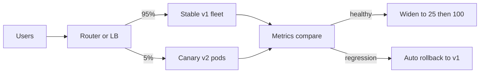

# Deployment Strategies

Every deployment is a bet that new code behaves in production the way it behaved in staging — and staging always lies a little. A deployment strategy is how you size that bet: how much traffic sees the new version, how fast you find out it's wrong, and how cheaply you can take it back. The through-line of this note: **the quality of a deployment strategy is measured by its rollback, not its rollout.**

## The problem that created it

The original strategy was the **big bang**: stop the old version, start the new one, hope. For a small internal tool this is fine. Then the system grows: users are always online, revenue flows through the API, and one bad deploy at 6 p.m. becomes an outage with your name on it. Two separate pains emerge:

1. **Downtime**: even a *good* deploy interrupts service while processes restart.
2. **Blast radius**: a *bad* deploy hits 100% of users instantly, and "roll back" means another full-downtime cycle — under pressure, with the pager screaming.

Every strategy below is a different answer to the same two questions: *how many users does a bad version touch before you know it's bad, and how fast can you get back?* The industry's empirical backing is unusually strong here: the DORA research program found that elite teams deploy more often with *lower* change-failure rates — small, reversible deployments are safer than rare, large ones.

## What it solves

- **Zero-downtime releases**: users never see a deploy happen.
- **Bounded blast radius**: a bad version reaches 5% of traffic, not 100%.
- **Fast, low-drama rollback**: recovery is a routine operation, not an incident of its own.
- **Deploy/release separation**: code can be in production but dark, so shipping and launching become independent decisions.

## How it works

### The strategy ladder

- **Big bang (recreate)**: stop old, start new. Downtime guaranteed, blast radius total. Acceptable only where downtime is acceptable.
- **Rolling**: replace instances a few at a time; old and new serve simultaneously during the window. Kubernetes' default strategy, with `maxSurge`/`maxUnavailable` controlling the pace — both default to **25%** (as of v1.37, 2026), `maxUnavailable` rounded *down* and `maxSurge` rounded *up*. No extra fleet needed, no downtime — but rollback means rolling forward through the same gradual process, and **both versions run at once**, so every deploy must be backward-compatible in its API and data access. Correct draining matters: see [[Graceful Shutdown and Deployment Safety]] and [[Health Checks and Service Discovery]] — a rolling deploy without readiness gating is a self-inflicted outage.
- **Blue-green**: run two full environments; blue serves while green receives the new version; flip the router when green is verified, keep blue warm as instant rollback. Rollback is one routing change — seconds. Cost: double the fleet (at least during the deploy), and the flip is still all-or-nothing for traffic: a bug that only shows under full load hits everyone at once.
- **Canary**: route a small slice (1%, 5%, 25%…) to the new version, compare its health against the stable fleet, widen on success, abort on regression. **Automated canary analysis** (Argo Rollouts, Flagger, Spinnaker/Kayenta) makes the comparison statistical rather than someone squinting at dashboards: define the metrics (error rate, p99, business KPIs), let the controller promote or roll back. This is the production standard at scale — the bet is sized at 1% and the judge is a machine with no deadline pressure.
- **Shadow (mirror) traffic**: copy real production traffic to the new version but discard its responses. Zero user risk, real load and data shapes — ideal for rewrites and performance validation. Sharp edge: side effects. A shadowed payment service must not debit anyone twice — shadowing suits read paths and pure computation, or demands careful stubbing of writes.

### Comparison table

| Strategy | Downtime | Blast radius of a bad deploy | Rollback speed | Extra infra cost | Complexity |
|---|---|---|---|---|---|
| Big bang | Yes | 100% | Slow (redeploy) | None | Trivial |
| Rolling | None | Grows with rollout pace | Medium (roll back gradually) | ~None | Low; needs version co-existence |
| Blue-green | None | 100% at flip | Seconds (flip back) | 2× fleet during deploy | Medium |
| Canary | None | 1–5% slice | Fast (shift traffic back) | Small (canary pods) | High; needs metrics + traffic splitting |
| Shadow | None | ~0 (users unaffected) | N/A (not serving) | ~2× for mirrored load | High; side-effect handling |

### Feature flags: separating deploy from release

A **feature flag** is a runtime conditional that turns code paths on/off per user, percentage, or segment — without a deploy. This splits two events that big-bang thinking fuses: **deploy** (code reaches production, dark) and **release** (users see the behavior). Benefits compound: merge small PRs behind a flag instead of long-lived branches; ramp a feature 1% → 100% independently of any deploy; kill a misbehaving feature in seconds via config rather than rolling back a binary that contains ten other changes.

The tax is **flag debt**: every flag doubles the paths through the code it guards; dead flags accumulate until nobody knows which are load-bearing (the cautionary tale is Knight Capital, 2012 — reuse of a long-dead flag contributed to a $460M loss). Discipline: every flag has an owner and an expiry, and removing a released flag is part of the feature's definition of done.

### Database migrations under zero downtime

The hardest part of every strategy above: during rolling/blue-green/canary, **old and new code run against the same database simultaneously**. A migration that renames a column breaks the old version instantly. The standard answer is **expand–migrate–contract**:

1. **Expand**: make additive, backward-compatible schema changes only — add the new column/collection field, nullable or defaulted. Old code ignores it; new code can start writing both old and new fields.
2. **Migrate**: backfill existing data in the background; ship code that reads new-then-old and writes both. Verify counts/checksums.
3. **Contract**: once no running code touches the old field (deploys settled, verified by access metrics), remove the old column and the dual-write code — a separate, later deploy.

Each step is individually reversible; at no point does any running version face a schema it can't handle. The cost is honesty about pace: a "simple rename" becomes three deploys over days. With MongoDB the schema is implicit but the problem is identical — documents written by v1 must remain readable by v2 and vice versa during the overlap window.

### Rollback as a first-class requirement

Treat "how do we undo this?" as part of the design review, not an incident improvisation:

- **Roll back beats debug forward** during user-facing pain: restore service first, diagnose from traces/logs after ([[Distributed Tracing]]).
- A rollback target must actually work: old images retained, old config compatible, and — the usual trap — **the database must still be readable by the old version**, which is exactly what expand–migrate–contract guarantees and ad-hoc migrations destroy.
- Some changes are effectively **irreversible** (data deleted, messages consumed, external side effects like payouts). Flag these in review and wrap them in a feature flag or a dark launch, because the deploy-level rollback story no longer covers them.
- Measure it: DORA's change failure rate and its recovery-time metric are the two numbers that tell you whether your strategy works in practice. (That second metric was "time to restore service" / MTTR in the *Accelerate* era; DORA renamed and narrowed it to **failed deployment recovery time** in its 2023 report, so it now measures recovery from *your deploy* rather than from any outage — which is the number a deployment strategy actually controls.)

Practices that make rollback stay fast in reality, not just in the design doc:

- **Immutable, versioned artifacts**: roll back to an image digest that provably existed, never "rebuild the old commit" (the rebuild can differ — dependencies drift).
- **Config rolls with code**: if config lives outside the artifact, a code rollback can land on incompatible config; version them together or test the rollback pairing.
- **Drill it**: a rollback that has never been executed is a hypothesis. Teams that practice (or better, auto-rollback on canary regression) turn it into muscle memory; [[Chaos Engineering]] game days are a natural place to rehearse.
- **One change per deploy where it counts**: rolling back a deploy that bundled ten changes reverts nine innocents — another argument for small frequent deploys and flags.

## Trade-offs

| You gain | You pay |
|---|---|
| Bounded blast radius, routine rollback | Pipeline complexity: traffic splitting, analysis, orchestration |
| Deploy anytime, release deliberately (flags) | Flag debt; combinatorial test surface |
| Zero-downtime schema evolution | Every migration becomes 3 phases; discipline required |
| Statistical deploy verdicts (canary analysis) | Needs good metrics first — canary without SLIs is theater ([[Logs Metrics and Traces]]) |

## Failure modes

- **Version-compatibility breaks during overlap**: v2 writes a payload v1 can't parse (API, cache entry, queue message, DB row). Seen as errors only on the *old* pods mid-rollout. Mitigation: backward-compatible contracts enforced in review; consumer-driven contract tests; [[Event Schema Evolution]] rules for messages.
- **Canary judged on vanity metrics**: error rate fine, but the canary silently corrupts a business flow. Include business KPIs (payment success rate) in the analysis set.
- **Canary too small or too short**: 1% for 5 minutes cannot see a p99 regression or a slow memory leak. Size the slice and bake time against the metric you fear ([[Capacity Planning]] thinking applies).
- **Sticky state defeats traffic shifting**: sessions pinned to canary pods, or cache entries written in a new format, make "shift traffic back" not actually undo the damage ([[Stateless vs Stateful Services]]).
- **Rollback that can't roll back the data**: the deploy went out with a destructive migration; now restore requires a backup, and minutes become hours ([[Disaster Recovery]]).

## When NOT to use it

- **Canary + automated analysis for a 2-person internal tool**: the machinery costs more than the outages. Rolling + good health checks is proportionate.
- **Blue-green when you can't afford 2× fleet** or when the database is the risky part — blue-green flips compute, not data.
- **Shadow traffic on side-effectful paths** without rigorous write-stubbing — mirrored debits are incidents, not tests.
- **Percentage canaries on very low-traffic services**: 1% of 10 RPM is statistical noise; use time-based bake or synthetic checks instead.

## In your stack

- Services pinned at **1 replica** deserve honesty: at `replicas: 1` the 25% defaults round to `maxUnavailable: 0` and `maxSurge: 1`, so a rolling update briefly runs a second pod and zero-downtime is possible without configuring anything — but any crash-on-boot bug means the single-replica service is down until rollback completes. There is no canary at 1 replica; the deploy *is* the canary. Low-traffic windows and fast health checks are the real mitigations.
- Your EKS + Kong setup supports canary two ways: pod-level (Argo Rollouts shifting ReplicaSet weights) or gateway-level (Kong route weights) — gateway-level also covers cross-service version splits.
- Fintech skew: for money-movement services, prefer canary with *business-metric* analysis (debit success rate, settlement lag) over pure error-rate analysis; an RBI-reportable incident can hide behind HTTP 200s. Flag-gate anything irreversible (new payout logic) separately from its deploy.
- Queue consumers (SQS today, Redis Streams planned) deploy under the same overlap rule: v1 and v2 consumers share the queue mid-rollout, so message schema changes follow expand–migrate–contract exactly like DB schemas ([[Event Schema Evolution]], [[Delivery Semantics]]).
- MongoDB migrations: background backfills must be rate-limited so they don't saturate the primary's write capacity during business hours — treat a backfill like any other load ([[Capacity Planning]]).

## Interview angle

The 60-second answer: "Deployment strategies trade infrastructure cost and complexity against blast radius and rollback speed. Rolling replaces pods gradually — free, but both versions co-exist, so everything must be backward compatible. Blue-green keeps a full warm standby — instant rollback via router flip, at 2× cost, but the flip is all-or-nothing. Canary sends a small slice to the new version and widens only if automated analysis of error rate, latency, and business metrics stays clean — smallest blast radius, most machinery. Shadow mirrors traffic with responses discarded — zero user risk, great for rewrites, dangerous with side effects. Orthogonally, feature flags separate deploy from release, and database changes follow expand–migrate–contract so every running version can always read the schema. The whole design is judged by one thing: how fast and how boring is rollback."

Classic follow-ups: "How do you deploy a breaking DB change with zero downtime?" (expand–migrate–contract, three phases). "Blue-green vs canary?" (rollback speed + cost vs blast radius + analysis). "What breaks rollbacks in practice?" (destructive migrations, irreversible side effects, incompatible cache/queue payloads). "Flags vs canary?" (flags gate *features* per user at runtime; canary gates *binaries* per traffic slice — mature shops use both).

## Check yourself

> [!question]- Q: Explain why a rolling deploy forces backward compatibility, with one concrete failure example.
> During a rolling deploy, old and new pods serve simultaneously behind the same load balancer, and both read/write the same database, caches, and queues. Any contract between those surfaces must be readable by both versions. Concrete failure: v2 renames `amount` to `amountMinor` in a queue message; mid-rollout, v1 consumers receive v2 messages, fail to parse, and dead-letter real payments — errors appear on the *old* pods, which confuses diagnosis. Additive changes plus dual-read/dual-write avoid this.

> [!question]- Q: What happens if a canary at 5% has a bug that only corrupts a response field, with HTTP status still 200?
> Automated analysis watching only error rate and latency promotes the bad version — the metrics are green. 5% of users get corrupted data, then 100% after promotion. Defenses: include business-level SLIs in the analysis set (success rate of the *business* operation, downstream validation errors), contract tests before deploy, and for critical responses, semantic canary checks (synthetic transactions whose results are verified end-to-end, not just status-coded).

> [!question]- Q: You must drop a legacy `status` column that new code no longer uses. Walk the zero-downtime sequence and what guards each step.
> This is the contract phase, and it's only safe after expand and migrate are truly done. (1) Verify nothing reads/writes the column: code search plus runtime evidence (query logs/metrics) across *all* services sharing the DB. (2) Deploy code that has zero references, everywhere. (3) Wait a full rollback horizon — if you might roll back to a version that reads `status`, the column must still exist — so the drop waits until no deployable artifact references it. (4) Drop in a separate change, off-peak, with a backup point. The guard at every step: any running or rollback-candidate version must find the schema it expects.

> [!question]- Q: Mini-design — deployment plan for a payment-service change that alters the debit flow and adds a Mongo field, on EKS behind Kong, 3 replicas.
> Expand first: deploy v2 writing both old and new Mongo fields, reading new-then-old — rolling deploy, backward compatible. Gate the new debit *logic* behind a feature flag, default off, so deploy and release are separate. Canary the release, not just the deploy: enable the flag for 1% of users (internal/test cohort first), watch debit success rate, p99, settlement lag, and DLQ depth against the stable cohort; widen 1% → 10% → 100% over hours. Rollback story: flag off in seconds (logic), traffic/ReplicaSet shift back (binary), old field still written (data). Contract weeks later: remove flag, remove dual-write, drop old field.

## Sources

- Google SRE Book (2016), ch. 8 "Release Engineering"; *SRE Workbook* (2018), ch. 16 "Canarying Releases" — canary sizing and analysis.
- *Accelerate* / DORA research (Forsgren, Humble, Kim) — deploy frequency vs change-failure-rate evidence.
- martinfowler.com — "BlueGreenDeployment" (Martin Fowler, 2010), "Canary Release" (Danilo Sato, 2014), and "Feature Toggles (aka Feature Flags)" (Pete Hodgson, 2017), the last being the source of the flag-debt guidance. Fowler hosts all three; he wrote only the first.
- Kubernetes documentation — Deployment strategies, `maxSurge`/`maxUnavailable`; Argo Rollouts and Flagger docs for automated canary analysis.
- "Evolutionary Database Design" (Fowler & Sadalage) and the PlanetScale/GitHub engineering posts on expand–contract (online schema change) practice.
- SEC filing / public postmortems of Knight Capital (2012) — the canonical flag-debt disaster.
