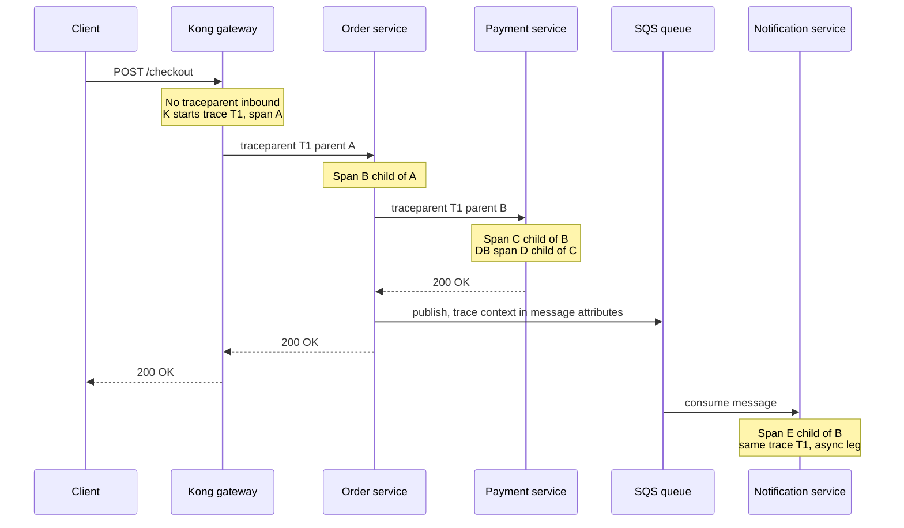

# Distributed Tracing

A distributed trace is the biography of one request: every service it touched, every call it made, how long each step took, and which step failed — stitched together across process boundaries by an ID that travels with the request. It answers the question logs and metrics structurally cannot: *this request took 2 seconds — where did the 2 seconds go?*

## The problem that created it

In a monolith, "where is the time going?" has a cheap answer: attach a profiler, read one stack trace, one log file. Then the system grows. The monolith becomes ten services; a checkout request now flows Kong → order-service → payment-service → bank-gateway-adapter, with a cache lookup, two DB queries, and an async event publish along the way.

Now a user reports "payments are slow." Every team checks its own dashboard and declares innocence: each service's *own* p99 looks fine. The latency lives in the gaps — a retry between two services, a connection pool wait, one slow downstream multiplied by a sequential call chain. Grepping logs across ten services for one request means guessing timestamps and hoping clocks agree ([[Logical Clocks and Ordering]] explains why wall clocks across machines are not trustworthy for ordering). Google built Dapper (published 2010) precisely because at their service count, no human could reconstruct a request's path by hand; Zipkin, Jaeger, and eventually OpenTelemetry are descendants of that paper.

## What it solves

- **Latency attribution**: decomposes end-to-end latency into per-hop, per-operation timings — "1.8 s of the 2 s was payment-service waiting on the bank adapter."
- **Error localization**: shows *which* hop in a chain failed and whether upstream errors are causes or symptoms.
- **Dependency discovery**: traces reveal the real call graph, including dependencies nobody documented.
- **Cross-service debugging with one key**: a single trace ID retrieves the whole story, instead of N grep sessions in N log stores.
- **Queue and async visibility**: context propagated through message headers shows time spent *waiting in a queue*, which per-service metrics hide.

## How it works

### The trace and span model

A **trace** is a tree of **spans**. A span is one timed operation — "HTTP POST /debit", "MongoDB find", "publish to SQS" — with a start time, duration, status, and key-value **attributes** (HTTP status, DB collection, error flags). Every span carries:

- `trace_id` — shared by every span in the request; the join key.
- `span_id` — unique to this span.
- `parent_span_id` — the span that caused it; this builds the tree.

The visual rendering is the familiar waterfall/flame view: parent spans on top, children indented beneath, width = duration. Gaps between a parent and its children are often the real finding — serialization, connection acquisition, GC pauses.

### Context propagation

The hard part of tracing is not recording spans — it's making sure the IDs *travel with the request* across process boundaries. This is **context propagation**: on every outbound call, the current trace context is written into headers; on every inbound call, it is extracted and continued.

The standard is **W3C Trace Context**, a `traceparent` HTTP header:

```
traceparent: 00-4bf92f3577b34da6a3ce929d0e0e4736-00f067aa0ba902b7-01
             |  |                                |                |
          version          trace-id (32 hex)   parent-span-id   flags (01 = sampled)
```

A companion `tracestate` header carries vendor-specific data. Older systems used Zipkin's B3 headers (`X-B3-TraceId` etc.); OpenTelemetry can speak both. For async hops, the same context is stuffed into message attributes/headers (Kafka headers, SQS message attributes) so the consumer's spans join the producer's trace.



### Correlation IDs vs full tracing — an honest comparison

Your `x-correlation-id` convention is the lightweight ancestor of tracing: one ID generated at the edge, passed on every inter-service request, logged by every service. It gives you the **join key** but not the **structure**.

| | Correlation ID | Full tracing |
|---|---|---|
| What you get | All log lines for one request, if you search every log store | Timed span tree: who called whom, durations, parent-child causality |
| Latency attribution | No — logs have timestamps, not durations or hierarchy | Yes — this is the whole point |
| Effort to adopt | Trivial: one header, one logging convention | Instrumentation in every service, a collector, a backend |
| Runtime cost | ~zero | Span creation + export; controlled by sampling |
| Async/queue visibility | Only if the ID is manually carried into messages | Context propagation libraries handle it |
| Good enough for | "What happened to request X?" forensics | "Where did the time go?", dependency maps, tail-latency hunts |

The honest verdict: a well-enforced correlation ID answers a surprising fraction of production questions at near-zero cost, and is strictly better than nothing. What it cannot do is *measure* — it has no notion of duration or hierarchy. When your incidents are "it was slow and nobody knows where," correlation IDs have hit their ceiling and tracing earns its cost. The migration path is natural: OpenTelemetry trace IDs can coexist with (and eventually replace) a homegrown correlation header, and logging the trace ID in every line preserves the log-join workflow.

### Instrumentation: auto vs manual

**OpenTelemetry (OTel)** is the vendor-neutral standard: one SDK, one wire protocol (OTLP), exporters to any backend (Jaeger, Tempo, vendor SaaS).

- **Auto-instrumentation**: for JVM services, the OTel Java agent (`-javaagent:opentelemetry-javaagent.jar`) instruments known libraries — Spring MVC/WebFlux, HTTP clients, JDBC, Mongo driver, Kafka clients — with zero code changes. It creates server/client spans and propagates context automatically. This gets you 80% of the value in an afternoon.
- **Manual instrumentation**: adding spans around business logic ("risk-check", "ledger-write") and attributes that matter to *you* (amount bucket, bank, retry count). Auto-instrumentation shows *that* payment-service took 1.8 s; a manual span shows it was the signature verification inside it.

### Sampling: head vs tail

Tracing every request at high RPS is expensive and mostly redundant — thousands of identical fast traces teach you nothing. **Sampling** decides which traces are kept:

- **Head sampling** decides at the *start* of the trace (e.g. keep 1%), propagated via the sampled flag so all services agree. Cheap and simple — but the decision is made before knowing whether the request will be interesting, so the slow, failing trace you wanted is 99% likely to have been dropped.
- **Tail sampling** buffers all spans and decides at the *end*, keeping traces that were slow, errored, or otherwise notable, plus a small random baseline. You keep exactly the interesting ones — but you must buffer every span until the trace completes, usually in a dedicated collector tier, which costs memory, and all spans of a trace must reach the *same* collector instance (routing by trace ID).

A pragmatic middle: head-sample at a modest rate for the baseline picture, force-sample on errors where the first service can tell, and reach for tail sampling only when scale demands it.

## Trade-offs

| You gain | You pay |
|---|---|
| Latency attribution across services | Instrumentation and a new infrastructure component (collector + storage) |
| One-key debugging | Sampling means some incidents have no trace |
| Real dependency graph | Context propagation must be *universal* — one non-propagating hop orphans everything downstream |
| Async visibility | Message-header propagation needs deliberate setup per broker |

## Failure modes

- **Broken propagation**: one service (or a proxy, or a hand-rolled HTTP client) drops the `traceparent` header → traces fracture into disconnected fragments. Detected by traces that mysteriously end at the same hop; mitigated by shared client libraries and a contract test that headers pass through.
- **Clock skew across hosts**: spans are timed locally; skewed clocks make children appear to start before parents. NTP keeps this mostly cosmetic, but don't trust microsecond-level cross-host ordering.
- **Collector overload**: a traffic spike multiplies span volume; an undersized collector drops spans (partial traces) or backpressures apps. Mitigate with sampling, collector autoscaling, and dropping spans before dropping requests.
- **Sampled-away evidence**: the one request the regulator asks about was head-sampled out. For money paths, force-sample or rely on unsampled structured logs joined by the trace/correlation ID.
- **Cardinality smuggling**: putting unbounded values in span *names* (e.g. `/users/12345`) wrecks backend grouping — names must be templated routes (`/users/{id}`), IDs go in attributes.

## When NOT to use it

- A monolith with one database — a profiler and slow-query log answer "where did the time go" without new infrastructure.
- Two or three services with stable, well-understood call paths — enforced correlation IDs plus good logs may be the right cost point.
- As a substitute for metrics or logs: traces are sampled and expensive to scan; they are the *middle* of the debugging funnel, not the alerting layer ([[Alerting and On-Call Design]]) and not the forensic record ([[Logs Metrics and Traces]]).

## In your stack

- You already have the discipline half: `x-correlation-id` on every inter-service request. Adopting OTel means the trace ID becomes the correlation mechanism; log both during migration and keep writing the trace ID into MDC so every log line joins the trace.
- The OTel Java agent covers your Spring Boot + Mongo + Redis + SQS clients without code changes — the realistic first step is agent-on, OTLP to a collector, 1–10% head sampling, errors force-sampled.
- Propagate context through SQS message attributes (and Redis Streams entry fields when you migrate) — otherwise every async hop starts an orphan trace and your queue wait time, often the real latency, stays invisible. [[Message Queues vs Event Logs]] matters here: queue-time spans are where async systems hide their tail latency.
- Kong can be configured to generate/forward trace headers, making the gateway the trace root — the natural place to see true user-perceived latency ([[Anatomy of a Web Request]]).
- Fintech note: for RBI-auditable money flows, do not rely on sampled traces as evidence — the unsampled structured log remains the system of record; traces are the debugging accelerator.

## Interview angle

The 60-second answer: "A trace is a tree of spans — timed operations — sharing a trace ID that propagates across every hop in headers, per W3C `traceparent`. Instrumentation (OpenTelemetry auto for frameworks, manual for business steps) records spans; a collector ships them to a backend that renders the waterfall. Because full tracing is costly, you sample: head sampling decides upfront and is cheap but blind, tail sampling decides after the fact and keeps the interesting traces at higher infra cost. Tracing uniquely answers 'where did the latency go' across services — logs give detail and metrics give rates, but neither carries cross-service causality."

Classic follow-ups: "How does context survive a message queue?" (headers/attributes on the message, consumer continues the trace). "Head vs tail sampling trade-off?" (cheap-but-blind vs buffered-but-smart). "Correlation ID vs tracing?" (join key vs measured structure — know the table above). "One service drops the header — what do you see?" (fragmented traces ending at that hop).

## Check yourself

> [!question]- Q: Explain to a teammate why their per-service dashboards all look healthy while end-to-end checkout p99 is 3 s.
> Per-service metrics measure each service's own handler time, in isolation. End-to-end latency includes everything between and around: sequential chains adding up, retries between services, connection-pool waits, queue dwell time, and the gateway hop. None of those belong to any single service's dashboard. A trace of one slow checkout shows the waterfall — where the 3 s actually accumulates — which no collection of per-service averages can reconstruct.

> [!question]- Q: What happens if the payment-service's hand-rolled HTTP client doesn't forward `traceparent`?
> Payment-service's own server span still joins the trace (it received the header), but every downstream call it makes starts a brand-new trace with a fresh trace ID. The original trace abruptly ends at payment-service; downstream spans exist but are orphaned under unrelated trace IDs. In the UI, checkout traces all "stop" at payment-service, which looks like payment-service is the bottleneck even when the real latency is below it. Fix: use the shared instrumented client, add a propagation contract test.

> [!question]- Q: You can afford to keep 1% of traces. An incident involves rare 8-second requests at 0.05% of traffic. Which sampling strategy finds them, and what does it cost?
> Head sampling at 1% keeps each 8-second trace with 1% probability — you'd capture roughly one in a hundred of the rare slow requests, likely zero evidence during a short incident. Tail sampling keeps them deterministically: buffer all spans until trace completion, apply a policy like "keep if duration > 2 s or error, plus 0.1% random baseline". The cost is a collector tier with enough memory to buffer in-flight traces and trace-ID-based routing so all spans of one trace meet at the same collector instance.

> [!question]- Q: Mini-design — add tracing to a flow that goes Kong → order → payment → SQS → notification, with the constraint that money-path evidence must be complete.
> Root the trace at Kong (generate traceparent if absent). OTel Java agent on all three services for HTTP/Mongo/SQS auto-spans; manual spans around ledger-write and bank-call with attributes (bank, status, amount bucket). Propagate context in SQS message attributes; notification consumer continues the trace so queue dwell time is visible. Sampling: head-sample 10% baseline, force-sample all errors; evidence completeness comes from unsampled structured logs carrying the trace ID on every money-path state transition — traces accelerate debugging, logs remain the auditable record.

## Sources

- Dapper paper — Sigelman et al., "Dapper, a Large-Scale Distributed Systems Tracing Infrastructure," Google Technical Report (2010).
- W3C Trace Context specification — the `traceparent`/`tracestate` header format.
- OpenTelemetry documentation — Java agent auto-instrumentation, context propagation, and sampling (head vs tail; the tail-sampling processor in the Collector).
- Google SRE Book (2016), ch. 12 "Effective Troubleshooting" — the funnel from symptom to cause that tracing accelerates.
- Jaeger and Zipkin project documentation — practical span model and B3 propagation history.
