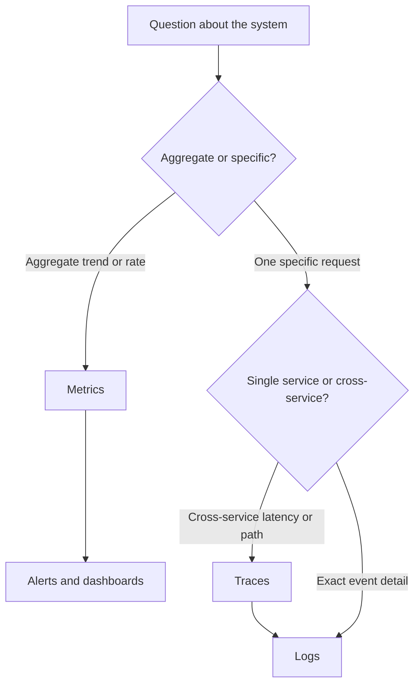

# Logs Metrics and Traces

Observability is the ability to ask new questions of a running system without shipping new code. Its raw material comes in three shapes — **logs**, **metrics**, and **traces** — and each answers a different question: logs tell you *what happened*, metrics tell you *how much and how fast*, traces tell you *where in the chain* it happened. Teams that treat them as interchangeable end up paying for all three and answering questions with none; the skill is knowing which pillar a question belongs to before reaching for a tool.

## Why this matters

When a single process served everything, debugging meant reading one log file on one machine. In a microservices fleet — dozens of Java services on EKS, each with multiple pods, fronted by Kong — a single user action touches many processes. No single log file contains the story anymore, and "SSH in and grep" stops being a strategy.

The three pillars exist because one data shape cannot serve all debugging questions economically:

- **"What exactly happened to request X?"** needs a discrete, timestamped record with full context — a **log**.
- **"Is checkout slower than yesterday? How many 5xx per second?"** needs cheap, pre-aggregated numbers you can graph over weeks — a **metric**. Storing a log line per request and counting at query time would cost orders of magnitude more.
- **"This payment took 2 seconds — which of the six services it touched spent the time?"** needs a record that *spans* process boundaries and preserves causality — a **trace** (covered in depth in [[Distributed Tracing]]).

Alerting ([[Alerting and On-Call Design]]) is built almost entirely on metrics; debugging the alert is done with traces and logs. Your [[SLA SLO SLI and Error Budgets|SLIs]] are metrics by definition.

## How it works

### Logs — what happened

A **log** is an immutable, timestamped record of a discrete event. The modern baseline is **structured logging**: emit JSON (or key-value pairs), not free-form prose, so machines can filter and aggregate without regex archaeology.

```json
{"ts":"2026-10-01T10:14:02.113Z","level":"ERROR","service":"payment-service",
 "x_correlation_id":"9f1c-...","sub":"u_8842","event":"upi_debit_failed",
 "bank":"YBL","latency_ms":4212,"error":"GATEWAY_TIMEOUT"}
```

Rules that separate useful logs from noise:

- **Consistent field names across services.** If one service logs `correlationId` and another logs `x_correlation_id`, cross-service queries silently miss half the data. Agree on a schema (service, level, timestamp, correlation ID, user/system identifiers) and enforce it in a shared logging library.
- **Use levels honestly.** `ERROR` means "a human may need to act"; `WARN` means "unexpected but handled"; `INFO` is business-relevant milestones; `DEBUG` is for development. The classic failure is logging every retry-able blip at `ERROR` — after a month, `ERROR` means nothing and real failures drown. If an "error" fires 10,000 times a day and nobody acts, it is not an error.
- **Sample high-volume logs.** Access-log-style events at high RPS can be sampled (keep 1 in N of successes, keep 100% of errors and slow requests). You lose nothing you'd ever read and cut cost dramatically.
- **Never log secrets or regulated PII.** Card numbers, tokens, KYC document data — a log store is rarely as locked down as the database the data came from.

### Metrics — how much, how fast

A **metric** is a named numeric time series, e.g. `http_requests_total{service="payment", status="500"}`. Metrics are cheap because they are aggregated at write time: one counter per label combination, not one record per event. Prometheus defines **four** types; the first three are universal vocabulary, the fourth is the one people misuse:

| Type | What it is | Example | Query pattern |
|---|---|---|---|
| **Counter** | Monotonically increasing total; resets only on restart | `http_requests_total`, `payments_failed_total` | `rate()` over a window → requests/sec |
| **Gauge** | Point-in-time value that goes up and down | queue depth, JVM heap used, pods ready | current value, min/max over window |
| **Histogram** | Counts of observations in predefined buckets, plus sum and count | request latency buckets | approximate percentiles (p99) across time *and* instances |
| **Summary** | Quantiles computed **inside the client process**, over a sliding time window, plus sum and count | one instance's p99 | read the quantile straight off — but you may not aggregate it |

Histograms exist because you cannot average percentiles: to get a fleet-wide p99 you need the raw distribution, and buckets are the cheap approximation of it ([[Latency vs Throughput vs Bandwidth]] explains why percentiles, not averages, are the numbers that matter).

**Histogram vs summary is the trap worth knowing cold.** A summary's quantiles are computed *in the process*, so what you scrape is already a finished p99 — of that one pod, over that pod's own sliding window. There is no mathematically valid way to combine one pod's p99 with another's; averaging them, maxing them, or `avg()`-ing the series all produce a number that means nothing. A histogram instead ships raw per-bucket counters, and counters *are* additive: sum the buckets across every pod, then estimate the quantile at query time with `histogram_quantile()`. You trade aggregation error (fatal) for bucket-boundary interpolation error (bounded, and shrinkable by choosing buckets around your SLO threshold). Reach for a summary only when you want one instance's view and will never need a fleet number. Prometheus *native* histograms — automatic, exponentially spaced buckets at far finer resolution — were experimental from v2.40 (2022) and became a stable feature in v3.8.0, still opt-in per scrape config.

**Cardinality is the loaded gun.** A metric's cost is the number of unique label combinations — each is a separate time series held in memory by the metrics system. `http_requests_total{service, status, method}` is maybe a few hundred series. Add `user_id` as a label and it becomes millions. The classic self-inflicted observability outage is a **cardinality explosion**: someone adds a high-cardinality label (user ID, correlation ID, full URL path with IDs in it), the metrics backend's memory balloons, and monitoring dies — usually during the incident you needed it for. Rule: labels are for *dimensions you will group by*, never for *identifiers*. Identifiers belong in logs and traces.

### Traces — where in the chain

A **trace** follows one request across every service it touches, recording a timed **span** per operation, linked into a tree by a shared trace ID propagated in headers. It is the only pillar that preserves *causality across processes* — the mechanics, sampling, and your `x-correlation-id` convention are the subject of [[Distributed Tracing]].

### The collection pipeline

All three pillars share the same shape of plumbing — emit, collect, ship, store, query — and the collection layer is where reliability and cost decisions live:

- **Logs**: the app writes structured JSON to stdout; a node-level agent (Fluent Bit, Vector, or the OpenTelemetry Collector as a DaemonSet on Kubernetes) tails container logs, enriches them with pod/namespace metadata, and ships them to the store. The app never blocks on log shipping — if the pipeline backs up, drop or buffer at the agent, never stall request threads.
- **Metrics**: either pulled (Prometheus scrapes each pod's `/metrics` endpoint on an interval) or pushed (agents to a vendor backend). Pull has a useful side effect: a failed scrape is itself a health signal.
- **Traces**: the SDK exports spans asynchronously to a collector, which batches, samples, and forwards — the collector tier is deliberately separate so sampling policy changes don't require redeploying applications.

Retention is tiered per pillar: metrics keep months cheaply (they're tiny), traces keep days (sampled), logs keep days hot and months cold — and the tiering decisions are where most of the bill is won or lost.

### Choosing the pillar for the question



A healthy debugging loop runs top-down: a metric alert fires → a trace shows which hop is slow or failing → logs from that service, filtered by trace/correlation ID, show the exact error.

### The cost shape

Logs are the expensive pillar. Metrics cost is proportional to *cardinality* (number of series), independent of traffic; trace cost is controlled by sampling; but log cost is proportional to **traffic × verbosity**, and every byte is typically indexed and retained. It is common for log ingestion and storage to dominate an observability bill by a wide margin. The levers, in order of effectiveness: delete logs nobody queries, sample high-volume success paths, shorten retention tiers (hot search for days, cold archive for compliance), and resist logging full payloads.

One school of thought — **wide events / canonical log lines** (Honeycomb's model, Stripe's "canonical log line") — argues for collapsing the pillars: emit one rich, structured event per request per service with dozens of fields, and derive metrics and trace-like views from it at query time; it trades higher ingest cost for the ability to ask arbitrary high-cardinality questions.

### What each pillar costs you

| You gain | You pay |
|---|---|
| Metrics: cheap long-term trends, the substrate for alerting and [[Autoscaling]] | Pre-aggregation destroys detail — you can never ask "which user?" of a counter |
| Logs: full event detail, arbitrary fields | Highest cost pillar; useless without discipline (structure, levels, correlation IDs) |
| Traces: cross-service causality | Requires instrumentation in every hop; sampling means some requests are invisible |
| All three together | Three pipelines, three retention policies, three query languages to operate |

## Common misconceptions

- **"More logging = more observability."** Unstructured, unleveled, uncorrelated logs add cost and noise, not insight. One well-structured event beats twenty `log.info("here 3")` lines.
- **"We can compute percentiles from averaged metrics."** You cannot average p99s across pods; you need histograms designed for aggregation.
- **"Metrics labels are free."** Each unique label combination is a stored time series; cardinality is the whole cost model.
- **"Traces replace logs."** Traces show *where*; the *why* (stack trace, business context) usually still lives in a log line linked by trace/correlation ID.
- **"Dashboards are observability."** A dashboard answers the questions someone anticipated; observability is being able to answer the ones nobody did. If every incident requires shipping new instrumentation before you can see it, you have monitoring, not observability.
- **"Retention should match for all three pillars."** Their cost-per-byte and query patterns differ by orders of magnitude; metrics for a year, traces for days, logs tiered — uniform retention overpays on one pillar and under-serves another.

## In your stack

- Your fleet already propagates `x-correlation-id` on every inter-service request — that is the field that turns isolated service logs into a cross-service story. The payoff only exists if every service logs it *in the same field name*.
- `sub` (oneAppUserId) and JWT `jti` are system identifiers, not PII, and belong in operational logs — redacting them makes traces unfollowable. Actual KYC data and card/account numbers never belong in logs; in an RBI-regulated environment assume an auditor reads your log store.
- Fintech skew: for money movement, prefer *complete* logs over sampled ones on the write path — you may need to reconstruct exactly what happened for a dispute. Sample the read-heavy, low-risk paths instead.
- Spring Boot: Micrometer is the metrics facade (counters/gauges/timers → Prometheus), Logback with a JSON encoder for structured logs, and MDC to attach `x-correlation-id` to every log line in a request automatically.
- Services pinned at 1 replica make metrics *more* important, not less: with no redundancy, you want to see saturation building ([[Capacity Planning]]) before the single pod falls over.
- Queue-centric flows need queue-centric metrics: SQS oldest-message age and DLQ depth today, Redis Streams pending-entries and consumer lag after the migration — these are the symptom signals your [[Alerting and On-Call Design|alerts]] will stand on.

## Interview angle

The 60-second answer: "Observability has three pillars. Metrics are cheap aggregated numbers — rates, latencies, saturation — used for dashboards, alerting, and autoscaling; the cost driver is label cardinality, never put identifiers in labels. Logs are discrete structured events with full context — the expensive pillar, controlled by levels, sampling, and retention. Traces follow one request across services via a propagated ID and show where latency and errors live in the call chain. A mature setup alerts on metrics, localizes with traces, and root-causes with logs, all joined by a correlation/trace ID."

Classic probes: "Why not log everything and grep?" (cost shape, no aggregation, no causality). "Why can't you put user ID on a metric label?" (cardinality explosion). "How do you get a fleet-wide p99?" (histograms, because percentiles don't average). "How do the three pillars connect during an incident?" (metric alert → trace → logs via shared ID).

## Check yourself

> [!question]- Q: Explain to a new joiner which pillar answers which question, with one example each.
> Metrics answer aggregate questions — "what is the 5xx rate on payment-service right now?" — because they are pre-aggregated numeric series. Traces answer localization questions — "this transfer took 3 s; which of the five hops spent it?" — because spans preserve timing and causality across services. Logs answer forensic questions — "what exact error did the bank gateway return for correlation ID abc-123?" — because they carry full event detail. Alert on metrics, localize with traces, root-cause with logs.

> [!question]- Q: What happens if a developer adds `user_id` as a label on `http_requests_total` in a service with 5 million users?
> Every active user creates new unique label combinations, each a separate time series the metrics backend must index and hold in memory. Series count jumps from hundreds to millions — a cardinality explosion. The metrics backend's memory and query latency balloon, scrapes slow or fail, and monitoring degrades or dies fleet-wide — often taking alerting with it. The fix is immediate: remove the label, and move per-user questions to logs or traces, which handle high cardinality by design.

> [!question]- Q: Your log bill tripled. Walk through your levers in order.
> First find what dominates: almost always a few high-volume INFO/DEBUG events on hot paths. Delete logs nobody has queried. Sample high-volume success-path events (keep all errors and slow requests). Demote dishonest levels (retryable blips logged at ERROR). Tier retention: days of hot searchable storage, cheap cold archive for compliance. Stop logging full request/response payloads. Only then consider per-GB pricing negotiations — engineering discipline beats procurement here.

> [!question]- Q: Mini-design — you own a UPI debit flow across 4 services. Specify the minimum observability you'd ship with it.
> Metrics: counter `upi_debits_total{status}`, latency histogram per service, gauge for queue/connection-pool saturation; alert on failure-rate and p99 against the SLO. Traces: propagate trace context (or at minimum `x-correlation-id`) through all 4 hops, 100% sampling if volume allows on a money path. Logs: one structured event per state transition (initiated, bank_called, bank_responded, settled/failed) with correlation ID, `sub`, amount, bank response code — never full card/KYC data. Unsampled logging on this write path, because disputes require reconstruction.

## Sources

- Google SRE Book (2016), ch. 6 "Monitoring Distributed Systems" — the four golden signals and symptom-vs-cause framing.
- OpenTelemetry documentation — signals overview (logs, metrics, traces) and semantic conventions for consistent field names.
- Prometheus documentation — metric types; "naming and labels" guidance on cardinality.
- Stripe engineering blog, "Fast and flexible observability with canonical log lines" — the one-wide-event-per-request pattern.
- Charity Majors / Honeycomb writing on observability and high-cardinality events — the wide-events school.
- *Designing Data-Intensive Applications* (Kleppmann), ch. 1 — percentiles and tail latency context.
