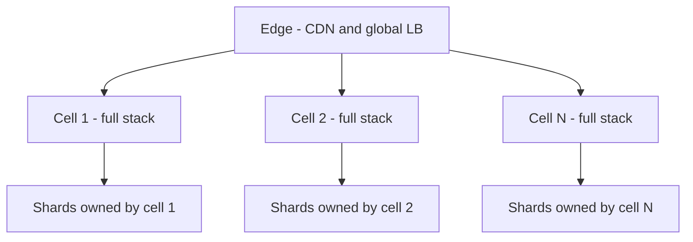

# Anatomy of 1M RPS

This is not a company case study — it is the answer to the question "what actually happens when load grows to a million requests per second?". The honest answer: nothing happens *at* 1M RPS that didn't start happening earlier. Each order of magnitude breaks a specific thing, forces a specific addition, and introduces a specific new class of failure. If you understand the ladder, every company case study in this module ([[Netflix Architecture]], [[Twitter Timeline Design]], [[How Facebook Scales MySQL]]) becomes an instance of the same climb.

One framing to hold throughout: **scaling is the art of removing things requests share.** At 100 RPS everything shares one box. At 1M RPS, the only thing that scales indefinitely is work that shares *nothing* per request — no shared lock, no shared row, no shared coordinator. Every tier below is a step in that removal.

## The scale of the problem

First, calibrate the numbers ([[Back of the Envelope Estimation]]):

| Tier | RPS | Roughly equivalent to (illustrative, 2020s, order of magnitude only) | Requests/day |
|---|---|---|---|
| 1 | ~100 | A successful B2B product; a mid-size fintech's core API | ~8.6M |
| 2 | ~1,000 | A popular consumer app in one country | ~86M |
| 3 | ~10,000 | A top-100 web property; all of India's UPI on an average second (Aug 2025: 20.01B txns/month, ~645M/day ≈ 7.5K TPS) | ~860M |
| 4 | ~100,000 | A large social platform's read path | ~8.6B |
| 5 | ~1,000,000 | A very large consumer platform's API front door — hyperscaler stores run 100× beyond this (S3 serves 200M+ req/s, 2026; DynamoDB peaked at 151M req/s, Prime Day 2025) | ~86B |

Two caveats that interviewers love: these are *sustained* numbers — peaks run 2–10× the average ([[Capacity Planning]]) — and 1M RPS of cache reads is a different universe from 1M RPS of money-moving writes. Always state the read/write mix before designing.

## The architecture

### ~100 RPS — one box and a database

A single application server and one PostgreSQL/MySQL instance handle this comfortably; 100 RPS is roughly one request every 10 ms, and a tuned relational database does thousands of simple queries per second. **What breaks first:** nothing, technically — the risk is availability (one box = one failure domain) and deploys causing downtime. **What you add:** a second app server behind a [[Load Balancers|load balancer]] for redundancy, not throughput — which immediately forces [[Stateless vs Stateful Services|statelessness]] (sessions move to Redis or a signed token). **New failure class:** config drift between two servers, and the load balancer itself as a component that can mis-route or flap on bad [[Health Checks and Service Discovery|health checks]].

### ~1,000 RPS — cache or die

The database starts feeling repeated reads; p99 latency creeps up because the same hot rows are read thousands of times. **What breaks first:** database CPU on read queries. **What you add:** a cache ([[Why Caching Works]], [[Caching Strategies]] — almost always cache-aside with Redis), a [[CDN]] for static assets, and real monitoring. **New failure class:** staleness and [[Cache Invalidation]] bugs — the system now has two copies of truth — plus the first [[Cache Stampede and Thundering Herd|stampedes]] when a popular key expires.

### ~10,000 RPS — the connection wall and read replicas

**What breaks first:** two things at once. The database hits its *connection* limit before its query limit — a few hundred app instances each holding a pool exhausts Postgres/MySQL at a few thousand connections ([[Connection Pooling]]) — and single-node write throughput begins to matter. **What you add:** [[Replication|read replicas]] to spread reads, a shared connection pooler (PgBouncer-style), CDN for semi-dynamic content, and async processing: anything not needed in the response path moves to a queue ([[Why Async Messaging Exists]]). **New failure class:** replication lag anomalies — users not seeing their own writes ([[Read Your Own Writes and Replica Lag Anomalies]]) — and queue backlogs as a new thing to monitor ([[Backpressure and Flow Control]]).

### ~100,000 RPS — sharding, fan-out, and hot keys

No single writer node survives this if writes are a meaningful fraction of load. **What breaks first:** the primary database's write throughput, and any architectural point where one request fans out to many internal calls — at 100K RPS, a request that touches 20 services generates 2M internal RPS, so **fan-out cost dominates** (this is exactly the [[Twitter Timeline Design]] problem). **What you add:** [[Sharding]] of the write path (choosing a shard key becomes the most consequential decision in the company), [[Consistent Hashing]] for cache and data distribution, async-everywhere via event logs ([[Kafka Architecture]]), and aggressive [[Rate Limiting]] at the edge. **New failure class:** the [[Hot Partition Problem]] and [[Hot Key Problem]] — load is no longer uniform, and one celebrity user or one tenant can melt a shard while the fleet average looks healthy; plus cross-shard queries ([[Secondary Indexes on Sharded Data]]) and [[Rebalancing Partitions|rebalancing]] as operational events that can themselves cause incidents.

### ~1,000,000 RPS — cells, shedding, and coordination avoidance

At this tier the unit of scaling stops being "a server" and becomes "a copy of the whole system":

- **Cell-based architecture.** The system is partitioned into independent **cells** — each a complete stack (LB, app, cache, data) owning a slice of users. A cell failure hurts its slice only; blast radius is capped by design ([[Bulkheads and Isolation]]). AWS and Slack both describe cell-based designs publicly.
- **Regional isolation.** Cells are deployed per region with independent failure domains; traffic can be evacuated between regions ([[Disaster Recovery]], and Netflix's regional evacuation practice in [[Chaos Engineering]]).
- **Load shedding as policy, not emergency.** At 1M RPS you *will* receive more than you can serve at some point. Deciding in advance which requests to drop — by priority, by user tier, by endpoint — is a product decision encoded in infrastructure ([[Load Shedding and Graceful Degradation]]).
- **Custom infra economics flip.** At this scale, a 10% efficiency gain pays for an infra team. This is why giants write their own caches, storage engines, and schedulers — not vanity, arithmetic ([[Netflix Architecture]]'s Open Connect is the canonical example).
- **Coordination avoidance.** The defining technical property: **the only thing that scales linearly is work with no shared state per request.** Anything requiring agreement — a global counter, a distributed lock, a cross-shard transaction — becomes the bottleneck ([[Consensus and Raft]], [[Two-Phase Commit and Distributed Transactions]]). Architectures at this tier are shaped by what they *refuse* to coordinate.

**New failure class:** metastable and cascading failures ([[Failure Modes in Distributed Systems]]) — retry storms, cache-miss avalanches after a cold restart, and feedback loops where recovery traffic prevents recovery. At 1M RPS the system has enough internal feedback that it can stay broken *after* the trigger is gone.

## Key decisions and why

| Tier | The decision that matters most | Why |
|---|---|---|
| 100 | Go stateless now | Everything later assumes it; retrofitting sessions out is painful |
| 1K | Cache-aside + TTLs everywhere | Cheapest 10× you will ever buy |
| 10K | Move non-response work to queues | Decouples your peak from your dependencies' peak |
| 100K | Choose the shard key with extreme care | It is nearly irreversible and determines your hot-partition destiny |
| 1M | Define shedding priorities and cell boundaries | You are now designing *which* failures you accept |

## What broke along the way

A compressed incident log of the climb, because each addition brought its own failure (an illustrative composite, not one company's history — the durations are representative, not measured):

- The LB added for redundancy flapped on an over-aggressive health check and took *both* servers out of rotation.
- The cache added at 1K RPS served stale balances after a deploy skipped invalidation (why [[Cache Invalidation]] is "one of the two hard problems").
- The read replicas added at 10K RPS introduced "I just paid but it still shows unpaid" tickets — replica lag meeting user expectations.
- The shard key chosen at 100K RPS (user ID) was fine until one B2B tenant grew to 100× median — a [[Hot Partition Problem]] with no cheap fix ([[Discord Message Storage Evolution]] is a real-world version: large servers' message partitions ran orders of magnitude hotter than the median).
- At 1M RPS, a 30-second cache cluster blip triggered a retry storm that kept the database saturated for 40 minutes after the cache recovered — the first **metastable failure**, fixed only by [[Load Shedding and Graceful Degradation|shedding]] and retry budgets ([[Timeouts Retries and Exponential Backoff]]).

## Lessons you can reuse

1. **Find the next bottleneck before it finds you.** Each tier has exactly one thing that breaks first; load testing exists to name it ([[Capacity Planning]]).
2. **Every addition creates a new failure class.** Caches add staleness, replicas add lag, shards add hot partitions, retries add storms. Budget for the failure mode when you budget for the component.
3. **Read and write paths scale differently.** Reads scale with copies (replicas, caches, CDN); writes scale only with partitioning. Separate them early in your thinking ([[CQRS]] is this idea formalized).
4. **Shared state is the enemy of linear scaling.** Audit what every request must agree on; each item on that list is a future ceiling.
5. **1M RPS is organizational, not just technical.** Nobody runs this with five engineers and good intentions (even [[WhatsApp and the Small-Team Scale Story|WhatsApp's famous 50-engineer story]] worked by ruthlessly shrinking the problem, not by skipping the operating discipline): it implies SRE as a function, on-call rotations and error budgets ([[SLA SLO SLI and Error Budgets]]), chaos testing ([[Chaos Engineering]]), capacity planning as a job, and a cost model where infrastructure is a top-three line item. The architecture diagrams are the easy part; the giants' real moat is the operating muscle around them.

### Signals you have outgrown your current tier

Bottlenecks announce themselves before they fail, if you watch the right gauges:

- **p99 diverging from p50** while averages look fine — queueing has started somewhere ([[Latency vs Throughput vs Bandwidth]]).
- **Database connections above ~60–70% of max** at peak — you will hit the wall on the next growth spurt or the next deploy's connection churn.
- **Cache hit rate falling as traffic grows** — the working set no longer fits; the DB is absorbing the difference silently.
- **One shard/partition/pod consistently hotter than the fleet median** — skew is compounding; waiting makes the [[Hot Partition Problem|split]] harder.
- **Queue depth that recovers slower after each spike** — consumers have no headroom; the next spike won't drain ([[Backpressure and Flow Control]]).
- **Retry rate rising with load** — you are near the regime where retries amplify instead of heal ([[Timeouts Retries and Exponential Backoff]]).

Any two of these together is the cue to build the *next* tier's machinery — not the 1M-RPS machinery.

## In your stack

- Niyo's services sit around tiers 1–2 per service. That is *good news*: the correct architecture for your scale is the simple one, and most 100K-RPS machinery would be pure cost.
- Correctness-over-latency (RBI-regulated money movement) changes the ladder: you cache less aggressively, you cannot serve stale balances, and write-path scaling arrives *later* but *harder* because [[Idempotency]] and audit trails constrain your options.
- Your SQS → Redis Streams path is the tier-3 move ("async everywhere") — the queue is what lets a partner-bank slowdown not become your outage.
- Services pinned at 1 replica mean you are deliberately below tier 1's availability bar. That is a legitimate cost call, but it makes graceful shutdown and fast restart ([[Graceful Shutdown and Deployment Safety]]) your real availability mechanism.
- Kong + CloudFront already give you the edge pieces ([[API Gateway]], [[CDN]], edge [[Rate Limiting]]) that tiers 2–4 require; the gap at higher tiers would be data-layer sharding of MongoDB.

## Interview angle

The 60-second version: *"Scale is a ladder of bottlenecks. ~100 RPS: one box, add an LB for redundancy and go stateless. ~1K: the DB drowns in repeated reads — add cache and CDN; you buy staleness. ~10K: connection limits and write pressure — read replicas, pooling, async queues; you buy replication lag. ~100K: single-writer ceiling — shard, and hot keys plus fan-out costs become the game. ~1M: cell-based isolation, load shedding as policy, coordination avoidance — the only thing that scales is shared-nothing work. And at the top it's organizational: SRE, chaos drills, cost engineering."*

Classic follow-ups: "Where does the database connection limit bite and why?" (pools × instances vs a few-thousand-connection ceiling); "Why do reads and writes scale differently?"; "What's the first thing you'd check if p99 degrades at 10× growth?" (the resource that saturates first — usually connections or a hot key, not CPU). Interviewers also probe whether you jump to tier-5 machinery for a tier-2 problem — over-engineering is the most common failure signal.

## Check yourself

> [!question]- Q: Explain why "coordination avoidance" is the defining property of the 1M RPS tier.
> Throughput scales by adding machines only if added machines don't have to agree with each other per request. Any shared mutable state — a global counter, lock, or cross-shard transaction — serializes requests through one point, and that point's capacity becomes the system ceiling no matter how many servers surround it. Consensus ([[Consensus and Raft]]) costs round trips and has bounded throughput, so planet-scale designs restructure problems (per-key ordering, cells, CRDT-style merges, async reconciliation) to need agreement rarely rather than making agreement faster.

> [!question]- Q: What happens if a system designed for 100K RPS loses its entire cache layer for 60 seconds?
> Every request becomes a database read. The database, sized assuming a 90%+ hit rate, receives 10–50× its normal load and saturates; requests queue, clients time out and retry, multiplying load further ([[Timeouts Retries and Exponential Backoff]]). When the cache returns, it is cold, so misses stay high and the overload persists — a metastable failure. Mitigations: request coalescing, cache warming before admission, retry budgets, and load shedding so the DB serves *some* requests rather than none.

> [!question]- Q: Your service runs at 800 RPS and the PM asks "will we survive 10×?" What do you actually check?
> Walk the tier-3 checklist: database connection count headroom (pools × future instance count vs DB max), read/write mix and whether reads can move to cache/replicas, the slowest synchronous dependency (it caps you regardless of your own capacity), queue depth behavior at 10× producers, and the top 10 hottest keys/rows (skew, not average, kills you). Then load test to find which saturates first rather than guessing.

> [!question]- Q: Why does fan-out dominate cost at the 100K tier rather than earlier?
> Fan-out multiplies *internal* traffic: one external request touching 20 services is 20 internal RPS. At 1K external RPS that's 20K internal calls — annoying but affordable. At 100K it's 2M internal RPS, and every internal hop now needs its own pooling, retries, and capacity — the interior of the system becomes its own planet-scale problem. This is why architectures at this tier either collapse call chains (precompute, as in [[Twitter Timeline Design]] fan-out-on-write), go async ([[Why Async Messaging Exists]]), or cap fan-out as a design rule. The math was always there; the tier is just where it crosses your budget.

> [!question]- Q: Mini design — sketch the smallest architecture that honestly serves 50K RPS of reads and 2K RPS of writes for a product catalog.
> Edge: CDN for images and cacheable GETs. App: stateless fleet behind an L7 LB. Data: one primary for the 2K writes (well within a tuned relational DB), 2–3 read replicas, and Redis cache-aside targeting ~95% hit rate so replicas see ~2.5K RPS of misses. Async: catalog updates fan out via a queue to invalidate cache entries. No sharding needed — 2K writes/sec doesn't justify it; say so explicitly, it is the senior answer.

## Sources

- *Designing Data-Intensive Applications*, Kleppmann (1st ed., 2017) — Ch. 1 (load parameters), Ch. 6 (partitioning).
- AWS Builders' Library — "Workload isolation using shuffle-sharding" and "Using load shedding to avoid overload" (blast-radius isolation and shedding-as-policy, from the operators of tier-5 systems); AWS Well-Architected whitepaper "Reducing the Scope of Impact with Cell-Based Architecture" (September 2023) for cell-based design.
- Slack Engineering blog — "Slack's Migration to a Cellular Architecture" (2023).
- Google SRE Book (2016) — chapters on handling overload and cascading failures; the origin of error-budget thinking for the "organizational" claim.
- Marc Brooker (AWS) blog — posts on metastable failures and coordination avoidance; see also "Metastable Failures in Distributed Systems" (Bronson et al., HotOS 2021).
