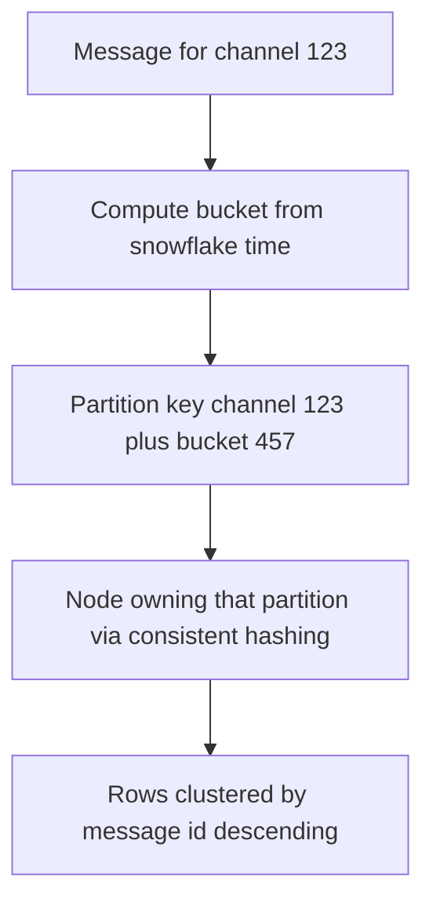
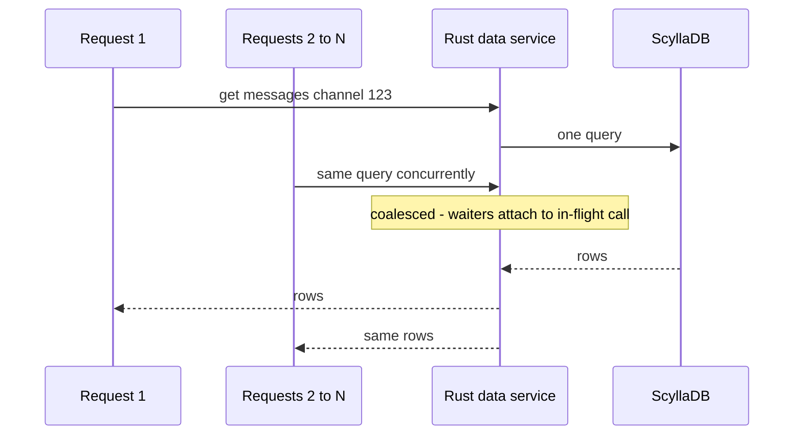

# Discord Message Storage Evolution

Discord chose to **store every message forever** — the opposite of WhatsApp's deliver-and-delete model ([[WhatsApp and the Small-Team Scale Story]]) — and then spent seven years paying for that choice through three generations of storage: MongoDB (2015) → Cassandra (2017) → ScyllaDB (2022). Each migration was forced by a different, predictable wall, and each is documented in an unusually honest pair of engineering posts. This is the single best public walkthrough of the [[Hot Partition Problem]], tombstone pain in LSM-tree stores, and request coalescing — read it as "what actually happens when read/write skew meets a real database."

## The scale of the problem

Era-labeled milestones from Discord's engineering blog:

| Year | State |
|---|---|
| 2015 (launch) | Single **MongoDB** replica set; deliberate choice for iteration speed |
| Nov 2015 | **~100 million** stored messages; data + indexes no longer fit in RAM |
| Jan 2017 | **Billions** of messages on a **12-node Cassandra** cluster; migration write-up published |
| Early 2022 | **Trillions** of messages; the same cluster had grown to **177 nodes** averaging **4 TB** of disk each |
| 2022–23 | Migrated to **72 ScyllaDB nodes** at **9 TB** each; write-up published 2023 |

Twelve nodes to 177 in five years, for one table, is the number to carry into an interview: the storage engine did not fail, it *grew* — and the growth itself (compaction babysitting, GC tuning, node replacement) became the cost that justified the third act.

The workload's defining feature is **skew**. Discord serves wildly different access patterns from one table: huge public servers concentrate enormous read *and* write volume into a handful of channels; small friend groups write rarely and read recent history; some servers write heavily but are barely read. Messages are read in reverse-chronological pages per channel. Averages are meaningless here — the tail of giant channels dominates, which is precisely what breaks naive partitioning ([[Sharding]]).

## The architecture

### Act 1 — MongoDB (2015): the deliberate fast start

A single [[MongoDB Architecture|MongoDB]] replica set with messages indexed by `(channel_id, created_at)`. Discord's team knew it wouldn't last; it was chosen to ship fast. The wall arrived at roughly **100M messages**: once the working set (data + index) exceeded RAM, every query risked disk, and latency became unpredictable. B-tree random I/O under a growing index is a well-understood cliff ([[B-Tree vs LSM-Tree]], [[Database Indexes]]). Verdict: right tool for month one, wrong tool for year two — and the team said so out loud, which is the healthy version of this story.

### Act 2 — Cassandra (2017): built for the write volume

Discord wanted linear horizontal scale, automatic failover, and write-optimized storage; [[Cassandra and Wide-Column Stores|Cassandra]]'s LSM-tree engine and leaderless replication (its lineage runs through [[The Dynamo Paper]]) fit. Amazon's managed descendant handles the same skew problem with adaptive capacity — see [[DynamoDB in Production]] for that contrast. The schema is the teaching gold:

- **Partition key: `(channel_id, bucket)`** where `bucket` is a **fixed ~10-day time window**. Partitioning by `channel_id` alone would create unbounded partitions for busy channels (Cassandra-era operational guidance put the practical ceiling at roughly 100 MB per partition); adding the time bucket caps each partition's size. Messages within a partition are clustered by **Snowflake message ID** (time-ordered, see [[Design a Distributed ID Generator]]), so "recent page of channel X" is one sequential read of one partition.
- Reads for a channel's history touch one partition per bucket, walking backwards in time.

#### Sizing the bucket — the one number you must derive

Everything else in the schema can be copied; the bucket length has to be computed from *your* busiest key. Work backwards from the partition-size ceiling — Cassandra-era operational guidance was to keep a partition well under roughly 100 MB, because partition is the unit that must be read, repaired, and compacted as a whole. Take an illustrative stored size of 500 bytes per message (body plus metadata and indexes):

| Channel type | Messages/day | Bytes/day | In a 10-day bucket |
|---|---|---|---|
| Small friends server | 200 | 100 KB | ~1 MB — trivially fine |
| Busy public channel | 20,000 | 10 MB | ~100 MB — exactly at the ceiling |
| Firehose channel | 100,000 | 50 MB | ~500 MB — five times over |

(Check the middle row: 20,000 × 500 B = 10,000,000 B = 10 MB per day, ×10 days = 100 MB.)

Two lessons fall out. First, **the bucket is sized for the worst key you intend to survive, not the median** — the same rule as every other skew problem. Second, that choice has a visible cost at the other end of the distribution: the quiet channel's 10-day bucket may hold 20 rows, so assembling a 50-message page walks backwards through several partitions, each one a separate read. A fixed global bucket is a compromise between those two failure directions, and if your busiest tenant grows an order of magnitude, the bucket — not the cluster — is what has to change.

### Act 3 — ScyllaDB + Rust data services (2022): same model, different engine, plus a shield

ScyllaDB is a C++ reimplementation of Cassandra's data model with a **shard-per-core** architecture: each CPU core owns a slice of each node's data with its own memory and I/O queues, no JVM, and therefore **no garbage-collection pauses**. Discord shrank 177 Cassandra nodes to **72 ScyllaDB nodes** (9 TB of disk each, up from an average of 4 TB per Cassandra node) and migrated trillions of messages.

The published before/after is the clearest argument in the whole case study, because it separates *speed* from *predictability* — note the shape of the Cassandra figures, which are ranges, versus the ScyllaDB figures, which are flat:

| Operation, p99 | Cassandra | ScyllaDB |
|---|---|---|
| Fetch historical messages | 40–125 ms | 15 ms |
| Insert a message | 5–70 ms | 5 ms |

A p99 that *wanders* between 5 and 70 ms is the signature of stop-the-world pauses and compaction contention: the work is the same every time, but the runtime occasionally stops doing it. ScyllaDB moved both halves — the fetch p99 floor itself fell from 40 ms to 15 ms — but the larger win is that the insert p99 stopped roaming a 14× band and settled flat at 5 ms. That distinction — latency versus latency *stability* — is most of what people mean when they say a system is "production-ready."

Equally important, Discord stopped letting its API tier talk to the database directly. They inserted **data services written in Rust** between the API monolith and ScyllaDB whose core job is **request coalescing**: when many concurrent requests ask for the same row (everyone loading the same hot channel), the first request triggers the database query and the rest **wait on that same in-flight result** instead of issuing duplicates. Requests are routed to data-service instances by **consistent hashing on `channel_id`** ([[Consistent Hashing]]), so all traffic for one hot channel lands on the same instance, maximizing coalescing hits. This is the same idea as single-flight dogpile protection in caching ([[Cache Stampede and Thundering Herd]]), applied one layer deeper.

### The three acts side by side

| | **Act 1 — MongoDB** | **Act 2 — Cassandra** | **Act 3 — ScyllaDB + data services** |
|---|---|---|---|
| Era | 2015–2016 | 2017–2022 | 2022– (write-up 2023) |
| Scale reached | ~100M messages | Billions → trillions | Trillions |
| Why chosen | Iteration speed | Linear write scale, failover | Same model, no JVM/GC, fewer nodes |
| The wall it hit | Working set outgrew RAM | Hot partitions, tombstones, GC pauses | — (hot reads absorbed by coalescing layer) |
| Cluster size | 1 replica set | 12 nodes → 177 nodes | 72 nodes |
| Read p99 | Degraded past RAM | 40–125 ms | 15 ms |
| What survived into the next act | The message data | The entire schema and partition design | — |

### How the final migration was executed

The 2023 post also documents the migration mechanics, which generalize: **dual-write** new messages to Cassandra and ScyllaDB; bulk-copy history with a purpose-built Rust migrator that reached speeds of up to **3.2 million messages per second**, finishing the multi-trillion-row pass in **nine days**; **validate** by comparing reads between systems; then cut reads over and retire the old cluster. Dual-write plus shadow-read validation is the standard zero-downtime datastore migration recipe ([[Rebalancing Partitions]] covers the in-place sibling of this problem).

That 3.2M/sec figure is worth a moment's arithmetic, because it explains why the migrator was a bespoke program and not a script. It is the migrator's *peak*, not its average, so the division gives you a floor rather than an estimate: one trillion rows at a sustained 3.2 million per second is about 312,500 seconds — roughly 3.6 days of *perfect* throughput — and Discord's corpus was trillions, plural. Nine days of wall clock therefore describes a migrator running near its ceiling for most of the window, with the remaining slack going to retries, validation, and the slow tail. Any migration plan that assumes it will copy history "over a weekend" should do this division first.

## Key decisions and why

1. **Store-everything was a product bet, not an accident.** Searchable, permanent history is core to Discord's value. Having made it, trillion-row storage became mandatory — retention policy *is* architecture.
2. **Bucketed partition keys.** `(channel_id, bucket)` bounds partition size by construction. The general rule: when one natural key (tenant, channel, user) can grow without limit, compose it with a bounding dimension (time, hash suffix) — this is the standard mitigation in [[Hot Partition Problem]].
3. **Migrate the engine, keep the model.** Cassandra → ScyllaDB preserved the schema and query patterns; the migration swapped implementation quality (C++/shard-per-core vs JVM/GC) rather than re-architecting. Lower risk than a second data-model redesign.
4. **Put coalescing in a service, not the database.** No database dedupes identical concurrent reads for you. A thin stateful routing layer ([[Consistent Hashing]] by channel) turned N identical hot reads into 1, which is the only move that actually *removes* hot-partition read load rather than just serving it faster.
5. **Rust for the data layer.** Predictable latency (no GC) and safe concurrency where it matters most. The point is not "rewrite in Rust"; it is that the tail-latency-critical 5% of the system justified a different tool.

## What broke along the way

- **MongoDB: the index-in-RAM wall (~100M messages, 2015).** Working set outgrew memory; latencies went from fine to erratic. Detection: p99 divergence and page-fault/disk-read metrics climbing.
- **Cassandra: hot partitions.** A large server's active channel concentrated reads and writes on one partition; the owning nodes' caches and compaction fell behind, latencies rose, and — the subtle part — *unrelated* channels sharing those nodes suffered too (noisy-neighbor blast radius). Load was skew-shaped, so adding nodes barely helped.
- **Cassandra: tombstones.** Cassandra deletes by writing a **tombstone** marker that persists until compaction. Discord described a channel where mass message deletion left millions of tombstones; subsequent reads had to scan and discard them, turning a cheap page-read into a multi-second crawl. Mitigations were operational (tuning `gc_grace_seconds`, tracking tombstone-heavy reads), but the pain is structural to LSM deletes ([[B-Tree vs LSM-Tree]]). The sting in the tail: the 2023 post reports the *migrator itself* timing out on the last few token ranges, because those ranges held enormous spans of tombstones Cassandra had never compacted away. Deleted data that was years old still cost real time to walk past on the way out the door — the clearest possible demonstration that in an LSM store, a delete is a write.
- **Cassandra: JVM GC pauses and ops burden.** Stop-the-world pauses caused latency spikes and even node flapping; by the end, a **177-node** cluster demanded constant compaction babysitting and made on-call miserable. "The database works" and "the database is operable by our team at this size" are different claims.
- **The migration itself** was a risk concentrate: dual writes, a cutover, and a Rust bulk migrator pushing historical data — done in ~9 days for the final table, with read-validation before switching.

Detection signals worth stealing from this story — the metrics that would have warned at each act:

- **Act 1:** working set vs RAM (cache/page-fault rates), p99 query latency diverging from p50.
- **Act 2:** per-partition size and read/write concentration (top-N partitions by traffic), tombstones scanned per read, JVM GC pause duration, compaction backlog per node.
- **Act 3:** coalescing hit rate (waiters attached per in-flight query) — the measure of how much hot-read load the data services absorb.

### What a hot partition looks like at 3 a.m.

Discord's 2023 post gives the trigger in a sentence: a large server posts an announcement that pings `@everyone`, everyone opens the app, and they all read the same channel in the same instant. Walk through what the on-call engineer actually sees, because the diagnosis is counter-intuitive every single time.

- **The symptom is the wrong shape.** Pages fire for message-history latency across *several unrelated* servers — small, quiet ones included — so the first hypothesis is always "the cluster is overloaded." Nobody's dashboard says "one channel is being read a lot."
- **The dashboards contradict the symptom.** Cluster-average CPU and disk utilisation look ordinary, because the average is taken over dozens of healthy nodes. Only the handful of replicas owning the hot `(channel_id, bucket)` pair are saturated: their read queues grow, their compaction backlog grows, and as they fall further behind, *every* query routed to them — including queries for completely unrelated channels — waits behind the hot one. That is the cascade Discord describes: one partition's latency becomes one node's latency becomes many tenants' latency.
- **How you confirm it.** Compare per-node latency distributions rather than cluster aggregates. Hot-partition trouble is **bimodal across nodes** — a few nodes terrible, the rest fine — whereas genuine capacity exhaustion lifts every node together. Then rank partitions by request count over the incident window; one `(channel_id, bucket)` sitting orders of magnitude above the next is the confirmation.
- **Why the obvious remedy fails.** A partition is owned by exactly RF nodes no matter how large the cluster is. Doubling from 177 nodes to 354 halves every *other* partition's share of the hardware and leaves the hot partition precisely as hot — you have bought capacity for the load you do not have. This is the single most useful thing the Discord story teaches: **hot partitions are immune to horizontal scaling by construction.**
- **What actually worked.** The coalescing layer in front of the database. After the Rust data services, the same `@everyone` burst collapses to roughly one database read per unique row, so the herd never reaches the partition at all. Note the direction of the fix — *upstream* of the hot resource, not more of it.

## Lessons you can reuse

- **Design the partition key for the skew you will have, not the average you measure today.** Ask "what is the biggest single tenant/channel/key this design must survive?" on day one.
- **Hot partitions are a data-shape problem; engines only change the pain threshold.** Scylla ate the same skew better than Cassandra, but the durable fixes were key design (bucketing) and read coalescing — both architecture, not procurement.
- **Deletes are not free in LSM systems.** If your product does bulk deletion (compliance erasure, retention jobs), model tombstone behavior before you pick the store.
- **Request coalescing is the highest-leverage trick for read-hot keys**, at any layer: cache, service, or database proxy. One in-flight query per unique hot read is the ceiling worth engineering toward.
- **Count operational cost as a first-class metric.** 177 self-managed JVM nodes vs 72 C++ nodes is not just a hardware delta; it is an on-call and attention delta — the real currency of a platform team ([[Capacity Planning]]).

## Common misconceptions

- **"Cassandra was the wrong choice."** It carried Discord from billions to trillions of messages over five years, and its *data model survived the next migration unchanged* — Act 3 swapped the engine, not the design. A database that holds for five years and teaches you your own access patterns has done its job; being eventually replaced is not a verdict against it.
- **"ScyllaDB fixed the hot partitions."** It raised the threshold — no GC pauses, shard-per-core isolation, so a saturated shard poisons less around it — but a hot partition is a property of the *request distribution*, not of the engine. What removed the load was the coalescing layer. If you take one fix from this note, take that one, not the procurement decision.
- **"Tombstones are a Cassandra bug."** They are the only way an append-only store can express a delete. SSTables are immutable, so you cannot go back and remove the row; you write a newer marker that shadows it, and the two meet at compaction. Every LSM engine — ScyllaDB, RocksDB, HBase — has the same mechanic. A store where deletes are cheap is a store that rewrites data in place, and that has its own costs ([[B-Tree vs LSM-Tree]]).
- **"MongoDB couldn't scale."** The Act 1 wall was specific and narrow: a *single replica set* whose working set outgrew one machine's RAM. That is a vertical limit reached without sharding, not a statement about the product — and Discord's own framing was that it was the correct choice for year one ([[MongoDB Architecture]]).
- **"Request coalescing is just caching."** A cache serves *hits* from memory; coalescing deduplicates *misses*. If 10,000 requests for a row that isn't cached arrive in the same instant, a cache produces 10,000 misses and 10,000 database queries; coalescing produces one query and 9,999 waiters. The two compose, and the coalescing half is the one that protects you during the cold-start moment when you need it most ([[Cache Stampede and Thundering Herd]]).
- **"A bigger bucket is the safer default."** Backwards. The bucket exists to *cap* partition size, so a longer bucket means a larger partition — more of exactly what you were bounding. The penalty for a bucket that is too short is read amplification (more partitions per page of history), which is a performance cost; the penalty for one that is too long is the instability above.

## In your stack

- MongoDB is your primary datastore; Discord's Act 1 is your early-warning playbook. Watch **working set vs RAM** (cache eviction and page-fault metrics on your clusters) — the cliff is quiet until it isn't.
- Your transaction-history-style collections share Discord's shape: per-account, time-ordered, read-recent-first. The `(entity_id, time_bucket)` compound-key idea translates directly to MongoDB shard keys and to time-bucketed collections.
- MongoDB has its own hard version of the partition-size ceiling: the **16 MB BSON document limit** (as of 2026). A "one document per account holding an array of transactions" schema fails exactly the way `channel_id`-only partitioning failed Cassandra — unbounded growth on the busiest key — which is why MongoDB's own guidance names the fix the *bucket pattern*: one document per `(entity, time window)` with a bounded array inside. Same disease, same cure, a different and much lower ceiling. Pick the window by doing the Act-2 arithmetic above against your busiest corporate account, not your median retail user.
- Request coalescing has a direct Redis-era analogue you can apply today: single-flight locks or short-TTL caching in front of a hot Mongo query ([[Cache Stampede and Thundering Herd]]), especially with services pinned at 1 replica, where one instance conveniently coalesces its own traffic — honest caveat: that same pinning means no failover for the coalescing layer.
- Fintech twist on store-everything: you *must* store everything (RBI audit trails), so Discord's trajectory — bounded partitions, delete-aware engine choice, cold archive tiers in object storage ([[S3 Deep Dive]]) — is your long-term reality, not an optional pattern.

## Interview angle

- **The 60-second story:** "Discord stores all messages forever. MongoDB (2015) hit the index-in-RAM wall near 100M messages. Cassandra (2017) scaled writes to billions using a `(channel_id, 10-day bucket)` partition key, but big servers created hot partitions, mass deletes created tombstone scans, and JVM GC plus 177 nodes made ops painful. In 2022 they moved to ScyllaDB — same data model, C++ shard-per-core engine, 72 nodes — and added Rust data services that coalesce concurrent identical reads, routed by consistent-hashing on channel ID so hot-channel reads collapse to one database query."
- Interviewers probe: *why* the bucket is in the partition key (bounded partition size), *why* coalescing beats caching alone for hot reads (it dedupes misses, not just hits), and *what tombstones are*.
- Classic follow-ups: "How would you choose the bucket size?" (target max partition size from write rate of the busiest channel); "Why not shard busy channels across partitions by hash?" (you'd pay scatter-gather on every page read — ordering matters; see [[Secondary Indexes on Sharded Data]]); "When is MongoDB the right first choice?" (when iteration speed dominates and you know the exit).

## Check yourself

> [!question]- Q: Explain why Discord's partition key is channel_id plus a time bucket, rather than channel_id alone or message_id alone.
> `channel_id` alone creates unbounded partitions: a busy channel accumulates GBs in one partition, overwhelming the owning nodes and degrading compaction and reads. `message_id` alone spreads a channel's messages across the whole cluster, so reading one page of history becomes a scatter-gather across many nodes with re-sorting. The composite key keeps each partition single-channel (so one page = one sequential read, in clustering order) while the bucket caps its size. It is the standard "compose the natural key with a bounding dimension" fix from [[Hot Partition Problem]].

> [!question]- Q: What happens, step by step, when 50,000 clients request the latest page of the same hot channel within one second, with and without Discord's data-service layer?
> Without it: up to 50,000 near-identical queries hit the partition's replica nodes; row cache helps hits, but concurrent misses all go to disk, compaction and GC amplify tail latency, and neighbors on those nodes degrade too. With it: consistent-hash routing sends all 50,000 requests to the same data-service instance, which finds an in-flight query for that key and attaches 49,999 waiters to it — the database sees roughly one query, and everyone gets the same result at the latency of a single read.

> [!question]- Q: You are paged at 3 a.m. Read p99 has tripled, pages are coming from three unrelated tenants, and cluster-average CPU is 35 percent. What do you check, in what order, and why is "add nodes" the wrong first move?
> Order: (1) per-node latency and queue depth, *not* cluster aggregates — if a handful of nodes are saturated while the rest are idle, the distribution is bimodal and you have a skew problem, not a capacity problem; the 35 percent average is the average of a few burning nodes and many bored ones. (2) Rank partitions by request volume over the incident window and look for one key orders of magnitude above the rest. (3) Check which replicas own that key and confirm they are exactly the saturated nodes — that closes the loop from symptom to cause, and explains the unrelated tenants: they merely share nodes with the hot key. Adding nodes is wrong because a partition lives on RF replicas regardless of cluster size; new hardware dilutes everyone else's load and leaves the hot partition untouched. The fixes that work are upstream — coalesce or cache the duplicate reads — or structural: re-key so the hot entity's data spans more partitions ([[Hot Partition Problem]]).

> [!question]- Q: Your compliance job bulk-deletes millions of old records from an LSM-based store. What is the hidden risk and how do you mitigate it?
> Each delete writes a tombstone that lives until compaction (after the grace period), so reads that scan the deleted range must also scan and discard millions of tombstones — latency explodes exactly where data seems "gone". Mitigate by partition-level or TTL-based expiry where the engine supports dropping whole partitions/SSTables cheaply, structuring data so deletions align with partitions (time-bucketed keys again), tuning compaction/grace settings, and monitoring tombstones-scanned-per-read metrics.

> [!question]- Q: Mini design — a trade-history service must serve "last 50 trades for account X" at high volume, with a few accounts 1000x busier than the median. Sketch the storage key and the read path.
> Key: partition on `(account_id, time_bucket)` with rows clustered by a time-ordered trade ID descending; bucket sized so the busiest account's partition stays modest (derive from its peak trades/day). Read path: fetch the newest bucket's partition, step to the previous bucket only if fewer than 50 rows returned. Put a single-flight coalescing layer (or short-TTL Redis cache) in front, keyed by account, so the 1000x accounts collapse concurrent identical reads to one query. This is Discord's design with "channel" renamed to "account".

## Sources

- Discord Engineering, "How Discord Stores Billions of Messages" (Stanislav Vishnevskiy, January 2017) — the MongoDB wall, Cassandra schema, bucketing, early tombstone story.
- Discord Engineering, "How Discord Stores Trillions of Messages" (Bo Ingram, 2023) — hot partitions, GC pain, 177→72 nodes, ScyllaDB migration, Rust data services and request coalescing.
- ScyllaDB documentation — shard-per-core architecture (background for the engine claims).
- *Designing Data-Intensive Applications* (Kleppmann) — ch. 3 (LSM-trees, compaction) and ch. 6 (partitioning, skew) for the theory under this story.
