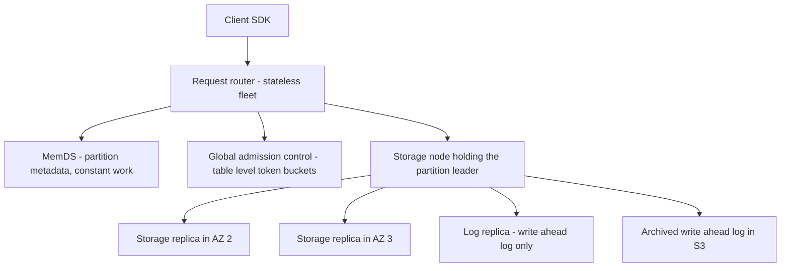
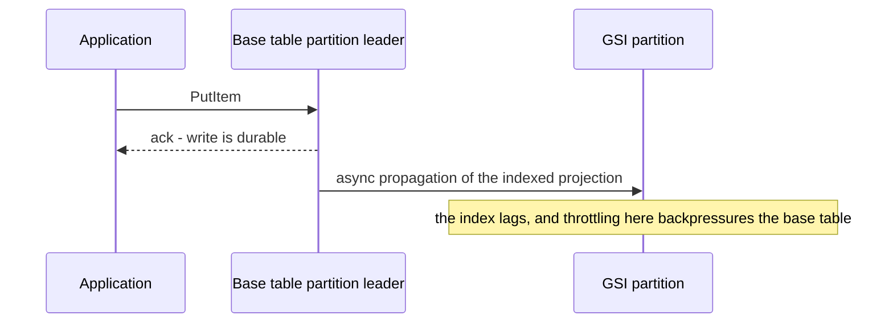

# DynamoDB in Production

DynamoDB is the productized descendant of Amazon's 2007 Dynamo paper — but "descendant" hides how much it *rejected* from its famous parent. Dynamo was leaderless, eventually consistent, and operated by the teams that used it; DynamoDB (launched 2012) is leader-based, offers strong consistency on demand, and is fully managed. This note covers the production story: how partitions and capacity actually behave, how a decade of hot-partition pain drove adaptive capacity and on-demand mode, and what the USENIX ATC 2022 paper revealed about keeping latency predictable at any scale.

## The scale of the problem

DynamoDB serves much of Amazon itself plus a large fraction of AWS customers. The public scale markers, with years:

- **Prime Day 2023** (per the AWS News Blog recap): DynamoDB peaked at **126 million requests per second**; **Prime Day 2024**: **146 million requests per second**; **Prime Day 2025**: **151 million requests per second** — trillions of API calls across each event (tens of trillions in 2024 and 2025), with single-digit-millisecond latency maintained.
- The 2022 USENIX paper's framing goal is not raw throughput but **predictable performance**: p50 and p99 latency should look the same for a 1 GB table and a 1 PB table.

The problem DynamoDB set out to solve (documented in the 2022 paper's history section): Dynamo-the-paper worked, but every team had to *operate* their own Dynamo installation — capacity planning, node replacement, partitioning decisions. Internally, teams fled to SimpleDB (managed, but with crippling 10 GB domain limits and unpredictable latency). DynamoDB's founding bet: **a multi-tenant, fully managed key-value store with provisioned, guaranteed throughput and bounded latency** — operability as the headline feature, not an afterthought.

Multi-tenancy is the constraint that explains almost every design choice below, so it is worth stating plainly. Many unrelated customers' partitions share the same storage nodes. That sharing is what makes the service cheap — one customer's idle capacity is another's burst — and it is also what makes every unbounded operation dangerous, because an unbounded operation by one tenant is a latency spike for a stranger. A single-tenant database can afford to be generous and occasionally slow. A multi-tenant one must be stingy and always fast, which is why DynamoDB's API refuses joins, refuses cross-partition queries, refuses interactive transactions, and meters everything.

## The architecture

### Not your 2007 Dynamo

The consistency story is the sharpest break from [[The Dynamo Paper]]:

| | Dynamo (2007 paper) | DynamoDB (product) |
|---|---|---|
| Replication | Leaderless, sloppy [[Quorum Reads and Writes|quorums]] | **Leader-based**: Multi-Paxos elects a leader per partition's replica group |
| Conflicts | Vector clocks, app-side merge (the shopping-cart story) | **None by design** — the leader serializes writes; no vector clocks, no sibling resolution |
| Consistency | Eventual, tunable R/W | Eventually consistent reads by default; **strongly consistent reads** (from the leader) on request; transactions added 2018 |
| Operation | Self-run by each team | Fully managed, multi-tenant |

Each table is [[Sharding|partitioned]] by hash of the partition key; each partition is replicated across three AZs with a Paxos-elected leader taking all writes and strong reads ([[Consensus and Raft]] territory; replicas also serve eventually consistent reads). B-tree-based storage nodes hold the replicas; global secondary indexes (**GSIs**) are separate index tables maintained asynchronously ([[Secondary Indexes on Sharded Data]]; more below).

### Request routing and the 2022 paper's machinery

The USENIX ATC 2022 paper ("Amazon DynamoDB: A Scalable, Predictably Performant, and Fully Managed NoSQL Database Service") describes the production control plane:

- **Request routers** — a stateless front fleet that authenticates, looks up partition metadata, and forwards to the right storage node. The metadata lookup itself was a scaling story: routers originally cached full routing tables; **MemDS**, a Perkle-tree-backed distributed metadata store, now serves partition lookups with constant-work behavior so metadata never becomes the hot spot.
- **Global admission control (GAC)** — the evolution of per-partition rate enforcement. Token-bucket [[Rate Limiting]] at the *table* level, tracked by a distributed GAC service, lets a table's unused capacity flow to whichever partitions are hot right now, replacing the rigid per-partition split that caused years of pain (next section).
- **Continuous verification** — background processes continuously re-verify replica integrity against logs — the same "trust nothing, audit always" durability posture as [[S3 Deep Dive]].

### Inside a replication group: quorum, log replicas, and scrubbing

A partition's **replication group** is normally three storage replicas across three AZs, each holding both the **write-ahead log** and the B-tree that serves reads. A write is acknowledged once a quorum of the group has the log record durably — so one slow or dead replica never blocks a write, and the leader's Multi-Paxos lease is what prevents two leaders accepting writes at once ([[Split Brain and Fencing]]).

The clever bit from the 2022 paper is what happens when a replica dies. Rebuilding a full replica means copying the whole B-tree, which takes minutes to hours for a large partition — and during that window the group is one failure away from losing write availability. DynamoDB instead adds a **log replica**: a node that stores only the recent write-ahead log and no B-tree at all. It can join in seconds, restoring the group's write quorum straight away, while a full replica — the kind that can also serve reads — rebuilds in the background. The general pattern is worth stealing: **separate the cheap part of a replica's job from the expensive part, and heal the cheap part first.**

Durability is likewise a process, not a property ([[Availability Reliability Durability]]). Write-ahead logs are archived to S3, and a continuous **scrub** compares live replicas against each other *and* against a replica reconstructed from the archived log — verification against an independent copy, not just a majority vote among possibly-identically-wrong peers. Amazon also used **TLA+** model checking on the replication and Paxos protocols, documented publicly in "How Amazon Web Services Uses Formal Methods" (CACM 2015) — the same instinct as S3's ShardStore work.

### Secondary indexes: a write stream you may not realize you bought

A **global secondary index** is not an index in the B-tree sense you know from MySQL or MongoDB. It is a *separate table*, partitioned by its own key, fed asynchronously from the base table's write stream. That one sentence explains every surprising GSI behaviour: it has its own capacity, it is always eventually consistent (there is no "strongly consistent GSI read", because the index may simply not have the write yet), and it can fall behind.

A **local secondary index**, by contrast, lives in the same partition as the base item, which is why it *can* serve strongly consistent reads and why it drags the 10 GB item-collection limit along with it. The choice between them is really a choice about which constraint you would rather live with: staleness, or a ceiling on how much data one key may ever hold ([[Secondary Indexes on Sharded Data]]).

### Hard limits worth memorizing

These are the AWS-documented constraints (as of 2026) that decide data models. They are limits, not era-specific performance figures, but check the docs before quoting any of them in a design review:

| Limit | Value | Why it bites |
|---|---|---|
| Item size | 400 KB | Forces large payloads into S3 with a pointer in the item |
| Per-partition throughput ceiling | ~3,000 RCU / ~1,000 WCU | The floor under every hot-key problem; adaptive capacity cannot exceed it |
| Item collection with a local secondary index | 10 GB per partition key value | Writes to that key start failing once exceeded — a one-way design trap |
| Query/Scan result page | 1 MB | Pagination is mandatory, not optional |
| `TransactWriteItems` | originally 25 items, raised to 100 in 2022 | Caps how much you can make atomic in one call |
| Streams record retention | 24 hours | Your consumer's outage budget, not a replayable log ([[Message Queues vs Event Logs]]) |
| Point-in-time recovery window | Up to 35 days (recovery period configurable 1–35 days, as of 2026) | Your "undo a bad migration" window |

## Key decisions and why

| Decision | Why |
|---|---|
| Leader-based replication, dropping vector clocks | Predictability was the product. Conflict resolution pushed to apps (Dynamo's model) makes latency and correctness app-dependent; a leader gives one serialization point and simple semantics |
| Provisioned capacity (RCU/WCU) as the contract | Multi-tenancy needs admission control; making throughput an explicit purchased quantity lets AWS guarantee it and isolate tenants |
| Hash partition key, no cross-partition queries | Keeps every operation O(one partition) — the price of predictable latency at any size |
| GSIs maintained asynchronously | Synchronous index updates would couple write latency to index count; async keeps the write path flat but costs consistency and write amplification |
| Adaptive capacity → GAC → on-demand (2018) | A decade of real hot-partition pain; see below |
| Transactions as one-shot requests, never interactive sessions | An interactive transaction lets a client hold locks across network round trips and think-time. In a multi-tenant store that is one tenant able to stall another's partition, so `TransactWriteItems` resolves in a single server-side operation and costs 2× capacity rather than offering `BEGIN`/`COMMIT` ([[Two-Phase Commit and Distributed Transactions]]) |
| Log replicas to heal quorums in seconds | A group running on two replicas is one failure from unavailability; the window of exposure, not the average, is what the SLA has to survive |
| Metadata served with constant work | A cache that only does work on a miss does its *most* work exactly when it is coldest — after a deployment or a network event. MemDS is queried even on cache hits so its load does not spike when the fleet's caches go cold ([[Failure Modes in Distributed Systems]]) |
| Two-phase rollouts for protocol changes | The paper describes deploying the ability to *read* a new format fleet-wide before any node starts *writing* it, so a rollback never strands unreadable data ([[Deployment Strategies]]) |

The common thread: every one of these trades peak efficiency for a narrower distribution of outcomes. Caching only on misses is more efficient; constant work is more predictable. Interactive transactions are more expressive; one-shot transactions bound the damage one tenant can do. A paid-for ceiling is less generous than best-effort; it is also the only thing that makes a multi-tenant latency promise keepable.

## What broke along the way

This is the most instructive section of the DynamoDB story, because the pain was *designed in* and took years to engineer out:

- **Throughput dilution (pre-2018).** Provisioned capacity was divided **equally among partitions**. A table with 10 partitions and 10,000 WCU gave each partition 1,000 WCU. Two ways to suffer: (1) a **hot key** concentrating traffic on one partition got throttled at 1/N of what you paid for ([[Hot Partition Problem]]); (2) worse, **scaling up storage or throughput split partitions, permanently diluting per-partition capacity** — a table that grew to 100 partitions and scaled back down kept 100 partitions, each with 1% of capacity. Teams discovered their "temporary" Black-Friday scale-up had permanently degraded their hot-key headroom. This generated years of "DynamoDB throttling despite unused capacity" incidents and an entire folk art of key-sheltering schema design ([[DynamoDB Design]]).
- **Adaptive capacity (presented at re:Invent 2017, made instant in May 2019)** let hot partitions borrow unused table capacity — first as a reactive background adjustment (minutes of throttling before relief), then proactively via GAC tokens (near-instant). A further change in **November 2019** lets DynamoDB automatically isolate a frequently accessed item onto a partition of its own. All of it mitigates *imbalance*, but a partition still has a hard ceiling (public figures: 3,000 RCU / 1,000 WCU per partition), so a single hot *item* can still throttle once its traffic exceeds what one partition may serve — isolating a key onto its own partition is not the same as splitting it, and a key cannot be split.
- **On-demand mode (announced late 2018)** removed capacity planning entirely: pay per request, with DynamoDB managing partitioning. Caveats operators learn in production: on-demand instantly serves up to ~2× a table's previous peak (as of 2026), and sudden spikes far beyond that can still briefly throttle while partitions split.
- **GSI write amplification and backpressure.** Every write to a table with GSIs is re-written to each index (and an update changing an indexed attribute costs a delete + insert in the index). N GSIs ≈ N+1 writes' worth of cost and capacity. Under-provisioned GSIs **backpressure the base table**: if the index can't absorb the replication stream, base-table writes throttle — a classic "my table had capacity but still throttled" mystery.
- **The 2015 DynamoDB metadata outage** (September 2015, us-east-1): a network disruption caused a storm of membership/metadata lookups that overwhelmed the internal metadata service; storage nodes that couldn't confirm membership took themselves offline, cascading into hours of elevated errors for DynamoDB and dependent services. The public AWS post-mortem is a canonical [[Failure Modes in Distributed Systems|metastable failure]] read, and the MemDS redesign in the 2022 paper is the structural fix: constant-work metadata serving regardless of system stress. Note the shape precisely, because it recurs everywhere: load *caused by the failure* exceeded the load that caused the failure, so the system could not recover on its own even after the trigger cleared. That is the definition of a metastable failure, and the only reliable cure is to remove the feedback loop — not to add capacity.
- **The item-collection trap.** Adding a **local secondary index** to a table silently imposes a 10 GB limit on all items sharing one partition key value. Nothing warns you while the collection is small; writes to that key simply begin failing years later, and an LSI cannot be added to or removed from an existing table. Global secondary indexes have no such limit, which is why "use a GSI unless you genuinely need the strongly consistent read an LSI offers" is the standard advice.
- **Scans against production tables.** `Scan` reads every partition and consumes capacity from all of them, so an analytics job or a "quick backfill" can throttle an entire table's live traffic. The structural answer is that DynamoDB is not an analytics store: export to S3 or stream into one ([[Time Series and Analytics Stores]]).
- **Global Tables resolve conflicts by last-writer-wins — in their default mode.** Multi-region eventual consistency (the original and still default mode) replicates per item, asynchronously, and a concurrent write in two regions keeps one version and discards the other, with no application merge hook — the opposite of the Dynamo paper's vector clocks, which at least *told* the application a conflict happened. For anything that accumulates — a balance, a counter, a ledger — silent discard is data loss, not a consistency relaxation ([[Consistency Models]]). Since **June 2025** a second mode, **multi-Region strong consistency**, is generally available: a write is synchronously replicated to at least one other region before it is acknowledged, and strongly consistent reads from any replica return the latest version — paying a cross-region round trip on every write, and (at GA) offered only in a handful of US, European and Asia-Pacific regions, none of them in India. Asia Pacific (Mumbai) was added in September 2026, but an MRSC table must span exactly three regions and Mumbai is the only Indian region on the list (as of 2026), so an all-India configuration is still impossible.

## Lessons you can reuse

1. **Averages lie; design for skew.** Per-partition splitting of a table-level budget assumed uniform access. Real traffic follows power laws. Any quota, cache, or shard scheme you build should be tested against skewed keys first ([[Hot Key Problem]]). [[Discord Message Storage Evolution]] and [[Twitter Timeline Design]] are the same lesson in two other storage systems.
2. **Admission control belongs at the highest level that has the information.** Moving from per-partition buckets to global (table-level) admission control is the general pattern: enforce where you can see the whole picture, meter locally.
3. **Make degradation a product feature.** On-demand mode is "we will do capacity planning for you" — the operational pain was turned into a priced product tier. Internally, your platform teams can do the same with sensible defaults.
4. **Indexes are writes.** Every secondary index multiplies write cost and adds an async consistency surface ([[Secondary Indexes on Sharded Data]]). Count them in capacity math from day one.
5. **Predictability is a feature you design for, not an outcome you hope for.** Constant-work patterns (MemDS), admission control, and bounded per-partition limits all trade peak cleverness for flat p99s — the explicit thesis of the 2022 paper.
6. **A system that works harder when it is sick will not recover on its own.** Cache misses that generate extra lookups, retries that generate extra load, health checks that fail under load and remove healthy capacity: all the same bug. Ask of every mechanism, "does this do *more* work when the system is degraded?" If yes, flatten it into constant work or cap it ([[Load Shedding and Graceful Degradation]]).
7. **Heal the cheap half of a replica first.** The log-replica trick generalizes to any replication scheme where catching up on recent history is cheap and rebuilding full state is expensive — restore the quorum with the cheap part, backfill the rest in the background.
8. **Verify replicas against something independent.** Three replicas that agree with each other can agree on the same corruption. DynamoDB compares live replicas against a copy rebuilt from the archived log; the general rule is that an audit needs a source of truth outside the thing it is auditing.
9. **Read the limits before the features.** 400 KB items, one-partition-only operations, 10 GB item collections under an LSI — these shape your data model far more than any feature does, and several of them are irreversible once the table is live.

## In your stack

- You run MongoDB, not DynamoDB — but the lessons map directly: a hot account/tenant document is your [[Hot Partition Problem]]; MongoDB's shard-key choice has the same "nearly irreversible, decides your fate" weight as DynamoDB's partition key ([[MongoDB Architecture]]).
- GSI write amplification has a Mongo cousin: every secondary index adds write cost per insert/update — audit index count on hot collections the way DynamoDB operators audit GSIs.
- The GAC idea applies to your [[Rate Limiting]]: a per-pod local limiter is the "per-partition bucket" mistake if traffic is skewed across pods; a Redis-backed shared budget is your small-scale GAC.
- SQS in front of write-heavy flows is your version of absorbing spikes that would throttle the store ([[Why Async Messaging Exists]]) — DynamoDB teams do the same with queues in front of on-demand tables for extreme spikes.
- Fail-closed note for fintech: DynamoDB throttles (explicit 400-class errors) rather than degrading silently — mirror that; for money movement, an honest rejection beats a silent partial write ([[Load Shedding and Graceful Degradation]]).
- The one place DynamoDB earns its keep in a MongoDB shop is **small, hot, key-value state that must not be lost**: idempotency keys, distributed locks, OTP and token state. A conditional `PutItem` with `attribute_not_exists(pk)` is a single-round-trip compare-and-set, and TTL expires the row without a sweeper job — a sturdier [[Idempotency]] guard than a Redis `SETNX` whose durability depends on your persistence settings ([[Redis Internals]]). Weigh it against the operational cost of a second datastore in the estate.
- **Cost shape, since it is nothing like Mongo's.** Provisioned capacity scales with *reserved* throughput and is billed whether or not you use it; on-demand scales with *actual request count and item size*, so a chatty client or an unbounded `Scan` converts directly into rupees. Storage is cheap; requests and GSIs are not. The practical rule: on-demand for spiky or unknown traffic, provisioned with autoscaling once the shape is known and steady, and count every GSI as another full write stream in the estimate.
- **Global Tables in its default (eventual) mode is the wrong tool for Niyo's ledger-shaped data.** Last-writer-wins silently discards a concurrent write, which for a balance is an unaudited loss — exactly the failure an RBI auditor would ask about. If multi-region ever becomes a requirement, the honest options are a single writable region with read replicas elsewhere, or a design where each region owns a disjoint key range so concurrent writes to one item cannot happen. The 2025 strong-consistency mode removes the silent discard but not the constraint that matters here: it needs exactly three regions and only one Indian region (Mumbai, added September 2026) supports it, so data-localisation rules rule it out before latency does.
- The 2022 paper's deployment discipline transfers directly to EKS: roll out the ability to *read* a new event or document schema everywhere before any instance starts *writing* it, so a rollback is always safe ([[Event Schema Evolution]], [[Deployment Strategies]]). With many services pinned at 1 replica, a rollback that strands unreadable data has no second instance to fall back on.

## Interview angle

The 60-second version: *"DynamoDB kept the Dynamo paper's partitioning and operational goals but rejected its consistency model: each partition has a Paxos-elected leader, so no vector clocks and optional strongly consistent reads. The production story is about predictability. Originally, provisioned throughput was split evenly across partitions, so hot keys and partition splits caused throttling while paid capacity sat unused — throughput dilution. The fixes, in order: adaptive capacity (hot partitions borrow table capacity), global admission control (table-level token buckets), and on-demand mode (no capacity planning at all) — though a single hot item is still capped by hard per-partition limits. GSIs are maintained async and multiply write cost, and an under-provisioned GSI backpressures the base table. The 2022 USENIX paper adds constant-work metadata serving — MemDS — after a 2015 metadata-driven outage. Scale proof: 151 million requests/sec at Prime Day 2025."*

Classic follow-ups: "DynamoDB vs the Dynamo paper?" (the table above — most candidates conflate them); "Why can you still get throttled with adaptive capacity?" (per-partition hard limits; one item can't be split); "What do GSIs cost?" (write amplification + eventual consistency + backpressure risk); "When DynamoDB over MongoDB?" (zero-ops, predictable latency, key-value access patterns vs richer queries and aggregation); "Why no interactive transactions?" (a client holding locks across think-time in a multi-tenant store lets one tenant stall another); "How does a dead replica get healed?" (log replica restores the quorum in seconds, full replica rebuilds behind it); "Is Global Tables safe for a balance?" (not in the default eventual mode — last-writer-wins discards a concurrent write silently; the 2025 multi-Region strong-consistency mode fixes that at a cross-region write-latency cost).

The highest-value thing to show here is that you understand *multi-tenancy as a design constraint*. Most candidates describe DynamoDB's restrictions as arbitrary limitations. Framing them as the price of a keepable latency promise across an enormous number of tenants is the answer that sounds like someone who has operated a platform.

## Check yourself

> [!question]- Q: Explain throughput dilution and why adaptive capacity didn't fully kill the hot-partition problem.
> Provisioned capacity was divided equally among partitions, and partition count only grows (splits on size/throughput scale-up are not merged back). So capacity-per-partition = table capacity / partition count kept shrinking, and any skewed key hit its partition's small slice while other slices idled. Adaptive capacity and GAC let hot partitions borrow idle table capacity, removing the *allocation* problem — but each partition still has an absolute ceiling (publicly ~3,000 RCU / 1,000 WCU), so one hot *item* (which can never span partitions) still throttles. Skew beyond the per-partition ceiling must be fixed in the data model: key sharding/salting ([[Hot Partition Problem]]).

> [!question]- Q: What happens if a GSI on your table is under-provisioned and the base table takes a write burst?
> The base table's writes replicate asynchronously to the GSI. If the GSI can't absorb the stream, the replication backlog grows until DynamoDB applies backpressure: base-table writes get throttled even though the base table itself has spare capacity. Detection: `WriteThrottleEvents` rising on the table while `ConsumedWriteCapacityUnits`, dimensioned by `GlobalSecondaryIndexName`, sits pinned at the index's provisioned limit. (Do not reach for `OnlineIndexConsumedWriteCapacity` here — that metric covers only the backfill while a *new* index is being created, not steady-state replication into an existing one.) Fix: provision GSIs at least at base-table write capacity (times update amplification), or use on-demand.

> [!question]- Q: Your payments team wants strongly consistent reads everywhere "to be safe". What does that cost in DynamoDB, and what would you actually recommend?
> Strong reads must hit the partition leader: they cost 2× the read capacity of eventual reads, can't be served by GSIs at all (GSIs are always eventually consistent), lose the latency benefit of reading the nearest replica, and concentrate read load on leaders. Recommend strong reads only on read-after-write paths where staleness is user-visible or money-correctness-relevant (e.g. balance check immediately after a debit), eventual reads elsewhere, and [[Idempotency]] + conditional writes for the actual correctness guarantees — consistency of reads is not a substitute for write-path safety.

> [!question]- Q: Mini design — model a "transactions by account, newest first" access pattern in DynamoDB and defend your partition key against Prime-Day-style skew.
> Table: partition key `accountId`, sort key `txnTimestamp#txnId` (descending queries via `ScanIndexForward=false`). Most accounts are cold, so hash distribution handles them; the risk is a mega-tenant (corporate account) exceeding per-partition write limits. Mitigation: write-shard hot accounts — partition key `accountId#shardN` with N chosen by observed write rate, fan-in at read time across N shards (scatter-gather of N Queries, acceptable for small N). Add a GSI only if a second access pattern (e.g. by merchant) truly exists, and budget its write amplification explicitly.

> [!question]- Q: A team proposes DynamoDB Global Tables across two regions for a wallet-balance table, arguing it gives active-active resilience. What do you say, and what breaks?
> In their default multi-Region eventual-consistency mode, Global Tables replicate per item, asynchronously, and resolve concurrent writes by last-writer-wins on an internal timestamp — the losing write is discarded with no application callback and no conflict record. For a balance, two concurrent debits in different regions can leave the account with one of them silently erased: an unexplainable discrepancy in an audited ledger, not a tolerable staleness window. That mode also cannot give read-your-own-writes across regions, so a user who pays in one region and refreshes against the other may see the old balance. The multi-Region strong-consistency mode (GA June 2025) closes both gaps by synchronously replicating each write to another region before acknowledging it — which is exactly the cross-region write latency the team was hoping to avoid, and it is only offered in specific regions. Safer designs in the default mode: keep a single writable region and serve other regions read-only with explicit staleness in the UI; or partition ownership so an account is only ever written in its home region, making cross-region conflicts structurally impossible. If you need genuine multi-region transactional integrity, that is the [[Google Spanner Deep Dive|Spanner]] class of system and its latency floor, not an eventually consistent key-value replica.

## Sources

- Elhemali et al., **"Amazon DynamoDB: A Scalable, Predictably Performant, and Fully Managed NoSQL Database Service"**, USENIX ATC 2022 — routing, MemDS, GAC, adaptive capacity history.
- DeCandia et al., **"Dynamo: Amazon's Highly Available Key-value Store"**, SOSP 2007 — the contrast baseline ([[The Dynamo Paper]]).
- AWS News Blog — **"Prime Day 2023 – Powered by AWS"**, the 2024 recap and **"AWS services scale to new heights for Prime Day 2025"** (August 2025) (the 126M, 146M and 151M RPS figures).
- AWS post-event summary of the **September 2015 us-east-1 DynamoDB service disruption** (metadata service outage).
- AWS documentation — adaptive capacity, on-demand mode, GSI provisioning and backpressure behavior; the service quotas page for item size, item-collection, transaction and batch limits; Global Tables conflict resolution and the **multi-Region strong consistency GA announcement (June 30, 2025)** and the September 2026 region expansion (Mumbai among five added regions); re:Invent talks: **"Amazon DynamoDB deep dive: Advanced design patterns"** (Rick Houlihan, various years).
- Newcombe et al., **"How Amazon Web Services Uses Formal Methods"**, CACM 2015 — the TLA+ modelling of DynamoDB's replication and consensus protocols.
