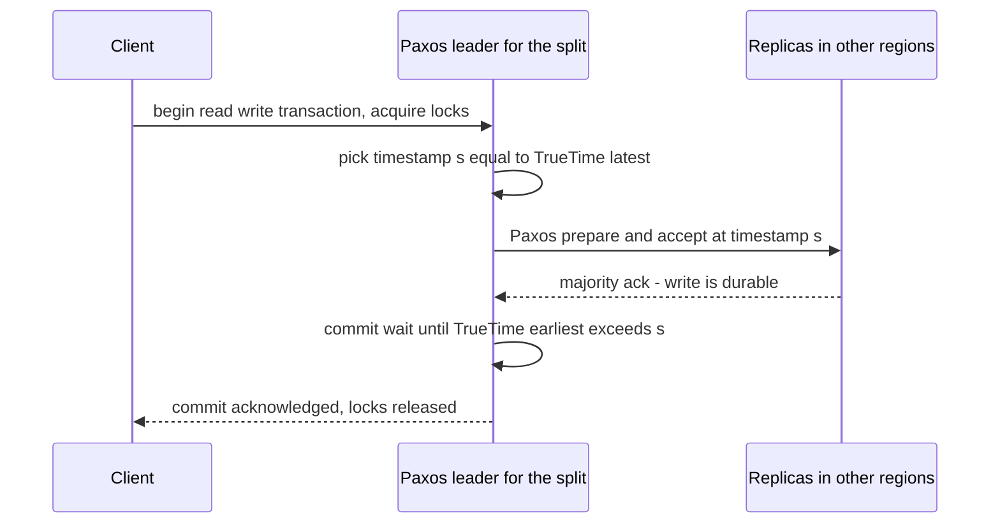
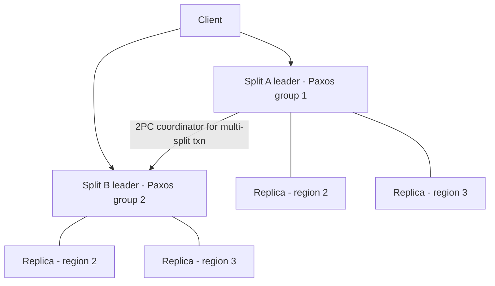

# Google Spanner Deep Dive

Spanner (OSDI 2012 paper) is Google's answer to a question most of this module's companies answered the other way: *what if we refuse to give up SQL and strong consistency, even across continents?* Where [[How Facebook Scales MySQL|Facebook]] accepted eventual consistency to keep latency low, Google built atomic-clock-and-GPS time infrastructure so that transactions spanning the planet behave as if they ran one at a time on a single machine. The core idea — **TrueTime** — turns clock *uncertainty* from something you ignore (and get bugs) into something you measure and wait out.

## The scale of the problem

Google's path to Spanner runs through its earlier storage systems ([[Bigtable and Spanner]]): **Bigtable** (2006 paper) scaled enormously but offered no cross-row transactions and no SQL; **Megastore** added synchronous replication and limited transactions but with poor write throughput. Teams were voting with their feet: building fragile transaction logic in application code, or staying on **sharded MySQL** and suffering. The canonical sufferer was **AdWords** — Google's revenue engine — running on a manually sharded MySQL fleet where, per the Spanner paper's own account of F1, the last resharding effort took **over two years** of coordinated work. The requirements that produced Spanner:

- **SQL and schemas** — product teams demonstrably refused to live without them long-term.
- **Cross-shard ACID transactions** — advertisers' budgets and campaigns must change atomically; "design around it" (Facebook's move) was unacceptable for money data.
- **Synchronous geo-replication** — a datacenter loss must not lose acknowledged commits ([[Disaster Recovery]]).
- **External consistency** — globally, if transaction T1 commits before T2 *starts* (in real time), every observer must see T1's effects ordered before T2's. This is [[Consistency Models|linearizability]] applied to transactions, and no system had offered it at global scale.

## The architecture

### TrueTime: clocks with honest error bars

Ordinary servers' clocks drift, so "timestamp order" normally means nothing across machines ([[Logical Clocks and Ordering]]). Google's fix is physical, not just algorithmic: each datacenter has **time master** servers equipped with **GPS receivers and atomic clocks** (two independent failure modes: GPS antennas fail regionally, atomic clocks drift slowly). Every machine's time daemon polls masters and tracks its own worst-case drift. The **TrueTime API** then never returns "the time"; it returns an **interval**: `TT.now() = [earliest, latest]`, guaranteed to contain true physical time. The half-width of that interval, **ε**, was in the low single-digit milliseconds on average in the 2012 paper era.

This enables the trick everything rests on, **commit-wait**: a transaction is assigned timestamp `s = TT.now().latest`, and the leader **waits** until `TT.now().earliest > s` before making the commit visible. After that wait (~2ε), every machine on Earth agrees that time `s` is in the past — so timestamp order *is* real-time order, with no communication. External consistency falls out: a later-starting transaction necessarily gets a later timestamp.

The numbers behind ε are worth knowing because they show how ordinary the engineering is. In the 2012 paper, daemons poll time masters roughly every 30 seconds and apply a conservative worst-case local drift bound of 200 microseconds per second between polls. ε therefore **sawtooths**: it is smallest just after a poll and grows linearly until the next one, ranging roughly between 1 and 7 milliseconds in the paper's measurements. That is the whole trick — not a perfect clock, but a *provably bounded* wrong one, refreshed often enough that the bound stays small.

Notice the order: the commit-wait overlaps the Paxos round trip where it can, but it cannot be skipped, and it is the last thing standing between a durable write and a visible one.

### Paxos per split, 2PC across groups

Data is [[Sharding|range-partitioned]] into **splits**; each split is replicated across datacenters by its own **Paxos group** ([[Consensus and Raft]] — Paxos is the older sibling of Raft). Every write is a Paxos commit — synchronous majority replication is the *baseline*, not an option. Single-split transactions need only that group's Paxos round. Transactions touching multiple splits use **two-phase commit across the Paxos group leaders**, with one group acting as coordinator.

Why is 2PC acceptable here when [[Two-Phase Commit and Distributed Transactions]] teaches that everyone avoids it? Because 2PC's fatal flaw is a *blocking, mortal coordinator* — if it dies between phases, participants hold locks forever. In Spanner each participant and the coordinator **is a Paxos group**, not a machine: the coordinator's state is itself consensus-replicated, so a leader death elects a new leader that finishes the protocol. 2PC over consensus groups removes the blocking problem and leaves "only" the latency cost.

Two details fill in how that stays stable under failure. Leadership is held by a **time-based lease** — the 2012 paper uses a default of 10 seconds — so a leader knows it may serve strong reads locally without asking anyone, and a new leader cannot be elected until the old lease has provably expired ([[Split Brain and Fencing]]). And because read-write transactions take locks, Spanner needs deadlock handling: the paper uses **wound-wait**, where an older transaction preempts ("wounds") a younger one holding a lock it needs, rather than letting the two wait on each other. Older transactions therefore always make progress, which bounds starvation.

Reads get special treatment: **read-only transactions are lock-free** — pick a timestamp, read a consistent snapshot at that timestamp from any sufficiently caught-up replica (MVCC with TrueTime timestamps). Bounded-staleness reads can be served by the nearest replica without touching the leader. Each replica tracks a **safe time**: the newest timestamp at which it is guaranteed to have seen everything, accounting both for the Paxos writes it has applied and for any prepared-but-undecided 2PC transactions on its splits. A snapshot read at or below safe time is answerable locally with no coordination; above it, the replica waits. This is why read-heavy global workloads perform well on a system whose writes are expensive — the expense is confined to the write path.

### Where the data physically lives

The 2012 paper's unit of placement is the **directory**: a set of contiguous keys sharing a common prefix, which is also the unit Spanner moves between Paxos groups when rebalancing or when an administrator changes a placement policy ([[Rebalancing Partitions]]). Splits are the ranges those directories are grouped into. The practical consequence for application developers is **interleaving**: Spanner's schema language lets you declare a child table as physically interleaved in its parent, so a customer's rows and that customer's order rows sit adjacent in the same split. Get this right and nearly every transaction is single-split, needing one Paxos round and no 2PC. Get it wrong and routine operations become distributed transactions. Physical data layout is part of the API here, in a way it simply is not in a single-node relational database.

### F1: AdWords moves off sharded MySQL

**F1** (VLDB 2013) is the SQL query and application layer Google built on Spanner for AdWords, adding distributed query execution, indexes, and change history. The nuance versus the Facebook story: this is *not* "sharded MySQL fails at scale". Facebook proves sharded MySQL scales fine **when the workload is designed to avoid cross-shard transactions and complex queries**. AdWords' workload was the opposite — relational, join-heavy, transaction-heavy across shards — so for *that workload class*, sharded MySQL was a treadmill of manual resharding and application-managed consistency. Same database, different workload, opposite conclusion. The pair of case studies is the whole lesson: **the workload decides**.

### The alternative: hybrid logical clocks, for people without atomic clocks

Spanner's design raises an obvious objection — most of us cannot install GPS receivers in a datacenter we do not own. The open-source answer, taken by **CockroachDB** and **YugabyteDB**, is the **hybrid logical clock**: combine a physical timestamp with a logical counter ([[Logical Clocks and Ordering]]) so causally related events are always correctly ordered even when physical clocks disagree, and configure a **maximum clock offset** that nodes are assumed to stay within. CockroachDB's documentation describes a default maximum offset of 500 milliseconds, with nodes that detect themselves drifting beyond it shutting down rather than risking incorrect ordering.

The consequence is a different place to pay. Spanner pays on the **write** path with commit-wait. CockroachDB does not commit-wait by default; instead a read that encounters a value written within its uncertainty window cannot tell whether that write happened before it, so the transaction restarts at a later timestamp. So the cost moves to the **read** path as occasional retries, and the guarantee is slightly weaker than Spanner's external consistency. Which is the better trade depends on your read/write mix — but the structural point is that nobody escapes clock uncertainty, they only choose where to put it.

## Key decisions and why

| Decision | Why |
|---|---|
| Buy hardware (GPS + atomic clocks) to shrink ε | Small, *bounded* clock uncertainty converts timestamps into a global ordering mechanism — cheaper than global coordination per transaction |
| Commit-wait instead of coordination for ordering | Waiting ~2ε locally scales infinitely; messaging every region per commit does not (coordination avoidance, ironically, via clocks) |
| Paxos per split, not one global consensus | Thousands of independent groups commit in parallel; consensus throughput limits apply per split, not per system ([[Scalability]]) |
| 2PC layered over Paxos groups | Keeps full ACID across splits while fixing 2PC's blocking-coordinator failure mode |
| Lock-free snapshot reads via MVCC + TrueTime | The read-heavy majority of traffic avoids locks and leaders entirely |
| SQL on top, eventually (F1, then full SQL in Cloud Spanner) | Megastore/Bigtable proved teams re-invent transactions and query layers badly when the platform omits them |
| Two independent clock sources per datacenter | GPS and atomic clocks fail in uncorrelated ways: GPS receivers fail regionally, from antenna faults or interference, and can fail *wrong*; atomic clocks fail by drifting slowly after an oscillator problem. A correctness guarantee built on one time source is a guarantee built on that source's worst day ([[Failure Modes in Distributed Systems]]) |
| Time-based leader leases rather than per-read coordination | A leader that knows it holds the lease can answer a strong read without talking to its replicas, so the common case costs nothing; the lease length is simply how long a failover must wait before it is provably safe |
| Interleaving exposed in the schema language | Spanner could have hidden placement, but then developers could not control whether a transaction is single-split. Making co-location declarable turns an invisible performance cliff into a design decision |
| Wound-wait over deadlock detection | Detecting deadlock cycles across a planet-spanning lock graph is a distributed-graph problem; preemption by age needs only a timestamp comparison and guarantees the oldest transaction finishes |

The pattern across all of them: Spanner buys *bounded, local* answers to questions that would otherwise need *global, synchronous* ones. Bounded clock error replaces a global ordering service. A lease replaces a round of coordination per read. An age comparison replaces distributed deadlock detection. That is the transferable idea — when a distributed question is expensive, look for a locally checkable invariant that implies the answer.

## What broke along the way

- **Megastore's write throughput** was the proximate failure: synchronous replication per write with poor throughput characteristics pushed teams back to Bigtable or MySQL — evidence that consistency without performance doesn't get adopted.
- **Manual MySQL resharding pain** (years-long migrations for AdWords) was the organizational breaking point that justified Spanner's cost.
- **Clock incidents are existential by design.** If TrueTime's ε grows (GPS trouble, masters unreachable), Spanner doesn't become incorrect — it becomes *slower*, because commit-wait stretches with ε. Correctness degrades to latency, a deliberately chosen failure mode. (Google has, separately, published about leap-second "smearing" to avoid time discontinuities.)
- **Write latency floors are permanent.** Every write pays a cross-datacenter Paxos majority round trip, plus commit-wait, plus 2PC rounds if multi-split. Multi-region commits sit in the tens of milliseconds at best — physics ([[Latency Numbers Every Engineer Should Know]]), not implementation debt. Spanner is simply not a sub-millisecond-write system, and schema/interleaving design (co-locating child rows with parents to keep transactions single-split) became a real skill for its users. The 2012 paper's own F1 measurements make the shape concrete: reads averaged single-digit milliseconds, single-site commits averaged tens of milliseconds, and multi-site commits roughly 100 milliseconds — and the paper is candid that its users had to design around that, not expect it to improve.
- **Monotonic keys create hotspots, and this one still bites people.** Because Spanner range-partitions rather than hash-partitions, a primary key that increases monotonically — a timestamp, an auto-increment sequence — sends every insert to the single split that owns the top of the range. Google's own Cloud Spanner documentation leads with this as the number-one schema anti-pattern and recommends hashing the key, using a UUID, or bit-reversing a sequence. It is the same [[Hot Partition Problem]] Discord hit, arriving through a completely different door: range partitioning gives you efficient scans and pays for them with sensitivity to key order ([[Sharding]]).
- **2PC's latency did not disappear, only its blocking did.** Making the coordinator a Paxos group fixes correctness-under-failure; it does nothing about the extra round trips, and it adds the participants' locks being held across them. Long-running or wide multi-split transactions hold locks across wide-area latency, which is how a Spanner deployment discovers lock contention it never saw in testing.
- **The price floor was a real adoption barrier.** Cloud Spanner's capacity was originally sold in whole nodes, which put a substantial monthly minimum under even a tiny database; Google later added sub-node "processing unit" granularity to lower that floor. The honest framing for an architecture review is a **cost shape**: you pay for provisioned compute capacity and replicated storage continuously, in every region of the instance configuration, whether or not traffic arrives — very unlike a request-priced store such as [[DynamoDB in Production|DynamoDB on-demand]].
- **Leap seconds had to be engineered away.** A clock that jumps backwards would break the interval guarantee outright, so Google "smears" leap seconds across a window rather than stepping them. A system whose correctness rests on time inherits every piece of civil-timekeeping messiness as an engineering problem.

## Lessons you can reuse

1. **Uncertainty you can bound is uncertainty you can use.** TrueTime doesn't make clocks perfect; it makes their error *known*. The general pattern — replace "assume X is true" with "measure how wrong X can be, then compensate" — applies far beyond clocks.
2. **Strong consistency is a latency budget line.** Spanner proves global linearizable transactions are *possible*; its write floors prove they are never free. Choose per workload ([[PACELC]]).
3. **Fix a protocol's failure mode, keep the protocol.** 2PC wasn't discarded; its blocking coordinator was made durable via consensus. Ask "what exactly breaks?" before abandoning a classic.
4. **Platforms win by meeting teams where they are.** SQL and transactions returned because application teams kept rebuilding them badly — the same force that keeps relational databases your default ([[Choosing a Database]]).
5. **Facebook vs Google is a workload comparison, not a ranking.** Social graph reads tolerate staleness; ad money does not. Put the two notes side by side in interviews.
6. **Prefer a locally checkable invariant to a global question.** Every Spanner trick is this move. Before adding a coordination round to your own design, ask whether some local fact — a lease, a bounded error, a monotonic version — already implies what you were about to go and ask for.
7. **Degrade on the axis you can afford.** Spanner's clock failures make it slower, never wrong. Decide this deliberately for your own components: when the thing you depend on misbehaves, does your system get slow, get wrong, or get loud? For money movement the only acceptable answers are slow and loud.
8. **Physical layout is part of your schema, whatever your database.** Interleaving in Spanner, embedding versus referencing in MongoDB, partition keys in Cassandra: in every distributed store, "what lives next to what" decides which operations are cheap. This is a design-time decision and an expensive one to revisit.
9. **Range partitioning and hash partitioning trade the same coin.** Range gives you ordered scans and costs you hotspot sensitivity on sequential keys; hash gives you even load and costs you scans. Neither is the safe default — the question is whether your access pattern is "a range of keys" or "this one key".

## In your stack

- Niyo's instincts should be Spanner-*shaped* (correctness over latency for money movement) without Spanner itself: MongoDB multi-document transactions or single-document atomicity + [[Idempotency]] + [[The Outbox Pattern]] cover most needs at your scale — [[Stripe and Payment System Design]] shows the payments-specific version of this trade.
- The commit-wait idea has a micro-analogue you already live: acknowledging a payment only after durable replication (e.g. Mongo `w: majority`) is "pay latency for a guarantee" — the same trade at datacenter scale instead of planet scale.
- If Niyo ever needed multi-region active-active with transactional integrity (e.g. global cards), managed Spanner-class systems (Cloud Spanner, or quorum-replicated alternatives) are the honest option — the build-it-yourself version requires clock infrastructure you cannot rent casually.
- Interleaving's lesson transfers to MongoDB schema design: co-locate data that must change together (embed child documents rather than referencing them) so transactions stay single-shard ([[MongoDB Architecture]]).
- **The monotonic-key warning applies to you right now, and in two places.** MongoDB's default `ObjectId` begins with a timestamp, so a **ranged** shard key on `_id` or on `createdAt` concentrates all inserts on the top chunk — the classic reason a newly sharded collection performs worse than the unsharded one it replaced. Hashed shard keys avoid it at the cost of ranged queries. The same warning applies to any Redis sorted set or Mongo index keyed on time if you later partition by it ([[Hot Partition Problem]]).
- **Spanner's degradation mode is the one to copy for KYC and payment paths.** When the clock is uncertain, Spanner waits longer rather than committing something it cannot order. The Niyo equivalent: when a downstream — the IAM service, a partner bank, a ledger write — cannot be confirmed, the correct behaviour is a timeout and an explicit failure that a retry with the same [[Idempotency|idempotency key]] can resolve safely, never an optimistic local commit that assumes the remote side agreed. Fail closed, in the org's words, and make the latency visible rather than hiding it behind a guess.
- Cost shape if Cloud Spanner is ever evaluated seriously here: provisioned compute plus replicated storage billed continuously in every region of the configuration, with a floor that exists even at zero traffic. That shape only makes sense when multi-region transactional integrity is a hard requirement, which for a single-country RBI-regulated product it currently is not — and data-localisation rules would constrain the region configuration before cost did.

A practical mapping of Spanner's guarantees onto what you actually run, so the ideas survive without the hardware:

| Spanner mechanism | What you already have | What you give up |
|---|---|---|
| Paxos majority replication per split | MongoDB replica set with `w: majority` | One cluster, not a planet; cross-region needs deliberate member placement |
| External consistency via commit-wait | Nothing equivalent | Cross-service real-time ordering; use causal tokens or an explicit sequence instead |
| Lock-free snapshot reads at a timestamp | Read concern `snapshot` inside a transaction | Serving snapshots from a nearby replica at a chosen past timestamp |
| 2PC over consensus groups | [[Saga Pattern|Sagas]] with compensations, plus [[The Outbox Pattern]] | Atomicity — you get eventual convergence and must design compensations |

The row that matters is the last one: at your scale the honest substitute for distributed transactions is a saga with idempotent steps and an audit trail, not a homegrown 2PC coordinator. Note also that with many services pinned at 1 replica, a MongoDB `w: majority` write protects the *data* but not the *service* — the write survives, and the caller still sees an outage if the single pod is the one that goes away.

## Interview angle

The 60-second version: *"Spanner is Google's globally replicated SQL database with external consistency: real-time transaction order is preserved globally. The enabler is TrueTime — GPS and atomic clocks per datacenter expose time as a bounded interval rather than a point. Transactions take a timestamp and commit-wait out the uncertainty, so timestamp order equals real-time order with zero cross-region coordination for ordering. Data is range-split; each split is its own Paxos group doing synchronous majority replication; multi-split transactions run 2PC over the group leaders, which is safe because every 2PC participant is itself a highly available consensus group. Reads are lock-free MVCC snapshots. The price is a permanent write-latency floor — Paxos round trips plus commit-wait. F1 moved AdWords onto it off sharded MySQL, because that workload needed cross-shard transactions — the opposite conclusion from Facebook's, driven by the workload."*

Classic follow-ups: "What happens if clocks go bad?" (ε grows → commit-wait grows → slower, not wrong); "Why is 2PC okay here?" (participants are Paxos groups — no mortal coordinator); "Spanner vs DynamoDB?" (global transactions + SQL vs single-digit-ms key-value — see [[DynamoDB in Production]]); "Could you build Spanner on NTP?" (yes in theory, with ε of hundreds of ms — commit-wait would be unusable; CockroachDB's hybrid-logical-clock approach moves the cost to read restarts instead); "Why two clock sources?" (GPS and atomic clocks fail in uncorrelated ways, and GPS can fail *wrong* rather than simply stopping); "What is the worst schema mistake on Spanner?" (a monotonically increasing primary key under a range-partitioned store); "Where does commit-wait sit in the write path?" (after the Paxos majority ack, before the commit becomes visible).

The trap in this question is over-claiming. Spanner is frequently described as "beating CAP", which it does not: during a partition that costs a split's Paxos group its majority, that split is unavailable for writes — a CP system behaving exactly as [[CAP Theorem|CAP]] predicts. What Spanner actually buys is that Google's network is engineered well enough that those partitions are rare, so the *practical* availability is high. Saying that precisely is worth more than reciting TrueTime.

## Check yourself

> [!question]- Q: Explain commit-wait to a colleague in three sentences.
> TrueTime tells every server a time interval guaranteed to contain true time, typically a few milliseconds wide. A committing transaction takes the interval's upper bound as its timestamp, then waits until every machine's lower bound has passed that timestamp before revealing the commit. After the wait, the timestamp is unambiguously in the past everywhere, so ordering transactions by timestamp is identical to ordering them by real time — global ordering bought with a local wait instead of global messages.

> [!question]- Q: What happens if a Paxos leader for a split dies mid-transaction?
> The split's Paxos group elects a new leader ([[Failover]] via consensus — no split brain, because election requires a majority). Because all transaction state (locks, prepare records, coordinator state) is replicated through Paxos, the new leader reconstructs in-flight 2PC work and completes or aborts it. Clients see elevated latency for that split during the election window, not lost or stuck transactions — exactly the blocking failure plain 2PC cannot survive.

> [!question]- Q: AdWords ran on sharded MySQL; Facebook still runs on sharded MySQL. Reconcile.
> Sharded MySQL scales when the application avoids cross-shard transactions and complex cross-shard queries — Facebook's graph workload is point reads/writes within a shard, with staleness tolerated, so the design holds. AdWords needed joins, secondary indexes, and atomic multi-row money updates *across* shards, forcing consistency logic into the app and multi-year manual reshardings. Same database, different workload requirements, legitimately different conclusions.

> [!question]- Q: Mini design — you must guarantee that a ledger read after a confirmed debit never shows the old balance, across two regions. What Spanner ideas apply at non-Google scale?
> Synchronous majority replication for the write (ack only after a quorum spanning regions — e.g. Mongo `w: majority` with cross-region members), reads routed to the leader or gated by a "read at least at timestamp T" token the client carries from the write ack (a poor man's external consistency via causal tokens — [[Read Your Own Writes and Replica Lag Anomalies]]). Accept the write-latency floor as the cost; for a ledger, correctness beats the extra tens of milliseconds.

> [!question]- Q: A team migrates a high-write events table to Spanner and makes the primary key an auto-incrementing sequence. Throughput collapses to roughly what one machine can do. What happened, and what are the fixes with their trade-offs?
> Spanner range-partitions, so a monotonically increasing key means every insert targets the newest key range — one split, one Paxos leader, one machine's worth of write throughput, no matter how many nodes the instance has. Splitting the range does not help because the new top split immediately inherits all the traffic. The fixes: hash the key or use a UUID, which distributes inserts evenly but destroys the ability to scan "the most recent N" efficiently; bit-reverse the sequence, which spreads writes while keeping values unique and dense; or keep the ordered key but prefix it with a bounded shard number, accepting a scatter-gather of that many reads for ordered scans — the same bucketing fix as [[Discord Message Storage Evolution]]. Which one is right depends entirely on whether the read pattern is "recent range" or "one row by id". The generalizable lesson: whenever a store partitions by range, a time-ordered key is a single-writer bottleneck in disguise.

## Sources

- Corbett et al., **"Spanner: Google's Globally-Distributed Database"**, OSDI 2012 — TrueTime, commit-wait, architecture.
- Shute et al., **"F1: A Distributed SQL Database That Scales"**, VLDB 2013 — the AdWords migration and the resharding anecdote.
- Chang et al., **"Bigtable: A Distributed Storage System for Structured Data"**, OSDI 2006 — the predecessor's limits.
- Google Cloud Spanner documentation — TrueTime and external consistency pages; multi-region configurations and SLAs (Cloud Spanner GA 2017, PostgreSQL interface added 2022); the **schema design and hotspot-avoidance** guide, which is the primary source for the monotonic-key warning and for interleaved tables.
- CockroachDB documentation — clock synchronization, maximum clock offset, and the read-uncertainty/restart behaviour, as the contrasting no-special-hardware design.
- *Designing Data-Intensive Applications*, Kleppmann — Ch. 8 (clocks and time), Ch. 9 (consistency and consensus) for the theory this instantiates.
