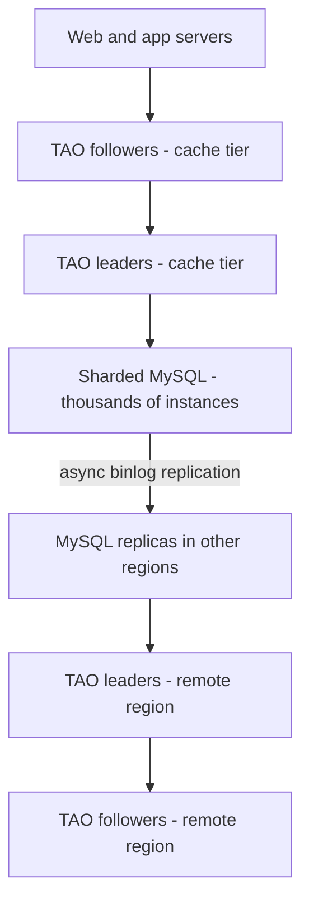
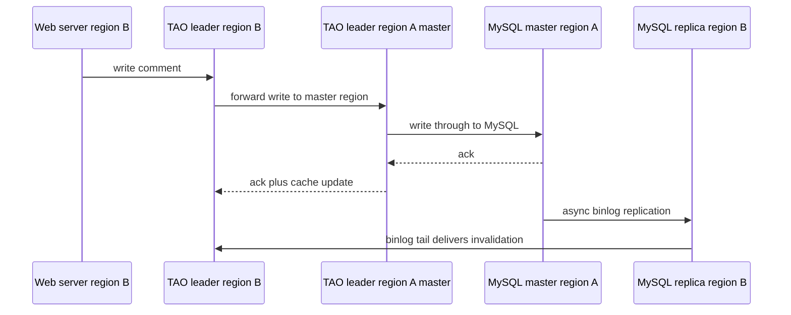

# How Facebook Scales MySQL

"MySQL doesn't scale" is one of the most repeated and most wrong claims in backend engineering. Facebook — one of the largest data operations on Earth — has kept MySQL as the durable store for its social graph for two decades. The trick is that Facebook does not ask MySQL to scale. It treats MySQL as a reliable **storage brick** — small, boring, well-understood — and builds the scaling machinery (sharding, caching, replication topology) in layers *above* it. This note is the myth-killer companion to [[Why MySQL Does Scale]]: the concrete architecture behind the slogan.

## The scale of the problem

Facebook's core data is a **social graph**: objects (users, posts, photos, comments) and associations (friendships, likes, tags). Public figures from the TAO paper era (2013) give the shape: the cache tier was already serving around a **billion reads per second** against the graph, with reads outnumbering writes by roughly **500:1**. The graph is huge, access is extremely skewed (celebrity posts are read millions of times), and queries are "point-y" — fetch an object, fetch a list of associations — not analytical joins. Exact current instance counts are not public; "thousands of MySQL servers across multiple regions" is the consistent public characterization in Meta's engineering posts.

Three properties define the problem:

1. **Read-dominated, massively skewed** — perfect cache territory ([[Why Caching Works]]).
2. **Graph-shaped queries** — "friends of X", "comments on Y", always scoped to one object's neighborhood.
3. **Tolerant of slight staleness** for most reads (a like count a second old is fine), but needing [[Read Your Own Writes and Replica Lag Anomalies|read-your-own-writes]] for the author.

## The architecture

Three layers, each doing one job:

### Layer 1: sharded MySQL as the durable store

The graph is [[Sharding|sharded]] into many **shards**, each assigned to a MySQL instance; an instance hosts multiple shards so they can be moved for [[Rebalancing Partitions|rebalancing]]. Every object ID embeds its shard ID, so locating data never requires a lookup service. Each MySQL instance is deliberately small and boring: single-node [[ACID Transactions|ACID]], ordinary B-tree tables (later MyRocks — below), ordinary binlog [[Replication|replication]]. No cross-shard transactions, no distributed query layer inside MySQL itself. MySQL was chosen and kept because its failure modes, backup tooling, and replication behavior were deeply understood — operational maturity beat theoretical fit.

### Layer 2: TAO, the graph-aware cache

**TAO** ("The Associations and Objects", USENIX ATC 2013 paper) replaced direct memcache usage for the social graph. It is a write-through, read-through caching service ([[Caching Strategies]]) that speaks a graph API — `object_get`, `assoc_range` ("give me the latest N comments on this post") — rather than raw keys. Two cache tiers exist per region: many **followers** (which web servers hit) and a smaller **leader** tier — one leader cache server per shard — that coordinates: all writes for a shard flow through its leader, which writes through to MySQL and then sends invalidation/update messages to followers. This gives per-shard write serialization and keeps caches coherent without distributed locking. TAO absorbs the overwhelming majority of reads; MySQL sees only cache misses and writes. Consistency is deliberately modest: roughly eventual for most readers, read-your-own-writes for the writing user via their follower tier — not [[Consistency Models|linearizable]], by explicit design.

### Layer 3: async cross-region replication

One region holds the **master** copy of each shard; other regions hold MySQL replicas fed by **asynchronous** binlog replication ([[Replication]]). Reads are served from the local region's replica + TAO (regional read locality — no cross-ocean round trips on the read path). Writes for a shard are forwarded to the shard's master region, applied there, and replicate back asynchronously. The cost: a remote-region user may briefly not see their own write from a cold cache; TAO patches the common cases, and the product tolerates the rest. This is a textbook **PACELC** "EL" choice ([[PACELC]]): latency over consistency in normal operation.

### How invalidations travel: the binlog as an event source

The piece that makes async replication and caching coexist: remote-region TAO tiers must learn about writes they didn't serve. Facebook's answer is to treat the **MySQL binlog as the event source** ([[Change Data Capture]], years before the term was fashionable): a pub-sub system — publicly described in the **Wormhole** paper (NSDI 2015) — tails each database's binlog and delivers update events to subscribers, including cache tiers in every region. Invalidations therefore arrive *with* the replicated data, in commit order per shard, rather than from a second code path that could race it. This kills the classic dual-write bug (DB updated, cache invalidation lost) at the root: there is only one write path, and everything else observes it.

### The numbers, pinned to their era

From the TAO paper (2013) and contemporaneous Facebook publications — dated, but they set the shape:

| Figure (2013 era) | Value |
|---|---|
| Reads served by the TAO cache tier | ~1 billion reads/second |
| Writes | millions/second |
| Read:write ratio on the graph | roughly 500:1 |
| Cache hit rate cited for TAO followers | ~96%+ |
| MyRocks space saving vs compressed InnoDB (reported ~2016–17) | ~50% |

Current figures are not public; Meta's posts since then describe growth in fleet size, the MySQL 8.0 migration (2021) and the move to MySQL Raft (2023) without refreshed request numbers.

### MyRocks: changing the engine, not the system

In the mid-2010s Facebook built **MyRocks** — RocksDB (an [[B-Tree vs LSM-Tree|LSM-tree]] engine) mounted inside MySQL as a storage engine — and migrated its user database (UDB) tier to it (publicly described around 2016–2017). Motivation was **space and write efficiency**: Meta reported roughly 50% smaller storage footprint versus compressed InnoDB, halving the number of servers needed for the same data. The key architectural point: because MySQL was a brick behind TAO, Facebook could swap the brick's internals — B-tree to LSM — without the layers above changing. A later Meta post (2021) describes migrating the fleet to MySQL 8.0, again under the running system.

## Key decisions and why

| Decision | Why |
|---|---|
| Shard above MySQL, not inside it | Each node stays a simple single-node database; all distribution logic lives in one place (TAO/shard management), not in the storage engine |
| Shard ID embedded in object IDs | Routing is a bit-mask, not a metadata lookup — no hot central directory |
| A graph API cache, not raw memcache | Caching `assoc_range` lists lets TAO answer "latest N comments" without the app recomputing list membership on every like — cache invalidation becomes tractable ([[Cache Invalidation]]) |
| Write-through leaders per shard | Serializes writes per shard, making follower invalidation ordered and eventual consistency bounded |
| Async cross-region replication | Synchronous cross-region writes would put an ocean RTT in every write; the product tolerates staleness, so pay the consistency cost, not the latency cost |
| No cross-shard transactions | Keeps every write single-node ACID; features are designed to not need distributed transactions ([[Two-Phase Commit and Distributed Transactions]] avoided by design) |
| Keep MySQL at all | Operational knowledge compounds: backup, failover, corruption tooling, and a generation of DBAs — worth more than a theoretically better store |

Contrast deliberately with [[Google Spanner Deep Dive]]: Google *wanted* cross-shard transactions and global consistency and paid for them with TrueTime and write latency. Facebook's workload let it refuse that cost. Same scale, opposite trade — the workload, not the fashion, decides.

## What broke along the way

- **Pre-TAO memcache era:** web servers cached graph data in raw memcache with app-managed keys. Lists ("all likes on X") were cached as blobs, so one new like invalidated the whole list, and [[Cache Stampede and Thundering Herd|thundering herds]] followed popular invalidations. The "Scaling Memcache at Facebook" paper (NSDI 2013) documents the machinery (leases, pools) built to survive this; TAO was the structural fix for the graph workload.
- **Hot shards:** celebrity objects concentrate load ([[Hot Partition Problem]]). TAO's follower tier absorbs read heat, and especially hot objects are handled with extra caching layers; write heat on one object remains fundamentally serialized at its shard leader.
- **Replica lag anomalies:** async replication means remote regions run seconds behind under load; failover during lag risks losing acknowledged-but-unreplicated writes. Facebook historically guarded the primary region with semi-synchronous replication to in-region log-only replicas ("logtailers") plus external promotion tooling; since 2023 (Meta's "Building and deploying MySQL Raft at Meta") a large portion of the fleet runs **MySQL Raft**, which moves replication and leader election into MySQL itself ([[Consensus and Raft]]) for faster, provably safe failover. Cross-region copies stay asynchronous, and [[Failover]] remains, as always, the dangerous part.
- **Space growth:** compressed InnoDB still spent too many bytes per row at fleet scale — the economic forcing function behind MyRocks.

## Lessons you can reuse

1. **Scale the system, not the database.** A database that fits on one node, replicated and sharded by a layer above, beats a "scalable database" you don't understand operationally. This is the whole thesis of [[Why MySQL Does Scale]].
2. **Cache with the workload's shape.** TAO works because it caches *graph queries*, not bytes. A cache that understands your access pattern can maintain its own coherence; a dumb cache pushes invalidation complexity into every caller.
3. **Pick where consistency is paid.** Facebook pays with staleness (async replication, eventual caches); Google pays with write latency (Spanner). Not paying at all is not an option — see [[CAP Theorem]].
4. **Boring bricks enable radical swaps.** The MyRocks migration — changing the storage engine under a billion users — was possible because each MySQL node was a replaceable unit behind a stable interface.
5. **Design features to avoid coordination.** No cross-shard transactions is a *product* discipline, not just an infra one.

## In your stack

- MongoDB at Niyo plays the "storage brick" role already (replica sets, sharding at the cluster layer) — the TAO lesson transfers as: put read traffic on Redis with a *structured* caching contract (cache the query result shape you actually serve, not raw documents), and make one writer path responsible for invalidation.
- Your read/write skew is far milder than 500:1, and fintech reads (balances, KYC status) often *cannot* be stale — so the Facebook trade (eventual everywhere) is mostly the wrong default for you. Borrow the layering, not the consistency choice.
- The "shard ID in the object ID" trick is directly reusable for any ID scheme you design ([[Design a Distributed ID Generator]]).
- MySQL instances that exist in your estate are fine at your scale precisely for Facebook's reason: a well-run single-node MySQL with [[Replication|replicas]] is predictable; reach for [[Sharding]] only when a single writer measurably can't keep up.

## Interview angle

The 60-second version: *"Facebook keeps MySQL by never asking it to be distributed. Data is sharded across thousands of small MySQL instances, each a plain single-node ACID store. TAO — a graph-aware, write-through cache tier from the 2013 paper — serves the overwhelming majority of reads and keeps itself coherent by routing each shard's writes through a leader cache. Regions get read locality from async MySQL replication; writes go to the shard's master region. Consistency is eventual-plus-read-your-writes, which the product tolerates. MyRocks later swapped the storage engine to an LSM for ~half the space — possible because MySQL was a brick behind a stable interface. Lesson: sharding, caching, and replication live above the database."*

Classic follow-ups: "Why not Cassandra/Spanner?" (operational maturity; the workload doesn't need global transactions); "How does TAO keep caches consistent?" (per-shard write-through leader + ordered invalidations to followers); "What breaks with async cross-region replication?" (lag anomalies, lossy failover); "Why did MyRocks save space?" ([[B-Tree vs LSM-Tree|LSM]] compaction + better compression vs B-tree fragmentation).

## Check yourself

> [!question]- Q: Explain in your own words why "MySQL doesn't scale" is the wrong conclusion from Facebook's architecture.
> No single-node database "scales" to planet load — not MySQL, not Postgres, not anything. Facebook's point is that it doesn't need to: scaling concerns (partitioning, read offload, geo-distribution) are handled by layers above — sharding logic, TAO caching, async replication — while each MySQL node only does what single-node MySQL is excellent at: durable, transactional storage of one shard. The database is a unit of deployment, not the unit of scale.

> [!question]- Q: What happens if a TAO shard's leader cache fails?
> Per the 2013 paper, TAO does not wait for a replacement: followers send their read misses directly to the database, and writes for that shard are rerouted to a random member of the leader tier, which performs the write-through and enqueues an asynchronous invalidation for the original leader to apply when it recovers. Followers keep serving (possibly slightly stale) cached data meanwhile. The cost is a short window of weaker coherence — the per-shard write serialization the leader normally provides is temporarily gone — repaired by the queued invalidations. This is the standard trade of leader-per-partition designs: keep serving during [[Failover]], accept briefly looser ordering, and make the repair path explicit.

> [!question]- Q: A user in Mumbai writes a comment whose shard master is in a US region. Trace the write and the user's next read.
> The write travels to the US master region: through local TAO to the shard's leader there, write-through to master MySQL, ack back. Async binlog replication carries it to the Mumbai replica over the next seconds; TAO machinery ensures the writing user's subsequent reads see their own comment (read-your-own-writes) even before the replica catches up. Other Mumbai users may not see the comment for a few seconds — accepted staleness, per [[PACELC]] choosing latency over consistency.

> [!question]- Q: Why does Facebook deliver cache invalidations by tailing the MySQL binlog instead of having the app send them?
> App-sent invalidations create a dual-write problem: the DB write and the invalidation are two separate operations, and any crash, retry, or race between them leaves a cache permanently serving stale data ([[Cache Invalidation]]). The binlog is written atomically with the data as part of MySQL's own commit, so an invalidation stream derived from it can never miss a committed write or announce an uncommitted one, and it arrives in per-shard commit order. This is [[Change Data Capture]] reasoning — the same argument behind Debezium and [[The Outbox Pattern]] in your own services.

> [!question]- Q: Mini design — your MongoDB-backed transactions service is read-heavy on "last 20 transactions per account". Apply one TAO idea.
> Cache the *list query result* per account in Redis (e.g. a capped Redis list or sorted set per account), maintained write-through by the single service that writes transactions: on insert, push to the list and trim, atomically with the DB write via the [[The Outbox Pattern|outbox pattern]] to avoid dual-write divergence. Readers hit Redis, miss to Mongo. This is TAO's `assoc_range` idea at Niyo scale: cache the association list with ordered writer-driven maintenance instead of TTL-expiring raw documents.

## Sources

- Bronson et al., **"TAO: Facebook's Distributed Data Store for the Social Graph"**, USENIX ATC 2013 — the primary source for the cache architecture and 2013-era numbers.
- Nishtala et al., **"Scaling Memcache at Facebook"**, NSDI 2013 — the pre-TAO caching machinery (leases, regional pools).
- Meta Engineering blog — **"MyRocks: A space- and write-optimized MySQL database"** (2016), **"Migrating Facebook to MySQL 8.0"** (2021) and **"Building and deploying MySQL Raft at Meta"** (May 2023).
- MyRocks project documentation (myrocks.io) — LSM-on-MySQL specifics.
- *Designing Data-Intensive Applications*, Kleppmann — Ch. 5 (replication), Ch. 6 (partitioning) for the general patterns TAO instantiates.
