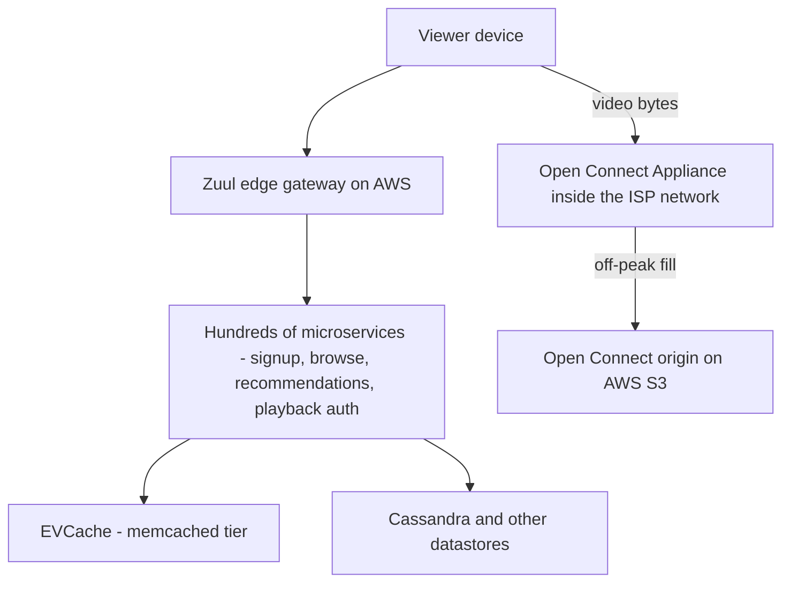
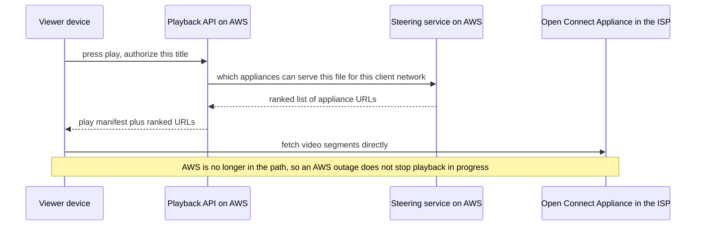

# Netflix Architecture

Netflix is the case study every resilience idea in Module 12 traces back to. The arc: a single database corruption in 2008 convinced the company that vertically scaled, datacenter-bound architecture was an existential risk; seven years later it was fully on AWS as hundreds of microservices; along the way it concluded that the only part of the stack worth *owning* was the two things its business actually is — moving video bytes (Open Connect) and staying up (the resilience tooling and culture). Everything else, it rents.

## The scale of the problem

- **August 2008**: a major database corruption in Netflix's own datacenter halted DVD shipping for **three days**. The post-incident conclusion was architectural, not operational: relying on vertically scaled, single-point-of-failure systems (big Oracle boxes, big storage arrays) could not be fixed by trying harder — the company needed horizontally scalable, redundant-by-design infrastructure ([[Vertical vs Horizontal Scaling]]).
- The cloud migration began in earnest around 2009 and was declared complete in **January 2016** — **seven years** — by which time Netflix had also rewritten essentially every system rather than lift-and-shift. The announcement post's argument for taking the slow route: a forklift migration would have carried the old architecture's limitations and failure modes into the cloud along with the workloads, just at a higher bill.
- Scale markers along the way: streaming grew from launch (2007) to well over 200 million global subscribers by the early 2020s; Netflix was repeatedly measured (Sandvine reports, late 2010s) around **~15% of global downstream internet traffic** — video bytes utterly dominate its traffic profile.
- The operational scale is hundreds of microservices (public talks around 2017 cited 700+), multi-region active-active since 2013, and internal caches (EVCache) serving tens of millions of operations per second (per ~2016 TechBlog posts).
- A second, quieter scale axis: **telemetry and events**. Netflix's Kafka-based **Keystone** pipeline was described in ~2016 TechBlog posts as carrying hundreds of billions of events per day — playback starts, UI interactions, service metrics — feeding both real-time operations and the recommendation models. In an architecture this distributed, the observability and analytics stream becomes a large distributed system in its own right, with its own capacity planning ([[Kafka Architecture]]).

## The architecture

### Two planes: control on AWS, video on Open Connect

The most important architectural fact about Netflix: **the thing you watch and the thing you click are served by different systems**.

- **Control plane (AWS)**: everything stateful and request-shaped — login, browsing, recommendations, playback authorization, billing — runs as microservices on AWS across three-plus regions, active-active. When you press play, AWS decides *whether* and *from where* you stream; it hands the client a set of Open Connect URLs.

  Per Netflix's Open Connect documentation, the component doing that choosing is a **steering service** running on AWS. It knows, for the requesting client's network, which OCAs are reachable and close (derived from BGP routing data and the ISP's own preferences), which of them currently hold the specific file the client needs at the bitrate it asked for, and how healthy and loaded each one is. It returns a *ranked list* rather than a single address, so the client can fall back without another round trip if its first choice misbehaves. That is the whole control-plane/data-plane contract in one call: AWS answers "who and where", the OCA answers "here are the bytes", and the two systems never share a failure mode.

- **Data plane (Open Connect, 2012–)**: Netflix's own [[CDN]]. **Open Connect Appliances (OCAs)** — storage-dense servers built by Netflix — are deployed *inside ISP networks* (free to ISPs) and at internet exchange points. Why own a CDN when commercial CDNs exist? Because video bytes dominate: at ~15% of the internet's downstream traffic, third-party CDN economics fail, and placing content one hop from subscribers is both cheaper and better (lower latency, no transit congestion). The catalog is **predictable** — unlike user uploads, Netflix knows tonight's likely plays — so OCAs are **proactively filled during off-peak windows** rather than cache-missing on demand: a pull-through cache replaced by a scheduled push, possible only because the content set is curated and finite.

Pressing play therefore crosses the boundary exactly once, and then never again:

### How the bytes get into the appliances, and why there are so many of them

Two details make Open Connect more interesting than "Netflix built a CDN".

**Filling is a scheduled logistics problem.** Per the Open Connect deployment documentation, each appliance fills during a configurable **fill window** — normally the ISP's off-peak hours, when the link Netflix is about to saturate is otherwise idle. An appliance prefers to fill from a **peer appliance at the same site**, then from other appliances in the same region, and only then from the origin on AWS. So the expensive long-haul transfer from origin happens roughly once per region rather than once per appliance, and it happens at a time of day when nobody is competing for the capacity. A pull-through cache cannot do any of this, because it fetches when the user asks, which is by definition peak time.

**The catalog is not one file per title; it is dozens.** Every title is encoded into many renditions — multiple codecs, resolutions and bitrates — so a client can adapt to its connection. That multiplies storage per title enormously, which is why Netflix has invested so publicly in encoding efficiency: **per-title encoding** (TechBlog, 2015) abandoned the one-size-fits-all bitrate ladder in favour of a ladder computed per title, because a cartoon and an action film need very different bitrates for the same perceived quality; **shot-based encoding** (TechBlog, around 2018) pushed the same idea down to individual shots within a title. Netflix also began shipping **AV1** to Android in 2020 for further bitrate savings. Every percent of bitrate removed is a percent off storage in thousands of appliances *and* a percent off the ISP links — the rare optimization that pays twice. The reusable observation: when one resource dominates your cost, efficiency work on that resource is worth a disproportionate amount of engineering.

### The OSS stack: Zuul, Eureka, Hystrix and heirs

Netflix open-sourced its microservices machinery, which became the de-facto standard Java stack (you have used descendants of all of it):

- **Zuul** — the edge [[API Gateway]]: routing, authn, load shedding at the front door (Zuul 2, 2018, rewrote it async/non-blocking).
- **Eureka** — [[Health Checks and Service Discovery|service discovery]] registry; clients discover instances and load-balance client-side (Ribbon).
- **Hystrix** — the library that mainstreamed [[Circuit Breakers]] and [[Bulkheads and Isolation|bulkheads]]: wrap every remote call, fail fast, fall back. **Hystrix went into maintenance mode in late 2018**; Netflix moved toward **adaptive concurrency limits** (dynamically inferring how much parallelism a dependency can take, rather than static thresholds), and the community successor for new Java work is **Resilience4j** (also the Spring Cloud default today). The lineage matters in interviews: static circuit breakers → adaptive, signal-driven limits.
- **EVCache** — memcached-based distributed cache, sharded and **replicated across AZs** so a zone loss doesn't cold-start the cache ([[Cache Stampede and Thundering Herd]] at Netflix scale is an outage, not a slowdown).
- **Cassandra** as the workhorse datastore for most online data (multi-region, write-heavy, AP-leaning — [[Cassandra and Wide-Column Stores]]).

### The resilience culture: break it on purpose

Netflix's most copied export is not code but practice ([[Chaos Engineering]] covers the discipline; this is its origin story):

- **Chaos Monkey** (built ~2010–2011, open-sourced 2012): randomly terminates production instances during business hours. Rationale: AWS instances die anyway; making death *frequent and expected* forces every team to build stateless, auto-recovering services — and surfaces the teams that didn't, at 2 pm with engineers at keyboards rather than 3 am.
- **Simian Army**: the generalization — Latency Monkey (inject latency ([[Timeouts Retries and Exponential Backoff|timeouts]] get tested for real)), Conformity Monkey (flag non-redundant instances), **Chaos Gorilla** (kill an entire Availability Zone), **Chaos Kong** (evacuate an entire AWS region).
- **Regional evacuation drills**: Netflix regularly shifts all traffic out of a live region to prove multi-region failover works *before* AWS has a bad day ([[Disaster Recovery]] practiced, not documented). Later tooling (FIT — failure injection testing — and ChAP) made failure injection targeted and experiment-shaped rather than random.

## Key decisions and why

| Decision | Why |
|---|---|
| Rebuild for cloud over seven years, not lift-and-shift | Moving the old architecture would move its failure modes; the migration was used as the forcing function to go stateless + horizontal ([[Stateless vs Stateful Services]]) |
| Buy compute/storage (AWS), even as a top-tier engineering org | Undifferentiated heavy lifting; Netflix's scarce resource was engineers, and datacenters don't win subscribers |
| Own the CDN (Open Connect) | Video bytes are the business and dominate costs; at ~15% of internet traffic, third-party CDN pricing and placement can't compete with boxes inside the ISP |
| Push content on a schedule instead of pull-through caching | The catalog is known and finite; predictability converts a caching problem into a logistics problem |
| Microservices + client-side discovery + per-call protection | Hundreds of teams deploying independently need blast-radius containment more than architectural purity ([[Monolith vs Microservices]] — Netflix is the honest "yes, microservices, *because of org scale*" case; [[Uber Architecture]] reached the same conclusion and then had to re-group services into domains) |
| Institutionalize failure (chaos tooling) | Redundancy that is never exercised silently rots; continuous failure injection is the audit loop for availability — the same logic as S3's durability auditing ([[S3 Deep Dive]]) |
| Give Open Connect appliances to ISPs for free | The constraint is that Netflix cannot buy its way out of ISP congestion — the last mile belongs to someone else. Free hardware that reduces an ISP's transit bill aligns both parties' incentives, which no commercial negotiation could do as cheaply |
| Return a ranked list of appliances, not one address | A single address makes the steering service's momentary wrongness into the viewer's buffering. A ranked list lets the client recover locally, without another control-plane round trip, which is also what keeps playback alive when AWS is having a bad day |
| Client-side load balancing via Eureka rather than a load balancer per service | At hundreds of services, a middle-tier load balancer per dependency is hundreds of extra hops, each with its own failure mode and its own capacity to plan. Pushing the choice into the caller removes a tier ([[Load Balancers]]) — and pushes the complexity into a client library every service must keep current, which is the real cost |
| Replace tuned circuit-breaker thresholds with adaptive limits | A hand-set threshold encodes an assumption about a dependency's capacity on the day it was tuned. Services change weekly; the number does not. Inferring the limit from observed latency and concurrency removes a config value that was quietly going stale in hundreds of services |

The decision worth dwelling on is the first one in this table. Netflix is usually taught as an AWS success story, but the part it refused to outsource is the part where its costs and its customer experience both live. The test it implies — *does owning this win customers or protect revenue?* — is more useful than any build-versus-buy checklist, because it forces you to name which one you are claiming.

## What broke along the way

- **The 2008 corruption** itself — the founding incident.
- **Christmas Eve 2012**: an AWS **ELB control-plane outage in us-east-1** took Netflix streaming down for much of a day — in its single-region era. This incident is the direct origin of the **multi-region active-active** program (2013) and Chaos Kong: Netflix concluded that *any* single region, however good AWS is, is a single point of failure ([[Disaster Recovery]]).

  The detail that makes this incident genuinely instructive is *which* part of AWS failed. Per AWS's public summary, a maintenance process deleted ELB state data for a portion of the running load balancers. Most load balancers kept forwarding traffic normally, and even the affected ones only degraded once some workflow tried to scale or reconfigure them against their now-missing state. The crippling part was that the **control plane** — the system that creates, modifies and recovers load balancers — was itself impaired, so it could neither repair the damaged load balancers nor build replacements. Netflix's own architecture was redundant across availability zones, and that redundancy was useless, because recovering from a zone problem *requires* the control plane to act. The generalizable lesson, and the one most teams still miss: your failover plan depends on a control plane, and you must ask whether that control plane is itself available during the failure you are planning for ([[Failure Modes in Distributed Systems]]). A standby that can only be promoted by a system which is also down is not a standby. Netflix's answer was to stop depending on recovery *within* a region and instead practise evacuating the whole region, which needs nothing from the broken region's control plane.
- **Cascading failures in the microservices era**: one slow mid-tier dependency stalling threads and toppling callers — the failure pattern ([[Failure Modes in Distributed Systems]]) that motivated Hystrix's bulkheads and fallbacks (serve a non-personalized row when recommendations are down; degraded beats down — [[Load Shedding and Graceful Degradation]]).
- **Static circuit-breaker limits aging badly**: tuned thresholds drifted as services evolved — a config-rot failure class that pushed Netflix toward adaptive concurrency limits instead of hand-set numbers.
- **The 2008 incident's less-quoted half.** It is usually told as "a database got corrupted". The architectural conclusion Netflix drew was about *recovery*, not corruption: a vertically scaled system fails as a unit, so there is nothing to fail over to and nothing to do but restore from backup and wait — three days, in this case. Horizontal redundancy is not primarily about handling more load; it is about having somewhere for the work to go ([[Vertical vs Horizontal Scaling]]).
- **The migration itself took seven years, and that was the point.** A lift-and-shift would have been faster and would have reproduced the single points of failure in a more expensive place. Netflix's public framing — that moving a broken architecture into the cloud gives you a broken cloud architecture — is the most quotable thing in the 2016 completion post, and the least acted upon.
- **Microservices bought independence and charged for it in observability.** Once a single play request crosses dozens of services, no individual log tells you why it was slow. The entire discipline of [[Distributed Tracing]] and correlation IDs exists because this architecture made the question "what happened to this request?" unanswerable by any other means. Netflix built heavy internal telemetry to make the architecture debuggable; the architecture does not come with that for free, and teams that adopt microservices without budgeting for it spend years blind ([[Logs Metrics and Traces]]).

## Lessons you can reuse

1. **Own your availability story; buy everything else.** Netflix owns exactly two layers: byte delivery (its cost center and customer experience) and resilience practice (its availability). Compute, storage, databases-as-a-service — rented. Apply the test: *does owning this win customers or protect revenue? If not, buy it.*
2. **Redundancy you haven't exercised is a rumor.** Chaos Monkey is the cheapest idea in this module: if instance death must be survivable, cause it routinely. Even a quarterly "kill a pod in UAT during work hours" captures most of the value.
3. **Degrade by design.** Every Netflix fallback (unpersonalized rows, cached artwork) was built *before* the failure. Decide per endpoint what "worse but up" looks like.
4. **Separate your control plane from your data plane.** The click path and the byte path have different scale, latency, and ownership needs — splitting them is what made both tractable.
5. **Exploit what's predictable about your workload.** Push-filled OCAs work because the catalog is known. Look for the part of your workload you can precompute or preposition ([[Why Caching Works]]).
6. **Check whether your recovery plan depends on something that will also be broken.** Christmas Eve 2012 in one sentence. Write down, for each failure you claim to survive, which systems must be *working* for the recovery to happen — and whether they share a failure domain with the thing that broke.
7. **Optimize the resource that dominates your bill, not the one that is most fun.** Netflix spends engineering effort on video bitrate because bytes are the cost; a percent there is worth more than a large win anywhere else. Find your equivalent — it is usually unglamorous, and it is usually not CPU.
8. **Microservices are an organizational tool with a technical bill.** Netflix adopted them because hundreds of teams needed to deploy without coordinating, and then paid for tracing, discovery, client libraries and per-call protection. Both halves are the lesson; quoting only the first is how teams end up with [[The Distributed Monolith Anti-Pattern|a distributed monolith]].
9. **Decide what "degraded" looks like per endpoint, in advance.** The reason Netflix can serve an unpersonalized row is that someone designed that row before the outage. A fallback invented during an incident is a guess made by a tired person.

## In your stack

- Your Resilience4j usage in Spring Boot *is* the Netflix lineage — Hystrix's ideas, post-maintenance-mode. Prefer its time limiter + bulkhead + circuit breaker per external dependency (partner banks, KYC vendors), with fallbacks that fail *closed* for money movement — Netflix can show a stale row; a fintech cannot show a stale balance and must instead degrade to an honest error.
- Kong at the edge plays Zuul's role (authn, routing, shedding); Kubernetes DNS + readiness probes play Eureka's ([[Health Checks and Service Discovery]]).
- The honest chaos-engineering caveat for Niyo: services pinned at **1 replica** mean Chaos-Monkey-style instance kills are guaranteed user-visible blips, not resilience tests. The transferable practice at your scale is *dependency* failure injection (kill the Redis connection, black-hole a partner API in UAT) and verifying [[Graceful Shutdown and Deployment Safety|graceful shutdown]], not random pod murder.
- EVCache's AZ-replicated cache idea maps to running Redis with replicas in a second AZ so a zone event doesn't cold-start your cache and stampede MongoDB ([[Cache Stampede and Thundering Herd]]).
- Open Connect's lesson generalizes: CloudFront in front of your static and semi-static content is you "buying" what Netflix had to build — correct call at your traffic volume (cost shape: egress and request count scale with users; appliance economics need Netflix-like volumes).
- **The control-plane question is the most actionable thing on this page for an EKS fleet.** Ask it of your own stack concretely: if an AZ degrades, what has to be *working* for your pods to be rescheduled elsewhere — the EKS control plane, the cluster autoscaler, the ability to pull images from ECR, the ALB's target registration? With many services at 1 replica, every one of those is in the recovery path for every service, and none of them is exercised on a normal day. Writing that list down is a half-day of work and usually the highest-value resilience exercise available to a team in your position.
- **Separate your control plane from your data plane where it is cheap to do so.** The Netflix split has a modest Niyo analogue: a payment that has been authorized should not need the recommendation service, the profile service or a config lookup to complete. Audit the money paths for dependencies that exist only for enrichment, and make them optional with an explicit timeout rather than implicitly required ([[Bulkheads and Isolation]]).
- **The adaptive-limits lesson applies to your Resilience4j configuration specifically.** Hand-tuned circuit-breaker thresholds and timeouts copied between services are the config rot Netflix abandoned. At minimum, derive each timeout from the dependency's observed p99 rather than from a round number, record where the number came from, and revisit it when the dependency changes — a per-dependency timeout nobody can justify is a number that will be wrong during the incident it was meant for ([[Timeouts Retries and Exponential Backoff]]).
- **Correlation IDs are the part of the Netflix tracing lesson you already have.** `x-correlation-id` on every inter-service request is the cheap half; the expensive half is making sure it is propagated across async hops too — into SQS message attributes and out again on the consumer side — because that is precisely where traces go dark today ([[Distributed Tracing]]).

## Interview angle

The 60-second version: *"Netflix's architecture splits into two planes. The control plane — login, browse, recommendations, playback authorization — is hundreds of microservices on AWS, multi-region active-active since a 2012 regional outage, fronted by Zuul, discovered via Eureka, protected by Hystrix-lineage circuit breakers (today: adaptive concurrency limits; Resilience4j in the community), cached by AZ-replicated EVCache over Cassandra. The data plane is Open Connect, Netflix's own CDN: storage appliances inside ISP networks, proactively filled off-peak because the catalog is predictable — owned because video is ~15% of downstream internet traffic and that's the business. The origin story is a 2008 database corruption that stopped DVD shipping for three days, triggering a seven-year rebuild-for-cloud migration finished in 2016. The culture is the famous part: Chaos Monkey through Chaos Kong — institutionalized failure injection and regional evacuation drills — because redundancy you never exercise doesn't exist. Lesson: own your availability story and your core byte path; buy everything else."*

Classic follow-ups: "Why did Netflix build a CDN instead of using Akamai?" (traffic share economics + predictable catalog enables push-fill); "What replaced Hystrix?" (maintenance mode 2018 → adaptive concurrency limits; Resilience4j for Spring folk); "Why microservices here but not everywhere?" (org scale: hundreds of independent teams — [[The Distributed Monolith Anti-Pattern]] is the counterfactual); "How would you test multi-region failover?" (evacuation drills, in business hours, regularly); "Why did multi-AZ not help in 2012?" (the ELB *control plane* was the impaired component, and recovery needed it); "What does AWS actually run for Netflix during playback?" (authorization and steering — once the client has appliance URLs, the bytes never touch AWS).

Two traps are worth naming. The first is treating chaos engineering as a tool you install; it is a claim about an architecture that is already redundant, and running it against a system without spare capacity just causes outages — say that out loud and you will sound like you have operated something. The second is presenting microservices as the lesson. Netflix adopted them to let hundreds of teams ship independently; at ten engineers the same decision buys you distributed-systems problems and no organizational benefit ([[Monolith vs Microservices]], [[Modular Monolith]]).

## Check yourself

> [!question]- Q: Explain why Netflix pushes content to OCAs on a schedule instead of using a normal pull-through CDN cache.
> Pull-through caches pay a miss penalty: first requesters fetch from origin, and the cache's value depends on hit rate against an unpredictable request stream. Netflix's catalog is finite and its demand is forecastable (tonight's popular titles are knowable per region), so it can place bytes *before* they're requested, during off-peak hours when ISP links are idle. That converts peak-hour origin fetches (expensive, congested) into scheduled bulk transfer, and makes the first play as fast as the thousandth. The enabling property is workload predictability — user-generated-content platforms can't copy this wholesale.

> [!question]- Q: What happens, step by step, when an entire AWS region hosting Netflix control-plane services fails?
> DNS/edge steering shifts user traffic to the surviving regions (practiced via Chaos Kong drills); those regions carry the load because capacity is provisioned for N-1 regions. State is already replicated cross-region (Cassandra multi-region writes, EVCache replication for warm caches). Playback in progress continues largely unaffected — video flows from OCAs, not AWS. New sessions see elevated latency during the shift. The design preconditions: active-active (no cold standby to boot — [[Disaster Recovery]]), capacity headroom, and the drills themselves — the first real evacuation must not be the first evacuation ever.

> [!question]- Q: Your service calls a KYC vendor that starts responding in 30 seconds instead of 300 ms. Trace what happens with and without Netflix-style protections.
> Without: threads/connections park for 30 s each, the pool saturates, your service stops serving *everything* (including endpoints not touching KYC), callers time out and retry, amplifying load — a cascading failure from one slow dependency. With: a time limiter caps the call (say 2 s), a [[Circuit Breakers|circuit breaker]] opens after repeated failures so subsequent calls fail in microseconds, a [[Bulkheads and Isolation|bulkhead]] caps how many threads KYC can ever consume, and the endpoint returns an explicit "verification pending, retry later" — degraded but honest, and the rest of the service never notices. For money paths the fallback must fail closed, not serve stale data.

> [!question]- Q: Mini design — adapt "chaos engineering" honestly for a fleet where most services run 1 replica.
> Random instance kills just create outages, so shift the target: (1) inject *dependency* failures in UAT — Redis down, Mongo stepdown, partner API latency — and assert graceful degradation and recovery; (2) verify [[Graceful Shutdown and Deployment Safety|shutdown behavior]] on every deploy (in-flight requests drain, consumers commit offsets); (3) run game days on the *organizational* response — alerts fire, runbooks exist, on-call can restore in RTO; (4) for the few truly critical services, make the business case that a second replica is the prerequisite for any real availability claim — and say plainly that chaos testing cannot conjure availability the architecture doesn't have.

> [!question]- Q: Netflix survived the Christmas Eve 2012 outage badly despite being deployed across multiple availability zones. Explain why multi-AZ did not save them, and what question that should make you ask about your own failover plan.
> The failure was in the ELB **control plane** — the system that creates and reconfigures load balancers — not in the data path. Netflix's redundancy across zones was real, but *using* it required asking the control plane to move traffic, and that was exactly the component that was impaired. Redundancy is only as good as the mechanism that activates it, and in 2012 that mechanism and the failure shared a blast radius. The question it should prompt about any failover design: list every system that must be healthy for the failover to execute — DNS updates, a control plane, an image registry, a secrets store, a deployment pipeline, a human with access — and check whether any of them lives inside the failure domain you are failing out of. Netflix's structural answer was to stop relying on in-region recovery and practise whole-region evacuation instead, which depends on nothing in the broken region. The cheap version for a smaller team is simply writing the list down and finding the one entry that makes the plan circular.

## Sources

- Netflix TechBlog — **"Completing the Netflix Cloud Migration"** (published February 2016 by Yury Izrailevsky, Stevan Vlaovic and Ruslan Meshenberg, announcing a migration completed in January 2016; the 2008 corruption story and seven-year arc); **"The Netflix Simian Army"** (2011); **"Chaos Engineering Upgraded"** (Chaos Kong, 2015); **"Performance Under Load"** (adaptive concurrency limits, 2018); EVCache posts (**"Caching for a Global Netflix"**, 2016); Zuul 2 announcement (2018).
- Netflix Open Connect — official overview, ISP deployment guide and appliance documentation (openconnect.netflix.com): the steering service, fill windows, and peer/regional fill hierarchy.
- Netflix TechBlog on encoding — **"Per-Title Encode Optimization"** (2015), the shot-based/dynamic-optimizer posts (around 2018), and the AV1-on-Android announcement (2020).
- Netflix TechBlog — **"Active-Active for Multi-Regional Resiliency"** (2013), the direct response to the Christmas Eve 2012 outage; Keystone data-pipeline posts (2016 era) for the event-volume figures.
- Hystrix GitHub repository — the maintenance-mode announcement (November 2018) recommending adaptive solutions and Resilience4j.
- Netflix post-mortem coverage of the **December 24, 2012 ELB outage** (Netflix TechBlog, "A Closer Look at the Christmas Eve Outage").
- Basiri et al., **"Chaos Engineering"**, IEEE Software 2016 — the discipline formalized by the Netflix team ([[Chaos Engineering]]).
- Sandvine **Global Internet Phenomena** reports (late 2010s) — the downstream-traffic-share figures.
