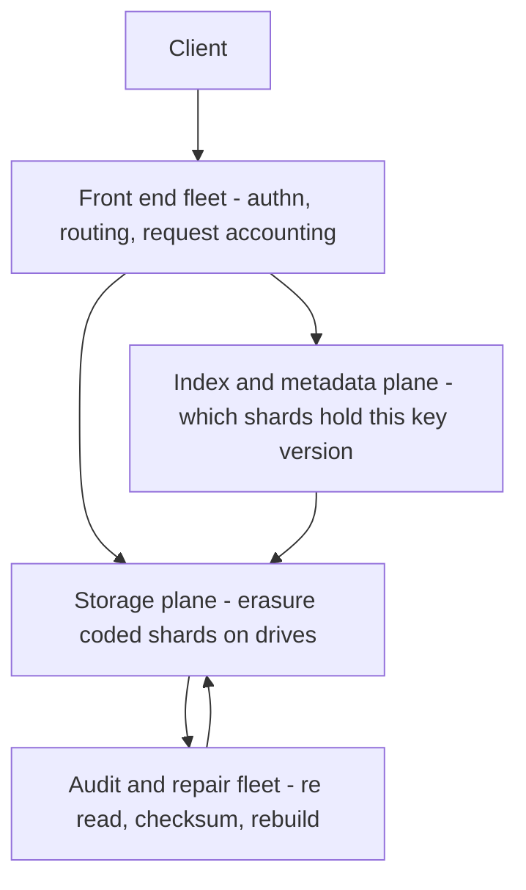

# S3 Deep Dive

Amazon S3 is the largest storage system ever built and, more interestingly, the clearest public example of **durability as an engineering discipline** rather than a number on a marketing page. This note goes one level deeper than [[How S3 Works]]: how the famous eleven nines are actually produced (spoiler: mostly by auditing and repair, not by the erasure math alone), why making S3 strongly consistent in 2020 was a planet-scale cache-coherence problem, and how S3's two founding constraints — immutable objects, flat namespace — are what let everything else scale.

## The scale of the problem

Labeled by year, since these numbers move fast:

- **2021** (S3's 15th birthday): over **100 trillion objects**.
- **2023** (AWS Pi Day): over **280 trillion objects**, averaging over **100 million requests per second**.
- **2024** (AWS Pi Day): over **350 trillion objects**.
- **2026** (AWS's "Twenty years of Amazon S3" post, March 2026): over **500 trillion objects**, serving more than **200 million requests per second**.

At this scale, rare events are routine arithmetic: with exabytes on millions of drives, **drive failures happen constantly** — not occasionally — and even bit-flips in memory and on the wire ([[The Fallacies of Distributed Computing|the network corrupts data more than people think]]) occur daily somewhere in the fleet. The durability promise — **99.999999999% annual durability**, i.e. an annual loss probability of about **1 in 100 billion** per object, or in AWS's own self-checking framing, store 10 million objects and expect to lose one roughly every 10,000 years — must hold *despite* a background hum of hardware death. That inversion is the key mental shift: S3 is not designed to avoid failure; it is designed so that continuous failure is unobservable.

## The architecture

### Two planes, and why the split matters

S3 is best understood as two separate systems wearing one API.

The **storage plane** holds immutable shards of object data on drives. The **index plane** answers "which object version is current for this key, and where are its shards" — and it is the one that behaves like a database, with partitioning, caching, and the consistency problem described below. Most of the interesting S3 stories are really stories about the index plane: the 2020 consistency change and the per-prefix request limits live there, and the 2017 outage began with the removal of capacity from the index subsystem. The data plane's job is comparatively simple, precisely because objects are immutable.

Andy Warfield's 2023 write-up of operating S3 describes a system of hundreds of microservices built on millions of hard drives, and makes one point about scale that is easy to miss: S3 is **multi-tenant on purpose, down to the spindle**. A single drive holds shards belonging to many unrelated customers. That is not just a packing optimization — it is a performance mechanism. One customer's workload is bursty and idle by turns; a thousand uncorrelated customers' workloads sum to something close to flat, so the fleet's aggregate demand is far more predictable than any individual tenant's, and each tenant can burst into capacity its neighbours are not using. The same decorrelation is why a single customer's data is spread across an enormous number of drives rather than concentrated: spreading is what makes the burst possible and what keeps any one drive from becoming hot. AWS has published a closely related general pattern in its Builders' Library as **shuffle sharding** — assign each tenant an overlapping random subset of resources, so that one noisy or failing tenant degrades only a small, mostly-unshared slice ([[Bulkheads and Isolation]]). Whether or not the specific algorithm is what S3 runs internally, the principle is the one that matters: spreading is an isolation mechanism, not just a load-balancing one.

### Durability: redundancy is the start, auditing is the engine

The visible mechanism is **erasure coding**: each object is split into K data shards plus M parity shards, spread across devices in **three or more Availability Zones**, so the object survives the loss of any M shards — including a whole AZ — at a storage overhead far below 3× replication ([[How S3 Works]] has the coding math). The naive "eleven nines math" multiplies independent shard-loss probabilities and produces absurdly good numbers.

The honest math is different, and it is why AWS's re:Invent durability talks insist **durability is a process, not a property**. Redundancy only protects you for as long as failures are *detected and repaired* faster than they accumulate. The real drivers of the nines:

- **Continuous auditing.** Background fleets perpetually re-read stored shards, verify checksums, and compare against expected state. A latent corrupt shard that sits undetected is a durability time bomb — the audit cycle time bounds your real durability.
- **Fast, prioritized repair.** When a drive dies, its shards are re-built from surviving shards onto healthy devices. The repair rate must beat the failure rate with margin; repair capacity is provisioned like a product feature.
- **End-to-end checksums.** Data is checksummed at ingest and verified on every hop and every read — guarding against network and memory corruption, not just disk loss.
- **Process safeguards on humans and software.** AWS describes "durability reviews" for any change that touches data paths, and deployment practices that assume the biggest durability threat is a bug or an operator, not a disk. The ShardStore work (below) is this culture applied to code.

One figure AWS uses to make failure-independence concrete: S3 is designed to survive the **complete loss of an entire AZ** without losing data — the coding scheme is chosen so no single facility holds enough shards to matter.

### The 2020 strong-consistency change

Until December 2020, S3 was **eventually consistent** for overwrite PUTs, DELETEs, and LISTs (with read-after-write consistency for brand-new keys, with caveats). Pipelines built on S3 grew folk workarounds — retry loops, manifest files, "list until it appears" — and frameworks like Hadoop/Spark shipped entire compatibility layers (S3Guard) to paper over it.

In **December 2020**, AWS made all S3 operations **strongly consistent** — read-after-write for everything, consistent LISTs — at no extra cost, with no performance regression, for every bucket. Why was this hard enough to take years? Because S3's metadata subsystem is a planet-scale distributed system *with caches*, and strong consistency means every cache must be provably coherent:

- S3's metadata layer caches object metadata aggressively to serve hundreds of millions of lookups per second. Eventual consistency let caches serve stale entries harmlessly; strong consistency makes any stale read a correctness bug — the problem became **cache coherence at planet scale** ([[Cache Invalidation]], at its most unforgiving).
- Per AWS's public write-ups (Werner Vogels' "Diving Deep on S3 Consistency", 2021), the team introduced new replication-ordering logic and a **witness** component that tracks whether a cached view can possibly be stale, letting reads be served from cache only when provably current — and they could not regress availability or latency while doing it, because half the internet's workloads sit on S3.
- The team used **formal verification** (model checking the consistency protocol) to gain confidence — informed by the painful truth that consistency bugs are exactly the ones tests miss ([[Consistency Models]]).

The design lesson: bolting strong consistency onto a live eventually consistent system is one of the hardest retrofits in distributed systems — which is why [[Google Spanner Deep Dive|Spanner]] built it in from day one, and why you should decide your consistency posture *early*.

### ShardStore and lightweight formal methods

S3's storage node software, **ShardStore** (a log-structured key-value store managing shards on disk, written in Rust), was validated with **"lightweight formal methods"** — the SOSP 2021 paper describes writing an executable reference model of correct behavior and continuously checking the production implementation against it with property-based testing, fuzzing, and targeted proofs. The notable choice: not full formal proof (too expensive to maintain), but *continuously executed* conformance checking that ordinary engineers can keep green as the code evolves. Durability culture, applied to software risk.

### Request-rate scaling and the prefix story

S3's namespace is **flat** — `bucket/key`, no real directories — and the key space is internally [[Sharding|range-partitioned]]. Historically, partition boundaries followed key prefixes, so for years AWS officially advised **randomizing key prefixes** (hash prefixes on keys) to spread load — time-ordered keys like `2017-06-01/...` concentrated writes on one partition ([[Hot Partition Problem]], in object-storage form). In **July 2018**, AWS announced per-prefix performance scaling — at least **3,500 PUT/COPY/POST/DELETE and 5,500 GET/HEAD requests per second per prefix**, with automatic repartitioning as traffic grows — officially retiring the randomization advice. Production reality retains one wrinkle: repartitioning is reactive, so a sudden burst against a cold prefix can return 503 `SlowDown` responses until S3 splits the partition; well-behaved clients back off and retry ([[Timeouts Retries and Exponential Backoff]]).

### Conditional writes, and what they changed

For most of its life S3's PUT was unconditional: last writer wins, with no way to say "only if this key does not already exist". That single gap is why so many systems needed a separate database or lock service alongside S3 just to decide who owned a file. In **August 2024** AWS added conditional writes via `If-None-Match`, letting a PUT fail if the key exists; support for `If-Match` on overwrites followed (November 2024), giving a compare-and-swap against the object's current ETag.

It is a small-sounding API change with large consequences, because a compare-and-swap is the primitive on which locks, leader election and optimistic concurrency are built ([[Distributed Locking]]). Table formats and metadata layers that previously required an external coordinator to serialize commits can now do it in S3 itself. The lesson for your own API design: the difference between "store this" and "store this only if the world still looks like I think it does" is the difference between a dumb store and one you can build coordination on, and it is worth adding before your users work around its absence.

### The storage classes are a cost model, not a feature list

S3's tiers — Standard, Intelligent-Tiering, the infrequent-access classes, the Glacier family down to Deep Archive, plus the single-AZ, low-latency **S3 Express One Zone** introduced in 2023 — are best read as points on a trade curve between per-GB storage price, per-request price, retrieval latency, and how many AZs the data survives. The **cost shape** is what to carry away: archival classes make storage very cheap and retrieval expensive and slow, so they fit data you must keep and expect never to read; One Zone classes trade an availability zone's worth of resilience for price or latency, which disqualifies them for anything whose loss you would have to report. Lifecycle rules move objects down the curve automatically, but transitions themselves cost a per-object request, so lifecycling millions of tiny objects can cost more than leaving them where they are.

## Key decisions and why

| Decision | Why it buys scale |
|---|---|
| **Immutable objects** — PUT replaces a whole object; no partial update, no append | No distributed update-in-place: every write is a new version, so replication and erasure coding never coordinate partial state; caching and [[CDN]] integration become trivial |
| **Flat namespace** — no directories, just keys | No directory tree to keep consistent or lock; LIST is a range scan over a partitioned index; renames being "copy + delete" is the honest cost |
| Erasure coding across ≥3 AZs | Eleven-nines durability at ~1.x storage overhead instead of 3× replication |
| Durability as process (audit + repair + checksums + reviews) | Redundancy decays without detection; the audit/repair loop is what converts redundancy into durability |
| Strong consistency retrofit (2020) with witness + formal methods | Ecosystem cost of eventual consistency (S3Guard etc.) exceeded the engineering cost of coherence |
| Per-prefix auto-scaling (2018) | Pushes partition management below the API so customers stop designing around it |
| Multi-tenancy down to the individual drive | Uncorrelated tenants sum to a flat aggregate demand curve, so the fleet can be provisioned for a predictable total while each tenant still gets to burst — a property no single-tenant deployment of the same hardware could offer |
| Spreading one customer's data very wide | Concentration creates hot drives and slow repairs; width gives parallel reads, parallel rebuilds, and a blast radius per drive that approaches zero |
| Conditional writes added in 2024, not 2006 | The original API deliberately had no cross-request coordination, which is what made it trivially scalable. Compare-and-swap was added only once the index plane was strongly consistent — you cannot offer a correct conditional write on top of an eventually consistent view of whether the key exists |

Read the table as one argument. Every row removes a reason for two requests to need to know about each other. Immutability removes coordination between writers of the same object; the flat namespace removes coordination over a directory tree; wide multi-tenant placement removes contention for a drive. What is left to scale is the index plane — and the 2020 consistency work is the story of what it costs when you must put a little coordination back.

## What broke along the way

- **The February 2017 us-east-1 outage**: an operator command during debugging removed more capacity than intended from subsystems serving the S3 index and placement; restarting them took hours, during which S3 — and a startling fraction of the internet, including AWS's own status dashboard — was down. Lessons in the public post-mortem: tools now cap how fast capacity can be removed, and large subsystems had not been fully restarted in years — restart paths are part of availability ([[Disaster Recovery]], [[Failure Modes in Distributed Systems]]).
- **Eventual-consistency ecosystem pain (2006–2020)**: over a decade of customer retry folklore and compatibility shims — evidence that a consistency model is a *public API*, and its costs land on every consumer.
- **Hot prefixes pre-2018**: time-ordered keys throttling pipelines, fixed only by key-design contortions until auto-repartitioning shipped.
- **Rename is not an operation, and big-data tooling assumed it was.** Hadoop and Spark's standard output committers wrote results to a temporary directory and then *renamed* it into place, relying on rename being atomic and instant — true on HDFS, false on S3, where a rename is a copy of every byte followed by a delete, is not atomic, and takes time proportional to the data. Combined with eventually consistent LISTs, a job could commit output that was incomplete and report success, which is the worst failure class there is: **silent wrong results rather than a visible error**. The fix was an entire family of S3-specific committers using multipart-upload semantics instead of rename. The transferable warning: when you put a new storage system behind an old interface, the operations whose *cost or atomicity* changed are more dangerous than the ones that disappeared, because the latter fail loudly.
- **Eventually consistent LIST was a correctness bug for analytics, not just an inconvenience.** A job that lists its own freshly written input can silently see a partial set and produce a smaller, entirely plausible-looking answer. This is why S3Guard and similar shims existed, and why the 2020 change mattered far beyond convenience ([[Consistency Models]]).
- **Request pricing had a sharp edge that AWS eventually filed off.** Until **May 2024**, bucket owners were billed for requests to their buckets even when those requests were *unauthorized and rejected with a 403* — so a third party who guessed or scraped your bucket name could run up your bill, and a misconfigured client anywhere in the world could do it by accident. After widespread public discussion of exactly that happening, AWS changed the behaviour so that unauthorized requests not initiated by the bucket owner are not charged. Two lessons: in a request-priced system, **cost is part of the threat model**, and a pricing rule that lets a stranger spend your money is a design flaw regardless of how defensible the accounting is.

## Lessons you can reuse

1. **Durability is a verb.** Backups and replicas you never verify are hope, not durability. Checksum, audit, and *restore-test* on a schedule — at any scale, including a single Mongo cluster ([[Availability Reliability Durability]]).
2. **Immutability is the cheapest scaling trick available.** Data that never changes in place needs no coordination to replicate, cache, or code. Event logs ([[Kafka Architecture]]), ledgers, and S3 all exploit the same property.
3. **Your consistency model is a contract with every future consumer.** S3 spent enormous effort un-shipping eventual consistency. Choose deliberately on day one.
4. **Partition management belongs below the API.** The 2018 prefix change and DynamoDB's adaptive capacity ([[DynamoDB in Production]]) are the same move: stop making customers design around your shards.
5. **Verify software like you verify hardware.** Continuous conformance checking (ShardStore) is attainable discipline: an executable model plus property-based tests catches what example-based tests cannot.
6. **The dangerous migration is the one that keeps the interface and changes the costs.** S3 behind a filesystem API broke jobs not because operations were missing but because `rename` quietly became expensive and non-atomic. Whenever you swap an implementation behind a stable interface, enumerate what changed in *cost, atomicity and ordering* — those are the differences your callers never defended against.
7. **Spread tenants, don't isolate them.** The instinct when one customer causes trouble is to give them dedicated capacity. S3 goes the other way: spread everyone very wide so bursts are absorbable and no single resource is anyone's bottleneck. Dedicate only where a tenant's blast radius genuinely must be zero.
8. **A store without compare-and-swap forces coordination into your application.** Before you build a lock service beside a datastore, check whether the store offers a conditional write — S3 now does, MongoDB has always had conditional updates, and Redis has `SETNX`. Using the store's own primitive removes a component and a failure mode ([[Distributed Locking]]).
9. **In anything priced per request, cost belongs in the design review.** Ask who can cause your system to spend money, and whether anything bounds it. This is the same question as capacity planning, asked in the currency finance cares about ([[Capacity Planning]]).

## In your stack

- S3 already is your blob tier (KYC documents, statements, exports behind CloudFront). The prefix lesson applies directly: date-prefixed keys for bulk document dumps can still hit cold-partition 503s on bursts — spread prefixes for high-throughput writes and implement backoff on `SlowDown`.
- RBI-flavored durability: S3 gives you the nines *within* its model, but **it does not protect against your own deletes or bugs** — versioning, Object Lock (WORM) for audit evidence, and cross-region replication are the knobs that turn S3 into a compliance-grade store; immutable audit trails are a regulatory expectation, and Object Lock is the deterministic control.
- The "durability is a process" posture maps to your MongoDB: majority write concern is the redundancy; scheduled restore drills and checksum-verified backups are the audit/repair loop most teams skip.
- Strong consistency (post-2020) means you may delete any "list-until-visible" retry folklore from older pipelines — but keep retries for 503s, which are about throughput, not consistency.
- **A concrete baseline for a regulated bucket**, worth auditing against rather than rediscovering per project: block public access at the account and bucket level; a bucket policy that denies any request with `aws:SecureTransport` false; SSE-KMS with a customer-managed key so key usage itself is logged and revocable; versioning on; Object Lock in compliance mode for anything that is audit evidence; CloudTrail **data events** enabled for the bucket, because management-plane CloudTrail alone does not record object reads; and access from your EKS workloads via a VPC gateway endpoint with an IRSA role scoped to a key prefix, not a wildcard.
- **Say the regulatory part out loud when it applies.** Choosing a bucket's region is a data-localisation decision, and RBI's storage expectations for payment data make it a compliance decision rather than a latency one. Cross-region replication for disaster recovery has the same property: the second region is a regulatory choice before it is an availability choice, and that constraint belongs in the design document, not in a later audit finding.
- **S3 does not authorize your users — it authorizes your service.** A presigned URL is a bearer credential with an expiry and no concept of who the holder is, so the ownership check that says "this customer may read *this* KYC document" has to happen in your service before the URL is minted, and the expiry has to be short. This is the org's "authentication, authorization and an ownership check on every access path" rule landing squarely on object storage ([[API Security Essentials]]).
- **The conditional-write addition is quietly useful to you.** A PUT with `If-None-Match` gives an atomic "claim this key" against S3 itself, which is a durable alternative to a Redis lock for coarse, low-frequency coordination — for example ensuring a daily reconciliation file is generated exactly once. It is far too slow for hot-path locking; it is well suited to the once-a-day jobs where a Redis failover losing a lock would be genuinely expensive ([[Redis Cluster and Sentinel]]).
- **Cost shape for your usage:** storage grows monotonically with retention policy and is the cheap part; request count and data transfer are what actually move the bill, and per-object lifecycle transitions are themselves billed requests. An actively served statements-and-documents workload with millions of small objects is request-dominated, not storage-dominated, which inverts the intuition most people bring from thinking about disk. The long-retention archive in the mini-design below is the opposite case — written once, read almost never — so there storage genuinely does dominate. Same bytes, opposite cost shape, decided entirely by how often they are read.

## Interview angle

The 60-second version: *"S3 stores hundreds of trillions of objects — over 500 trillion per AWS's 2026 anniversary post — behind two founding constraints: objects are immutable and the namespace is flat. Durability is eleven nines by design, but the number comes from a process: erasure coding across three-plus AZs is just the redundancy; continuous checksum auditing and prioritized repair are what keep redundancy from silently decaying, because at exabyte scale drives fail constantly. In December 2020 S3 became strongly consistent for all operations — hard because its metadata caches serve hundreds of millions of lookups a second, so it was a planet-scale cache-coherence problem, solved with a witness protocol and verified with formal methods. Request rates scale per key prefix — 3,500 writes and 5,500 reads per second per prefix since 2018, auto-repartitioning as you grow. The reusable lesson: immutability plus a flat namespace remove coordination, and whatever coordination you remove, you don't have to scale."*

Classic follow-ups: "Walk me through why 11 nines isn't just the erasure-coding math" (latent failures, audit/repair cycle); "Why was strong consistency hard to add?" (coherent caches without regressing availability/latency); "Design an object store" ([[Design Distributed File Storage]] — metadata/data split, placement, repair); "What can't S3 do?" (no partial updates/appends, no atomic rename, LIST costs — which is why databases exist).

## Check yourself

> [!question]- Q: Explain "durability is a process, not a property" with the failure math in mind.
> Erasure coding gives an object margin — it survives M shard losses. But shards keep failing (drive deaths, latent corruption), so margin erodes continuously; durability is determined by whether detection + repair restores margin faster than failures consume it. An undetected corrupt shard is indistinguishable from a healthy one until read, so background auditing bounds the window in which a second and third failure can stack. The published nines assume the audit/repair loop runs; stop the loop and the same hardware decays to data loss.

> [!question]- Q: What happens if a client suddenly writes 50,000 objects per second under a brand-new key prefix?
> The prefix initially maps to one (or few) internal partitions with a budget around 3,500 writes/sec each, so S3 returns 503 SlowDown for the overflow while its partitioning system detects sustained load and splits the key range. With exponential backoff the workload self-heals over minutes as capacity fans out; without backoff, retries amplify the overload ([[Timeouts Retries and Exponential Backoff]]). Pre-sharding keys across many prefixes from the start avoids the cold-start throttle entirely.

> [!question]- Q: Why do immutable objects make strong consistency *easier* — and what, then, was the 2020 problem actually about?
> Immutable object data never has partial-update races: a version either exists completely or not at all, so data-plane replication needs no coordination. The hard part was the *metadata* plane: which version is current, does the key exist, what does LIST return — served from massive caches. Strong consistency required those caches to never serve a stale answer, i.e. distributed cache coherence under hundreds of millions of lookups per second, without a latency regression. The data was never the problem; the pointers were.

> [!question]- Q: Mini design — regulatory requirement: KYC documents must be tamper-proof for 7 years and survive region loss. Sketch the S3 configuration and name what S3 alone does not give you.
> Bucket with versioning + Object Lock in compliance mode (WORM, 7-year retention) so even privileged users can't delete; SSE-KMS encryption; cross-region replication to a second region (also Object-Locked) for region loss; access via least-privilege roles with CloudTrail data events as the audit trail; lifecycle to a cheaper tier for cost ("what scales with what": storage dominates, requests are negligible). S3 alone doesn't give you: application-level authorization and ownership checks on the access path, an index for retrieval (that's your database), proof of *which* document was served (log it), and data-localisation compliance — region choice is on you.

> [!question]- Q: A nightly job writes a few million small objects, then a second job lists the prefix and processes everything it finds. On S3 today, which of the classic failure modes are gone and which still apply?
> Gone: the consistency ones. Since December 2020 the LIST is strongly consistent, so the second job cannot see a partial set of the first job's output, and a read immediately after a write returns the new version — the "list until it appears" and manifest-file workarounds are obsolete. Still present: everything about **rate and cost**. A few million writes concentrated under one fresh prefix will meet the per-prefix request ceiling and return 503 `SlowDown` until S3 repartitions, so the writer needs exponential backoff and ideally keys spread across many prefixes from the start ([[Timeouts Retries and Exponential Backoff]]). Millions of small objects are also request-dominated in cost, and if the pipeline later renames or moves them it will discover that a rename is a full copy plus a delete, charged and timed accordingly. And if the second job is a Spark-style workload, it must use an S3-native committer rather than a rename-based one — that hazard is about atomicity, which strong consistency did not fix. The useful summary: 2020 fixed what S3 *tells* you, not what S3 *charges* you or how fast it will let you go.

## Sources

- AWS News Blog — Pi Day posts: **"Amazon S3's 15th birthday"** (2021, 100T objects), **Pi Day 2023** (280T, 100M req/s), **Pi Day 2024** (350T); **"Twenty years of Amazon S3"** (2026, 500T objects, 200M+ req/s).
- **"Diving Deep on S3 Consistency"** — Werner Vogels, All Things Distributed, 2021 (the witness/coherence explanation); AWS announcement of strong consistency, re:Invent December 2020.
- Bornholt et al., **"Using Lightweight Formal Methods to Validate a Key-Value Storage Node in Amazon S3"**, SOSP 2021 (ShardStore).
- AWS re:Invent — **"Beyond eleven nines: Lessons from the Amazon S3 culture of durability"** (STG331, 2019) and subsequent S3 deep-dive sessions (Andy Warfield's talks).
- AWS announcement, July 2018 — **"Amazon S3 announces increased request rate performance"** (3,500/5,500 per prefix, end of prefix-randomization guidance).
- AWS **post-mortem of the February 28, 2017 us-east-1 S3 disruption** (public summary).
- Andy Warfield, **"Building and operating a pretty big storage system"** (2023 write-up of his FAST keynote on S3) — the microservice count, drive-fleet scale, multi-tenant heat management and workload decorrelation.
- AWS Builders' Library — **"Workload isolation using shuffle-sharding"**, the published general form of the tenant-spreading pattern.
- AWS announcements — **conditional writes with `If-None-Match`** (August 2024) and the subsequent `If-Match` support (November 2024); **S3 Express One Zone** (re:Invent 2023); the **May 2024 change ending charges for unauthorized requests** not initiated by the bucket owner.
- Apache Hadoop documentation — the **S3A committers**, written specifically because rename-based commit protocols are unsafe on object storage.
