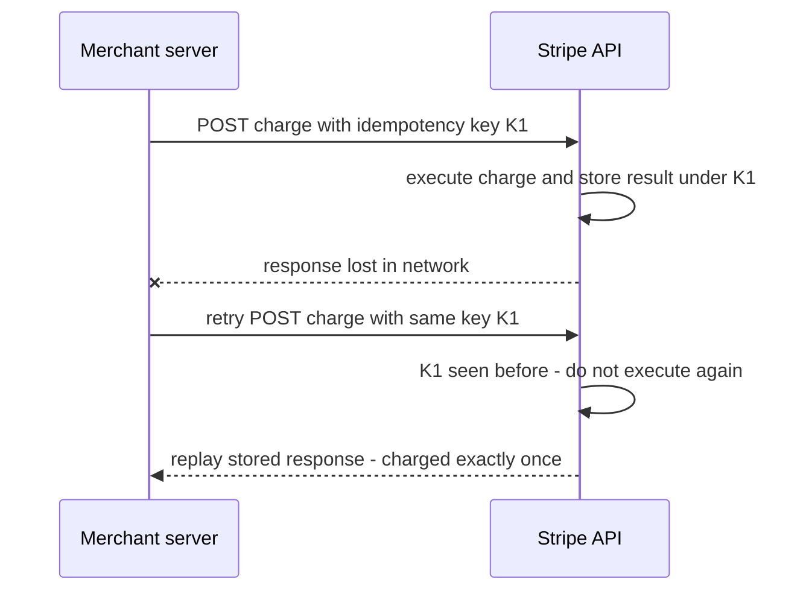
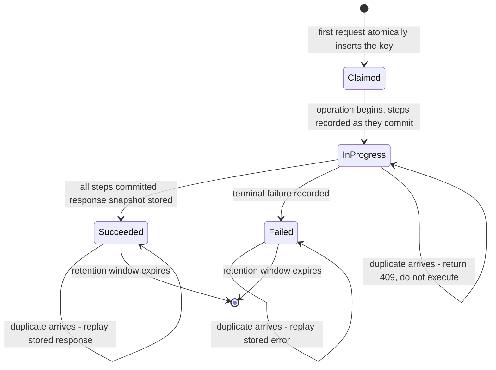

# Stripe and Payment System Design

Every other case study in this module optimizes for throughput or latency; Stripe's defining constraint is **correctness about money** — the same constraint as your day job. A timeline that drops a tweet is an annoyance; a payment system that charges twice, or loses track of a rupee, is a legal and trust failure. Stripe's public engineering writing is the best open documentation of how to build for that constraint: make retries safe by contract (idempotency keys), make money movement provable (double-entry ledger), accept that delivery is at-least-once and engineer **exactly-once *effects***, and shed load by criticality when overloaded. None of it requires exotic infrastructure; all of it requires discipline.

## The scale of the problem

- Stripe disclosed processing **$1 trillion in total payment volume in 2023** (annual letter, published 2024) and **$1.9 trillion in 2025** (annual letter, February 2026) — era-label both. Internal request rates, datastore sizes, and fleet shapes are largely **not public**; this case study is about *published mechanisms*, not leaked numbers.
- The hard part is not raw QPS — payments traffic is modest next to Twitter reads. It is that the workload combines:
  1. **Unreliable clients and networks.** Merchants' servers time out and retry; mobile networks drop responses after the charge succeeded. Every ambiguous outcome is a potential double charge ([[Network Partitions and Timeouts]]).
  2. **No tolerance for partial failure.** A charge touches card networks, balances, fees, payouts, invoices, webhooks — these must end mutually consistent, always.
  3. **Spiky load with asymmetric stakes.** Black Friday multiplies volume; during overload, failing a dashboard read is fine, failing a charge confirmation is not.
  4. **A public API frozen in time.** Thousands of merchant integrations, written across a decade, must keep working — compatibility is a correctness property too ([[API Design and Versioning]]).

## The architecture

### Idempotency keys — retry safety as a public contract

Stripe's API accepts an **`Idempotency-Key` header** on mutating requests: a client-generated unique string (a UUID) per *logical* operation. The server stores the key with the **result of the first execution** (status code and response body) and, on any retry with the same key, **replays the stored response instead of re-executing**. Keys are retained for a bounded window (Stripe documents pruning after 24 hours on API v1; v2 endpoints use a 30-day replay window and re-execute failed work rather than replaying a stored error, as of 2026). The client contract: generate a fresh key per logical operation; on timeout or 5xx, **retry with the same key** (with exponential backoff and jitter — [[Timeouts Retries and Exponential Backoff]]).

The subtle engineering is server-side: the key must be checked-and-claimed **atomically** with beginning the operation (otherwise two concurrent retries race), and a multi-step charge needs to record how far it got so a retry can **resume or complete consistently** rather than half-execute twice. This makes idempotency keys a small state machine, not a cache entry ([[Idempotency]] covers the implementation patterns; [[Design a Payment System]] uses them as a building block). Drawn out, the state machine is the whole design — note that every state has an answer for "a duplicate arrived now":

The three self-transitions carry the real engineering. A duplicate landing on `Succeeded` is the easy case everybody implements. A duplicate landing on `InProgress` — the retry that arrives *while the first attempt is still running*, which is exactly what a client timeout produces — is the case that causes double charges when it is missing, because a system that only checks for completed results sees nothing and executes again. And the transition out of the diagram matters too: once the retention window expires, the same key is a brand-new operation.

#### Four ways to make a write safe to retry

The idempotency key is the most general tool, not the only one, and in real systems you use several at different layers:

| Mechanism | Where the dedup key comes from | Works when | Limitation |
|---|---|---|---|
| **Idempotency key** | The caller, one per logical operation | The caller can be trusted to reuse it across retries | Needs a key store, a retention window, and a documented contract — and is completely defeated by a caller that generates a new key per attempt |
| **Natural idempotency** | Nowhere — the operation is inherently repeatable | The write *sets* a value rather than changing it by a delta | `status = SETTLED` is safe to apply twice; `balance += 100` never is. Only some operations have the right shape |
| **Dedup on a business identifier** | The domain — invoice number, UTR, order ID | A unique real-world ID already exists before the first attempt | If the ID is assigned by the operation itself, you are back to the first row |
| **Conditional write** | The data — a version number or expected-state check | You can express "apply only if state is still X" ([[Transaction Isolation Levels]]) | Turns duplicates into conflicts rather than replays, so the caller still has to interpret the failure |

The honest reading: prefer natural idempotency and business identifiers where the domain hands them to you for free, and reach for explicit keys when it does not.

### Double-entry ledger — money as immutable, provable entries

Stripe's internal Ledger system (described on its engineering blog in February 2024) applies centuries-old **double-entry bookkeeping**:

- Every money movement is recorded as **balanced entries**: a debit to one account and an equal credit to another (merchant balance, Stripe fees, card-network receivable, payout account…). Nothing moves without a source and a destination, so money is **conserved by construction**.
- **Entries are immutable** — appended, never updated or deleted. Corrections are new *reversing* entries. The ledger is an append-only log of financial facts ([[Event Sourcing]] is this same idea generalized).

A simplified illustration of one card charge of 100 (schematic, not Stripe's actual account names):

| Entry | Debit account | Credit account | Amount |
|---|---|---|---|
| 1 | Card network receivable | Merchant pending balance | 100 |
| 2 | Merchant pending balance | Processing fee revenue | 3 |
| 3 | Merchant pending balance | Merchant available balance | 97 |

Every row balances; summing any account's entries yields its balance; and a refund later is a *new* balanced entry in the opposite direction, never an edit to these rows. If entry 3 were lost to a bug, reconciliation would surface a pending balance that never drained — the error is structurally visible.

- **Balances are derived**, computed as sums over entries (with snapshots/caching for speed) — never stored as independently mutable fields that can drift from their history.
- **Reconciliation jobs** continuously verify invariants: every ledger account sums correctly, internal state matches external truth (card-network settlement files, bank statements), and every real-world event maps to balanced entries. Discrepancies open investigations; Stripe's post describes measuring money movement against explicit accuracy SLOs. Reconciliation is the *detection layer* that catches what bugs, race conditions, and partner failures slip past.

### Exactly-once effects from at-least-once delivery

Internally and at the edges (webhooks to merchants), Stripe assumes **at-least-once delivery** — the only honestly achievable semantics ([[Exactly-Once Delivery Is a Lie]]). Webhooks are documented as possibly delivered multiple times; merchants are told to deduplicate by event ID. The equation that makes the whole system safe:

**at-least-once delivery + deterministic dedup (keys/IDs) = exactly-once *effects***

Retries happen everywhere — merchant→Stripe (idempotency keys), Stripe→card networks (network-level reference IDs), Stripe→merchant (webhook event IDs). At every hop, the *receiver* owns dedup ([[Delivery Semantics]]).

### Load shedding by criticality, and versioning by date

- Stripe's published rate-limiting design ("Scaling your API with rate limiters", 2017) layers four controls — two limiters that run constantly and two shedders that act only under stress ([[Rate Limiting]], [[Load Shedding and Graceful Degradation]]):

| Control | What it bounds | When it acts | What gets refused |
|---|---|---|---|
| Request rate limiter | Requests/sec per user (token bucket in Redis) | Always | One user's burst beyond their rate |
| Concurrent requests limiter | In-flight requests per user | Always | A user monopolizing workers with slow calls |
| Fleet usage load shedder | Share of total fleet capacity | Overload | Non-critical methods, so charge creation keeps reserved capacity |
| Worker utilization load shedder | Worker pool saturation | Severe overload | Traffic by class — test mode sheds first, critical live traffic last |

  The principle: *degrade in order of business harm, never uniformly*.
- API compatibility ("APIs as infrastructure", 2017): each API version is a **date** (e.g. `2017-05-24`; since `2024-09-30.acacia` the date carries a release name, with monthly non-breaking releases and a twice-yearly major release that may break — current `2026-09-30.endive` as of October 2026); an account is **pinned** to the version current at its first request and can send a version header per request. Internally, code targets the latest version, and a chain of small **version-change modules (gates)** transforms responses backward, version by version, for older consumers. Breaking changes ship behind a new date without breaking a decade of integrations.

## Key decisions and why

1. **Push retry-safety into the API contract.** Stripe cannot control merchants' retry behavior, so it made *any* retry safe by giving clients an explicit key. Contrast with "please don't retry" documentation — hope is not a mechanism.
2. **Derive balances; never mutate them.** A mutable `balance` column can silently drift; an append-only ledger with derived sums cannot lie without the discrepancy being computable. Auditability falls out for free.
3. **Reconcile continuously against external truth.** Internal consistency is not enough — the card network's settlement file is reality. Closing the loop converts silent corruption into bounded-latency alerts.
4. **Spend engineering on the unhappy path.** Idempotency machinery, reversing entries, webhook redelivery, resumable charge state machines — most of this code runs rarely. In payments the unhappy path *is* the product.
5. **Shed by business value, not uniformly.** Capacity reserved for charge creation; test mode dies first. Generic per-IP limiting treats a health check and a ₹10-lakh payout identically — wrong model for money.
6. **Date-pinned versions with transformation gates** make compatibility a structured engineering artifact rather than tribal "don't touch that field" knowledge.

## What broke along the way

- Stripe has had publicly acknowledged **API outages and degradations**. The best-documented is **2019-07-10**, two outages in one day for which Stripe published a full root-cause analysis: a minor database version upgrade three months earlier had introduced a failover fault that only manifested with multiple stalled nodes, and the stalled nodes kept answering health checks as healthy while they stopped reporting replication lag, so one shard could not elect a new primary. Two failure modes this vault keeps naming — [[Health Checks and Service Discovery|a health check that measures the wrong thing]] and [[Failover|failover as the dangerous part]] — in one incident. Beyond that RCA, detailed public post-mortems are rare, and inventing them would defeat this module's purpose.
- What the published designs *imply* they fought: double charges from ambiguous timeouts (hence idempotency keys as a first-class feature), drift between balances and history (hence derived balances and reconciliation), overloads where uniform throttling would have harmed critical traffic (hence criticality-aware shedders), and integration breakage from API evolution (hence version gates).
- The webhook documentation's insistence on dedup-by-event-ID tells you redelivery storms are real and expected, not theoretical.

### What a double charge looks like at 3 a.m.

This is the mechanism, not a Stripe incident — but it is the most common way a correctly-built idempotency layer still produces a double charge, and it is worth rehearsing because it is nearly invisible in your own service's telemetry.

**The symptom**: a customer is debited twice. Your dashboards show two successful transfers seconds apart, both `200`, both healthy. No error, no retry, no alert. From the server's perspective, everything worked exactly as designed.

**What is actually on the screen when you look**:

- Two distinct transfer IDs — same payer, same payee, same amount — roughly 30 seconds apart, which is suspiciously close to the caller's HTTP timeout.
- Two **different** idempotency keys.
- The first request's server-side duration sitting at or just past that timeout.

**The root cause**: the caller timed out waiting for the first response and retried, but generated a *fresh* key for the retry — because the key was created inside the retry loop instead of outside it. From your server's point of view these are two unrelated operations with two unrelated keys, and it executed both correctly. The mechanism was never engaged. One line of client code, one layer away, with no server-side error to show for it.

**How you confirm it**: look for near-duplicate payloads under distinct keys within a short window. If that count is non-trivial, you have a client-contract problem rather than a concurrency bug. The contrast is diagnostic — a correctly integrated client produces *repeated* keys and a visible count of replayed responses, so a replay rate of zero across a busy integration is itself a warning sign, not a clean bill of health.

**The fixes, in the order that actually pays**:

1. **Make the key's lifetime explicit** in the SDK and the API spec: generate it where the logical operation is *created*, never inside the retry loop. One sentence of documentation prevents the entire class of bug, and an SDK that owns the retry loop can make it unrepresentable.
2. **Alert on the detector above**, because you will not fix every integration you do not control.
3. **For high-value operations, add a domain-level guard** — a short-window uniqueness constraint over (payer, payee, amount) that returns a conflict instead of executing. This is belt-and-braces, and it genuinely rejects some legitimate rapid repeat payments. That is a product decision to be made deliberately with the business, not an engineering default to be slipped in.

## Lessons you can reuse

- **Idempotency is a contract between caller and callee** — decide who generates the key, what the logical-operation boundary is, how long dedup state lives, and what a replayed response contains. Then write it down in the API spec.
- **Exactly-once is an end-to-end property you build, not a transport feature you enable.** Budget for dedup at every consumer ([[Exactly-Once Delivery Is a Lie]]).
- **Append-only + derived state beats mutable state wherever disputes are possible** — which in fintech is everywhere. If you can't replay history to reproduce today's balance, you don't have a ledger; you have a rumor.
- **Reconciliation is a feature, not a batch chore.** Treat "internal state matches external truth" as an SLO with alerting ([[SLA SLO SLI and Error Budgets]]).
- **Rank your endpoints by criticality before the incident.** The shedding order is a product decision; 3 a.m. is the wrong time to make it ([[Load Shedding and Graceful Degradation]]).
- **Version by date, transform at the boundary.** Pinning each consumer to the version current at signup, and translating responses through a chain of small per-version gates, turns "we can never change this field" into a bounded engineering task ([[API Design and Versioning]]). The pattern works for internal service contracts too, not just public APIs.

## Common misconceptions

- **"An idempotency key is a cache."** A cache may be missed with no consequence beyond a slower request; this may not. It must be **claimed atomically** before the work starts, and it must record an *in-progress* state, not just finished results — otherwise two concurrent retries both find nothing stored and both execute. It is a lock and a result store and a state machine, and the lock half is the half people omit.
- **"Idempotent means the server ignores duplicates."** It means the server **returns the original outcome**. Silently dropping a duplicate leaves the caller with no response at all, so they will time out and retry again — you have built a retry amplifier. Replaying the stored response is what terminates the loop.
- **"Exactly-once delivery is achievable with the right broker."** It is not, over an unreliable network ([[Exactly-Once Delivery Is a Lie]]). What is achievable is at-least-once delivery plus deterministic dedup at the receiver, which yields exactly-once *effects*. Stripe's entire design is an instance of that equation, and saying it precisely is worth real credit in an interview.
- **"Double-entry means writing to two tables."** It means every movement is recorded as a debit and an equal credit, so the system's total is conserved by construction. You can implement it in a single table with a sign column. The **invariant** is the idea; the schema is an implementation detail.
- **"A ledger is an audit log."** An audit log *describes* what happened alongside the real state; a ledger **is** the state, with balances computed from it. The test: delete one row. If the reported balance does not change, you have a log sitting next to a mutable balance field — and that balance will drift, silently, and you will find out from a customer.
- **"Idempotency keys make an operation safe to retry forever."** Stripe documents retaining results for **24 hours** on API v1 (30 days on v2). Once the window expires, the same key is a brand-new operation. Any client retry policy whose tail extends past the server's retention window — a dead-letter replay the next morning, a manual re-run of a failed batch — is silently unsafe, and nothing in the mechanism will warn you.
- **"Reconciliation is a nightly batch chore."** Here it is the *detection layer*, and its frequency is literally the length of time corruption stays invisible. A nightly job means a worst case of roughly 24 hours of undetected drift. That may be the right choice, but it should be a stated SLO with a number attached ([[SLA SLO SLI and Error Budgets]]), not a side effect of what the scheduler happened to be set to.

## In your stack

This is your home turf — Niyo is RBI-regulated money movement and KYC, so the overlap is near-total:

- **Correctness over latency is already your stated bias** — Stripe shows where to spend it: resumable payment state machines, dedup at every consumer, reversing entries instead of updates.
- **Idempotency keys end-to-end:** your Kong edge can require an idempotency key on mutating payment routes; services persist key→result in MongoDB (unique index on the key) with Redis in front for fast replay; your SQS/Redis Streams consumers dedup by message/event ID because redelivery is guaranteed-possible ([[Delivery Semantics]]).
- **Maker-checker is the human version of Stripe's deterministic controls:** an operation above threshold requires a second approver — like reconciliation, it is an independent check on a single actor's action. Same philosophy, different enforcement point. (Per your org's rules: LLMs may recommend or explain, but money movement and final approval need deterministic controls and humans — exactly the Stripe-shaped division of labor.)
- **Audit trails:** immutable ledger entries map to your RBI audit obligations — append-only collections, no in-place updates on financial records, replayable history. `x-correlation-id` on every hop is what lets reconciliation and dispute investigations stitch a money movement across services ([[Distributed Tracing]]).
- **Honest 1-replica note:** idempotency makes retries *safe*, which makes aggressive client retries + timeouts the correct response to your single-replica services restarting — safety enables resilience you otherwise couldn't afford.

## Interview angle

- **The 60-second story:** "Payment systems optimize for correctness, not latency. Stripe makes retries safe by contract: clients send an idempotency key per logical operation; the server atomically records the first execution's result and replays it on retry — so at-least-once delivery plus dedup yields exactly-once *effects*, which is the only honest exactly-once. Money is tracked in an immutable double-entry ledger — balanced debit/credit entries, balances derived as sums, corrections as reversing entries — with continuous reconciliation against external truth like network settlement files. Under overload they shed by criticality (test mode first, charge creation protected), and the API is versioned by pinned dates with per-version transformation gates so a decade of integrations keeps working."
- Interviewers probe: where dedup state lives and its atomicity (claim the key in the same transaction as starting the work), what happens on a retry that arrives *while the first attempt is still running* (return 409/conflict or block until the original completes — never execute twice), and why balances must be derived.
- Classic follow-ups: "Design the idempotency key store" (unique index, status field `started/succeeded/failed`, TTL, response snapshot); "How do you handle a payment stuck mid-flow?" (resumable state machine + reconciliation sweeper); "Two-phase commit across bank and ledger?" (no — [[Two-Phase Commit and Distributed Transactions]] blocks, and the external bank isn't a 2PC participant anyway; use [[Saga Pattern]]-style compensation with reversing entries — only systems that own all replicas, like [[Google Spanner Deep Dive|Spanner]], get to make cross-shard transactions look local). Full walkthrough: [[Design a Payment System]].

## Check yourself

> [!question]- Q: Explain how an idempotency key turns at-least-once delivery into exactly-once effects, and why the server-side check must be atomic.
> The client assigns one key per logical operation and reuses it on every retry. The server, before executing, atomically claims the key (e.g., unique-index insert in the same transaction that marks the operation started); if the claim fails, the operation already ran or is running, so the server returns the stored result or a conflict instead of re-executing. Delivery remains at-least-once — duplicates arrive — but the *effect* (the charge) happens once. Without atomicity, two concurrent retries can both see "key unseen" and both execute: the classic check-then-act race, which is precisely the double charge the mechanism exists to prevent.

> [!question]- Q: What happens if a reconciliation job finds that the sum of ledger entries for a merchant disagrees with the card network's settlement file?
> The discrepancy is surfaced, never silently patched: an alert/investigation opens with the two conflicting totals and the entry-level diff. Because entries are immutable and replayable, investigators can recompute the balance from history and identify the missing or extra movement (a lost webhook, a double-recorded capture, a partner file error). The fix is a new *correcting entry* (or a claim against the partner), leaving the audit trail intact. The design insight: derived balances plus an external truth source make corruption *detectable and attributable*; mutable balances make it invisible.

> [!question]- Q: Your payment API is at 100 percent capacity during a festival spike. Using Stripe's published approach, what do you shed, in what order, and why not just rate-limit every client equally?
> Order of harm, lowest first: synthetic/test traffic; then non-critical reads (dashboards, list endpoints); then deferrable writes (webhook redeliveries, report generation); *last and ideally never*, payment execution — for which fleet capacity is explicitly reserved. Equal per-client limiting is the wrong model because requests differ in business value: throttling a merchant's balance-list polling is free, throttling their charge confirmations is revenue and trust loss. Criticality-aware shedding degrades the product's periphery to protect its heart ([[Load Shedding and Graceful Degradation]]).

> [!question]- Q: A customer was debited twice. Your service logs show two successful transfers 30 seconds apart, both 200, under two different idempotency keys, and no errors anywhere. Where is the bug, how do you prove it, and what do you change?
> The bug is in the caller, not in your server. The second request carried a *different* key, so as far as your service was concerned it was a second, unrelated transfer — and it executed it correctly. The giveaway is the 30-second gap matching the caller's HTTP timeout: the first response was lost or slow, the client retried, and it minted a fresh key because the key was generated inside the retry loop rather than attached to the logical operation. To prove it, query for near-identical payloads — same payer, payee and amount — under distinct keys within a short window; a non-trivial count means a contract problem across that integration rather than a race in your code. A useful corroborating signal is the *replay* rate: a correctly integrated client reuses keys and therefore produces visible replayed responses, so a busy integration with a replay rate of zero is suspicious rather than clean. Changes, in order: fix the key's lifetime in the SDK and say so explicitly in the API spec, since this is prevented by documentation far more cheaply than by code; alert on the duplicate-payload detector, because you cannot fix integrations you do not own; and for high-value transfers consider a domain-level short-window uniqueness guard that returns a conflict — accepting, as a deliberate product decision, that it will occasionally reject a genuine repeat payment.

> [!question]- Q: Mini design — sketch the idempotency layer for a fund-transfer endpoint in your stack.
> Contract: clients send `Idempotency-Key` (UUID) on `POST /transfers`; same key must mean byte-identical request payload (reject key reuse with a different payload). Store: MongoDB collection `{_id: key, requestHash, status: started|succeeded|failed, responseSnapshot, createdAt}` with a TTL index (e.g., 24–48h) — the unique `_id` insert is the atomic claim; Redis caches completed entries for fast replay. Flow: claim → run the transfer state machine (each step recorded, so a crashed attempt resumes rather than restarts) → persist response snapshot → replay on duplicates; concurrent duplicate while `started` gets 409 with Retry-After. Downstream SQS/Streams consumers dedup by transfer ID independently — every hop owns its own dedup ([[Idempotency]], [[Exactly-Once Delivery Is a Lie]]).

## Sources

- Stripe API documentation — "Idempotent requests" (the `Idempotency-Key` contract, 24-hour retention on v1), the API v2 overview (30-day idempotency window), "Versioning" (named releases since 2024-09-30.acacia) and webhook delivery documentation (redelivery and event-ID dedup).
- Brandur Leach, "Designing robust and predictable APIs with idempotency" — Stripe engineering blog, 2017.
- Paul Tarjan, "Scaling your API with rate limiters" — Stripe engineering blog, 2017 (the four limiters and shedding order).
- Brandur Leach, "APIs as infrastructure: future-proofing Stripe with versioning" — Stripe engineering blog, 2017 (date-pinned versions, version-change gates).
- Ilya Ganelin, "Ledger: Stripe's system for tracking and validating money movement" — Stripe engineering blog, February 2024 (double-entry model, immutability, reconciliation).
- Stripe, "Root cause analysis: significantly elevated error rates on 2019-07-10" — the published post-mortem behind the outage described under "What broke".
- Stripe annual letters (March 2024 and February 2026) — the $1T (2023) and $1.9T (2025) total volume figures.
- *Designing Data-Intensive Applications* (Kleppmann), ch. 12 — correctness, exactly-once effects, and end-to-end dedup arguments this note leans on.
