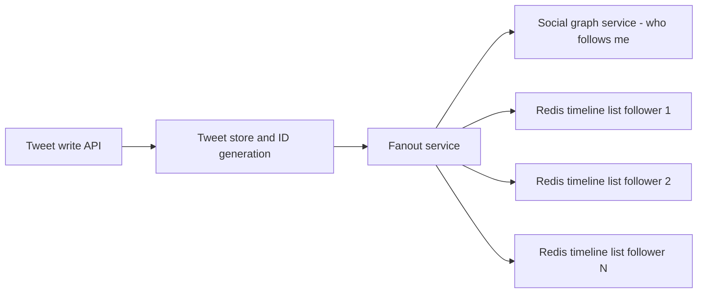
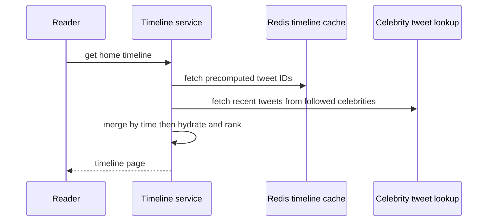

# Twitter Timeline Design

Twitter's home timeline is *the* canonical fan-out case study: a system whose reads outnumber writes by nearly two orders of magnitude, and whose load distribution is so skewed — most users have dozens of followers, a few have tens of millions — that no single strategy works for everyone. The solution, a **hybrid of precomputed (push) timelines for normal users and query-time (pull) merging for celebrities**, is the clearest industrial example of a rule you will reuse everywhere: **design for the distribution's tail, not its average**. ([[Scalability]] tells this story briefly via DDIA; this note goes into the mechanics.)

## The scale of the problem

Numbers from Raffi Krikorian's "Timelines at Scale" talk (QCon, late 2012; widely circulated 2013 — label them with that era, Twitter grew far beyond this):

| Metric (2012–2013 era) | Value |
|---|---|
| Active users | ~150M worldwide |
| Home timeline reads | ~**300K QPS** |
| Tweet writes | ~400M/day ≈ **~4.6K/sec average**, spikes far higher during events |
| Read:write ratio | roughly **65:1** on these figures |
| Fan-out work | ~4.6K tweets/sec × average ~75–100 followers ≈ hundreds of thousands of timeline inserts/sec |

Two features make this hard:

1. **The read volume dwarfs the write volume**, so the read path must be nearly free — which argues for precomputing timelines at write time.
2. **Follower counts are power-law distributed.** The average hides the tail: one tweet from an account with 30M+ followers implies 30M+ timeline inserts. Precomputation collapses exactly where the account is most important. The per-key load skew is the [[Hot Key Problem]] / [[Hot Partition Problem]] in its purest form, and it is the forcing function for the whole design.

## The architecture

### The two pure strategies

| | **Pull — fan-out on read** | **Push — fan-out on write** |
|---|---|---|
| On tweet | Write tweet once to the tweet store | Write tweet, then insert its ID into every follower's timeline cache |
| On timeline read | Query tweets of all followees, merge, rank | Read one precomputed list |
| Write cost | O(1) | O(followers) |
| Read cost | O(followees) queries + merge, at 300K QPS | O(1) |
| Fails when | Read volume is huge (every read does a multi-way merge) | A user has millions of followers (write amplification explodes) |
| Freshness | Always current | Delayed by fan-out latency |

Early Twitter was pull, and the read path buckled — 300K QPS of multi-way merges against the social graph is unaffordable. Pure push fixes reads but makes the celebrity tweet a write bomb.

### The push pipeline (normal users)



- Each active user's home timeline is a **Redis list of tweet IDs** (plus small metadata), capped around **~800 entries** (2012 era) — a timeline is a window, not an archive.
- The **fanout service** reads the follower list from the social graph service and inserts the new tweet ID into each follower's list; replicated copies of each timeline (the talk describes three) provide read availability ([[Replication]]).
- **Only active users keep materialized timelines.** A dormant user's timeline is rebuilt on demand from the pull path when they return — caching only the working set ([[Why Caching Works]]).
- Fan-out completed within seconds at high percentiles (era-specific; the point is it is asynchronous and the product tolerates that slight delay — [[Why Async Messaging Exists]]).
- Reading a timeline: fetch the ID list from Redis in one call, then **hydrate** the tweet bodies/user objects from caches in front of the tweet store, and render. Reads are key lookups, no graph queries.

### The hybrid (celebrities)

Accounts above a follower threshold are **excluded from fan-out**. Their tweets are written once, and at **read time** each follower's timeline fetch merges the precomputed Redis list with a query for recent tweets from the high-follower accounts they follow. One expensive-but-rare path for the tail, one cheap path for the bulk, merged at the edge of the read.

#### The arithmetic behind the threshold

"Celebrities are too expensive to fan out" is true but too vague to design with. The cost that actually forces the split is not *total* work — it is work **concentrated into one instant**, by one write.

Start from the era's documented figures, taking 100 as the round upper end of that 75–100 average-follower range. Steady-state fan-out load:

```
4,600 tweets/sec × 100 followers = ~460,000 timeline inserts/sec
```

Now one account with 30 million followers posts a single tweet. That one write is 30,000,000 inserts:

```
30,000,000 ÷ 460,000 = ~65
```

**One tweet demands roughly 65 seconds of the entire platform's steady-state fan-out capacity.** Even assuming the pipeline is provisioned with 10× headroom — a simplification; Twitter's real provisioning is not public — that is still about six and a half seconds in which the fan-out tier does essentially nothing but one person's tweet, while every other tweet in the world queues behind it. That is [[Backpressure and Flow Control|head-of-line blocking]], and it is why the threshold exists: the question is not "is push cheaper than pull" but "how large a single-write burst can the pipeline absorb without pushing everyone else past the product's freshness budget."

Now look at why the pull side is cheap, because this is the part people miss. A celebrity's recent-tweets list is **one small object read by millions of people** — the most cacheable item in the entire system. The asymmetry is the whole design:

- **Push spreads one write across 30 million distinct destinations.** Nothing is shared, nothing is cacheable; every insert is unique work.
- **Pull concentrates 30 million reads onto one source.** Caches turn that into approximately one read.

Caches love the second shape and are useless against the first. The hybrid is not a compromise between two mediocre options; it routes each author to the strategy whose cost structure actually fits them.



### Where ranking entered

The design above is the **chronological** timeline of the 2012–2013 talks. Twitter introduced algorithmic ranking of the home timeline around 2016: candidate tweets (from the same push/pull machinery, plus out-of-network sources) are scored by engagement models and reordered at read time. Ranking slots in *after* hydration, on the merged candidate set — it changes what you show, not how you gather it, so the fan-out architecture survives underneath. Later ranking-era internals are largely not public; the 2023 open-sourcing of parts of "the algorithm" confirmed the candidate-sourcing-then-scoring shape without changing this note's fan-out story.

### Search: the mirror image

Twitter's **Earlybird** (a modified Lucene real-time index) does the opposite trade: tweets are indexed once at write time into time-ordered index partitions, and each search **fans out on read** — the query is scattered to all index partitions and the results merged ([[Secondary Indexes on Sharded Data]]'s scatter-gather). Timeline = fan-out on write; search = fan-out on read. Same data, opposite strategies, because the read patterns differ: timelines are read constantly by everyone, any given search query is rare.

## Key decisions and why

1. **Precompute what is read constantly.** At a ~65:1 read:write ratio, moving work from read time to write time wins — the classic space/write-amplification-for-read-latency trade ([[Caching Strategies]], materialized-view thinking, [[CQRS]] in spirit: the timeline is a read model built from tweet-write events).
2. **Cap the materialized view.** ~800 entries per timeline bounds memory; nobody pages back through 10K tweets, and the rare deep read can fall back to pull. Precompute the window users actually read.
3. **Segment users by their load profile.** Outliers get a different code path rather than a bigger machine — the generalizable cure for skew (salting/splitting in [[Hot Partition Problem]] is the storage-level sibling).
4. **Keep timelines in RAM (Redis), tweets in durable stores.** The timeline list is reconstructible (it's derived data), so it can live in a cache tier with [[Replication|replicated]] copies for read availability — losing it means recomputation, not data loss ([[Redis Internals]]).
5. **Fan-out asynchronously.** The tweet write acknowledges once durably stored; fan-out proceeds in the background. Slight, bounded staleness buys enormous write-path headroom ([[Delivery Semantics]] — and inserts must be idempotent per (timeline, tweet ID) because retries happen: [[Idempotency]]).

## What broke along the way

- **The pull-era read path** collapsed first: timeline queries hammering the social graph and tweet storage — the "fail whale" years (roughly 2008–2010) were substantially this.
- **Celebrity fan-out under pure push**: a single tweet from a tens-of-millions-follower account generated tens of millions of inserts; fan-out latency for everyone queued behind it, and races appeared (a reply could fan out before the original reached slower timelines, breaking conversation ordering — Krikorian describes the ordering pain). The hybrid was the fix.
- **Event spikes**: global moments (New Year, World Cup goals, the 2013 "Castle in the Sky" airing that set the ~143K tweets/sec record — era-labeled) multiply both write and fan-out load within seconds; the async pipeline absorbs by queueing, trading fan-out lag for availability ([[Backpressure and Flow Control]]).
- **Hot reads on event tweets**: everyone's timeline *contains* the same viral tweet ID, so hydration hammers the same keys in the tweet cache — a classic [[Hot Key Problem]] handled by cache replication/local caching in the serving tier (details era-specific and partly not public).

### What fan-out lag looks like at 3 a.m.

Twitter did not publish an incident write-up for this, so take it as the mechanism — but every asynchronous fan-out pipeline fails in exactly this shape, and the first thing to internalise is that **nothing returns an error**.

The trigger is an event spike. The documented extreme: **143,199 tweets/sec** during the August 2013 "Castle in the Sky" airing — roughly **31 times** the era's ~4,600/sec average. Multiply that by fan-out and the write-side work rises by the same factor within seconds.

- **The symptom is a product complaint, not an alert.** Users say "my timeline is stale" or "I saw the reply before the original." Tweet writes are succeeding. Timeline reads are succeeding. Availability is 100% and the product is broken — which is precisely why this needs its own instrumentation ([[SLA SLO SLI and Error Budgets]]: the SLI here is freshness, not success rate).
- **On the dashboards**: write rate elevated and healthy; fan-out queue depth climbing monotonically rather than oscillating; and the metric that matters most, **age of the oldest unprocessed fan-out job**, walking from seconds into minutes. Queue *depth* alone lies to you — a deep queue draining fast is fine, a shallow queue that has stopped draining is not. Age is the honest signal.
- **The ordering artifact.** With many fan-out workers and no per-timeline ordering guarantee, a reply can be inserted into timelines before the tweet it replies to — conversations render inverted. This is [[Message Ordering]] surfacing as a user-visible bug, and Krikorian's talk describes exactly this pain.
- **Confirming where the backlog actually is.** If the queue is the bottleneck, Redis insert latency is normal and depth is growing. If Redis is the bottleneck, insert latency rose *first* and the queue grew as a consequence. Check which moved first; the fixes are opposite.
- **The 3 a.m. levers are all capacity-free**, which is the point — nothing you provision arrives in time to help:
  1. **Shed fan-out for inactive users first.** The design already rebuilds a dormant user's timeline on demand, so skipping them costs nothing the architecture doesn't already handle.
  2. **Lower the celebrity threshold temporarily.** This is the elegant one: the threshold is a runtime knob that *converts write-path load into read-path load*. Dropping it from, say, 1M followers to 100K instantly removes the heaviest accounts from the pipeline and moves their cost onto the cacheable read path, where it is nearly free.
  3. **Let the backlog drain** and resist the urge to restart workers, which discards in-flight progress and re-does it.

## Lessons you can reuse

- **Averages lie; design for the tail.** Any system with per-entity fan-out (notifications, feeds, group chat, webhooks) has a power-law tail that will break a single-strategy design. Measure the distribution before choosing push vs pull.
- **Push vs pull is a spectrum with a threshold knob**, not a binary. The hybrid pattern — precompute for the many, query for the few — reappears in news feeds ([[Design a News Feed]]), notification fan-out ([[Design a Notification Service]]), and group messaging ([[Design a Chat System]]).
- **Materialize derived read models, keep them bounded, and make them rebuildable.** If you can rebuild it, you can cache it aggressively and survive losing it.
- **Asynchronous fan-out needs idempotent, per-key-ordered delivery** — the message-queue lessons of [[Message Ordering]] and [[Idempotency]] apply verbatim.
- **Different read patterns over the same data deserve different indexes** (timeline push vs Earlybird's search pull) — one storage layout never serves all queries ([[CQRS]]).

## Common misconceptions

- **"A hybrid means some users get push and others get pull."** It splits by **author**, not by reader. *Every* reader's timeline is a merge; what differs is which authors contributed through the precomputed path and which get merged in at read time, and that is decided by the author's follower count. A reader who follows 300 ordinary accounts and 4 celebrities reads one Redis list plus four cached celebrity lookups — they are on both paths simultaneously.
- **"Fan-out on write copies the tweet to every follower."** It copies the **ID**. A viral tweet exists once in the tweet store and appears as an 8-byte tweet ID, plus a few bytes of metadata, in millions of lists. Get this wrong and every memory estimate you produce is off by two or three orders of magnitude.
- **"Precomputing makes the timeline fresher."** Backwards. Pull is *always* current by construction, because it queries live data at read time; push is delayed by whatever the fan-out pipeline's lag happens to be. Staleness is the **price** of precomputation, not its benefit. What you buy is read cost, and you pay in freshness — which is only a good trade because a timeline tolerates seconds of lag.
- **"Losing the Redis timeline cache is data loss."** It is derived data, recomputable from the tweet store and the social graph. Losing it costs a recomputation storm and a period of slow reads — serious, but an availability incident, not a durability one. This distinction is what licenses keeping timelines in a cache tier at all ([[Replication]]).
- **"The celebrity threshold is a constant someone derived once."** It is an operating knob, and a live one: it balances fan-out write cost against read-time merge cost, both of which move with traffic, cache hit rates, and hardware. Treat it as a dial you can turn during an incident, not a magic number in a config file.
- **"Algorithmic ranking replaced the fan-out architecture."** Ranking sits *after* candidate gathering. The push/pull machinery still assembles the candidate set; the ranker reorders it and mixes in out-of-network candidates. The fan-out design described here survives underneath the algorithm — which is why it is still the right thing to draw on a whiteboard.
- **"Pure pull is naive."** Pure pull is correct, simple, and the right answer for most systems — it is what you should build first. It fails at a specific, computable point: when read volume times fan-in cost exceeds what your datastore can serve. That threshold is a function of the **read:write ratio**, not of user count, and a system with few reads per write can stay on pull forever.

## In your stack

- Your notification/transaction-alert flows are small fan-outs: one event → many user channels. The Twitter lesson is to check your distribution — a few corporate/partner accounts with 10,000× the activity of a median user are your "celebrities" and may need their own path before the p99 does.
- Redis-as-materialized-view is directly available to you: precomputed per-user lists (recent transactions, pending actions) with capped length (`LPUSH` + `LTRIM`) and TTL, rebuilt from MongoDB on miss — exactly the timeline-cache shape ([[Redis Beyond Caching]]).
- Your SQS→Redis Streams consumers doing fan-out must be idempotent per (user, event) and tolerate redelivery — Twitter's fan-out pipeline has the same contract ([[Delivery Semantics]]).
- The freshness SLI lesson transfers directly and is usually missing: if you precompute anything — an activity feed, a notification queue, a dashboard aggregate — then "writes succeed and reads succeed" tells you nothing about whether the product works. Instrument **age of the oldest unprocessed job** on every SQS queue and Redis Stream consumer group, and alert on it. Consumer lag is already the one metric that distinguishes "the queue is busy" from "the queue has stopped" ([[Backpressure and Flow Control]], [[Consumer Groups and Rebalancing]]).
- Honest 1-replica note on fan-out: a single consumer instance gives you strict serial processing — accidentally solving the ordering artifact described above, since there is no second worker to race with — at the cost of a hard throughput ceiling and no failover. During an event spike you cannot scale out to drain a backlog; your only levers are the capacity-free ones (shed low-value work, shrink the work per event). Know which lever you have before you need it.
- Fintech caveat: timelines tolerate seconds of staleness; balances do not. Materialize *views* this way (activity feeds, dashboards), never the authoritative ledger — correctness beats latency in your world ([[Stripe and Payment System Design]]).

## Interview angle

- **The 60-second story:** "Twitter's home timeline (2012–13 era: ~150M users, ~300K QPS reads vs ~4.6K tweets/sec) is read-dominated, so they fan out on write: a fanout service inserts each tweet ID into every follower's capped Redis list, and reads become one cache fetch plus hydration. But follower counts are power-law distributed — a 30M-follower account would mean 30M inserts per tweet — so celebrities are excluded from fan-out and merged in at read time. Hybrid: push for the many, pull for the tail. Search is the mirror image: Earlybird indexes once on write and scatter-gathers on read. The transferable lesson is to design for the skew, not the average."
- Interviewers probe: can you *derive* why pure pull and pure push each fail (do the arithmetic — [[Back of the Envelope Estimation]]), where the celebrity threshold comes from, and what the Redis list actually stores (IDs, not bodies — hydrate separately).
- Classic follow-ups: "Where does ranking fit?" (after hydration, on the merged candidate set); "What if fan-out lags?" (bounded staleness, monitor fan-out latency, shed inactive users first); "How do you pick the celebrity threshold?" (equalize marginal fan-out write cost against read-time merge cost — it's an empirical knob, not a constant); "How is this different for search?" — and the full design walkthrough lives in [[Design a News Feed]].

## Check yourself

> [!question]- Q: Explain fan-out on write vs fan-out on read for a timeline, and do the arithmetic that shows why Twitter needed a hybrid.
> Fan-out on write inserts each new tweet into every follower's precomputed timeline: writes cost O(followers), reads cost O(1). Fan-out on read stores each tweet once and merges followees' tweets at read time: writes O(1), reads O(followees) at full read volume. With ~300K reads/sec vs ~4.6K tweets/sec (2012–13), reads must be cheap → push wins for the bulk: ~4.6K/sec × ~100 avg followers ≈ ~460K inserts/sec, affordable. But one 30M-follower account turns a single tweet into 30M inserts — push alone is hostage to the tail. Hence hybrid: push for normal accounts, pull-and-merge for high-follower accounts at read time.

> [!question]- Q: What happens, end to end, when a user with 200 followers tweets — and what is different when a user with 50 million followers tweets?
> 200 followers: the write API persists the tweet and gets its ID; the async fanout service fetches the follower list and pushes the tweet ID into 200 Redis timeline lists (trimming each to its cap); within seconds all 200 timelines reflect it; each read is a single list fetch plus hydration. 50M followers: no fan-out at all — the tweet is stored once and the account is flagged as excluded; each follower's next timeline read merges their precomputed list with a query for recent tweets from the celebrities they follow. The celebrity pays at read time (shared, cacheable), not 50M times at write time.

> [!question]- Q: Your notification service fans out "payment received" events to user devices. Which Twitter failure mode should you check for first, and what is the fix?
> Check the fan-out distribution: a partner/corporate account receiving thousands of payments per minute is your celebrity — its events can monopolize the fan-out queue and delay everyone's notifications (head-of-line blocking), and its device list may be a hot key. Fixes mirror Twitter's: a separate path or dedicated queue/partition for high-volume senders, per-key ordering only where required ([[Message Ordering]]), idempotent delivery per (user, event) for safe retries, and rate-based shedding of low-value notifications first ([[Load Shedding and Graceful Degradation]]).

> [!question]- Q: What breaks if fan-out is performed synchronously inside the tweet-write request?
> The write's latency becomes O(followers): a 10K-follower account waits on 10K cache inserts before getting a 200, and a celebrity tweet times out outright. Worse, write throughput now couples to the fan-out backlog — an event spike slows *posting* exactly when posting surges, and a Redis shard hiccup fails tweets that were already durably stored, forcing clients to retry and double-post. Decoupling via an async pipeline ([[Why Async Messaging Exists]]) makes the tweet durable-then-acknowledged in constant time, converts fan-out pressure into queue depth ([[Backpressure and Flow Control]]), and bounds the blast radius of cache-tier failures to staleness rather than write errors.

> [!question]- Q: A major event triples your write rate. No errors anywhere, every dashboard is green, and users are complaining that their feeds are minutes behind. What metric would have caught this, and what can you actually do in the next five minutes?
> The metric is **freshness**, and it is almost never instrumented by default: age of the oldest unprocessed fan-out job, or equivalently the end-to-end latency from "event created" to "present in the user's materialized feed." Success-rate and error-rate dashboards are structurally blind here, because an async pipeline that has fallen an hour behind is still returning 200s on both the write and the read. Queue *depth* is a weak substitute — a deep queue draining quickly is healthy, a shallow queue that stopped draining is not; only age distinguishes them. In the next five minutes, every useful lever reduces work rather than adds capacity, because new capacity does not arrive in five minutes: stop fanning out to inactive users, whose feeds the system can rebuild on demand anyway; lower the high-volume-sender threshold so the heaviest accounts drop out of the write path and move onto the cacheable read path; and leave the workers alone so in-flight progress is not discarded and repeated. Afterwards, the durable fix is to make the threshold a runtime-tunable knob and alert on freshness, not on errors.

> [!question]- Q: Why does Twitter store only tweet IDs in the Redis timeline, not full tweet objects?
> Deduplication and consistency: a viral tweet appears in millions of timelines — storing bodies would multiply memory by orders of magnitude and make edits/deletes (or author suspension) require rewriting every copy. Storing IDs keeps each timeline small (an 800-entry list of longs is a few KB), centralizes the mutable truth in the tweet store and its caches, and lets hydration apply visibility rules at read time. The cost is a second lookup, absorbed by the heavily cached, replicated tweet-object tier.

## Sources

- Raffi Krikorian, "Timelines at Scale" (QCon talk, late 2012; InfoQ recording) — the architecture, Redis lists, ~300K QPS and fan-out numbers.
- *Designing Data-Intensive Applications* (Kleppmann), ch. 1 — the Twitter fan-out worked example and read/write-ratio framing.
- Twitter engineering blog posts on Earlybird / real-time search (circa 2010–2012) and the "new tweets per second record" post (2013) for the event-spike figure.
- Twitter (now X) engineering talks on timeline infrastructure, 2012–2017 era — threshold-based hybrid fan-out. (Later ranking-era internals are largely not public.)
